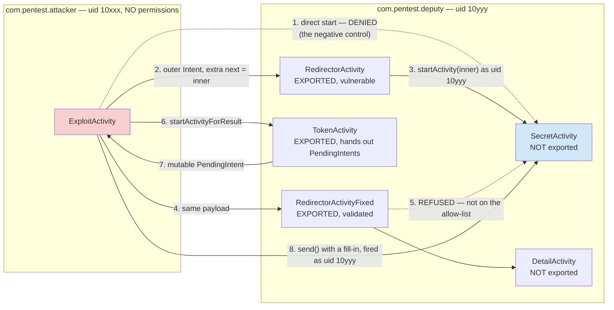

# 26 — Intent · Examples

Everything here is real code that compiles. Nothing here is a built artefact: this
directory ships **sources plus a build command**, never an APK. The reasons are in
[`deputy-app/build.sh`](deputy-app/build.sh)'s header, and the short version is
that an intentionally-vulnerable APK somebody can install without reading anything
is a liability.

---

## What is here

| File | What it is | Discussed in |
|---|---|---|
| [`intent-field-semantics.java`](intent-field-semantics.java) | The four addressing modes (implicit, package-restricted, explicit-by-name, explicit-by-class) and the three field traps: `setData`/`setType` clearing each other, an extra that is itself an `Intent`, and the selector | [README §3.1–3.2](../README.md#31-the-twelve-fields-one-at-a-time), [§9.1](../README.md#9-examples) |
| [`caller-identity-patterns.java`](caller-identity-patterns.java) | The three identity tiers as code: two wrong patterns that look right, then `getCallingActivity()`, `Binder.getCallingUid()` in a bound Service, a `signature` permission, and `PendingIntent.getCreatorPackage()` | [README §3.8](../README.md#38-caller-identity--the-honest-answer), [§9.5](../README.md#9-examples) |
| [`RedirectorActivity.java`](RedirectorActivity.java) | **VULNERABLE.** The intent-redirection primitive, both flavours: the `Parcelable` extra and the string/URI form | [README §5.2](../README.md#52-intent-redirection--the-primitive-in-full) |
| [`RedirectorActivityFixed.java`](RedirectorActivityFixed.java) | **FIXED.** The same router with resolve → package check → class allow-list → flag stripping → component re-assertion, plus the design that removes the class entirely | [README §5.2](../README.md#52-intent-redirection--the-primitive-in-full) |
| [`deputy-app/`](deputy-app/) | The buildable victim app: launcher, two exported routers, one non-exported prize, two allow-listed routes, and a `PendingIntent` dispenser | [Lab 01](../labs/lab-01-intent-redirection.md), [Lab 04](../labs/lab-04-ctf-the-courier.md) |
| [`attacker-app/`](attacker-app/) | The buildable exploit: an ordinary app with **no permissions**, running a negative control, the exploit, and a control for the fix | [Lab 01](../labs/lab-01-intent-redirection.md) |

---

## Why the two Redirector files live here and not in `deputy-app/`

Because the README walks through them line by line, and a second copy under
`deputy-app/` would drift out of sync with the prose. `deputy-app/build.sh`
compiles them from this directory, so there is exactly one copy of each.

If you are looking for the deputy app's *other* classes — `MainActivity`,
`SecretActivity`, `DetailActivity`, `SettingsActivity`, `TokenActivity` — they are
in [`deputy-app/`](deputy-app/), because nothing in the README quotes them in full.

---

## Building

```bash
# host — from anywhere
cd 26-Intent/examples/deputy-app
./build.sh                      # produces out/deputy.apk and out/attacker.apk
./build.sh --install            # ...and installs them
./build.sh --target-sdk 31      # rebuild at API 31 for the PendingIntent experiment
./build.sh --clean              # delete out/
```

The build needs the Android SDK build-tools and one platform `android.jar`, plus a
JDK and `python3`. It does **not** need Gradle, a wrapper download, or any network
access. Set `SDK_ROOT` if the SDK is not in one of the usual places.

> **`out/` is a build directory and must never be committed.** It contains `.apk`,
> `.dex`, `.class` files and a throwaway keystore, all of which are on this
> repository's artefact blocklist. `./build.sh --clean` removes it; run that before
> you commit anything.

### Compiling the two standalone files

They contain no `public` class, so their descriptive filenames are legal Java and
they compile on their own:

```bash
# host
SDK=$HOME/Android/Sdk
javac -nowarn -source 8 -target 8 \
      -bootclasspath "$SDK/platforms/android-35/android.jar" \
      -cp "$SDK/platforms/android-35/android.jar" \
      -d /tmp/out \
      intent-field-semantics.java caller-identity-patterns.java \
      deputy-app/DetailActivity.java
```

*(`caller-identity-patterns.java` and `intent-field-semantics.java` were compiled
clean with exactly this command, against `android-35`, while this chapter was
written.)*

---

## The two apps, at a glance



Arrows 1, 3, 5 and 8 are the four results worth capturing as evidence. Arrow 1
proving the *denial* is as important as arrow 3 proving the *bypass*: without it,
nobody can tell whether your harness works.

---

## Running the exploit

```bash
# host — terminal 1
adb logcat -c
adb logcat -s ATTACKER:I DEPUTY:* AndroidRuntime:E ActivityTaskManager:E

# host — terminal 2
adb shell "am start -n com.pentest.attacker/.ExploitActivity"
```

Then press the button on screen for lab 01's redirection run, or **long-press** it
for lab 04's `PendingIntent` run.

> **⚠️ Measured environment limitation**
> The device used to write this chapter (Redmi, MIUI 12.5, Android 11 / API 30)
> **refuses `adb install`**:
>
> ```text
> Failure [INSTALL_FAILED_USER_RESTRICTED: Install canceled by user]
> ```
>
> MIUI gates USB installation behind a developer-options toggle tied to a signed-in
> Xiaomi account. `adb push` plus `adb shell pm install` fails identically. Both
> APKs here were therefore verified to **compile, dex, align and sign** on the host,
> and the resulting bytecode was inspected with `dexdump` — but the two-app exploit
> was **not executed** on that device. On stock AOSP, a Pixel, or an emulator this
> does not apply and the labs run end to end.

---

## Authorisation

`RedirectorActivity.java`, the deputy app and the attacker app are **deliberately
vulnerable** and **deliberately offensive** respectively. Build and run them
against each other, on a device you own. Pointing the attacker app at somebody
else's application is unauthorised access in essentially every jurisdiction, and
"it was only fifteen lines" is not a defence.
