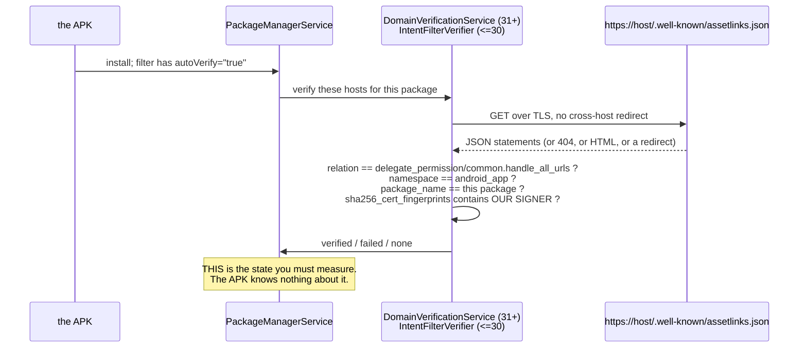

# Lab 03 — App Links verification state on a real device

**Difficulty:** Intermediate
**Time:** 1.5–3 hours
**Prerequisites:** [Chapter 26 §3.5, §3.11](../README.md), [Lab 02](lab-02-resolution-forensics.md)
**Related:** [45-OAuth lab-03](../../45-OAuth/labs/lab-03-scheme-hijack.md) stages the
*attack* this lab measures the *precondition* for. Do this one first.
**Uses:** [`../scripts/appstate-linkcheck.sh`](../scripts/appstate-linkcheck.sh)

---

## Objective

Determine, on **any** Android version, whether a declared App Link is actually
exclusive — and produce evidence a developer will accept.

The finding this lab exists to produce is short and is missed constantly:

> The application declares `android:autoVerify="true"` on its `https` deep-link
> filter. On a stock device, verification has **not** succeeded. The filter
> therefore behaves as an ordinary deep link: any installed application may declare
> the same host and compete for the link, and the only control remaining is a
> disambiguation dialog the user is asked to resolve mid-flow.

Every clause of that is measurable. None of it is visible in the APK.

---

## Background: request versus state

> **Definition**
> A **deep link** is any URI that opens a screen in an app. It is **not exclusive**
> — Android imposes no uniqueness constraint on schemes or hosts.
> An **Android App Link** is an `https` filter with `android:autoVerify="true"`
> **whose verification has succeeded**: the platform fetched
> `https://<host>/.well-known/assetlinks.json` over TLS and confirmed it names the
> app's package and its **signing certificate**. Verified App Links route
> exclusively, with no chooser.

The gap between those two sentences is the whole lab. `autoVerify="true"` in a
manifest is a **request**. Verification is a **state**. They are recorded in
completely different places — the request in the APK, the state in
`PackageManagerService` — and they disagree far more often than developers expect.



### The version split, measured

The command everybody quotes is `pm get-app-links`. It arrived with Android 12.

```text
# measured — Redmi, Android 11 / API 30
$ adb shell pm get-app-links
Unknown command: get-app-links
```

Carrying that command into an Android 11 engagement produces a confident
"verification state could not be determined", which is wrong. The API-30 and
earlier subsystem is different and has a different command set:

| | API 31+ (`DomainVerificationService`) | API ≤ 30 (legacy `IntentFilterVerification`) |
|---|---|---|
| Read one package | `pm get-app-links PKG` | `pm get-app-link PKG` — **singular** |
| Read everything | `dumpsys package domain-verification` | `dumpsys package domain-preferred-apps` |
| Force re-verify | `pm verify-app-links --re-verify PKG` | (reinstall) |
| Set state | `pm set-app-links --package PKG 0 all` | `pm set-app-link PKG always\|ask\|never\|undefined` |
| Reset | `pm reset-app-links PKG` | `pm set-app-link PKG undefined` |
| States reported | `verified`, `none`, `legacy_failure`, numeric codes, plus a user-selection section | `always`, `ask`, `never`, `undefined` |

There is one more difference and it changes what you may write in the report: on
API ≤ 30, `always` can be a **user or OEM preference** rather than a successful
`assetlinks.json` check. On API 31+, `verified` means the file was fetched and
matched, and user choices are reported separately. **Do not write "verified" in a
report about an Android 11 device.**

---

## Setup

```bash
# host
adb devices
adb shell getprop ro.build.version.sdk
adb shell getprop ro.build.version.release
adb shell getprop ro.product.brand
```

**Q1.** Record all four. Which command family does your device use?

The chapter's script does the detection for you and runs the right family:

```bash
# host
cd 26-Intent
bash scripts/appstate-linkcheck.sh --help
```

---

## Step 1 — Survey the whole device first

Before looking at any one app, look at the population. This tells you what "normal"
is on this device, which is what you need to say an app is abnormal.

```bash
# host
bash scripts/appstate-linkcheck.sh --all | head -80
```

Reference output from the Redmi / API 30 device:

```text
App verification status:

  Package: com.google.android.youtube
  Domains: youtu.be m.youtube.com youtube.com www.youtube.com studio.youtube.com oauth-redirect.googleusercontent.com
  Status:  ask

  Package: com.vendor.marketplace
  Domains: shopvdr.example www.shopvendor.example.ae www.shopvendor.example.de www.shopvendor.example.in business.shopvendor.example.in dl.shopvendor.example.ae dl.shopvendor.example.in www.shopvendor.example.jp www.shopvendor.example.uk www.shopvendor.example
  Status:  always : 200000000

  Package: com.google.android.apps.docs
  Domains: one.google.com * docs.google.com drive.google.com icing.drive.google.com client-side-encryption.google.com spreadsheets.google.com krahsc.google.com
  Status:  ask
```

**Q2.** Count the packages on your device in each state. What fraction are
`ask`/`none`? Is that higher or lower than you expected?

**Q3.** The YouTube entry lists `oauth-redirect.googleusercontent.com` among its
domains, at `Status: ask`. Explain, in one sentence, why that specific host name in
that specific state is worth a second look. (You do not need to conclude anything —
the point is to notice.)

**Q4.** The Google Docs entry contains a bare `*` in its domain list. What is that,
and why can a filter entry like it **never** be verified? What does that imply
about the component behind it?

---

## Step 2 — One package, in depth

Pick a target. A banking app, an email client, or anything with a login is the most
instructive; otherwise use any app with `https` filters.

```bash
# host
bash scripts/appstate-linkcheck.sh <package>
```

**Q5.** What state did it report? Quote the exact output — the state string is the
evidence and paraphrasing it loses the finding.

**Q6.** The script's last section asks who else claims each host right now:

```text
--- who else claims these hosts right now? ---
  m.youtube.com                                 1 activities found:
  www.youtube.com                               1 activities found:
```

What does a count greater than 1 mean? What does a count of exactly 1 **not** mean?
(Careful: one candidate today does not imply exclusivity tomorrow.)

**Q7.** Two readers, one device. Run both by hand:

```bash
# host — API 30 and below
adb shell "pm get-app-link <package>"
adb shell "dumpsys package domain-preferred-apps" | grep -A3 "<package>"
```

On the reference device these two disagreed for YouTube: `pm get-app-link` printed
`always`, while `dumpsys` showed **two** entries for the same package, one `ask`
and one `always : 200000001`. Does yours agree with itself? If not, which would you
quote, and what would you say about the other?

> **Pentester's Note**
> When two of the platform's own readers disagree, quote **both** and say so.
> "`pm get-app-link` reports `always`; `dumpsys package domain-preferred-apps`
> reports two records for the same package, `ask` and `always`" is a defensible
> sentence. Picking the one that supports your conclusion is not.

---

## Step 3 — Read the request, then compare it to the state

Now get the *request* out of the APK and put it next to the *state*.

```bash
# host
adb shell "pm path <package>"
adb pull <the base.apk path> target.apk

# host — every filter that asked to be verified
aapt2 dump xmltree --file AndroidManifest.xml target.apk \
  | grep -B2 -A12 'autoVerify'
```

**Q8.** How many filters declare `autoVerify="true"`? Which hosts do they name?

**Q9.** Now build the table that **is** the finding:

| Host | `autoVerify` declared? | State on device | Verdict |
|---|---|---|---|
| | | | |

Any row with "yes" in column 2 and anything other than `verified` (API 31+) in
column 3 is a finding. Write the verdict column in the language you would use in a
report.

**Q10.** Are there hosts in the *state* table that are **not** in the manifest you
just read, or vice versa? Explain each mismatch. (Hint: library-injected filters,
and build flavours.)

---

## Step 4 — Fetch what the platform fetches

```bash
# host
bash scripts/appstate-linkcheck.sh <package> --hosts
```

Or by hand, for one host:

```bash
# host
curl -sS -L -w '\nHTTP %{http_code} final=%{url_effective}\n' \
  "https://<host>/.well-known/assetlinks.json" | python3 -m json.tool
```

**Q11.** For each host: does the file exist? Is it valid JSON? Does it contain a
statement with

- `"relation": ["delegate_permission/common.handle_all_urls"]`,
- `"namespace": "android_app"`,
- the **exact** installed package name, and
- a `sha256_cert_fingerprints` entry?

**Q12.** Check the redirect. The platform fetches over TLS and does **not** follow
a redirect to a different host. Did `%{url_effective}` differ from the URL you
asked for? If it did, is the final host the same one?

---

## Step 5 — The fingerprint, which is where it usually breaks

This is the most common single cause of a failed App Link, and it is invisible
unless you check it explicitly.

```bash
# host — the digest the platform will compare against
apksigner verify --print-certs target.apk | grep -i 'SHA-256 digest'
# or
keytool -printcert -jarfile target.apk | grep -i SHA256
```

```bash
# host — do the comparison mechanically
bash scripts/appstate-linkcheck.sh <package> --hosts --apk target.apk
```

**Q13.** Does the hosted fingerprint match the installed APK's signer? If not, you
have found the cause. Which of these is it?

| Cause | How you would recognise it |
|---|---|
| The fingerprint is the **debug** certificate | `CN=Android Debug, O=Android, C=US` in the hosted file's provenance, or the developer confirms |
| The app is re-signed by **Play App Signing** | The store-installed APK's digest differs from the developer's local build; the correct digest is in the Play Console |
| The `package_name` has a **flavour suffix** | Manifest says `com.example.app.prod`, file says `com.example.app` |
| Multiple signers / key rotation | `signingInfo` has a history; the file lists only the old key |

**Q14.** Write the remediation as an artefact, not as a sentence: produce the
corrected `assetlinks.json` for this app, with the right package name and the right
fingerprint.

---

## Step 6 — Force the platform to try again, and watch

On API 31+ you can trigger verification and observe it:

```bash
# host
adb logcat -c
adb shell "pm verify-app-links --re-verify <package>"
sleep 5
adb logcat -d | grep -iE 'DomainVerification|IntentFilterIntentOp|assetlinks|statement'
adb shell "pm get-app-links <package>"
```

**Q15.** What changed? If the state is still not `verified`, does logcat name a
reason?

On API ≤ 30 there is no re-verify command; verification runs at install. Simulate
it:

```bash
# host — API 30 and below
adb shell "pm set-app-link <package> undefined"
adb shell "pm get-app-link <package>"
adb install -r target.apk        # reinstall triggers the legacy verifier
adb shell "pm get-app-link <package>"
```

**Q16.** Did the state change? On many OEM builds the legacy verifier is
disabled or heavily rate-limited, which is itself worth recording: **on this
device, App Links verification does not run at all** is a platform observation, not
an app finding, and belongs in a different section of your report.

---

## Step 7 — Prove the consequence

State without consequence is trivia. Show what the unverified state actually means.

```bash
# host — how many components claim this exact URL?
adb shell "cmd package query-activities -a android.intent.action.VIEW \
    -c android.intent.category.BROWSABLE -d 'https://<host>/<a real path>'"

# host — who wins?
adb shell "pm resolve-activity --brief -a android.intent.action.VIEW \
    -c android.intent.category.BROWSABLE -d 'https://<host>/<a real path>'"
```

**Q17.** If `pm resolve-activity` returns
`com.android.internal.app.ResolverActivity`, what does that mean, and what would
the user see?

**Q18.** Now the demonstration that convinces people. Take the deputy app from
[lab 01](lab-01-intent-redirection.md), add a filter claiming the target's host,
rebuild and install:

```xml
<activity android:name=".RedirectorActivity" android:exported="true">
    <intent-filter>
        <action android:name="android.intent.action.VIEW" />
        <category android:name="android.intent.category.DEFAULT" />
        <category android:name="android.intent.category.BROWSABLE" />
        <data android:scheme="https" android:host="<the target's host>" />
    </intent-filter>
</activity>
```

```bash
# host — before and after
adb shell "cmd package query-activities -a android.intent.action.VIEW \
    -c android.intent.category.BROWSABLE -d 'https://<host>/'" | head -1
```

**Q19.** Did the count go up? Did a chooser appear when you fired the link? Take
the screenshot — a disambiguation dialog offering the user a choice between the
real app and something called "Photo Filters", in the middle of a login, is the
most persuasive single artefact this lab produces.

**Q20.** Repeat the same experiment against an app whose state **is** `verified`
(API 31+). What happened to your competing app? Explain the difference in terms of
what the platform fetched and checked.

> **Scope**
> Step 7 competes for a real host name. Do it against an application and an account
> you own, on your own device, and uninstall the competing app afterwards. If you
> want the OAuth-flow version of this — intercepting a live authorisation code —
> that is [45-OAuth lab-03](../../45-OAuth/labs/lab-03-scheme-hijack.md), which has
> its own scope warning and a severity chain to go with it.

---

## Step 8 — The custom-scheme case, for completeness

Everything above concerns `http(s)`. A custom scheme is a different animal:

```bash
# host
adb shell "cmd package query-activities -a android.intent.action.VIEW -d 'myapp://callback'"
adb shell "dumpsys package domain-preferred-apps" | grep -i myapp
```

**Q21.** Does the custom scheme appear anywhere in the verification tables? Why
not? What would `assetlinks.json` even be fetched *from*?

**Q22.** Write the two-sentence explanation you would give a developer who says
"we use `myapp://` for our OAuth redirect, so nobody else can receive it".

---

## Success criteria

- [ ] Device API level recorded and the correct command family identified
- [ ] Device-wide survey run, with a count of packages in each state
- [ ] At least one wildcard (`*`) or otherwise unverifiable host found and explained
- [ ] One target package examined in depth, with its exact state string quoted
- [ ] Both platform readers run, and any disagreement between them recorded rather
      than resolved in your favour
- [ ] The manifest's `autoVerify` **requests** extracted and tabulated against the
      device's **states**
- [ ] `assetlinks.json` fetched for every declared host, and its four required
      properties checked
- [ ] The APK's signing-certificate SHA-256 compared to the hosted fingerprint
- [ ] A corrected `assetlinks.json` produced as the remediation artefact
- [ ] Re-verification triggered (31+) or a reinstall performed (≤30), and the
      result recorded — including "verification does not run on this build" if that
      is what you found
- [ ] The consequence demonstrated: a competing app installed, the candidate count
      shown to rise, and a chooser screenshotted
- [ ] The competing app uninstalled
- [ ] The custom-scheme case explained in two sentences

---

## Debrief

1. Distinguish "declares `autoVerify`", "is verified", and "is the user's default"
   in one sentence each. Which of the three can you read from an APK?

2. You are handed an APK and no device. Write the strongest sentence you can
   honestly write about its App Links. Then write the sentence you would be tempted
   to write, and say why it is wrong.

3. `pm get-app-links` does not exist below API 31. What else about App Links
   changed at 31, and why does that make the command split more than cosmetic?

4. An app's state reads `always` on Android 11. A developer says "so it is
   verified". Correct them, and say what you would need to establish
   verification on that platform.

5. The most common cause of a failed App Link is a certificate-fingerprint
   mismatch caused by Play App Signing. Explain the mechanism to a developer who
   generated their `assetlinks.json` from their local release build and is certain
   it is correct.

6. Rate the severity of an unverified App Link on: (a) a marketing landing page,
   (b) a password-reset link, (c) an OAuth `redirect_uri`. Justify the differences
   in one sentence each.

7. Verified App Links are exclusive. Name two things they still do **not** protect
   against. (Consider: what happens *inside* the app once the URI arrives, and what
   happens on a device where the user has already chosen an app.)

8. Your client's app uses a custom scheme for its OAuth redirect and cannot migrate
   this quarter. Write the compensating control you would recommend, and say
   honestly how much it is worth.

---

## Cleanup

```bash
# host
adb uninstall com.pentest.deputy          # if you installed the competing app
# API 31+
adb shell "pm reset-app-links <package>"
# API 30 and below
adb shell "pm set-app-link <package> undefined"
rm -f target.apk
```

Reset any app-link preference you changed. Leaving a device with `never` set for a
banking app's domain is a small thing that will confuse somebody later, possibly
you.
