# 26 — Intent · Mind Map

One map of the whole chapter. Read it left to right: what the message *is*, how it is *routed*, what
the receiver can *believe*, how it is *attacked*, how it is *found*, and what it is *fixed* with.

```mermaid
mindmap
  root((26 — Intent))
    1. The message
      Twelve fields
        action
          null action matches every filter
          no registry — any string is valid
        data Uri
          setData CLEARS type
        type MIME
          setType CLEARS data
          setDataAndType keeps both
        identifier — API 29
        categories — a Set
        component
          non-null ⇒ EXPLICIT ⇒ no matching
        package
          setPackage — resolution within one app
        flags
          FLAG_GRANT_* have teeth
          FLAG_ACTIVITY_FORWARD_RESULT
          FLAG_DEBUG_LOG_RESOLUTION
        extras — a Bundle
          lazy unparcel on first get
          AN EXTRA CAN BE AN INTENT
        selector — resolution only
        clipData — carries grants too
        sourceBounds — cosmetic
      Ways to send
        startActivity — one Activity
        startActivityForResult — the ONLY identity path
        startService / bindService — implicit illegal API 21+
        sendBroadcast — ALL matching receivers
    2. Routing
      Explicit
        component set
        no filter needed
        export + permission still enforced
      Implicit
        three tests, all must pass
          ACTION
            null passes
            filter must list it
            empty filter never matches
          CATEGORY
            EVERY category on the Intent
            must be on the filter
            not the reverse
            startActivity ADDS CATEGORY_DEFAULT
          DATA
            independent sets
              schemes
              authorities host+port
              paths
              MIME types
            CROSS PRODUCT not tuples
            content:/file: implied when types declared
            wildcards work from BOTH sides
        match value
          0x108000 empty
          0x208000 scheme
          0x308000 host
          0x408000 port
          0x508000 path
          0x608000 type
          negative = which test failed
        ranking
          priority
          match value
          preferredOrder
          verified App Link wins outright
        outcome
          0 ⇒ ActivityNotFoundException
          1 ⇒ deliver
          2+ ⇒ preference or chooser
      Where it runs
        IntentFilter.match
        IntentResolver buckets
          Non-Data Actions
          Full / Base / Wild MIME Types
          Schemes
        ComputerEngine.queryIntentActivitiesInternal
        ActivityStarter.executeRequest
          callingUid != applicationInfo.uid ⇒ deny
    3. Identity
      Kernel-stamped
        Binder.getCallingUid in a live transaction
        bound Service / AIDL only
        chapter 25 owns this half
      System-stamped
        getCallingActivity — for-result only
        getCallingPackage
        PendingIntent.getCreatorUid
        getLaunchedFromPackage — API 34
      Message-carried — worthless
        EXTRA_REFERRER
        getReferrer
        any custom caller extra
      Traps
        Binder.getCallingUid in onCreate = YOUR uid
        Binder.getCallingUid in onReceive = YOUR uid
        a package NAME is not an identity
    4. Attacks
      Intent redirection — THE primitive
        exported component starts an Intent it received
        runs as the VICTIM's uid
        reaches victim's non-exported components
        Parcelable flavour
          getParcelableExtra + startActivity
          needs an attacker APK
          am CANNOT do it
        String / URI flavour
          Intent.parseUri on an extra or query param
          web reachable via BROWSABLE
        accelerants
          FLAG_GRANT_* — grant laundering, ch 27
          FLAG_ACTIVITY_FORWARD_RESULT
          FLAG_GRANT_PREFIX_URI_PERMISSION
      PendingIntent mutability
        token = Intent + creator identity
        fired as the creator by system_server
        fillIn merges attacker data FIRST
        clearCallingIdentity happens SECOND
        blank component = blank cheque
        mandatory explicit flag from API 31
        leaks via notifications, extras, widgets, callbacks
      Resolution attacks
        scheme hijack — 45-OAuth lab-03
        unverified autoVerify App Link
        high-priority filter interception
        ordered broadcast + abortBroadcast
      Outbound leaks
        implicit broadcast carrying a secret
        chooser interception
        sticky broadcasts
      Deep-link data to a sink
        WebView.loadUrl
        OAuth token endpoints
        path traversal
        reflection / SQL / exec
    5. Deep links and App Links
      Deep link
        any scheme, NOT exclusive
        custom schemes unverifiable in principle
      App Link
        https + autoVerify + VERIFIED
        assetlinks.json over TLS
          relation handle_all_urls
          namespace android_app
          package_name
          sha256_cert_fingerprints
        autoVerify is a REQUEST not a STATE
      Measuring it
        API 31+
          pm get-app-links
          pm verify-app-links --re-verify
          pm reset-app-links
        API 30 and below
          pm get-app-link  — singular
          pm set-app-link
          dumpsys package domain-preferred-apps
      Failure modes
        file missing / 404
        served over http or cross-host redirect
        DEBUG certificate fingerprint
        package_name flavour mismatch
    6. Finding it
      Static
        manifest — chapter 32 owns the audit
        grep getParcelableExtra + check-cast
        grep parseUri
        grep PendingIntent.get without FLAG_IMMUTABLE
        manifest-merger report — SDK injections
      Dynamic
        cmd package query-activities
        pm resolve-activity
        dumpsys package resolver tables
        am start with every extra type
        am --debug-log-resolution
        logcat Permission Denial
        frida intent-monitor.js
          nested Intent extras
          taint mode
      Reverse engineering
        framework names survive obfuscation
        check-cast Landroid/content/Intent; is THE signature
        JADX prints flags as decimals
        Intent and PendingIntent flags share values
    7. Discipline
      adb shell is uid 2000
        proves existence, NOT reachability
      Build the attacker APK
      Run the negative control
        show a Permission Denial you expected
      Reachability AND consequence
        exported alone is not a finding
      Package visibility API 30+
        your shell sees more than the app does
      Resolve every protectionLevel
        normal-level permission is not a control
    8. Fixes
      setComponent / setClassName — strongest
      setPackage — cheapest sufficient fix
      Allow-list the forwarded class
      Strip FLAG_GRANT_* and FORWARD_RESULT
      FLAG_IMMUTABLE by default
      Explicit component inside a mutable token
      signature protectionLevel on the component
      Bound Service + Binder.getCallingUid
      Verified App Link for web-reachable entry points
```

---

## How to use this map

- **Revising for an interview?** Read branches 1, 2 and 3 top to bottom; those three answer every
  question in §10 of the README up to Senior level.
- **On an engagement?** Start at branch 6 (Finding it), and use branch 7 (Discipline) as the checklist
  that keeps the finding alive through triage.
- **Writing a remediation?** Branch 8 is the whole answer, and each leaf maps to a code template in
  [`cheatsheet.md`](cheatsheet.md) §13.
- **Arguing severity?** Branch 4 tells you what the attacker gains; branch 7 tells you what you must
  have proved before you claim it.
