# 28 — Services — Mind Map

One map of the whole chapter. Read the four top-level branches in this order:
**what a service is**, **what it hands out**, **who is allowed**, **how you test
it**. The last branch is where the measured results live.

```mermaid
mindmap
  root((28 Services))

    1 What it is
      A claim on process lifetime
        plus an addressable entry point
        NOT a thread
        NOT a process
        runs on the MAIN thread
      Declared in the manifest
        android:name
        android:exported
        android:permission
        android:process not a boundary
        android:isolatedProcess
        android:externalService
        android:useAppZygote
        android:foregroundServiceType
        android:directBootAware
        android:stopWithTask
      Three shapes
        Started
          startService / startForegroundService
          onStartCommand intent flags startId
          fire and forget, no channel back
          START_STICKY restarts with NULL intent
          START_NOT_STICKY
          START_REDELIVER_INTENT keeps a copy in system_server
          stopSelf startId not bare stopSelf
        Bound
          bindService with BIND_AUTO_CREATE
          onBind returns an IBinder
          onServiceConnected is the only proof
          onBind CACHED per filterEquals Intent
          onUnbind then onRebind
          lives while a client is bound
        Foreground
          startForeground id notification
          5 second promotion deadline
          NOT about the screen, about oom_adj
          foregroundServiceType API 29, mandatory API 34
      Lifetime and death
        two independent claims
        lmkd and oom_adj bands
        task swipe and stopWithTask
        background execution limits API 26
        OEM power manager MEASURED
          MIUI AutoStartManagerService Reject RestartService

    2 What onBind hands out
      Local Binder
        same process only
        cross process is a ClassCastException
        NOT a security control
      Messenger
        a Handler behind one AIDL method
        SERIALISED onto one looper thread
        asynchronous, no return value
        msg.sendingUid API 21
        msg.sendingPid API 29
        msg.replyTo is CALLER CHOSEN
          a correct sendingUid check does not close it
      AIDL Stub
        generated interface, Stub, Proxy
        method order IS the transaction code
        enforceInterface with the DESCRIPTOR
          a name tag, not a lock
        Binder THREAD POOL
          CONCURRENT
          REENTRANT
          races in a HashMap that tests never show
        asInterface short circuits in process
      Choosing between them
        state and no return value, use Messenger
        typed RPC and throughput, use AIDL
        the replyTo hazard is Messenger only
        the concurrency hazard is AIDL only

    3 Who is allowed
      system_server checks the BIND
        ActiveServices bindServiceLocked
        package visibility resolves to null
        exported
        android:permission
        background start policy
        ONCE, never per call
      The service checks the CALLS
        Binder getCallingUid
          works INSIDE a Stub method
          returns YOUR OWN uid in onBind MEASURED
          and in onStartCommand onCreate onUnbind onDestroy
          and on any worker thread
        kernel stamped, unforgeable, see 25 Binder
        checkSignatures not a hard coded uid
        sharedUserId means several packages per uid
        never clearCallingIdentity around the check
      Protection levels decide everything
        normal is not a gate
        android.permission.INTERNET as a guard MEASURED x5
        dangerous is a prompt not a wall
        signature and signature knownSigner
        BIND_ star permissions are system only
      Package visibility API 30
        false with NO exception MEASURED
        anti enumeration, NOT access control
        QUERY_ALL_PACKAGES or queries
      SELinux binder call
        decided before any of this, see 22

    4 The system binds you
      AccessibilityService
        BIND_ACCESSIBILITY_SERVICE
        res xml carries the real capability
          canRetrieveWindowContent
          canPerformGestures
          typeAllMask
        read the screen AND drive the screen
        not a CVE, a threat model item
        defences and their honest limits
      NotificationListenerService OTP interception
      InputMethodService it IS the keyboard
      VpnService all traffic
      TileService AutofillService HostApduService
      JobService the modern background path
      MEASURED 76 system bind services, 9 accessibility

    5 Sandbox reduction
      isolatedProcess
        uid 99000 to 99999 MEASURED
        useAppZygote 90000 to 98999 MEASURED
        empty supplementary groups, hence no network
        isolated_app s0 c512 c768 shared categories
        bind only in practice
        a POSITIVE finding, see 21
      externalService
        runs under the CLIENT uid
        WebView renderer pattern
        without isolatedProcess it is a finding

    6 Attacking
      Find
        dumpsys package r Service Resolver Table
        pm query-services -a and -n
        service-recon.py verdicts
          OPEN 325 MEASURED
          WEAK-PERM 16 MEASURED
          SIGNATURE 108, SYSTEM-BIND 76
      Reach
        bindService from a real app
        true does not mean connected MEASURED KeyChainService
        false with no exception means invisible
        SecurityException means a real gate
      Learn
        getInterfaceDescriptor code 1598968902 is free
        empty parcel probe distinguishes Stub from raw Binder
        empty descriptor means no token at all
      Exploit
        write the descriptor, transact code 1
        MEASURED token returned to uid 10313
      Vulnerability classes
        unprotected AIDL method
        check in the wrong place
        permission that is not a permission
        Messenger dispatcher and replyTo leak
        confused deputy, standing offer to act
        startForegroundService promotion DoS
        intent redirection sink, see 26
      Grade it
        exported is a LEAD not a finding
        severity is the demonstrated effect
        five question rubric

    7 Tooling
      adb only
        dumpsys activity services jobscheduler accessibility
        am start-service start-foreground-service kill
        no am bind-service exists
      examples attacker-app
        build.sh javac d8 aapt2 apksigner
        no Gradle, no network
      scripts service-recon.py
      scripts trace-service-lifecycle.js
        runtime v8 or timers do not fire
        do not hook Handler dispatchMessage, it SIGSEGVs
        do not resolve uids inside execTransact, reentrancy
      Frida hook the typed method for arguments
      jadx smali super Landroid app Service
      obfuscation hides the implementation not the interface

    8 Recommending instead of call
      27 owns ContentProvider call abuse
      this chapter owns the replacement
        aidl file IS the schema
        typed arguments
        getCallingUid where it works
        lifetime control
        oneway where it belongs
      honest costs
        more code
        method order is the wire format
        binding is asynchronous
        a signature permission on the provider may be enough
```

## How to use this map

- **Branch 1** is the vocabulary. If a term in branches 2–8 is unfamiliar, it is
  defined there.
- **Branch 3** is the security model in one place: the platform checks the bind,
  the developer checks the calls, and only one of those two is ever missing.
- **Branches 4 and 5** are the two ends of the privilege spectrum — the services
  the system binds because they are powerful, and the services that give up
  power deliberately.
- **Branch 6** is the test plan, in order.
- Anything labelled **MEASURED** was observed on a Redmi `M2101K6P` running
  Android 11 / API 30. Everything else is documented behaviour, and the version
  matrix in [`README.md`](README.md) §3.16 marks which is which row by row.
