# 29 — Broadcast Receivers — Mind Map

One map of the whole chapter. Measured figures are from a **Redmi `M2101K6P`,
Android 11 / API 30**.

```mermaid
mindmap
  root((29<br/>Broadcast<br/>Receivers))

    WHY it exists
      apps must react to events they did not cause
        boot, connectivity, screen, install, SMS
      alternatives were worse
        polling drains the battery
        privileged hardware access destroys the sandbox
      one-to-many and anonymous in BOTH directions
        the only Android IPC primitive that is
      the airport tannoy
        anyone can reach the microphone
        listeners cannot identify the voice
        ordered = one passenger at a time
        sticky = the announcement loops forever
        some listeners wear no badge

    REGISTRATION
      Manifest / STATIC
        visible to apktool aapt2 jadx MobSF
        parsed once by PackageManagerService
        can START a process that is not running
        android:exported
          default flipped by an intent-filter
          MANDATORY from API 31
        android:permission = SENDER must hold
        android:priority = ordered delivery order
        android:directBootAware
          runs before first unlock
          credential-encrypted storage unavailable
      Runtime / DYNAMIC
        Context.registerReceiver
        in NO manifest
        only in AMS in-memory ReceiverList table
        only reader: dumpsys activity broadcasts
        dies with the process
        overloads
          2-arg = EXPORTED below API 33
          3-arg = flags, API 26+
          4-arg = broadcastPermission
          5-arg = permission + flags
        API 33
          RECEIVER_EXPORTED 0x2
          RECEIVER_NOT_EXPORTED 0x4
          MANDATORY for targetSdk 33+
          targetSdk-gated, NOT device-gated
        AndroidX backport
          pkg.DYNAMIC_RECEIVER_NOT_EXPORTED_PERMISSION
          a signature permission standing in for a flag
          measured: 119 filters, 3 packages
          a POSITIVE finding
      LocalBroadcastManager
        never reaches AMS
        invisible AND unreachable
        deprecated but a FIX not a finding

    THE GAP
      static tools see only the manifest half
      measured: 299 of 431 third-party actions
        have live runtime registrations
        and ZERO manifest receivers device-wide
      cmd package query-receivers says No receivers found
        while dumpsys shows 6, 29, 4 live registrations
      dumpsys does NOT give you
        the receiver CLASS NAME
        any export flag below API 33
      only a registerReceiver hook gives you those
        measured: CalculatorApplication$1
        an anonymous inner class a name-sweep misses

    DISPATCH
      Context.sendBroadcast
        no identity is passed
        the kernel stamps the uid
      AMS broadcastIntentLocked
        1. resolve user
        2. strip privileged flags
        3. PROTECTED-BROADCAST CHECK
        4. sticky handling
        5. collect receivers from TWO sources
        6. enqueue
      Two queues
        foreground FLAG_RECEIVER_FOREGROUND
          bcast_timeout 10s measured
        background
          bcast_timeout 60s measured
        timeout applies to ORDERED only
        bcast_allow_bg_activity_start_timeout 10s
          a background-activity-start capability
      BroadcastQueue.processNextBroadcast
        parallel list drained first, all at once
        ordered list one at a time, waiting
      Delivery into the app
        IIntentReceiver oneway binder txn
        LoadedApk ReceiverDispatcher InnerReceiver
        Args posted to the main Looper
        onReceive on the MAIN THREAD
      Manifest receivers take another path
        ActivityThread.handleReceiver
        fresh instance by reflection, per broadcast

    PROTECTION
      protected-broadcast
        declared by SYSTEM packages only
        AMS refuses non-platform senders
        thrown BEFORE any receiver is consulted
        device-specific, OEMs add their own
        measured: 532 distinct in framework-res.apk
        in a THIRD-PARTY manifest it does NOTHING
        probe it, never remember it
        root sends what shell cannot
      receiverPermission
        sendBroadcast(i, perm)
        set by the SENDER
        stops EAVESDROPPING
        invisible in ANY manifest
      android:permission / broadcastPermission
        set by the RECEIVER
        stops FORGERY
        shows as requiredPermission= in dumpsys
      protectionLevel decides everything
        normal = decoration
        signature = a real control
      both checks live in
        deliverToRegisteredReceiverLocked

    ORDERED
      one receiver at a time, priority order
      priority
        manifest android:priority
        runtime filter.setPriority - INVISIBLE statically
        above 1000 reserved, unenforced
        measured in the wild: 2147483647
      abortBroadcast
        stops the chain SILENTLY
        nobody downstream is told
      result code / data / extras
        flows forward through the chain
        ends in the SENDER'S process
        an exfiltration channel out of the victim
      FLAG_RECEIVER_NO_ABORT 0x08000000
        the sender's defence
      am broadcast sends ORDERED
        measured twice, from both ends

    STICKY
      deprecated API 21
      retained by AMS, replayed at registration
      CANNOT be protected
        no sender at replay time
        receiverPermission unenforceable
        setPackage cannot constrain it
      registerReceiver returns the retained Intent
      BROADCAST_STICKY is protectionLevel normal
      none retained on the measured device
        finding one is itself notable

    IDENTITY
      you CANNOT know who sent it
        AMS re-dispatches every broadcast
        measured: Binder.getCallingUid returns 1000
        getCallingPid returns 0 (oneway)
        Process.myUid is your own
      the ONE place the sender is recorded
        dumpsys history caller= field
        needs shell, root, or DUMP
      the history also records
        extras in CLEARTEXT
          measured: token=SUPERSECRET123
        ordered / sticky / abort flags
        every recipient with timing
      50 records per queue - capture early

    ATTACKS
      forge the action
        unprotected custom action
        protected action beside an unprotected one
      bypass the filter
        ["explicit component, getAction() null"]
      eavesdrop
        implicit send, no receiverPermission
        costs nothing, leaves no trace
      harvest the ordered result
        setResultData reaches the sender
      intercept
        higher priority plus abortBroadcast
        rewrite the result mid-chain
        stall for up to bcast_timeout - DoS
      wake a dormant app
        setPackage escapes API 26 limits
        FLAG_INCLUDE_STOPPED_PACKAGES 0x20
      background activity start
        10s window after delivery

    VERSION GATES
      API 12 - EXCLUDE_STOPPED_PACKAGES default
      API 21 - sticky deprecated
      API 26 - implicit broadcasts stop waking manifest receivers
        setPackage and setComponent are EXEMPT
        exemption list: BOOT_COMPLETED, SMS, LOCALE_CHANGED...
      API 29 - cmd package query-receivers
      API 30 - package visibility filtering
      API 31 - android:exported mandatory
      API 33 - RECEIVER_EXPORTED/NOT_EXPORTED mandatory
      API 34 - further background-start limits

    TOOLING
      receiver-surface.py
        parses the AMS runtime table
        --runtime-only isolates the invisible half
        --history recovers senders and extras
      protected-broadcast-map.sh
        static list from framework-res.apk
        --verify asks the enforcement path itself
      hook-broadcast.js
        class names, export state, send side
        dispatcher hook, not a class sweep
        senderProbe measures the uid-1000 fact
      drozer
        fires from an APP context, unlike adb shell
      32-Manifest manifest-audit.py
        owns the DECLARATION audit
      26-Intent intent-surface-map.py
        owns RESOLUTION; explicitly excludes runtime receivers

    REPORTING
      an exported receiver is NOT a finding
        1227 of 1438 filters unguarded on a stock device
      a finding needs
        a forgeable action ON THIS DEVICE
        reachability from an UNPRIVILEGED app
        an observable, preferably persistent, state change
      adb shell is uid 2000 and is privileged
        and am broadcast is ORDERED
      quote counts with a timestamp
        the surface changes minute to minute
```

---

## How to use this map

Read it outward from the centre. The four branches that carry the security content are
**THE GAP**, **PROTECTION**, **ORDERED** and **IDENTITY** — everything else is scaffolding
that makes those four make sense.

If you are triaging an app under time pressure, walk only this path:

1. **REGISTRATION → Runtime** — run `receiver-surface.py --package <pkg>`.
2. **PROTECTION → protected-broadcast** — classify every action it listens for.
3. **ATTACKS → forge the action** — send the forgeable ones from an app.
4. **REPORTING** — no state change, no finding.
