# 30 — Activities: Mind Map

One map for the whole chapter. Nodes marked **M** were measured on a Redmi M2101K6P,
Android 11 / API 30, MIUI 12.5 — see [README §7.9](README.md) for the full measured/documented split.

```mermaid
mindmap
  root((30 Activities))
    1 The model
      Activity
        one screen plus its code
        extends android.app.Activity
        declared in the manifest
        lifetime owned by system_server
        app-side object
        system-side ActivityRecord
        the two can disagree
      Starting one is IPC
        two Binder transactions not one
        caller to system_server
        system_server to target
        the identity stamp dies in between
      Task
        ordered stack of ActivityRecords
        lives in ActivityTaskManagerService
        outlives every process in it
        survives in Recents
        created by a START not a declaration
        A TASK IS NOT AN APP
      Back stack
        one per task
        Back pops the top
        can cross a package boundary
      Recents
        a picture of tasks
        task snapshots written to disk
        FLAG_SECURE is the control
    2 taskAffinity
      what it is
        a string naming a preferred task
      default is the package name
        nobody writes it
        so the task name is public
      empty string is the hardening
        shows as taskAffinity=null M
      set on application
        inherited by every activity
      consulted ONLY when
        a task is chosen or created
        FLAG_ACTIVITY_NEW_TASK
        singleTask or singleInstance
        non-Activity context
        allowTaskReparenting later
      NOT consulted when
        standard start from an Activity
        no flags
    3 Launch modes
      standard 0
        always a new instance M
      singleTop 1
        reuse only at the TOP
        two instances can coexist M
        onNewIntent
      singleTask 2
        reuses the instance M
        stays in the SAME task M
        DESTROYS everything above M
        does not always make a task
      singleInstance 3
        alone in its own task M
        that task never accepts another M
      singleInstancePerTask 4
        API 31 plus
      forced by flags
        FLAG_ACTIVITY_SINGLE_TOP
        FLAG_ACTIVITY_CLEAR_TOP
    4 Lifecycle
      onCreate
        attacker input arrives here
        getIntent
      onNewIntent
        instance was REUSED
        getIntent goes STALE
        call setIntent
      onResume
        where defensive checks belong
      onPause and onStop
        Recents snapshot taken
      onSaveInstanceState
        state written to disk
      onActivityResult
        a THIRD attacker input
        least validated of the three
    5 Attacks
      Task hijacking
        StrandHogg class
        attacker declares victim affinity
        plus launchMode singleTask
        allowTaskReparenting variant
        no code no exploit no permission
        MEASURED BLOCKED on API 30 M
          affinities are uid-namespaced
          10312:com.victim vs 10311:com.victim
        USENIX Security 2015 paper
        StrandHogg 2.0 needed no manifest
      Mixed-package task
        cross-app start
        WITHOUT FLAG_ACTIVITY_NEW_TASK
        callee joins the CALLER's task
        affinity never consulted
        MEASURED WORKS on API 30 M
        Back crosses a trust boundary
      Confused deputy
        exported Activity
        forwards an Intent from an extra
        startActivity runs as the VICTIM
        prize 1 reachability
          exported=false becomes reachable M
        prize 2 grant laundering
          FLAG_GRANT_READ_URI_PERMISSION
          issued on the victim's behalf
          to a target the attacker chose M
          grant did NOT persist M
        prize 3 result theft
          FLAG_ACTIVITY_FORWARD_RESULT
      Tapjacking
        SYSTEM_ALERT_WINDOW special permission
        TYPE_APPLICATION_OVERLAY 2038
        held by a SERVICE not an Activity
        FLAG_NOT_TOUCHABLE
        FLAG_NOT_FOCUSABLE
        platform sets FLAG_WINDOW_IS_OBSCURED
        and delivers it anyway
      Result channel
        onActivityResult is inbound IPC
        implicit outbound means unknown callee
        grant can ride home
      Over-exposed screens
        exported with no permission
        normal-level permission is worthless
        showWhenLocked plus turnScreenOn
        allowEmbedded
        activity-alias has its OWN exported
    6 Identity
      tier 1 kernel-stamped
        Binder getCallingUid in a Service
        unforgeable
      tier 2 system-stamped
        getCallingActivity
          only after startActivityForResult
        getCallingPackage
        PendingIntent getCreatorPackage
        getLaunchedFromPackage API 34
      tier 3 message-carried
        getReferrer
        EXTRA_REFERRER
        every extra
        ZERO evidential value
      the trap
        Binder getCallingUid in onCreate
        returns your OWN uid M
    7 Defences
      taskAffinity empty string
      launchMode singleTask on sensitive screens
      exported false
      signature-level permission
      requireContentUriPermissionFromCaller API 35
      selector not Intent
        closed allow-list
        build from a class literal
        carry nothing across
        fail closed
      filterTouchesWhenObscured
        discard not warn
        per VIEW not per Activity
        dialogs need their own
      FLAG_SECURE
        before setContentView
        stops capture not input
      setIntent in onNewIntent
      signature pinning not package names
    8 Tools
      dumpsys activity activities
        Task and Hist lines
        affinity and taskAffinity
        launchedFromPackage
        printed TWICE
      dumpsys activity recents
        tasks whose processes died
      dumpsys window windows
        whose overlay is on top
      cmd appops query-op SYSTEM_ALERT_WINDOW
      task-affinity-map.py
        namespacing verdict
        AFFINITY-SQUAT
        MIXED-PACKAGE-TASK
        TASK-OWNING-LAUNCHMODE
      activity-trace.js
        starts with decoded flags
        arrivals with task placement
        tiered identity block
        result channel
        obscured touches
      am start
        implies NEW_TASK always
        no --eparcelable
        uid 2000 is privileged
    9 Severity honesty
      task hijack needs malware installed
      tapjacking needs an overlay grant
      deputy needs only any app
      web-reachable deputy needs nothing
      a task id is not a deception
      screenshot it or do not claim it
      state the precondition in the title
    10 Boundaries
      26 Intent owns the message
      27 ContentProviders owns the grant's worth
      32 Manifest owns the declaration audit
      25 Binder owns the identity stamp
      21 App Sandbox owns uid isolation
      30 owns the component the task and hijacking
```

