# 31 — Fragments: mind map

One map for the whole chapter. Everything marked *(m)* was measured on the API 35 AVD; see
[README §7.7](README.md) for what was not.

```mermaid
mindmap
  root((31 Fragments))
    1 What it is
      A portion of a screen with its own lifecycle
      NOT a component
        no manifest entry
        no android:exported
        no permission
        no ActivityRecord
        no task
        system_server does not know it exists
      Therefore no access check on creation
      Becomes an attack surface only when
        somebody OUTSIDE chooses WHICH one
      Two implementations, both present on API 35
        android.app.Fragment
          deprecated API 28, NOT removed (m)
          host: Activity
          loader: Fragment.instantiate
        androidx.fragment.app.Fragment
          shipped in the APK, app pins the version
          host: FragmentActivity
          loader: FragmentFactory.instantiate
    2 Architecture
      Activity owns a FragmentManager
      FragmentManager owns fragments and a back stack
      Child managers form a tree
      Everything is in-process
        no Binder
        no IPC cost
        invisible to Binder tracing
      A Fragment identity is a STRING
        ActivityRecord uses a ComponentName
        a Fragment uses a class name
        that is why injection exists
    3 Lifecycle
      onAttach onCreate onCreateView onViewCreated
      onStart onResume onPause onStop
      onDestroyView onDestroy onDetach
      Four differences from an Activity
        outlives its own view
          getViewLifecycleOwner exists for this
        never destroyed by the system alone
        no onNewIntent
          getIntent may be stale forever
        no caller identity, ever
      What an attacker gets from each
        ["onAttach: getActivity().getIntent()"]
        ["onCreate: getArguments() already populated"]
        onCreateView: the secret reaches the screen
        onSaveInstanceState: Parcelled to disk
    4 FragmentManager and back stack
      Back stack holds TRANSACTIONS not fragments
      addToBackStack records the INVERSE
      Three ops in one transaction, one Back press
      commit vs commitAllowingStateLoss
        platform reflective path uses the second
      Two unrelated back stacks
        task stack: system_server, ch 30
        fragment stack: app process, this ch
      Visible in dumpsys activity pkg (m)
    5 State
      FragmentState carries the CLASS NAME
      Restoration IS the reflective primitive
      Arguments
        Parcelled, persisted with the Activity
        setArguments throws after attach
        so developers treat them as trusted
        injected fragment gets attacker args (m)
      setRetainInstance deprecated
      ViewModel
        Activity-scoped store is SHARED
        an injected fragment can read it
    6 Fragment injection
      Sources
        Intent extra
        deep link query parameter
        Bundle
        saved state
      Sinks
        PreferenceActivity :android:show_fragment
        Fragment.instantiate
        FragmentFactory.instantiate
        Class.forName plus newInstance
      The gate isValidFragment
        base returns true below targetSdk 19 (m)
        base THROWS at or above 19 (m)
        an override is a blank cheque
        invoke-virtual plus if-eqz, nothing more
      Three states
        A no override, tsdk under 19: loads anything
        B no override, tsdk 19+: host CRASHES (m)
        C override present: whatever it says
      Constraints on the named class
        public
        assignable to Fragment
        public no-argument constructor
      Framework gadget pool is tiny
        11 Fragment subclasses in framework.jar (m)
        the pool is the APP's own classes
    7 Measured on API 35
      injection lands at targetSdk 35 (m)
      deep link lands, no attacker install (m)
      args Bundle arrives intact (m)
      install floor is targetSdk 24 (m)
      bypass flag is SHELL only (m)
      allowlist refuses AND crashes host (m)
      platform checks type BEFORE constructing (m)
      AndroidX constructs BEFORE checking
        loadFragmentClass has no checkcast
        its catch ClassCastException is dead code
        checkcast at 21, newInstance at 18
      241 APKs, 48 gates, 32 correct
        11 no override, 5 exported
        5 return true, 0 exported (m)
    8 Reverse engineering
      Manifest lists HOSTS, never fragments
      Anchors that survive R8
        PreferenceActivity as superclass
        the method name isValidFragment
        Fragment;->instantiate
        the string :android:show_fragment
      AndroidX path is NOT findable by name
      Vulnerable gate in bytes
        12 11 0f 01
      The question that decides it
        does the method READ its parameter
      R8 tension
        reflective load defeats reachability
        readable Fragment names imply a keep rule
    9 Dynamic analysis
      Drive from an APP, not adb shell
        shell can start non-exported activities
        check ActivityTaskManager START from uid
      dumpsys activity pkg
        Active Fragments, Added Fragments
        mContainerId 0x1020458 matches bytecode (m)
      Frida fragment-trace.js
        hooks base class, not subclass
        base impl THROWS, handle it
        REVIEWED AND UNRUN on this device
      Traps
        filterEquals ignores extras, use am start -S
        permission review dialog absorbs launches
        keyguard refuses app-originated starts
        adb shell su -c is broken, use su 0
    10 Static analysis
      grep produces LEADS not findings
      per-METHOD source and sink co-occurrence
      Three tiers
        1 input reaches a loader in one method
        2 a PreferenceActivity gate to adjudicate
        3 structural presence, NOT a finding
      Blind spots, stated
        R8 renames the AndroidX path
        string encryption
        source and sink in different methods
      Report the denominator
      Explain EVERY hit
    11 Impact
      CAN
        read the app private files
        use the app permissions
        read Activity-scoped ViewModels
        subscribe to fragment results
        render a dialog in the victim window
      CANNOT
        cross the sandbox
        exfiltrate BY ITSELF
        beat a user-auth-bound key
        beat a server-side check
      The exfiltration gap
        the VICTIM displays it
        a return path is a SECOND finding
    12 Fixes
      Exact-name allowlist
        keeps reflection
        refusal crashes the host
      Closed key map
        deletes the primitive
        R8 can prove reachability again
      Destination-side session check
        protects EVERY route
      Route table with allowExternal
        assert it in CI
      Do not extend PreferenceActivity
```

<!-- lint:allow SU-DASH-C SU-DASH-C-BARE -- the Traps branch names the broken form as a trap; it is a label, not a command to run -->

---

## How to use this map

Read it top to bottom once. Then use branch **6** as the checklist on a real app:

1. **Sources** — what values does an exported Activity read from its Intent?
2. **Sinks** — does any of them reach a reflective loader in the *same method*?
3. **The gate** — if there is one, does it read its parameter?
4. **Constraints** — which Fragments actually have a public no-arg constructor?
5. **Impact** — what do those Fragments do, and is there a return path?

Branch **11** is the one to re-read before writing severity, and branch **9**'s traps are the ones to
re-read before believing a negative result.
