# 32 — Manifest · Mind Map

One picture of the whole chapter. Read it outward from the centre: the manifest is the app's own
declaration of its security policy — what it is, what it wants, and what it exposes — and reading it
correctly is the first skill of every Android assessment. The two things that make that reading hard
are that `targetSdk` silently changes what every other attribute *means*, and that what you read is
not necessarily what the platform parsed.

Every branch corresponds to a section of [the chapter README](README.md).

```mermaid
mindmap
  root((Android<br/>Manifest))
    Read it three ways
      apktool decoded XML
      aapt2 dump xmltree
      dumpsys package on device
      the platform is authoritative
      disagreement IS the finding
      AXML parser confusion
      audit the MERGED manifest
    targetSdkVersion first
      changes what every attribute means
      17 provider exported defaults false
      23 runtime permissions
      24 user CAs no longer trusted
      26 background and broadcast limits
      28 cleartext denied by default
      29 scoped storage introduced
      30 scoped storage enforced and queries
      31 exported mandatory
      31 PendingIntent mutability explicit
      33 receiver export explicit
      34 foregroundServiceType required
      a low targetSdk is itself a finding
    manifest element
      package is the security principal
      identity is package plus signing cert
      sharedUserId deprecated
      shares one UID and one sandbox
      versionCode and versionName
      installLocation
    application element
      debuggable true is critical
        run-as gives full data access
        JDWP attachable
      allowBackup and adb backup
      dataExtractionRules replaces it
      usesCleartextTraffic
      networkSecurityConfig read the XML
      testOnly shipped is a finding
      extractNativeLibs false means mmap
      requestLegacyExternalStorage
      android name is the Application class
        obscure name means packer stub
      appComponentFactory injection surface
      largeHeap more secrets resident
    activity
      exported mandatory from 31
      filter implies exported below 31
      permission is the guard
      launchMode plus taskAffinity
        singleTask enables task hijacking
        empty taskAffinity is the hardening
      allowTaskReparenting
      excludeFromRecents for sensitive screens
      noHistory
      directBootAware runs before unlock
      showWhenLocked and turnScreenOn
      activity-alias has its OWN export state
        can expose a non exported target
    service
      exported means an RPC entry point
      isolatedProcess strongest app sandbox
      foregroundServiceType required at 34
      externalService across users
      accessibility service is ultra privileged
      notification listener is ultra privileged
    receiver
      exported accepts attacker intents
      permission guards the sender
      runtime registered receivers
        RECEIVER_EXPORTED from 33
        NOT visible in the manifest
        find them in code
    provider the richest surface
      authorities the content namespace
      exported defaults false from 17
      permission blanket guard
      readPermission and writePermission
      grantUriPermissions enables theft
        via intent redirection
      multiprocess and initOrder
      grant-uri-permission children
        path pathPrefix pathPattern
        path slash grants everything
      path-permission is subtle
        can narrow OR widen
        missing path leaves blanket in effect
      FileProvider paths
        files-path and cache-path
        external-path and external-files-path
        root-path exposes the filesystem
        root-path with dot is almost always wrong
    intent-filter
      action must match
      ALL categories must be present
      data matched on scheme host port path
      CATEGORY_DEFAULT required for implicit
      priority enables interception
      autoVerify and assetlinks json
    permissions
      uses-permission map to attacker gain
      maxSdkVersion easy to miss
      custom permission only as strong
        as the app that defines it
      squatting first definition wins
      protectionLevel
        normal auto granted
        dangerous runtime prompt
        signature same key only
        privileged appop development
        knownSigner
      special permissions to flag
        SYSTEM_ALERT_WINDOW
        MANAGE_EXTERNAL_STORAGE
        PACKAGE_USAGE_STATS
        REQUEST_INSTALL_PACKAGES
        QUERY_ALL_PACKAGES
        BIND_ACCESSIBILITY_SERVICE
    other elements
      queries package visibility
      uses-library and uses-native-library
      meta-data is where API keys hide
      instrumentation shipped is a finding
      profileable
    manifest merging
      library manifests merge into the app
      an SDK can inject an exported component
      the developer never wrote it
      tools node merge replace remove
      tools replace and tools remove
      read the merger report
      audit the merged output
    the discipline
      adb shell is UID 2000
      shell has privileges an app does not
      reproduce from an unprivileged app
      before reporting reachability
      the most common false positive
    tooling
      manifest-audit.py severity rated
      applies the targetSdk matrix
      frida-manifest-runtime.js
      reads what PackageManager parsed
      the third leg of the comparison
```

