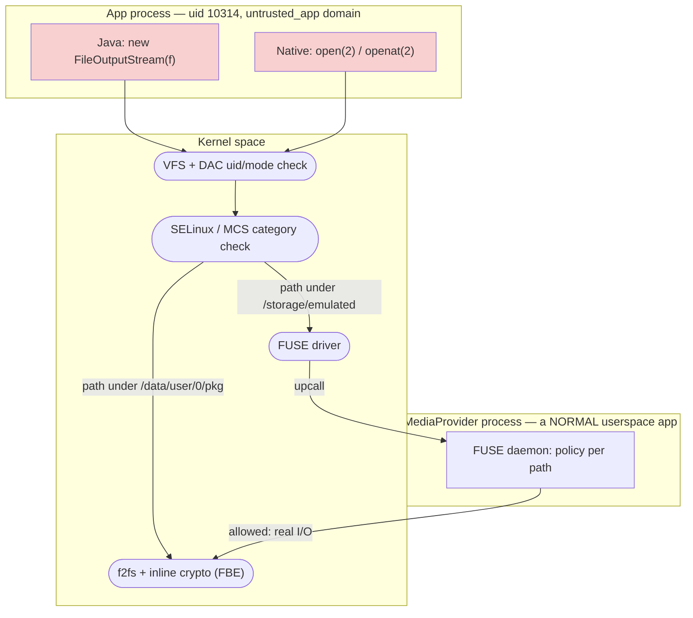
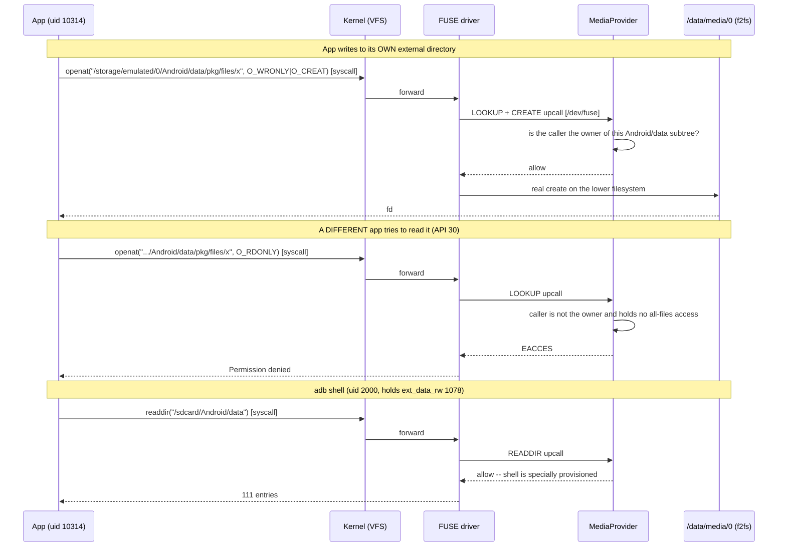
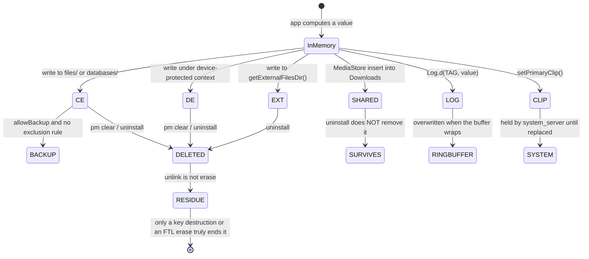
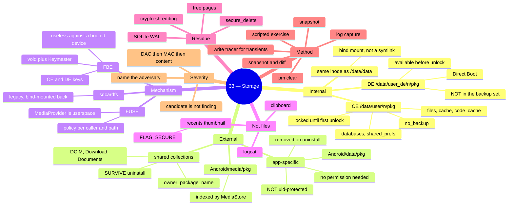

# 33 — Storage

> After this chapter you can enumerate every place an Android app can put a byte, prove who can
> reach each one, find the plaintext copy that sits beside the ciphertext, and write a storage
> finding whose severity you can defend.

**Prerequisites:** [02-Linux-Basics](../02-Linux-Basics/README.md),
[09-Android-App-Internals](../09-Android-App-Internals/README.md),
[21-App-Sandbox](../21-App-Sandbox/README.md), [23-Permissions](../23-Permissions/README.md)
**Applies to:** API 21 (Android 5.0) through API 35 (Android 15). Everything measured here was
measured on **Android 11 / API 30**, and every version-dependent claim carries a matrix row.

---

## Table of Contents

- [1. Introduction](#1-introduction)
- [2. High-Level Architecture](#2-high-level-architecture)
- [3. Deep Internal Working](#3-deep-internal-working)
  - [3.1 The two questions every storage decision answers](#31-the-two-questions-every-storage-decision-answers)
  - [3.2 CE and DE: the two internal trees](#32-ce-and-de-the-two-internal-trees)
  - [3.3 Direct Boot](#33-direct-boot)
  - [3.4 File-based encryption, and what it does not protect](#34-file-based-encryption-and-what-it-does-not-protect)
  - [3.5 Inside the app directory](#35-inside-the-app-directory)
  - [3.6 External app-specific storage](#36-external-app-specific-storage)
  - [3.7 Shared collections and MediaStore](#37-shared-collections-and-mediastore)
  - [3.8 The Storage Access Framework](#38-the-storage-access-framework)
  - [3.9 The stores that are not files](#39-the-stores-that-are-not-files)
  - [3.10 SQLite on disk](#310-sqlite-on-disk)
  - [3.11 SharedPreferences on disk](#311-sharedpreferences-on-disk)
  - [3.12 The backup channels](#312-the-backup-channels)
  - [3.13 Version matrix](#313-version-matrix)
- [4. Source Code Walkthrough (AOSP)](#4-source-code-walkthrough-aosp)
- [5. Security Perspective](#5-security-perspective)
- [6. Reverse Engineering Perspective](#6-reverse-engineering-perspective)
- [7. Dynamic Analysis](#7-dynamic-analysis)
- [8. Static Analysis](#8-static-analysis)
- [9. Examples](#9-examples)
- [10. Common Interview Questions](#10-common-interview-questions)
- [11. Common Mistakes](#11-common-mistakes)
- [12. Hands-on Labs](#12-hands-on-labs)
- [13. Summary](#13-summary)
- [14. References](#14-references)

---

## 1. Introduction

### 1.1 The problem that existed before

Imagine a shared office with no locks on any drawer.

Everyone works in the same room. You have a desk, and there is a filing cabinet in the corner that
everyone uses. You can put your papers in your desk or in the cabinet. Nobody stops you doing either.
Nobody stops your colleague opening your desk, either, because there is no lock — the only thing
protecting your papers is that people generally do not go through other people's desks.

That was a phone before Android. A Symbian or feature-phone application, and for that matter a
desktop application today, ran as *you*. It could read every file you could read. If a calculator
app wanted to open your email client's saved passwords, nothing in the operating system objected;
the calculator ran with your identity and your identity was allowed.

Two things break in that world, and they break in different ways.

The first is obvious: **a hostile application steals from a friendly one.** The malicious game reads
the banking app's saved session token and drains an account.

The second is subtler and, in practice, far more common: **a friendly application leaks to nobody in
particular.** It writes a debug log to a shared folder because the developer needed it once during
testing. It caches a decrypted attachment somewhere convenient. It puts a token in a file that ends
up in a cloud backup. No attacker is involved at the moment of writing. The exposure is created
first and found later — by whoever eventually looks.

Android's storage model exists to make the first problem structurally impossible and the second one
merely likely.

### 1.2 What Android did about it

Android gave every application its own user account.

Not a metaphorical one — a real Linux uid, assigned at install time, with its own home directory
that the kernel refuses to let any other uid open. Chapter
[09-Android-App-Internals](../09-Android-App-Internals/README.md) covers how that uid is assigned and
recorded, and [21-App-Sandbox](../21-App-Sandbox/README.md) covers how the boundary is enforced. For
this chapter, the consequence is what matters:

> **📖 Definition — the app's private directory**
> The directory an application owns, created at install time, whose owner is the application's own
> uid and whose mode denies every other uid. On a modern device it is at
> `/data/user/<userId>/<packageName>`. Nothing else on the device can read it without root or a
> platform bug.

That solved the first problem. It did not solve the second one, and it could not, because the second
problem is not about permissions. It is about **the app putting its own data somewhere else.**

And there is always somewhere else. There is the shared area every app can see, so that a camera can
save a photo a gallery can display. There is the logging system, which is a ring buffer that any
sufficiently privileged process can read. There is the clipboard. There is the backup system, which
exists precisely to copy the private directory somewhere it will survive the phone. There is the
screenshot the system takes of your app for the task switcher. There is the cache directory, where
developers put things they think do not count.

A file in the private directory at mode `0600` is, on a locked non-rooted device, about as protected
as a file on a phone can be. The interesting question is never whether *that* file is safe. It is
**whether a second copy of the same bytes exists somewhere else** — and it very often does.

> **🧠 Mental Model**
> Encryption moves a secret; it does not remove one. Storage security is not about the strength of
> the lock on the safe. It is about how many photocopies of the document are lying around the
> office, and which of those rooms are unlocked.

### 1.3 What would break without this

Strip out the model and imagine the result.

Without per-app uids, one malicious install compromises every other app on the device permanently,
with no exploit required. Every credential, every message history, every photo. Android's entire
permission system would also collapse, because permissions are checked against an identity, and
without separate identities there is nothing to check.

Without the shared area, apps could not cooperate at all. Your camera could not hand a photo to your
messaging app. The platform would be a collection of sealed boxes.

Without scoped storage — the restrictions Android added in versions 10 and 11 to the shared area —
that shared area would remain what it was for a decade: a directory where any app with one broad
permission could read every document, photo, recording and downloaded file on the device, and could
also enumerate the *names* of every other app's data directory there, which is a fingerprint of
which apps you have installed.

Without file-based encryption, a phone that is powered off and taken apart would give up all of it
to anyone with a chip reader.

Each of those mechanisms exists because the alternative was tried and failed.

### 1.4 Where the ciphertext ends up, and where the plaintext copy usually turns up too

This chapter is cited from [34-Cryptography](../34-Cryptography/README.md) and
[49-KeyStore](../49-KeyStore/README.md) for one specific job, and it is worth naming it up front.

Chapter 34 will teach you to judge whether an app's encryption is sound: the algorithm, the mode, the
IV, where the key came from. Suppose it passes. Suppose the app uses AES-256/GCM with a random IV
and a non-exportable key generated inside hardware. There is genuinely nothing to say about the
cryptography.

The data can still be sitting in cleartext in five other places:

- in `cache/`, because a temporary file was written before encryption and the delete was skipped on
  the error path;
- on external storage, because a support engineer asked for a diagnostic export;
- in `shared_prefs/`, because a second feature needed the value synchronously;
- in logcat, because somebody was debugging the second feature;
- in the write-ahead log of a database, because a `DELETE` removes a row and not the bytes.

That is not a hypothetical list. It is the exact set of leaks in
[`examples/leaky-vault/`](examples/leaky-vault/), whose `Vault.java` performs textbook-correct
encryption in the same method that creates all five. Every one of them has shipped in real
applications.

> **🔍 Pentester's Note**
> When a report says "the app encrypts sensitive data at rest", ask what was searched for the
> *unencrypted* copy, and how. If the answer is "we reviewed the encryption implementation", the
> question has not been asked. The method is in [section 7](#7-dynamic-analysis) and the tooling is
> in [`scripts/`](scripts/).

### 1.5 What this chapter owns, and what it does not

This chapter sits between four others, and the boundaries are deliberate.

| Chapter | Owns | This chapter owns instead |
|---|---|---|
| [09-Android-App-Internals](../09-Android-App-Internals/README.md) | The data directory's *identity*: how the uid is assigned, `packages.list`, the supplementary-GID table, the CE/DE API surface and `pm clear` semantics | What is *inside* those directories, on disk, and who can reach it |
| [21-App-Sandbox](../21-App-Sandbox/README.md) | Sandbox *enforcement*, what scoped storage *is*, the `allowBackup` exploitation chain | The storage *mechanisms* — FUSE, MediaStore, SQLite and preference file formats — and the testing method |
| [23-Permissions](../23-Permissions/README.md) | Permission strings, grant state, appops, and the measured fact that the legacy storage GIDs are gone on modern releases | What the filesystem does once a grant exists, and what it does when there is none |
| [34-Cryptography](../34-Cryptography/README.md) | Whether the crypto is sound; `EncryptedSharedPreferences`, `EncryptedFile`, Tink, key provenance | Where the output lands, and what else landed beside it |

Two more: [27-ContentProviders](../27-ContentProviders/README.md) owns `FileProvider` exploitation
and path traversal; this chapter owns what such a traversal *reaches*.
[10-APK-Internals](../10-APK-Internals/README.md) owns the APK container itself.

---

## 2. High-Level Architecture

### 2.1 The whole map, in one picture

```
                      ONE PHYSICAL FLASH CHIP
                              |
        +---------------------+---------------------------+
        |                                                 |
   /data  (f2fs or ext4, file-based encryption)      /system, /vendor, /product
        |                                            read-only, not app storage
        |
        +-- /data/user/0/<pkg>/          CREDENTIAL-ENCRYPTED  "internal storage"
        |      files/  cache/  code_cache/  databases/  shared_prefs/  no_backup/
        |      owner: the app's uid        mode 0700 on the directory
        |      locked until first unlock after boot
        |      (reachable as /data/data/<pkg> too -- same directory, second name)
        |
        +-- /data/user_de/0/<pkg>/       DEVICE-ENCRYPTED
        |      same subdirectory layout, same uid
        |      readable from the moment /data mounts, BEFORE any unlock
        |
        +-- /data/media/0/               THE SHARED VOLUME, on the same partition
        |      |                         surfaced to apps through FUSE as:
        |      |
        |      +-- Android/data/<pkg>/     "external app-specific"  <- NOT uid-protected
        |      +-- Android/media/<pkg>/    same, but INDEXED by MediaStore
        |      +-- Android/obb/<pkg>/      expansion files
        |      +-- DCIM/ Pictures/ Download/ Documents/ Music/
        |                                  SHARED COLLECTIONS -- survive uninstall
        |
        +-- /data/misc/profiles/cur/0/<pkg>/    ART execution profile
        +-- /data/system_ce/0/snapshots/        recents thumbnails (system-owned)

                      NOT ON THE FILESYSTEM AT ALL
        logcat ring buffer  |  clipboard  |  a running process's heap
```

Read that top down and one thing should be uncomfortable: **"internal" and "external" storage are on
the same chip, in the same partition, encrypted by the same subsystem.** The words are historical.
They date from when "external" meant a removable microSD card you could physically take out. On a
device with no card slot — which is most of them — the distinction that survives is not physical at
all. It is *who owns the bytes and who is allowed to ask for them*.

That is why the FAQ question "what is the difference between internal and external storage when
they are both on the same chip" is not a naive question. It is the right question, and the answer is:
nothing physical; everything administrative.

### 2.2 The two trust boundaries



What you are looking at is **two completely different enforcement paths for what looks to the app
like the same API call.**

A write to `/data/user/0/<pkg>/files/x` goes through the kernel and stops there. The kernel checks
the discretionary access control bits — is this uid allowed to write this inode — and then checks
SELinux, which independently asks whether this *domain* with these *categories* may write a file with
that *label*. If both agree, the bytes go to f2fs, which encrypts them on the way down. Total round
trip: a syscall.

A write to `/storage/emulated/0/DCIM/x.jpg` goes through the kernel to the FUSE driver, which
**upcalls into a userspace process** — MediaProvider, an ordinary Android app running as
`u:r:mediaprovider:s0` — and asks it whether this is allowed. MediaProvider consults its own policy:
which package is calling, what permissions it holds, whether the file is in that package's own
directory, whether it is a media type the caller may touch. Only then does the real I/O happen.

> **📖 Definition — FUSE (Filesystem in Userspace)**
> A kernel mechanism that lets an ordinary userspace program implement a filesystem. The kernel
> forwards each operation — `open`, `read`, `getattr`, `readdir` — to that program over a character
> device and waits for its answer. The filesystem's rules are therefore *code someone wrote*, not
> kernel policy, and they can be arbitrarily complex.

The security consequence is large and often missed: **the rules governing shared storage are
application logic, not kernel policy.** They can be, and are, different per calling package, per
path, per API level, per file type. That is exactly why `/sdcard` behaves so confusingly. It is not
one filesystem with one rule set. It is a policy engine wearing a filesystem's clothes.

### 2.3 What the same file looks like from three vantage points



Three callers, one path, three different answers — and none of the differences is expressible in the
file's mode bits. This is measured behaviour on the API 30 device this chapter was written against,
not a description of the documentation:

- the owning app writes and reads freely;
- an ordinary third-party app gets `list()` returning `null` for `/sdcard/Android/data`, and
  `EACCES` on the contents — while `File.exists()` on another package's directory still returns
  `true`, so *existence* leaks even though contents do not;
- `adb shell`, running as uid 2000 with supplementary group `1078 (ext_data_rw)`, lists all 111
  entries without complaint.

> **⚠️ Warning**
> This is why "I checked with `adb shell` and the file was readable" proves nothing about whether an
> *app* can read it, and why "the app could not read it" proves nothing about whether `adb` or a
> file manager with all-files access can. Every storage finding must name the adversary. A finding
> that does not name one cannot be triaged, because the same file is simultaneously reachable and
> unreachable depending on who is asking.

### 2.4 The lifecycle of a byte



Follow one value through that diagram and the shape of the whole problem appears. Every arrow out of
`InMemory` is a decision a developer made, usually without thinking of it as a security decision. The
arrows into `SURVIVES` and `RESIDUE` are the ones that produce findings. And `DELETED → RESIDUE` is
the arrow that surprises people most: removing a file removes a directory entry, not the bytes it
pointed at, and on a log-structured filesystem like f2fs even overwriting a file in place does not
reliably overwrite the same physical blocks.

---

## 3. Deep Internal Working

### 3.1 The two questions every storage decision answers

Everything in this section reduces to two questions, and it is worth holding them in mind because
the API surface is large and the questions are not.

**Question one: who can read these bytes?** The answer is decided by three independent gates, and a
byte is reachable only if all three say yes:

| Gate | Mechanism | Where it is decided |
|---|---|---|
| DAC | Unix uid, gid and mode bits; every directory on the path needs `o+x` to traverse | The kernel, on every `open` |
| MAC | SELinux type enforcement plus MCS categories | The kernel, on every `open`, independently of DAC |
| Policy | MediaProvider's FUSE rules, for shared storage only | A userspace process, per path and per caller |

The single most common bad storage finding in the industry is a report that checked gate one and
stopped. A mode `0644` file whose parent directory is `0700` is not reachable. Two apps whose
SELinux labels carry different MCS categories cannot read each other's files *regardless of mode
bits*. Both are demonstrated with measurements in [section 5.3](#53-honest-severity-a-worked-example).

**Question two: when can they read them?** Not everything is available at all times:

| State | CE storage | DE storage | Shared storage |
|---|---|---|---|
| Device off | Encrypted, keys not in RAM | Encrypted, keys not in RAM | Encrypted |
| Booted, never unlocked | **Unavailable** — key not derived | **Available** | Partially; the volume is mounted |
| Unlocked once, then locked | Available (keys stay in RAM) | Available | Available |
| Unlocked | Available | Available | Available |

That table is the whole of Direct Boot, and it is why moving one file from CE to DE storage can turn
a well-protected credential into one that a forensic acquisition of a locked, powered-on phone
recovers.

### 3.2 CE and DE: the two internal trees

> **📖 Definition — credential-encrypted (CE) storage**
> App storage encrypted with a key derived from the user's lock-screen credential. It cannot be
> decrypted until the user has unlocked the device at least once since boot. Path:
> `/data/user/<userId>/<packageName>`.

> **📖 Definition — device-encrypted (DE) storage**
> App storage encrypted with a key bound to the device rather than to the user's credential. It is
> available from the moment the kernel mounts `/data`, before any unlock. Path:
> `/data/user_de/<userId>/<packageName>`.

Chapter [09-Android-App-Internals §3.11](../09-Android-App-Internals/README.md) owns the API surface
— `createDeviceProtectedStorageContext()`, `moveSharedPreferencesFrom()`, the `directBootAware`
attribute — and its §5.7 owns the vulnerability class. What belongs here is the on-disk reality, and
one measurement that contradicts what almost every source says.

#### `/data/data` is not a symlink

Folklore, several textbooks, and this repository's own [79-Glossary](../79-Glossary/README.md) all
describe `/data/data/<pkg>` as a symlink to `/data/user/0/<pkg>` (or the reverse). On the Android 11
device measured for this chapter, it is neither:

```bash
# adb shell as root
$ readlink /data/user/0 ; echo rc=$?
rc=1

$ stat -c "%i %n" /data/data /data/user/0
118 /data/data
118 /data/user/0

$ grep " /data/user/0 " /proc/mounts
/dev/block/dm-10 /data/user/0 f2fs rw,lazytime,seclabel,nosuid,nodev,noatime,...
```

`readlink` fails because there is no symlink. The two paths share **inode 118** because
`/data/user/0` is a **bind mount** of the same directory on the same f2fs device. Historically AOSP
did create a symlink here; on this build, `vold` bind-mounts instead.

> **🔬 Under the Hood**
> Android 11 added a further layer visible in the same mount table:
> `/data_mirror/data_ce/null/0` and `/data_mirror/data_de/null`. These are bind mounts that
> `installd` keeps so it can hand a *specific app's* data directory into that app's mount namespace
> without exposing the whole tree. It is the mechanism behind an app seeing only its own
> `Android/data` subtree, and it is why two apps genuinely have *different mount tables*. See
> [06-Android-Architecture](../06-Android-Architecture/README.md) on per-app mount namespaces.

Practically: it does not matter which path you use for reading. It matters enormously that you do
not conclude from `readlink` failing that the directory is missing, and it matters that any tool
which resolves symlinks to deduplicate will *not* deduplicate these two paths.

#### What each tree actually contains

Measured on the test device, for a stock Chrome install:

```bash
# adb shell as root
$ ls -ldZ /data/data/com.android.chrome /data/user_de/0/com.android.chrome
drwx------ 13 u0_a196 u0_a196 u:object_r:app_data_file:s0:c196,c256,c512,c768  /data/data/com.android.chrome
drwx------  5 u0_a196 u0_a196 u:object_r:app_data_file:s0:c196,c256,c512,c768  /data/user_de/0/com.android.chrome
```

Same uid, same SELinux label, same mode. **The two trees are indistinguishable from the outside.**
The difference is entirely in which key the filesystem uses to decrypt their contents, which is a
property of an extended attribute on the directory and not of anything `ls` shows you.

That has a direct consequence for testing: **you cannot tell by looking at a file whether it is in
CE or DE storage. You must look at the path.** And a recursive scan of `/data/data` — which is what
most quick scripts do — never visits `/data/user_de` at all, because it is a sibling tree rather
than a subdirectory. The example app in [`examples/leaky-vault/`](examples/leaky-vault/) writes a
token to DE storage for exactly this reason; a `/data/data`-only sweep reports the app clean.

Note also the four MCS categories in that label: `c196,c256,c512,c768`. The first pair identifies
the *app* — `c[appId & 0xff]` and `c[256 + (appId >> 8)]`, so appId 196 gives `c196,c256`. The
second pair identifies the *user*. The formula was cross-checked on a second package: appId 269
produced `c13,c257`, since `269 & 0xff = 13` and `256 + (269 >> 8) = 257`. This matches the
corrected values recorded in [21-App-Sandbox](../21-App-Sandbox/README.md) and the arithmetic in
[22-SELinux](../22-SELinux/README.md); a first category above `c255` is arithmetically impossible and
means the context was fabricated rather than captured.

### 3.3 Direct Boot

Direct Boot is the feature that makes DE storage necessary, and understanding *why it exists* is the
only way to reason about when using it is legitimate.

**The problem.** Full-disk encryption meant that a phone which rebooted at three in the morning —
because the battery ran out, or an update installed — was a brick until someone typed the PIN. No
alarm clock. No incoming calls, on some devices. No accessibility service, which for a user who
depends on a screen reader means the phone cannot be unlocked without help. That is not a
theoretical inconvenience; it is a safety problem.

**The fix.** Split app storage in two. Give every app a small area encrypted with a device-bound key
that is available immediately at boot, and let components explicitly opt in to running in that
window.

```xml
<!-- AndroidManifest.xml -->
<receiver
    android:name=".BootReceiver"
    android:directBootAware="true"
    android:exported="false">
    <intent-filter>
        <action android:name="android.intent.action.LOCKED_BOOT_COMPLETED" />
    </intent-filter>
</receiver>
```

`LOCKED_BOOT_COMPLETED` fires in the Direct Boot window. The familiar `BOOT_COMPLETED` fires only
after the first unlock. A `directBootAware` component that touches credential-encrypted storage will
throw, because the key does not exist yet.

**The security consequence, stated precisely.** Anything an app places in DE storage is decryptable
by the platform from the moment `/data` mounts. The adversary this changes things for is specific:
somebody who has the powered-on but never-unlocked device and can run code on it, or who can perform
an acquisition against it. Against a thief with a powered-off phone, DE and CE are equally
protected. Against a person who knows the PIN, both are equally exposed.

> **🔍 Pentester's Note**
> DE storage is a reliable, high-value finding *and* a frequently over-reported one. The finding is
> "this credential is available before first unlock, which the app's own threat model assumes it is
> not". The non-finding is "the app uses DE storage", which is true of nearly every app that has a
> boot receiver and is entirely correct behaviour when what it stores there is a boolean.
> [`examples/fixed-vault/Vault.java`](examples/fixed-vault/Vault.java) shows the distinction as
> code: the boot component asked *is there a credential?*, so DE gets a boolean and CE keeps the
> credential.

Enumerate it explicitly — a generic recursive scan will not:

```bash
# adb shell as root
ls -laR /data/user_de/0/<package>
```

### 3.4 File-based encryption, and what it does not protect

> **📖 Definition — file-based encryption (FBE)**
> Encryption applied per file and per directory rather than to the whole block device. Each file's
> contents are encrypted with a key derived from a per-directory key, and filenames are encrypted
> separately. It replaced full-disk encryption because it is what makes two different availability
> states — CE and DE — possible on one partition.

Measured on the test device:

```bash
# adb shell
$ getprop ro.crypto.state
encrypted
$ getprop ro.crypto.type
file
$ getprop ro.crypto.volume.filenames_mode
aes-256-cts
$ getprop ro.crypto.metadata.enabled
true
```

`ro.crypto.type=file` confirms FBE rather than the older `block` (full-disk) scheme. Filenames use
AES-256-CTS; file *contents* default to AES-256-XTS, and the corresponding property was empty on this
device, which is normal — an empty property means the default rather than "no encryption". The
`/data` mount options include `inlinecrypt`, meaning the encryption is performed by the storage
controller's inline crypto engine rather than by the CPU.

Here is the part that matters for every finding you will ever write about storage:

> **⚠️ Warning**
> **FBE protects against an adversary holding the hardware. It protects against nothing that runs on
> a booted device.** Every process on a running phone sees plaintext, because the kernel decrypts
> transparently for anyone the keys are installed for. A root shell reads your `shared_prefs` in
> cleartext. Another app blocked from reading it is blocked by DAC and SELinux, not by encryption.
>
> This means "the data is encrypted at rest by the platform" is never a valid response to a storage
> finding about a running device, and it is *always* a valid response to a finding about a stolen,
> powered-off one. Establish which you are talking about before the conversation goes anywhere else.

### 3.5 Inside the app directory

The subdirectory table is owned by [09 §3.10](../09-Android-App-Internals/README.md); what follows is
the storage-security reading of it, plus what a real directory listing tells you.

| Directory | Accessor | Backed up by default | What it is really for, and what goes wrong |
|---|---|---|---|
| `files/` | `getFilesDir()` | Yes | The default home for app data. Everything here is in the backup set unless excluded |
| `cache/` | `getCacheDir()` | **No** | The system may delete it under storage pressure — *may*, not will. Developers treat "temporary" as "does not count", and it is where the plaintext staging copy lives |
| `code_cache/` | `getCodeCacheDir()` | **No** | Compiled or extracted code. Cleared on app update. The graphics stack writes shader caches here, including into DE storage |
| `databases/` | `getDatabasePath()` | Yes | SQLite files **and their `-wal`, `-shm` and `-journal` companions**, which are separate files and are separately backed up |
| `shared_prefs/` | `getSharedPreferences()` | Yes | Plain XML. Inside the sandbox, and plain |
| `no_backup/` | `getNoBackupFilesDir()` | **No** | Excluded from backup with no rules file needed. The right home for a token when backup is otherwise enabled |
| `app_<name>/` | `getDir(name, mode)` | Yes | Anything the app names itself. WebView, Chromium components and many SDKs use these heavily |
| `lib` | — | — | A symlink to the extracted native libraries |

A real listing, from the test device:

```bash
# adb shell as root
$ ls -la /data/data/com.android.chrome/
drwx------  13 u0_a196 u0_a196        app_chrome     app_dex     app_tabs
drwxrws--x   9 u0_a196 u0_a196_cache  cache
drwxrws--x   2 u0_a196 u0_a196_cache  code_cache
drwxrwx--x   2 u0_a196 u0_a196        databases   files   no_backup   shared_prefs
lrwxrwxrwx   1 root    root           lib -> /product/app/Chrome/lib/arm
```

Two details worth noticing. The `cache` and `code_cache` directories have a **different group** —
`u0_a196_cache`, numerically `20000 + (appId - 10000)` — and carry the **setgid bit** (`drwxrws--x`),
so files created inside inherit that group. That is what lets the system account cache usage
separately and reclaim it. And the top-level directory is mode `0700`, which is the fact that makes
most world-readable findings inside it false positives.

#### Durability: `apply()`, `commit()`, and `write()` returning

None of these puts bytes on the disk.

- `SharedPreferences.Editor.apply()` updates the in-memory map immediately and schedules the disk
  write on a background thread. It returns before anything is written and reports no errors.
- `commit()` writes synchronously and returns a boolean, so at least you learn whether it failed.
- `FileOutputStream.write()` returning means the bytes are in the kernel's page cache. Only
  `getFD().sync()` (or `FileChannel.force`) pushes them to storage.

For a security example this is a footnote; for the reliability of your *own* test methodology it is
not. If you snapshot a directory immediately after triggering an action, you may snapshot before the
write lands. [`scripts/storage-diff.py`](scripts/storage-diff.py) is used with a pause between
exercise and snapshot for this reason, and [`examples/fixed-vault/Vault.java`](examples/fixed-vault/Vault.java)
fsyncs before its atomic rename so that a power loss cannot leave a zero-length vault.

### 3.6 External app-specific storage

> **📖 Definition — external app-specific storage**
> A per-package directory on the shared volume, at
> `/storage/emulated/<userId>/Android/data/<packageName>`, reachable through
> `getExternalFilesDir()` and `getExternalCacheDir()`. No permission has been required to write to
> it since API 19. It is deleted when the app is uninstalled.

This is the single most misunderstood location in Android, because two true statements about it pull
in opposite directions:

- It is **app-specific** and **removed on uninstall**, which makes developers file it mentally
  alongside internal storage.
- It is **not protected by the app's uid**. On disk it belongs to the media stack. The protection is
  MediaProvider's FUSE policy, which is application logic that has changed materially in three
  consecutive Android releases.

Measured on the test device, an app's own external directory:

```bash
# adb shell as root
$ ls -ldZ /storage/emulated/0/Android/media/com.google.android.gms
drwxrwx--- 2 u0_a185 everybody u:object_r:fuse:s0  /storage/emulated/0/Android/media/com.google.android.gms
```

Group `everybody`, SELinux type `fuse`. Compare with the internal directory's `app_data_file` label
and per-app MCS categories from [section 3.2](#32-ce-and-de-the-two-internal-trees): the isolation
mechanism is completely different, and it is *not* the kernel.

There is a further wrinkle this device makes visible. `/proc/mounts` shows the shared volume served
by FUSE, but `Android/data` and `Android/obb` bind-mounted as `sdcardfs` on top of it:

```
/dev/fuse   /storage/emulated                    fuse     rw,...,user_id=0,group_id=0,allow_other
/data/media /storage/emulated/0/Android/data     sdcardfs rw,...,gid=1015,mask=6,derive_gid,...
/data/media /storage/emulated/0/Android/obb      sdcardfs rw,...,gid=1015,mask=6,derive_gid,...
/data/media /mnt/pass_through/0/emulated         sdcardfs rw,...
```

> **📖 Definition — sdcardfs**
> A kernel-space shim, predating FUSE on Android, that presented `/data/media` with synthesised
> ownership and permissions. It was replaced by FUSE in Android 11 for policy flexibility, at a
> performance cost — and OEMs then bind-mounted sdcardfs back over the hot paths to recover it. The
> `/mnt/pass_through/` mount is that optimisation.

The practical consequence: **the mode bits and ownership you see under `/sdcard` are synthesised,
not stored.** Every file appears as `root:everybody` with mode `0660` because the mount options say
so (`fsuid=1023,fsgid=1023,gid=1015,mask=6`), regardless of which app created it. So:

> **⚠️ Warning**
> File ownership under `/sdcard` tells you nothing about who wrote the file. Do not report "this file
> is owned by root" as a finding, and do not attribute a file to an app based on its uid there. The
> only reliable attribution is MediaStore's `owner_package_name` column — see the next section.

### 3.7 Shared collections and MediaStore

> **📖 Definition — shared collection**
> One of the media directories on the shared volume — `DCIM/`, `Pictures/`, `Movies/`, `Music/`,
> `Documents/`, `Download/` — whose contents belong to *the user*, not to any app. They are indexed
> by MediaStore, and they **survive the uninstall of the app that created them**.

That last clause answers the FAQ's "why did my file survive uninstall". The system removes what
belonged to the app. A photo in `DCIM/` was never the app's; it was the user's, and the app merely
created it. This is a deliberate design decision and not a bug.

> **📖 Definition — MediaStore**
> A `ContentProvider` maintained by the MediaProvider app that indexes every file in the shared
> collections. It is both the *permission-mediated API* for reaching shared media and a *database
> about the user's files*.

Both halves of that definition matter. Here is the second half, measured:

```bash
# adb shell
$ content query --uri content://media/external/file \
    --projection _id:_data:owner_package_name --where "_data LIKE '%Download%'"
Row: 1 _id=29, _data=/storage/emulated/0/Download/apatch_patched_...img, owner_package_name=me.bmax.apatch
Row: 2 _id=62, _data=/storage/emulated/0/Download/net-jolivier-cert-importer-....apk, owner_package_name=com.android.chrome
Row: 5 _id=73, _data=/storage/emulated/0/Download/Telegram.apk, owner_package_name=com.android.chrome
```

The `owner_package_name` column records which application created each file. Read those three rows
as an adversary would: this user downloaded a root-patching image using a root manager, and
side-loaded Telegram through Chrome. Nothing was opened. The *index* said it.

> **🔍 Pentester's Note**
> `owner_package_name` is a privacy surface in its own right and belongs under MASVS-PRIVACY, not
> just MASVS-STORAGE. An app that can query MediaStore learns which other apps produced which files
> — an installed-app fingerprint and a behaviour profile, obtained without any package-visibility
> permission. On the test device an app with **no** storage permission saw **0 rows**, which is the
> correct modern behaviour; on an app that legitimately holds a media permission, the whole index is
> visible.

#### Writing to a shared collection properly

```java
// Android app code — examples/leaky-vault/ExportActivity.java
ContentValues cv = new ContentValues();
cv.put(MediaStore.MediaColumns.DISPLAY_NAME, "report.txt");
cv.put(MediaStore.MediaColumns.MIME_TYPE, "text/plain");
cv.put(MediaStore.MediaColumns.RELATIVE_PATH, Environment.DIRECTORY_DOWNLOADS);
cv.put(MediaStore.MediaColumns.IS_PENDING, 1);                       // <- the part people skip

Uri item = cr.insert(MediaStore.Downloads.getContentUri(
        MediaStore.VOLUME_EXTERNAL_PRIMARY), cv);
try (OutputStream os = cr.openOutputStream(item)) {
    os.write(body);
}
cv.clear();
cv.put(MediaStore.MediaColumns.IS_PENDING, 0);
cr.update(item, cv, null, null);
```

`IS_PENDING` is not decoration. Between the `insert` and the final `update`, the file exists on disk
but MediaStore hides it from every other app. Skipping it means other apps can see and read a
**half-written** file — for an export containing a token, a real if narrow window, and one that
widens on a slow network.

Two columns are worth knowing for analysis:

| Column | What it gives you |
|---|---|
| `_data` | The absolute filesystem path. Deprecated for writing, still readable, and the fastest way to correlate the index with the disk |
| `IS_PENDING` | `1` means a half-written file. A scan that ignores it will see files that vanish |

#### The raw `File` path into a shared collection still works — measured

It is widely repeated that scoped storage forces every shared-collection write through MediaStore.
On API 30 that is **not** what the device does, and the difference matters because it is a leak path
people stop looking for.

The example app's `ExportActivity` deliberately attempts both routes. Both succeeded:

```bash
# adb shell — after running ExportActivity, from an app with NO storage permission
$ ls -l /sdcard/Download/ | grep ch33
-rw-rw---- 1 root everybody 96 ch33-vault-export.txt          # MediaStore route
-rw-rw---- 1 root everybody 96 legacy-ch33-vault-export.txt   # raw File route
```

Android 11 restored direct filesystem access for **creating** files in the media collections;
what it did not restore is reading or modifying files the app does not own. So an app targeting 30,
holding no storage permission at all, can still put a token in `Download/` with three lines of
pre-scoped-storage `java.io.File` code — while a write to the shared **root**
(`getExternalStorageDirectory()`) from the same app fails with `EPERM`.

> **⚠️ Warning**
> Do not assume the legacy path is dead on API 30, and do not stop grepping for
> `getExternalStoragePublicDirectory` because "scoped storage would have blocked it". Test the write
> rather than reasoning from the version number. The file this produced survived the app's own
> uninstall, because a shared collection is not the app's storage.

### 3.8 The Storage Access Framework

> **📖 Definition — Storage Access Framework (SAF)**
> A set of system UI flows — `ACTION_OPEN_DOCUMENT`, `ACTION_CREATE_DOCUMENT`,
> `ACTION_OPEN_DOCUMENT_TREE` — in which **the user picks the file or directory** and the app
> receives a URI grant for exactly that selection. The app never holds a broad storage permission.

SAF is the answer to "the app needs to let the user export a report" that does not require any
storage permission at all, and its security property is the one worth internalising: **the grant is
bounded by what the user picked.** An app that asks for `MANAGE_EXTERNAL_STORAGE` to write one file
the user chose has asked for the entire device instead of one file.

The subtlety is persistence:

```java
// Android app code
getContentResolver().takePersistableUriPermission(uri,
        Intent.FLAG_GRANT_READ_URI_PERMISSION | Intent.FLAG_GRANT_WRITE_URI_PERMISSION);
```

Without that call the grant dies with the process. With it, the grant **survives reboots** and lasts
until the app releases it or is uninstalled. An app that takes a persistable grant on a directory
tree the user chose casually — say, the whole of `Downloads` — holds indefinite read/write access to
it. Enumerate what an app holds:

```bash
# adb shell
dumpsys activity providers | grep -A5 -i "persisted uri"
```

`FileProvider` — sharing a file *out* of your app to another one — is
[27-ContentProviders](../27-ContentProviders/README.md)' subject, including how its path-mapping XML
is abused for traversal. What belongs here is only the destination: a traversal through a
misconfigured `FileProvider` reaches `shared_prefs/`, `databases/` and the WAL files described in
[section 3.10](#310-sqlite-on-disk), which is what turns a "provider misconfiguration" into a
credential disclosure.

### 3.9 The stores that are not files

Three of the most reliable storage findings are not in the app's directory at all, and are therefore
invisible to every tool that scans it.

#### Logcat

The system log is a set of ring buffers held by `logd`. It is storage in every sense that matters: it
persists beyond the writing process, it is readable by other principals, and it is routinely
collected wholesale by crash reporters and uploaded.

Who can read it:

| Principal | Can read logcat? |
|---|---|
| The app itself | Its own entries, and on a debuggable build effectively everything |
| An app holding `READ_LOGS` | Yes — but it is `signature|privileged|development`, so a normal app cannot get it |
| `adb shell` | Yes, always |
| Root | Yes |
| A crash-reporting SDK in the app's own process | Yes, and it commonly uploads the buffer |

The severity model that matters: a secret in `Log.d` is **not** "any app can steal this" on a modern
device. It is "this secret leaves the device inside crash reports, is visible to anyone with a USB
cable and developer mode, and is in the hands of every SDK in the process". That is usually Medium,
and High when the value is a long-lived bearer credential — because the credential then works from
anywhere.

```bash
# host — the sweep, scoped to one app
adb logcat -c
# ... exercise the app ...
adb logcat -d --pid=$(adb shell pidof -s com.example.app) > session.log
grep -inE "token|password|secret|bearer|authorization|jwt|eyJ" session.log
```

#### The clipboard

`ClipboardManager.setPrimaryClip()` puts a value in system-wide state. From Android 10, background
apps cannot read it — but the foreground app can, and so can the input method, which is a third-party
app on most devices. An app that copies a password or a one-time code to the clipboard has handed it
to the keyboard. From Android 13, `ClipDescription.EXTRA_IS_SENSITIVE` at least suppresses the
on-screen preview.

#### The recents thumbnail

When an activity goes to the background the system captures an image of it for the task switcher and
writes it to a **system-owned** directory. Three properties make this the nastiest of the three:

- the file belongs to `system_server`, not to the app, so it is outside the app's sandbox;
- it is written by another process, so no hook installed in the app sees it and no diff of the app's
  own directories finds it;
- the app cannot delete it.

The control is `FLAG_SECURE`, a **window** flag, which is why a manifest audit can never detect its
absence:

```java
// Android app code — examples/fixed-vault/VaultActivity.java
getWindow().setFlags(WindowManager.LayoutParams.FLAG_SECURE,
                     WindowManager.LayoutParams.FLAG_SECURE);
```

Set it before `setContentView`, and set it on **every** window that can display the secret.
[32-Manifest](../32-Manifest/README.md) records the common error precisely: `excludeFromRecents` and
`noHistory` do *not* prevent the snapshot; only `FLAG_SECURE` does.

> **🔍 Pentester's Note**
> Test it, do not read the source. Open the sensitive screen, press the recents key, and look. If
> `FLAG_SECURE` is set the preview is blank and `adb shell screencap` on that window is refused.
> Snapshot directories move between releases and OEMs — on the test device the credential-encrypted
> system directory is `/data/system_ce/0/` — so locate it on the device in front of you rather than
> quoting a path from a blog.

### 3.10 SQLite on disk

This is where the most reliable single finding in mobile security lives: **deleting a row does not
delete the bytes.**

An app's logout path runs `DELETE FROM sessions`. The SQL executes. The table is empty. Query it and
you get nothing. The developer is not lying.

Then read the write-ahead log.

> **📖 Definition — write-ahead logging (WAL)**
> A SQLite journal mode in which changes are appended to a companion file, `<db>-wal`, instead of
> being written into the main database. Readers consult the WAL first. Only at a **checkpoint** are
> those pages folded back into the main file. WAL is the default for databases opened through
> `SQLiteOpenHelper` and Room.

Two mechanisms preserve deleted data, and they are independent:

1. **The WAL holds the old page.** SQLite copies a whole page when any row on it changes, so a
   `DELETE` appends a rewritten page and leaves the previous copy — containing the row — in the file.
2. **The main file's free list holds the content.** When space is freed SQLite marks it available; it
   does not overwrite it. `PRAGMA secure_delete=ON` changes that, at a write-amplification cost, and
   is off by default.

Measured, using [`examples/leaky-vault/`](examples/leaky-vault/) on the test device. Two notes were
stored with secrets, then the app's logout path ran:

```
# host — after store, notes, logout
D CH33Vault: logout: deleted 2 rows carrying a secret

$ ls -l databases/
-rw-rw---- notes.db       4096
-rw------- notes.db-shm  32768
-rw------- notes.db-wal  61832

rows visible to SQL: 1

notes.db          4096 bytes   RESIDUAL: []
notes.db-wal     61832 bytes   RESIDUAL: ['ch33-recovery-code-889912',
                                          'checking account',
                                          'recovery address',
                                          'sk_live_EXAMPLE_NOT_A_REAL_KEY_ch33']
notes.db-shm     32768 bytes   RESIDUAL: []
```

The delete was real — SQL sees one row. Every deleted secret is still in the write-ahead log. Note
also that the main database is 4 KB and the WAL is 60 KB: **at that moment almost all of the app's
data lived in a file most tooling ignores.**

The same session against [`examples/fixed-vault/`](examples/fixed-vault/):

```
D CH33Fixed: logout: deleted 2 rows; wal now 0 bytes

-rw-rw---- notes.db      20480
-rw------- notes.db-shm  32768
-rw------- notes.db-wal      0
```

The fix is three statements, and their **order** is the part that silently goes wrong:

```java
// Android app code — examples/fixed-vault/NoteStore.java
db.delete("notes", "vault_ref IS NOT NULL", null);
db.execSQL("VACUUM");                                  // rebuild first
Cursor c = db.rawQuery("PRAGMA wal_checkpoint(TRUNCATE)", null);   // then fold and truncate
```

Checkpointing before vacuuming truncates the WAL to zero and then `VACUUM`, which rewrites the whole
database, immediately generates a fresh 20 KB WAL. That is not a hypothetical: it is what the first
version of the fixed app did, and it was caught only because the log line prints the resulting size
instead of asserting success.

| File | What it is | Present when |
|---|---|---|
| `<db>` | The database | Always |
| `<db>-wal` | Write-ahead log | WAL mode, between checkpoints. **Deleted on a clean close**, which is why an app that is not running may show no WAL at all |
| `<db>-shm` | Shared-memory index into the WAL | Alongside the WAL |
| `<db>-journal` | Rollback journal | Non-WAL mode, during a transaction, and sometimes left behind |

> **⚠️ Warning**
> The WAL's *absence* proves nothing. SQLite checkpoints and deletes it on a clean close, so an app
> you stopped before snapshotting will often show a bare `.db`. Snapshot **while the app is
> running**, or accept that you are looking at the post-checkpoint state where the residue has moved
> into the main file's free pages instead. This is the single most common way the WAL finding is
> missed.

There is no `sqlite3` binary on a stock device — `/system/bin/sh: sqlite3: inaccessible or not
found` — so pull the files and analyse them on the host. [`scripts/leak-hunter.py`](scripts/leak-hunter.py)
treats `-wal`, `-shm` and `-journal` as first-class targets and labels anything found only in a
companion file as **RESIDUAL**, which is a stronger claim than the same value in a live table: it
means a deletion the developer believes happened, did not.

#### Room

Room is a compile-time wrapper over the same `SQLiteOpenHelper` machinery. It changes nothing on
disk: same file, same WAL, same defaults. A `@Delete` DAO method leaves exactly the same residue. The
only difference for analysis is that the schema is also emitted as JSON into the app's build output
and sometimes shipped in `assets/`, which is a free read of every table and column name.

### 3.11 SharedPreferences on disk

```xml
<!-- /data/user/0/<pkg>/shared_prefs/session.xml -->
<?xml version='1.0' encoding='utf-8' standalone='yes' ?>
<map>
    <string name="auth_token">ch33-demo-token-AAAABBBBCCCCDDDD…</string>
    <string name="label">primary-account</string>
    <long name="issued_at" value="1786475572000" />
</map>
```

Plain XML. Typed elements. **Named keys** — which is why preference files are the highest-yield
target in an app's directory: the key name tells you what the value is without any analysis at all.

`MODE_WORLD_READABLE` and `MODE_WORLD_WRITEABLE` were the historical disaster here. They were
deprecated in API 17 and **throw `SecurityException` from API 24**, so you will not find them working
on a modern device — but you will find them in code that still compiles, and in old
`getSharedPreferences(name, 1)` calls where the literal `1` hides what the mode is.

```bash
# host — the fastest triage of an entire app
adb shell "su -c 'grep -rn \"\" /data/data/com.example.app/shared_prefs/'" | head -50
```

Read every key name first. Then read the values.

### 3.12 The backup channels

Three distinct channels share one manifest attribute, which is why the attribute alone tells you so
little:

| Channel | What it copies | Governed by |
|---|---|---|
| Auto Backup to the cloud | Up to 25 MB of CE storage, to the user's Google Drive | `allowBackup`, plus `fullBackupContent` (API 23–30) or `dataExtractionRules` (API 31+) |
| `adb backup` over USB | The same set, to a local file | `allowBackup`; heavily restricted or removed on newer platforms and OEM builds |
| Device-to-device transfer | The same set, phone to phone | `dataExtractionRules` `<device-transfer>` on API 31+ |

Always excluded, with no rule needed: `cache/`, `code_cache/`, `no_backup/`. DE storage is **not** in
the default backup set either, which is why an assessment that looks only at backup misses a DE leak
entirely.

The trap that renders a correct-looking exclusion useless:

> **⚠️ Warning**
> `dataExtractionRules` is read from API 31. `fullBackupContent` is read up to API 30. An app that
> declares only the newer attribute is **unprotected on every device below API 31** — and since the
> older format is the one that governs `adb backup`, that is precisely the population where
> extraction is easiest. Ship both attributes.
> [`examples/fixed-vault/backup_rules.xml`](examples/fixed-vault/backup_rules.xml) shows the two
> formats side by side.

A second, quieter trap: excluding `notes.db` does **not** exclude `notes.db-wal`. They are separate
files, they are backed up separately, and the WAL is where the deleted rows are.

Honest severity for `allowBackup="true"` is covered in [section 5.6](#56-allowbackup-a-candidate-not-a-finding).
[21-App-Sandbox §5.5](../21-App-Sandbox/README.md) owns the extraction chain itself; do not restage
it, run it.

### 3.13 Version matrix

| API | Release | What changed | What it means for testing |
|---|---|---|---|
| 17 | 4.2 | `MODE_WORLD_READABLE` / `MODE_WORLD_WRITEABLE` deprecated | Still compiles, still works |
| 19 | 4.4 | `getExternalFilesDir()` needs no permission | The leak path that no permission audit sees opens here |
| 21 | 5.0 | SELinux fully enforcing for apps | MCS categories become an independent gate on top of DAC |
| 23 | 6.0 | Runtime permissions; `fullBackupContent` | Storage permission becomes revocable, so grant state must be checked live |
| 24 | 7.0 | `MODE_WORLD_*` **throws**; Direct Boot and DE storage introduced | `/data/user_de` becomes a place to look. `FileProvider` becomes mandatory for sharing files |
| 26 | 8.0 | `getNoBackupFilesDir()` widely adopted | An exclusion mechanism that needs no XML |
| 29 | 10 | **Scoped storage introduced**, with `requestLegacyExternalStorage` as an opt-out | The opt-out is honoured. Behaviour depends on `targetSdk`, not on the device |
| 30 | 11 | **Scoped storage enforced**; the opt-out is ignored for apps targeting 30+; `MANAGE_EXTERNAL_STORAGE` added; FUSE replaces sdcardfs; `Android/data` becomes unreadable to other apps | Measure it — see below |
| 31 | 12 | `dataExtractionRules` replaces `fullBackupContent` | Ship both or be unprotected below 31 |
| 33 | 13 | `READ_EXTERNAL_STORAGE` split into `READ_MEDIA_IMAGES` / `_VIDEO` / `_AUDIO`; clipboard sensitivity flag | A granted media permission no longer implies all media |
| 34 | 14 | Partial media access via `READ_MEDIA_VISUAL_USER_SELECTED` | "Has the permission" no longer implies "sees everything" |

#### What API 30 actually enforces — measured, not asserted

Run from inside an ordinary third-party app with **no storage permissions**, targetSdk 30, on the
API 30 test device ([`examples/leaky-vault/StorageProbe.java`](examples/leaky-vault/StorageProbe.java)):

```
  targetSdkVersion               30
  isExternalStorageLegacy()      false
  getExternalStorageState()      mounted

  listing /storage/emulated/0/Android/data ...
  RESULT: list() returned null -- the directory is not enumerable by this app.
  com.android.chrome/files            exists=true  read=false list=null
  com.google.android.gms/files        exists=true  read=false list=null
  com.android.vending/files           exists=true  read=false list=null

  /data/data/com.android.chrome       exists=false read=false

  WRITE to the shared root DENIED: FileNotFoundException --
      /storage/emulated/0/ch33-probe-write.txt: open failed: EPERM

  MediaStore rows visible to this app: 0
```

Four things in that output are worth extracting, because each contradicts a common assumption:

1. **`Android/data` is not enumerable, but existence still leaks.** `list()` returns `null`, and
   `exists()` on another package's subdirectory returns `true`. An app can therefore still probe
   *which apps are installed* by testing paths, without any package-visibility permission.
2. **`exists=false` on `/data/data/com.android.chrome` does not mean it is absent.** `stat(2)` on a
   path you cannot traverse fails with `EACCES`, and `File.exists()` reports that as `false`. The
   Java API cannot distinguish "no such file" from "not allowed to look" — a persistent source of
   wrong conclusions in automated tooling.
3. **Writing to the shared root fails with `EPERM`,** not with a `SecurityException`. Code that
   catches `SecurityException` to detect the scoped-storage case will miss it entirely.
4. **MediaStore returns zero rows** to an app with no media permission — which is the correct modern
   behaviour, and worth confirming rather than assuming.

Meanwhile, from `adb shell` on the *same device at the same moment*, `/sdcard/Android/data` lists
111 entries without complaint, because shell holds supplementary group `1078 (ext_data_rw)`:

```bash
# adb shell
$ id
uid=2000(shell) gid=2000(shell) groups=...,1015(sdcard_rw),1028(sdcard_r),1078(ext_data_rw),1079(ext_obb_rw),...
```

> **🔍 Pentester's Note**
> That asymmetry is the single most important practical fact about scoped storage. Your `adb`
> session is a **more privileged principal than any app**, and every conclusion you draw with it
> about app-to-app reachability is wrong by default. When you want to know what an app can see, ask
> an app. That is what `StorageProbe` exists for.

Note finally what `MANAGE_EXTERNAL_STORAGE` is, from the device's own package dump:

```
Permission [android.permission.MANAGE_EXTERNAL_STORAGE]:
    sourcePackage=android
    uid=1000 gids=[1077] type=1 prot=signature|appop|preinstalled
```

`prot=signature|appop|preinstalled` means it cannot be requested by an ordinary runtime dialog; it is
granted through a full-screen Settings page after the user is walked out of the app, and Play
policy requires a justification. What it grants is broad — read and write across the shared volume,
including other apps' `Android/data` — but it is emphatically **not** access to another app's
internal `/data/user/0` directory. Conflating the two is a common over-claim.
[23-Permissions §3.12](../23-Permissions/README.md) owns the grant mechanics.

---

## 4. Source Code Walkthrough (AOSP)

AOSP file paths are stable across releases; line numbers are not, so none are given. Everything
below can be found by opening the named file and searching for the named method.

### 4.1 Where the paths come from

`frameworks/base/core/java/android/os/Environment.java` is the origin of every external-storage path
an app ever sees. Its central abstraction is `UserEnvironment`, which builds paths from the
`EXTERNAL_STORAGE` environment variable that Zygote's fork sets up for each app process.

```java
// frameworks/base/core/java/android/os/Environment.java  (illustrative excerpt)
public static File getExternalStorageDirectory() {
    throwIfUserRequired();
    return sCurrentUser.getExternalDirs()[0];
}

public static File getExternalStoragePublicDirectory(String type) {
    throwIfUserRequired();
    return sCurrentUser.buildExternalStoragePublicDirs(type)[0];
}
```

Two things follow from reading it rather than assuming.

First, **the paths are per-process state, not constants.** They are derived from environment
variables established when the app process was forked, which is why an app in a secondary user gets
`/storage/emulated/10` and why hardcoding `/storage/emulated/0` breaks on a device with a work
profile. The same applies internally: `getFilesDir()` on user 10 returns
`/data/user/10/<pkg>/files`, not `/data/data/<pkg>/files`.

Second, `getExternalStorageDirectory()` carries a deprecation notice, and the reason is exactly the
scoped-storage transition: on API 30 the `File` it hands back is a path an app targeting 30 mostly
cannot write to. The method still returns a valid-looking `File`. The failure surfaces only at
`open`, as `EPERM` — measured in [section 3.13](#313-version-matrix).

`Environment.isExternalStorageLegacy()` is the honest answer to "is scoped storage in force for me",
and it is the one call worth making instead of reasoning about the interaction of `targetSdk`,
`requestLegacyExternalStorage`, and whether the app was upgraded or freshly installed.

### 4.2 Where the internal paths come from

`frameworks/base/core/java/android/app/ContextImpl.java` implements every accessor an app uses:

```java
// frameworks/base/core/java/android/app/ContextImpl.java  (illustrative excerpt)
@Override
public File getFilesDir() {
    synchronized (mSync) {
        if (mFilesDir == null) {
            mFilesDir = new File(getDataDir(), "files");
        }
        return ensurePrivateDirExists(mFilesDir);
    }
}

@Override
public File getNoBackupFilesDir() {
    synchronized (mSync) {
        if (mNoBackupFilesDir == null) {
            mNoBackupFilesDir = new File(getDataDir(), "no_backup");
        }
        return ensurePrivateDirExists(mNoBackupFilesDir);
    }
}
```

`ensurePrivateDirExists` is the interesting one: it creates the directory **with mode 0771** if it is
missing, using `Os.mkdir` followed by `Os.chmod`. That is why `files/`, `databases/` and
`shared_prefs/` do not exist immediately after install — they are created lazily, on first use — and
why a storage-diff snapshot taken before the app has ever run shows an almost empty tree. It is also
why an empty root in [`scripts/storage-map.sh`](scripts/storage-map.sh) output means "never used",
not "nothing there".

`getDataDir()` is the fork in the road between CE and DE:

```java
// frameworks/base/core/java/android/app/ContextImpl.java  (illustrative excerpt)
@Override
public File getDataDir() {
    if (mPackageInfo != null) {
        File res = null;
        if (isCredentialProtectedStorage()) {
            res = mPackageInfo.getCredentialProtectedDataDirFile();
        } else if (isDeviceProtectedStorage()) {
            res = mPackageInfo.getDeviceProtectedDataDirFile();
        }
        ...
    }
}
```

`createDeviceProtectedStorageContext()` returns a `ContextImpl` whose storage flags select the second
branch. Everything downstream — `getFilesDir()`, `getSharedPreferences()`, `getDatabasePath()` —
then resolves under `/data/user_de/<userId>/<pkg>` with no further change to the calling code. That
is what makes the DE mistake so easy to make: **one call at the top changes where every subsequent
write lands, and nothing at the write site looks different.**

### 4.3 The write path, from `apply()` to the disk

`frameworks/base/core/java/android/app/SharedPreferencesImpl.java` contains the whole preference
mechanism. `EditorImpl.apply()` is worth tracing because its behaviour surprises people:

```java
// frameworks/base/core/java/android/app/SharedPreferencesImpl.java  (illustrative excerpt)
@Override
public void apply() {
    final MemoryCommitResult mcr = commitToMemory();
    final Runnable awaitCommit = new Runnable() { ... };
    QueuedWork.addFinisher(awaitCommit);
    Runnable postWriteRunnable = new Runnable() { ... };
    SharedPreferencesImpl.this.enqueueDiskWrite(mcr, postWriteRunnable);
    notifyListeners(mcr);
}
```

The in-memory map is updated synchronously; the disk write is queued. `apply()` returns before
anything is written and reports nothing if the write later fails.

`writeToFile` is where the on-disk format is produced, and two details matter for analysis. It writes
through a **backup file**: the existing `session.xml` is renamed to `session.xml.bak`, the new file
is written, and the backup is deleted on success. A crash in between leaves the `.bak` on disk — a
stale copy of the previous preferences, which is a real source of recoverable old tokens and a file
most scanners do not think to look at. And the file mode is set with `FileUtils.setPermissions(...,
FileUtils.S_IRUSR | FileUtils.S_IWUSR | FileUtils.S_IRGRP | FileUtils.S_IWGRP, ...)`, which produces
the `-rw-rw----` seen on every preference file in [section 3.11](#311-sharedpreferences-on-disk).

### 4.4 A complete path, from Java to the kernel

Take one `FileOutputStream` write on external storage and follow it all the way down:

| Layer | File | What happens |
|---|---|---|
| App | your code | `new FileOutputStream(new File(ctx.getExternalFilesDir(null), "x"))` |
| libcore | `libcore/ojluni/src/main/java/java/io/FileOutputStream.java` | `open0` → `IoBridge.open` |
| libcore | `libcore/luni/src/main/java/libcore/io/IoBridge.java` | `Libcore.os.open(path, flags, mode)` |
| libcore | `libcore/luni/src/main/java/libcore/io/Linux.java` | `native public FileDescriptor open(...)` |
| JNI | `libcore/luni/src/main/native/libcore_io_Linux.cpp` | `Linux_open` → `TEMP_FAILURE_RETRY(open(path, flags, mode))` |
| bionic | `bionic/libc/bionic/open.cpp` | `__openat` syscall wrapper |
| kernel | VFS | DAC check, then SELinux `avc_has_perm` |
| kernel | FUSE driver | Path is under `/storage/emulated` → forward to the daemon |
| userspace | MediaProvider | `packages/providers/MediaProvider/jni/FuseDaemon.cpp` decides |
| kernel | f2fs + inline crypto | The real write, encrypted on the way down |

The step that has no analogue on a desktop Linux system is the second-to-last. **A userspace app is
in the path of the syscall.** `FuseDaemon.cpp` and the Java policy in
`packages/providers/MediaProvider/src/com/android/providers/media/MediaProvider.java` implement it,
and `MediaProvider.java` is where `shouldBypassFuseRestrictions` and the owner checks live — the code
that decides whether one package may see another's `Android/data`.

The practical consequence for tracing: a Frida hook on `libc.so!open` in the **app's** process sees
the call and its arguments, and never sees what MediaProvider did with it. If you need the decision,
you have to be in MediaProvider's process, which is a system app.

### 4.5 Where the FBE keys live

`system/vold/` is the volume daemon and owns file-based encryption. Two files carry the logic:

- `system/vold/FsCrypt.cpp` — installs the per-user CE and DE keys into the kernel keyring and
  associates them with directories.
- `system/vold/KeyStorage.cpp` — wraps those keys with a key derived from the user's credential and
  a Keymaster/KeyMint-held secret, so unwrapping requires both the credential and the hardware.

The kernel side is `fs/crypto/` plus the filesystem's inline-crypto support, which is why the
device's `/data` mount options include `inlinecrypt`.

The security property worth extracting: **the CE key is unwrapped using material that only the secure
hardware holds, and only when the correct credential is supplied.** That is what makes brute-forcing
the lock screen offline infeasible — the attempt has to go through hardware that rate-limits it.
[49-KeyStore](../49-KeyStore/README.md) and `50-HardwareBackedSecurity` own that machinery; here it
matters only because it sets the boundary of what "encrypted at rest" buys you, which is: everything
against a powered-off device, and nothing against a booted one.

---

## 5. Security Perspective

### 5.1 How attackers abuse storage

| Adversary | Reach | What they take |
|---|---|---|
| A malicious app, no permissions | Shared collections it created; MediaStore rows it owns; **existence** of other packages' `Android/data` directories; genuinely world-readable files whose SELinux label permits it | Installed-app fingerprint; any app's carelessly world-readable file |
| A malicious app with media permissions | The whole MediaStore index, including `owner_package_name` for every file | Which app produced which file, i.e. a behaviour profile of the user |
| An app with `MANAGE_EXTERNAL_STORAGE` | The entire shared volume, including every app's `Android/data` | Every debug export, cached attachment and log any app wrote outside its sandbox |
| Someone with USB debugging authorised | logcat, `run-as` on debuggable apps, `bmgr`/`adb backup`, `/sdcard`, `Android/data` | On a debuggable app, its whole CE directory with no root |
| Root or a physical acquisition | Everything on a booted device | Everything, including the WAL residue and the recents thumbnails |
| A forensic acquisition of a locked, powered-on device | DE storage | Anything the app put in DE storage, which is why [section 3.3](#33-direct-boot) matters |
| A thief with a powered-off device | Nothing, if FBE is working and the credential is strong | Nothing — this is what FBE is for |

### 5.2 How developers create the exposure

Every one of these is in [`examples/leaky-vault/`](examples/leaky-vault/), with a comment naming the
plausible reason a competent engineer wrote it:

- **A staging file "because it is only temporary".** Written before encryption, deleted after — and
  not deleted at all on the error path, which is the path taken when something has already gone
  wrong and the device is most likely to be examined.
- **A diagnostic export, because support asked for one.** `getExternalFilesDir()` needs no
  permission, so this leak is invisible to a permission review.
- **A second copy of a value, because another feature needed it synchronously.** The vault call was
  asynchronous; `SharedPreferences` was not.
- **A `Log.d` left in from debugging the previous item.**
- **A move to DE storage, because a boot-time component needed the value.** The component needed to
  know *whether* a credential existed; it got the credential.
- **A `DELETE` on logout that the developer correctly believes works.** It does. It is not an erase.

### 5.3 Honest severity: a worked example

This is the most useful thing in the chapter, and it comes from a measurement on a stock,
un-modified, SELinux-Enforcing Android 11 device.

Scanning every app's directory for world-readable files produced eight hits. Three are worth
comparing:

```bash
# adb shell as root
$ find /data/data -maxdepth 3 -type f -perm -o+r
/data/data/com.google.android.gms/shared_prefs/google_sdk_flags.xml
/data/data/me.bmax.apatch/patch/ramdisk.cpio
/data/data/com.vendor.filemanager/files/libfmtool2.so
```

An automated scanner reports three world-readable files in third-party app directories. Now check
reachability, which is what separates a finding from noise:

```bash
# adb shell as root
$ ls -ld /data/data/com.google.android.gms /data/data/com.google.android.gms/shared_prefs
drwx--x--x 42 u0_a185 u0_a185  /data/data/com.google.android.gms
drwxrwx--x  2 u0_a185 u0_a185  /data/data/com.google.android.gms/shared_prefs

$ ls -ld /data/data/me.bmax.apatch /data/data/me.bmax.apatch/patch
drwx------ 12 u0_a269 u0_a269  /data/data/me.bmax.apatch
drwx------  2 u0_a269 u0_a269  /data/data/me.bmax.apatch/patch
```

The GMS path is `0711` → `0771` → `0664`. Every component grants `o+x`, so the DAC path is walkable.
The APatch path is `0700` at the very first component. **Two of the three hits are dead on arrival:**
`open(2)` resolves a path one component at a time and a single ancestor without `o+x` ends it,
regardless of the file's own mode.

Now check the second gate:

```bash
# adb shell as root
$ ls -Zd /data/data/com.google.android.gms /data/data/me.bmax.apatch
u:object_r:privapp_data_file:s0:c512,c768       /data/data/com.google.android.gms
u:object_r:app_data_file:s0:c13,c257,c512,c768  /data/data/me.bmax.apatch
```

The APatch directory carries **per-app MCS categories** (`c13,c257`). GMS, as a privileged app, is
labelled `privapp_data_file` with **only the user categories** — no per-app pair. So even if the DAC
path had been open, MCS would have blocked a third-party app from APatch; and it does not block
anything from GMS.

Prediction made, now test it. First as `adb shell`, uid 2000:

```bash
# adb shell
$ cat /data/data/com.google.android.gms/shared_prefs/google_sdk_flags.xml | head -3
<?xml version='1.0' encoding='utf-8' standalone='yes' ?>
<map>
    <int name="crash:log_buffer_capacity" value="100" />

$ head -c 32 /data/data/me.bmax.apatch/patch/ramdisk.cpio
head: ...: Permission denied
```

Then — and this is the part that matters, because `adb shell` is a more privileged principal than any
app — from inside an **ordinary third-party app with zero permissions**
([`examples/leaky-vault/StorageProbe.java`](examples/leaky-vault/StorageProbe.java)):

```
  /data/data/com.google.android.gms/shared_prefs/google_sdk_flags.xml
      canRead()=true   open+read: READ OK (64 bytes)
  /data/data/com.google.android.gms/shared_prefs/google_ads_flags.xml
      canRead()=true   open+read: READ OK (64 bytes)
```

**An ordinary app read another package's private-directory file, on a stock Enforcing device.**

Now write the finding honestly. The severity is **Informational**, and the reasoning is the valuable
part:

- The file contains SDK feature flags and crash-buffer sizes. There is no credential in it, no PII,
  nothing an attacker gains from.
- It is a *system* app's file, so it is the platform image's decision, not any third-party
  developer's.
- The reader has to know the exact filename; `shared_prefs/` itself is `0771`, so it can be
  traversed but not listed.

And the *mechanism* is High-value teaching, because the identical mechanism applied to a file
containing a token would be a serious finding, and because it demolishes two comfortable beliefs at
once: that "apps cannot read other apps' data directories" is unconditionally true, and that a
world-readable file is automatically a finding. Neither is. Three gates, checked in order, every
time:

1. **DAC** — is every directory on the path `o+x`, and is the file `o+r`?
2. **MAC** — do the SELinux type and MCS categories permit this reader?
3. **Content** — is there anything in it worth having?

> **🔍 Pentester's Note**
> [`scripts/storage-diff.py`](scripts/storage-diff.py) computes gate one and prints
> `DAC-reachable: yes/no` with the blocking directory named. It deliberately does **not** compute
> gate two, and its output says so on every finding, because guessing at SELinux is how a report
> ends up claiming an attack that the device refuses. Gate two needs a second app. That is exactly
> what `StorageProbe` is for.

### 5.4 Vulnerability class — the plaintext copy beside the ciphertext

**Vulnerable code.** From [`examples/leaky-vault/Vault.java`](examples/leaky-vault/Vault.java),
lightly trimmed. The encryption is textbook-correct AES-256/GCM with a non-exportable
AndroidKeyStore key:

```java
// Android app code — the vulnerability is not in the crypto
File staging = new File(ctx.getCacheDir(), "vault-staging.tmp");
try {
    writeBytes(staging, secret.getBytes("UTF-8"));    // <- plaintext hits the disk
    byte[] sealed = seal(secret);
    writeBytes(new File(ctx.getFilesDir(), "vault.bin"), sealed);
    staging.delete();                                  // <- skipped if seal() threw
} catch (Exception e) {
    Log.e(TAG, "store failed for " + label, e);        // <- staging file survives
}
```

**Why developers write it.** Because staging looks like defensive engineering. If encryption fails,
you still have the data. The failure mode is invisible in review: the `delete()` is right there, and
nothing draws the eye to the fact that it is inside the `try`.

**Detection — static.** Grep for a write whose argument is a cleartext variable that is also passed
to a `Cipher`:

```bash
# host
grep -rnE "getCacheDir|createTempFile|\.tmp\"" --include=*.java --include=*.kt src/
```

**Detection — dynamic.** This is the case a filesystem diff **cannot** find, by construction. The
file is created and deleted between the two snapshots. Measured: the full diff of a
store/notes/logout/probe/export session against the leaky app reported 21 new paths and the staging
file was not one of them. The tool that finds it is a write tracer:

```bash
# host
frida -U -f com.pentest.ch33.vault -l scripts/storage-trace.js
```

[`scripts/storage-trace.js`](scripts/storage-trace.js) hooks `FileOutputStream.<init>`,
`File.delete()` and `libc!open`, so it reports both the creation and the deletion with a stack.

**Exploit and impact.** Against the happy path: a device acquisition, a debuggable-build `run-as`, or
a raw partition carve, since `delete()` unlinks a name and does not erase blocks — and on f2fs, a
log-structured filesystem, an in-place overwrite does not reliably touch the same physical blocks
either. Against the error path: the file simply persists, and the error path is the state the device
is in when it is most likely to be examined.

**Secure fix.** Encrypt in memory, write once to a temporary name in the same directory, `fsync`,
then rename atomically. See [`examples/fixed-vault/Vault.java`](examples/fixed-vault/Vault.java):

```java
// Android app code
byte[] sealed = seal(secret);                       // nothing cleartext ever reaches the disk
FileOutputStream fos = new FileOutputStream(tmp);
try { fos.write(sealed); fos.getFD().sync(); } finally { fos.close(); }
if (!tmp.renameTo(target)) throw new IOException("atomic replace failed");
```

**Honest severity.** **Medium** where the plaintext is a session token that the server revokes, and
the only reader is root or an acquisition. **High** where it is a long-lived credential, a recovery
code or key material, because those work from anywhere and revocation is not in the picture. **Low**
where the "secret" turns out to be an analytics identifier. The storage location does not set the
severity; the value and the reachable adversary do.

### 5.5 Vulnerability class — residual data after deletion

**Vulnerable code.** A correct-looking logout, from
[`examples/leaky-vault/NoteStore.java`](examples/leaky-vault/NoteStore.java):

```java
// Android app code
public int clearSecretsOnLogout() {
    SQLiteDatabase db = getWritableDatabase();
    return db.delete("notes", "secret IS NOT NULL", null);
}
```

**Why developers write it.** Because it is right, as SQL. The rows are gone. Every test that queries
the table passes.

**Detection — static.** Look for a delete with no checkpoint and no `secure_delete`:

```bash
# host
grep -rnE "\.delete\(|DELETE FROM|@Delete" --include=*.java --include=*.kt src/
grep -rn "secure_delete\|wal_checkpoint\|VACUUM" src/          # expect zero hits
```

**Detection — dynamic.** Pull the database and every companion, then scan the raw bytes. There is no
`sqlite3` on the device, so do it on the host:

```bash
# host
adb shell "su -c 'cp /data/user/0/<pkg>/databases/notes.db-wal /data/local/tmp/w; chmod 644 /data/local/tmp/w'"
MSYS_NO_PATHCONV=1 adb pull /data/local/tmp/w ./notes.db-wal
python3 -B scripts/leak-hunter.py --dir . --min-confidence medium
```

**Exploit and impact.** Anyone who can read the app's `databases/` directory — root, an acquisition,
`run-as` on a debuggable build, a `FileProvider` traversal — recovers data the application, and
therefore the user, believes was deleted. Deleted messages, cleared payment cards, revoked sessions.

**Secure fix.** `secure_delete=ON` from the start, `VACUUM` then `wal_checkpoint(TRUNCATE)` in that
order, and — best of all — a schema that never stores the plaintext secret, so there is nothing to
leave behind. All three are in
[`examples/fixed-vault/NoteStore.java`](examples/fixed-vault/NoteStore.java).

**Honest severity.** **High** when the residue is credentials or content the user was told was
deleted, because it directly contradicts a promise the product made. **Medium** for stale session
identifiers. Note that this finding is unusually defensible: you can show the developer the exact
bytes in `-wal` next to the passing test that says the row is gone.

### 5.6 `allowBackup`: a candidate, not a finding

`android:allowBackup="true"` is the **default**. Omitting the attribute gives identical behaviour,
which is why "the manifest does not set `allowBackup`" is not a defence.

What it takes to turn the candidate into a finding, in order:

1. **Confirm the flag is live.** `dumpsys package <pkg> | grep -i backup`, and check for
   `fullBackupContent` / `dataExtractionRules` — a rules file that excludes everything meaningful
   closes the issue.
2. **Confirm the channel works on this platform.** `adb backup` is restricted or absent on many
   modern and OEM builds. `bmgr enabled` and `bmgr backupnow <pkg>` test the cloud path.
3. **Extract, and list what came out.** An empty or 1 KB `.ab` file is not proof of protection; it is
   usually proof the transport refused for an unrelated reason. [21-App-Sandbox §5.5](../21-App-Sandbox/README.md)
   owns the extraction chain.
4. **Show something sensitive in the extract.** This is the step that decides the severity, and the
   only one that produces a finding.

Severity: **Informational** when the extract holds nothing sensitive. **Medium** when it holds PII.
**High** when it holds a long-lived bearer credential — because the credential then works from
anywhere, and a cloud backup has moved it off the device entirely.

Two things a backup assessment will **not** find, so do not let a clean result close the topic: DE
storage is not in the default backup set, and `cache/`, `code_cache/` and `no_backup/` are always
excluded. The leaky example's DE token and cache staging file are both invisible to this method.

### 5.7 MASVS and MASTG mapping

| Control | What it asks | Where in this chapter |
|---|---|---|
| **MASVS-STORAGE-1** | Sensitive data is stored securely | [3.5](#35-inside-the-app-directory), [3.10](#310-sqlite-on-disk), [3.11](#311-sharedpreferences-on-disk), [5.4](#54-vulnerability-class--the-plaintext-copy-beside-the-ciphertext) |
| **MASVS-STORAGE-2** | No unintended data leakage — backups, logs, external storage, DE storage | [3.6](#36-external-app-specific-storage), [3.9](#39-the-stores-that-are-not-files), [3.12](#312-the-backup-channels), [5.5](#55-vulnerability-class--residual-data-after-deletion), [5.6](#56-allowbackup-a-candidate-not-a-finding) |
| **MASVS-PRIVACY-1/-2** | Minimisation and non-identification of user data | [3.7](#37-shared-collections-and-mediastore) — `owner_package_name` as an app fingerprint |
| **MASVS-PLATFORM-3** | The app does not expose sensitive data through the UI | [3.9](#39-the-stores-that-are-not-files) — `FLAG_SECURE`, recents, clipboard |

The method [71-OWASP-Mobile](../71-OWASP-Mobile/README.md) names for MASVS-STORAGE is
**"filesystem diff + log capture"**. That is [section 7](#7-dynamic-analysis) and
[`labs/lab-02-filesystem-diff-across-a-session.md`](labs/lab-02-filesystem-diff-across-a-session.md).

### 5.8 How malware abuses storage, and how forensics uses it

Malware's storage behaviour is unusually legible, because malware has to persist somewhere:

- **Dropping a payload it will load later.** Historically into `app_dex/` or `files/`, executed via
  `DexClassLoader`. Modern app domains lost `file:execute_no_trans` on `app_data_file` (see
  [22-SELinux](../22-SELinux/README.md)), which is what pushed loaders toward
  `InMemoryDexClassLoader` — leaving *less* on disk, which is a detection problem rather than a
  security improvement.
- **Staging exfiltration in a shared collection**, so the data survives the app's own uninstall.
- **Reading other apps' `Android/data`** after social-engineering `MANAGE_EXTERNAL_STORAGE` out of
  the user, on the pretext of being a file manager or a cleaner.

For the analyst, the same properties invert into evidence. `owner_package_name` attributes a file to
the app that created it. The ART profile under `/data/misc/profiles/cur/0/<pkg>` records which
methods actually ran — measured in [section 7](#7-dynamic-analysis) changing from an empty file to
84 bytes across a single session. And WAL residue recovers what the app deleted, which in an incident
is frequently the most valuable thing on the device.

---

## 6. Reverse Engineering Perspective

### 6.1 What the storage APIs look like in JADX

Decompiled storage code is unusually recognisable because the API names survive obfuscation: they are
framework methods, and R8 cannot rename what it does not own.

```java
// JADX output — from a real app, names shortened
public final void a(String str) {
    File file = new File(this.b.getCacheDir(), "t.dat");
    d.a(file, str.getBytes(StandardCharsets.UTF_8));
    byte[] c2 = e.c(str);
    d.a(new File(this.b.getFilesDir(), "v.bin"), c2);
    file.delete();
    this.b.getSharedPreferences("s", 0).edit().putString("a_t", str).apply();
    Log.d("V", "stored: " + str);
}
```

Method and field names are gone. `getCacheDir`, `getFilesDir`, `getSharedPreferences`, `putString`,
`Log.d` and `delete` are all intact. The `0` in `getSharedPreferences("s", 0)` is
`MODE_PRIVATE` — and this is exactly where you check for a `1`, which would be the long-deprecated
`MODE_WORLD_READABLE`.

The shape to learn: **a value flows into a `File` write, into a `Cipher`, into a preference, and into
a log, all in one method.** Once you can see that shape, you can find it in any app in under a
minute.

### 6.2 The calls worth grepping for, and what each implies

| Call | Where it writes | Why it matters |
|---|---|---|
| `getFilesDir` / `openFileOutput` | CE `files/` | In the backup set by default |
| `getCacheDir` / `createTempFile` | CE `cache/` | Not backed up, and where the staging copies live |
| `getExternalFilesDir` / `getExternalCacheDir` | `Android/data/<pkg>` | **Outside the uid sandbox, and needs no permission** |
| `getExternalStorageDirectory` | The shared root | Legacy. Writing here fails with `EPERM` on an API 30+ target — measured |
| `getExternalStoragePublicDirectory` | `Download/`, `DCIM/`, … | Legacy-looking, and **still works on API 30** for creating new files. Do not assume it fails — see [3.7](#37-shared-collections-and-mediastore) |
| `getExternalMediaDirs` | `Android/media/<pkg>` | App-specific **and indexed by MediaStore** — the worst of both |
| `createDeviceProtectedStorageContext` | `/data/user_de` | Available before first unlock |
| `MediaStore.*.getContentUri` / `ContentResolver.insert` | A shared collection | **Survives uninstall** |
| `enableWriteAheadLogging` / Room | `databases/*.db-wal` | Residual deleted rows |
| `setPrimaryClip` | System clipboard | The IME can read it |
| `Log.[vdiwe]` | The logcat ring buffer | Leaves the app, ends up in crash reports |

### 6.3 In Smali

External-storage writes have a distinctive shape because `getExternalFilesDir` takes an argument that
is almost always `null`:

```smali
# smali/com/example/a.smali
.method private c(Ljava/lang/String;)V
    .locals 4

    # File dbg = new File(ctx.getExternalFilesDir(null), "debug");
    iget-object v0, p0, Lcom/example/a;->b:Landroid/content/Context;
    const/4 v1, 0x0
    invoke-virtual {v0, v1}, Landroid/content/Context;->getExternalFilesDir(Ljava/lang/String;)Ljava/io/File;
    move-result-object v0

    new-instance v2, Ljava/io/File;
    const-string v3, "debug"
    invoke-direct {v2, v0, v3}, Ljava/io/File;-><init>(Ljava/io/File;Ljava/lang/String;)V

    # new FileOutputStream(out, true)   <- append mode: it accumulates
    new-instance v0, Ljava/io/FileOutputStream;
    const/4 v1, 0x1
    invoke-direct {v0, v2, v1}, Ljava/io/FileOutputStream;-><init>(Ljava/io/File;Z)V
    ...
.end method
```

Two details a reader should extract. `const/4 v1, 0x0` immediately before the
`getExternalFilesDir` call is the `null` type argument, so that pair is a reliable signature to grep
for. And `const/4 v1, 0x1` before the `FileOutputStream.<init>(File;Z)` is **append mode**, which
means the file grows across sessions rather than being overwritten — turning a one-off leak into a
complete history.

The preference-mode check in Smali:

```smali
# MODE_PRIVATE
const/4 v1, 0x0
invoke-virtual {v0, v2, v1}, Landroid/content/Context;->getSharedPreferences(Ljava/lang/String;I)Landroid/content/SharedPreferences;

# MODE_WORLD_READABLE -- throws from API 24, but tells you what the app once did
const/4 v1, 0x1
```

### 6.4 What obfuscation does, and does not do

R8 and ProGuard rename the app's own classes, methods and fields. They **cannot** rename framework
methods, because the framework is on the classpath and not in the DEX. So after obfuscation:

- `getExternalFilesDir` is still `getExternalFilesDir`;
- the *preference file name* and *key name* are string constants, and string constants survive
  unless the app also uses string encryption ([40-Obfuscation](../40-Obfuscation/README.md));
- `Log.d` calls are removed entirely if the app configured `-assumenosideeffects` for
  `android.util.Log` — which is a genuine mitigation for the logging leak, and one worth checking
  before reporting a `Log.d` you found in a debug build.

The one thing that does defeat a quick read is string encryption: `getSharedPreferences(a.b(0x1f), 0)`
tells you a preference file is opened and not which one. The answer is dynamic —
[section 7](#7-dynamic-analysis) — because the decrypted name necessarily exists at runtime.

### 6.5 In native code

An app whose storage is handled in C++ — Flutter, Unity, a native crypto library, or an obfuscated
loader — has no Java storage calls at all. Look for the libc imports:

```bash
# host
llvm-readelf --dyn-syms lib/arm64-v8a/libapp.so | grep -E " (open|openat|fopen|write|unlink|rename)$"
```

and for path strings:

```bash
# host
strings -a lib/arm64-v8a/libapp.so | grep -E "^/(data|storage|sdcard)|Android/data|\.db$|\.json$"
```

A native path string with `/storage/emulated/0/` in it is a strong lead: it is a hardcoded absolute
path, which means the code did not go through `getExternalFilesDir` and therefore did not adapt to
scoped storage. On API 30 that code is broken, and how the app handles the failure is often
interesting. [15-Native-Code](../15-Native-Code/README.md) and [16-JNI](../16-JNI/README.md) cover
the analysis; the storage hook is in [`scripts/storage-trace.js`](scripts/storage-trace.js), which
installs its libc hooks **outside** `Java.perform` precisely so they are live before ART finishes
booting.

---

## 7. Dynamic Analysis

### 7.1 The method: filesystem diff plus log capture

This is the technique [71-OWASP-Mobile](../71-OWASP-Mobile/README.md) names as standard for
MASVS-STORAGE, and it is four steps:

1. **Reset to a known state.** `pm clear` the package. Without this you are diffing against whatever
   the app accumulated since install, and every result is contaminated.
2. **Snapshot.**
3. **Exercise the app** through a *scripted*, reproducible sequence.
4. **Snapshot again and diff**, then account for every change.

```bash
# host
adb shell "am force-stop com.example.app; pm clear com.example.app"
python3 -B scripts/storage-diff.py snapshot --package com.example.app --out before.json
adb logcat -c

# ... exercise the app ...

python3 -B scripts/storage-diff.py snapshot --package com.example.app --out after.json
adb logcat -d > session.log
python3 -B scripts/storage-diff.py diff before.json after.json
```

> **⚠️ Warning**
> Step 3 must be scripted. A lab or a report whose exercise step is "tap around the app for a while"
> cannot be reproduced, and a diff you cannot reproduce is an anecdote. The example apps are driven
> entirely through `am start --es action …` for this reason.

Real output, from the leaky example on the test device:

```
  APPEARED=21  CONTENT=1  TOUCHED=3
  NEW ROOT      /storage/emulated/0/Android/media/com.pentest.ch33.vault

APPEARED (21), abridged:
  -rw-------        76  /data/user/0/com.pentest.ch33.vault/files/vault.bin
  -rw-rw----       260  /data/user/0/com.pentest.ch33.vault/shared_prefs/session.xml
  -rw-rw----     12288  /data/user/0/com.pentest.ch33.vault/databases/notes.db
  -rw-------        48  /data/user_de/0/com.pentest.ch33.vault/files/boot-token.txt
  -rw-rw----       107  /storage/emulated/0/Android/data/com.pentest.ch33.vault/files/debug/export.json
  -r--------     19236  /data/user_de/0/com.pentest.ch33.vault/code_cache/com.android.opengl.shaders_cache

CONTENT (1)
  /data/misc/profiles/cur/0/com.pentest.ch33.vault/primary.prof
      e3b0c44298fc1c14 -> 7c42d4b4f0940a0a  (0 -> 84 bytes)

EXPOSURE REVIEW: Nothing world-readable or world-writable changed or appeared.
```

Five things to read out of that:

- **The DE write is visible only because the DE root was snapshotted.** A recursive scan of
  `/data/data` would show a clean app.
- **`NEW ROOT`** means a storage area came into existence during the session. `getExternalMediaDirs()`
  creates its directory on first call, so this line says the app *reached for* a location it had
  never used — a finding in itself.
- **The ART profile changed** from an empty file to 84 bytes. Not app data, but it records which code
  paths ran.
- **`EXPOSURE REVIEW` found nothing**, which is the correct result for this app. Every file it wrote
  has correct mode bits. The leaks are about *location*, not permissions — and a tool that only
  looked for bad modes would report this app clean.
- **The `TOUCHED` class is noise.** On f2fs with `lazytime`, an mtime can move without a write
  reaching the disk. `--only-findings` suppresses it.

### 7.2 The limitation, stated plainly

The leaky app has **five** leaks. The diff above shows four.

`LEAK-1`, the plaintext staging file in `cache/`, is absent — because the app deletes it on the happy
path. It existed for a few milliseconds between the two snapshots and left no trace in either.

**A before/after diff is structurally blind to any file created and deleted between the snapshots.**
No amount of care with the method fixes it; it is a property of the method. This is why every serious
storage assessment runs a write tracer as well:

```bash
# host
frida -U -f com.pentest.ch33.vault -l scripts/storage-trace.js
```

[`scripts/storage-trace.js`](scripts/storage-trace.js) hooks `FileOutputStream.<init>`,
`RandomAccessFile`, `File.delete()`, `SharedPreferencesImpl$EditorImpl.putString`,
`SQLiteDatabase.insert*` and `execSQL`, `Log.*`, `ClipboardManager.setPrimaryClip`, and
`libc!open`/`openat`. It prints an app-frames-only stack for each first occurrence, tags every path
with which storage area it belongs to, and marks anything outside the uid-protected directories with
`<<< OUTSIDE`.

The two tools are complements, and each misses what the other catches:

| | Filesystem diff | Write tracer |
|---|---|---|
| Persistent files | **Yes** | Only if written while attached |
| Transient files | **No** | **Yes** |
| Writes before you attached | **Yes** | **No** — use `-f` to spawn |
| Writes by another process on the app's behalf | **Yes** | **No** |
| logcat, clipboard | No | **Yes** |
| Recents thumbnail | No | No — it is written by `system_server` |

Neither finds the recents thumbnail. That one needs an eye on the task switcher.

### 7.3 Mapping an app you have never seen

```bash
# host
./scripts/storage-map.sh com.example.app --media
```

It walks all six package-derived roots, prints mode, owner and SELinux label for each, counts files
and bytes, lists every world-readable and world-writable file, and — the part that matters — walks
each such file's ancestors to report whether the DAC path is actually reachable, naming the directory
that blocks it when it is not. With `--media` it also asks MediaStore what the package owns in shared
collections, which the filesystem cannot tell you.

### 7.4 Hunting for values

```bash
# host
python3 -B scripts/leak-hunter.py --package com.example.app --keep ./pulled
python3 -B scripts/leak-hunter.py --dir ./pulled/com.example.app --min-confidence high
```

It pulls by tarring as root on the device (a direct `adb pull` of `/data/data` fails, because adb
runs as shell), then applies type-appropriate detectors: named key/value pairs in preference XML,
`sqlite_master` schema plus row contents read in **read-only immutable** mode, JSON key paths, line
numbers in text, and `strings`-style extraction from binaries at reduced confidence.

**And now the part that decides whether you can use it.** Run against a real Chrome install on the
test device — 2,903 files:

```
  files scanned      2903
  raw hits           3370
  distinct values    1426

  tiers: {high: 132, medium: 615, low: 2623}
  top rules: base64-blob 1076, long-hex 1011, uuid 850, hot-key-name 207,
             email 113, google-api-key 93, credential-column 10,
             authorization-header 4
```

**All 132 high-confidence hits were false positives.** Every one was a Chrome component-updater
signature manifest — `app_chrome/*/_metadata/verified_contents.json`, keys `payload` and `protected`,
values beginning `eyJ`. They match a JWT-shaped rule because they *are* signed JSON: Chrome verifying
its own component downloads, which is the browser doing exactly the right thing.

> **🔍 Pentester's Note**
> 132 out of 132. That is the honest baseline for a shape-based scanner on a large real app, and it
> is why `leak-hunter.py`'s docstring carries a numbered false-positive list — advertising
> identifiers that look like session tokens, public keys and certificates that look like secret
> blobs, feature flags, `hint_password_too_short` matching a "password" rule, your own test
> credentials, and the same value appearing in ten files because one library copied it once. A
> scanner output pasted into a report is not a finding; it is a queue. Work the queue.

### 7.5 Watching MediaStore

```bash
# adb shell — everything one package owns in shared collections
content query --uri content://media/external/file \
  --projection _id:_data:owner_package_name:is_pending \
  --where "owner_package_name='com.example.app'"
```

Run it before and after the app writes. A new row with `is_pending=1` that never becomes `0` is a
half-written file left visible on disk. And a row whose `_data` points somewhere the app never
mentions is worth following.

### 7.6 Objection, for a fast first look

```bash
# host
objection -g com.example.app explore
# then, in the objection prompt:
env
ls /data/user/0/com.example.app/shared_prefs
android sslpinning disable          # unrelated, but you will want it eventually
```

`env` prints every storage root the app knows about in one command. It is the quickest possible
orientation and it is not a substitute for the probe, because it reports the *paths* and not what the
app can actually reach.

### 7.7 Environment traps that will cost you an hour each

Every one of these was hit while writing this chapter.

| Trap | Symptom | Fix |
|---|---|---|
| Git Bash rewrites Unix paths in argv | `--root /data/local/tmp/x` becomes `C:/Program Files/Git/data/local/tmp/x` and the tool reports "does not exist" | `MSYS_NO_PATHCONV=1`, or use a Windows shell or WSL. `storage-diff.py` detects and explains it |
| `adb shell` does not preserve quoting | `su -c "ls -l /data/data"` arrives as `su -c ls -l /data/data`; `su` runs only `ls` | Pass the whole command as one argument, or base64-encode it |
| `adb pull` onto NTFS drops mode bits | Every pulled file looks world-readable | Ask the *device* about permissions. `leak-hunter.py` suppresses the column on Windows rather than printing a wrong one |
| No `sqlite3` on the device | `sqlite3: inaccessible or not found` | Pull the file, use Python's `sqlite3` in read-only URI mode |
| The keyguard blocks app-originated activity starts on some OEM builds | Half your `am start` commands work and half silently do nothing | `adb shell "dumpsys trust" \| grep -o "deviceLocked=[01]"` before trusting any result |
| `am start` does not redeliver to a `standard` activity | A scripted four-step exercise runs only step one, and adb prints a message that reads like success | `android:launchMode="singleTop"` on the driven activity |
| The WAL is deleted on a clean close | Snapshotting a stopped app shows a bare `.db` and you conclude there is no residue | Snapshot while the app is running |

---

## 8. Static Analysis

### 8.1 In the manifest

```bash
# host
apktool d target.apk -o out/
grep -nE "allowBackup|dataExtractionRules|fullBackupContent|debuggable|directBootAware|requestLegacyExternalStorage|MANAGE_EXTERNAL_STORAGE|READ_MEDIA|EXTERNAL_STORAGE" out/AndroidManifest.xml
```

| What you find | What it means | What it does **not** mean |
|---|---|---|
| `allowBackup="true"` or absent | Backup is enabled | That anything sensitive is in the backup — see [5.6](#56-allowbackup-a-candidate-not-a-finding) |
| `dataExtractionRules` but no `fullBackupContent` | Protected on API 31+ | Protected below 31 — it is **not** |
| `debuggable="true"` | `run-as` reads the whole CE directory with no root | Anything about a Play-distributed build; check the actual artefact |
| `requestLegacyExternalStorage="true"` | Honoured for a targetSdk-29 app | Anything at all for a targetSdk-30+ app — it is ignored |
| `MANAGE_EXTERNAL_STORAGE` | All-files access across the shared volume | Access to another app's `/data/user/0` directory |
| No storage permission at all | The app cannot touch shared collections without SAF | **That it writes nothing outside its sandbox.** `getExternalFilesDir()` needs no permission |

That last row is the one to internalise. [`examples/leaky-vault/`](examples/leaky-vault/) declares no
storage permission whatsoever and still writes a token to external storage. A permission audit
reports it clean.

### 8.2 In the code

```bash
# host — sources
grep -rnE "getExternalFilesDir|getExternalCacheDir|getExternalMediaDirs|getExternalStorageDirectory|getExternalStoragePublicDirectory|/sdcard/|/storage/emulated" --include=*.java --include=*.kt src/

# host — the DE class
grep -rn "createDeviceProtectedStorageContext\|moveSharedPreferencesFrom\|moveDatabaseFrom\|directBootAware" --include=*.java --include=*.kt src/

# host — logging of anything that smells like a secret
grep -rnE "Log\.[vdiwe]\(.*(token|password|secret|key|auth|session|cookie|jwt)" --include=*.java --include=*.kt src/

# host — residual data
grep -rnE "enableWriteAheadLogging|setWriteAheadLoggingEnabled|secure_delete|wal_checkpoint|VACUUM" --include=*.java --include=*.kt src/

# host — the deprecated modes, and the literal 1 that hides one
grep -rnE "MODE_WORLD_READABLE|MODE_WORLD_WRITEABLE|getSharedPreferences\([^,]+,\s*[123]\s*\)" --include=*.java --include=*.kt src/

# host — is FLAG_SECURE set anywhere at all?
grep -rn "FLAG_SECURE" --include=*.java --include=*.kt src/
```

### 8.3 In the DEX, without sources

```bash
# host
jadx -d out/ target.apk
grep -rn "getExternalFilesDir\|getSharedPreferences\|setPrimaryClip\|FLAG_SECURE" out/sources/

# host — smali, when jadx fails on obfuscated code
apktool d target.apk -o smali_out/
grep -rn "getExternalFilesDir\|Landroid/util/Log;->d" smali_out/smali*/
```

### 8.4 In the APK's own files

The APK ships data too, and it is frequently overlooked:

```bash
# host
unzip -l target.apk | grep -iE "assets/|res/raw/|\.db$|\.json$|\.properties$|\.pem$|\.p12$"
unzip -p target.apk "assets/config.json" | head
```

Room emits its schema as JSON into the build output and apps sometimes ship it in `assets/`, which
hands you every table and column name for free. Bundled databases in `assets/` are copied into
`databases/` on first run, so an unencrypted seed database becomes an unencrypted live one.
[10-APK-Internals](../10-APK-Internals/README.md) owns the container.

### 8.5 In the network security config

Not a storage file — but `res/xml/network_security_config.xml` frequently reveals which hosts an app
talks to, which tells you what its stored credentials are *for*. That, and whether a debug overlay is
shipped in a release build, are `44-NetworkSecurityConfig`'s subject.

### 8.6 What static analysis cannot decide

Be explicit about this when writing a methodology, because clients ask:

- **Whether a value is sensitive.** `putString("t", x)` says nothing about what `x` is.
- **Whether a path is reached.** Dead code writes nothing.
- **What a string-encrypted preference name resolves to.**
- **Whether the WAL contains residue.** That is a property of the disk, not the code.
- **Whether `FLAG_SECURE` covers every window that shows the secret.** You can find the call; you
  cannot find the screen it is missing from.

All six need the device. That is [section 7](#7-dynamic-analysis).

---

## 9. Examples

Five graded examples. Each is real, compilable code, and each has a specific point.

### 9.1 Simple — where does this actually go?

The first thing to internalise is that you cannot answer "where does my app's data live" from
memory, because the answer depends on the user, on the storage context and on the device.

```java
// Android app code — print every root the framework will give you
public static void dumpRoots(Context ctx) {
    Log.i("Roots", "getDataDir()            " + ctx.getDataDir());
    Log.i("Roots", "getFilesDir()           " + ctx.getFilesDir());
    Log.i("Roots", "getCacheDir()           " + ctx.getCacheDir());
    Log.i("Roots", "getNoBackupFilesDir()   " + ctx.getNoBackupFilesDir());
    Log.i("Roots", "getDatabasePath(x.db)   " + ctx.getDatabasePath("x.db"));

    Context de = ctx.createDeviceProtectedStorageContext();
    Log.i("Roots", "DE getFilesDir()        " + de.getFilesDir());

    Log.i("Roots", "getExternalFilesDir()   " + ctx.getExternalFilesDir(null));
    Log.i("Roots", "getExternalMediaDirs()  " +
            java.util.Arrays.toString(ctx.getExternalMediaDirs()));

    if (Build.VERSION.SDK_INT >= 29) {
        Log.i("Roots", "isExternalStorageLegacy " + Environment.isExternalStorageLegacy());
    }
}
```

Measured output on the API 30 test device, for uid 10314:

```
getDataDir()            /data/user/0/com.pentest.ch33.vault
DE getFilesDir()        /data/user_de/0/com.pentest.ch33.vault/files
getExternalFilesDir()   /storage/emulated/0/Android/data/com.pentest.ch33.vault/files
getExternalMediaDirs()  [/storage/emulated/0/Android/media/com.pentest.ch33.vault]
isExternalStorageLegacy false
```

Note `getDataDir()` returns `/data/user/0/...`, **not** `/data/data/...`. On a device with a work
profile it returns `/data/user/10/...`. Any code — or any analysis script — that hardcodes
`/data/data/<pkg>` is wrong on a secondary user, silently.

### 9.2 Intermediate — the leak that no permission audit finds

```java
// Android app code — DELIBERATELY WRONG. examples/leaky-vault/Vault.java
File dbg = new File(ctx.getExternalFilesDir(null), "debug");
dbg.mkdirs();
OutputStreamWriter w = new OutputStreamWriter(
        new FileOutputStream(new File(dbg, "export.json"), true), UTF_8);
w.write("{\"label\":\"" + label + "\",\"secret\":\"" + secret + "\"}\n");
w.close();
```

The manifest that ships with this code declares **no storage permission of any kind**. It does not
need one: `getExternalFilesDir()` has required no permission since API 19. A reviewer auditing
permissions passes the app.

Two aggravating details. The `true` second argument is **append mode**, so the file accumulates every
secret the app has ever stored rather than holding only the latest. And the destination is reachable
by anything with `MANAGE_EXTERNAL_STORAGE`, by `adb shell`, and — on any device below Android 11 — by
any app with `READ_EXTERNAL_STORAGE`, which was most of them.

The fix is not "add a permission". It is **do not write it**, and if a diagnostic export is genuinely
required, hand the user a Storage Access Framework picker so they choose the destination and the app
never holds a broad grant:

```java
// Android app code — the user picks; the app gets a URI for exactly that file
Intent i = new Intent(Intent.ACTION_CREATE_DOCUMENT)
        .addCategory(Intent.CATEGORY_OPENABLE)
        .setType("application/json")
        .putExtra(Intent.EXTRA_TITLE, "diagnostics.json");
startActivityForResult(i, RQ_EXPORT);
```

### 9.3 Advanced — deleting data so that it is actually gone

```java
// Android app code — examples/fixed-vault/NoteStore.java and Vault.java
public int clearSecretsOnLogout() {
    SQLiteDatabase db = getWritableDatabase();
    int n = db.delete("notes", "vault_ref IS NOT NULL", null);

    db.execSQL("VACUUM");                                       // 1. rebuild the file
    Cursor c = db.rawQuery("PRAGMA wal_checkpoint(TRUNCATE)", null);   // 2. then fold + truncate
    if (c != null) { c.moveToFirst(); c.close(); }

    File wal = new File(ctx.getDatabasePath(DB).getPath() + "-wal");
    Log.d(TAG, "logout: deleted " + n + " rows; wal now "
            + (wal.exists() ? wal.length() + " bytes" : "absent"));
    return n;
}
```

Four things are deliberate here.

**The order.** Checkpoint-then-vacuum truncates the WAL and then immediately refills it, because
`VACUUM` rewrites the entire database. The first version of this method did exactly that and logged
`wal now 20632 bytes`. Vacuum first.

**`secure_delete=ON`, set in `onConfigure` with `rawQuery`.** It is not retroactive, so it has to be
on from the first write. And it must be `rawQuery`: that pragma returns a value, and `execSQL`
refuses any statement that produces rows, throwing an exception whose text mentions neither pragmas
nor `onConfigure`.

**The log line prints the resulting size** instead of asserting success. That is what caught the
ordering bug. A remediation you cannot observe is a remediation you cannot trust.

**And the real fix is structural.** The fixed schema stores `vault_ref`, an opaque identifier, where
the leaky one stored a live credential. There is no plaintext secret in the database to leave residue
of. Every pragma above is defence in depth behind that decision.

For the file itself, the only deletion guarantee flash storage actually supports is losing the key:

```java
// Android app code — examples/fixed-vault/Vault.java
KeyStore ks = KeyStore.getInstance("AndroidKeyStore");
ks.load(null);
ks.deleteEntry(KEY_ALIAS);      // the ciphertext is now undecryptable by anyone, including us
```

Overwriting the file first is a reasonable gesture and no more than that: `/data` is f2fs, which is
log-structured and allocates *new* blocks for an overwrite, and beneath the filesystem the flash
translation layer remaps blocks in a way no userspace code can reach. **Crypto-shredding is the
model.** An app that stored plaintext has no equivalent move available to it.

### 9.4 Real application — auditing a shipping app end to end

A complete first pass against an app you have never seen, in the order that finds the most for the
least effort:

```bash
# host — 1. what does the manifest claim?
apktool d target.apk -o out/ >/dev/null
grep -nE "allowBackup|debuggable|dataExtractionRules|fullBackupContent|EXTERNAL_STORAGE" out/AndroidManifest.xml

# host — 2. what exists on disk right now?
./scripts/storage-map.sh com.example.app --media

# host — 3. reset, snapshot, exercise, snapshot, diff
adb shell "am force-stop com.example.app; pm clear com.example.app"
python3 -B scripts/storage-diff.py snapshot --package com.example.app --out before.json
adb logcat -c
frida -U -f com.example.app -l scripts/storage-trace.js &      # catches the transient writes
#   ... log in, use the sensitive feature, log out ...
python3 -B scripts/storage-diff.py snapshot --package com.example.app --out after.json
adb logcat -d > session.log
python3 -B scripts/storage-diff.py diff before.json after.json --only-findings

# host — 4. what is IN the files?
python3 -B scripts/leak-hunter.py --package com.example.app --keep ./pulled --min-confidence medium

# host — 5. the stores that are not files
grep -inE "token|password|secret|bearer|authorization|eyJ" session.log
#   then: open the sensitive screen, press recents, and look at the thumbnail
```

The order matters. Step 1 costs a minute and tells you which of the later steps will pay. Step 2
tells you which roots exist at all. Step 3 is the method. Step 4 is a queue, not a result. Step 5
finds what steps 2 to 4 structurally cannot.

Then, for every candidate, answer three questions before it becomes a finding: **who can reach it,
what is in it, and what does that let them do.** A candidate that fails any of the three is an
observation, and belongs in an appendix rather than in the findings table.

### 9.5 Enterprise — a storage policy a large codebase can actually hold to

At scale the problem stops being "find the leak" and becomes "make the leak impossible to add
without somebody noticing". Three mechanisms, in increasing order of effectiveness:

**A single storage facade.** Every write in the codebase goes through one class, so the audit surface
is one file instead of thousands.

```kotlin
// Android app code — Kotlin, enterprise pattern
enum class Sensitivity { PUBLIC, INTERNAL, SECRET }

class Storage(private val ctx: Context) {
    fun write(name: String, bytes: ByteArray, level: Sensitivity) = when (level) {
        // SECRET never leaves the credential-encrypted directory, never enters the
        // backup set, and is always sealed with a Keystore key.
        Sensitivity.SECRET   -> File(ctx.noBackupFilesDir, name).writeSealed(bytes)
        Sensitivity.INTERNAL -> File(ctx.filesDir, name).writeBytes(bytes)
        // The type system, not a code review, is what stops a SECRET going here.
        Sensitivity.PUBLIC   -> File(ctx.getExternalFilesDir(null), name).writeBytes(bytes)
    }
}
```

**A CI gate that fails the build.** Three checks catch most regressions:

```bash
# host — run in CI against the built APK, not against source
set -e
aapt2 dump xmltree app.apk --file AndroidManifest.xml > m.txt

grep -q 'allowBackup.*true' m.txt && \
  ! grep -qE 'dataExtractionRules|fullBackupContent' m.txt && \
  { echo "FAIL: backup enabled with no exclusion rules"; exit 1; }

grep -q 'debuggable.*true' m.txt && { echo "FAIL: debuggable release build"; exit 1; }

# any direct external-storage write outside the storage facade
grep -rn "getExternalFilesDir\|getExternalStorageDirectory" --include=*.kt src/ \
  | grep -v "src/main/java/com/example/storage/Storage.kt" \
  && { echo "FAIL: external write outside the storage facade"; exit 1; }
```

**A release-build logging strip**, so that a `Log.d` added during debugging cannot ship:

```
# proguard-rules.pro
-assumenosideeffects class android.util.Log {
    public static int v(...);
    public static int d(...);
    public static int i(...);
}
```

> **⚠️ Warning**
> `-assumenosideeffects` removes the *call*, not the *string construction*, in every case. A
> `Log.d(TAG, "token=" + token)` may leave the concatenation in the DEX string pool and in memory
> even after the call is stripped. Verify against the built artefact, not the rules file — which is
> the general principle behind all three of these mechanisms. See
> [40-Obfuscation](../40-Obfuscation/README.md).

---

## 10. Common Interview Questions

### 10.1 Beginner

**Q: Where does an Android app's data live?**
In a directory owned by the app's own Linux uid, at `/data/user/<userId>/<package>` — reachable as
`/data/data/<package>` for user 0. Inside it are `files/`, `cache/`, `databases/`, `shared_prefs/`,
`code_cache/` and `no_backup/`. There is a second, separate tree at
`/data/user_de/<userId>/<package>` for data that must be available before the user unlocks the
device, and a third area on the shared volume at `/storage/emulated/<userId>/Android/data/<package>`
that is app-specific but *not* protected by the app's uid.

**Q: Why can't one app read another app's files?**
Because each app runs as a different Linux uid and the directory mode denies every other uid — and
because SELinux independently assigns each app's files a label with unique MCS categories, so the
kernel refuses the read even if the mode bits allowed it. Two independent gates, both of which must
agree.

**Q: Is `/sdcard` a real SD card?**
Almost never. On a device with no card slot it is a symlink to `/storage/self/primary`, which is a
FUSE view of `/data/media/<userId>` — the same physical partition as everything else. The name is
historical.

### 10.2 Intermediate

**Q: What is the difference between internal and external storage if they are on the same chip?**
Nothing physical. Internal storage is owned by the app's uid and enforced by the kernel. External
app-specific storage is owned by the media stack and enforced by MediaProvider's FUSE policy, which
is userspace application logic that has changed in three consecutive releases. Practically: internal
is unreadable by other apps; external is unreadable by other *ordinary* apps on API 30+, readable by
anything with all-files access, and was readable by any app with one broad permission before that.

**Q: What did scoped storage actually change?**
It removed the "one permission, whole volume" model. From API 29 an app sees its own app-specific
directory plus the media it owns; other media requires a media permission and goes through
MediaStore; arbitrary files require the user to pick them via SAF. From API 30 the
`requestLegacyExternalStorage` opt-out is ignored for apps targeting 30+, and other apps'
`Android/data` directories became unreadable. Measured on API 30: an ordinary app gets `null` from
`list()` on `/sdcard/Android/data`, and `EPERM` writing to the shared root.

**Q: An app stores a session token in `SharedPreferences`. Is that a critical finding?**
No, and reporting it as one is the most common bad storage finding there is. It is inside the
sandbox, at mode `0600`, unreadable by other apps, and encrypted at rest by FBE when the device is
locked. The finding, if there is one, is about the token's *properties* — how long it lives, whether
it is bound to the device, whether logout revokes it server-side — or about a *second copy* of it
somewhere weaker. Name the adversary or do not write the finding.

### 10.3 Senior

**Q: `allowBackup="true"`. Walk me through turning that into a finding.**
Four steps. Confirm the flag is live and that no `fullBackupContent` or `dataExtractionRules` file
already excludes what matters. Confirm the channel works on this platform — `adb backup` is
restricted on many modern and OEM builds, so test `bmgr enabled` and `bmgr backupnow` as well.
Extract and unpack, and treat an empty `.ab` as a transport refusal rather than as proof of
protection. Then show something sensitive in the extract; that is the only step that sets the
severity. Also state what the method cannot see: DE storage is not in the backup set, and `cache/`,
`code_cache/` and `no_backup/` are always excluded.

**Q: An app deletes rows on logout. How do you check whether the data is gone?**
Pull the database *and* its `-wal`, `-shm` and `-journal` companions, and scan the raw bytes. WAL is
the default journal mode, so a `DELETE` appends a rewritten page and leaves the old page — with the
row — in the WAL until a checkpoint. `secure_delete` is off by default, so freed pages in the main
file keep their contents too. Measured on the example app: SQL reported one row remaining, and the
61 KB `-wal` still contained all four deleted secret strings. Snapshot while the app is running, or
the WAL will have been checkpointed away on close and you will conclude wrongly.

**Q: You find a world-readable file in another app's data directory. Is it exploitable?**
Three gates, in order. DAC: does every directory on the path grant `o+x`? On the test device two of
three world-readable hits were blocked by a `0700` ancestor. MAC: do the SELinux categories permit
the reader? Two apps with different MCS category pairs cannot read each other regardless of mode.
Content: is there anything worth having? The one file that passed all three on the test device held
SDK feature flags, which makes it Informational — but the mechanism is worth understanding, because
the same path with a token in it would be serious.

### 10.4 Staff Engineer

**Q: Design a storage policy for a 200-engineer codebase.**
One storage facade that every write goes through, with a `Sensitivity` parameter so the *type system*
rather than a code review prevents a secret reaching external storage. `SECRET` resolves to
`no_backup/`, sealed with a non-exportable Keystore key. A CI gate against the built APK — not the
source — that fails on `allowBackup` without exclusion rules, on a debuggable release, and on any
external-storage call outside the facade. `-assumenosideeffects` on `android.util.Log` for release
builds, verified against the artefact because it strips the call and not necessarily the string
concatenation. And a recurring diff-across-a-session test in the release pipeline, because the
mechanisms above catch what a developer writes and not what a third-party SDK writes.

**Q: You must support Direct Boot for a boot-time feature. How do you avoid weakening the app?**
Ask what the boot-time component actually needs. Nearly always it needs to know *whether* something
exists, not what it is — so put a boolean in DE storage and keep the credential in CE. If real data
must live in DE, it should be data whose exposure before first unlock is acceptable, and that
decision should be written down in the threat model rather than made implicitly by whoever moved the
file. Where genuinely sensitive data must be DE-resident, seal it with a Keystore key that requires
user authentication, which reintroduces the credential binding the move gave away.

**Q: How do you make deletion meaningful on flash storage?**
You do not, at the filesystem layer. f2fs is log-structured and allocates new blocks for an
overwrite; beneath it the flash translation layer remaps blocks in a way userspace cannot reach.
Design for crypto-shredding: encrypt every deletable record with a per-record or per-scope key held
in the Keystore, and delete the key. The ciphertext then becomes undecryptable by anyone including
you, which is a guarantee the storage stack can actually keep. `secure_delete` and `VACUUM` are
defence in depth behind that, not substitutes for it.

### 10.5 Principal Engineer

**Q: Argue for or against making all app storage device-encrypted by default.**
Against, decisively. CE storage's guarantee — data is undecryptable until the user's credential has
been supplied once since boot — is the property that makes a lost phone a hardware loss instead of a
data breach, and it is the only guarantee in the whole stack that holds against an adversary with
unlimited physical access. DE exists to solve an availability problem (alarms, accessibility, calls
after a 3 a.m. reboot), and the correct scope of a solution to an availability problem is the minimum
data needed for availability. Defaulting to DE would trade the platform's strongest confidentiality
property for the convenience of not thinking about the split. The right default is the current one:
CE unless a component demonstrates it must run before unlock, and then only the data that component
needs.

**Q: Scoped storage moved enforcement from the kernel into a userspace process. Was that a good
trade?**
It bought expressiveness at the cost of a larger, more complex trusted computing base and a
performance regression significant enough that OEMs bind-mounted sdcardfs back over the hot paths —
which is visible in the test device's mount table as `/mnt/pass_through/`. On the credit side, the
old model was genuinely indefensible: one permission granted read access to every document, photo and
recording on the device, plus an enumerable list of every installed app's data directory. That could
not have been fixed with mode bits, because the policy needed to be per-caller, per-path and
per-file-type, and mode bits cannot express any of those. So: right call, honestly expensive, and
the cost is that shared-storage semantics are now application logic that differs between releases —
which is why this chapter measures the behaviour rather than describing it.

**Q: What would you change about Android's storage model if you could?**
Three things. First, make backup exclusion opt-*in* rather than opt-out, since the failure mode of
the current default is silent and the failure mode of the reverse is a bug report. Second, unify the
two backup rules formats — shipping an app that is protected on API 31+ and unprotected below it is
a foot-gun with no upside, and it exists purely because the migration was not designed for
coexistence. Third, give apps a first-class API for "delete this so it is actually gone", backed by
per-record Keystore keys, so that crypto-shredding is the obvious path rather than something each
team rediscovers.

---

## 11. Common Mistakes

### 11.1 Developer mistakes

| Mistake | Why it happens | What to do instead |
|---|---|---|
| Writing plaintext to a staging file before encrypting | Staging looks like defensive engineering | Encrypt in memory, write once, `fsync`, rename atomically |
| Cleaning up the temp file inside the `try` block | The `delete()` is visibly present, so review passes | Clean up in `finally`, or do not create the file |
| Treating `cache/` as "does not count" | It is called cache and the system may delete it | It is on the same disk with the same reachability. Only the backup set differs |
| `getExternalFilesDir()` for anything sensitive | It is app-specific and removed on uninstall, so it *feels* private | It is not uid-protected. Anything sensitive stays in the CE directory |
| Excluding `notes.db` from backup but not `notes.db-wal` | They look like one database | Exclude every companion. The WAL is where the deleted rows are |
| Setting only `dataExtractionRules` | It is the current attribute | Ship `fullBackupContent` too, or be unprotected below API 31 |
| Assuming `DELETE` erases | It does, as SQL | `secure_delete`, `VACUUM`, then `wal_checkpoint(TRUNCATE)` — and better, do not store the plaintext |
| Moving a credential to DE storage for a boot feature | The boot component needs *something* | It usually needs a boolean. Give it a boolean |
| `FLAG_SECURE` on the login screen only | That is where the password is typed | It is per-window. Set it on every screen that displays the secret |
| Logging a secret while debugging a different bug | It is temporary | Strip `Log.v/d/i` in release and verify against the artefact |

### 11.2 Pentester mistakes

| Mistake | Why it is wrong | The correction |
|---|---|---|
| "Sensitive data stored in plaintext in `shared_prefs`" with no adversary named | Mode `0600` inside a `0700` directory is the correct outcome | Name who reaches it. If the answer is "root", say so and set severity accordingly |
| Reporting every world-readable file | Most are blocked by a `0700` ancestor or by MCS categories | Walk the ancestors, compare the SELinux labels, then read the contents |
| Testing reachability with `adb shell` | Shell holds `ext_data_rw` and is more privileged than any app | Ask an app. That is what a probe app is for |
| Scanning `/data/data` only | DE storage is a sibling tree, not a subdirectory | Enumerate `/data/user_de/<n>/<pkg>` explicitly |
| Concluding "no residue" from a missing `-wal` | SQLite deletes it on a clean close | Snapshot while the app runs |
| Concluding "the app writes nothing here" from a diff | A diff cannot see a file created and deleted between snapshots | Run a write tracer as well |
| Pasting scanner output into a report | 132 of 132 high-confidence hits on Chrome were false positives | The output is a queue. Work it |
| Reporting `allowBackup="true"` as a finding on its own | It is the default and proves nothing about the contents | Extract the backup and show something in it |
| Claiming `MANAGE_EXTERNAL_STORAGE` grants access to other apps' internal data | It does not | It covers the shared volume, including `Android/data`. `/data/user/0` is unaffected |
| Reporting your own test credentials | You typed them | `--exclude-value`, and check what you supplied before writing anything |

### 11.3 Reverse engineer mistakes

| Mistake | Why it is wrong | The correction |
|---|---|---|
| Assuming `/data/data/<pkg>` is a symlink | On the API 30 device measured, it is a **bind mount**, same inode, no symlink | `stat -c %i` on both paths, and check `/proc/mounts` |
| Reading `File.exists() == false` as "absent" | `stat(2)` fails with `EACCES` on a path you cannot traverse, and Java reports that as `false` | The API cannot distinguish the two. Check as root |
| Attributing an `/sdcard` file by its uid | FUSE synthesises `root:everybody` for everything | Ask MediaStore for `owner_package_name` |
| Trusting `getExternalStorageDirectory()` to be writable | It returns a valid `File` and the write fails at `open` with `EPERM` | Call `isExternalStorageLegacy()` and test the write |
| Expecting obfuscation to hide storage calls | R8 cannot rename framework methods | Grep for `getExternalFilesDir` and friends; they survive |
| Catching `SecurityException` to detect scoped storage | The shared-root write fails with `EPERM` as `FileNotFoundException` | Catch `IOException` too, and read the message |
| Hooking only Java | A native or Flutter app may do all its storage in C++ | Hook `libc!open`/`openat` as well, outside `Java.perform` |
| Hardcoding `/data/data/<pkg>` in a script | Wrong on any secondary user or work profile | Derive it from `getDataDir()`, or from the user id |

---

## 12. Hands-on Labs

Four labs of increasing difficulty. The last is a CTF.

| Lab | Difficulty | What you will be able to do afterwards |
|---|---|---|
| [Lab 01 — Map every storage root](labs/lab-01-map-the-eight-roots.md) | Beginner | Enumerate every location one installed app can write to, read its SELinux label, decode its MCS categories, and decide whether a world-readable file is reachable. Needs no custom app and no build |
| [Lab 02 — Filesystem diff across a session](labs/lab-02-filesystem-diff-across-a-session.md) | Intermediate | Run the standard MASVS-STORAGE method end to end: reset, snapshot, scripted exercise, snapshot, diff — then discover the leak the method structurally cannot find, and catch it with a write tracer |
| [Lab 03 — Scoped storage and FUSE](labs/lab-03-scoped-storage-and-fuse.md) | Advanced | Measure what API 30 actually enforces, from three different principals, and explain why `adb shell` is the wrong instrument for the question |
| [Lab 04 — CTF: the plaintext copy](labs/lab-04-ctf-the-plaintext-copy.md) | Expert | Recover a secret from an app whose cryptography is correct, through four escalating stages including WAL residue and a decoy that punishes a scanner-driven answer |

All four run against the apps in [`examples/`](examples/), built with
[`examples/build.sh`](examples/build.sh). Lab 01 needs no build at all and can be done against
preinstalled system apps, which makes it the right starting point on any device.

---

## 13. Summary

### 13.1 Key points

- **Internal and external storage are on the same chip, in the same partition, under the same
  encryption.** The distinction is administrative: who owns the bytes and who may ask for them.
- **The app's private directory has two trees, not one.** Credential-encrypted at
  `/data/user/<n>/<pkg>` and device-encrypted at `/data/user_de/<n>/<pkg>`. They are indistinguishable
  by `ls`. A scan of `/data/data` alone never visits the second.
- **On the API 30 device measured, `/data/data` and `/data/user/0` are the same directory via a bind
  mount, not a symlink** — same inode, `readlink` fails, `/proc/mounts` shows the bind.
- **Shared storage is a policy engine wearing a filesystem's clothes.** `/sdcard` is a FUSE mount
  serviced by MediaProvider, an ordinary userspace app, so its rules are code that varies by caller,
  path, file type and release.
- **Three gates decide reachability, and all three must agree:** DAC (every ancestor needs `o+x`),
  SELinux MAC (MCS categories isolate apps independently of mode bits), and MediaProvider policy for
  shared storage. Checking only the first is the most common bad storage finding.
- **FBE protects against an adversary holding the hardware and nothing that runs on a booted
  device.** Establish which adversary a conversation is about before it goes anywhere else.
- **The interesting question is never whether the encrypted file is safe.** It is whether a second
  copy of the same bytes exists in a cache, a log, an export, a backup or a write-ahead log — and it
  usually does.
- **`DELETE` is not erase.** Measured: the SQL reported one row remaining while the 61 KB `-wal`
  still held every deleted secret. Fix with `secure_delete`, then `VACUUM`, then
  `wal_checkpoint(TRUNCATE)` — in that order — and better still by not storing the plaintext.
- **A filesystem diff cannot see a file created and deleted between snapshots.** Run a write tracer
  as well; neither tool substitutes for the other.
- **`adb shell` is a more privileged principal than any app.** It holds `ext_data_rw` and lists
  `Android/data` freely while an ordinary app gets `null`. Every reachability conclusion drawn with
  `adb` alone is wrong by default.
- **`allowBackup` is a candidate, not a finding.** So is a world-readable file. So is a token in
  `SharedPreferences`. Each becomes a finding only when you can name the adversary who reaches it and
  show what they get.

### 13.2 Mind map



### 13.3 Condensed cheat sheet

| Question | Command or fact |
|---|---|
| Where is CE storage? | `/data/user/<n>/<pkg>` — same directory as `/data/data/<pkg>` for user 0 |
| Where is DE storage? | `/data/user_de/<n>/<pkg>` — a sibling tree, not a subdirectory |
| Is `/sdcard` real? | `/sdcard -> /storage/self/primary`, a FUSE view of `/data/media/<n>` |
| Is FBE on? | `getprop ro.crypto.type` → `file` |
| Map every root | `./scripts/storage-map.sh <pkg> --media` |
| Diff a session | `storage-diff.py snapshot` → exercise → `snapshot` → `diff` |
| Trace transient writes | `frida -U -f <pkg> -l scripts/storage-trace.js` |
| Hunt values | `leak-hunter.py --package <pkg> --min-confidence medium` |
| Is a world-readable file reachable? | Every ancestor needs `o+x`, **and** the SELinux categories must permit the reader |
| Who wrote a file in `/sdcard`? | Not the uid — ask MediaStore's `owner_package_name` |
| Where are deleted rows? | `<db>-wal`, and the main file's free pages |
| Is backup really exploitable? | Extract it and show something in it. An empty `.ab` is a transport refusal |
| Is scoped storage in force? | `Environment.isExternalStorageLegacy()`, from inside the app |
| Path mangled on Windows? | `MSYS_NO_PATHCONV=1` |

### 13.4 Quick revision

- Name the six package-derived storage roots.
- Why does a recursive scan of `/data/data` miss a Direct Boot leak?
- What does `readlink /data/user/0` return on the device this chapter measured, and why?
- Which process decides whether one app may read another's `Android/data`?
- Name the three gates that must all agree before one uid can read another's file.
- What does FBE protect against, and what does it not?
- Why is a mode `0644` file inside a mode `0700` directory not a finding?
- Which file holds rows that a `DELETE` removed?
- In what order do `VACUUM` and `wal_checkpoint(TRUNCATE)` go, and what happens if you swap them?
- Name one leak class a filesystem diff structurally cannot find.
- Why is `adb shell` the wrong instrument for measuring app-to-app reachability?
- What does `MANAGE_EXTERNAL_STORAGE` *not* grant?
- Which manifest attribute must ship alongside `dataExtractionRules`, and why?
- Why does uninstalling an app not remove the file it wrote to `Downloads`?
- What is the only deletion guarantee flash storage can actually keep?

---

## 14. References

### 14.1 AOSP source

| Path | Open it when |
|---|---|
| `frameworks/base/core/java/android/os/Environment.java` | You need to know where an external path comes from, or why it differs per user |
| `frameworks/base/core/java/android/app/ContextImpl.java` | Tracing `getFilesDir()`, `getDataDir()`, and the CE/DE fork |
| `frameworks/base/core/java/android/app/SharedPreferencesImpl.java` | Understanding `apply()` vs `commit()`, the `.bak` file, and the `0660` mode |
| `frameworks/base/core/java/android/app/backup/FullBackup.java` | Working out which domains a backup rules file can name |
| `packages/providers/MediaProvider/src/com/android/providers/media/MediaProvider.java` | The scoped-storage policy itself — who may see whose files |
| `packages/providers/MediaProvider/jni/FuseDaemon.cpp` | The FUSE upcall handler that sits in the path of every shared-storage syscall |
| `system/vold/FsCrypt.cpp` | How CE and DE keys are installed into the kernel keyring |
| `system/vold/KeyStorage.cpp` | How those keys are wrapped with the user credential and a hardware-held secret |
| `frameworks/base/services/core/java/com/android/server/pm/Installer.java` | How app data directories are created and cleared |
| `libcore/luni/src/main/native/libcore_io_Linux.cpp` | The JNI layer between Java file I/O and the `open` syscall |

### 14.2 Official documentation

- **Data and file storage overview** — the map of every storage option, and the one page to give a
  developer who asks where to put something.
- **Storage updates in Android 11** — the definitive statement of what scoped storage enforced, and
  the source for the `requestLegacyExternalStorage` behaviour change.
- **Direct Boot** — CE and DE storage, `directBootAware`, and `LOCKED_BOOT_COMPLETED`.
- **File-based encryption** (Android Open Source Project, Security) — the CE/DE key hierarchy and
  what each key is bound to.
- **Access documents and other files using SAF** — `ACTION_OPEN_DOCUMENT`, `ACTION_CREATE_DOCUMENT`,
  and persistable URI permissions.
- **MediaStore reference** — the collections, `IS_PENDING`, `OWNER_PACKAGE_NAME`, and
  `createWriteRequest`.
- **Back up user data with Auto Backup** — `dataExtractionRules`, `fullBackupContent`, and the domain
  names.
- **SQLite: Write-Ahead Logging** and **PRAGMA secure_delete** (sqlite.org) — the authoritative
  description of why a deleted row survives, and what turns that off.

### 14.3 OWASP MASVS / MASTG

| Identifier | Coverage here |
|---|---|
| MASVS-STORAGE-1 | Sections [3.5](#35-inside-the-app-directory), [3.10](#310-sqlite-on-disk), [3.11](#311-sharedpreferences-on-disk), [5.4](#54-vulnerability-class--the-plaintext-copy-beside-the-ciphertext) |
| MASVS-STORAGE-2 | Sections [3.6](#36-external-app-specific-storage), [3.9](#39-the-stores-that-are-not-files), [3.12](#312-the-backup-channels), [5.5](#55-vulnerability-class--residual-data-after-deletion), [5.6](#56-allowbackup-a-candidate-not-a-finding) |
| MASVS-PRIVACY-1 / -2 | Section [3.7](#37-shared-collections-and-mediastore) — MediaStore `owner_package_name` as an installed-app and behaviour fingerprint |
| MASVS-PLATFORM-3 | Section [3.9](#39-the-stores-that-are-not-files) — recents thumbnails, `FLAG_SECURE`, clipboard |
| MASTG — testing local storage for sensitive data | Section [7](#7-dynamic-analysis) and [`labs/lab-02`](labs/lab-02-filesystem-diff-across-a-session.md) |
| MASTG — testing logs for sensitive data | Section [3.9](#39-the-stores-that-are-not-files) and section [7.1](#71-the-method-filesystem-diff-plus-log-capture) |
| MASTG — testing backups for sensitive data | Section [5.6](#56-allowbackup-a-candidate-not-a-finding) |

### 14.4 Vulnerability classes

No CVE identifiers are invented here. The classes below are described by shape, which is what you
will actually match against in the field:

- **World-writable or world-readable app files** created through the long-deprecated
  `MODE_WORLD_READABLE` / `MODE_WORLD_WRITEABLE` modes, or through a native component that calls
  `chmod` directly and bypasses the framework entirely. The framework modes throw from API 24; the
  native path does not.
- **Path traversal through a misconfigured `FileProvider`**, reaching `shared_prefs/` or
  `databases/` and their WAL companions.
  [27-ContentProviders](../27-ContentProviders/README.md) owns the exploitation; this chapter owns
  what the traversal reaches.
- **Sensitive data in device-encrypted storage**, recoverable from a locked but powered-on device.
- **Residual data in SQLite WAL and free pages** after a deletion the application reports as
  successful.
- **Backup extraction** of credentials from apps with `allowBackup` enabled and no exclusion rules.
- **Cross-app data exposure through shared storage** on devices predating scoped storage enforcement,
  where one broad permission reached every app's `Android/data`.

### 14.5 Talks and research

- Google I/O and Android Dev Summit sessions on scoped storage and the Android 11 storage changes —
  the clearest statements of intent behind the FUSE migration.
- Android Security Paper (Google) — the platform's own description of the sandbox and FBE.
- Mobile forensics literature on SQLite recovery, which is where the WAL and free-page carving
  techniques are developed in depth. The techniques predate Android and apply unchanged.

### 14.6 Related chapters

| Chapter | Relationship |
|---|---|
| [09-Android-App-Internals](../09-Android-App-Internals/README.md) | Owns the data directory's *identity* — uid assignment, `packages.list`, the supplementary-GID table, the CE/DE API surface and `pm clear` semantics; this chapter owns *what is inside those directories and who can reach it* |
| [**21-App-Sandbox**](../21-App-Sandbox/README.md) | **Owns sandbox enforcement and what scoped storage *is*; this chapter owns the storage *mechanisms* and the testing method. Read 21 §3.11 before this chapter's §3.6** |
| [23-Permissions](../23-Permissions/README.md) | Owns the permission string and its *grant state*, including the measured retirement of the legacy storage GIDs; this chapter owns *what the filesystem does once a grant exists* |
| [22-SELinux](../22-SELinux/README.md) | The second reachability gate. Its MCS arithmetic is what decides whether a world-readable file is readable in practice |
| [34-Cryptography](../34-Cryptography/README.md) | Owns whether the ciphertext is *sound*, and `EncryptedSharedPreferences` / `EncryptedFile` / Tink; this chapter owns *where that output landed and what landed beside it* |
| [49-KeyStore](../49-KeyStore/README.md) | Where the key that makes crypto-shredding possible actually lives |
| [27-ContentProviders](../27-ContentProviders/README.md) | Owns `FileProvider` exploitation and traversal; this chapter owns what a traversal *reaches* |
| [10-APK-Internals](../10-APK-Internals/README.md) | The APK container, and the data an app ships in `assets/` and `res/raw/` |
| [19-Memory](../19-Memory/README.md) | The copy that never reaches disk, and why a `byte[]` beats a `String` for a secret |
| [32-Manifest](../32-Manifest/README.md) | The declaration audit for `allowBackup`, `directBootAware` and the storage permissions |
| [71-OWASP-Mobile](../71-OWASP-Mobile/README.md) | Maps every finding here to MASVS-STORAGE and MASVS-PRIVACY |
| [77-UsefulCommands](../77-UsefulCommands/README.md) | Its `lab-04-storage-diff` is the short-form version of this chapter's §7 method |
