# 33 — Storage · Mind Map

One map of the whole chapter. Read it outward from the centre: the four pillars are
**CE/DE**, **scoped storage**, **FUSE**, and **shared media**, and everything else hangs off the
question each of them answers.

```mermaid
mindmap
  root((33<br/>Storage))

    (Why it exists)
      Before Android
        every app ran as the user
        no lock on any drawer
      Two failure modes
        hostile app steals from friendly app
          solved structurally by per-app uids
        friendly app leaks to nobody
          NOT solved
          the whole of this chapter
      The real question
        never "is the encrypted file safe"
        always "where is the second copy"

    (Internal storage)
      CE  credential-encrypted
        /data/user/n/pkg
        also /data/data/pkg for user 0
          same inode 118
          BIND MOUNT not a symlink
          readlink exits 1
        key derived from lock credential
        unavailable until first unlock
      DE  device-encrypted
        /data/user_de/n/pkg
        SIBLING tree not a subdirectory
          a scan of /data/data misses it
        available before any unlock
        not in the backup set
      Subdirectories
        files
        cache and code_cache
          setgid, group 20000+appId-10000
          never backed up
          where staging copies live
        databases
          and -wal -shm -journal
        shared_prefs
          plain XML, named keys
        no_backup
          excluded with no rules file
        app_name
          WebView, SDK data
      Created lazily
        absent until first use
        empty root means never used

    (Direct Boot)
      The problem it solves
        3 a.m. reboot
        no alarm, no calls
        no accessibility service
      LOCKED_BOOT_COMPLETED
        vs BOOT_COMPLETED
      directBootAware=true
      The mistake
        moving a credential to DE
        because a boot component needed it
      The fix
        the component needed a boolean
        give it a boolean

    (File-based encryption)
      ro.crypto.type = file
      filenames aes-256-cts
      contents aes-256-xts
      inlinecrypt on the mount
      vold + Keymaster wrap the keys
      PROTECTS
        a powered-off device
      DOES NOT PROTECT
        anything on a booted device
        root reads plaintext
        "encrypted at rest" answers
        only one kind of question

    (External storage)
      Same chip, same partition
        the word is historical
      App-specific
        Android/data/pkg
        getExternalFilesDir
        NO permission needed since API 19
          invisible to a permission audit
        NOT uid-protected
        removed on uninstall
      Android/media/pkg
        app-specific AND indexed
        worst of both
      Shared collections
        DCIM Download Documents
        belong to the USER not the app
        SURVIVE uninstall

    (FUSE)
      /sdcard to /storage/self/primary
      /dev/fuse mount
      MediaProvider is a normal app
        policy is application logic
        differs per caller, path, type
        changed in 3 releases
      sdcardfs
        the kernel shim it replaced
        bind-mounted back for speed
        /mnt/pass_through
      Consequence
        ownership under /sdcard is synthesised
        root:everybody for everything
        tells you nothing about the writer

    (Scoped storage)
      API 29 introduced
        requestLegacyExternalStorage opt-out
      API 30 enforced
        opt-out ignored for target 30+
      Measured on API 30
        isExternalStorageLegacy false
        list of Android/data returns null
        but exists returns true
          existence still leaks
        write to /sdcard root gives EPERM
          NOT SecurityException
        MediaStore returns 0 rows
      The asymmetry
        adb shell has ext_data_rw 1078
        lists 111 entries
        an app gets null
        ADB IS THE WRONG INSTRUMENT
      MANAGE_EXTERNAL_STORAGE
        gid 1077
        signature appop preinstalled
        grants the shared volume
        NOT another app's /data/user/0

    (MediaStore)
      The permission-mediated API
      AND a database about the user
      owner_package_name
        attribution for shared files
        the only reliable attribution
        also an app fingerprint
        MASVS-PRIVACY not just STORAGE
      IS_PENDING
        hides a half-written file
        skipping it opens a window
      _data
        the real path, for correlation

    (Storage Access Framework)
      user picks, app receives a URI
      no broad permission at all
      takePersistableUriPermission
        survives reboot
        until released or uninstalled
      the right answer to "export a file"

    (Not files at all)
      logcat
        a ring buffer is storage
        READ_LOGS is signature-only
        adb and root always
        crash SDKs upload it
      clipboard
        the IME can read it
        background apps cannot since 10
      recents thumbnail
        written by system_server
        outside the app's sandbox
        no hook in the app sees it
        the app cannot delete it
        FLAG_SECURE is a WINDOW flag
          a manifest audit cannot find it missing
          per-window, not per-app

    (Residue)
      DELETE is not erase
      SQLite WAL
        default journal mode
        holds the pre-delete page
        deleted on a CLEAN CLOSE
          absence proves nothing
        measured
          SQL says 1 row
          61832-byte wal holds all 4 secrets
      Free pages
        secure_delete is OFF by default
        and is not retroactive
      Order matters
        VACUUM then wal_checkpoint TRUNCATE
        the other order refills the wal
      unlink is not overwrite
      f2fs is log-structured
        overwrite allocates new blocks
      the FTL remaps beneath everything
      CRYPTO-SHREDDING
        the only guarantee flash can keep
        delete the Keystore key

    (Backup)
      Three channels one attribute
        Auto Backup to cloud
        adb backup over USB
        device-to-device transfer
      allowBackup true is the DEFAULT
        absent means enabled
      fullBackupContent  API 23-30
      dataExtractionRules  API 31+
        ship BOTH
        newer-only is unprotected below 31
      excluding x.db misses x.db-wal
      DE storage is not in the set
      cache code_cache no_backup always out

    (Method)
      pm clear for a clean baseline
      snapshot
      SCRIPTED exercise
        am start not tapping
        a diff you cannot reproduce
        is an anecdote
      snapshot and diff
      CANNOT see
        a file created and deleted between
        measured: 4 of 5 leaks found
      write tracer catches the rest
        FileOutputStream, delete
        SharedPreferences putString
        SQLite insert and execSQL
        Log, clipboard
        libc open outside Java.perform
      neither finds the recents thumbnail
      log capture alongside

    (Severity)
      Three gates in order
        DAC
          every ancestor needs o+x
          measured: 2 of 3 hits blocked
        MAC
          MCS c[appId and 0xff]
          c[256 + appId shift 8]
          privapp_data_file has no app pair
        Content
          is it worth having
      NAME THE ADVERSARY
        or do not write the finding
      Candidates not findings
        allowBackup on its own
        a world-readable file
        a token in shared_prefs
      Scanner output is a queue
        132 of 132 high-confidence
        hits on Chrome were false

    (Boundaries)
      09 owns the directory's identity
      21 owns enforcement and what
        scoped storage IS
      23 owns permissions and GIDs
      22 owns the SELinux gate
      34 owns whether the crypto is sound
      27 owns FileProvider traversal
      49 owns the key
      THIS chapter owns
        where the output landed
        and what landed beside it
```

---

## The one-paragraph version

An app's data lives in a directory owned by its own Linux uid, split into two trees — one locked
until the user unlocks the device, one available from boot. Everything outside those two trees is
weaker, and the weakest is what survives uninstall. Reachability is decided by three independent
gates and a finding needs all three. Encryption at rest protects a powered-off phone and nothing
else. The interesting question is never whether the encrypted file is safe; it is where the second
copy of those bytes went — into a cache, a log, an export, a backup, or a write-ahead log — and the
way you answer it is to reset the app, snapshot the disk, drive a scripted session, snapshot again,
diff, and then run a write tracer for everything the diff structurally cannot see.
