# 34 — Cryptography

> After this chapter you will be able to read an unfamiliar Android application's cryptographic code
> and say, with evidence, whether it protects anything at all — and if it does not, explain precisely
> which mathematical or operational property was broken, how to demonstrate it, and what the developer
> should have written instead.

**Prerequisites:** [03-Programming-Fundamentals](../03-Programming-Fundamentals/README.md),
[04-Java](../04-Java/README.md), [33-Storage](../33-Storage/README.md)
**Applies to:** Android 4.4–16 (API 19–36). Provider behaviour differs sharply across API 23, 24, 28
and 31; every such difference is called out in a Version Matrix.

---

## Table of Contents

1. [Introduction](#1-introduction)
2. [High-Level Architecture](#2-high-level-architecture)
3. [Deep Internal Working](#3-deep-internal-working)
4. [Source Code Walkthrough (AOSP)](#4-source-code-walkthrough-aosp)
5. [Security Perspective](#5-security-perspective)
6. [Reverse Engineering Perspective](#6-reverse-engineering-perspective)
7. [Dynamic Analysis](#7-dynamic-analysis)
8. [Static Analysis](#8-static-analysis)
9. [Examples](#9-examples)
10. [Common Interview Questions](#10-common-interview-questions)
11. [Common Mistakes](#11-common-mistakes)
12. [Hands-on Labs](#12-hands-on-labs)
13. [Summary](#13-summary)
14. [References](#14-references)

---

## 1. Introduction

### 1.1 Start from nothing: what is cryptography actually for?

Imagine you want to send a letter to a friend in another city. You drop it in a postbox. Between your
hand and your friend's hand, that letter is touched by a dozen strangers. Any of them could:

- **read** it,
- **change** a word in it and reseal the envelope,
- **write a completely new letter** and sign your name to it,
- and later, you could **deny** that you ever wrote it.

Those four problems have four names, and cryptography is the discipline that solves them.

> **Definition**
> **Cryptography** is the practice of transforming information so that it retains its meaning for the
> intended party and loses it for everyone else — and so that any tampering with it becomes
> detectable. It is applied mathematics, but the security properties it delivers are *operational*
> properties, not mathematical ones.

| Goal | Plain English | The question it answers | Typical primitive |
|---|---|---|---|
| **Confidentiality** | Nobody else can read it | "Can an eavesdropper learn the contents?" | Encryption (AES, ChaCha20) |
| **Integrity** | Nobody can change it undetected | "Has a single bit been altered?" | Hash + MAC (SHA-256 + HMAC) |
| **Authenticity** | It really came from who it claims | "Am I talking to the right party?" | MAC, digital signature |
| **Non-repudiation** | The sender cannot later deny it | "Can I prove to a third party who sent this?" | Digital signature (RSA, ECDSA) |

Read that table again, because the distinction between the third and fourth rows is where most
engineers — and most junior pentesters — get confused.

A **MAC** (Message Authentication Code) gives you authenticity *between two parties who share a
secret key*. Because both parties have the same key, either of them could have produced the tag. So
Alice can convince herself that a message came from Bob, but she cannot convince a judge, because she
could have forged it herself. A **digital signature** uses a key that only the signer possesses, so
anyone holding the corresponding public key can verify it, and the signer cannot plausibly claim
someone else made it. That is non-repudiation.

### 1.2 The single most important fact in this chapter

Over the last two decades, the number of Android applications broken because AES itself was broken
is, to a very good approximation, **zero**. The number broken because the developer used AES *wrongly*
is enormous.

> **Mental Model**
> Cryptographic primitives are like power tools. AES is a superb, essentially unbreakable saw. But a
> saw does not know whether you are cutting wood or your own hand. Almost every real Android finding
> is a **usage** failure: a key stored in the APK, a fixed IV, ECB mode, a password used directly as
> a key, `Random` where `SecureRandom` was required, encryption with no integrity protection. Your job
> is not to break AES. Your job is to find the hand under the saw.

This has a direct consequence for how you spend your time. You will almost never do cryptanalysis.
You will read code, look for a small catalogue of recurring mistakes (Section 5 is that catalogue),
and prove impact.

### 1.3 A physical intuition for encryption

Here is the simplest possible cipher, and it is genuinely useful to understand because variants of
it appear in real (bad) Android code all the time.

Suppose your message is the single letter `A`. In a computer, `A` is the byte `0x41`, which in binary
is `01000001`. Now suppose you and your friend agreed in advance on a secret byte, say `0x2C` =
`00101100`. You combine them with **XOR** (exclusive-or): for each bit position, output `1` if the two
input bits differ and `0` if they are the same.

```
plaintext   01000001   (0x41 'A')
key         00101100   (0x2C)
XOR         --------
ciphertext  01101101   (0x6D 'm')
```

Your friend receives `0x6D`, XORs it with the same `0x2C`, and gets `0x41` back. That is because XOR
is its own inverse: `(P ⊕ K) ⊕ K = P`. Every symmetric cipher on earth is, at some level, an
elaborate machine for generating a key-dependent stream of bits to XOR against your data.

Now the crucial insight. If the secret key is **truly random**, **as long as the message**, and
**never reused**, this scheme is *provably unbreakable* — it is called the **one-time pad**, and
Claude Shannon proved in 1949 that an attacker who sees only the ciphertext learns literally nothing
about the plaintext, because every possible plaintext of that length is equally consistent with what
they observed.

> **Definition**
> **One-time pad (OTP)** — a cipher in which the key is random, at least as long as the message, and
> used exactly once. It offers *information-theoretic* security: unbreakable even by an adversary
> with unlimited computing power.

So why does nobody use it? Because if you can securely deliver a random key as long as the message,
you could have just securely delivered the message. The key distribution problem is the whole
problem. Every practical cipher is a trade: we give up perfect secrecy in exchange for a short key,
and we rely on the *computational* infeasibility of the attack rather than its *impossibility*.

And note the third condition — **used exactly once**. Break that and the scheme collapses instantly.
If you encrypt two messages `P1` and `P2` with the same pad `K`, an attacker who has both ciphertexts
computes:

```
C1 ⊕ C2 = (P1 ⊕ K) ⊕ (P2 ⊕ K) = P1 ⊕ P2
```

The key vanishes. The attacker now has the XOR of two English (or JSON, or protobuf) plaintexts, which
is trivially recoverable by hand. Remember this. It is the *exact* reason that reusing a nonce in
AES-GCM or ChaCha20-Poly1305 is catastrophic, and we will return to it in Section 3.4.

### 1.4 Why Android specifically

An Android application is, from an attacker's point of view, a **program running on the attacker's own
computer**. That single sentence explains most of what follows:

- Anything the app can decrypt, the attacker can decrypt, because the attacker controls the process.
- Any key the app derives from data inside the APK, the attacker can derive too.
- Any check the app performs locally, the attacker can patch out.
- Files the app writes are on hardware the attacker owns, and can be read given root or a backup.

Cryptography on Android is therefore used for a narrower and more honest set of goals than developers
often believe:

| Legitimate use | Why it works |
|---|---|
| Protecting data at rest against **offline** access (stolen device, extracted backup, malicious app with a storage bug) | The attacker does not have a running, unlocked, authenticated process |
| Protecting data in transit | Covered by TLS — see [35-SSL](../35-SSL/README.md) |
| Binding secrets to hardware and user authentication | The key material never leaves the TEE/StrongBox — see [49-KeyStore](../49-KeyStore/README.md) |
| Verifying that data received from a server was not tampered with | Signature verification with a public key |
| Integrity of the app itself | APK signing — see [10-APK-Internals](../10-APK-Internals/README.md) |

| Illegitimate use (a finding in the making) | Why it fails |
|---|---|
| Hiding an API key inside the app | The app must recover the key to use it; so can you |
| DRM-style "the user must not see this" | The user owns the device and the process |
| "Encrypting" a request body to stop tampering while the key is in the APK | Trivially reversible; also, this is what TLS + server-side validation is for |
| Obfuscating a string so a scanner does not flag it | Obfuscation is not encryption — see [40-Obfuscation](../40-Obfuscation/README.md) |

> **Pentester's Note**
> When you find crypto in an app, the first question is never "is this algorithm good?" It is **"what
> is this trying to protect, and from whom?"** If the answer is "protect a secret from the user of the
> device", the design is already broken and the algorithm is irrelevant. Write the finding against the
> design, not the cipher.

### 1.5 What you will be able to do at the end

- Read `Cipher.getInstance("AES")` and immediately know it means ECB, and explain why that is fatal.
- Explain to a developer, without hand-waving, why reusing a GCM nonce lets an attacker forge
  arbitrary messages, not merely read them.
- Distinguish an IV, a nonce and a salt, and say which must be secret, which must be unique, and
  which must be random.
- Hook every `javax.crypto` call in a live app and dump keys, IVs, plaintext and ciphertext.
- Recover the plaintext of an app's "encrypted" local database in under an hour, in the common case.
- Write the corrected code yourself, in Java or Kotlin, using Tink or the AndroidKeyStore.
- Tell a client honestly when a crypto finding is Critical and when it is Informational.

---

## 2. High-Level Architecture

### 2.1 The map of cryptography

Before any code, here is the whole landscape on one page. Every term in it is defined later in this
chapter; the purpose of the diagram is to give you somewhere to put each new term as you meet it.

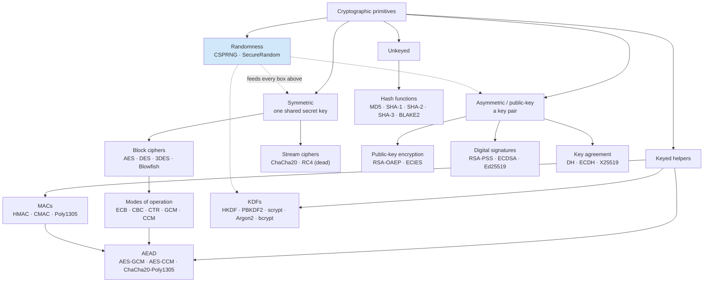

Read this top-down. There are exactly four families. **Symmetric** cryptography uses one key that both
sides hold; it is fast and does the bulk of the work. **Asymmetric** cryptography uses a mathematically
linked pair of keys where one can be published; it is thousands of times slower and is used only to
establish or authenticate, never to carry bulk data. **Unkeyed** primitives — hashes — take input and
produce a fixed-size fingerprint with no secret involved. **Keyed helpers** combine the others into
things you can actually use: MACs for integrity, KDFs for turning one secret into many, and AEAD for
doing confidentiality and integrity in a single, hard-to-misuse operation.

The dashed lines from **Randomness** matter more than they look. Every single one of those boxes
silently depends on unpredictable random numbers, and a failure there breaks the box above it
completely, with no visible symptom. That is why randomness gets its own section (3.9) and why
`new Random()` in key-generation code is a genuine finding.

### 2.2 Where crypto lives in the Android stack

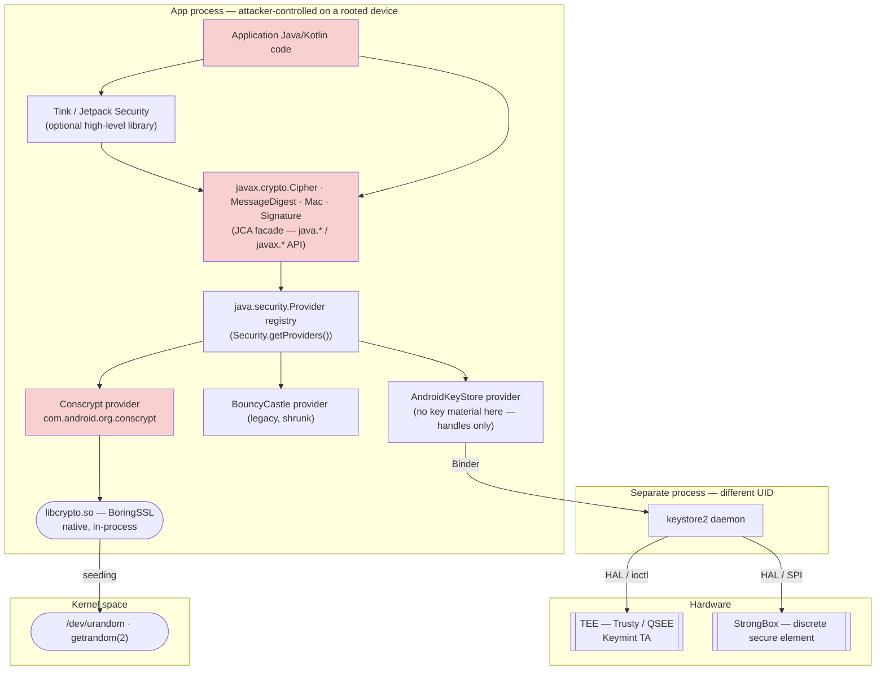

Everything shaded red is **inside the app's own process**, and therefore inside the attacker's reach
on a rooted or instrumented device. When an app calls `cipher.doFinal(plaintext)`, the key is a byte
array in that process's heap. Frida can read it. That is the whole basis of Section 7.

The two boxes that are *not* red are the interesting ones. The `AndroidKeyStore` provider does not
hold key bytes at all; it holds an opaque handle (an alias plus a blob) and forwards every operation
over Binder to the `keystore2` daemon, which in turn asks the Keymint Trusted Application inside the
TEE to perform the operation. The raw key never enters the app's address space, so no amount of
in-process instrumentation extracts it. You can still *use* it, by hooking the code that calls it, but
you cannot *exfiltrate* it. This distinction — "can I steal the key" versus "can I use the key while
the app is running" — is the single most important practical consequence of the Android crypto
architecture, and it is developed fully in [49-KeyStore](../49-KeyStore/README.md).

### 2.3 The JCA call flow, end to end

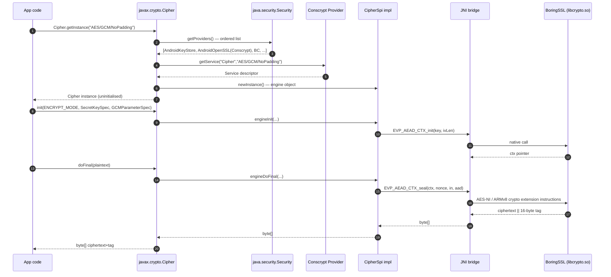

This sequence is worth memorising because every hooking decision you make follows from it. Notice
there are at least four distinct places you could intervene:

1. **At `Cipher.getInstance`** — you learn the transformation string. Cheap, and often enough to write
   the finding ("the app calls `getInstance("AES")`").
2. **At `Cipher.init`** — you learn the key object and the parameter spec (the IV). This is where the
   key is handed over as a `java.security.Key`, and for a `SecretKeySpec` you can call `getEncoded()`
   and read the raw bytes.
3. **At `Cipher.doFinal`** — you see plaintext going in and ciphertext coming out, or the reverse.
4. **At the BoringSSL boundary** — `EVP_AEAD_CTX_seal`, `AES_set_encrypt_key` and friends, reachable
   with `Interceptor.attach` on `libcrypto.so`. Only necessary when the app avoids the JCA entirely
   (Flutter, some native SDKs, and deliberately hardened apps).

Levels 2 and 3 together are what the universal Frida hook in
[`scripts/frida-jca-universal-hook.js`](scripts/frida-jca-universal-hook.js) implements.

### 2.4 The shape of a *correct* encryption operation

Here is the pattern you are looking for. Anything that deviates should raise a question.

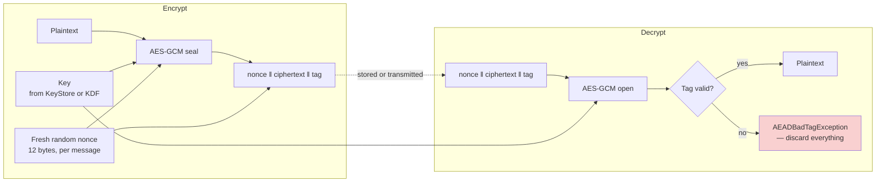

Four properties define a correct scheme, and you should check each one every time:

1. **The key comes from somewhere with real entropy** — hardware-backed storage, a proper KDF over a
   user secret, or a server. Never a constant in the code.
2. **The nonce is fresh for every single message** and is transmitted alongside the ciphertext. It is
   *not* secret. It must *never* repeat under the same key.
3. **Integrity is enforced** — either an AEAD mode does it for you (preferred), or an explicit MAC
   computed over the ciphertext, checked before decryption.
4. **A failed integrity check produces no output at all.** Not "returns the plaintext with a warning
   logged". Nothing.

---

## 3. Deep Internal Working

This is the long section. It is organised primitive by primitive. For each one you get: what problem
it solves, how it works internally, the Android API that exposes it, and how it fails.

### 3.1 Symmetric encryption: block ciphers

> **Definition**
> A **block cipher** is a keyed, invertible permutation on fixed-size blocks of bits. Given a key `K`,
> it maps every possible 128-bit input to a distinct 128-bit output, and the mapping is reversible if
> and only if you know `K`. It encrypts exactly one block; turning it into something that can encrypt
> a 40 KB file is the job of a **mode of operation** (Section 3.3).

#### 3.1.1 DES and 3DES — why they are dead

**DES** (Data Encryption Standard, 1977) has a 64-bit block and a **56-bit** effective key. Fifty-six
bits means 2⁵⁶ ≈ 7.2 × 10¹⁶ possible keys. In 1998 the EFF built a machine called Deep Crack that
brute-forced a DES key in about 56 hours for roughly USD 250,000. Today a modest cluster or a rented
FPGA farm does it in hours for a few dollars. DES provides no security whatsoever.

**3DES** (Triple DES) applies DES three times with two or three keys: `E(K3, D(K2, E(K1, P)))`. The
decrypt-in-the-middle construction exists so that setting `K1 = K2 = K3` degrades gracefully to plain
DES for backwards compatibility. 3DES has an effective strength of about 112 bits against key
recovery, which sounds adequate — but its **64-bit block size** is fatal. By the birthday bound, after
about 2³² blocks (32 GB) encrypted under one key in CBC mode, collisions between ciphertext blocks
become likely, and each collision leaks the XOR of two plaintext blocks. This is the **Sweet32**
attack, and it is why 3DES was formally deprecated. NIST disallowed 3DES for new applications after
2023.

| Cipher | Block size | Key size | Status | If you see it in an APK |
|---|---|---|---|---|
| DES | 64 bit | 56 bit | Broken since the 1990s | High-severity finding |
| 3DES / DESede | 64 bit | 112/168 bit | Deprecated (Sweet32) | Medium finding; recommend AES |
| Blowfish | 64 bit | 32–448 bit | Legacy; same 64-bit block problem | Medium |
| RC4 | stream | 40–2048 bit | Broken (biased keystream) | High |
| AES | 128 bit | 128/192/256 bit | Current standard | Fine — check the *mode* |
| ChaCha20 | stream | 256 bit | Current standard | Fine — check nonce handling |

> **Warning**
> `Cipher.getInstance("DES")` still works on Android through the BouncyCastle provider on many API
> levels. The platform will not stop a developer using a broken cipher. Absence of an exception is not
> evidence of security.

#### 3.1.2 AES — what it actually does

**AES** (Advanced Encryption Standard, standardised 2001, originally the Rijndael cipher) has a fixed
**128-bit (16-byte) block** and a key of 128, 192 or 256 bits. It is a **substitution-permutation
network**: the 16-byte block is arranged as a 4×4 byte grid (the "state"), and a number of rounds are
applied — 10 rounds for AES-128, 12 for AES-192, 14 for AES-256. Each round performs four steps:

| Step | What it does | Why it is there |
|---|---|---|
| `SubBytes` | Replaces each byte using a fixed 256-entry lookup table (the S-box) | Non-linearity — without it the whole cipher would be a solvable linear system |
| `ShiftRows` | Rotates row *i* of the grid left by *i* bytes | Diffusion across columns |
| `MixColumns` | Treats each column as a polynomial and multiplies it by a fixed polynomial in GF(2⁸) | Diffusion within a column — one input byte affects all four output bytes |
| `AddRoundKey` | XORs the state with a round key derived from the master key by the key schedule | Injects the secret |

The final round omits `MixColumns` so that decryption is structurally symmetric. The **key schedule**
expands the master key into one round key per round plus one for the initial whitening.

> **Under the Hood**
> On every ARMv8-A device — which is every 64-bit Android phone — AES is not executed as software
> table lookups. The CPU has dedicated instructions: `AESE` (encrypt round), `AESD` (decrypt round),
> `AESMC`/`AESIMC` (mix columns), plus `PMULL`/`PMULL2` for the GF(2¹²⁸) multiplication used by GCM.
> BoringSSL detects these via `getauxval(AT_HWCAP)` and selects a hardware path. Two consequences
> matter to you. First, AES is fast enough that "we used a weaker cipher for performance" is never a
> valid excuse on modern hardware. Second, the hardware path is **constant-time**, which eliminates the
> cache-timing side channels that plagued table-based AES implementations. An app that ships its own
> table-based AES in Java or in a bundled `.so` has given up both benefits.

You do not need to be able to implement AES. You need to know: 128-bit block, at least 128-bit key,
no practical attack better than brute force, and — critically — **AES by itself encrypts exactly 16
bytes and provides no integrity at all.** Everything interesting happens in the mode.

### 3.2 Symmetric encryption: stream ciphers

A **stream cipher** does not chop the message into blocks. It generates a pseudorandom **keystream**
from the key and a nonce, and XORs that keystream with the plaintext — exactly the one-time-pad
construction from Section 1.3, except the "pad" is generated deterministically rather than being truly
random.

**ChaCha20** (Daniel J. Bernstein, RFC 8439) is the stream cipher you will actually see. It takes a
256-bit key, a 96-bit nonce and a 32-bit block counter, and produces 64 bytes of keystream per
invocation of its core function. Internally it maintains a 4×4 grid of 32-bit words and performs 20
rounds of add-rotate-XOR ("ARX") operations — no lookup tables, therefore inherently constant-time in
software, which is why it is preferred on devices without AES hardware.

Because a stream cipher is a pad generator, all the one-time-pad rules apply with full force:

> **Warning**
> Reusing a (key, nonce) pair with any stream cipher — including AES in CTR or GCM mode, which are
> stream ciphers in disguise — means the same keystream is XORed with two different plaintexts. XOR the
> two ciphertexts together and the keystream cancels out, leaving `P1 ⊕ P2`. This is not a theoretical
> weakening. It is total plaintext recovery, and for GCM it is also total *forgery* capability.

### 3.3 Modes of operation

A block cipher encrypts 16 bytes. Your data is not 16 bytes. The **mode of operation** defines how to
chain block-cipher calls to handle arbitrary-length data, and it is where nearly all real-world
failures live.

#### 3.3.1 ECB — Electronic Codebook

Split the plaintext into 16-byte blocks. Encrypt each one independently with the same key.

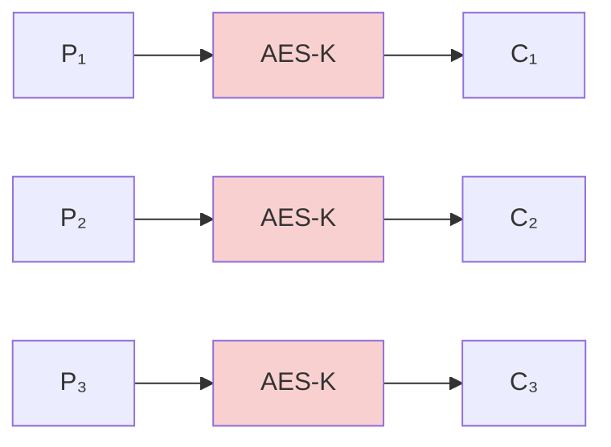

The diagram is the explanation of the flaw. There is no arrow between the blocks. Nothing carries
information from one block to the next. Therefore **identical plaintext blocks always produce
identical ciphertext blocks**.

This destroys semantic security. Consider a 4 KB PNG of a company logo encrypted with AES-ECB: every
run of identical pixels becomes an identical ciphertext block, and the outline of the logo remains
visible in the ciphertext. This is the famous "ECB penguin". Now consider something more relevant to
Android: an app that ECB-encrypts each field of a JSON object, or ECB-encrypts a fixed-format record.
An attacker who can request encryption of chosen data builds a dictionary mapping known plaintext
blocks to ciphertext blocks, then decrypts captured records by lookup — without ever recovering the
key.

ECB also provides **no integrity and no ordering guarantee**. An attacker can delete a block, duplicate
a block, or swap two blocks, and decryption still "succeeds", producing a rearranged plaintext. If the
ciphertext is `[user_id_block][balance_block]`, swapping blocks between two users' records is a direct
attack.

> **Pentester's Note**
> ECB is instantly recognisable without any key, and this is one of the few pure-ciphertext findings
> you can prove from a data file alone. Take the ciphertext, split it into 16-byte blocks, and count
> duplicates. If any 16-byte block appears twice in a body of data that should be high-entropy, the
> mode is ECB (or a broken CBC with a fixed IV encrypting identical messages). The script
> [`scripts/detect-ecb.py`](scripts/detect-ecb.py) automates exactly this over a directory pulled from
> a device.

**Severity:** ECB in a release build is at minimum Medium and usually High, because it is a
demonstrable loss of confidentiality and never has a valid justification.

#### 3.3.2 CBC — Cipher Block Chaining

CBC fixes the "no arrow between blocks" problem by XORing each plaintext block with the previous
*ciphertext* block before encrypting. The first block has no predecessor, so it is XORed with an
**Initialisation Vector (IV)**.

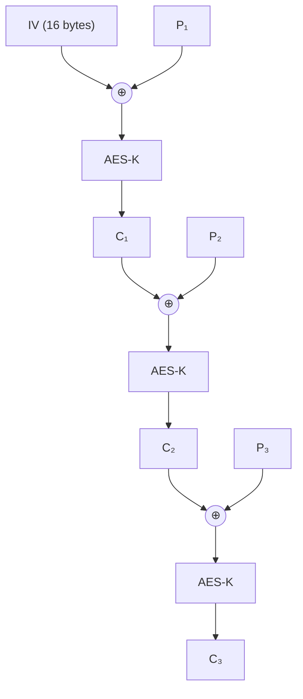

Formally: `Cᵢ = E_K(Pᵢ ⊕ C₍ᵢ₋₁₎)` with `C₀ = IV`. Decryption reverses it:
`Pᵢ = D_K(Cᵢ) ⊕ C₍ᵢ₋₁₎`.

**IV requirements for CBC**, which developers get wrong constantly:

| Requirement | Must hold? | Consequence of violation |
|---|---|---|
| Unique per message | **Yes** | Identical messages produce identical ciphertexts; an attacker learns when a message repeats, and can build a dictionary |
| Unpredictable before encryption | **Yes for CBC specifically** | If the attacker can predict the next IV and can choose plaintext, they can test guesses about earlier plaintext. This is the **BEAST** attack (CVE-2011-3389) against TLS 1.0, which used the previous record's last ciphertext block as the next IV |
| Secret | **No** | The IV is transmitted in the clear alongside the ciphertext, conventionally prepended |
| Same length as the block | **Yes** | 16 bytes for AES. A wrong length throws `InvalidAlgorithmParameterException` |

The correct Android idiom for CBC is to **let the provider generate the IV** on encryption and read it
back, then store it with the ciphertext:

```java
// Correct CBC: provider-generated random IV, stored with the ciphertext.
Cipher c = Cipher.getInstance("AES/CBC/PKCS5Padding");
c.init(Cipher.ENCRYPT_MODE, key);        // no IvParameterSpec → provider generates one
byte[] iv = c.getIV();                   // 16 random bytes from SecureRandom
byte[] ct = c.doFinal(plaintext);
byte[] out = ByteBuffer.allocate(iv.length + ct.length).put(iv).put(ct).array();
```

#### 3.3.3 The padding oracle attack — explained in full

CBC needs the plaintext to be a whole number of blocks, so it is padded (Section 3.5). On decryption
the implementation removes the padding, and if the padding is malformed it raises an error. That error
— if the attacker can observe it — is a **decryption oracle**. Understanding this attack completely is
a rite of passage, so here it is, step by step.

**Setup.** The attacker has a ciphertext `IV ‖ C₁ ‖ C₂` and can send arbitrary ciphertexts to the app
or server, observing only whether decryption reported "bad padding" or some other outcome. The
attacker wants `P₂`, the plaintext of block 2.

**The key identity.** Decryption computes `P₂ = D_K(C₂) ⊕ C₁`. Call `D_K(C₂)` the **intermediate
value** `I₂`. The attacker does not know `I₂`, but `I₂` depends **only on `C₂` and the key** —
it does not depend on `C₁` at all. So if the attacker sends `C₁' ‖ C₂` with a *forged* `C₁'`, the
receiver computes `P₂' = I₂ ⊕ C₁'`. The attacker fully controls `C₁'`, and therefore fully controls
`P₂'` in the sense of being able to shift it by any XOR mask.

**Step 1 — recover the last byte of `I₂`.** The attacker sets `C₁'` to 16 arbitrary bytes and iterates
the last byte `C₁'[15]` through all 256 values, sending `C₁' ‖ C₂` each time. The receiver computes
`P₂' = I₂ ⊕ C₁'` and then checks the padding. Valid PKCS#7 padding for the final block includes the
single-byte case `0x01`. So for exactly one value of `C₁'[15]` (barring a rare secondary case), the
last byte of `P₂'` equals `0x01` and the padding check passes.

At that moment the attacker knows:

```
P₂'[15] = 0x01
P₂'[15] = I₂[15] ⊕ C₁'[15]
  ⇒ I₂[15] = C₁'[15] ⊕ 0x01
```

The attacker has recovered one byte of the intermediate value, using at most 256 requests, **without
the key**.

**Step 2 — recover the real plaintext byte.** The genuine plaintext byte is
`P₂[15] = I₂[15] ⊕ C₁[15]`, where `C₁` is the *original* ciphertext block. The attacker knows `I₂[15]`
and has `C₁[15]`, so `P₂[15]` falls out immediately.

**Step 3 — move to the next byte.** Now target padding value `0x02`. The attacker sets
`C₁'[15] = I₂[15] ⊕ 0x02` (forcing the last plaintext byte to `0x02`) and brute-forces `C₁'[14]`
through 256 values until the padding `0x02 0x02` validates. That yields `I₂[14]`, hence `P₂[14]`.
Repeat for `0x03 0x03 0x03`, and so on.

**Cost.** 256 requests per byte in the worst case, 128 on average. A 16-byte block costs about 2,048
requests. A 1 KB ciphertext costs roughly 128,000 requests. On a local Android app with no network
round trip, that is seconds.

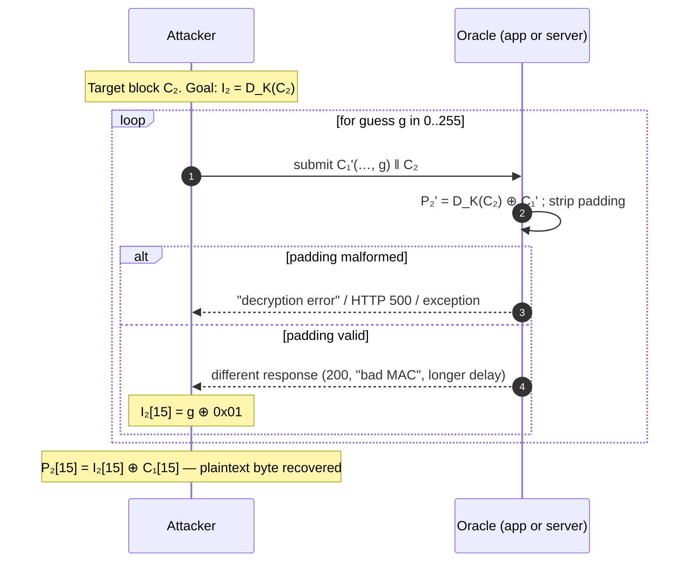

**What counts as an oracle?** Anything that distinguishes "padding was wrong" from "padding was right
but something else was wrong". In Android apps this shows up as:

- A caught `BadPaddingException` that logs a different message from a caught `IOException`.
- A UI that shows "corrupted data" for one case and "wrong password" for the other.
- A server endpoint returning HTTP 500 for bad padding and 403 for a failed authorisation check.
- **A timing difference**, even without any error message, because the MAC check is skipped when
  padding fails.

**The fix, and why it is the fix.** Use an AEAD mode (GCM), where there is exactly one failure mode and
the authentication tag is checked before any padding logic runs. If you must use CBC, apply
**encrypt-then-MAC**: compute an HMAC over `IV ‖ ciphertext`, and on decryption verify the HMAC with a
constant-time comparison **before** invoking the cipher at all. If the MAC fails you never decrypt, so
there is no padding to be wrong about.

> **Pentester's Note**
> To test for a padding oracle in an Android app, you do not need the network. Hook the decryption
> entry point with Frida, feed it mutated ciphertexts, and observe the exception type. If
> `BadPaddingException` is distinguishable from any other outcome — including by the app crashing
> versus not crashing — you have an oracle. Whether it is *exploitable* depends on whether an attacker
> can reach that entry point, which is where you must be honest in the report.

#### 3.3.4 CTR — Counter mode

CTR turns a block cipher into a stream cipher. Instead of encrypting the plaintext, it encrypts a
counter block, and XORs the result with the plaintext.

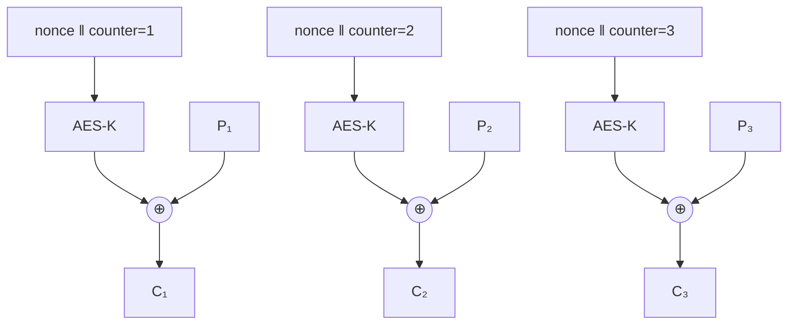

Properties: no padding is needed (the keystream is truncated to the plaintext length); encryption and
decryption are the same operation; blocks can be computed in parallel and in any order, which makes
random access into a large encrypted file possible. Notably, only the block cipher's **encrypt**
direction is ever used, in both directions of the protocol.

The counter block is conventionally `nonce ‖ counter`, e.g. a 12-byte nonce followed by a 4-byte
big-endian counter, giving 2³² blocks (64 GB) per nonce before the counter wraps.

CTR carries the full one-time-pad fragility. Reuse a (key, nonce) and you leak `P1 ⊕ P2`. Additionally
CTR is **completely malleable**: flipping bit *n* of the ciphertext flips bit *n* of the plaintext,
with no other effect. If the plaintext is `{"admin":false}` and the attacker knows the offset, they
flip the right bits to make it `{"admin":true }`. CTR alone is therefore never acceptable for data an
attacker can modify. It needs a MAC.

#### 3.3.5 GCM — Galois/Counter Mode, and the catastrophe of nonce reuse

**GCM** is CTR mode plus an authenticator, packaged as a single **AEAD** primitive.

> **Definition**
> **AEAD** — Authenticated Encryption with Associated Data. A single operation that provides
> confidentiality *and* integrity *and* can additionally authenticate (but not encrypt) extra data such
> as headers or a record ID. Encryption outputs ciphertext plus an **authentication tag**; decryption
> either returns the plaintext or fails, and returns nothing on failure.

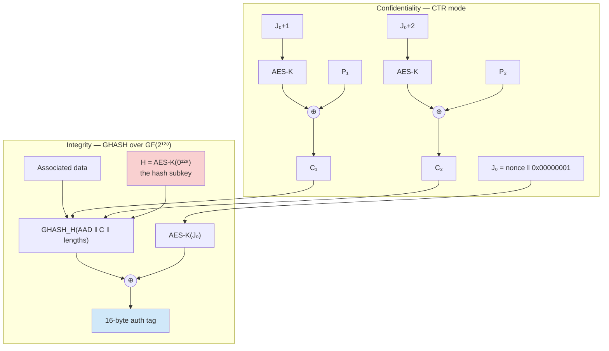

The upper half is exactly CTR mode. The lower half computes **GHASH**, a keyed universal hash over the
finite field GF(2¹²⁸). The hash subkey `H` is derived by encrypting an all-zero block with the AES key.
GHASH processes the associated data and the ciphertext as coefficients of a polynomial and evaluates
it at `H`. The result is XORed with `AES-K(J₀)` — the keystream block for counter zero — to produce the
tag.

**Now, why nonce reuse is catastrophic rather than merely bad.**

There are two independent disasters, and most explanations only mention the first.

**Disaster one — plaintext recovery.** GCM's confidentiality is CTR. Same key, same nonce, same
keystream. `C1 ⊕ C2 = P1 ⊕ P2`. If the attacker knows or can guess one plaintext (an HTTP header, a
JSON key, a fixed protocol prefix), they recover the other outright. This is the same failure as the
one-time pad, and it is bad enough on its own.

**Disaster two — authentication key recovery, which is total forgery.** This is the part that makes
nonce reuse *catastrophic*. Write the tag computation for a message with ciphertext blocks
`C₁ … C_n`, associated data blocks `A₁ … A_m`, and length block `L`. GHASH evaluates the polynomial:

```
GHASH_H = A₁·H^(m+n+1) ⊕ … ⊕ C₁·H^(n+1) ⊕ … ⊕ C_n·H^2 ⊕ L·H
Tag     = GHASH_H ⊕ AES-K(J₀)
```

Every term is a known ciphertext block multiplied by a power of the unknown `H`, and the whole thing is
masked by the unknown `AES-K(J₀)`. One equation, two unknowns — unsolvable.

Now suppose the attacker obtains **two** messages encrypted with the **same key and the same nonce**.
`J₀` is identical, so `AES-K(J₀)` is the *same unknown value* in both equations. XOR the two tags
together and that mask cancels:

```
Tag₁ ⊕ Tag₂ = GHASH_H(msg₁) ⊕ GHASH_H(msg₂)
```

The right-hand side is a polynomial in `H` whose coefficients are entirely known to the attacker (they
are the ciphertext and length blocks, all public). The attacker now has a polynomial equation over
GF(2¹²⁸) with a single unknown `H`. Polynomial root-finding over a finite field is a solved, fast
problem — Berlekamp's or Cantor–Zassenhaus algorithm. The attacker factors it, obtains a small
candidate set for `H`, and with a third message or a single verification query narrows it to one.

Once the attacker has `H`, they can compute `GHASH_H` for **any** message of their choosing. And they
also know `AES-K(J₀)` for that nonce, because `AES-K(J₀) = Tag₁ ⊕ GHASH_H(msg₁)` and every term is now
known. So for that nonce, the attacker can produce a valid tag for **any ciphertext they like**. They
can forge messages. If GCM is protecting an authorisation token, a firmware update, a transaction
record, or an IPC message, forging is game over — far worse than reading.

This attack is known in the literature as the "forbidden attack" against GCM, and it has been
demonstrated against real TLS servers that repeated nonces due to buggy random generation.

> **Warning**
> A single repeated (key, nonce) pair in AES-GCM does not degrade security gracefully. It hands the
> attacker the authentication subkey `H` and therefore unlimited forgery under that key. There is no
> partial credit. When you see a hardcoded or counter-restarted GCM IV in an Android app, that is a
> **High or Critical** finding, and this paragraph is the justification you write in the report.

**Practical GCM parameters:**

| Parameter | Correct value | Notes |
|---|---|---|
| Nonce length | **12 bytes (96 bits)** | The only length that is used directly as `J₀`. Any other length is first passed through GHASH, which is slower and slightly reduces the safety margin |
| Tag length | 128 bits (16 bytes) | Android's `GCMParameterSpec(tLen, iv)` takes `tLen` in **bits**. Passing `16` instead of `128` silently gives you a 2-byte tag — a forgery succeeds once every 65,536 tries |
| Max data per (key, nonce) | ~64 GB | The CTR counter is 32 bits |
| Max messages per key with random nonces | ~2³² | Birthday bound on a 96-bit nonce; beyond this, a repeat becomes likely. Use a counter, or rotate keys |

> **Warning**
> `new GCMParameterSpec(16, iv)` is a real and frequently shipped bug. The first argument is the tag
> length **in bits**. `16` means a 16-bit tag. Look for it specifically; it is easy to grep for and
> easy to miss by eye.

Additionally, the AndroidKeyStore provider enforces something the standard JCA does not: it **refuses
to let you supply an IV for encryption** with a GCM key (throwing on `init` with an
`IvParameterSpec`/`GCMParameterSpec` in encrypt mode, unless the key was created with
`setRandomizedEncryptionRequired(false)`). This is a deliberate anti-footgun. If you see
`setRandomizedEncryptionRequired(false)` in `KeyGenParameterSpec` builder code, the developer has
explicitly disabled that protection and you should find out why.

#### 3.3.6 CCM — Counter with CBC-MAC

CCM is the other standard AEAD built on AES: CTR mode for confidentiality plus CBC-MAC for
authentication, in a MAC-then-encrypt arrangement that is nonetheless proven secure for this specific
construction. It requires two block-cipher passes over the data (so it is roughly half the speed of
GCM on hardware with `PMULL`), and it cannot be computed online because the message length must be
known up front. You will meet it in constrained environments — Bluetooth LE, 802.11i/WPA2, and some
IoT protocols — rather than in ordinary app code. Its nonce rules are the same as GCM's: unique per
key, never repeated.

#### 3.3.7 ChaCha20-Poly1305

The modern alternative to AES-GCM, specified in RFC 8439. ChaCha20 provides the keystream; **Poly1305**
is a one-time authenticator that computes a tag using a key derived from the first 32 bytes of the
ChaCha20 keystream for that nonce.

The reason it exists: on hardware without AES instructions (older ARMv7 devices, some embedded chips),
software AES is both slow and vulnerable to cache-timing attacks, while ChaCha20 is fast and naturally
constant-time. TLS 1.3 clients typically offer both and let the server pick.

The nonce rule is identical and equally absolute. Poly1305's authentication key is derived from the
keystream, so reusing a nonce reveals the one-time authentication key and again yields forgery.

Android exposes it as `ChaCha20/Poly1305/NoPadding` (Conscrypt, API 28+) and `ChaCha20` for the raw
stream cipher.

#### 3.3.8 Mode comparison table

| Mode | Confidentiality | Integrity | Padding needed | Parallel | Nonce/IV rule | Verdict for new code |
|---|---|---|---|---|---|---|
| **ECB** | No (leaks patterns) | No | Yes | Yes | none | **Never.** Always a finding |
| **CBC** | Yes | No | Yes | Decrypt only | Random + unpredictable, 16 B | Only with encrypt-then-MAC |
| **CFB / OFB** | Yes | No | No | No | Unique | Legacy; avoid |
| **CTR** | Yes | No | No | Yes | Unique, never reused | Only with a MAC |
| **GCM** | Yes | Yes | No | Yes | Unique, 12 B, **never reused** | **Default choice** |
| **CCM** | Yes | Yes | No | Partly | Unique, never reused | Fine; constrained environments |
| **ChaCha20-Poly1305** | Yes | Yes | No | Yes | Unique, 12 B, **never reused** | **Default choice** where AES-NI absent |
| **XTS** | Yes | No | No | Yes | Sector number as tweak | Disk encryption only |

### 3.4 The IV / nonce / salt table — the distinction developers destroy

Three different values, all of them public, all of them "extra input alongside the key", and
constantly confused with each other. This table is the single most useful thing in this section. Print
it.

| Property | **IV** (Initialisation Vector) | **Nonce** (Number used ONCE) | **Salt** |
|---|---|---|---|
| **Used with** | Block cipher modes: CBC, CFB, OFB | Stream ciphers and AEAD: CTR, GCM, CCM, ChaCha20 | Key derivation and password hashing: PBKDF2, scrypt, Argon2, bcrypt, HKDF |
| **Purpose** | Make encryption of the same plaintext under the same key produce different ciphertext | Keep the keystream unique per message | Make the same password produce a different derived key on every account/device, defeating precomputation |
| **Must be secret?** | **No** | **No** | **No** |
| **Must be unique?** | **Yes**, per (key, message) | **Yes**, absolutely, per (key, message) | Yes, per user/record — but a collision is far less severe |
| **Must be random?** | **Yes for CBC** — must also be *unpredictable* in advance | **No** — a counter is not only acceptable but *preferred*, because it guarantees uniqueness where random values only make collisions unlikely | **Yes** — random, 16 bytes typical |
| **Typical length** | Block size: 16 bytes for AES | 12 bytes for GCM/ChaCha20 | 16 bytes |
| **Where is it stored?** | Prepended to the ciphertext | Prepended to the ciphertext | Stored alongside the hash / derived-key record |
| **Consequence of reuse** | CBC: identical prefixes leak; chosen-plaintext attacks become possible | **Catastrophic**: plaintext XOR leak *and* authentication key recovery → arbitrary forgery | Precomputed rainbow tables become effective across all users sharing the salt |
| **Consequence of being predictable** | BEAST-style chosen-plaintext attack | Same as reuse if the attacker can force a repeat | Minor, provided it is unique |
| **Consequence of being public** | None — it is designed to be public | None | None |

> **Mental Model**
> Think of the **key** as which lock you are using, the **IV/nonce** as which *starting position* the
> lock's tumblers are in for this particular message, and the **salt** as a per-user serial number
> stamped into the lock's manufacture so that two people with the same combination still get different
> locks. Losing the key is fatal. Repeating the nonce is fatal in a different way. Repeating the salt
> is a manufacturing shortcut that helps a mass-produced attack.

Three corollaries you will use in reports:

1. **"The IV is hardcoded but that's fine because the IV is public" is wrong.** Public and constant are
   different properties. The IV must be public *and* unique.
2. **"We use a random nonce so it's fine" is only fine up to the birthday bound.** With a 96-bit random
   nonce, after 2³² messages under one key the collision probability becomes non-negligible. A
   long-lived key on a chatty client can reach that. A counter avoids the issue entirely.
3. **Using the key as the IV, or the IV as part of the key, collapses two independent security
   properties into one.** You will see `new IvParameterSpec(key)` in real code. It is a finding.

### 3.5 Padding

Block modes need input that is an exact multiple of the block size. **PKCS#7** padding (called
`PKCS5Padding` in the Java API for historical reasons — PKCS#5 was defined for 8-byte blocks, but Java
uses the name for the generalised PKCS#7 scheme) appends `n` bytes, each with the value `n`, where `n`
is the number of bytes needed to reach the next block boundary.

| Plaintext length mod 16 | Padding appended |
|---|---|
| 15 | `01` |
| 14 | `02 02` |
| 10 | `06 06 06 06 06 06` |
| **0** | `10 10 … 10` — **a full extra block of sixteen `0x10` bytes** |

That last row surprises people. Padding is always added, even when the data already fits, because
otherwise the receiver could not tell padding from data.

Other schemes you may encounter:

| Padding | Description | Where seen |
|---|---|---|
| `NoPadding` | Input must already be a block multiple | CTR, GCM (correct); CBC with manual padding (suspicious) |
| `PKCS5Padding` / `PKCS7` | As above | The normal choice for CBC |
| `ISO10126Padding` | Random bytes, last byte is the count | Rare, deprecated |
| `ZeroBytePadding` / `X9.23` | Zero-fill | Ambiguous for binary data — a finding if data can end in `0x00` |
| `OAEPPadding` | For RSA — see 3.6 | Correct RSA encryption |
| `PKCS1Padding` | For RSA — legacy | Vulnerable to Bleichenbacher |

#### 3.5.1 The Android transformation-string trap

This is the most-cited Android crypto pitfall and you must know it precisely.

```java
Cipher c = Cipher.getInstance("AES");
```

A JCA transformation string has the form `algorithm/mode/padding`. When you give only the algorithm,
the **provider chooses the defaults**. For AES, the historical Java default — inherited by Android — is
**ECB with PKCS5Padding**. So `Cipher.getInstance("AES")` is exactly `Cipher.getInstance("AES/ECB/PKCS5Padding")`.

The developer wrote three characters and got the worst mode in the catalogue.

| API level | Behaviour |
|---|---|
| ≤ 27 | `getInstance("AES")` silently resolves to `AES/ECB/PKCS5Padding`. No warning at all |
| 28+ (Android 9) | Still resolves to ECB, but the platform logs a warning to logcat when the deprecated Crypto provider is requested; ECB itself is still not blocked |
| All | Android Lint (`GetInstance` check) and Google Play's pre-launch report flag it |

> **Warning**
> `Cipher.getInstance("AES")` and `Cipher.getInstance("RSA")` are both silent downgrades — the second
> resolves to `RSA/ECB/PKCS1Padding`. Always grep for `getInstance("` with a transformation string
> containing no `/`. It is one of the highest-yield greps in Android security review.

The same class of trap applies to a few other strings:

| Written | Actually means | Problem |
|---|---|---|
| `"AES"` | `AES/ECB/PKCS5Padding` | ECB |
| `"DES"` | `DES/ECB/PKCS5Padding` | Broken cipher and ECB |
| `"RSA"` | `RSA/ECB/PKCS1Padding` | PKCS#1 v1.5 padding (Bleichenbacher) |
| `"AES/ECB/NoPadding"` | itself | ECB, explicitly — no ambiguity, still a finding |

### 3.6 Asymmetric cryptography

#### 3.6.1 The problem it solves

Symmetric crypto requires both parties to already share a secret. How did they share it? If two people
have never met, symmetric cryptography alone cannot help them. Asymmetric cryptography — invented
publicly by Diffie and Hellman in 1976, and independently earlier at GCHQ — solves this by creating a
**key pair**: a private key that you never reveal, and a public key that you publish to the world. What
one key does, only the other can undo.

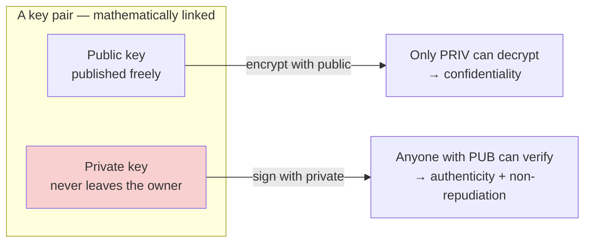

Two completely different operations share the same key pair, and confusing them is a classic error:

- **Encrypting** uses the **recipient's public** key; only the recipient's private key can decrypt.
- **Signing** uses the **signer's private** key; anyone with the signer's public key can verify.

#### 3.6.2 RSA — intuition, then reality

**Key generation intuition.** Pick two large random primes `p` and `q`, each around 1024 bits for a
2048-bit key. Multiply them: `n = p × q`. Publishing `n` is safe because factoring a 2048-bit product
of two large primes is, as far as anyone knows publicly, infeasible. Compute `φ(n) = (p−1)(q−1)`, pick
a public exponent `e` (almost universally 65537), and compute `d = e⁻¹ mod φ(n)`. The public key is
`(n, e)`; the private key is `(n, d)` plus the primes retained for the Chinese Remainder Theorem
speed-up.

**Textbook RSA** is `C = M^e mod n` and `M = C^d mod n`. It works, and it is **completely insecure** as
written, for reasons worth listing because they explain what padding is for:

| Textbook RSA flaw | Why |
|---|---|
| Deterministic | The same message always encrypts to the same ciphertext. An attacker with a small message space (a PIN, a yes/no, a card number) encrypts every candidate and compares |
| Malleable | `C₁ · C₂ mod n` decrypts to `M₁ · M₂`. An attacker can multiply a ciphertext by `2^e` to double the plaintext |
| Small-message weakness | If `M^e < n` — for example a short message with `e = 3` — there is no modular reduction, and the attacker just takes the integer cube root |
| Reveals equality | Two identical plaintexts to the same recipient are visibly identical |

**Padding fixes this.** Two schemes matter:

- **PKCS#1 v1.5** (`RSA/ECB/PKCS1Padding`): prepends `00 02 || random non-zero bytes || 00` to the
  message. It makes RSA randomised, but its structure enables **Bleichenbacher's adaptive
  chosen-ciphertext attack** (1998): a server that distinguishes "padding starts with 00 02" from any
  other failure is an oracle that lets an attacker decrypt a captured ciphertext in on the order of a
  million queries. Variants of this attack have resurfaced repeatedly (ROBOT, 2017). It is deprecated
  for encryption but is still, confusingly, the mandated scheme in some legacy protocols.
- **OAEP** (`RSA/ECB/OAEPWithSHA-256AndMGF1Padding`): Optimal Asymmetric Encryption Padding, which runs
  the message through a Feistel-like construction with a mask generation function (MGF1) built on a
  hash. It has a security proof and no equivalent oracle. **This is the only acceptable choice for RSA
  encryption in new code.**

> **Warning**
> The Android string `"RSA/ECB/OAEPWithSHA-256AndMGF1Padding"` has a notorious inconsistency: some
> providers interpret the MGF1 hash as SHA-1 even when the label hash is SHA-256. If you must use it,
> pass an explicit `OAEPParameterSpec(
> "SHA-256", "MGF1", MGF1ParameterSpec.SHA256, PSource.PSpecified.DEFAULT)` to `init`. Mismatched
> providers between the encrypting and decrypting side of an app cause "works on device A, fails on
> device B" bugs that developers frequently misdiagnose.

**For signatures**, the analogous pair is:

- **PKCS#1 v1.5 signatures** (`SHA256withRSA`) — still widely used and, unlike the encryption variant,
  not catastrophically broken, though implementation bugs (Bleichenbacher's "e=3 signature forgery",
  where a verifier fails to check the padding fully) have appeared repeatedly.
- **PSS** (`SHA256withRSA/PSS`) — probabilistic, provably secure, preferred for new designs.

**Why you never RSA-encrypt bulk data.** RSA can only encrypt a message smaller than the modulus minus
the padding overhead: for a 2048-bit key with OAEP-SHA256 that is 190 bytes. It is also on the order of
1,000 times slower than AES per byte. The universal design is **hybrid encryption**: generate a random
AES key, encrypt the data with AES-GCM, encrypt the *AES key* with RSA-OAEP, and transmit both. If you
find an app looping over a file calling RSA on each 190-byte chunk, you have found a developer who did
not know this, and that is worth a note even if it is not directly exploitable — such code invariably
has other problems.

**RSA key sizes:**

| Size | Status |
|---|---|
| 512 / 768 | Factored publicly. Broken |
| 1024 | Deprecated; considered within reach of well-resourced attackers. A finding |
| 2048 | Current minimum acceptable |
| 3072 | ~128-bit security; recommended for long-lived keys |
| 4096 | Common; slow key generation on mobile |

#### 3.6.3 Diffie–Hellman and ECDH — the colour-mixing analogy

Two people who have never met need a shared secret, over a channel where everything they say is
overheard. Here is how it works, in paint.

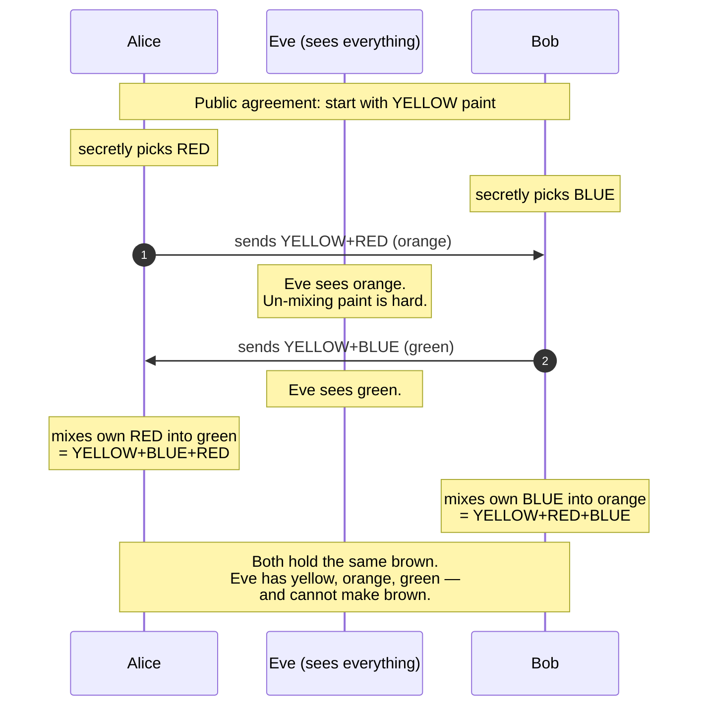

The mathematics replaces paint with modular exponentiation. Public parameters are a large prime `p`
and a generator `g`. Alice picks a secret `a` and sends `A = g^a mod p`. Bob picks `b` and sends
`B = g^b mod p`. Alice computes `B^a = g^(ba)`; Bob computes `A^b = g^(ab)`. They match. Eve, holding
`g`, `p`, `g^a` and `g^b`, would need to solve the **discrete logarithm problem** to recover `a` — and
no efficient classical algorithm is known.

**Elliptic-curve Diffie–Hellman (ECDH)** is the same protocol with the group replaced. Instead of
integers modulo a prime, points on an elliptic curve are used, with point addition as the group
operation. The advantage is enormous: the best known attacks on elliptic-curve discrete log are
generic square-root algorithms, so a 256-bit curve gives roughly the same security as a 3072-bit
finite-field DH or RSA modulus — with far smaller keys and far less computation. On a phone, that
matters.

> **Warning**
> Plain (unauthenticated) Diffie–Hellman is completely defeated by an active man-in-the-middle: Eve
> runs DH separately with Alice and with Bob, and relays. DH gives you a shared secret with
> *somebody*, not with the person you meant. Authentication — a signature or a certificate — is what
> binds the exchange to an identity. This is precisely what the TLS handshake in
> [35-SSL](../35-SSL/README.md) does, and why the certificate matters.

**Curves you will meet:**

| Curve | Also called | Notes |
|---|---|---|
| **P-256** | secp256r1, prime256v1 | The NIST curve; ubiquitous in TLS and in AndroidKeyStore EC keys. ~128-bit security |
| P-384, P-521 | secp384r1, secp521r1 | Higher security levels; slower |
| **Curve25519 / X25519** | — | Bernstein's curve, designed for fast, simple, misuse-resistant implementations. Used for key agreement. Every byte string is a valid public key, which eliminates a class of validation bugs |
| **Ed25519** | edwards25519 | The signature counterpart of Curve25519 (EdDSA). Deterministic nonces by construction |
| secp256k1 | — | Bitcoin's curve. In an Android app, its presence usually means cryptocurrency |

> **Under the Hood**
> A classic ECDH implementation bug is the **invalid curve attack**: the receiver does not verify that
> the peer's public key is actually a point on the agreed curve. An attacker sends a point on a
> different, weaker curve; the arithmetic still "works" and the resulting shared secret lives in a
> small subgroup, leaking the receiver's private key a few bits at a time over repeated exchanges. When
> auditing a custom ECDH implementation in a `.so`, check for point validation. X25519 is immune by
> design, which is one of the reasons it is preferred.

#### 3.6.4 ECDSA and the nonce catastrophe

**ECDSA** signs a message hash `h` with private key `d` using a **per-signature random value `k`**:

```
R = k·G          (a curve point; take r = x-coordinate of R mod n)
s = k⁻¹ · (h + r·d)  mod n
signature = (r, s)
```

Now solve that second equation for the private key:

```
d = (s·k − h) · r⁻¹  mod n
```

**If you know `k`, you have the private key.** Immediately, from a single signature. This makes `k` as
sensitive as the private key itself — which is why it is called a nonce, and why it must be
unpredictable and never reused.

**Reuse is worse still: two signatures with the same `k` give the key away without knowing `k`.**
Suppose `(r, s₁)` signs `h₁` and `(r, s₂)` signs `h₂` with the same `k`. Note `r` is identical in both,
which is how you *detect* the condition by inspection. Then:

```
s₁ − s₂ = k⁻¹(h₁ − h₂)      ⇒   k = (h₁ − h₂) / (s₁ − s₂)   mod n
```

and then `d` from the equation above. Two signatures, three lines of arithmetic, private key
recovered.

This is not hypothetical. It is exactly how the Sony PlayStation 3 code-signing key was recovered in
2010 — Sony's implementation used a **constant** `k`. It is also the mechanism behind repeated Bitcoin
key thefts from wallets with broken random number generators, including the 2013 Android
`SecureRandom` failure discussed in Section 3.9.

> **Pentester's Note**
> If an app produces ECDSA signatures, collect several and compare the `r` values. Identical `r` across
> two different messages means the same `k` was used, and you can recover the signing key with a short
> Python script. This is a spectacular, unambiguous finding. The same check applies to DSA.

The modern defence is **deterministic ECDSA** (RFC 6979), where `k` is derived by HMAC from the private
key and the message hash, removing the RNG from the equation entirely, or **Ed25519**, which is
deterministic by construction.

#### 3.6.5 Signing versus encrypting — a table you will need in interviews

| | Encryption | Signature |
|---|---|---|
| Key used to produce | Recipient's **public** key | Signer's **private** key |
| Key used to consume | Recipient's **private** key | Signer's **public** key |
| Property delivered | Confidentiality | Authenticity, integrity, non-repudiation |
| Who can produce | Anyone | Only the key holder |
| Who can consume | Only the key holder | Anyone |
| Size limit | Message must be smaller than the modulus | None — the *hash* is signed |
| Android transformation | `RSA/ECB/OAEPWithSHA-256AndMGF1Padding` | `SHA256withRSA/PSS`, `SHA256withECDSA` |
| Android class | `javax.crypto.Cipher` | `java.security.Signature` |

Notice the last row. On Android, encryption and signing use **different classes**. An app that
implements "signing" by calling `Cipher` with a private key is doing textbook RSA and is almost
certainly wrong.

### 3.7 Hash functions

> **Definition**
> A **cryptographic hash function** maps input of any length to a fixed-length output (a "digest"),
> such that it is infeasible to (a) find an input producing a given digest, (b) find a second input
> matching a given input's digest, or (c) find any two inputs with the same digest.

Those three properties have names, and the distinction between them decides severity:

| Property | Definition | Broken means |
|---|---|---|
| **Preimage resistance** | Given `H(x)`, cannot find `x` | Passwords hashed with it can be reversed |
| **Second-preimage resistance** | Given `x`, cannot find `y ≠ x` with `H(y) = H(x)` | An attacker can substitute a file for a *specific* known file |
| **Collision resistance** | Cannot find *any* `x ≠ y` with `H(x) = H(y)` | An attacker can craft *two* files that hash the same, and get one signed |

Collision resistance always breaks first, because of the **birthday bound**: for an `n`-bit digest,
collisions appear after about 2^(n/2) attempts, not 2^n. A 128-bit digest gives only 64 bits of
collision resistance.

| Hash | Digest size | Status | Verdict in an Android app |
|---|---|---|---|
| **MD5** | 128 bit | Collisions since 2004, chosen-prefix collisions cheap | Never for security. Finding |
| **SHA-1** | 160 bit | Collision demonstrated (SHAttered, 2017); chosen-prefix collision (2020) | Never for security. Finding. Still appears legitimately as a *non-security* identifier (e.g. Git object IDs) — judge by use |
| **SHA-224/256/384/512** | 224–512 bit | Secure | Correct choice. SHA-256 is the default |
| **SHA-512/256** | 256 bit | Secure, faster than SHA-256 on 64-bit CPUs | Fine |
| **SHA-3 (Keccak)** | 224–512 bit | Secure. Different internal construction (sponge) — immune to length extension | Fine; rarely seen on Android |
| **BLAKE2b / BLAKE2s** | up to 512 bit | Secure, very fast, keyed mode built in | Fine; seen in bundled native libraries |
| **BLAKE3** | 256 bit default | Secure, extremely fast, tree-structured | Rare on Android; increasing |
| CRC32 | 32 bit | **Not a cryptographic hash at all** | If used for integrity, it is a finding — trivially forgeable |

> **Warning**
> An app computing `MD5(password)` to store a credential is a serious finding, but so is an app
> computing `SHA-256(password)` with no salt and no work factor. A modern GPU computes tens of billions
> of SHA-256 hashes per second. Passwords need a **password hashing function** (Section 3.8), not a
> hash function.

#### 3.7.1 Length extension, and why HMAC exists

MD5, SHA-1 and SHA-2 all use the **Merkle–Damgård construction**: the message is padded, split into
blocks, and each block updates an internal chaining state; the final state *is* the digest.

That last clause is the problem. Since the digest *is* the complete internal state, an attacker who
knows `H(secret ‖ message)` and `len(secret)` — but **not the secret** — can resume the hash from that
state, append data of their choosing, and compute `H(secret ‖ message ‖ padding ‖ attacker_data)`
correctly. This is the **length-extension attack**.

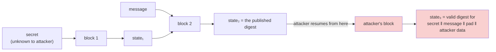

Concretely: a developer builds a "signature" as `SHA256(secret_key + request_body)` and sends it
alongside the request. An attacker who captures one valid pair can append `&admin=true` to the body,
compute the extended digest without the key, and produce a request that validates. This pattern is
common in home-grown mobile API signing schemes, and finding it is a real, high-impact result.

**HMAC** is the fix. Defined in RFC 2104:

```
HMAC(K, m) = H( (K ⊕ opad) ‖ H( (K ⊕ ipad) ‖ m ) )
```

where `ipad` is the byte `0x36` repeated and `opad` is `0x5C` repeated, both to the hash's block
length. The nested structure means the published value is the output of an *outer* hash whose input
included the key, so an attacker cannot resume anything useful. HMAC is proven secure even if the
underlying hash is only weakly collision-resistant, which is why HMAC-SHA1 is still considered safe
for authentication even though plain SHA-1 is not safe for signatures.

SHA-3 and BLAKE2 are not Merkle–Damgård (sponge and HAIFA constructions respectively) and are immune
to length extension, so `SHA3-256(key ‖ message)` is safe — but use HMAC anyway, because it is what
everyone reviewing your code expects.

### 3.8 MACs and KDFs

#### 3.8.1 Message Authentication Codes

| MAC | Built on | Android name | Notes |
|---|---|---|---|
| **HMAC-SHA256** | Hash function | `HmacSHA256` | The default choice. Also `HmacSHA1`, `HmacSHA512` |
| **CMAC** | Block cipher (AES) | `AESCMAC` (BC) | Used where only a block cipher is available; standard in smartcards |
| **Poly1305** | One-time universal hash | via `ChaCha20/Poly1305` | Only safe as part of an AEAD — its key must never be reused |
| **GMAC** | GHASH | via AES-GCM with empty plaintext | Authenticates without encrypting |

> **Warning**
> Comparing MACs with `Arrays.equals()` or `String.equals()` introduces a **timing side channel**,
> because those methods return as soon as they find a differing byte. An attacker who can measure
> response time recovers the correct tag byte by byte. Use `MessageDigest.isEqual(a, b)`, which is
> documented to be constant-time on Android and modern Java. This is a real finding and a good one,
> because it is easy to grep for and developers are surprised by it.

#### 3.8.2 Encrypt-then-MAC versus MAC-then-encrypt

If you are combining a cipher and a MAC by hand — which you should avoid, but which you will
encounter — the order matters.

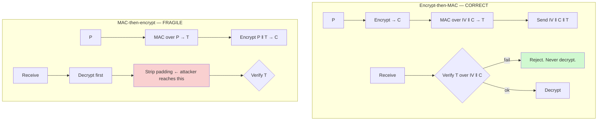

**Encrypt-then-MAC** is the only construction that is generically secure. The MAC covers the
ciphertext and the IV, so an attacker who tampers with anything is rejected before a single byte of
ciphertext reaches the decryption routine. There is no padding oracle, because padding is never
examined on forged input.

**MAC-then-encrypt** forces the receiver to decrypt and unpad *before* it can check the MAC. That is
exactly the padding-oracle setup from Section 3.3.3. TLS 1.0–1.2 used MAC-then-encrypt for CBC cipher
suites, and the consequences (Lucky 13, POODLE against SSL 3.0) took a decade to clean up. TLS 1.3
removed CBC entirely and mandates AEAD.

**Encrypt-and-MAC** (MAC the plaintext, send both separately) leaks equality of plaintexts through the
MAC and is also unsafe.

The practical advice: **do not build this by hand. Use AES-GCM, or use Tink.** If you must, use
encrypt-then-MAC with a *separate* MAC key derived from the master key by HKDF, never the same key for
both.

#### 3.8.3 Key derivation functions

> **Definition**
> A **KDF** turns one piece of keying material into one or more cryptographic keys of the required
> length, with the guarantee that the outputs are independent and that the input is not recoverable.

There are two families and they solve different problems. Confusing them is one of the most common
design errors.

**Password-based KDFs (slow, deliberately).** The input is a low-entropy human password. The threat is
offline brute force. The defence is to make each guess expensive.

| KDF | Parameters | Hardness | Verdict |
|---|---|---|---|
| **PBKDF2** | iterations, salt, PRF (HMAC-SHA256) | CPU only — GPU/ASIC friendly | Acceptable, widely available, needs high iteration counts |
| **bcrypt** | cost factor (log₂ rounds), salt | CPU + small memory (4 KB) | Good for passwords; 72-byte input limit |
| **scrypt** | N (CPU/memory cost), r, p, salt | CPU + large memory | Good; memory-hard defeats GPUs |
| **Argon2id** | time, memory, parallelism, salt | CPU + memory + side-channel resistant | **Best choice** (winner of the 2015 Password Hashing Competition) |

**PBKDF2 iteration counts** — the number developers get wrong most often, usually by copying a
tutorial from 2011:

| Year / source | Recommended iterations (PBKDF2-HMAC-SHA256) |
|---|---|
| RFC 8018 original guidance (2000) | 1,000 — **hopelessly low today** |
| Common copied-from-blog value | 1,000 or 10,000 — **too low** |
| OWASP current guidance | **600,000** for PBKDF2-HMAC-SHA256 |
| OWASP current guidance | 1,300,000 for PBKDF2-HMAC-SHA1 |
| Practical mobile compromise | ≥ 100,000, measured to take ~100 ms on the target's *slowest* supported device, and recorded in the stored record so it can be raised later |

> **Pentester's Note**
> When you find PBKDF2 in an app, extract three things: the **iteration count**, the **salt** (is it
> per-user and random, or the string `"salt"`?), and the **PRF**. An iteration count of 1,000 with a
> constant salt means you can crack the derived key offline at hundreds of millions of guesses per
> second on a single GPU. Report it with a measured cracking rate; numbers persuade where adjectives do
> not.

**Key-based KDFs (fast).** The input is already high-entropy — a Diffie–Hellman shared secret, a random
master key, a key from the KeyStore. There is nothing to brute force, so slowness would be pointless.

**HKDF** (RFC 5869) is the standard, and it has two distinct phases:

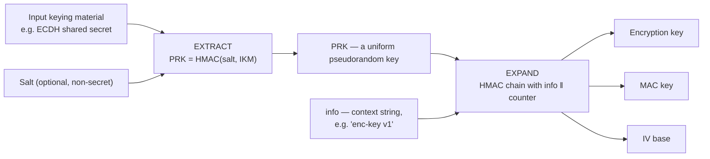

**Extract** takes possibly-non-uniform input (a DH shared secret has structure — it is a curve point,
not a uniform bit string) and concentrates it into a uniformly random pseudorandom key. **Expand**
stretches that into as much output as you need, with an `info` parameter that **domain-separates** the
outputs: the same PRK with `info = "enc"` and `info = "mac"` produces two independent keys. That is how
you correctly derive an encryption key and a MAC key from one master secret, and it is the right answer
to "should I use the same key for AES and HMAC?" (No. Derive two.)

Android exposes HKDF through Tink and through BouncyCastle; there is no `javax.crypto` HKDF in the
platform API until relatively recently, so seeing a hand-rolled version is normal — check it against
RFC 5869 carefully.

### 3.9 Randomness

Every key, every IV, every nonce, every salt, every ECDSA `k` comes from a random number generator. If
that generator is predictable, everything above it collapses, and — critically — **nothing looks
wrong**. Ciphertext still looks like noise. Tests still pass.

> **Definition**
> A **PRNG** (pseudorandom number generator) produces a deterministic stream from a seed; it is
> designed for statistical quality, not unpredictability. A **CSPRNG** (cryptographically secure PRNG)
> additionally guarantees that an attacker who sees any amount of output cannot predict the next bit
> better than chance, and cannot recover previous output if they later compromise the state.

| Class | Type | Seeded from | Safe for keys? |
|---|---|---|---|
| `java.util.Random` | Linear congruential, **48-bit** state | `System.nanoTime()` by default | **No. Never.** |
| `java.util.concurrent.ThreadLocalRandom` | Same family | Same | **No** |
| `Math.random()` | Wraps `java.util.Random` | Same | **No** |
| `java.security.SecureRandom` | Provider-backed CSPRNG | `/dev/urandom` via Conscrypt/BoringSSL | **Yes** |
| `SecureRandom.getInstanceStrong()` | Blocking source on some platforms | Kernel entropy pool | Yes; may block — rarely needed on Android |
| Kernel `getrandom(2)` / `/dev/urandom` | ChaCha20-based kernel CSPRNG | Hardware RNG, interrupt timing, boot seed | Yes |

**Why `java.util.Random` is fatal.** Its state is 48 bits. Given two consecutive `nextInt()` outputs, an
attacker recovers the internal seed by brute force over at most 2⁴⁸ candidates — hours on commodity
hardware, and far less with a meet-in-the-middle. Worse, the default seed is derived from the current
time in nanoseconds. If an attacker can estimate when the key was generated to within a second, the
search space is roughly 10⁹, which is instant. An "AES-256 key" generated by `new Random()` has, in
practice, at most 48 bits of entropy and often far less.

```java
// FINDING — this key has at most 48 bits of entropy, not 256.
byte[] key = new byte[32];
new Random().nextBytes(key);
```

```java
// CORRECT
byte[] key = new byte[32];
new SecureRandom().nextBytes(key);

// BETTER — let the provider generate a proper key object
KeyGenerator kg = KeyGenerator.getInstance("AES");
kg.init(256);                     // uses SecureRandom internally
SecretKey key = kg.generateKey();
```

**The Android history you should know.** In August 2013, a flaw in the Android platform's
`SecureRandom` implementation — a failure to properly seed the OpenSSL PRNG in certain application
contexts — caused some apps, notably Bitcoin wallets, to generate ECDSA signatures with repeating `k`
values, allowing private key recovery and real theft of funds. Google's fix was twofold: patch the
platform, and publish guidance for applications to explicitly seed `SecureRandom` from
`/dev/urandom`. The lesson that survives is architectural: on modern Android, `SecureRandom` is backed
by Conscrypt and ultimately by the kernel's `getrandom(2)`, and **you must not "help" it by calling
`setSeed()` with your own value**.

> **Warning**
> `SecureRandom.setSeed(seed)` on Android **replaces** rather than supplements the seed in some
> provider implementations, historically including the old Crypto provider. Code of the form
> `SecureRandom sr = SecureRandom.getInstance("SHA1PRNG"); sr.setSeed(password.getBytes());
> kg.init(256, sr);` is a **key-derivation-by-PRNG anti-pattern** that produces a fully deterministic
> key from the password with no salt and no work factor. This exact snippet has circulated on Stack
> Overflow for over a decade and appears in production apps. It is a High-severity finding: any
> attacker who knows the password (or can brute force it at billions of guesses per second) has the
> key, and the derivation is not even stable across Android versions, which is how developers usually
> discover it — as a data-loss bug.

**Requesting `"SHA1PRNG"` specifically is itself a smell.** The algorithm name is not standardised
across providers, its behaviour has differed between Android versions, and there is no reason to
request it. `new SecureRandom()` gives you the best available provider default.

**How to spot bad randomness in code:**

| Signal | What to check |
|---|---|
| `new Random()`, `Math.random()`, `ThreadLocalRandom` near crypto | Always a finding if the output becomes a key, IV, nonce, salt or token |
| `SecureRandom.setSeed(` with a derived or constant value | Determinism |
| `System.currentTimeMillis()` used as a seed or as a nonce | Predictable |
| `UUID.randomUUID()` used as a **key** | It is 122 bits of `SecureRandom` output formatted as text — acceptable entropy for a token, but the *string form* used directly as key bytes gives you ASCII hex, i.e. 4 bits per byte |
| A "random" value with a fixed length that is always hex or Base64 | Check whether the entropy is in the bytes or only in the encoding |
| `hashCode()`, `nanoTime()`, `android_id`, IMEI as key material | Not secret, not random |

**How to spot it in data.** Pull the app's stored ciphertext and run entropy analysis: true ciphertext
is indistinguishable from random and will score close to 8.0 bits/byte. Repeating IVs across records,
sequential nonces starting from zero on each app launch, and identical ciphertext prefixes for
different records are all visible without any code. The lab in
[`labs/lab-03-audit-a-real-app.md`](labs/lab-03-audit-a-real-app.md) walks through this.

### 3.10 Digital signatures and PKI in one page

A **digital signature** over a message `m` with private key `d` is, in every practical scheme,
`Sign(d, H(m))` — the hash is signed, not the message, because asymmetric operations are size-limited
and slow. Verification recomputes `H(m)` and checks it against the signature using the public key.

That gives you authenticity — but only if you know the public key belongs to who you think. Solving
*that* is **PKI** (Public Key Infrastructure): a chain of signatures rooted in a key you already trust.

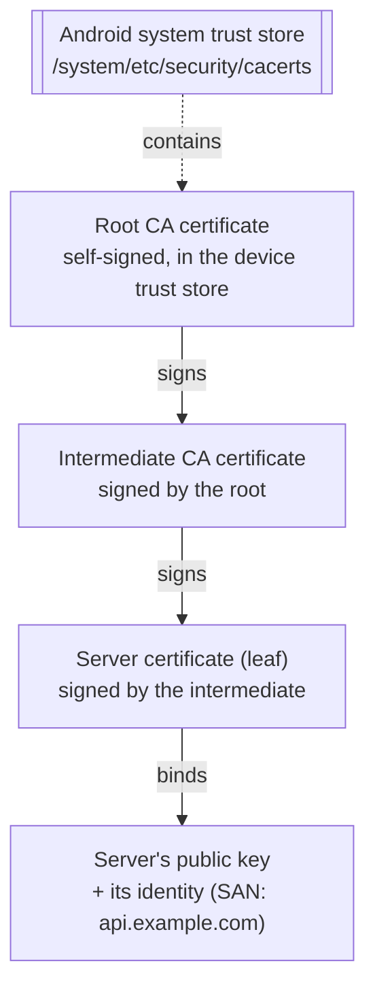

The full treatment — X.509 field by field, chain building, validation order, name constraints,
revocation — is in [35-SSL](../35-SSL/README.md) Section 3. What matters here is the shape: signatures
give authenticity, and PKI turns a small set of pre-trusted keys into trust in an unbounded set of
identities.

Android itself uses signatures in several places you should recognise:

| Use | Scheme | Chapter |
|---|---|---|
| APK signing (v1 JAR, v2/v3/v4 APK Signature Scheme) | RSA or ECDSA over SHA-256 | [10-APK-Internals](../10-APK-Internals/README.md) |
| Verified Boot (AVB) | RSA over the vbmeta hash tree | [20-Security-Architecture](../20-Security-Architecture/README.md) |
| Key Attestation | ECDSA chain rooted in a Google-held key | [50-HardwareBackedSecurity](../50-HardwareBackedSecurity/README.md) |
| Play Integrity / SafetyNet responses | JWS (RSA or ECDSA) | [38-TamperDetection](../38-TamperDetection/README.md) |
| TLS certificates | RSA/ECDSA | [35-SSL](../35-SSL/README.md) |

### 3.11 The Java Cryptography Architecture on Android

#### 3.11.1 The provider model

The JCA is a **service provider framework**. Application code names an *algorithm*; the runtime finds a
*provider* that implements it. This indirection is why the same code can be hardware-backed on one
device and pure software on another, and it is why "which provider ran my code?" is a real question you
must sometimes answer.

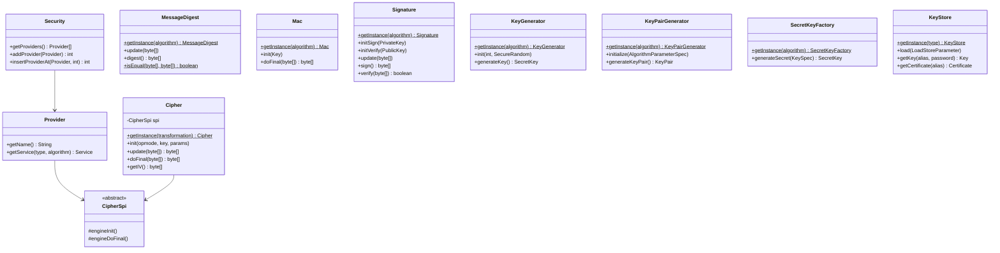

**The engine classes and what each is for:**

| Class | Purpose | Key methods to hook |
|---|---|---|
| `javax.crypto.Cipher` | Symmetric and asymmetric encryption/decryption | `getInstance`, `init`, `update`, `doFinal`, `getIV` |
| `java.security.MessageDigest` | Hashing | `getInstance`, `update`, `digest`, `isEqual` |
| `javax.crypto.Mac` | Keyed authentication | `getInstance`, `init`, `doFinal` |
| `java.security.Signature` | Sign and verify | `initSign`, `initVerify`, `update`, `sign`, `verify` |
| `javax.crypto.KeyGenerator` | Generate symmetric keys | `init`, `generateKey` |
| `java.security.KeyPairGenerator` | Generate asymmetric key pairs | `initialize`, `generateKeyPair` |
| `javax.crypto.SecretKeyFactory` | Convert between key specs — this is where PBKDF2 lives | `generateSecret` |
| `javax.crypto.KeyAgreement` | DH / ECDH | `init`, `doPhase`, `generateSecret` |
| `java.security.KeyStore` | Store and retrieve keys and certificates | `load`, `getKey`, `getCertificate`, `setEntry` |
| `java.security.SecureRandom` | CSPRNG | `nextBytes`, `setSeed` |
| `javax.crypto.spec.SecretKeySpec` | Wraps raw key bytes into a `Key` — **the constructor is where raw keys become visible** | `<init>`, `getEncoded` |
| `javax.crypto.spec.IvParameterSpec` | Wraps raw IV bytes | `<init>`, `getIV` |
| `javax.crypto.spec.GCMParameterSpec` | Tag length + IV | `<init>` |
| `javax.crypto.spec.PBEKeySpec` | Password, salt, iterations, key length | `<init>` |

> **Pentester's Note**
> `SecretKeySpec.<init>(byte[], String)` is the single highest-value hook in Android crypto. Every raw
> symmetric key that is *not* hardware-backed must pass through it, because that is the only way to turn
> a `byte[]` into something `Cipher.init` accepts. Hook the constructor and you capture every software
> key the app uses, regardless of how it was obtained or obfuscated. This is why the universal script in
> Section 7 hooks constructors and not just methods.

#### 3.11.2 The providers on Android

```java
// Print the provider list and what each supplies — run this in a test app or via Frida.
for (Provider p : Security.getProviders()) {
    Log.i("CRYPTO", p.getName() + " v" + p.getVersion() + " — " + p.getInfo());
}
```

| Provider | Backed by | Supplies | Notes |
|---|---|---|---|
| **AndroidKeyStore** | `keystore2` daemon → Keymint TA in TEE/StrongBox | `KeyStore`, `KeyGenerator`, `KeyPairGenerator`, `Cipher`, `Mac`, `Signature` for keystore-resident keys | Key material never enters the app process. Highest priority for keystore aliases |
| **AndroidOpenSSL** (Conscrypt) | BoringSSL via JNI | Almost everything: AES, RSA, EC, SHA-2, HMAC, TLS | The default and the one you want. Hardware-accelerated |
| **BC** (Bouncy Castle) | Pure Java, trimmed AOSP fork | Legacy algorithms Conscrypt does not implement | Progressively reduced across API levels |
| **Crypto** | Old, `SHA1PRNG` and `SHA1withDSA` only | — | **Removed in API 28.** Requesting it throws `NoSuchProviderException` |
| **AndroidNSSP** | Network Security Config plumbing | — | Not directly used by apps |
| **Conscrypt (Google Play Services / JetPack)** | Updatable BoringSSL | Same as AndroidOpenSSL but newer | Installed by `ProviderInstaller.installIfNeeded()` — inserts at position 1 |

**Version Matrix — provider behaviour by API level:**

| API level | Android | Change relevant to you |
|---|---|---|
| 19 (4.4) | KitKat | `AndroidKeyStore` supports only asymmetric keys |
| 23 (6.0) | Marshmallow | `AndroidKeyStore` gains **symmetric (AES, HMAC)** key support; `KeyGenParameterSpec` introduced; `setUserAuthenticationRequired` available |
| 24 (7.0) | Nougat | BC provider trimmed heavily; many `BC` algorithm names removed in favour of Conscrypt. Apps requesting `"BC"` explicitly start to break |
| 26 (8.0) | Oreo | Conscrypt becomes the default for more algorithms |
| 28 (9.0) | Pie | **Crypto provider removed.** `getInstance("SHA1PRNG", "Crypto")` throws. StrongBox (`setIsStrongBoxBacked`) introduced. Conscrypt becomes a mainline module |
| 29 (10) | Q | Conscrypt updatable via Play; `ChaCha20-Poly1305` widely available |
| 30 (11) | R | `KeyStore` 2.0 groundwork; attestation improvements |
| 31 (12) | S | **keystore2** replaces the old keystore daemon; Keymint replaces Keymaster |
| 33 (13) | T | Key attestation and ECDH via keystore improvements |
| 34+ (14+) | U | Conscrypt in an APEX module; trust store handling changes (see [35-SSL](../35-SSL/README.md)) |

#### 3.11.3 Tink — the recommended way out

Google's **Tink** library exists because the JCA is a *primitive-level* API and primitives are easy to
misuse. Tink is a *misuse-resistant* API: there is no way to specify ECB, no way to supply your own
nonce, no way to forget the MAC.

```java
// Tink AEAD — the whole correct pattern in six lines.
AeadConfig.register();
KeysetHandle handle = AndroidKeysetManager.Builder()
        .withSharedPref(context, "keyset", "prefs_file")
        .withKeyTemplate(AeadKeyTemplates.AES256_GCM)
        .withMasterKeyUri("android-keystore://my_master_key")   // wraps the keyset with a KeyStore key
        .build()
        .getKeysetHandle();
Aead aead = handle.getPrimitive(Aead.class);
byte[] ct = aead.encrypt(plaintext, associatedData);
byte[] pt = aead.decrypt(ct, associatedData);
```

Everything you spent Section 3 learning to check is handled: the algorithm is AES-256-GCM, the nonce is
generated fresh and prepended automatically, the tag is 128 bits, the keyset is wrapped by an
AndroidKeyStore master key so the raw key is never stored in plaintext, and key rotation is a
first-class concept.

**Jetpack Security** (`androidx.security:security-crypto`, providing `EncryptedSharedPreferences` and
`EncryptedFile`) is a thin wrapper over Tink.the original `security-crypto` library entered
maintenance mode and Google's current guidance has shifted; when you see it, check the version and
whether the app pins a `MasterKey` correctly. Its presence is generally a *good* sign compared with
hand-rolled crypto, but verify that the master key alias uses
`MasterKey.KeyScheme.AES256_GCM` and that the app is not simultaneously storing the same data
unencrypted elsewhere — which is a surprisingly common finding.

> **Mental Model**
> There are three tiers of Android crypto code, and you can grade an app in thirty seconds by which
> tier it is in. **Tier 1**: it uses Tink or Jetpack Security — probably fine, verify configuration.
> **Tier 2**: it uses the JCA directly with AES/GCM and AndroidKeyStore — plausible, audit the details.
> **Tier 3**: it uses the JCA with `SecretKeySpec` built from bytes in the code — start writing the
> finding.

---
## 4. Source Code Walkthrough (AOSP)

The point of this section is not to memorise line numbers. It is to be able to answer, from primary
sources, questions like "does `Cipher.getInstance("AES")` really default to ECB on this platform?" and
"where does `SecureRandom` actually get its bytes?" — because a client's developer will eventually
dispute one of your findings, and the AOSP tree settles the argument.

### 4.1 The libcore / JCA layer

Android's `java.*` and `javax.*` classes come from **libcore**, which is a fork of OpenJDK plus Android
additions.

| Path | Contents |
|---|---|
| `libcore/ojluni/src/main/java/javax/crypto/Cipher.java` | The `Cipher` facade — `getInstance`, transformation parsing, provider selection |
| `libcore/ojluni/src/main/java/javax/crypto/CipherSpi.java` | The abstract engine that providers implement |
| `libcore/ojluni/src/main/java/javax/crypto/KeyGenerator.java` | Symmetric key generation |
| `libcore/ojluni/src/main/java/javax/crypto/Mac.java` | MAC facade |
| `libcore/ojluni/src/main/java/javax/crypto/spec/SecretKeySpec.java` | The raw-bytes-to-Key wrapper |
| `libcore/ojluni/src/main/java/java/security/MessageDigest.java` | Hash facade, including `isEqual` |
| `libcore/ojluni/src/main/java/java/security/Signature.java` | Signature facade |
| `libcore/ojluni/src/main/java/java/security/SecureRandom.java` | CSPRNG facade |
| `libcore/ojluni/src/main/java/java/security/Security.java` | Provider registry |
| `libcore/luni/src/main/java/java/security/Security.java` (older trees) | Android-specific provider ordering |

**Transformation parsing.** `Cipher.getInstance(String transformation)` tokenises on `/`. The parser
recognises exactly three shapes:

1. `"algorithm"` — one token. The provider is asked for a service named exactly `Cipher.<algorithm>`,
   and that service's implementation picks its own mode and padding.
2. `"algorithm/mode/padding"` — three tokens. The lookup is attempted in order for
   `Cipher.<alg>/<mode>/<pad>`, then `Cipher.<alg>/<mode>` with padding set separately, then
   `Cipher.<alg>//<pad>` with mode set separately, then `Cipher.<alg>` with both set separately.
3. Anything else throws `NoSuchAlgorithmException`.

The important consequence is case (1): **when you pass only the algorithm, no mode or padding is ever
requested, so the provider's built-in default applies.** For Conscrypt's AES implementation that
default is ECB with PKCS#5 padding, matching the JCA's historical behaviour. This is the AOSP-level
answer to "is `getInstance("AES")` really ECB?" — yes, and here is where to look.

**`SecretKeySpec`.** Read this class and note two things. First, the constructor performs
`this.key = key.clone()` — the key bytes are copied, so zeroing your original array afterwards does not
zero the copy inside the spec. Second, `getEncoded()` returns another clone. Both facts matter for
memory-forensics work: a single "one key" in the developer's mind is several arrays on the heap, and
`SecretKeySpec` has no `destroy()` implementation that actually wipes them on most Android versions.

```java
// libcore/ojluni/src/main/java/javax/crypto/spec/SecretKeySpec.java — illustrative excerpt
public SecretKeySpec(byte[] key, String algorithm) {
    if (key == null || algorithm == null) throw new IllegalArgumentException("Missing argument");
    if (key.length == 0) throw new IllegalArgumentException("Empty key");
    this.key = key.clone();
    this.algorithm = algorithm;
}
```

That `clone()` is why hooking the *constructor* is reliable: whatever gymnastics the app performed to
assemble the key array, it must hand a plain `byte[]` to this method.

### 4.2 Conscrypt — where the work happens

Conscrypt is Android's JCA provider backed by BoringSSL. It ships both in the platform and as a
Mainline module.

| Path | Contents |
|---|---|
| `external/conscrypt/common/src/main/java/org/conscrypt/OpenSSLProvider.java` | Registers every algorithm the provider supplies — the authoritative list of what Conscrypt offers |
| `external/conscrypt/common/src/main/java/org/conscrypt/OpenSSLCipher.java` | The `CipherSpi` implementations for AES/DES/etc, including mode and padding handling |
| `external/conscrypt/common/src/main/java/org/conscrypt/OpenSSLEvpCipherAES.java` | AES specifically |
| `external/conscrypt/common/src/main/java/org/conscrypt/OpenSSLAeadCipher.java` | The AEAD path — GCM and ChaCha20-Poly1305 |
| `external/conscrypt/common/src/main/java/org/conscrypt/NativeCrypto.java` | The JNI declarations — every `native` method that crosses into BoringSSL |
| `external/conscrypt/common/src/jni/main/cpp/conscrypt/native_crypto.cc` | The JNI implementations |
| `external/boringssl/src/crypto/fipsmodule/aes/` | AES itself, including the ARMv8 assembly |
| `external/boringssl/src/crypto/fipsmodule/modes/gcm.c` | GCM and GHASH |
| `external/boringssl/src/crypto/rand/` | The random number generator |

**Reading `OpenSSLProvider.java` is a genuinely useful exercise.** It contains lines registering each
transformation, e.g. entries for `AES/ECB/NoPadding`, `AES/CBC/PKCS5Padding`, `AES/GCM/NoPadding` and
so on. When a developer claims "that algorithm isn't available on Android", this file is the answer.

**The AEAD path.** `OpenSSLAeadCipher` is worth tracing because it is where GCM's nonce rules are (or
are not) enforced. Conscrypt's implementation maintains the IV and, on the `AndroidKeyStore` path,
Keymint refuses a caller-supplied IV for encryption unless the key was created with randomized
encryption disabled. On the plain Conscrypt path, **there is no such protection** — if the app passes a
constant `GCMParameterSpec`, Conscrypt will happily use it. The platform does not save the developer;
you must find it.

**The JNI boundary.** `NativeCrypto.java` declares methods such as:

```java
// external/conscrypt/common/src/main/java/org/conscrypt/NativeCrypto.java — shape of the declarations
static native long EVP_CIPHER_CTX_new();
static native void EVP_CipherInit_ex(NativeRef.EVP_CIPHER_CTX ctx, long evpCipher,
        byte[] key, byte[] iv, boolean encrypting);
static native int EVP_CipherUpdate(NativeRef.EVP_CIPHER_CTX ctx, byte[] out, int outOffset,
        byte[] in, int inOffset, int inLength);
static native long EVP_AEAD_CTX_seal(long evpAead, byte[] key, int tagLen,
        byte[] out, int outOffset, byte[] nonce, byte[] in, int inOffset, int inLength, byte[] ad);
```

These are the exact functions to target when an app has been hardened against Java-level hooking:
`EVP_CipherInit_ex` receives the key and IV as `byte[]`, and `EVP_AEAD_CTX_seal` receives the key,
nonce, plaintext and associated data. Hooking `NativeCrypto` methods is often more reliable than hooking
`Cipher`, because the app cannot reimplement them without abandoning Conscrypt entirely.

### 4.3 Randomness, all the way down

Trace a single call from Java to the kernel.

```
new SecureRandom().nextBytes(buf)
  → java.security.SecureRandom.nextBytes(byte[])
  → SecureRandomSpi.engineNextBytes  (provider selected from Security.getProviders())
  → org.conscrypt.OpenSSLRandom.engineNextBytes
  → NativeCrypto.RAND_bytes(byte[])                    [JNI]
  → external/conscrypt/.../native_crypto.cc :: NativeCrypto_RAND_bytes
  → RAND_bytes()                                        [BoringSSL]
  → external/boringssl/src/crypto/rand/rand.c
      · maintains a per-thread ChaCha20-based DRBG state
      · reseeds from CRYPTO_sysrand()
  → external/boringssl/src/crypto/rand/urandom.c :: CRYPTO_sysrand
      → getrandom(buf, len, 0)   syscall, falling back to read() on /dev/urandom
  → kernel: drivers/char/random.c — ChaCha20 CSPRNG seeded from
      hardware RNG (arch_get_random_seed_long), interrupt timing, and the boot seed
```

Three observations that come straight out of that trace and that you can use in a report:

1. **`SecureRandom` on modern Android is not "SHA1PRNG".** It is BoringSSL's DRBG over
   `getrandom(2)`. Requesting `"SHA1PRNG"` explicitly bypasses the sensible default and pins the app to
   legacy behaviour.
2. **`getrandom(2)` with flags `0` does not block after the pool is initialised**, which happens very
   early in boot. The old fear that reading randomness would block does not apply to app code.
3. **There is no per-app entropy pool.** The randomness is kernel-wide, so an app cannot "use up" its
   entropy, and manually seeding from `/dev/urandom` in application code — advice that circulated after
   2013 — is now unnecessary and, if combined with `setSeed`, actively harmful.

### 4.4 The AndroidKeyStore path

| Path | Contents |
|---|---|
| `frameworks/base/keystore/java/android/security/keystore/KeyGenParameterSpec.java` | The builder that expresses every key restriction |
| `frameworks/base/keystore/java/android/security/keystore/AndroidKeyStoreCipherSpiBase.java` | The `CipherSpi` that forwards to keystore |
| `frameworks/base/keystore/java/android/security/keystore/AndroidKeyStoreProvider.java` | Provider registration |
| `system/security/keystore2/` | The `keystore2` daemon (API 31+) |
| `system/security/keystore/` | The legacy keystore daemon |
| `hardware/interfaces/security/keymint/` | The KeyMint HAL interface definition |

The essential structural fact: `AndroidKeyStoreSecretKey` **does not implement `getEncoded()`
meaningfully** — it returns `null`. Any code doing `key.getEncoded()` on a keystore key and then
building a `SecretKeySpec` from it is either failing at runtime or was never using the keystore key at
all. When you hook `getEncoded()` and see `null`, that is your signal that the key is hardware-backed
and cannot be extracted in-process. That is a *good* finding for the app and you should say so.

Full treatment in [49-KeyStore](../49-KeyStore/README.md) and
[50-HardwareBackedSecurity](../50-HardwareBackedSecurity/README.md).

---

## 5. Security Perspective

### 5.1 How to think about severity before we start

Every finding below ends with an honest severity, and the reasoning behind it always comes down to
three questions:

1. **What is protected, and does it matter?** AES-ECB over a cache of public product images is not the
   same finding as AES-ECB over stored payment credentials.
2. **Who is the attacker, and can they reach it?** A key extractable only with root, on a device the
   user controls, protecting only that user's own data, is often Informational. The same key protecting
   *other users'* data, or a shared backend secret, is Critical.
3. **What does exploitation actually produce?** "The key is hardcoded" is an observation. "Here is the
   decrypted contents of the local database containing session tokens for every account used on this
   device" is a finding.

> **Pentester's Note**
> The single fastest way to lose credibility with a mobile client is to report "hardcoded encryption
> key — Critical" for a key that encrypts a UI preference cache. Do the second and third steps. Decrypt
> something. Show it.

### 5.2 The crypto findings catalogue

This is the working core of the chapter. Each entry has the same shape: **vulnerable code → why
developers write it → static detection → dynamic detection → exploit and impact → secure replacement →
honest severity.**

---

#### F-01 — Hardcoded symmetric key

**Vulnerable code**

```java
public class CryptoUtil {
    private static final String KEY = "MySuperSecretKey";          // 16 chars = 128 bits
    private static final byte[] IV  = "0123456789abcdef".getBytes();

    public static String encrypt(String plain) throws Exception {
        SecretKeySpec k = new SecretKeySpec(KEY.getBytes("UTF-8"), "AES");
        Cipher c = Cipher.getInstance("AES/CBC/PKCS5Padding");
        c.init(Cipher.ENCRYPT_MODE, k, new IvParameterSpec(IV));
        return Base64.encodeToString(c.doFinal(plain.getBytes("UTF-8")), Base64.NO_WRAP);
    }
}
```

**Why developers write it.** Because it works, it is deterministic, it can be tested, and the
alternative — key management — is genuinely hard. Many developers also believe that ProGuard/R8 makes
strings unreadable. It does not; R8 renames identifiers, it does not encrypt string constants (string
encryption requires DexGuard or a similar commercial tool, and even then it is reversible at runtime).

**Static detection**

```bash
# host — after jadx-gui or apktool
grep -rn "SecretKeySpec" sources/ | head -50
grep -rEn '"[A-Za-z0-9+/=]{16,}"' sources/ --include=*.java | grep -i -E 'key|secret|iv|pass'
# Smali: constants feeding a SecretKeySpec constructor
grep -rn "Ljavax/crypto/spec/SecretKeySpec;-><init>" smali*/
# String pool of the DEX, without decompiling
strings classes.dex | grep -E '^[A-Za-z0-9+/]{16,}={0,2}$'
```

Also check `res/values/strings.xml`, `assets/`, `BuildConfig`, `local.properties` leakage into
`BuildConfig` fields, `.so` files (`strings libnative.so`), and the AndroidManifest `<meta-data>`
elements.

**Dynamic detection**

```javascript
// Frida REPL — minimal proof; the full script is scripts/frida-jca-universal-hook.js
Java.perform(function () {
  var SKS = Java.use('javax.crypto.spec.SecretKeySpec');
  SKS.$init.overload('[B', 'java.lang.String').implementation = function (k, alg) {
    console.log('[KEY] ' + alg + ' = ' + bytesToHex(k) + '  ascii="' + bytesToAscii(k) + '"');
    return this.$init(k, alg);
  };
});
```

**Exploit and impact.** Extract the key, then decrypt every artefact the app produced. If the same key
is used server-side or across all installations of the app (which a hardcoded key is, by definition),
the compromise is not per-device — it is **global**. Every user's stored data, every intercepted
"encrypted" request body, becomes readable by anyone who downloads the APK.

**Secure replacement**

```java
// Key lives in the AndroidKeyStore. It is generated on-device, per-install,
// and its bytes never enter the app process.
private static final String ALIAS = "record_encryption_key_v1";

private static SecretKey getOrCreateKey() throws Exception {
    KeyStore ks = KeyStore.getInstance("AndroidKeyStore");
    ks.load(null);
    if (ks.containsAlias(ALIAS)) {
        return ((KeyStore.SecretKeyEntry) ks.getEntry(ALIAS, null)).getSecretKey();
    }
    KeyGenerator kg = KeyGenerator.getInstance(KeyProperties.KEY_ALGORITHM_AES, "AndroidKeyStore");
    kg.init(new KeyGenParameterSpec.Builder(ALIAS,
                KeyProperties.PURPOSE_ENCRYPT | KeyProperties.PURPOSE_DECRYPT)
            .setBlockModes(KeyProperties.BLOCK_MODE_GCM)
            .setEncryptionPaddings(KeyProperties.ENCRYPTION_PADDING_NONE)
            .setKeySize(256)
            .setRandomizedEncryptionRequired(true)   // provider generates the IV; app cannot fix it
            .setUserAuthenticationRequired(false)    // set true + validity window for sensitive data
            .build());
    return kg.generateKey();
}
```

**Severity.** High to Critical when the key protects authentication material, personal data or payment
data, because a single APK download compromises every installation. Medium when it protects
low-sensitivity local data. Informational when the "protected" data is public anyway — but say why.

---

#### F-02 — ECB mode

**Vulnerable code**

```java
Cipher c = Cipher.getInstance("AES");                     // = AES/ECB/PKCS5Padding
// or, explicitly:
Cipher c2 = Cipher.getInstance("AES/ECB/PKCS5Padding");
```

**Why developers write it.** Overwhelmingly because of the two-character habit `getInstance("AES")` —
they did not choose ECB, they did not choose anything. A minority choose it deliberately because
"CBC needs an IV and I don't want to store the IV", which is a real (if wrong) engineering trade
against a storage-format problem.

**Static detection**

```bash
# host
grep -rEn 'getInstance\("(AES|DES|DESede|Blowfish)"\)' sources/
grep -rn 'ECB' sources/
# Smali
grep -rn 'const-string.*"AES"' smali*/ -A3 | grep -B1 'Cipher;->getInstance'
```

Semgrep rule (see [`scripts/semgrep-crypto.yml`](scripts/semgrep-crypto.yml)) catches both forms.

**Dynamic detection.** Hook `Cipher.getInstance` and print the transformation string; anything with no
`/` or containing `ECB` is confirmed. Additionally, run the ECB detector over the app's data directory:
identical 16-byte blocks in stored ciphertext are proof independent of the code.

**Exploit and impact.** Two distinct attacks:

1. **Pattern leakage.** Any structure in the plaintext at 16-byte granularity survives into the
   ciphertext. For a fixed-format record — say `userid(16) | balance(16) | flags(16)` — you can tell
   which users have identical balances.
2. **Block shuffling.** With no chaining and no integrity, you can cut and paste ciphertext blocks
   between records. If record A is your own and record B belongs to the victim, splice your
   `userid` block onto their data (or the reverse) and the decryption still succeeds. This turns a
   confidentiality issue into an integrity and authorisation issue.

**Secure replacement**

```java
// AES-GCM: authenticated, no padding, provider-generated nonce
Cipher c = Cipher.getInstance("AES/GCM/NoPadding");
c.init(Cipher.ENCRYPT_MODE, key);                 // provider picks a fresh 12-byte IV
byte[] iv = c.getIV();
byte[] ct = c.doFinal(plaintext);                 // ciphertext ‖ 16-byte tag
// store iv ‖ ct
```

**Severity.** Medium by default, High when the plaintext has exploitable structure or when block
splicing yields an authorisation bypass. Never dismiss it as cosmetic; it is the clearest evidence that
nobody reviewed the crypto.

---

#### F-03 — Static or zero IV in CBC

**Vulnerable code**

```java
private static final byte[] IV = new byte[16];                       // all zeroes
// or
IvParameterSpec iv = new IvParameterSpec("1234567890123456".getBytes());
// or, the sneakiest form:
IvParameterSpec iv2 = new IvParameterSpec(key.getEncoded());         // IV == key
```

**Why developers write it.** Because the alternative requires storing the IV with the ciphertext, which
means changing the storage format, which means a migration. A fixed IV keeps the format simple and
makes encryption deterministic, which some developers actively want because they use the ciphertext as
a database lookup key. That last case is a real design tension, and the correct answer is a keyed hash
(HMAC) for the lookup column and proper randomised encryption for the value.

**Static detection**

```bash
# host
grep -rn "IvParameterSpec" sources/ -B4 | grep -E 'new byte\[16\]|"[^"]{16}"|getEncoded'
grep -rn "new byte\[16\]" sources/
```

**Dynamic detection.** Hook `IvParameterSpec.<init>` and `Cipher.init`; encrypt two different values
and compare the IVs. If they match, confirmed. Also compare stored records on disk: identical first 16
bytes across records means either a shared IV or no IV at all.

**Exploit and impact.** With a fixed IV, CBC becomes deterministic: the same plaintext always yields the
same ciphertext. That enables (a) equality detection across records, (b) dictionary attacks over a small
plaintext space — encrypt every possible PIN and match, and (c) chosen-plaintext distinguishing attacks.
If the app also lets the attacker influence the plaintext, the predictable-IV condition enables BEAST-
style byte-at-a-time recovery of adjacent secret data.

**Secure replacement.** Do not supply an IV at all on encryption; read `cipher.getIV()` afterwards and
prepend it. Or move to GCM. Either way, the storage format must become `iv ‖ ciphertext`.

**Severity.** Medium generally; High where the plaintext space is small (PINs, booleans, enumerated
values) or where determinism enables a direct attack.

---

#### F-04 — IV/nonce reuse in GCM

**Vulnerable code**

```java
// The worst one in this catalogue.
private static final byte[] NONCE = new byte[12];                 // constant, every message
Cipher c = Cipher.getInstance("AES/GCM/NoPadding");
c.init(Cipher.ENCRYPT_MODE, key, new GCMParameterSpec(128, NONCE));
```

Variants that are just as broken:

```java
// Counter that restarts at zero on every app launch — repeats across sessions.
private static int counter = 0;
byte[] nonce = ByteBuffer.allocate(12).putInt(counter++).array();

// Nonce derived from data that repeats.
byte[] nonce = Arrays.copyOf(MessageDigest.getInstance("SHA-256")
                    .digest(userId.getBytes()), 12);              // same user → same nonce

// Non-CSPRNG source.
byte[] nonce = new byte[12];
new Random().nextBytes(nonce);
```

**Why developers write it.** Because they migrated from CBC-with-fixed-IV to GCM by changing only the
transformation string, keeping the IV constant they already had, and it worked. GCM does not complain.
Nothing in the API or the logs indicates a problem. Also because `setRandomizedEncryptionRequired(false)`
was added to make a test pass.

**Static detection**

```bash
# host
grep -rn "GCMParameterSpec" sources/ -B6 | grep -E 'new byte\[12\]|static final byte\[\]|copyOf'
grep -rn "setRandomizedEncryptionRequired(false)" sources/
grep -rn "GCMParameterSpec(1[0-9]\?," sources/     # tag length in bits, watch for 16
```

**Dynamic detection.** Hook `GCMParameterSpec.<init>` and record every `(key, iv)` pair. Any repeat is
the finding. The universal script keeps a set for exactly this purpose and prints
`!!! NONCE REUSE DETECTED !!!` when it sees one.

**Exploit and impact.** As derived in Section 3.3.5: two ciphertexts under the same key and nonce give
you `P₁ ⊕ P₂` immediately, and — via polynomial root-finding over GF(2¹²⁸) — the GHASH subkey `H` and
therefore the ability to **forge arbitrary authenticated ciphertexts** under that key and nonce. If the
app uses GCM to protect a locally stored authorisation token, a licence file, an offline transaction
log, or an IPC message, forgery is a complete break of the security control, not merely a disclosure.

**Secure replacement**

```java
// Preferred: let the provider do it.
Cipher c = Cipher.getInstance("AES/GCM/NoPadding");
c.init(Cipher.ENCRYPT_MODE, key);                    // fresh random 12-byte IV every time
byte[] iv = c.getIV();
byte[] ct = c.doFinal(pt);
byte[] out = ByteBuffer.allocate(12 + ct.length).put(iv).put(ct).array();
```

```java
// If a counter is genuinely required (e.g. deterministic ordering), it must be
// persisted and monotonic across process restarts, and the key must rotate before wrap.
long n = persistentCounter.incrementAndGet();        // durable, e.g. via DataStore
byte[] iv = ByteBuffer.allocate(12).putInt(deviceEpochId).putLong(n).array();
```

Or, better than either, use Tink's `Aead`, which makes nonce handling inaccessible.

**Severity.** High to Critical. This is the finding where you should spend the effort to build a
proof-of-concept forgery, because a developer who reads "nonce reuse" and thinks it means "slightly
weaker encryption" will not prioritise the fix.

---

#### F-05 — Key derived from a constant, or from non-secret device data

**Vulnerable code**

```java
// "Derivation" from a constant — the derived key is a constant.
byte[] key = MessageDigest.getInstance("SHA-256").digest("MyAppSecret2019".getBytes());

// Derivation from device identifiers, which are not secret.
String seed = Settings.Secure.getString(cr, Settings.Secure.ANDROID_ID)
            + Build.SERIAL + telephonyManager.getDeviceId();
byte[] key = MessageDigest.getInstance("MD5").digest(seed.getBytes());

// The SecureRandom-as-KDF anti-pattern.
SecureRandom sr = SecureRandom.getInstance("SHA1PRNG");
sr.setSeed(password.getBytes());
KeyGenerator kg = KeyGenerator.getInstance("AES");
kg.init(256, sr);
SecretKey key = kg.generateKey();
```

**Why developers write it.** The first because they want a 32-byte key from a memorable string and
SHA-256 conveniently produces 32 bytes. The second because they want a per-device key without using the
KeyStore, and device IDs feel secret. The third because it is the top Stack Overflow answer to
"generate AES key from password in Android" and has been for over a decade.

**Static detection**

```bash
# host
grep -rn "SHA-256\|MD5" sources/ -A3 | grep -i "SecretKeySpec\|KeyGenerator"
grep -rn "ANDROID_ID\|Build.SERIAL\|getDeviceId\|getImei" sources/
grep -rn "SHA1PRNG" sources/
grep -rn "setSeed" sources/
```

**Dynamic detection.** Hook `MessageDigest.digest` and `SecretKeySpec.<init>`; when the output of a
digest becomes the input of a key spec, you have a hash-as-KDF. Hook `SecureRandom.setSeed` — any call
at all is worth investigating.

**Exploit and impact.** For the constant case, the key is in the APK by construction. For device
identifiers: `ANDROID_ID` is readable by the app itself and, historically, by other apps; `Build.SERIAL`
returns `"unknown"` on API 26+ for non-privileged apps, which turns the "per-device" key into a
**global constant**; `getDeviceId()` requires `READ_PHONE_STATE` and returns `null` on API 29+. So this
pattern typically degrades, silently, into a fixed key shared by every installation. For the
`SHA1PRNG` case, the key is a deterministic function of the password with no salt and no work factor,
crackable at GPU speed, and additionally it is **not stable across Android versions**, which is how the
bug is usually discovered — as data loss after an OS upgrade.

**Secure replacement**

```java
// Password → key, done correctly.
SecureRandom rng = new SecureRandom();
byte[] salt = new byte[16];
rng.nextBytes(salt);                                     // store salt alongside the record
int iterations = 600_000;                                // measure on the slowest supported device
PBEKeySpec spec = new PBEKeySpec(password, salt, iterations, 256);
SecretKeyFactory f = SecretKeyFactory.getInstance("PBKDF2WithHmacSHA256");
SecretKey key = new SecretKeySpec(f.generateSecret(spec).getEncoded(), "AES");
spec.clearPassword();
```

```java
// Better still where no password is involved: hardware-backed key, as in F-01.
```

**Severity.** High. In the device-identifier variant, add the observation that it degrades to a global
key on modern Android — developers find that argument persuasive because it is also a functional bug.

---

#### F-06 — `java.util.Random` for keys, IVs, nonces or tokens

**Vulnerable code**

```java
byte[] key = new byte[32];
new Random().nextBytes(key);

String token = Long.toHexString(new Random(System.currentTimeMillis()).nextLong());

int otp = 100000 + new Random().nextInt(900000);
```

**Why developers write it.** `Random` is the class everyone learns first, and the compiler does not
warn. The `Math.random()` variant is even more natural for someone coming from a non-security
background.

**Static detection**

```bash
# host
grep -rn "new Random()\|Math.random()\|ThreadLocalRandom" sources/ | \
  grep -iE "key|iv|nonce|token|salt|otp|secret|session"
# Smali
grep -rn "Ljava/util/Random;-><init>" smali*/
```

**Dynamic detection.** Hook `java.util.Random.nextBytes` / `nextInt` / `nextLong` and print a stack
trace; if the caller is anywhere near crypto or token generation, you have it.

```javascript
// Frida REPL
Java.perform(function () {
  var R = Java.use('java.util.Random');
  R.nextBytes.implementation = function (b) {
    console.log('[!] java.util.Random.nextBytes(' + b.length + ')\n' +
      Java.use('android.util.Log').getStackTraceString(Java.use('java.lang.Exception').$new()));
    return this.nextBytes(b);
  };
});
```

**Exploit and impact.** `java.util.Random` is a 48-bit linear congruential generator. Two successive
outputs are enough to recover the seed and predict all future values. If the seed is
`System.currentTimeMillis()` and you know the approximate generation time, the search is trivial. For
an OTP or a password-reset token this is a direct account-takeover primitive. For an AES key it reduces
a nominal 256-bit key to at most 48 bits.

**Secure replacement.** `SecureRandom` for raw bytes; `KeyGenerator` for keys; and for tokens, generate
at least 128 bits from `SecureRandom` and encode with `Base64.encodeToString(bytes, Base64.URL_SAFE |
Base64.NO_WRAP)`.

**Severity.** High when the value is a key or an authentication token. Medium when it is only an IV
(where uniqueness matters more than unpredictability — except for CBC, where predictability is also a
problem).

---

#### F-07 — MD5 or SHA-1 used for integrity or authentication

**Vulnerable code**

```java
String signature = md5(secret + params);                      // API request "signature"
boolean ok = md5(downloadedFile).equals(expectedMd5);         // update integrity check
String stored = sha1(password);                               // credential storage
```

**Why developers write it.** MD5 and SHA-1 are shorter, faster, and appear in every legacy protocol.
Many backend teams still define an API signing scheme around MD5 and the mobile team implements
the spec.

**Static detection**

```bash
# host
grep -rn 'getInstance("MD5")\|getInstance("SHA-1")\|getInstance("SHA1")' sources/
grep -rn "DigestUtils.md5\|DigestUtils.sha1" sources/        # Apache Commons Codec
```

**Dynamic detection.** Hook `MessageDigest.getInstance` and log the algorithm plus a stack trace. The
universal script does this and prints a warning banner for MD5/SHA-1.

**Exploit and impact.** Judge by **use**, not by name:

| Use | Impact of MD5/SHA-1 |
|---|---|
| Integrity of a file the attacker can supply | **High** — chosen-prefix collisions for MD5 are cheap; for SHA-1 they are expensive but demonstrated |
| Integrity of a file only the vendor supplies | Lower — a second-preimage attack is still infeasible; the finding is "deprecated algorithm", not "exploitable" |
| `H(secret ‖ data)` as a MAC | **High** — length extension (Section 3.7.1) forges valid signatures without the key |
| Password storage | **Critical** — unsalted fast hash; recoverable at billions of guesses per second |
| Non-security identifier (cache key, ETag) | Informational — say so, and do not inflate it |

**Secure replacement.** `SHA-256` for digests; `HmacSHA256` for keyed integrity; PBKDF2/scrypt/Argon2
for passwords. If the backend mandates MD5 signing, the finding belongs to the backend team and should
be written that way.

**Severity.** Ranges from Informational to Critical. This is the finding where junior testers most
often over-report; the table above is your defence.

---

#### F-08 — Custom or home-grown crypto

**Vulnerable code**

```java
// "Encryption" by rotating and reversing.
public static String obscure(String s, int shift) {
    StringBuilder sb = new StringBuilder();
    for (char c : s.toCharArray()) sb.append((char) (c + shift));
    return sb.reverse().toString();
}

// A hand-written "block cipher" with a hand-written key schedule.
private byte[] scramble(byte[] in, byte[] key) { /* 40 lines of shifts and XORs */ }
```

**Why developers write it.** Sometimes to avoid export-control paperwork; sometimes because a scanner
flagged their use of a real algorithm; most often because they believe secrecy of the algorithm adds
security.

**Static detection.** Look for classes named `Crypt`, `Encrypt`, `Security`, `Obfuscator`, `Protector`
that do **not** import `javax.crypto`. Loops over `char` or `byte` arrays with `^`, `<<`, `>>>`, `+`
and a "key" parameter are the signature. In native code, look for tight loops with XOR and rotate
instructions and no reference to known constants.

**Dynamic detection.** These implementations are usually reachable as a single static method. Hook it,
feed it chosen inputs, and recover its structure empirically — encrypt `00 00 00 …`, then
`01 00 00 …`, and observe which output bytes change. If one input byte affects one output byte, it is a
substitution or XOR scheme and you can solve it directly.

**Exploit and impact.** Essentially always fully reversible. Kerckhoffs's principle from 1883 states
that a cryptosystem must be secure even if everything about it except the key is public knowledge; an
Android app publishes its algorithm by construction, in the DEX.

**Secure replacement.** AES-GCM through the JCA, or Tink. There is no case in an Android app where a
custom cipher is the right answer.

**Severity.** Depends entirely on what it protects — but the *design* finding ("unreviewed custom
cryptography") should be reported regardless, because it predicts further problems elsewhere in the
codebase.

---

#### F-09 — Keys in `strings.xml`, `BuildConfig`, or the manifest

**Vulnerable code**

```xml
<!-- res/values/strings.xml -->
<string name="api_secret">sk_live_EXAMPLE_NOT_A_REAL_KEY_ch34</string>
<string name="aes_key">7A29F0B4C6D81E35</string>
```

```gradle
// build.gradle
buildConfigField "String", "ENCRYPTION_KEY", "\"7A29F0B4C6D81E35\""
```

```xml
<!-- AndroidManifest.xml -->
<meta-data android:name="com.example.API_KEY" android:value="AIza..." />
```

**Why developers write it.** Because moving a secret from Java source into a resource *feels* like
externalising it, and because `local.properties` is git-ignored, so the value does not appear in source
control — which developers reasonably but mistakenly read as "not in the app".

**Static detection**

```bash
# host — this sweep finds most of them
apktool d -f app.apk -o out
grep -rEn '(key|secret|token|password|passwd|pwd|api|auth|credential)' out/res/values/*.xml
grep -rn "BuildConfig" sources/ | grep -iE "key|secret|token"
aapt2 dump xmltree app.apk --file AndroidManifest.xml | grep -i -A2 "meta-data"
# Anything base64-ish or hex-ish in the string pool
strings out/res/values/strings.xml | grep -E '[A-Za-z0-9+/]{20,}={0,2}'
```

**Dynamic detection.** `Resources.getString`, `Context.getString`, and `BuildConfig` static field reads
are hookable, but for this finding static analysis is definitive and faster.

**Exploit and impact.** `BuildConfig` fields become `static final` constants in the DEX and are visible
in JADX in plain text. Resources are stored in `resources.arsc` in the APK and are readable with
`aapt2 dump strings` without any decompilation at all — no obfuscation applies to them, ever. If the
secret is a backend API key, the impact is whatever that key authorises, which is frequently far more
than the app itself can do.

**Secure replacement.** Do not ship the secret. Move the operation that needs it to the server and have
the app call an authenticated endpoint. If a value genuinely must be on the device (a public key for
pinning, a client identifier), confirm that it is not a *secret* — public keys and client IDs are fine
in the APK by design.

**Severity.** Determined by what the secret unlocks. A third-party API key with billing attached is
routinely Critical. Always test the key against the service to establish real scope before assigning
severity.

---

#### F-10 — Base64 mistaken for encryption

**Vulnerable code**

```java
// "Encrypting" the password before storing it.
prefs.edit().putString("pwd", Base64.encodeToString(password.getBytes(), Base64.DEFAULT)).apply();
```

**Why developers write it.** Because Base64 output looks unreadable, and because "encode" and
"encrypt" are near-synonyms in ordinary English. This is genuinely a vocabulary failure more than a
security failure.

**Static detection.** `Base64.encodeToString` with no `Cipher` anywhere in the data path. Look at
stored preferences: values ending in `=` or `==` that decode to readable text.

```bash
# adb shell (root) — read the app's prefs and try decoding everything
run-as com.example cat shared_prefs/prefs.xml | \
  grep -oE '>[A-Za-z0-9+/]+={0,2}<' | tr -d '><' | while read v; do echo "$v" | base64 -d; echo; done
```

**Exploit and impact.** Trivial and total. `base64 -d` recovers the plaintext.

**Secure replacement.** Do not store the password at all. Store a server-issued token, in
`EncryptedSharedPreferences` or behind an AndroidKeyStore key with
`setUserAuthenticationRequired(true)`.

**Severity.** High to Critical when it is a credential, because there is no attack complexity
whatsoever.

---

#### F-11 — XOR "encryption"

**Vulnerable code**

```java
private static final byte[] MASK = { 0x5A, 0x3C, 0x71, 0x0E };
public static byte[] xor(byte[] in) {
    byte[] out = new byte[in.length];
    for (int i = 0; i < in.length; i++) out[i] = (byte) (in[i] ^ MASK[i % MASK.length]);
    return out;
}
```

**Why developers write it.** Because it is fast, dependency-free, symmetric (one function for both
directions), and because string-obfuscation tools generate exactly this. Note the important nuance:
when a commercial obfuscator emits XOR string encoding, its goal is to defeat `strings` and casual
grepping, **not** to provide confidentiality. Judging that as a crypto finding is a false positive.
Judging a developer's hand-written XOR over a stored auth token as merely "obfuscation" is a false
negative. Read the intent from the data being protected.

**Static detection.** Loops with `^` over a byte array and a short constant. Constant byte arrays of
length 1–16 declared `static final`.

**Dynamic detection.** Hook the method; or, from data alone, XOR the ciphertext against a known or
guessed plaintext prefix (JSON `{"`, PNG magic, XML `<?xml`) and see whether a repeating key falls out.
`xortool` and a few lines of Python do this automatically.

**Exploit and impact.** A repeating-key XOR is broken by classical means: determine the key length by
index of coincidence or by Hamming distance between shifted blocks, then solve each key byte by
frequency analysis. With any known plaintext, it is instant.

**Secure replacement.** AES-GCM if confidentiality is required; nothing at all if the intent was merely
to keep a string out of `strings` output, in which case say so honestly in the report.

**Severity.** High when protecting real secrets; Informational when it is an obfuscator artefact.

---

#### F-12 — Encryption with no integrity protection

**Vulnerable code**

```java
Cipher c = Cipher.getInstance("AES/CBC/PKCS5Padding");
c.init(Cipher.ENCRYPT_MODE, key, new IvParameterSpec(iv));
byte[] ct = c.doFinal(plaintext);
// stored as iv ‖ ct — nothing authenticates it
```

**Why developers write it.** Because "encryption" is understood as confidentiality only, and integrity
feels like a separate, optional concern. Many developers have never been taught that ciphertext must be
authenticated.

**Static detection.** `Cipher` with CBC or CTR and **no** `Mac` usage anywhere in the same class or
data path; no `AEADBadTagException` handling; no `GCM`.

**Dynamic detection.** Modify a stored ciphertext byte and observe that the app accepts the result.
That is the proof.

**Exploit and impact.** Depends on the mode:

- **CTR/OFB/CFB**: bit-flipping is surgical. Flip bit *n* of ciphertext, flip bit *n* of plaintext.
  `"role":"user"` becomes `"role":"admn"`… and with a little care, exactly what you want.
- **CBC**: flipping a bit in `Cᵢ₋₁` flips the corresponding bit in `Pᵢ` and completely randomises
  `Pᵢ₋₁`. If the format tolerates one garbled block (a length-prefixed record, a JSON object with a
  junk field, a file with a header you can sacrifice), the attack works. Combined with a padding
  oracle, CBC without a MAC is also fully decryptable.
- **ECB**: block reordering, duplication and deletion.

**Secure replacement.** AES-GCM. If the format cannot change, add encrypt-then-MAC with an
HKDF-derived separate MAC key, and verify with `MessageDigest.isEqual` before decrypting.

**Severity.** Medium to High. The severity is driven by whether the attacker can reach and modify the
ciphertext — which for locally stored data means root or a backup, and for transmitted data means an
active network position.

---

#### F-13 — The key stored next to the ciphertext

**Vulnerable code**

```java
// SharedPreferences: encrypted blob and its key, side by side.
prefs.edit()
     .putString("data",    Base64.encodeToString(ciphertext, Base64.NO_WRAP))
     .putString("data_k",  Base64.encodeToString(key.getEncoded(), Base64.NO_WRAP))
     .apply();
```

Variants: the key in a file in the same directory; the key as the first 32 bytes of the encrypted file;
the key in a `.properties` file in `assets/`; the key written to external storage.

**Why developers write it.** Because encryption was added to satisfy a checklist item ("data at rest
must be encrypted") without a threat model. If the key is in the same protected location as the data,
the encryption adds nothing — but the checkbox is ticked.

**Static detection.** Look for `getEncoded()` whose result is written to storage. Look at the app's
data directory for a file or preference whose value is exactly 16, 24 or 32 bytes after Base64
decoding.

```bash
# adb shell (root)
cd /data/data/com.example
grep -rn "" shared_prefs/*.xml | grep -oE '[A-Za-z0-9+/]{20,}={0,2}' | while read b; do
  n=$(echo "$b" | base64 -d 2>/dev/null | wc -c); [ "$n" = 16 -o "$n" = 32 ] && echo "$n bytes: $b";
done
```

**Dynamic detection.** Hook `SharedPreferences$Editor.putString` and `FileOutputStream.write` and look
for a value that also appeared in a `SecretKeySpec` constructor.

**Exploit and impact.** Whoever can read the ciphertext can read the key. The encryption provides no
protection against the threat it was added for. Its only residual value is against a partial read — for
example a backup that captures one file but not another — which is rarely the actual threat.

**Secure replacement.** Wrap the data key with an AndroidKeyStore key (this is exactly what Tink's
`AndroidKeysetManager` and Jetpack's `MasterKey` do), so the stored key blob is itself encrypted by a
key that never leaves the TEE. Then the on-disk material is useless without the device *and* an
unlocked, authenticated session.

**Severity.** Medium to High. Frame it as "the encryption does not defend against the stated threat",
which is more useful to the client than "key exposure".

---

#### F-14 — Insecure key transport and wrapping

**Vulnerable code**

```java
// Sending the symmetric key to the server "encrypted" with a hardcoded RSA public key
// is fine — but sending it in a header is not.
conn.setRequestProperty("X-Session-Key", Base64.encodeToString(aesKey.getEncoded(), Base64.NO_WRAP));
```

```java
// Textbook RSA "key wrapping" — deterministic, no padding
Cipher rsa = Cipher.getInstance("RSA/ECB/NoPadding");
rsa.init(Cipher.ENCRYPT_MODE, serverPublicKey);
byte[] wrapped = rsa.doFinal(aesKey.getEncoded());
```

**Why developers write it.** They implement a "hybrid encryption" design from a blog post without
understanding that RSA needs padding, or they add "encryption on top of TLS" as defence in depth and
implement it badly enough to be worse than nothing.

**Static detection.** `RSA/ECB/NoPadding` or `RSA/ECB/PKCS1Padding` anywhere. `getEncoded()` results
placed into request headers, query parameters or URLs.

**Exploit and impact.** Textbook RSA is deterministic and malleable (Section 3.6.2). PKCS#1 v1.5 is
vulnerable to Bleichenbacher if the server distinguishes padding errors. A key in a URL or query string
lands in server logs, proxy logs, and the `Referer` header.

**Secure replacement.** `RSA/ECB/OAEPWithSHA-256AndMGF1Padding` with an explicit `OAEPParameterSpec`,
or better, ECDH + HKDF, or best, do not roll a key-exchange protocol at all — use TLS, which already
has one that has been reviewed for thirty years.

**Severity.** Medium to High.

---

#### F-15 — Insecure comparison of MACs, tokens and hashes

**Vulnerable code**

```java
if (Arrays.equals(computedMac, receivedMac)) { ... }
if (computedHash.equals(expectedHash)) { ... }
if (token.equals(storedToken)) { ... }
```

**Static detection.** `Arrays.equals` or `String.equals` on a value derived from `Mac.doFinal` or
`MessageDigest.digest`.

**Exploit and impact.** Both methods short-circuit on the first differing byte, so the time taken
reveals how many leading bytes were correct. Over enough measurements an attacker recovers the correct
value byte by byte. On a local Android app this is usually **not** practically exploitable — the
attacker who can measure the timing precisely enough usually already has code execution. Over a network
against a server it is a real attack. Report it accordingly, and do not inflate it.

**Secure replacement.** `MessageDigest.isEqual(a, b)`, which is implemented to compare all bytes
regardless of the outcome.

**Severity.** Low on-device; Medium to High server-side. This entry exists partly to teach you when
*not* to escalate.

---

#### F-16 — Weak or absent certificate/signature verification in an update path

**Vulnerable code**

```java
// Downloads a DEX/JAR/SO and loads it, verifying only a hash served over the same channel.
if (md5(downloaded).equals(serverProvidedMd5)) {
    new DexClassLoader(downloaded.getPath(), odex, null, getClassLoader());
}
```

**Why developers write it.** Dynamic code loading for A/B testing, feature flags or hot-fixes, with
integrity handled by "the server sends the hash".

**Exploit and impact.** The hash comes from the same server over the same channel, so an attacker who
can tamper with one can tamper with both. This is **remote code execution** in the app's process, with
all of the app's permissions. It is also a Google Play policy violation.

**Secure replacement.** Sign the payload with an offline private key; embed the *public* key in the app;
verify with `Signature.getInstance("SHA256withECDSA")` before loading. Public keys in the APK are fine —
that is what they are for.

**Severity.** Critical when confirmed reachable. See [15-Native-Code](../15-Native-Code/README.md) and
[38-TamperDetection](../38-TamperDetection/README.md).

---

### 5.3 Quick-reference findings table

| ID | Finding | Typical severity | Fastest detection |
|---|---|---|---|
| F-01 | Hardcoded symmetric key | High–Critical | Hook `SecretKeySpec.<init>` |
| F-02 | ECB mode | Medium–High | grep `getInstance("AES")` |
| F-03 | Static / zero IV | Medium–High | Compare IVs across two encryptions |
| F-04 | GCM nonce reuse | High–Critical | Record `(key, iv)` pairs, look for a repeat |
| F-05 | Key from constant or device ID | High | grep `ANDROID_ID`, `SHA1PRNG`, `setSeed` |
| F-06 | `java.util.Random` for secrets | High | grep `new Random()` near crypto |
| F-07 | MD5/SHA-1 for integrity or auth | Info–Critical | Hook `MessageDigest.getInstance` |
| F-08 | Custom crypto | Varies | Class doing byte maths with no `javax.crypto` import |
| F-09 | Secrets in resources / BuildConfig | Varies | `aapt2 dump strings` |
| F-10 | Base64 as "encryption" | High | Decode stored preferences |
| F-11 | XOR "encryption" | Info–High | Constant byte array + `^` loop |
| F-12 | No integrity on ciphertext | Medium–High | Flip a ciphertext bit, app still accepts |
| F-13 | Key stored beside ciphertext | Medium–High | 16/32-byte Base64 blobs in prefs |
| F-14 | Bad key transport / textbook RSA | Medium–High | grep `RSA/ECB/NoPadding` |
| F-15 | Non-constant-time comparison | Low–High | grep `Arrays.equals` after `doFinal` |
| F-16 | Unsigned code/update path | Critical | `DexClassLoader` + hash-only check |

### 5.4 OWASP MASVS and MASTG mapping

| Requirement | What it asks | Findings above |
|---|---|---|
| **MASVS-CRYPTO-1** | The app uses current, strong cryptography and uses it according to industry best practice | F-02, F-03, F-04, F-07, F-08, F-11, F-12, F-14 |
| **MASVS-CRYPTO-2** | The app performs key management according to industry best practice | F-01, F-05, F-09, F-13 |
| **MASVS-STORAGE-1** | The app securely stores sensitive data | F-01, F-10, F-13 |
| **MASVS-STORAGE-2** | The app prevents leakage of sensitive data | F-09 |
| **MASVS-AUTH-2** | The app performs local authentication securely | F-06, F-15 |
| **MASVS-CODE-4** | The app validates and sanitises all data from external sources | F-16 |
| **MASVS-RESILIENCE-*** | Anti-tampering, obfuscation | Context for F-08, F-11 |

Relevant MASTG tests include the "Testing Symmetric Cryptography", "Testing the Configuration of
Cryptographic Standard Algorithms", "Testing Key Management" and "Testing Random Number Generation"
entries. Cite the MASVS control, not just the MASTG test ID, because control IDs are stable across
MASTG refactors.

### 5.5 Real vulnerability classes and named attacks

These are well-documented, named issues that you can reference safely.

| Name | What it is | Relevance to Android |
|---|---|---|
| **Bleichenbacher (1998)** and **ROBOT (2017)** | Adaptive chosen-ciphertext attack on RSA PKCS#1 v1.5 encryption via a padding oracle | Any app or backend using `RSA/ECB/PKCS1Padding` for encryption |
| **Padding oracle / Vaudenay (2002)** | Byte-at-a-time CBC plaintext recovery from a padding error oracle | CBC without a MAC, in-app or server-side |
| **POODLE (CVE-2014-3566)** | Padding oracle against SSL 3.0's non-deterministic padding | Legacy TLS stacks; see [35-SSL](../35-SSL/README.md) |
| **BEAST (CVE-2011-3389)** | Chosen-plaintext recovery using predictable CBC IVs in TLS 1.0 | Why CBC IVs must be unpredictable |
| **Lucky 13** | Timing side channel in TLS CBC MAC-then-encrypt | Why encrypt-then-MAC is preferred |
| **Sweet32** | Birthday attack on 64-bit block ciphers (3DES, Blowfish) | Why 3DES is deprecated |
| **SHAttered (2017)** | First public SHA-1 collision | Why SHA-1 must not be used for signatures |
| **Heartbleed (CVE-2014-0160)** | OpenSSL heartbeat buffer over-read leaking memory including keys | Historical; motivates BoringSSL's existence |
| **Debian OpenSSL PRNG (CVE-2008-0166)** | A patch removed entropy, reducing the keyspace to 32,768 keys | The canonical "randomness failure is invisible" case |
| **Sony PS3 ECDSA (2010)** | Constant `k` in ECDSA signing revealed the code-signing private key | The canonical nonce-reuse case |
| **Android `SecureRandom` flaw (August 2013)** | Improper PRNG seeding in certain app contexts led to repeated ECDSA nonces and Bitcoin key theft | The reason `SecureRandom` guidance exists |
| **ROCA (CVE-2017-15361)** | Structured RSA key generation in an Infineon library allowed factoring | Affected some smartcards and TPMs |

> **Warning**
> Do not cite a CVE number you have not verified. In a client report, an incorrect CVE reference
> undermines every other claim in the document. When in doubt, describe the vulnerability class by name
> ("a padding oracle in the CBC decryption path") rather than reaching for an identifier.

### 5.6 How malware abuses cryptography

Cryptography is a dual-use tool, and malware analysts meet it constantly:

- **String and configuration encryption.** Banking trojans encrypt their C2 URLs, target-app lists and
  overlay templates with AES or RC4, with the key in the DEX or derived at runtime from a package
  signature. Recovering the key and decrypting the config is the core task of a typical Android malware
  triage — see [69-MalwareAnalysis](../69-MalwareAnalysis/README.md).
- **Payload encryption.** A dropper ships an encrypted DEX or `.so` in `assets/`, decrypts it at
  runtime, and loads it with `DexClassLoader` or `InMemoryDexClassLoader`. Hooking `Cipher.doFinal`
  and dumping the output recovers the payload — this is the single most common use of the universal
  script in Section 7.
- **Ransomware.** Android ransomware historically used weak or reused keys, which is why decryptors
  exist for several families. Establishing whether the key was generated per-device with `SecureRandom`
  or derived from a constant determines whether recovery is possible at all.
- **Traffic obfuscation.** Custom encryption layered *inside* TLS specifically to defeat interception —
  which is why hooking at the crypto layer beats hooking at the network layer for such families.

### 5.7 Forensic perspective

An investigator asks different questions from a pentester:

| Question | Where the answer is |
|---|---|
| Was the data encrypted with a device-bound key? | Key attestation record; `KeyInfo.isInsideSecureHardware()`; presence of an AndroidKeyStore alias |
| Can the data be decrypted without the device? | Only if the key is in the APK or derivable from stored material |
| Was user authentication required? | `KeyInfo.isUserAuthenticationRequired()` and the auth validity window |
| When was the key created? | `keystore2` database metadata under `/data/misc/keystore/` |
| Is there a plaintext copy anywhere? | Caches, logs, `/sdcard`, WebView storage, backups, heap dumps |

That final row is the one that pays. Encryption is frequently applied to one copy of the data while a
plaintext copy sits in a cache directory, a log line, or an exported backup. Search for the plaintext
before you fight the ciphertext.

---
## 6. Reverse Engineering Perspective

### 6.1 What crypto looks like in JADX

Decompiled crypto is unusually easy to recognise, because the JCA forces a fixed call sequence and the
class names survive obfuscation (they are platform classes; R8 cannot rename `javax.crypto.Cipher`).

**The canonical shape:**

```java
// jadx output — typical obfuscated app
public class a {
    private static final byte[] a = {55, 65, 50, 57, 70, 48, 66, 52, 67, 54, 68, 56, 49, 69, 51, 53};

    public static String a(String str) {
        try {
            SecretKeySpec secretKeySpec = new SecretKeySpec(a, "AES");
            Cipher cipher = Cipher.getInstance("AES/CBC/PKCS5Padding");
            cipher.init(1, secretKeySpec, new IvParameterSpec(a));
            return Base64.encodeToString(cipher.doFinal(str.getBytes("UTF-8")), 2);
        } catch (Exception e) {
            return null;
        }
    }
}
```

Everything you need is visible even though the class and method names are gone:

| Clue | What it tells you |
|---|---|
| `new SecretKeySpec(a, "AES")` where `a` is a `static final byte[]` initialised with literals | **Hardcoded key** (F-01) |
| `new IvParameterSpec(a)` with the **same** array | **IV equals key** (F-03) — and a constant IV |
| `cipher.init(1, ...)` | `1` is `Cipher.ENCRYPT_MODE`; `2` is `DECRYPT_MODE`; `3` is `WRAP_MODE`; `4` is `UNWRAP_MODE`. JADX often leaves these as integers |
| `getInstance("AES/CBC/PKCS5Padding")` | Mode and padding, directly |
| `Base64.encodeToString(..., 2)` | `2` is `Base64.NO_WRAP` |
| `catch (Exception e) { return null; }` | Errors swallowed — a common companion bug and a hint that failures are invisible in testing |

**Constants worth memorising:**

| Field | Value |
|---|---|
| `Cipher.ENCRYPT_MODE` | 1 |
| `Cipher.DECRYPT_MODE` | 2 |
| `Cipher.WRAP_MODE` | 3 |
| `Cipher.UNWRAP_MODE` | 4 |
| `Base64.DEFAULT` | 0 |
| `Base64.NO_PADDING` | 1 |
| `Base64.NO_WRAP` | 2 |
| `Base64.URL_SAFE` | 8 |

### 6.2 What it looks like in Smali

Smali is where you go when JADX fails, and where you go to *patch*. Here is the same method.

```smali
# smali/com/example/a.smali
.class public Lcom/example/a;
.super Ljava/lang/Object;

# The hardcoded key as a static array — note fill-array-data
.field private static final a:[B

.method static constructor <clinit>()V
    .locals 1
    const/16 v0, 0x10
    new-array v0, v0, [B
    fill-array-data v0, :array_0
    sput-object v0, Lcom/example/a;->a:[B
    return-void

    :array_0
    .array-data 1
        0x37t 0x41t 0x32t 0x39t 0x46t 0x30t 0x42t 0x34t
        0x43t 0x36t 0x44t 0x38t 0x31t 0x45t 0x33t 0x35t
    .end array-data
.end method

.method public static a(Ljava/lang/String;)Ljava/lang/String;
    .locals 5

    # new SecretKeySpec(a, "AES")
    new-instance v0, Ljavax/crypto/spec/SecretKeySpec;
    sget-object v1, Lcom/example/a;->a:[B
    const-string v2, "AES"
    invoke-direct {v0, v1, v2}, Ljavax/crypto/spec/SecretKeySpec;-><init>([BLjava/lang/String;)V

    # Cipher.getInstance("AES/CBC/PKCS5Padding")
    const-string v2, "AES/CBC/PKCS5Padding"
    invoke-static {v2}, Ljavax/crypto/Cipher;->getInstance(Ljava/lang/String;)Ljavax/crypto/Cipher;
    move-result-object v2

    # new IvParameterSpec(a)   <-- IV is the key
    new-instance v3, Ljavax/crypto/spec/IvParameterSpec;
    sget-object v4, Lcom/example/a;->a:[B
    invoke-direct {v3, v4}, Ljavax/crypto/spec/IvParameterSpec;-><init>([B)V

    # cipher.init(ENCRYPT_MODE, key, iv)
    const/4 v4, 0x1
    invoke-virtual {v2, v4, v0, v3}, Ljavax/crypto/Cipher;->init(ILjava/security/Key;Ljava/security/spec/AlgorithmParameterSpec;)V

    # cipher.doFinal(...)
    invoke-virtual {p0}, Ljava/lang/String;->getBytes()[B
    move-result-object v0
    invoke-virtual {v2, v0}, Ljavax/crypto/Cipher;->doFinal([B)[B
    move-result-object v0

    const/4 v1, 0x2
    invoke-static {v0, v1}, Landroid/util/Base64;->encodeToString([BI)Ljava/lang/String;
    move-result-object v0
    return-object v0
.end method
```

**Grep patterns that find crypto in any Smali tree:**

```bash
# host — run from the apktool output directory
grep -rn "Ljavax/crypto/Cipher;->getInstance" smali*/
grep -rn "Ljavax/crypto/spec/SecretKeySpec;-><init>" smali*/
grep -rn "Ljavax/crypto/spec/IvParameterSpec;-><init>" smali*/
grep -rn "Ljavax/crypto/spec/GCMParameterSpec;-><init>" smali*/
grep -rn "Ljava/security/MessageDigest;->getInstance" smali*/
grep -rn "Ljavax/crypto/Mac;->getInstance" smali*/
grep -rn "Ljava/security/SecureRandom;->setSeed" smali*/
grep -rn "Ljava/util/Random;-><init>" smali*/
grep -rn "Ljavax/crypto/spec/PBEKeySpec;-><init>" smali*/
# every string constant that is a transformation
grep -rn 'const-string.*"\(AES\|DES\|RSA\|Blowfish\)[^"]*"' smali*/
# fill-array-data blocks of exactly 16/24/32 bytes are candidate keys
grep -rn -A3 "const/16 v[0-9]*, 0x20" smali*/ | grep -B1 "new-array"
```

### 6.3 Recovering a key you cannot read

Sometimes the key is assembled at runtime — concatenated from several strings, decrypted by an
obfuscator's routine, XORed with a device value, or fetched from a native library. Static analysis then
gives you the *shape* but not the *value*.

The reliable answer is always the same: **let the app compute it, and read the result.** The key must
eventually reach `SecretKeySpec.<init>` or `NativeCrypto.EVP_CipherInit_ex` as plain bytes. Hook there.
This is why the universal hook is more valuable than any amount of static cleverness.

For a native-only implementation, the equivalent chokepoints in `libcrypto.so` are:

| Symbol | Meaning |
|---|---|
| `AES_set_encrypt_key` / `AES_set_decrypt_key` | Legacy API; first argument is the raw key |
| `EVP_EncryptInit_ex` / `EVP_DecryptInit_ex` | Arguments 4 and 5 are key and IV pointers |
| `EVP_CipherInit_ex` | Same, with a direction flag |
| `EVP_AEAD_CTX_init` | AEAD setup; key pointer and length |
| `EVP_AEAD_CTX_seal` / `_open` | Nonce, input, output, associated data |
| `CCCrypt` (rare on Android) | Apple's API — appears in cross-platform code |
| `mbedtls_aes_setkey_enc` | mbedTLS-based apps |

Hooking these with `Interceptor.attach` is covered in Section 7.5.

### 6.4 What obfuscation does — and does not — do

| Obfuscation | Effect on crypto analysis |
|---|---|
| **R8 / ProGuard renaming** | Renames the app's own classes and methods. **Does not** rename `javax.crypto.*`, so every grep pattern above still works |
| **String encryption** (DexGuard, commercial tools) | Transformation strings and key literals become calls to a decoder. Static grep fails; runtime hooking still works, because the decoded value must reach the JCA |
| **Control-flow flattening** | Makes the decompiled method unreadable. The JCA call sequence still exists in the bytecode |
| **Native migration** | Key material moved into a `.so`. Java hooks miss it; BoringSSL/native hooks catch it |
| **Reflection** | `Class.forName("javax.crypto.Cipher").getMethod("getInstance", ...)`. Defeats naive grep. Hook `java.lang.reflect.Method.invoke` and filter, or hook the target class directly — the reflected call still lands on the real `Cipher` |
| **Packers / dynamic DEX loading** | The real code is not in `classes.dex` at all. Dump the loaded DEX at runtime first — see [40-Obfuscation](../40-Obfuscation/README.md) |
| **Anti-Frida / anti-debug** | Hooking blocked. Bypass first — see [67-BypassingProtections](../67-BypassingProtections/README.md) — or fall back to static analysis and memory dumps |

> **Mental Model**
> Obfuscation moves the point at which the secret becomes visible; it never removes that point. The key
> must be a `byte[]` at the moment it is used, and the plaintext must be a `byte[]` at the moment it is
> produced. Find the narrowest place where that is guaranteed to be true and put your hook there.

---

## 7. Dynamic Analysis

### 7.1 The universal JCA hook

The script [`scripts/frida-jca-universal-hook.js`](scripts/frida-jca-universal-hook.js) is the most
important artefact in this chapter. It instruments the entire `javax.crypto` and `java.security`
surface and prints, for every operation: the transformation, the raw key, the IV or nonce, the
associated data, the plaintext and the ciphertext, with hex dumps and a stack trace. It also detects
nonce reuse automatically and flags weak algorithms.

```bash
# host — spawn the app under instrumentation (preferred: catches initialisation-time crypto)
frida -U -f com.example.target -l scripts/frida-jca-universal-hook.js

# host — attach to an already-running app
frida -U -n com.example.target -l scripts/frida-jca-universal-hook.js

# host — with options: only show operations whose stack mentions our package
frida -U -f com.example.target -l scripts/frida-jca-universal-hook.js \
      -P '{"filterPackage":"com.example","maxDump":512,"showStacks":true}'
```

Typical output:

```
[*] JCA universal hook loaded. 21 hook groups installed.
[+] Cipher.getInstance("AES")                       <-- ECB!  (defaults to AES/ECB/PKCS5Padding)
    at com.example.a.a(SourceFile:31)
[+] SecretKeySpec(<init>) alg=AES len=16
    hex   37 41 32 39 46 30 42 34 43 36 44 38 31 45 33 35
    ascii 7A29F0B4C6D81E35
[+] Cipher.init(ENCRYPT_MODE) transformation=AES  key=<SecretKeySpec AES 16B>  params=null
[+] Cipher.doFinal in=27B out=32B
    in  hex 7b 22 70 61 73 73 22 3a 22 68 75 6e 74 65 72 32 ...
    in  ascii {"pass":"hunter2","u":"bob"}
    out hex 3d 9c 41 ...
```

That is the whole finding — algorithm, key, plaintext — in one command.

### 7.2 Targeted hooks you will write by hand

The universal script is loud. When you know what you are looking for, a five-line hook is better.

**Dump only the plaintext of decryption calls:**

```javascript
// frida -U -f com.example -l this.js
Java.perform(function () {
  var Cipher = Java.use('javax.crypto.Cipher');
  Cipher.doFinal.overload('[B').implementation = function (input) {
    var out = this.doFinal(input);
    // opmode 2 == DECRYPT_MODE; read the private field via reflection-free access
    console.log('[doFinal] ' + Java.use('java.lang.String').$new(out));
    return out;
  };
});
```

**Detect GCM nonce reuse specifically:**

```javascript
// frida -U -f com.example -l this.js
Java.perform(function () {
  var seen = {};
  var GCM = Java.use('javax.crypto.spec.GCMParameterSpec');
  GCM.$init.overload('int', '[B').implementation = function (tLen, iv) {
    var hex = Array.prototype.map.call(iv, function (b) {
      return ('0' + (b & 0xff).toString(16)).slice(-2);
    }).join('');
    if (seen[hex]) {
      console.error('[!!!] GCM NONCE REUSE: ' + hex + ' (seen ' + seen[hex] + ' times)');
    }
    seen[hex] = (seen[hex] || 0) + 1;
    if (tLen < 96) console.error('[!] Short GCM tag: ' + tLen + ' bits');
    return this.$init(tLen, iv);
  };
});
```

**Capture PBKDF2 parameters:**

```javascript
// frida -U -f com.example -l this.js
Java.perform(function () {
  var PBE = Java.use('javax.crypto.spec.PBEKeySpec');
  PBE.$init.overload('[C', '[B', 'int', 'int').implementation = function (pw, salt, iter, len) {
    console.log('[PBKDF2] password="' + Java.use('java.lang.String').$new(pw) + '"' +
                ' saltLen=' + salt.length + ' iterations=' + iter + ' keyBits=' + len);
    if (iter < 100000) console.error('[!] Iteration count too low: ' + iter);
    return this.$init(pw, salt, iter, len);
  };
});
```

**Force a key to be printable even when `getEncoded()` is overridden:**

```javascript
// frida -U -f com.example -l this.js
Java.perform(function () {
  var Key = Java.use('java.security.Key');
  // Instead of hooking the interface, hook init and inspect the concrete object.
  var C = Java.use('javax.crypto.Cipher');
  C.init.overload('int', 'java.security.Key').implementation = function (op, key) {
    var enc = null;
    try { enc = key.getEncoded(); } catch (e) {}
    console.log('[init] op=' + op + ' keyClass=' + key.$className +
                ' encoded=' + (enc === null ? 'null (hardware-backed)' : enc.length + ' bytes'));
    return this.init(op, key);
  };
});
```

That last one is diagnostic gold: `null` means AndroidKeyStore, and you should stop trying to extract
the key and start looking at how the app *uses* it instead.

### 7.3 Objection

```bash
# host
objection -g com.example.target explore

# inside the objection REPL
android hooking watch class javax.crypto.Cipher
android hooking watch class_method javax.crypto.Cipher.doFinal --dump-args --dump-return
android hooking watch class_method javax.crypto.spec.SecretKeySpec.$init --dump-args
android hooking search classes crypt
android heap search instances javax.crypto.spec.SecretKeySpec
android keystore list
android keystore watch
```

`android keystore list` enumerates the AndroidKeyStore aliases the app has created, which tells you
immediately whether the app uses hardware-backed keys at all. `android heap search instances` finds
live `SecretKeySpec` objects still on the heap, which sometimes recovers a key you missed by attaching
too late.

### 7.4 Reading the data, not the code

Half of crypto testing does not involve hooking at all.

```bash
# adb shell (root) — snapshot everything the app stores
adb shell "su -c 'tar czf /sdcard/appdata.tgz /data/data/com.example.target'"
adb pull /sdcard/appdata.tgz
tar xzf appdata.tgz

# host — where are the ciphertexts?
find . -type f -exec file {} \; | grep -i "data"
# entropy scan: values near 8.0 bits/byte are ciphertext or compressed data
python3 scripts/detect-ecb.py --entropy ./data/data/com.example.target
# ECB detection: repeated 16-byte blocks
python3 scripts/detect-ecb.py ./data/data/com.example.target
```

Then look for the tells:

| Observation | Conclusion |
|---|---|
| Two records share their first 16 bytes | Same IV, or no IV |
| Two records share their first 12 bytes and the mode is GCM | **Nonce reuse** |
| A 16-byte block appears twice within one record | ECB |
| Record length is always a multiple of 16 | Block mode with padding (CBC/ECB) |
| Record length is `12 + n + 16` | Likely `nonce ‖ ciphertext ‖ GCM tag` — a good sign |
| Values decode from Base64 to readable text | Not encrypted at all (F-10) |
| A 32-byte high-entropy value alongside the data | Possibly the key (F-13) |

### 7.5 Native hooking when the JCA is bypassed

```javascript
// frida -U -f com.example -l native-crypto.js
// Hooks BoringSSL/OpenSSL EVP entry points in libcrypto.so.
function hexdump_ptr(p, len) {
  return p.isNull() ? '<null>' : hexdump(p, { length: len, ansi: false });
}

var lib = Process.findModuleByName('libcrypto.so');
if (lib === null) { console.error('libcrypto.so not loaded yet'); }

['EVP_EncryptInit_ex', 'EVP_DecryptInit_ex', 'EVP_CipherInit_ex'].forEach(function (name) {
  var addr = Module.findExportByName('libcrypto.so', name);
  if (addr === null) return;
  Interceptor.attach(addr, {
    onEnter: function (args) {
      // int EVP_CipherInit_ex(ctx, cipher, engine, key, iv, enc)
      console.log('\n=== ' + name + ' ===');
      console.log('key:\n' + hexdump_ptr(args[3], 32));
      console.log('iv:\n'  + hexdump_ptr(args[4], 16));
      console.log(Thread.backtrace(this.context, Backtracer.ACCURATE)
                        .map(DebugSymbol.fromAddress).join('\n'));
    }
  });
});

var seal = Module.findExportByName('libcrypto.so', 'EVP_AEAD_CTX_seal');
if (seal !== null) {
  Interceptor.attach(seal, {
    onEnter: function (args) {
      // EVP_AEAD_CTX_seal(ctx, out, out_len, max_out, nonce, nonce_len, in, in_len, ad, ad_len)
      var nonceLen = args[5].toInt32();
      var inLen = args[7].toInt32();
      console.log('\n=== EVP_AEAD_CTX_seal ===');
      console.log('nonce (' + nonceLen + '):\n' + hexdump_ptr(args[4], nonceLen));
      console.log('plaintext (' + inLen + '):\n' + hexdump_ptr(args[6], Math.min(inLen, 256)));
    }
  });
}
```

Use this when the Java hooks produce nothing but the app is still encrypting — the classic signature
of a Flutter app, a bundled native SDK, or a deliberately hardened build. See
[15-Native-Code](../15-Native-Code/README.md) and [16-JNI](../16-JNI/README.md).

### 7.6 Xposed / LSPosed alternative

Where Frida is detected and you cannot bypass the detection, an LSPosed module hooking the same methods
runs inside the Zygote-forked process with no `ptrace` and no injected agent, which defeats most
Frida-specific checks. The hook targets are identical; only the API changes.

```java
// LSPosed module — hooks SecretKeySpec across all apps
XposedHelpers.findAndHookConstructor("javax.crypto.spec.SecretKeySpec", lpparam.classLoader,
    byte[].class, String.class, new XC_MethodHook() {
        @Override protected void beforeHookedMethod(MethodHookParam param) {
            byte[] k = (byte[]) param.args[0];
            XposedBridge.log("[KEY] " + param.args[1] + " " + bytesToHex(k));
        }
    });
```

See [63-LSPosed](../63-LSPosed/README.md).

### 7.7 Logcat and MobSF

```bash
# host — some apps log key material in debug builds. Always check.
adb logcat -c
adb logcat --pid=$(adb shell pidof -s com.example.target) -v threadtime | \
  grep -iE "key|iv|nonce|cipher|encrypt|decrypt|token|secret"
```

MobSF's static analyser flags most of the catalogue automatically. Treat its output as a **lead list**,
never as findings: it reports every `getInstance("AES")` including ones in bundled third-party libraries
that never execute, and it cannot tell an obfuscator's XOR routine from a developer's. See
[55-MobSF](../55-MobSF/README.md).

---

## 8. Static Analysis

### 8.1 The full sweep, in order

```bash
# host — 1. unpack
apktool d -f target.apk -o out/
unzip -o -q target.apk -d raw/
jadx -d jadx-out/ target.apk 2>/dev/null

# 2. transformations, the highest-yield grep in the chapter
grep -rn 'Cipher.getInstance(' jadx-out/sources/ | sort | uniq -c | sort -rn

# 3. the "no slash" variant — silent ECB
grep -rEn 'Cipher\.getInstance\("[A-Za-z0-9]+"\)' jadx-out/sources/

# 4. explicit weak choices
grep -rnE '"(DES|DESede|RC2|RC4|Blowfish)' jadx-out/sources/
grep -rn 'ECB' jadx-out/sources/
grep -rnE 'getInstance\("(MD5|MD2|SHA-?1)"\)' jadx-out/sources/

# 5. key material
grep -rn 'SecretKeySpec' jadx-out/sources/ -B5
grep -rn 'PBEKeySpec' jadx-out/sources/ -A2
grep -rn 'KeyGenerator.getInstance\|KeyPairGenerator.getInstance' jadx-out/sources/

# 6. randomness
grep -rn 'new Random(\|Math.random()\|ThreadLocalRandom' jadx-out/sources/
grep -rn 'SecureRandom' jadx-out/sources/ | grep -i 'setSeed\|SHA1PRNG'

# 7. IV and nonce
grep -rn 'IvParameterSpec\|GCMParameterSpec' jadx-out/sources/ -B4

# 8. integrity
grep -rn 'Mac.getInstance' jadx-out/sources/
grep -rn 'Arrays.equals' jadx-out/sources/ -B3 | grep -i 'mac\|digest\|hash\|token\|signature'

# 9. resources and build config
grep -rEni '(secret|passwd|password|api_?key|token|private_?key|-----BEGIN)' out/res/values/*.xml
grep -rn 'BuildConfig' jadx-out/sources/ | grep -iE 'key|secret|token'
ls -la out/assets/ 2>/dev/null

# 10. keys embedded as files
find raw/ out/ -type f \( -name '*.pem' -o -name '*.p12' -o -name '*.jks' -o -name '*.bks' \
     -o -name '*.key' -o -name '*.crt' -o -name '*.cer' -o -name '*.der' \)
grep -rl "BEGIN RSA PRIVATE KEY\|BEGIN PRIVATE KEY\|BEGIN EC PRIVATE KEY" raw/ out/

# 11. native
for so in raw/lib/*/*.so; do
  echo "== $so"
  nm -D "$so" 2>/dev/null | grep -iE 'AES|EVP_|SHA|RAND|crypt|mbedtls|sodium'
  strings "$so" | grep -iE 'aes|-----BEGIN|password|secret' | head
done

# 12. the AndroidKeyStore story — is it used at all?
grep -rn 'AndroidKeyStore\|KeyGenParameterSpec\|KeyProtection' jadx-out/sources/
grep -rn 'setUserAuthenticationRequired\|setIsStrongBoxBacked\|setRandomizedEncryptionRequired' jadx-out/sources/

# 13. modern libraries — a good sign, still verify
grep -rn 'com.google.crypto.tink\|androidx.security.crypto\|EncryptedSharedPreferences\|MasterKey' jadx-out/sources/
```

### 8.2 What each result means

| Grep result | Interpretation | Next step |
|---|---|---|
| `getInstance("AES")` | ECB, confirmed | Confirm reachability, write F-02 |
| `getInstance("AES/GCM/NoPadding")` | Good mode | Check the nonce source |
| `SecretKeySpec` with a literal array | Hardcoded key | Extract and decrypt something |
| `SecretKeySpec` with a `getEncoded()` result | Chained from another key — trace it | |
| `PBEKeySpec(..., 1000, ...)` | Iteration count far too low | Measure a cracking rate for the report |
| `AndroidKeyStore` present | Hardware-backed keys in use | Check `setUserAuthenticationRequired` and `setIsStrongBoxBacked` |
| `AndroidKeyStore` absent, `SecretKeySpec` present | All keys are software keys in process memory | High-value target for the Frida hook |
| `Tink` / `EncryptedSharedPreferences` | Probably fine | Verify the master key and that no plaintext duplicate exists |
| `Mac.getInstance` absent but CBC/CTR present | No integrity (F-12) | Try bit-flipping |
| No crypto at all but the app stores tokens | The real finding is *absence* of protection | Check [33-Storage](../33-Storage/README.md) |

### 8.3 Semgrep

A rules file is provided at [`scripts/semgrep-crypto.yml`](scripts/semgrep-crypto.yml). Run it against
decompiled Java:

```bash
# host
semgrep --config scripts/semgrep-crypto.yml jadx-out/sources/
```

Semgrep catches the structural patterns that grep misses — for example a `SecretKeySpec` whose argument
traces back to a string literal three assignments earlier.

### 8.4 Android Lint and build-time checks

If you have the source (a white-box engagement), the fastest wins come from the toolchain itself:

```bash
# host — in the project directory
./gradlew lint
# Relevant Lint checks: GetInstance, TrustAllX509TrustManager, BadHostnameVerifier,
# UnsafeDynamicallyLoadedCode, HardcodedDebugMode
```

Add these to the client's CI as part of the remediation advice; a finding that comes with a
build-breaking check is far more likely to stay fixed.

### 8.5 Manifest and network configuration

Crypto findings frequently pair with transport findings. Check:

```bash
# host
aapt2 dump xmltree target.apk --file AndroidManifest.xml | grep -iE 'usesCleartextTraffic|networkSecurityConfig|debuggable|allowBackup'
```

`android:allowBackup="true"` turns a local-encryption finding into an off-device data exposure, because
the encrypted blob *and* anything stored beside it can be extracted with `adb backup` on older
platforms. `android:debuggable="true"` gives you `run-as` and removes the need for root entirely. See
[32-Manifest](../32-Manifest/README.md) and
[44-NetworkSecurityConfig](../44-NetworkSecurityConfig/README.md).

---
## 9. Examples

All five examples are runnable files under [`examples/`](examples/). They are graded from a minimal
demonstration to a production-shaped design.

### 9.1 Simple — the vulnerable pattern, annotated

[`examples/01-vulnerable-crypto.java`](examples/01-vulnerable-crypto.java)

```java
// examples/01-vulnerable-crypto.java
// EVERY LINE OF THIS CLASS IS A FINDING. It exists so you can practise recognising them.
package com.example.insecure;

import android.util.Base64;
import java.security.MessageDigest;
import java.util.Random;
import javax.crypto.Cipher;
import javax.crypto.spec.IvParameterSpec;
import javax.crypto.spec.SecretKeySpec;

public final class InsecureCrypto {

    // F-01: hardcoded key, visible in the DEX string pool.
    private static final String KEY = "MySuperSecretKey";       // exactly 16 bytes → AES-128

    // F-03: constant IV shared by every message.
    private static final byte[] IV = new byte[16];              // all zeroes

    /** F-02: no mode or padding given → AES/ECB/PKCS5Padding. */
    public static String encryptEcb(String plaintext) throws Exception {
        Cipher c = Cipher.getInstance("AES");
        c.init(Cipher.ENCRYPT_MODE, new SecretKeySpec(KEY.getBytes("UTF-8"), "AES"));
        return Base64.encodeToString(c.doFinal(plaintext.getBytes("UTF-8")), Base64.NO_WRAP);
    }

    /** F-03 + F-12: fixed IV, CBC, and no authentication of the ciphertext. */
    public static String encryptCbcFixedIv(String plaintext) throws Exception {
        Cipher c = Cipher.getInstance("AES/CBC/PKCS5Padding");
        c.init(Cipher.ENCRYPT_MODE, new SecretKeySpec(KEY.getBytes("UTF-8"), "AES"),
               new IvParameterSpec(IV));
        return Base64.encodeToString(c.doFinal(plaintext.getBytes("UTF-8")), Base64.NO_WRAP);
    }

    /** F-06: a 256-bit key with at most 48 bits of entropy. */
    public static byte[] generateKeyBadly() {
        byte[] k = new byte[32];
        new Random(System.currentTimeMillis()).nextBytes(k);
        return k;
    }

    /** F-05 + F-07: a hash is not a KDF, and MD5 is not a hash you should use. */
    public static byte[] deriveKeyBadly(String password) throws Exception {
        return MessageDigest.getInstance("MD5").digest(password.getBytes("UTF-8"));
    }

    /** F-07 length extension: H(secret ‖ data) is forgeable without the secret. */
    public static String signRequest(String body) throws Exception {
        MessageDigest md = MessageDigest.getInstance("SHA-256");
        md.update(KEY.getBytes("UTF-8"));
        md.update(body.getBytes("UTF-8"));
        return Base64.encodeToString(md.digest(), Base64.NO_WRAP);
    }

    /** F-10: encoding is not encryption. */
    public static String protect(String secret) {
        return Base64.encodeToString(secret.getBytes(), Base64.NO_WRAP);
    }
}
```

Read it once, then close the file and try to list the seven distinct findings from memory. That
exercise is exactly what a real review feels like.

### 9.2 Intermediate — correct AES-GCM with a software key

[`examples/02-correct-aes-gcm.java`](examples/02-correct-aes-gcm.java)

```java
// examples/02-correct-aes-gcm.java
// Correct AES-256-GCM with a caller-supplied key. Use this when the key comes from
// somewhere legitimate (a KDF, a server, a KeyStore-wrapped blob) — NOT from a constant.
package com.example.secure;

import java.nio.ByteBuffer;
import java.security.SecureRandom;
import javax.crypto.Cipher;
import javax.crypto.SecretKey;
import javax.crypto.spec.GCMParameterSpec;

public final class AesGcm {

    private static final int NONCE_BYTES = 12;   // 96 bits: the only length used directly as J0
    private static final int TAG_BITS    = 128;  // NOTE: bits, not bytes. 16 here would be a bug.

    private AesGcm() {}

    /** Returns nonce ‖ ciphertext ‖ tag. */
    public static byte[] seal(SecretKey key, byte[] plaintext, byte[] associatedData)
            throws GeneralSecurityException {
        Cipher c = Cipher.getInstance("AES/GCM/NoPadding");
        // Do NOT pass a GCMParameterSpec here. Letting the provider generate the nonce
        // guarantees it comes from SecureRandom and is fresh for every call.
        c.init(Cipher.ENCRYPT_MODE, key);
        byte[] nonce = c.getIV();
        if (nonce.length != NONCE_BYTES) throw new IllegalStateException("unexpected nonce length");
        if (associatedData != null) c.updateAAD(associatedData);
        byte[] ct = c.doFinal(plaintext);
        return ByteBuffer.allocate(NONCE_BYTES + ct.length).put(nonce).put(ct).array();
    }

    /** Consumes nonce ‖ ciphertext ‖ tag. Throws on any tampering; returns nothing on failure. */
    public static byte[] open(SecretKey key, byte[] sealed, byte[] associatedData)
            throws GeneralSecurityException {
        if (sealed.length < NONCE_BYTES + 16) throw new IllegalArgumentException("too short");
        ByteBuffer bb = ByteBuffer.wrap(sealed);
        byte[] nonce = new byte[NONCE_BYTES];
        bb.get(nonce);
        byte[] ct = new byte[bb.remaining()];
        bb.get(ct);

        Cipher c = Cipher.getInstance("AES/GCM/NoPadding");
        c.init(Cipher.DECRYPT_MODE, key, new GCMParameterSpec(TAG_BITS, nonce));
        if (associatedData != null) c.updateAAD(associatedData);
        // Throws AEADBadTagException if the tag does not verify. Do not catch it and
        // return partial data — that would reintroduce an oracle.
        return c.doFinal(ct);
    }

    public static SecretKey freshKey() throws GeneralSecurityException {
        KeyGenerator kg = KeyGenerator.getInstance("AES");
        kg.init(256, new SecureRandom());
        return kg.generateKey();
    }
}
```

The two comments that matter most are the ones about `getIV()` and about not catching
`AEADBadTagException`. Both are places where a well-intentioned developer breaks the scheme while
"improving" it.

### 9.3 Advanced — password-based encryption done properly

[`examples/03-pbkdf2-and-argon2.kt`](examples/03-pbkdf2-and-argon2.kt)

```kotlin
// examples/03-pbkdf2-and-argon2.kt
// Password → key, with a stored parameter record so the work factor can be raised later
// without invalidating existing data.
package com.example.secure

import java.nio.ByteBuffer
import java.security.SecureRandom
import javax.crypto.Cipher
import javax.crypto.SecretKeyFactory
import javax.crypto.spec.GCMParameterSpec
import javax.crypto.spec.PBEKeySpec
import javax.crypto.spec.SecretKeySpec

object PasswordVault {

    private const val VERSION: Byte = 1
    private const val SALT_BYTES = 16
    private const val NONCE_BYTES = 12
    private const val TAG_BITS = 128
    private const val KEY_BITS = 256

    // Calibrate this on the slowest device you support: aim for ~100 ms.
    // Store it in the record so it can be increased for new data without breaking old data.
    private const val DEFAULT_ITERATIONS = 600_000

    private val rng = SecureRandom()

    /**
     * Record layout:
     *   [0]      version
     *   [1..4]   iterations (big-endian int)
     *   [5..20]  salt (16)
     *   [21..32] nonce (12)
     *   [33..]   ciphertext ‖ tag
     */
    fun seal(password: CharArray, plaintext: ByteArray): ByteArray {
        val salt = ByteArray(SALT_BYTES).also(rng::nextBytes)
        val key = deriveKey(password, salt, DEFAULT_ITERATIONS)
        val cipher = Cipher.getInstance("AES/GCM/NoPadding").apply {
            init(Cipher.ENCRYPT_MODE, key)
        }
        val nonce = cipher.iv
        // Bind the header to the ciphertext so an attacker cannot downgrade the iteration count.
        val header = ByteBuffer.allocate(1 + 4 + SALT_BYTES)
            .put(VERSION).putInt(DEFAULT_ITERATIONS).put(salt).array()
        cipher.updateAAD(header)
        val ct = cipher.doFinal(plaintext)

        return ByteBuffer.allocate(header.size + NONCE_BYTES + ct.size)
            .put(header).put(nonce).put(ct).array()
    }

    fun open(password: CharArray, record: ByteArray): ByteArray {
        val bb = ByteBuffer.wrap(record)
        val version = bb.get()
        require(version == VERSION) { "unsupported record version $version" }
        val iterations = bb.int
        require(iterations in 10_000..10_000_000) { "implausible iteration count" }
        val salt = ByteArray(SALT_BYTES).also(bb::get)
        val nonce = ByteArray(NONCE_BYTES).also(bb::get)
        val ct = ByteArray(bb.remaining()).also(bb::get)

        val header = ByteBuffer.allocate(1 + 4 + SALT_BYTES)
            .put(version).putInt(iterations).put(salt).array()
        val key = deriveKey(password, salt, iterations)
        val cipher = Cipher.getInstance("AES/GCM/NoPadding").apply {
            init(Cipher.DECRYPT_MODE, key, GCMParameterSpec(TAG_BITS, nonce))
            updateAAD(header)
        }
        return cipher.doFinal(ct)   // AEADBadTagException on wrong password or tampering
    }

    private fun deriveKey(password: CharArray, salt: ByteArray, iterations: Int): SecretKeySpec {
        val spec = PBEKeySpec(password, salt, iterations, KEY_BITS)
        try {
            val factory = SecretKeyFactory.getInstance("PBKDF2WithHmacSHA256")
            return SecretKeySpec(factory.generateSecret(spec).encoded, "AES")
        } finally {
            spec.clearPassword()
        }
    }
}
```

Three design decisions here are the interesting part, and they are what separates senior work from a
tutorial:

1. **The iteration count is stored in the record**, so it can be raised later. A hardcoded constant
   means every existing record becomes undecryptable when you change it.
2. **The header is passed as associated data**, so an attacker cannot edit the stored iteration count
   down to `10_000` and then brute force cheaply. Without this, the parameters are attacker-controlled.
3. **`spec.clearPassword()` in a `finally` block**, and a `CharArray` rather than a `String`, because
   `String` is immutable and interned and will sit in the heap until garbage collection — visible in a
   heap dump.

### 9.4 Real application — hardware-backed keys with authentication binding

[`examples/04-keystore-backed-vault.kt`](examples/04-keystore-backed-vault.kt)

```kotlin
// examples/04-keystore-backed-vault.kt
// Production shape: the key lives in the TEE, never enters app memory, and is
// unusable unless the user has authenticated recently.
package com.example.secure

import android.security.keystore.KeyGenParameterSpec
import android.security.keystore.KeyProperties
import java.nio.ByteBuffer
import java.security.KeyStore
import javax.crypto.Cipher
import javax.crypto.KeyGenerator
import javax.crypto.SecretKey
import javax.crypto.spec.GCMParameterSpec

class KeystoreVault(private val alias: String = "vault_key_v1") {

    private val keyStore = KeyStore.getInstance("AndroidKeyStore").apply { load(null) }

    private fun key(): SecretKey {
        (keyStore.getEntry(alias, null) as? KeyStore.SecretKeyEntry)?.let { return it.secretKey }

        val builder = KeyGenParameterSpec.Builder(
            alias,
            KeyProperties.PURPOSE_ENCRYPT or KeyProperties.PURPOSE_DECRYPT
        )
            .setBlockModes(KeyProperties.BLOCK_MODE_GCM)
            .setEncryptionPaddings(KeyProperties.ENCRYPTION_PADDING_NONE)
            .setKeySize(256)
            // The provider generates the IV. The app CANNOT supply one, which makes
            // nonce reuse structurally impossible for this key.
            .setRandomizedEncryptionRequired(true)
            // Key usable only within 30 s of a device-credential or biometric unlock.
            .setUserAuthenticationRequired(true)

        if (android.os.Build.VERSION.SDK_INT >= 30) {
            builder.setUserAuthenticationParameters(
                30,
                KeyProperties.AUTH_DEVICE_CREDENTIAL or KeyProperties.AUTH_BIOMETRIC_STRONG
            )
        } else {
            @Suppress("DEPRECATION")
            builder.setUserAuthenticationValidityDurationSeconds(30)
        }

        if (android.os.Build.VERSION.SDK_INT >= 28) {
            // StrongBox is a discrete secure element. Not present on every device —
            // catch StrongBoxUnavailableException and fall back to the TEE.
            builder.setIsStrongBoxBacked(true)
        }

        return try {
            generate(builder.build())
        } catch (e: android.security.keystore.StrongBoxUnavailableException) {
            builder.setIsStrongBoxBacked(false)
            generate(builder.build())
        }
    }

    private fun generate(spec: KeyGenParameterSpec): SecretKey =
        KeyGenerator.getInstance(KeyProperties.KEY_ALGORITHM_AES, "AndroidKeyStore")
            .apply { init(spec) }
            .generateKey()

    fun seal(plaintext: ByteArray, aad: ByteArray? = null): ByteArray {
        val c = Cipher.getInstance("AES/GCM/NoPadding").apply { init(Cipher.ENCRYPT_MODE, key()) }
        aad?.let(c::updateAAD)
        val ct = c.doFinal(plaintext)
        return ByteBuffer.allocate(12 + ct.size).put(c.iv).put(ct).array()
    }

    fun open(record: ByteArray, aad: ByteArray? = null): ByteArray {
        val bb = ByteBuffer.wrap(record)
        val nonce = ByteArray(12).also(bb::get)
        val ct = ByteArray(bb.remaining()).also(bb::get)
        val c = Cipher.getInstance("AES/GCM/NoPadding").apply {
            init(Cipher.DECRYPT_MODE, key(), GCMParameterSpec(128, nonce))
        }
        aad?.let(c::updateAAD)
        return c.doFinal(ct)
    }

    /** Diagnostic: prove to yourself (and to a report) where the key really lives. */
    fun describeKey(): String {
        val k = key()
        val factory = javax.crypto.SecretKeyFactory.getInstance(k.algorithm, "AndroidKeyStore")
        val info = factory.getKeySpec(k, android.security.keystore.KeyInfo::class.java)
                as android.security.keystore.KeyInfo
        return buildString {
            append("alias=").append(info.keystoreAlias)
            append(" size=").append(info.keySize)
            append(" userAuthRequired=").append(info.isUserAuthenticationRequired)
            append(" blockModes=").append(info.blockModes.joinToString("|"))
            append(" paddings=").append(info.encryptionPaddings.joinToString("|"))
            // deliberately NOT randomizedEncryption -- see the note below
            append(" securityLevel=")
            append(
                if (android.os.Build.VERSION.SDK_INT >= 31) info.securityLevel.toString()
                else @Suppress("DEPRECATION") info.isInsideSecureHardware.toString()
            )
        }
    }
}
```

`describeKey()` is the function you will actually use as a tester. Call it through Frida and you get an
authoritative statement about whether the key is in hardware — no guessing.

> **Note the one thing `KeyInfo` will not tell you.** There is no
> `info.isRandomizedEncryptionRequired`. `isRandomizedEncryptionRequired()` is declared on
> **`KeyGenParameterSpec`** — the request — and **not** on `KeyInfo` — the fact. Verified against
> `android-35`: `KeyInfo` exposes `getKeystoreAlias`, `getKeySize`, `getPurposes`, `getBlockModes`,
> `getEncryptionPaddings`, `getDigests`, `getOrigin`, `getSecurityLevel`,
> `isInsideSecureHardware`, `isUserAuthenticationRequired` and the other authentication flags, and
> nothing about randomized encryption. Kotlin will not compile a reference to it, which is how this
> was caught.
>
> That gap is not an oversight in the platform, and it is the same "request versus fact" distinction
> this whole section is about. You confirm the constraint by **use**, not by query: against a key
> created with `setRandomizedEncryptionRequired(true)`, supplying your own IV —
> `Cipher.init(ENCRYPT_MODE, key, GCMParameterSpec(128, myIv))` — throws
> `InvalidAlgorithmParameterException`. That throw is the evidence that belongs in the report.

### 9.5 Enterprise — Tink, key rotation and envelope encryption

[`examples/05-tink-envelope.kt`](examples/05-tink-envelope.kt)

```kotlin
// examples/05-tink-envelope.kt
// Enterprise shape: Tink for misuse resistance, an AndroidKeyStore master key
// wrapping the keyset, associated data binding records to their owner,
// and explicit key rotation.
package com.example.secure

import android.content.Context
import com.google.crypto.tink.Aead
import com.google.crypto.tink.KeysetHandle
import com.google.crypto.tink.aead.AeadConfig
import com.google.crypto.tink.aead.PredefinedAeadParameters
import com.google.crypto.tink.integration.android.AndroidKeysetManager

class RecordVault(context: Context, userId: String) {

    private val aead: Aead

    init {
        AeadConfig.register()
        val manager = AndroidKeysetManager.Builder()
            // Keyset is persisted in SharedPreferences, but ENCRYPTED by a
            // non-exportable AndroidKeyStore key referenced by this URI.
            .withSharedPref(context, "record_keyset", "com.example.tink_prefs")
            .withKeyTemplate(PredefinedAeadParameters.AES256_GCM.toKeyTemplate())
            .withMasterKeyUri("android-keystore://record_master_key")
            .build()
        aead = manager.keysetHandle.getPrimitive(Aead::class.java)
        this.userId = userId
    }

    private val userId: String

    /**
     * Associated data binds the ciphertext to the record owner and type.
     * Moving a ciphertext between users or fields now fails authentication,
     * which closes a whole class of confused-deputy bugs that encryption alone does not.
     */
    fun seal(field: String, plaintext: ByteArray): ByteArray =
        aead.encrypt(plaintext, context(field))

    fun open(field: String, ciphertext: ByteArray): ByteArray =
        aead.decrypt(ciphertext, context(field))

    private fun context(field: String): ByteArray =
        "v1|user=$userId|field=$field".toByteArray(Charsets.UTF_8)
}
```

The single most instructive line is the associated-data construction. Encryption alone does not stop an
attacker who can move a ciphertext blob from one database row to another — the decryption still
succeeds because the key is the same. Binding the context into the AEAD makes that relocation fail. If
you take one design idea from this chapter into your own reviews, take that one: **ask what the
ciphertext is bound to.**

---

## 10. Common Interview Questions

### Beginner

**Q: What is the difference between encoding, hashing and encryption?**
Encoding (Base64, hex, URL encoding) changes representation and is reversible by anyone; it provides no
security and exists for transport compatibility. Hashing is a one-way function producing a fixed-size
digest; it is not reversible and has no key. Encryption is reversible *with a key* and provides
confidentiality. Confusing the first with the third is finding F-10.

**Q: What is the difference between symmetric and asymmetric cryptography?**
Symmetric uses one shared key for both directions and is fast; asymmetric uses a mathematically linked
key pair where one half can be published, is thousands of times slower, and is used to establish
shared secrets or to sign. Real systems use both: asymmetric to agree a symmetric key, symmetric for
the data.

**Q: Why is `Cipher.getInstance("AES")` dangerous?**
Because a transformation string with no mode or padding lets the provider choose, and the default on
Android is `AES/ECB/PKCS5Padding`. ECB leaks plaintext structure and provides no integrity.

**Q: What is an IV and does it need to be secret?**
An initialisation vector randomises the first block of a chaining mode so that identical plaintexts do
not produce identical ciphertexts. It does **not** need to be secret; it is normally prepended to the
ciphertext. It does need to be unique per message, and for CBC also unpredictable.

**Q: Why is MD5 bad?**
Collisions are computable in seconds, so it cannot be relied on to prove that two pieces of data are
the same. Judge severity by use: for password storage it is critical, for a cache key it is irrelevant.

### Intermediate

**Q: Explain a padding oracle attack.**
Give the mechanism from Section 3.3.3: CBC decryption computes `Pᵢ = D_K(Cᵢ) ⊕ C₍ᵢ₋₁₎`, the attacker
controls `C₍ᵢ₋₁₎`, and a distinguishable "bad padding" response tells them when they have forced the
last plaintext byte to `0x01`. That reveals a byte of the intermediate value, hence a byte of
plaintext, at a cost of ≤256 queries. Repeat for each byte. Mention that the fix is an AEAD mode or
encrypt-then-MAC, and that the *oracle* can be an exception type, a log line, or a timing difference.

**Q: Why is GCM nonce reuse worse than CBC IV reuse?**
CBC IV reuse leaks equality of message prefixes and enables chosen-plaintext distinguishing. GCM nonce
reuse does that *and* leaks the GHASH authentication subkey `H`, because XORing the two tags cancels
the `AES-K(J₀)` mask and leaves a polynomial in `H` with known coefficients that can be factored.
Recovering `H` gives arbitrary forgery, not just disclosure.

**Q: When would you choose ChaCha20-Poly1305 over AES-GCM?**
On hardware without AES instructions, where software AES is both slow and vulnerable to cache timing
attacks. ChaCha20 is ARX-based, constant-time by construction, and fast in software. On modern ARMv8
with the crypto extensions, AES-GCM is usually faster, so both are offered and negotiated.

**Q: What is the difference between a MAC and a signature?**
A MAC uses a shared secret, so either party could have produced it — it gives authenticity between the
two of them but not non-repudiation. A signature uses a private key held by one party, so anyone with
the public key can verify it and the signer cannot deny it.

**Q: How many iterations should PBKDF2 use?**
Enough to take roughly 100 ms on the slowest device you support; current OWASP guidance is 600,000 for
PBKDF2-HMAC-SHA256. More important than the exact number: the count must be stored with the record so
it can be raised, and the salt must be per-record and random.

**Q: An app stores an AES key in `EncryptedSharedPreferences`. Is that secure?**
It is much better than plaintext. Verify three things: that the `MasterKey` is an AndroidKeyStore key
(not a hardcoded passphrase), that the scheme is `AES256_GCM`, and that the same data is not also
written unencrypted to a cache, a log, or external storage. The last check finds more real problems
than the first two.

### Senior

**Q: Walk me through everything that happens between `Cipher.getInstance("AES/GCM/NoPadding")` and
ciphertext coming back, on a modern Android device.**
Expect the full chain from Section 2.3 and 4.2: transformation parsing in `libcore`'s `Cipher.java`;
provider iteration over `Security.getProviders()`; Conscrypt's `OpenSSLProvider` service lookup;
instantiation of an `OpenSSLAeadCipher` SPI; `engineInit` generating a 12-byte nonce from
`SecureRandom` (which is BoringSSL's DRBG over `getrandom(2)`); a JNI call into
`native_crypto.cc`; `EVP_AEAD_CTX_seal` in BoringSSL; dispatch to an ARMv8 implementation using
`AESE`/`AESMC` for the counter-mode blocks and `PMULL` for GHASH; and the return of ciphertext
concatenated with a 16-byte tag. Bonus points for noting that the key never left the Java heap in this
path, unlike the AndroidKeyStore path.

**Q: An app uses AES-GCM with a hardware-backed key. What can you still attack?**
The key cannot be extracted, but everything around it can be. You can hook the code that *calls* the
cipher and obtain plaintext both before encryption and after decryption. You can invoke the cipher
yourself as an oracle, encrypting or decrypting arbitrary data with the app's key, for as long as you
have code execution and the auth window is open. You can attack the key's *authorisation*: if
`setUserAuthenticationRequired` is false, the key is usable at any time by anything running in the
process. You can attack the surrounding logic — what the app does with the plaintext, where it caches
it, whether it logs it. Correct crypto with a hardware key changes the finding from "key extraction" to
"key use", not to "nothing".

**Q: You find an ECDSA implementation in an app. What do you check?**
Whether `k` is generated with a CSPRNG or is deterministic per RFC 6979; whether multiple signatures
share an `r` value (which proves `k` reuse and yields the private key); whether the curve is a standard
one and whether peer public keys are validated as being on the curve; whether the hash matches the
curve size; and whether the verification code actually checks the return value rather than merely
calling `verify()` and ignoring it.

**Q: How would you prove a nonce-reuse finding to a sceptical developer?**
Collect two ciphertexts produced under the same key and nonce with known plaintexts, show that
`C₁ ⊕ C₂ = P₁ ⊕ P₂`, then implement the forbidden-attack polynomial solve to recover `H`, and finally
produce a forged ciphertext with a valid tag that the app accepts. The forged, accepted message is the
artefact that ends the argument.

### Staff Engineer

**Q: Design the local data protection for a banking app supporting Android 8 through 16, with offline
access to the last 30 days of transactions.**
Expect: hardware-backed AES-256-GCM master key in the AndroidKeyStore with StrongBox where available
and a documented TEE fallback; `setUserAuthenticationRequired(true)` with a short validity window and
`setInvalidatedByBiometricEnrolment(true)` so adding a fingerprint destroys the key; envelope
encryption so each record has its own data key wrapped by the master key, enabling per-record deletion
and rotation; AAD binding each record to the account ID and record type; a versioned record format so
parameters can change; a defined behaviour when the key is invalidated (re-authenticate and re-sync
from the server, never silently fall back to plaintext); and a data-minimisation argument that the
best protection for the 30 days you do not need is not storing it.

**Q: How do you roll a compromised encryption key across 5 million installed devices?**
Expect: a key version identifier in every record from day one (this is the decision that makes rotation
possible at all); dual-read support so the client can decrypt both versions; lazy re-encryption on
access plus a background migration; server-side revocation of anything derived from the old key;
staged rollout with monitoring for decryption-failure rates; and an explicit plan for records that
cannot be migrated because the user never opens the app.

**Q: When is it correct to implement cryptography rather than use a library?**
Effectively never for primitives. The defensible cases are protocol composition using library
primitives — for example implementing a defined key hierarchy with HKDF — and even then it should be
specified, reviewed and tested against known-answer vectors. The cost of a bug is total and silent,
and the benefit over Tink is nil.

### Principal Engineer

**Q: Argue for and against making AES-GCM the only cipher available to Android app developers.**
For: nonce misuse and mode selection are the dominant failure classes, and removing choice removes
those failures; a single primitive means a single audited implementation and a single hardware
acceleration path; the JCA's flexibility is a historical artefact serving compatibility, not
developers. Against: GCM is itself misuse-prone (the nonce is exactly the footgun); some deployments
must interoperate with legacy systems; constrained or FIPS-constrained contexts need CCM or specific
modes; and removing primitives pushes developers to bundle their own libraries, which is strictly
worse. The resolution is what Tink actually does: keep the primitives but make the *default, ergonomic*
API misuse-resistant, and make the dangerous path explicit and noisy.

**Q: Post-quantum cryptography is arriving. What changes for Android app security, and what does
not?**
Symmetric cryptography is essentially unaffected — Grover's algorithm gives a square-root speed-up, so
AES-256 remains comfortable and AES-128 becomes merely adequate; hash output sizes should double for
collision resistance. Asymmetric cryptography is the exposure: RSA, DH, ECDH and ECDSA all fall to
Shor's algorithm on a sufficiently large quantum computer, which motivates the "harvest now, decrypt
later" threat for long-lived confidential data in transit. Expect hybrid key exchange (a classical
ECDH combined with ML-KEM) in TLS first, then signature migration, and confirm that on mobile the binding
constraint is not the maths but the deployment tail: devices that no longer receive updates keep the
old algorithms for a decade. Crucially, **none of this changes the findings in Section 5** — a
hardcoded key is equally broken before and after the transition, and that is where the real risk in
apps remains.

**Q: How would you measure whether an organisation's mobile crypto is improving over time?**
Propose measurable, automatable signals rather than opinions: the proportion of releases with zero
findings from a CI-enforced static ruleset; the proportion of keys that are hardware-backed, measurable
at runtime via `KeyInfo`; the number of distinct crypto implementations in the codebase (trending to
one); mean time from a deprecation announcement to removal; and the fraction of data at rest covered by
a documented, tested key-rotation procedure. Then note the measurement trap: any metric that counts
scanner findings incentivises suppressing the scanner.

---

## 11. Common Mistakes

### Developer mistakes

- Writing `Cipher.getInstance("AES")` and shipping ECB without knowing it.
- Reusing an IV or nonce because "it's public anyway".
- Passing `16` to `GCMParameterSpec` intending 16 bytes and getting a 16-**bit** tag.
- Using a hash as a KDF: `SHA-256(password)` is not key derivation.
- Copying the `SecureRandom.setSeed(password)` pattern from Stack Overflow.
- Using `java.util.Random` for anything security-relevant.
- Encrypting without authenticating, then being surprised by bit-flipping.
- Catching `AEADBadTagException` and returning the partial plaintext "so the UI doesn't break".
- Storing the key next to the ciphertext and considering the job done.
- Believing R8 or ProGuard hides string constants.
- Comparing MACs with `Arrays.equals`.
- Using `String` for passwords and keys instead of `char[]`/`byte[]`, leaving them in the heap.
- Adding "encryption on top of TLS" and implementing it worse than TLS.
- Assuming that because the code compiles and round-trips, it is correct — every one of the vulnerable
  examples in Section 9.1 round-trips perfectly.

### Pentester mistakes

- Reporting "weak crypto" without demonstrating impact, and inflating severity to compensate.
- Flagging MD5 used as a cache key as a High finding.
- Flagging an obfuscator's XOR string routine as "custom encryption protecting secrets".
- Missing the hardware-backed case: reporting "key extractable" when `getEncoded()` returns `null`.
- Attaching Frida too late and missing initialisation-time key derivation. Use `-f` to spawn.
- Testing only the happy path and never mutating a stored ciphertext to test integrity.
- Failing to check whether a plaintext copy of the data exists somewhere else, which would make the
  crypto finding moot and the storage finding the real one.
- Reporting library code that is never called. Confirm reachability.
- Treating MobSF output as findings rather than leads.
- Not recording the exact device, Android version and app version — provider behaviour differs and the
  developer will test on something else.

### Reverse engineer mistakes

- Assuming a `SecretKeySpec` argument that looks like a literal really is one — trace the assignment;
  obfuscators emit decoders that look like constants.
- Concluding "no crypto" because `javax.crypto` does not appear, when the app uses BoringSSL directly
  from a `.so`.
- Reading a transformation string from `strings classes.dex` and assuming it is the one used — apps
  often contain several, in dead code and in bundled libraries.
- Dumping a key at the wrong layer: the *wrapped* key blob from the KeyStore is not the key.
- Forgetting that reflection defeats naive greps but not runtime hooks.
- Spending hours on static analysis of an obfuscated decryptor when a five-line Frida hook on
  `SecretKeySpec.<init>` would have printed the key in a second.

---

## 12. Hands-on Labs

Full material lives in [`labs/`](labs/).

| Lab | Objective | Difficulty |
|---|---|---|
| [Lab 01 — Break the vulnerable vault](labs/lab-01-break-the-vault.md) | Given an APK using the patterns from Example 9.1, extract the key statically, decrypt the stored data, and write the finding | Beginner |
| [Lab 02 — Hook everything](labs/lab-02-hook-everything.md) | Build your own JCA hook from scratch, then compare with the reference script; capture keys, IVs, plaintext and detect nonce reuse | Intermediate |
| [Lab 03 — Audit a real app end to end](labs/lab-03-audit-a-real-app.md) | Full methodology on an app of your choice: static sweep, dynamic confirmation, data analysis, severity assignment, remediation code | Advanced |
| [Lab 04 — CTF: the padding oracle](labs/lab-04-ctf-padding-oracle.md) | Recover a flag from a CBC ciphertext using only a distinguishable error response | Advanced / CTF |

**Assignment.** After Lab 02, delete the reference script and rewrite it from memory. The universal
hook is a tool you should be able to reconstruct on a client site with no internet access.

---

## 13. Summary

### Key points

- Cryptography delivers four properties: confidentiality, integrity, authenticity and non-repudiation.
  Know which one a given primitive actually provides.
- Almost every Android crypto finding is broken **usage**, not broken mathematics.
- `Cipher.getInstance("AES")` means `AES/ECB/PKCS5Padding`. ECB is always a finding.
- CBC needs a random, unpredictable IV and, without a MAC, is vulnerable to padding oracles and
  bit-flipping.
- GCM nonce reuse is catastrophic: it leaks `P₁ ⊕ P₂` **and** the GHASH subkey `H`, enabling arbitrary
  forgery.
- IV, nonce and salt are three different things. None is secret; all must be unique; only IVs (for CBC)
  and salts must be random.
- RSA needs OAEP for encryption and PSS (or at minimum PKCS#1 v1.5 with correct verification) for
  signatures, and is never used for bulk data.
- ECDSA `k` reuse reveals the private key from two signatures. Identical `r` values are the tell.
- MD5 and SHA-1 are dead for security. `H(secret ‖ data)` is forgeable by length extension; that is why
  HMAC exists.
- Passwords need a slow, salted KDF (PBKDF2 at ≥600k iterations, or better scrypt/Argon2id);
  high-entropy secrets need HKDF.
- `java.util.Random` is a 48-bit LCG. `SecureRandom` is the only acceptable source, and you must not
  `setSeed()` it.
- Encrypt-then-MAC, never MAC-then-encrypt. Or better, use an AEAD.
- The AndroidKeyStore keeps key bytes out of the app process; that changes the attack from *extraction*
  to *use*, not to *nothing*.
- Tink and Jetpack Security exist because the JCA is too easy to misuse. Prefer them.
- `SecretKeySpec.<init>` is the highest-value hook in Android crypto.
- Severity comes from what is protected, who can reach it, and what exploitation produces — not from
  the algorithm's name.

### Mind map

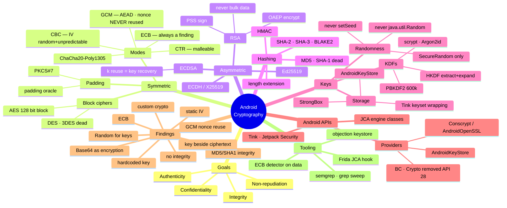

### Condensed cheat sheet

| Need | Answer |
|---|---|
| Symmetric encryption | `AES/GCM/NoPadding`, 256-bit key, 12-byte provider-generated nonce, 128-bit tag |
| Alternative AEAD | `ChaCha20/Poly1305/NoPadding` (API 28+) |
| Hash | `SHA-256` |
| Keyed integrity | `HmacSHA256`, compared with `MessageDigest.isEqual` |
| Password → key | `PBKDF2WithHmacSHA256`, ≥600,000 iterations, 16-byte random salt, count stored |
| Secret → keys | HKDF extract-then-expand with a distinct `info` per output |
| Asymmetric encryption | `RSA/ECB/OAEPWithSHA-256AndMGF1Padding` with explicit `OAEPParameterSpec` |
| Signature | `SHA256withECDSA` (P-256) or `SHA256withRSA/PSS` |
| Key agreement | ECDH on P-256 or X25519, then HKDF |
| Randomness | `new SecureRandom()`, never `setSeed` |
| Key storage | `AndroidKeyStore` with `KeyGenParameterSpec`, `setRandomizedEncryptionRequired(true)` |
| Easiest correct answer | Tink `Aead` with `AndroidKeysetManager` |
| Highest-value Frida hook | `javax.crypto.spec.SecretKeySpec.$init` |
| Fastest static grep | `grep -rEn 'Cipher\.getInstance\("[A-Za-z0-9]+"\)'` |
| Proof of ECB from data alone | Repeated 16-byte blocks in the ciphertext |
| Proof of nonce reuse | Two records sharing their leading 12 bytes under GCM |

### Quick revision

- What are the four goals of cryptography, and which one does a MAC *not* provide?
- What does `Cipher.getInstance("AES")` resolve to, and why?
- Give the CBC decryption identity and use it to explain a padding oracle.
- Why does GCM nonce reuse enable forgery and not just disclosure?
- State the three differences between an IV, a nonce and a salt.
- How many PBKDF2 iterations, and why must the count be stored in the record?
- What are the two phases of HKDF and what does each accomplish?
- Two ECDSA signatures share an `r` value. What can you compute?
- What does `getEncoded()` return for an AndroidKeyStore key, and what does that tell you?
- Which single Frida hook captures every software symmetric key an app uses?
- Name three ways a hardcoded key can hide from `grep`.
- When is MD5 in an Android app *not* a finding?

---

## 14. References

### AOSP source

- `libcore/ojluni/src/main/java/javax/crypto/` — `Cipher`, `Mac`, `KeyGenerator`, `SecretKeyFactory`
- `libcore/ojluni/src/main/java/javax/crypto/spec/SecretKeySpec.java` — raw key wrapper
- `libcore/ojluni/src/main/java/java/security/` — `MessageDigest`, `Signature`, `SecureRandom`, `Security`
- `external/conscrypt/common/src/main/java/org/conscrypt/OpenSSLProvider.java` — the algorithm registry
- `external/conscrypt/common/src/main/java/org/conscrypt/OpenSSLCipher.java` — cipher SPI implementations
- `external/conscrypt/common/src/main/java/org/conscrypt/NativeCrypto.java` — the JNI surface
- `external/boringssl/src/crypto/fipsmodule/` — AES, modes, GHASH
- `external/boringssl/src/crypto/rand/` — the DRBG and `CRYPTO_sysrand`
- `frameworks/base/keystore/java/android/security/keystore/` — `KeyGenParameterSpec`, `KeyInfo`
- `system/security/keystore2/` — the keystore daemon
- Android Code Search: https://cs.android.com/

### Official documentation

- Cryptography — https://developer.android.com/guide/topics/security/cryptography
- Android Keystore system — https://developer.android.com/privacy-and-security/keystore
- Security best practices — https://developer.android.com/privacy-and-security/security-tips
- Jetpack Security — https://developer.android.com/topic/security/data
- Tink — https://developers.google.com/tink
- Conscrypt — https://github.com/google/conscrypt
- BoringSSL — https://boringssl.googlesource.com/boringssl/

### OWASP

- MASVS — https://mas.owasp.org/MASVS/
- MASVS-CRYPTO — https://mas.owasp.org/MASVS/06-MASVS-CRYPTO/
- MASTG cryptography tests — https://mas.owasp.org/MASTG/
- OWASP Password Storage Cheat Sheet — https://cheatsheetseries.owasp.org/cheatsheets/Password_Storage_Cheat_Sheet.html

### Standards and RFCs

- RFC 2104 — HMAC: Keyed-Hashing for Message Authentication
- RFC 5869 — HKDF: HMAC-based Extract-and-Expand Key Derivation Function
- RFC 8018 — PKCS #5: Password-Based Cryptography Specification Version 2.1
- RFC 8439 — ChaCha20 and Poly1305 for IETF Protocols
- RFC 6979 — Deterministic Usage of DSA and ECDSA
- RFC 8017 — PKCS #1: RSA Cryptography Specifications Version 2.2
- NIST SP 800-38A — Block cipher modes of operation
- NIST SP 800-38D — Galois/Counter Mode and GMAC
- NIST SP 800-57 — Key management recommendations
- NIST SP 800-131A — Transitioning the use of cryptographic algorithms
- FIPS 197 — Advanced Encryption Standard
- FIPS 186-5 — Digital Signature Standard

### Papers and named attacks

- Shannon, "Communication Theory of Secrecy Systems" (1949) — the one-time pad proof
- Bleichenbacher, "Chosen Ciphertext Attacks Against Protocols Based on the RSA Encryption Standard PKCS #1" (CRYPTO '98)
- Vaudenay, "Security Flaws Induced by CBC Padding" (EUROCRYPT 2002) — the padding oracle
- Joux, "Authentication Failures in NIST version of GCM" — the forbidden attack on repeated nonces
- Böck, Zauner, Devlin, Somorovsky, Jovanovic, "Nonce-Disrespecting Adversaries: Practical Forgery Attacks on GCM in TLS" (WOOT 2016)
- Stevens et al., "The first collision for full SHA-1" (2017) — SHAttered
- Bhargavan and Leurent, "On the Practical (In-)Security of 64-bit Block Ciphers" (2016) — Sweet32
- Biryukov, Dinu, Khovratovich, "Argon2" — the Password Hashing Competition winner

### Related chapters

- [33-Storage](../33-Storage/README.md) — where the ciphertext lands
- [35-SSL](../35-SSL/README.md) — cryptography applied to transport
- [36-CertificatePinning](../36-CertificatePinning/README.md) — pinning the public key
- [44-NetworkSecurityConfig](../44-NetworkSecurityConfig/README.md) — the XML that governs trust
- [49-KeyStore](../49-KeyStore/README.md) — hardware-backed key storage in depth
- [50-HardwareBackedSecurity](../50-HardwareBackedSecurity/README.md) — TEE, StrongBox, attestation
- [40-Obfuscation](../40-Obfuscation/README.md) — why XOR strings are not a crypto finding
- [53-Frida](../53-Frida/README.md) — the instrumentation engine behind every script here
- [69-MalwareAnalysis](../69-MalwareAnalysis/README.md) — crypto as an attacker's tool
- [71-OWASP-Mobile](../71-OWASP-Mobile/README.md) — mapping findings to MASVS


