# 34 — Cryptography · Mind Map

One picture of the whole chapter. Read it outward from the centre: cryptography delivers four
operational properties; Android exposes them through one pluggable API called the JCA; almost every
real finding is a *usage* failure at that API rather than a break of the mathematics underneath; and
the fastest route to any of those findings is a hook on the boundary the app cannot rename. Every
branch corresponds to a section of [the chapter README](README.md). Use it as a revision map before an
engagement or an interview.

```mermaid
mindmap
  root((Cryptography<br/>on Android))
    Four goals
      Confidentiality
        nobody else can read it
        encryption
      Integrity
        no bit altered undetected
        hash plus MAC
      Authenticity
        it came from who it claims
        MAC or signature
      Non repudiation
        sender cannot deny it
        signature only
        MAC cannot do this
        both parties share the key
    The central fact
      AES has never been the problem
      usage is always the problem
      key in the APK
      fixed IV
      ECB by default
      password used as a key
      Random instead of SecureRandom
      encryption with no integrity
      your job is the hand under the saw
    Symmetric
      Block ciphers
        AES 128 192 256
        16 byte block
        DES dead 56 bit key
        3DES dead 64 bit block Sweet32
        Blowfish dead 64 bit block
      Stream ciphers
        RC4 broken biases
        ChaCha20 modern
        keystream XOR plaintext
        never reuse keystream
      Modes
        ECB
          each block independent
          identical blocks identical ciphertext
          block splicing
          never
        CBC
          chains via XOR with previous
          needs unpredictable IV
          padding oracle
          malleable without a MAC
        CTR
          block cipher becomes stream cipher
          no padding needed
          fully malleable
          needs a MAC
        GCM
          CTR plus GHASH
          AEAD one primitive
          12 byte nonce
          128 bit tag
          nonce reuse is total break
        CCM
          CTR plus CBC MAC
          constrained devices
        ChaCha20 Poly1305
          no AES hardware needed
          API 28 plus
        GCM SIV
          nonce misuse resistant
    IV nonce salt
      IV
        not secret
        unpredictable for CBC
        16 bytes
      Nonce
        not secret
        unique per key
        12 bytes for GCM
        reuse is catastrophic
      Salt
        not secret
        unique per record
        defeats precomputation
      all three stored with the data
    Padding
      PKCS7 and PKCS5
      value equals count
      always adds a block if aligned
      removal can fail
      failure that is observable is an oracle
    Padding oracle
      P2 equals D_K of C2 XOR C1
      intermediate depends only on key and C2
      forge C1 prime to control plaintext
      drive last byte to 0x01
      256 queries per byte worst case
      128 average
      recovers plaintext without the key
      fix is AEAD
      or encrypt then MAC checked first
    Asymmetric
      RSA
        modular exponentiation
        needs OAEP for encryption
        needs PSS for signing
        textbook RSA is deterministic and malleable
        PKCS1 v1.5 is Bleichenbacher class
      ECC
        smaller keys same strength
        P 256 and Curve25519
      ECDH
        colour mixing analogy
        shared secret then HKDF
      ECDSA
        nonce k must be unique
        reused k reveals the private key
        Sony PS3
        RFC 6979 deterministic k
      signing is not encrypting
    Hashes
      SHA 256 default
      SHA 3 and BLAKE2 alternatives
      MD5 collision broken
      SHA 1 collision broken SHAttered
      length extension
        Merkle Damgard output is state
        H of secret plus data is forgeable
        this is why HMAC exists
      collision versus preimage
      context decides severity
        cache key not a finding
        signature is a finding
    MACs and KDFs
      HMAC
        RFC 2104
        two passes two derived keys
        compare with MessageDigest isEqual
      encrypt then MAC
        MAC over IV plus ciphertext
        verify before decrypting
        no padding to be wrong about
      MAC then encrypt
        must decrypt to check
        Lucky 13 class
      Password KDF
        PBKDF2 600000 iterations
        Argon2id memory hard
        scrypt
        slow on purpose
        store the parameters
        authenticate the parameters
      Key based KDF
        HKDF RFC 5869
        extract then expand
        info label per output key
        fast on purpose
        input already high entropy
      confusing the two is a finding
    Randomness
      SecureRandom is the only answer
      never setSeed
      java util Random is a 48 bit LCG
        two outputs reveal the state
      SHA1PRNG anti pattern
        never a KDF
        behaviour changed at API 24
        silent data loss
      device identifiers are not secrets
      entropy sources
        getrandom syscall
        dev urandom
        BoringSSL DRBG
    JCA
      Provider model
        Security getProviders ordered
        getInstance walks the list
        first match wins
      Providers
        AndroidKeyStore
        AndroidOpenSSL Conscrypt
        Bouncy Castle legacy
      Transformation string
        alg slash mode slash padding
        one token means provider defaults
        one token means ECB
      Conscrypt
        JNI to BoringSSL
        NativeCrypto
      AndroidKeyStore
        key generated in the daemon
        getEncoded returns null
        Binder to keystore2 to KeyMint
        StrongBox is a separate element
      Tink
        no mode parameter
        no nonce parameter
        always authenticated
        keysets and rotation
        master key URI is not optional
    Findings catalogue
      F 01 hardcoded key
      F 02 ECB
      F 03 static or zero IV
      F 04 GCM nonce reuse
      F 05 key from constant or device id
      F 06 java util Random
      F 07 MD5 or SHA 1 for integrity
      F 08 custom crypto
      F 09 secrets in resources
      F 10 Base64 as encryption
      F 11 XOR encryption
      F 12 no integrity on ciphertext
      F 13 key beside ciphertext
      F 14 textbook RSA
      F 15 non constant time compare
      F 16 unsigned update path
    Static analysis
      grep transformations first
      grep the no slash variant
      SecretKeySpec constructor
      fill array data 16 24 32 bytes
      strings on classes dex
      strings xml and BuildConfig
      strings on native libraries
      detect ecb py
      semgrep crypto yml
      R8 renames identifiers
      R8 does not encrypt strings
    Dynamic analysis
      four intervention points
        getInstance gives the transformation
        init gives key and IV
        doFinal gives plaintext and ciphertext
        BoringSSL when JCA is bypassed
      frida jca universal hook js
      Objection keystore list
      hook fails then force verify filter
      attach late misses onCreate crypto
      filter by package or drown in TLS
    Reading the data
      pull data data package
      repeated 16 byte blocks means ECB
      shared first 16 bytes means fixed IV
      shared first 12 bytes means nonce reuse
      length 12 plus n plus 16 is a good sign
      entropy near 8 is ciphertext
      Base64 decoding to text is not encryption
      look for the plaintext copy first
    Severity
      what is protected and does it matter
      who is the attacker and can they reach it
      what does exploitation produce
      hardcoded key is global not local
      decrypt something and show it
      a report where everything is High
      is a report where nothing is
    Correct designs
      AES GCM with a caller key
      PBKDF2 or Argon2id for passwords
      AndroidKeyStore for local data
      Tink envelope for scale
      ask what the ciphertext is bound to
```

---

## How to use this map

**Before an engagement.** Read the *Findings catalogue*, *Static analysis* and *Dynamic analysis*
branches. Those three are the working half of the chapter and they are what you will actually execute.

**Before an interview.** Read *Four goals*, *IV nonce salt*, *Padding oracle* and *MACs and KDFs*. The
distinction between authenticity and non-repudiation, the three-way distinction between IV, nonce and
salt, and the difference between a password KDF and HKDF are the four questions that separate
candidates who have read about cryptography from candidates who have used it.

**When you are stuck on a target.** Walk *Dynamic analysis* → *four intervention points*. Almost every
"I cannot find the crypto" problem is one of: you attached too late, the app is below the JCA in
native code, or the method was inlined and your hook never fired.

**When writing a finding.** Walk *Severity*. Three questions, answered in writing, in the report.

Full detail in [README.md](README.md); the command forms are in [cheatsheet.md](cheatsheet.md).
