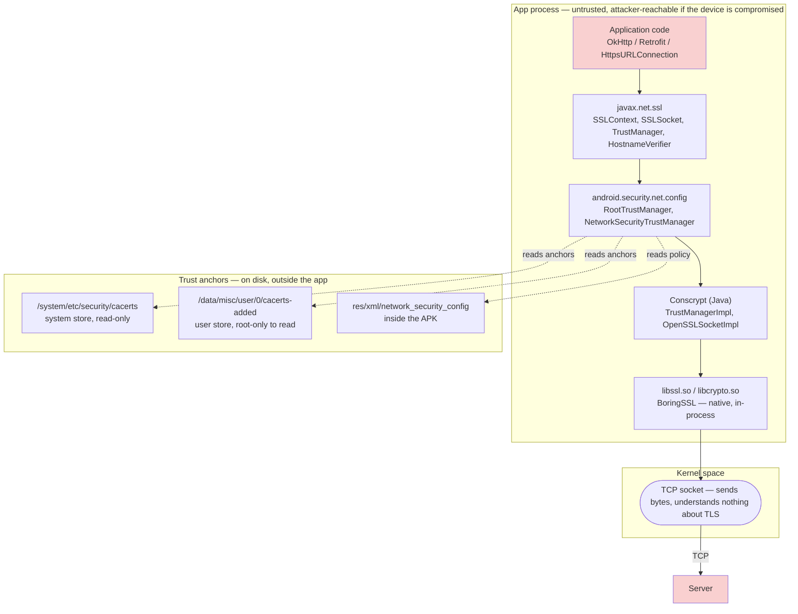
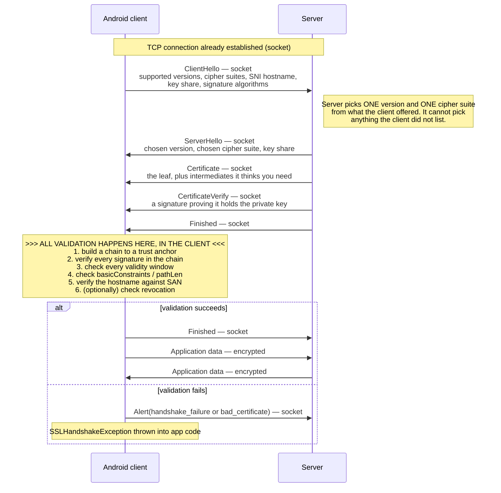
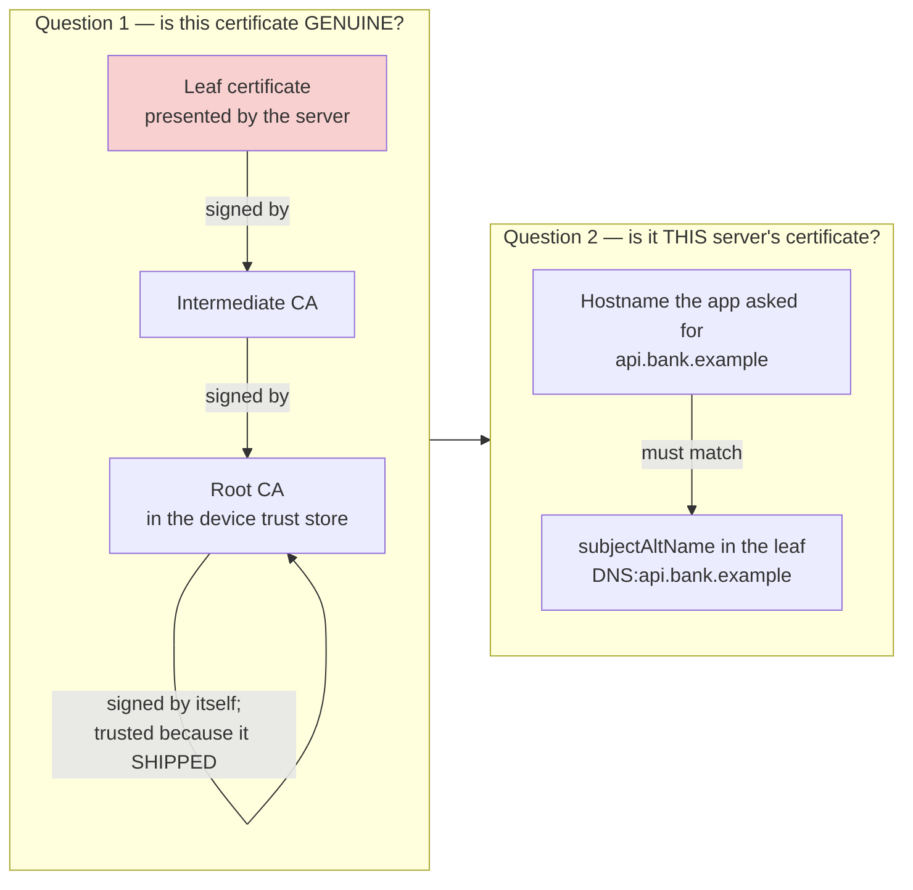
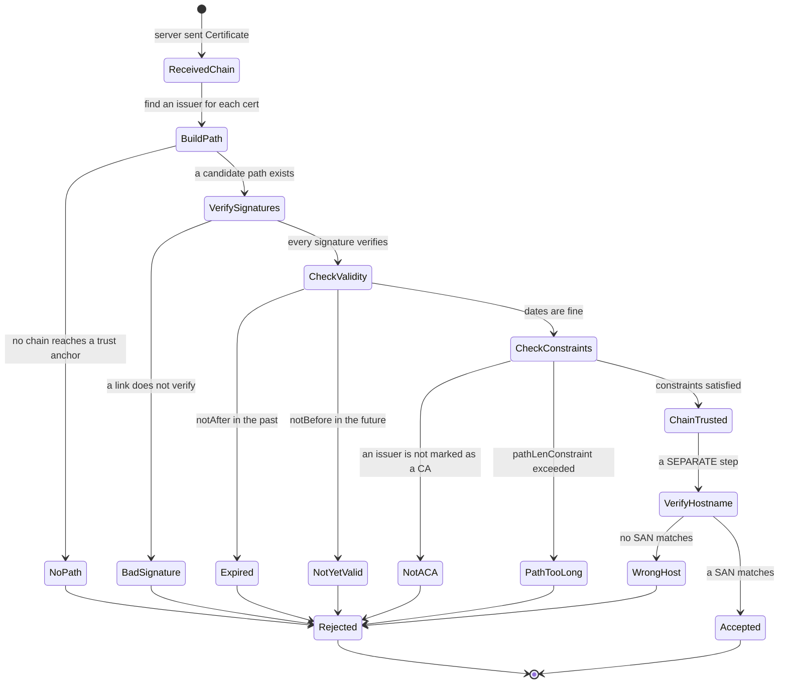
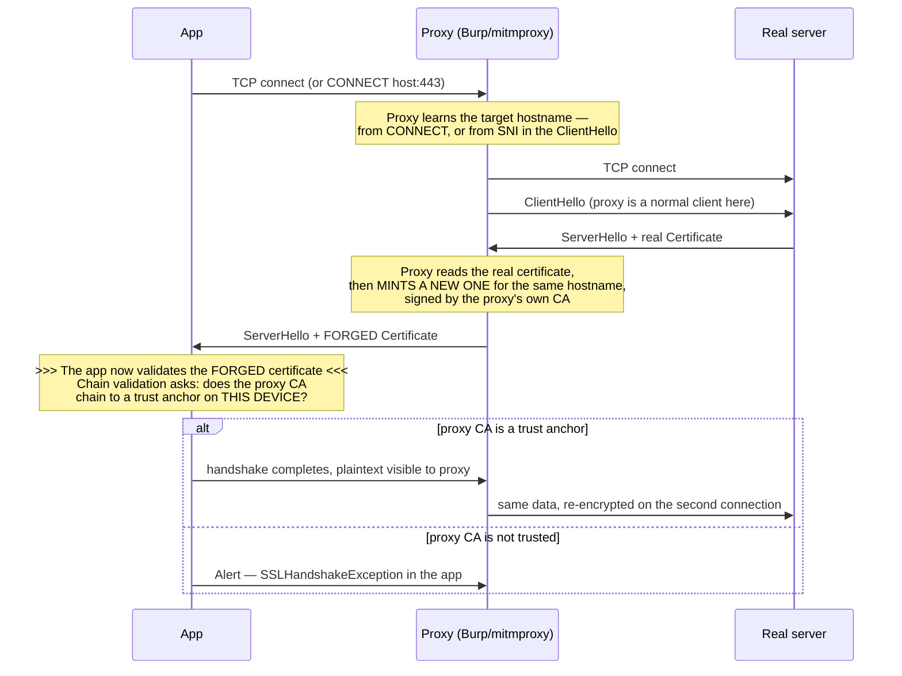
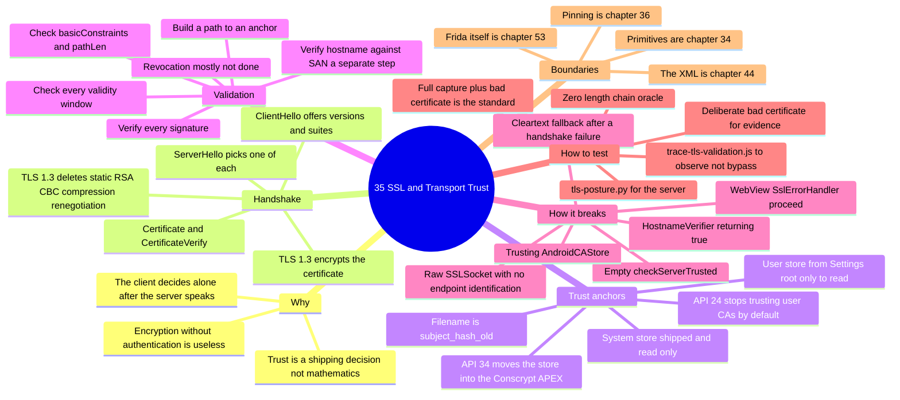

# 35 — SSL/TLS and Transport Trust

> After this chapter you will be able to take an unfamiliar Android application, determine exactly
> which parts of TLS validation it performs, prove each answer with a measurement rather than an
> assertion, intercept its traffic on a real device or explain precisely why you cannot — and state
> the honest severity of what you found, which is not the same thing for every host it talks to.

**Prerequisites:** [01-Computer-Science-Basics](../01-Computer-Science-Basics/README.md),
[04-Java](../04-Java/README.md), [34-Cryptography](../34-Cryptography/README.md),
[20-Security-Architecture](../20-Security-Architecture/README.md)
**Applies to:** Android 4.4–16 (API 19–36). Trust-anchor behaviour changes sharply at API 24 and the
trust store *moves* at API 34; every such difference is called out in a Version Matrix, and the
chapter tells you to measure it on your own device rather than trust the table.

---

## Table of Contents

1. [Introduction](#1-introduction)
2. [High-Level Architecture](#2-high-level-architecture)
3. [Deep Internal Working](#3-deep-internal-working)
4. [Source Code Walkthrough (AOSP)](#4-source-code-walkthrough-aosp)
5. [Security Perspective](#5-security-perspective)
6. [Reverse Engineering Perspective](#6-reverse-engineering-perspective)
7. [Dynamic Analysis](#7-dynamic-analysis)
8. [Static Analysis](#8-static-analysis)
9. [Examples](#9-examples)
10. [Common Interview Questions](#10-common-interview-questions)
11. [Common Mistakes](#11-common-mistakes)
12. [Hands-on Labs](#12-hands-on-labs)
13. [Summary](#13-summary)
14. [References](#14-references)

---

## 1. Introduction

### 1.1 The problem, before any technology

You want to send a message to your bank. Between your phone and your bank's computer, that message
passes through equipment you have never seen and do not control: a café's wireless access point, an
internet provider's routers, an undersea cable's landing station, a data centre's switches. Anyone
with access to any of that equipment can, in principle, do four things:

1. **Read** the message.
2. **Change** it before passing it on.
3. **Pretend to be the bank** and answer you themselves.
4. **Pretend to be you** and send messages to the bank.

The first two are the ones people think of. The third is the one that actually matters, and it is
the one this chapter is about.

Here is why. Suppose you solve reading and changing perfectly — you and the bank agree on a secret
code that scrambles everything and detects tampering. You are now having a perfectly private,
perfectly tamper-proof conversation. **With whom?** You agreed the secret code with whoever answered
when you called. If the café's router answered instead of the bank, you have an impeccably secured
conversation with the attacker, and the padlock in the corner of the screen is entirely honest about
it: the connection *is* encrypted. It is encrypted to the wrong party.

> **🧠 Mental Model**
> Encryption without authentication is a locked armoured van with no idea where it is going. It will
> protect the cargo beautifully all the way to the thief's warehouse. Almost every real-world TLS
> failure in mobile applications is an authentication failure, not an encryption failure — and
> because the encryption still works, everything *looks* fine.

So the hard problem is not "how do we scramble the bytes". Scrambling bytes is
[34-Cryptography](../34-Cryptography/README.md)'s subject and it is, by comparison, solved. The hard
problem is: **how does a phone that has never met your bank before decide that the computer
answering on the other end really is your bank?**

### 1.2 The physical-world analogy, and where it breaks

Imagine you need to verify a stranger's identity. You ask for a passport. You do not know the
stranger, and you have never seen their passport before, but you accept it — because you trust the
government that issued it, and you believe the passport is hard to forge.

Three things had to be true for that to work:

- You already trusted the **issuer** before the encounter. You did not decide to trust the passport
  office in the moment; that was decided long ago and stored in your head.
- The passport is **bound to this person** — it has their photograph on it. A genuine passport
  belonging to somebody else is worthless to them.
- You can tell a genuine passport from a forged one, because it carries something only the issuer
  can produce.

TLS is that scheme, with a certificate as the passport, a **Certificate Authority** as the passport
office, a **digital signature** as the thing only the issuer can produce, and the **hostname** as
the photograph.

> **📖 Definition**
> A **certificate** is a small file that says "this public key belongs to this name", signed by
> someone else. That is the whole of it. It is a statement of ownership, plus a signature over that
> statement. Everything else in the file — validity dates, permitted uses, extensions — exists to
> constrain when and how that statement may be believed.

> **📖 Definition**
> A **Certificate Authority (CA)** is an organisation whose signature your device has been
> pre-configured to believe. There is no mathematics that makes a CA trustworthy. It is trusted
> because its certificate was shipped in the trust store on your phone, by whoever built the
> operating system. Trust here is a shipping decision, not a cryptographic property.

The analogy breaks in one place, and the break is the source of most of this chapter's material. In
the physical world, you check the photograph without thinking about it — nobody hands over a passport
and gets waved through on the strength of the passport office's seal alone. In TLS, verifying the
signature and verifying the name are **two separate steps, performed by two different pieces of
code**, and it is entirely possible for a program to do the first and skip the second. An
application that does that accepts a genuine, valid, correctly-issued passport belonging to somebody
else. Section 3.6 is about exactly that, and it is the failure most people forget can happen.

### 1.3 What would happen without any of this

Strip TLS out and you get the internet of about 1994, which is worth picturing concretely because
"an attacker can read your traffic" undersells it:

- Every password typed into every application, visible to the café.
- Every session token, copyable — and a copied session token is a copied login, with no password
  needed.
- Every response modifiable in flight: an attacker does not merely *read* your bank balance, they
  *choose* what balance your app displays, and *choose* which account number the payment screen
  pre-fills.
- Application updates and downloaded code replaced with attacker-supplied versions, turning one
  network position into permanent control of the device.

That last point is why transport security is load-bearing for everything else in this repository. An
app can have flawless key storage ([49-KeyStore](../49-KeyStore/README.md)), a perfect permission
model ([23-Permissions](../23-Permissions/README.md)) and a hardened sandbox
([21-App-Sandbox](../21-App-Sandbox/README.md)), and all of it is irrelevant if an attacker can
choose what the app receives.

### 1.4 Why "SSL" and "TLS" are both in this chapter's name

They are the same thing at different ages.

**SSL** (Secure Sockets Layer) was designed at Netscape. Version 1.0 was never released, 2.0 was
broken, and 3.0 (1996) was the first version that worked well enough to carry the web. When the
protocol moved to the standards process, it was renamed **TLS** (Transport Layer Security), and TLS
1.0 is essentially SSL 3.1 — its version number on the wire is literally `0x0301`.

| Name | Wire version | Year | Status |
|---|---|---|---|
| SSL 2.0 | `0x0002` | 1995 | Broken, prohibited |
| SSL 3.0 | `0x0300` | 1996 | Broken by POODLE (CVE-2014-3566), prohibited by RFC 7568 |
| TLS 1.0 | `0x0301` | 1999 | Deprecated by RFC 8996 |
| TLS 1.1 | `0x0302` | 2006 | Deprecated by RFC 8996 |
| TLS 1.2 | `0x0303` | 2008 | Current, still overwhelmingly common |
| TLS 1.3 | `0x0304` | 2018 | Current, a substantial redesign |

Nobody has legitimately used SSL for two decades, but the name stuck to everything built around it:
`SSLContext`, `SSLSocket`, `SSLHandshakeException`, `libssl.so`, "SSL pinning". When you see "SSL"
in an Android class name, read "TLS". This chapter says TLS when it means the protocol and SSL only
when quoting an identifier.

> **🔍 Pentester's Note**
> "The app uses SSL" in a report means nothing. Which version, negotiated with which cipher suite,
> validating which anchors, against which hostname? Section 7 gives you the commands to answer each
> of those, and section 5.9 explains why a version-only finding is usually the weakest thing you
> could write down.

### 1.5 What this chapter owns, and what it does not

The network chapters divide along clean lines, and staying inside them keeps the material from
turning to mush:

| Subject | Chapter | The distinction |
|---|---|---|
| **TLS itself, and trust** | **35, this one** | The handshake, trust anchors, chain validation, hostname verification, the deliberate-bad-certificate test |
| Certificate pinning | 36-CertificatePinning | Deciding to trust *one specific key*, ignoring the trust store. Runs **after** everything here has already succeeded |
| The `network_security_config` XML | 44-NetworkSecurityConfig | The declarative file that *configures* what this chapter describes |
| Cryptographic primitives | [34-Cryptography](../34-Cryptography/README.md) | RSA, ECDSA, AES, SHA-2 — the parts a certificate and a handshake are built out of |
| Frida as a tool | [53-Frida](../53-Frida/README.md) | How hooking works; this chapter uses it, it does not teach it |
| OAuth flows | [45-OAuth](../45-OAuth/README.md) | What is *inside* the connection you learn to open here |

The line between this chapter and pinning is worth stating precisely, because it is the one people
blur: **if an app validates a certificate against the device's trust store, that is this chapter. The
moment it checks a certificate against a value baked into the app, that is chapter 36.** A useful
consequence: if your interception works after you add a CA to the system store, you never met
pinning at all. If the handshake completes and *then* the app reports a network error, you have.

---

## 2. High-Level Architecture

### 2.1 Where TLS sits



Read this from the top. Application code almost never touches TLS directly; it asks a networking
library for a URL. That library obtains a socket factory, which comes from an `SSLContext`, which
was built from an array of `TrustManager` objects. On a modern Android device the `TrustManager` the
app gets by default is not a simple one — it is `RootTrustManager`, a platform class that consults
the app's network security configuration, and which delegates the actual certificate arithmetic down
to Conscrypt and ultimately to BoringSSL in native code.

Two things in that diagram matter more than the rest.

First, **everything above the kernel line runs inside the app's own process**. The trust decision is
made by code the app controls, in memory the app controls, on a device the user controls. That is
why every bypass in [53-Frida](../53-Frida/README.md) works, and it is a structural fact rather than
a bug: there is nowhere else to put the decision, because the app is the only party that knows what
it wanted.

Second, **the trust anchors come from outside the app**. The app does not ship the list of CAs it
believes; it inherits one from the operating system, and can only narrow or widen it by policy. That
separation is what makes "add a CA to the device" a viable interception strategy at all, and the API
24 change in section 3.4 is precisely a change to *which* of those two stores an app inherits.

### 2.2 The handshake, as a conversation



The block in the middle is the whole chapter. Notice where it is: **in the client, after the server
has said everything it is going to say.** The server does not participate in its own validation. It
presents a certificate and a proof that it holds the matching private key, and then the client
decides, alone, whether that is good enough.

This is why an interception proxy works, and why it works the way it does. The proxy is not breaking
cryptography. It terminates the client's TLS connection, presents a certificate of its own, and
opens a second, separate TLS connection onward to the real server. There are two handshakes and two
sets of keys. The only thing standing between the proxy and success is step 1 of that validation
block: can the proxy's certificate be chained to something the client already trusts?

> **🧠 Mental Model**
> Interception is not an attack on TLS. It is an application to be trusted, which the client either
> grants or refuses. Everything in section 3.4 about trust stores is about how to get that
> application granted; everything in section 5 is about applications that get granted when they
> should not.

### 2.3 The two questions, drawn separately



These are answered by different code, in that order, and an application can pass one and fail the
other. The consequences differ sharply:

| Broken check | What the attacker must obtain | Cost |
|---|---|---|
| Chain validation (Q1) | Nothing at all — a self-signed certificate made in one command | Zero |
| Hostname verification (Q2) | A genuine, CA-issued certificate for a name they control | The price of a free certificate for a domain they own |

Q2 being "harder" does not make it less severe. It costs an attacker one free certificate and
produces a complete authentication bypass, with a chain that validates honestly and a padlock that
is entirely genuine. An application with a `HostnameVerifier` that returns `true` is fully
interceptable by anyone willing to register a domain name.

### 2.4 Where the trust anchors live on disk

```
/system/etc/security/cacerts/            SYSTEM store
    00673b5b.0                           one DER-encoded certificate per file
    04f60c28.0                           filename = subject_hash_old, then ".0"
    ...                                  138 files stock on the test device
                                         read-only, part of the system image
                                         SELinux: u:object_r:system_security_cacerts_file:s0

/data/misc/user/0/cacerts-added/         USER store, per Android user
    9a5ba575.0                           same format, same naming scheme
                                         written by Settings when a user installs a CA
                                         NOT readable by adb shell (uid 2000); root only
                                         SELinux: u:object_r:misc_user_data_file:s0

/data/misc/keychain/                     KeyChain metadata
    pins                                 legacy pin database
    pubkey_blacklist.txt                 blocked public keys
    serial_blacklist.txt                 blocked serial numbers

/apex/com.android.conscrypt/             Conscrypt APEX module
    bin/ etc/ javalib/ lib/ lib64/       on API 30: NO cacerts directory here
                                         from API 34 the trust store MOVES into this APEX
```

That layout is measured, not remembered — it is what a `ls` on the device used for this chapter
actually returned, and section 3.4.4 gives the commands so you can check your own rather than
believe this listing.

The naming scheme is the part worth understanding, because it explains an error people hit
constantly. Each file is named for a hash of the certificate's **subject**, so that the verifier can
find a candidate issuer by hashing the name it is looking for instead of parsing every file in the
directory. The hash is OpenSSL's **`subject_hash_old`**, the pre-1.0.0 MD5-based algorithm — *not*
`subject_hash`, which is the SHA-1-based one modern OpenSSL uses by default. Getting this wrong
produces a certificate that sits in the right directory, with the right permissions, and is never
found:

```bash
# host -- the RIGHT one
openssl x509 -inform PEM -in burp.pem -subject_hash_old -noout
# 9a5ba575

# host -- the WRONG one; this filename will be silently ignored
openssl x509 -inform PEM -in burp.pem -subject_hash -noout
```

On the device used for this chapter, the Burp CA is stored as `9a5ba575.0`, and running
`subject_hash_old` against that exact file returns `9a5ba575`. The trailing `.0` is a collision
counter: if two different CAs happen to share a subject hash, the second becomes `.1`.

### 2.5 The trust decision, as a state machine



Every one of those rejection states is a separate check, implemented in a separate place, and each
can be removed independently by an application. That is the practical reason this diagram is worth
memorising: when you see a failure, the exception message names the state, and the state tells you
which check is still working. When you see a *success* that should have been a failure, the state
that was skipped tells you what the developer disabled.

Note also that `ChainTrusted` is not the end. A trusted chain for the wrong host is a rejected
connection on a correct client, and an accepted connection on a broken one. Section 3.6 is entirely
about that final transition.

---

## 3. Deep Internal Working

### 3.1 What a certificate actually contains

A certificate is a DER-encoded ASN.1 structure. Stripped of the encoding, an X.509 v3 certificate
is:

| Field | What it is | Why an attacker cares |
|---|---|---|
| `version` | 1, 2 or 3. Effectively always 3 | v1 has no extensions, so no SAN and no basicConstraints |
| `serialNumber` | Unique per issuer | Revocation lists name serials; also a fingerprint for tracking |
| `signatureAlgorithm` | How the issuer signed it, e.g. `sha256WithRSAEncryption` | SHA-1 here on a non-root certificate is a finding |
| `issuer` | The Name of whoever signed it | Must equal the `subject` of the next certificate up |
| `validity` | `notBefore` and `notAfter` | Both checked; a certificate can be too new as well as too old |
| `subject` | The Name of the entity this certificate is about | Historically the identity; **no longer consulted for hostname matching** |
| `subjectPublicKeyInfo` | The public key, plus its algorithm | The thing actually being certified. A pin is a hash of this field |
| `extensions` | v3 additions, some critical | Where all the interesting constraints live |

The extensions that decide behaviour:

| Extension | OID | Effect |
|---|---|---|
| `subjectAltName` | 2.5.29.17 | The names this certificate is valid for. **This, not CN, is what hostname verification reads** |
| `basicConstraints` | 2.5.29.19 | `CA:TRUE` means this certificate may sign others. `pathLenConstraint` caps how many further CAs may appear below it |
| `keyUsage` | 2.5.29.15 | What the key may do: `digitalSignature`, `keyCertSign`, `keyEncipherment` |
| `extKeyUsage` | 2.5.29.37 | Narrower purposes, e.g. `serverAuth`. A certificate without `serverAuth` should not authenticate a server |
| `authorityKeyIdentifier` | 2.5.29.35 | Which of the issuer's keys signed this — lets a verifier pick the right one when a CA has several |
| `subjectKeyIdentifier` | 2.5.29.14 | This certificate's own key identifier, used to build chains quickly |
| `cRLDistributionPoints` | 2.5.29.31 | Where to fetch the revocation list, if anyone bothers |
| `authorityInfoAccess` | 1.3.6.1.5.5.7.1.1 | OCSP responder URL, and often a URL for the missing intermediate |

> **🔬 Under the Hood**
> `basicConstraints` is the extension that made the 2000s interesting. Before verifiers checked it
> properly, an ordinary leaf certificate — the kind anyone could buy for their own domain — could be
> used to sign a certificate for any other domain, because nothing said it was not a CA. The check
> is now universal and boring, which is the correct end state for a security control, but it is why
> the field is marked *critical* and why a chain containing a non-CA issuer must be rejected outright
> rather than merely warned about.

The chapter's prober prints exactly these fields. Against `badssl.com` it reported, measured:

```
  [LEAF]
    subject   : CN=*.badssl.com
    issuer    : C=US, O=Let's Encrypt, CN=YR2
    valid     : 2026-07-28 20:03:02 UTC  ->  2026-10-26 20:03:01 UTC
    key       : rsaEncryption 2048-bit
    signature : sha256WithRSAEncryption
    is CA     : False
    SAN       : DNS:*.badssl.com, DNS:badssl.com

  [CA #1]
    subject   : C=US, O=Let's Encrypt, CN=YR2
    issuer    : C=US, O=ISRG, CN=Root YR
    key       : rsaEncryption 2048-bit
    is CA     : True  pathLen=0
```

`pathLen=0` on the intermediate is the constraint doing its job: that CA may issue leaf certificates
and may not issue further CAs. If a chain arrived with another CA certificate below it, a correct
verifier rejects the chain even though every signature in it is valid.

### 3.2 The handshake, in detail, and what a proxy actually breaks

#### 3.2.1 TLS 1.2

The classic exchange, which still carries the majority of traffic:

1. **ClientHello.** The client sends the highest version it supports, a 32-byte random, a list of
   cipher suites, and extensions — including `server_name` (SNI), which names the host it wants,
   in cleartext.
2. **ServerHello.** The server picks one version and one cipher suite *from what the client
   offered*. It cannot invent one. This is why a client that does not offer RC4 cannot be made to
   use RC4 by the server, and why the *client's* offered set is a security property.
3. **Certificate.** The server sends its leaf plus whatever intermediates it thinks the client
   needs. It does not send the root; the client is supposed to already have that.
4. **ServerKeyExchange** (for ECDHE/DHE suites). The server's ephemeral key share, signed with the
   private key belonging to the certificate.
5. **ServerHelloDone**, then the client validates everything.
6. **ClientKeyExchange**, **ChangeCipherSpec**, **Finished**; the server answers in kind.

Two properties fall out of that structure and both matter for testing:

- With an **ECDHE** or **DHE** suite, the session key is derived from ephemeral key shares and the
  certificate's private key is used only to *sign*. Recording the traffic and later stealing the
  server's private key does not decrypt it. This is **forward secrecy**.
- With a **static RSA** suite (`TLS_RSA_WITH_...`), the client encrypts the premaster secret to the
  server's long-term public key. Anyone who records the traffic and later obtains that private key
  decrypts everything, retroactively. That is why the chapter's prober rates static RSA suites as a
  finding even though the encryption itself is fine.

#### 3.2.2 TLS 1.3

TLS 1.3 is not TLS 1.2 with better defaults. It deleted the options:

| Removed | Consequence |
|---|---|
| Static RSA key exchange | Forward secrecy is mandatory; there is no non-forward-secret mode |
| CBC cipher suites | The entire BEAST / Lucky 13 / POODLE family becomes unrepresentable |
| Compression | CRIME-class attacks become unrepresentable |
| Renegotiation | A class of protocol confusion disappears |
| The cipher-suite/kex coupling | A 1.3 suite names only the AEAD and hash; the key exchange is negotiated separately |

There are five TLS 1.3 cipher suites in total, all AEAD. The chapter's prober measured
`www.cloudflare.com` offering exactly three of them —
`TLS_AES_128_GCM_SHA256`, `TLS_AES_256_GCM_SHA384`, `TLS_CHACHA20_POLY1305_SHA256` — which is what a
well-configured modern server looks like.

The handshake is also one round trip shorter, and more of it is encrypted. In particular the
**server's certificate is encrypted** in TLS 1.3. A passive observer on the wire can no longer see
which certificate a server presented. SNI is still cleartext by default, so the *requested* hostname
usually leaks anyway, but this changes what a packet capture alone can tell you.

> **🔍 Pentester's Note**
> This has a practical consequence for testing. Under TLS 1.2 you could read a server's certificate
> out of a pcap. Under TLS 1.3 you cannot, so you must complete a handshake yourself to see it —
> which is exactly what `scripts/tls-posture.py` does, and why a passive capture is no longer
> sufficient for characterising an endpoint.

#### 3.2.3 What an intercepting proxy actually does



There are **two independent TLS connections**, with two different sets of keys. The proxy is a
server to the app and a client to the real server. Nothing about the cryptography is weakened; the
app is simply talking to a different party than it thinks.

The forged certificate copies the hostname from the real one — that is essential, because otherwise
hostname verification would fail even if the CA were trusted. Note the consequence: **a proxy
defeats chain validation by being trusted, and satisfies hostname verification by construction.** So
if interception fails after you have installed the CA correctly, hostname verification is almost
never the reason.

### 3.3 The client-side objects, and which one does what

| Type | Package | Responsibility | The classic bug |
|---|---|---|---|
| `SSLContext` | `javax.net.ssl` | Factory for sockets; holds the key managers, trust managers and RNG | Built with a permissive `TrustManager` |
| `TrustManagerFactory` | `javax.net.ssl` | Turns a `KeyStore` of anchors into `TrustManager` objects | Initialised with `AndroidCAStore`, re-widening trust |
| `X509TrustManager` | `javax.net.ssl` | **Decides whether a chain is trusted.** Void return; throwing is the only way to reject | Empty `checkServerTrusted` body |
| `X509ExtendedTrustManager` | `javax.net.ssl` | Same, plus overloads that receive the `Socket`/`SSLEngine`, so hostname is available | Overriding only the two-argument form, leaving the extended path unprotected |
| `HostnameVerifier` | `javax.net.ssl` | **Decides whether the certificate belongs to this host.** Boolean return | `return true` |
| `SSLSocketFactory` | `javax.net.ssl` | Produces `SSLSocket`s from a context | Replaced globally with `setDefaultSSLSocketFactory`, affecting SDKs that never asked |
| `KeyStore` | `java.security` | The container of trust anchors | `"AndroidCAStore"` includes the user store |

The single most important API detail in this chapter:

```java
public interface X509TrustManager {
    void checkServerTrusted(X509Certificate[] chain, String authType)
            throws CertificateException;
}
```

**The return type is `void`.** There is no `return true` to write. Acceptance is expressed by *not
throwing*, which means an empty method body is a complete, compiling, silently catastrophic
implementation. The insecure version of this method contains strictly *less* code than a correct
one, and nothing in it contains a keyword that says "insecure".

> **🧠 Mental Model**
> Almost every security API in Android fails closed: you must do something to allow. `X509TrustManager`
> fails **open**: you must do something to *deny*. That inversion, in one interface, is responsible
> for more broken Android TLS than every protocol weakness combined.

The interface contract also requires an implementation to throw `IllegalArgumentException` when the
chain is null or empty. Every conformant implementation does. A trust-everything implementation
cannot, because it never inspects its arguments — which is what makes the empty-chain oracle in
section 7.4 decisive.

### 3.4 Trust anchors: the crux of the chapter

#### 3.4.1 The two stores

Android has two trust stores, and the difference between them is the single most consequential fact
in mobile TLS testing.

| | System store | User store |
|---|---|---|
| Path (API 30) | `/system/etc/security/cacerts/` | `/data/misc/user/0/cacerts-added/` |
| Written by | The device manufacturer, at build time | Settings, when a user installs a certificate |
| Readable by | Everyone | root only |
| Removable by the user | No | Yes |
| Trusted by an app targeting API 23 or lower | Yes | Yes |
| **Trusted by an app targeting API 24 or higher** | **Yes** | **No, unless the app opts in** |
| Survives a factory reset | Yes | No |
| SELinux label | `u:object_r:system_security_cacerts_file:s0` | `u:object_r:misc_user_data_file:s0` |

#### 3.4.2 Why user CAs stopped being trusted at API 24

Before Android 7.0, a certificate a user installed was trusted by every application on the device.
That is a defensible default for a desktop operating system administered by its owner. It is a poor
one for a phone, for three reasons that turned out to matter in practice:

1. **Users can be talked into installing things.** "Install this certificate to use the free
   wireless" is a plausible-sounding instruction, and a user who follows it has handed a stranger
   the ability to read every application's traffic. The user cannot evaluate the request, because
   nothing in the interface distinguishes a captive-portal certificate from a wiretap.
2. **Enterprise management installed CAs for its own reasons.** A corporate device with a
   management CA installed meant every personal application on it was interceptable by the employer,
   including ones with no business relationship to the employer at all.
3. **The application had no say.** A banking application could do everything right and still be
   silently interceptable because of a decision made in Settings.

Android 7.0 changed the default: **an application whose `targetSdkVersion` is 24 or higher trusts
only the system store, unless it explicitly opts in.** Existing apps were unaffected until they
recompiled against the new SDK, which is what made the change deployable.

The opt-in is a `network_security_config` declaring `<certificates src="user"/>` — that XML is
44-NetworkSecurityConfig's subject. An app can also opt in from code by initialising a
`TrustManagerFactory` from the `"AndroidCAStore"` `KeyStore`, which contains both stores; that is
pattern C in [examples/InsecureTlsClient.java](examples/InsecureTlsClient.java), and because it lives
in code rather than XML, no manifest review will find it.

> **⚠️ Warning**
> This is the answer to "why did installing my CA not help". Nothing failed. The certificate is
> installed, it is in the right directory with the right name, the browser trusts it — and the app
> ignores it, on purpose, because it targets API 24 or later. The fix is not to reinstall it. The fix
> is to stop it being a *user* CA.

#### 3.4.3 What was measured on the API 30 device

The behaviour above is usually asserted. It is more useful measured, so it was.

Using Frida inside a live application process on the test device, calling
`android.security.net.config.NetworkSecurityConfig.getDefaultBuilder(ApplicationInfo)` with
synthetic `ApplicationInfo` values — which measures the platform's own rule directly, rather than one
particular app's configuration:

| targetSdk | debuggable | trust anchors | the added CA |
|---|---|---|---|
| 23 | false | 139 | trusted |
| 24 | false | 139 | trusted |
| 28 | false | 139 | trusted |
| 30 | false | 139 | trusted |
| 34 | false | 139 | trusted |
| 23 / 24 / 30 / 34 | true | 139 | trusted |

Every row identical. At first reading that appears to *contradict* section 3.4.2 — and the
explanation is the most instructive part of the measurement.

The added CA on that device is a PortSwigger (Burp) CA, and it is not in the user store from the
platform's point of view. It is in the **system** store. A `trustusercerts` module had promoted it
there:

```
$ mount | grep cacerts
APatch on /system/etc/security/cacerts type tmpfs (rw,seclabel,relatime,...)
/dev/block/dm-10 on /system/etc/security/cacerts/d41b5e2a.0 type f2fs (...)
/dev/block/dm-10 on /system/etc/security/cacerts/86212b19.0 type f2fs (...)
   ... 139 such lines in total, one per certificate ...
/dev/block/dm-10 on /system/etc/security/cacerts/9a5ba575.0 type f2fs (...)
```

That is the modern technique in one command's output. `/system` is read-only and protected by
verified boot, so the module does not write to it. It mounts a **tmpfs over the cacerts directory**,
then **bind-mounts every one of the 138 stock certificates back into it individually**, and adds the
139th — the promoted CA. The directory looks entirely normal to every reader, the underlying
partition is untouched, and the arrangement is rebuilt at every boot.

So the table is not a contradiction. It is the demonstration: **the API 24 rule never applied,
because by the time any app looked, the certificate was no longer a user CA.** The counterfactual is
what the rule predicts — had that certificate only ever been in `/data/misc/user/0/cacerts-added/`,
the `targetSdk >= 24` rows would have shown 138 anchors and reported it untrusted.

> **🔬 Under the Hood**
> The API-30 platform exposes exactly one `getDefaultBuilder` overload,
> `(android.content.pm.ApplicationInfo)`, which is why the probe passes a synthetic `ApplicationInfo`
> rather than a target SDK integer. Reading the value off the live platform class is what makes this
> a measurement instead of a recollection, and it is a technique worth reusing: when a behaviour is
> gated on `ApplicationInfo`, you can ask the platform what it *would* do for any app, from inside
> any app.

#### 3.4.4 Where the store is, by API level — and why you must check

The trust store has moved. Get this wrong and you will spend an afternoon copying files into a
directory nothing reads.

| API | Release | Trust store location |
|---|---|---|
| 19–33 | 4.4 – 13 | `/system/etc/security/cacerts/` |
| 34+ | 14+ | `/apex/com.android.conscrypt/cacerts/` — the store moved into the updatable Conscrypt APEX module |

On the API 30 device used here, `/apex/com.android.conscrypt/` **exists** and contains
`bin/ etc/ javalib/ lib/ lib64/` — and **no `cacerts` directory at all**. The APEX is present; the
trust store is not in it yet.

The move matters for more than a path. Because the store now lives in an APEX, it is updatable
independently of the system image — which is good for shipping CA changes and awkward for
interception, because the old "remount `/system` and drop a file in" technique targets a directory
that is no longer authoritative.

**Check, do not assume:**

```bash
# adb shell
ls -d /apex/com.android.conscrypt/cacerts /system/etc/security/cacerts 2>&1
getprop ro.build.version.sdk
```

Whichever of those two paths exists and is populated is the one that matters on the device in front
of you. This chapter deliberately does not tell you which it will be.

#### 3.4.5 Getting a CA trusted, ranked by durability

| Method | Root? | Survives reboot | Scope | Notes |
|---|---|---|---|---|
| Install as user CA via Settings | No | Yes | Apps targeting API 23 or below, and apps that opt in | Fastest, and usually insufficient |
| Repackage the APK with a `network_security_config` trusting user CAs | No | Yes | That one app | Breaks the signature; see 44-NetworkSecurityConfig for the XML |
| Ephemeral tmpfs overlay on the cacerts directory | Yes | **No** | Every app | Good for one session; gone at reboot |
| `trustusercerts`-style Magisk/APatch module | Yes | Yes | Every app | The measured arrangement in 3.4.3; leaves `/system` untouched |
| Emulator with a writable system image | n/a | Yes | Every app | Cleanest of all when the target runs on an emulator |

> **🔍 Pentester's Note**
> Whichever you use, **write it down**. A CA you added is a change you made to the device, and it is
> methodology, not a finding. Reporting "the device trusts an attacker CA" when you are the attacker
> who installed it is the fastest way to lose a client's confidence. The same discipline appears in
> [06-Android-Architecture/scripts/device-posture.sh](../06-Android-Architecture/scripts/device-posture.sh).

### 3.5 Chain validation, step by step

Given a leaf certificate and some intermediates, a verifier must:

1. **Build a path.** Starting from the leaf, find a certificate whose `subject` equals the leaf's
   `issuer`; repeat until reaching a certificate in the trust store. There may be several possible
   paths — a CA cross-signed by two roots produces genuine ambiguity — and a good verifier tries
   alternatives rather than failing on the first dead end. Android's does.
2. **Verify each signature.** Each certificate's signature must verify against the *next one up's*
   public key. This is the only step that is cryptography; the rest is bookkeeping.
3. **Check each validity window.** `notBefore <= now <= notAfter`, at every link, not just the leaf.
   An expired intermediate breaks the chain exactly as an expired leaf does — which the chapter's
   prober demonstrated against `expired.badssl.com`, flagging both an expired leaf and an expired
   intermediate.
4. **Check `basicConstraints`.** Every certificate above the leaf must be `CA:TRUE`, and the number
   of intermediates below a CA must not exceed its `pathLenConstraint`.
5. **Check `keyUsage` and `extKeyUsage`.** A CA needs `keyCertSign`; a server certificate should
   carry `serverAuth`.
6. **Check revocation**, if anyone is going to. Mostly nobody is; see 3.7.

Failures in steps 1–5 surface as `CertPathValidatorException`, wrapped in
`SSLHandshakeException`. The message is worth reading rather than skimming, because it names the
step:

| Message fragment | Which step failed |
|---|---|
| `Trust anchor for certification path not found` | 1 — no path to anything in the store |
| `Certificate expired at ...` / `Certificate not valid until ...` | 3 |
| `Could not validate certificate signature` | 2 |
| `Certificate is not a CA` / `basic constraints` | 4 |

> **⚠️ Warning**
> `Trust anchor for certification path not found` is *also* what you get when the server simply
> failed to send an intermediate and the client could not fetch it. That is a server
> misconfiguration, not a client bug, and it is the single most common false positive in this area.
> Desktop browsers hide it because they cache intermediates from previous browsing and will fetch a
> missing one via `authorityInfoAccess`; Android's verifier is less forgiving. That asymmetry is
> precisely why an endpoint "works in the browser but not in the app", and it has nothing to do with
> trust stores. The chapter's prober flags a single-certificate chain for this reason.

### 3.6 Hostname verification — the separate step everyone forgets

Once the chain is trusted, one question remains: is this certificate for the host we asked for?

The rules, from RFC 6125 and RFC 2818 as implemented by every current client:

- Match against **`subjectAltName`** entries of type `dNSName`. If a SAN extension is present, it is
  authoritative.
- **Common Name is not consulted.** A certificate carrying only a CN and no SAN fails on Android and
  on every current browser. This is a comparatively recent tightening, and it is why old internal
  certificates suddenly stopped working.
- A wildcard `*` matches **exactly one label**, only in the **leftmost** position, and never matches
  a dot. `*.example.com` matches `api.example.com`; it does not match `example.com`, and it does not
  match `a.b.example.com`.
- IP addresses match only against `iPAddress` SAN entries, never against a `dNSName`.

Two consequences that come up constantly in testing:

- A certificate for `*.example.com` is **not** valid for `example.com`. Servers must list both, which
  is why the measured `badssl.com` leaf carries `DNS:*.badssl.com, DNS:badssl.com` — two entries, on
  purpose.
- `*.com` would be catastrophic and no CA will issue it, but `*.somecompany.com` is issued routinely,
  and it means one compromised host anywhere under that domain yields a certificate valid for all of
  them. The chapter's prober rates a wildcard covering a whole second-level domain as a finding for
  that reason, and rated `*.badssl.com` accordingly.

Where the check happens differs by stack, which matters when you are looking for the bug:

| Stack | Who verifies the hostname |
|---|---|
| `HttpsURLConnection` | The `HostnameVerifier` on the connection, after the handshake |
| OkHttp | `okhttp3.internal.tls.OkHostnameVerifier`, unless the app replaced it |
| `SSLSocket` used directly | **Nobody, unless the app asks.** A raw `SSLSocket` does *not* verify the hostname by default |

That last row is a genuine trap and a real source of bugs. Code that opens an `SSLSocket` by hand,
validates the chain perfectly via the platform trust manager, and never calls a `HostnameVerifier`,
has a fully validating chain and no identity check at all. Since API 24 the correct fix is one line:

```java
// Correct: ask the platform to do hostname verification inside the handshake
SSLParameters params = socket.getSSLParameters();
params.setEndpointIdentificationAlgorithm("HTTPS");
socket.setSSLParameters(params);
```

Without `setEndpointIdentificationAlgorithm`, the `X509ExtendedTrustManager` overloads that receive
the socket have nothing to compare against, and the certificate is accepted for any host.

### 3.7 Revocation, and why it is mostly theatre on mobile

If a private key is stolen, the certificate must be invalidated before it expires. Two mechanisms
exist:

| Mechanism | How | Why it fails |
|---|---|---|
| **CRL** | Download a list of revoked serial numbers from the CA | The lists are large, the download is slow, and it happens on the connection's critical path |
| **OCSP** | Ask the CA about one certificate | Adds a round trip to a third party, leaks which sites you visit to the CA, and the CA becomes an availability dependency |

Both are usually configured to **soft-fail**: if the check cannot be completed, the connection
proceeds. An attacker who can intercept the connection can also block the revocation check, so
soft-fail revocation stops exactly nobody. Hard-fail is not deployable, because one CA outage takes
down every site it serves.

**OCSP stapling** improves the shape — the server fetches its own OCSP response and includes it in
the handshake — but the client must then require it, and requiring it reintroduces hard-fail.

On Android, the practical position is: **assume revocation is not checked.** The platform maintains
`/data/misc/keychain/pubkey_blacklist.txt` and `serial_blacklist.txt` for catastrophic cases —
which is a manually-curated kill switch for specific compromised keys, not general revocation.

> **🔍 Pentester's Note**
> Do not write "the app does not check certificate revocation" as a finding without qualification.
> Almost no mobile application does, the platform does not by default, and the control is largely
> ineffective even where implemented. If revocation genuinely matters for the client's threat model,
> the answer is short-lived certificates or pinning — and pinning is chapter 36.

### 3.8 Protocol versions and cipher suites on Android

Client defaults, which decide what an app will negotiate if it says nothing:

| Version | Android client default |
|---|---|
| SSL 3.0 | Disabled by default since Android 5.0 (API 21); removed later |
| TLS 1.0 | Default through Android 9; **disabled by default from Android 10 (API 29)** |
| TLS 1.1 | Default through Android 9; **disabled by default from Android 10 (API 29)** |
| TLS 1.2 | Enabled by default from Android 5.0 (API 21) |
| TLS 1.3 | Enabled by default from Android 10 (API 29); Conscrypt supports it earlier |

Reading a cipher suite name is a skill worth five minutes. `TLS_ECDHE_RSA_WITH_AES_128_GCM_SHA256`
decomposes as:

| Part | Meaning |
|---|---|
| `TLS` | The protocol family |
| `ECDHE` | **Key exchange** — elliptic-curve Diffie-Hellman, Ephemeral. The `E` is forward secrecy |
| `RSA` | **Authentication** — the certificate's key type, used to sign the exchange |
| `AES_128_GCM` | **Bulk encryption** — AES with a 128-bit key in GCM mode, which is AEAD |
| `SHA256` | The hash for the key-derivation function; with GCM, integrity comes from the AEAD, not from a separate MAC |

TLS 1.3 suites drop the first two parts entirely — `TLS_AES_128_GCM_SHA256` names only the AEAD and
the hash, because the key exchange is negotiated in its own extension.

What to flag, and at what severity:

| Property | Severity | Why |
|---|---|---|
| Anonymous suites (`_anon_`) | Critical | No server authentication at all. There is no certificate to validate |
| Export suites (40-bit) | Critical | Deliberately weakened; the precondition for FREAK and Logjam |
| NULL encryption | Critical | The record layer is plaintext |
| RC4 | High | Keystream biases allow plaintext recovery; prohibited by RFC 7465 |
| 3DES | Medium | 64-bit blocks make Sweet32 feasible on long-lived connections |
| SSL 3.0 accepted | High | POODLE (CVE-2014-3566) |
| TLS 1.0 / 1.1 accepted | Medium | Deprecated by RFC 8996; modern Android clients will not negotiate them anyway |
| Static RSA key exchange | Low | No forward secrecy; recorded traffic is decryptable if the key later leaks |

Those severities are the ones `scripts/tls-posture.py` assigns, and section 5.9 explains why the
middle of that table is where most reports go wrong.

---

## 4. Source Code Walkthrough (AOSP)

### 4.1 The files that matter

| Path | What lives there |
|---|---|
| `frameworks/base/core/java/android/security/net/config/NetworkSecurityConfig.java` | The resolved policy for a domain: trust anchors, cleartext permission, pin set. `getDefaultBuilder(ApplicationInfo)` is the API-24 rule in code |
| `frameworks/base/core/java/android/security/net/config/RootTrustManager.java` | The `X509ExtendedTrustManager` an app gets by default; picks the right per-domain config and delegates |
| `frameworks/base/core/java/android/security/net/config/NetworkSecurityTrustManager.java` | Validates against one config's anchors, then applies that config's pin set |
| `frameworks/base/core/java/android/security/net/config/SystemCertificateSource.java` | Reads the system store directory |
| `frameworks/base/core/java/android/security/net/config/UserCertificateSource.java` | Reads the user store directory |
| `frameworks/base/core/java/android/security/net/config/DirectoryCertificateSource.java` | The shared hashed-filename lookup both stores use |
| `frameworks/base/core/java/android/security/net/config/ManifestConfigSource.java` | Decides whether the app has a config resource or gets the default |
| `external/conscrypt/common/src/main/java/org/conscrypt/TrustManagerImpl.java` | The real certificate-path validation |
| `external/conscrypt/common/src/main/java/org/conscrypt/OpenSSLSocketImpl.java` | The `SSLSocket` implementation over BoringSSL |
| `external/conscrypt/common/src/main/java/org/conscrypt/NativeCrypto.java` | Every JNI declaration crossing into BoringSSL |
| `external/boringssl/src/ssl/` | The handshake state machine itself |

Two of those are worth reading in full if you read nothing else:
`NetworkSecurityConfig.getDefaultBuilder`, because it is the API 24 rule expressed as about fifteen
lines of Java, and `TrustManagerImpl.checkTrusted`, because it is where a decade of path-validation
edge cases is written down.

### 4.2 The call path, top to bottom

Tracing one request from application code to the kernel:

```
app: new URL("https://api.example.com/").openConnection()
  -> java.net.URL.openConnection
  -> com.android.okhttp.internal.huc.HttpsURLConnectionImpl        [platform-bundled OkHttp]
  -> ...Connection.connect
  -> obtains an SSLSocketFactory from the default SSLContext
  -> javax.net.ssl.SSLContext.getDefault
       -> the platform default is initialised with RootTrustManager
  -> SSLSocketFactory.createSocket                                 [Conscrypt]
  -> org.conscrypt.OpenSSLSocketImpl.startHandshake
       -> NativeCrypto.SSL_do_handshake                            [JNI boundary]
       -> external/boringssl/src/ssl/handshake_client.cc           [native]
            -> writes the ClientHello to the socket
            -> reads the ServerHello and Certificate
            -> calls back UP into Java to verify the chain:
  <- org.conscrypt.Platform.checkServerTrusted
  <- android.security.net.config.RootTrustManager.checkServerTrusted
       -> selects the NetworkSecurityConfig for this hostname
  <- android.security.net.config.NetworkSecurityTrustManager.checkServerTrusted
       -> validates against that config's anchors
  <- org.conscrypt.TrustManagerImpl.checkTrusted
       -> builds and validates the path
       -> throws CertificateException on failure
  -> back in native code: continue or send an Alert
  -> kernel: write(2) on the TCP socket
```

The delegation chain in the middle was not read out of the source; it was **observed live** on the
test device by hooking `checkServerTrusted` on every implementation. Feeding a zero-length chain to
`RootTrustManager` produced this cascade, in this order:

```
[chk] android.security.net.config.RootTrustManager.checkServerTrusted(2 args)
[chk] android.security.net.config.NetworkSecurityTrustManager.checkServerTrusted(2 args)
[chk] android.security.net.config.NetworkSecurityTrustManager.checkServerTrusted(3 args)
[chk] com.android.org.conscrypt.TrustManagerImpl.checkServerTrusted(3 args)
      RESULT   : threw == REJECTED
      reason   : java.lang.IllegalArgumentException: null or zero-length parameter
```

Three classes, one rejection, propagated back up. That is the platform's trust pipeline, measured.

> **🔬 Under the Hood**
> The direction of the arrows is worth noticing. The handshake runs in **native** code, and it calls
> **up** into Java to ask whether the chain is acceptable. That inversion is why a Java-level hook on
> `checkServerTrusted` works at all against a natively-driven handshake — and equally why an
> application that links its own BoringSSL and never crosses back into Java is untouchable from
> Java. Section 7.7 is about recognising that case.

### 4.3 `NetworkSecurityConfig.getDefaultBuilder` — the API 24 rule in code

This method is where "apps targeting Nougat and above do not trust user CAs" actually lives. Its
shape, quoting only what matters:

```java
// frameworks/base/core/java/android/security/net/config/NetworkSecurityConfig.java
public static final Builder getDefaultBuilder(ApplicationInfo info) {
    Builder builder = new Builder()
            .setHstsEnforced(DEFAULT_HSTS_ENFORCED)
            .setCleartextTrafficPermitted(DEFAULT_CLEARTEXT_TRAFFIC_PERMITTED);
    // System certificate store, does not bypass static pins.
    builder.addCertificatesEntryRef(
            new CertificatesEntryRef(SystemCertificateSource.getInstance(), false));
    // ... the user store is added only for apps that predate the change
    //     or that are otherwise entitled to it ...
    return builder;
}
```

Three observations that generalise beyond this one method:

- The **system store is added unconditionally**. There is no configuration that removes it from the
  default; an app that wants a narrower set must supply its own anchors and stop using the default
  entirely.
- The comment "does not bypass static pins" is doing real work. The `false` argument is
  `overridesPins`. A `<debug-overrides>` block passes `true` here, which is why a debug CA can defeat
  pinning while a normally-installed one cannot — that mechanism belongs to 44-NetworkSecurityConfig
  and 36-CertificatePinning, and is noted here only so the argument is not mysterious.
- The decision is made from `ApplicationInfo`, which is exactly why the measurement in 3.4.3 could
  be performed on a synthetic `ApplicationInfo` and yield the platform's real answer.

`ManifestConfigSource` decides whether this default is used at all: if the manifest names a
`networkSecurityConfig` resource, an `XmlConfigSource` parses it instead. That is the seam between
this chapter and 44.

### 4.4 `DirectoryCertificateSource` — why the filename is a hash

Both stores are read by the same code, and it is worth understanding because it explains the naming
scheme and one very common mistake.

The source, in `DirectoryCertificateSource.java`, does not enumerate the directory to find an
issuer. It **hashes the subject name it is looking for** and opens the file with that name directly,
trying `<hash>.0`, `<hash>.1` and so on until it finds a match or runs out. Lookup is therefore O(1)
in the number of installed CAs, and a directory with 139 certificates costs the same as one with 3.

The consequence for anyone installing a CA by hand: **the filename is not cosmetic, it is the
index.** A correctly-formatted certificate in the right directory with the wrong name is invisible.
It will not be found, no error will be logged, and the only symptom is that trust does not work.

The hash is the legacy OpenSSL `subject_hash_old`. On the test device this was confirmed end to end:
the Burp CA is stored as `9a5ba575.0`, and

```bash
# host
openssl x509 -inform DER -in 9a5ba575.0 -noout -subject_hash_old
# 9a5ba575
```

The file is **DER**, not PEM — worth knowing before you pipe it into a command that expects one or
the other.

### 4.5 `TrustManagerImpl` — where validation actually happens

Conscrypt's `TrustManagerImpl` is the class that does the certificate arithmetic. Its structure:

- `checkServerTrusted(X509Certificate[] chain, String authType, String host)` is the public entry
  point, with overloads taking a `Socket` or an `SSLEngine`.
- `checkTrusted` is the internal worker. It cleans the chain (removing certificates the server sent
  that do not belong on the path), builds a path to a trust anchor, and runs the `CertPathValidator`.
- `checkTrustedRecursive` handles the awkward reality that a certificate may have more than one
  possible issuer — cross-signing — and that the first path attempted may be the wrong one.

The first thing every one of those overloads does is reject a null or empty chain. That is a
contract requirement of `X509TrustManager`, and it is what the empty-chain oracle exploits:

```
$ oracle()
  android.security.net.config.RootTrustManager   (platform)
      threw     -- java.lang.IllegalArgumentException: null or zero-length parameter
  android.security.net.config.NetworkSecurityTrustManager   (platform)
      threw     -- java.lang.IllegalArgumentException: null or zero-length parameter
  com.android.org.conscrypt.TrustManagerImpl   (platform)
      threw     -- java.lang.IllegalArgumentException: null or zero-length parameter
  android.net.SSLCertificateSocketFactory$1   (platform)
      RETURNED  -- accepted a ZERO-LENGTH chain. NOT VALIDATING.
```

That last line is a measured result and a genuinely instructive one. `SSLCertificateSocketFactory$1`
is an anonymous `X509TrustManager` **shipped in the Android platform itself**, and it accepts
everything. It is what backs `SSLCertificateSocketFactory.getInsecure()`, whose own documentation
warns that it disables all certificate validation. It exists for a narrow class of callers who
genuinely have no PKI available, and it is a live, loaded, callable trust-everything trust manager
present in every app process on the device.

> **⚠️ Warning**
> An application that obtains its socket factory from `SSLCertificateSocketFactory.getInsecure()`
> has the same vulnerability as one that writes its own empty `checkServerTrusted`, with none of the
> code that static analysis looks for. Grep for `getInsecure` as well as for `TrustManager`.

### 4.6 Crossing into BoringSSL

`NativeCrypto.java` declares the JNI surface. The handshake itself is
`external/boringssl/src/ssl/handshake_client.cc`, and the certificate verification callback is
installed through `SSL_CTX_set_custom_verify` — the modern BoringSSL entry point, which replaced the
classic OpenSSL `SSL_CTX_set_verify`.

This matters for two practical reasons:

1. On the Java-managed path, that callback ends up calling back into
   `org.conscrypt.Platform.checkServerTrusted`, which is why Java hooks work.
2. An application that bundles **its own** BoringSSL — Flutter, Cronet, Unity, many React Native
   configurations, anything with a custom `.so` doing HTTP — never crosses that boundary. Its
   verification callback is native, in-process, and often statically linked and stripped. No Java
   hook reaches it. The symptom is unmistakable and section 7.7 covers it.

---

## 5. Security Perspective

### 5.1 How attackers abuse it

The attacker's requirement is a position on the network path, which is cheaper to obtain than people
assume:

| Position | How | Realism |
|---|---|---|
| Rogue access point | Broadcast a familiar SSID in a public place | Trivial; hardware costs very little |
| ARP spoofing on a shared network | Local network, no special access | Trivial on most home and café networks |
| DNS manipulation | Control the resolver, or poison it | Common on captive-portal networks |
| Compromised router | Default credentials, unpatched firmware | Extremely common |
| Hostile ISP or transit provider | Position by ownership | Depends entirely on jurisdiction |
| Malicious VPN application | The user installs it voluntarily | Very common; "free VPN" is a business model |

Given a position, the attack against a **correct** app is: attempt interception, watch the handshake
fail, and give up. Against a **broken** app it is: attempt interception, succeed, and read
everything.

That binary is the reason this chapter exists. There is no partial credit in transport security. An
app either verifies who it is talking to or it does not.

### 5.2 The vulnerability catalogue

Every entry gets the same treatment: the vulnerable code, why a developer wrote it, how to find it
statically and dynamically, what it yields, the fix as code, and an honest severity.

#### V-1 — Trust-everything `TrustManager`

**Vulnerable code.**

```java
TrustManager[] trustAll = new TrustManager[] {
    new X509TrustManager() {
        public void checkClientTrusted(X509Certificate[] c, String a) { }
        public void checkServerTrusted(X509Certificate[] c, String a) { }   // <-- accepts everything
        public X509Certificate[] getAcceptedIssuers() { return new X509Certificate[0]; }
    }
};
SSLContext ctx = SSLContext.getInstance("TLS");
ctx.init(null, trustAll, new SecureRandom());
HttpsURLConnection.setDefaultSSLSocketFactory(ctx.getSocketFactory());
```

**Why developers write it.** The staging server has a self-signed certificate, the sprint ends on
Friday, and this is the top-voted answer to "how do I fix `SSLHandshakeException`". It works
immediately, it never fails, and nothing about it looks different at runtime from correct code.

**Static detection.** Grep for an `X509TrustManager` whose `checkServerTrusted` body is empty; in
Smali the method body is `return-void` with no `invoke` instruction at all. Section 8.2 gives the
patterns.

**Dynamic detection.** `scripts/trace-tls-validation.js` reports the class with `origin: app`, then
`oracle()` shows it accepting a zero-length chain.

**Exploit.** Any self-signed certificate. One `openssl req -x509` command, and full interception.

**Fix.** Delete it. Use the platform default — see
[examples/HardenedTlsClient.java](examples/HardenedTlsClient.java) fix A. The secure version is
shorter.

**Severity.** Critical where credentials, tokens or PII cross the connection. See 5.9 before writing
that down for a static-asset host.

#### V-2 — `HostnameVerifier` returning `true`

**Vulnerable code.**

```java
connection.setHostnameVerifier(new HostnameVerifier() {
    public boolean verify(String hostname, SSLSession session) { return true; }
});
```

**Why developers write it.** The QA certificate is issued for the load balancer's internal name and
the app calls a different URL. Rather than reissue the certificate, somebody makes the error go away.

**Static detection.** A `verify` method whose Smali body is `const/4 v0, 0x1; return v0`.

**Dynamic detection.** The tracer reports every `verify` call and its result. A verifier that returns
`true` for every host, including one it should reject, is the tell — but you must *present* it a
wrong host, which is Lab 02.

**Exploit.** A genuine certificate for any domain the attacker controls. Chain validation passes
honestly. This is a complete authentication bypass for the price of a free certificate.

**Fix.** Delete it; the platform default verifies against SAN correctly. If a `SSLSocket` is used
directly, set `setEndpointIdentificationAlgorithm("HTTPS")`.

**Severity.** Critical, and frequently under-rated because "the certificate was valid" sounds
reassuring.

#### V-3 — Trusting the user certificate store

**Vulnerable code.**

```java
KeyStore ks = KeyStore.getInstance("AndroidCAStore");   // system AND user
ks.load(null, null);
TrustManagerFactory tmf = TrustManagerFactory.getInstance(
        TrustManagerFactory.getDefaultAlgorithm());
tmf.init(ks);
```

**Why developers write it.** It makes the app work behind a corporate TLS-inspecting proxy, or with
the developer's own Burp CA, and it is a one-line change.

**Static detection.** Grep for `AndroidCAStore`. In XML, `<certificates src="user"/>` — which is
44-NetworkSecurityConfig's territory, but you will find it while testing this.

**Dynamic detection.** The tracer's `[tmf] TrustManagerFactory.init(custom KeyStore, N entries)`
line, where N exceeds the system store's count.

**Exploit.** Persuade the user to install a certificate, or install one during brief physical
access.

**Fix.** If a private CA is genuinely needed, ship *that anchor* and only that anchor — fix C in
[examples/HardenedTlsClient.java](examples/HardenedTlsClient.java) — or, better, declare it
declaratively, which is 44's subject.

**Severity.** Medium to High, and genuinely context-dependent. On a managed enterprise fleet it may
be a deliberate, documented decision. On a consumer banking app it is a serious finding. Ask before
rating.

#### V-4 — Cleartext fallback on handshake failure

**Vulnerable code.**

```java
try {
    return fetch("https://api.example.com/login", body);
} catch (SSLHandshakeException e) {
    return fetch("http://api.example.com/login", body);      // <-- the bug
}
```

**Why developers write it.** Handshake failures look like flaky networks in a crash dashboard, and
"retry on failure" is a reflex. Somebody adds a fallback to reduce an error rate and it works,
because the error rate does go down.

**Static detection.** This one has **no permissive `TrustManager` and no `HostnameVerifier`** to
find. Every line of TLS code is correct. Search instead for `catch` blocks on
`SSLHandshakeException` / `SSLException` and for string manipulation turning `https` into `http`.

**Dynamic detection.** Present a bad certificate and watch what the app does after the refusal. This
is exactly why Lab 02 exists.

**Exploit.** The attacker does not need a certificate at all. Break the handshake — present anything
invalid, or reset the connection — and the app downgrades itself.

**Fix.** Do not retry with less security. A handshake failure is not a transient network error; it
means the identity check failed. Fix D in
[examples/HardenedTlsClient.java](examples/HardenedTlsClient.java).

**Severity.** Critical on an authentication endpoint. Note that from API 28 the platform blocks
cleartext by default, so this is often *latent* — the bug is present and defused. An app that also
sets `cleartextTrafficPermitted="true"` has removed the safety net, and the combination is the
finding.

#### V-5 — WebView `SslErrorHandler.proceed()`

**Vulnerable code.**

```java
webView.setWebViewClient(new WebViewClient() {
    @Override
    public void onReceivedSslError(WebView v, SslErrorHandler handler, SslError e) {
        handler.proceed();                                   // <-- ignores every certificate error
    }
});
```

**Why developers write it.** A WebView showing an internal page with a self-signed certificate
refuses to load, and `proceed()` makes it load.

**Static detection.** Grep for `onReceivedSslError` and check whether the override ever calls
`handler.cancel()`. An override that only ever proceeds is the bug; an override that is absent is
correct, because the default cancels.

**Dynamic detection.** `scripts/trace-tls-validation.js` hooks both `onReceivedSslError` and
`SslErrorHandler.proceed` and prints a warning when `proceed()` is called.

**Exploit.** Any certificate. The WebView renders attacker-controlled content inside the app's own
origin, which is materially worse than a plain interception because of what a WebView can reach —
see [43-WebView](../43-WebView/README.md).

**Fix.** Do not override `onReceivedSslError` at all. If a specific internal certificate must be
accepted, compare `SslError.getCertificate()` against a known value and call `cancel()` otherwise.

**Severity.** Critical when the WebView has a JavaScript bridge; High otherwise.

#### V-6 — Raw `SSLSocket` with no hostname verification

**Vulnerable code.**

```java
SSLSocketFactory f = (SSLSocketFactory) SSLSocketFactory.getDefault();
SSLSocket s = (SSLSocket) f.createSocket("api.example.com", 443);
s.startHandshake();                       // chain validated; hostname NOT checked
```

**Why developers write it.** They are implementing a non-HTTP protocol — a message queue, a custom
binary protocol, a socket-based push channel — where no HTTP library is doing the work for them, and
they do not know that hostname verification is a separate step they now own.

**Static detection.** Any `createSocket` followed by `startHandshake` with no
`setEndpointIdentificationAlgorithm` and no `HostnameVerifier` call.

**Exploit.** Identical to V-2: a genuine certificate for any name.

**Fix.** Set `setEndpointIdentificationAlgorithm("HTTPS")` on the socket's `SSLParameters` before
the handshake.

**Severity.** High. Frequently missed by scanners because there is nothing permissive to find — the
bug is an *absence*.

#### V-7 — Weak or dangerous server configuration

Not the app's code, but the app's problem. Anonymous suites, export suites, NULL ciphers, SSL 3.0
and RC4 all belong here, and `scripts/tls-posture.py` finds them. The important framing: a server
that *accepts* TLS 1.0 is a smaller finding than one that *only* accepts TLS 1.0, and a server
offering an anonymous suite is a critical finding regardless of what the client does, because no
client-side check can compensate for the absence of a certificate.

### 5.3 How developers misuse it

A summary of the pattern behind all seven:

- They **write code where they should write none.** The platform default is correct; every override
  is an opportunity to be wrong.
- They **fix the symptom in the client** when the defect is in the server's certificate. A wrong SAN
  should be reissued once, not worked around in a million installed copies.
- They **treat a security failure as an availability problem.** Handshake failures get retried,
  errors get swallowed, and the metric that improves is the crash rate.
- They **ship the debugging shortcut.** Almost every instance of V-1 and V-3 was originally scoped to
  a debug build and lost its guard in a refactor.

### 5.4 Real vulnerability classes and CVEs

The academic and practical literature here is unusually good, and it is worth knowing because it
tells you the base rate.

- **"The Most Dangerous Code in the World"** (Georgiev et al., CCS 2012) examined SSL certificate
  validation in non-browser software and found it broken across payment SDKs, cloud client
  libraries, and merchant tooling. Its central finding — that the failures come from badly designed
  APIs rather than from developer carelessness — is exactly the `void checkServerTrusted` problem in
  section 3.3.
- **"Why Eve and Mallory Love Android"** (Fahl et al., CCS 2012) analysed thousands of Android
  applications and found a large fraction with broken or absent TLS validation, then confirmed
  interception against real apps handling credentials.

Those two are the citations to reach for when a client asks whether this is a real problem or a
theoretical one.

On protocol weaknesses, the one identifier this chapter uses is **POODLE, CVE-2014-3566** — a
padding oracle against SSL 3.0's non-deterministic CBC padding, which is why SSL 3.0 is prohibited
rather than merely deprecated. Other named attacks in this space (BEAST, Lucky 13, FREAK, Logjam,
Sweet32, CRIME) are described by class in section 3.8 and in
[34-Cryptography](../34-Cryptography/README.md) rather than by identifier here, deliberately: this
chapter does not repeat identifiers it has not verified.

### 5.5 Bug bounty patterns

What actually gets paid, and what does not:

| Pattern | Typically accepted? | Why |
|---|---|---|
| Permissive `TrustManager` on an authenticated endpoint, with a captured session | Yes | Demonstrable impact, captured evidence |
| Cleartext transmission of credentials or tokens | Yes | Unambiguous |
| `SslErrorHandler.proceed()` in a WebView with a JS bridge | Yes | Leads to something worse |
| Cleartext to an analytics or asset host, no user data | Often not | Low impact; see 5.9 |
| "TLS 1.0 is enabled on the server" | Usually not | No demonstrated impact, and modern clients will not negotiate it |
| "The app does not pin certificates" | Almost never | Not a vulnerability; pinning is defence in depth, and it is chapter 36 |
| "I intercepted the app after installing my own CA as a system CA on my rooted device" | No | You changed the trust store. That is your methodology, not their bug |

That last row is the one that costs people credibility, and it is worth being blunt: **interception
achieved by adding your own CA proves the app has no pinning. It does not prove the app has a
vulnerability.** The finding is what happens with a certificate the app *should* have refused, which
is Lab 02.

### 5.6 OWASP MASVS and MASTG mapping

| Identifier | Requirement | How this chapter tests it |
|---|---|---|
| **MASVS-NETWORK-1** | Secure network traffic: data in transit is encrypted with current standards | `scripts/tls-posture.py` for the server profile; the tracer plus a full capture for the client |
| **MASVS-NETWORK-2** | The app verifies the identity of the remote endpoint | The deliberate-bad-certificate test, Lab 02. This is the requirement that a clean code review cannot satisfy |

The testing standard both requirements come down to, and the phrase worth using in a report, is
**full capture plus a deliberate bad certificate**. Full capture proves you saw everything the app
sends. The deliberate bad certificate proves the app would have refused what it should refuse. Either
one alone is inconclusive: a full capture obtained with a trusted CA says nothing about validation,
and a bad-certificate test on one endpoint says nothing about the others.

### 5.7 How pentesters test it

The procedure, in the order that avoids wasted work:

1. **Inventory the endpoints** before touching TLS. Static analysis of the APK for hostnames plus a
   full capture; you cannot rate a finding until you know which host it applies to.
2. **Characterise each server** with `scripts/tls-posture.py`.
3. **Establish interception** for the app (Lab 01). If it fails, determine *why* — untrusted CA,
   pinning, native stack — because each has a different answer.
4. **Observe** what the app validates with `scripts/trace-tls-validation.js`, before changing
   anything.
5. **Present bad certificates** (Lab 02). This is the step that produces evidence.
6. **Rate honestly** (5.9).

### 5.8 How malware abuses it, and how forensics finds it

Malware's interest in this area runs in the opposite direction: it wants **its own** traffic not to
be intercepted by an analyst, and it wants the **victim's** traffic to be interceptable.

- Malicious applications pin aggressively to defeat analysis, and increasingly do their TLS in
  native code for the same reason (section 7.7).
- A malicious VPN or "security" application that installs its own CA gets the same position as a
  network attacker, with the user's consent, permanently.
- Some families deliberately downgrade: catching a handshake failure and retrying over cleartext to
  a hard-coded address, which looks exactly like V-4 and is not an accident.

For an analyst, the artefacts worth collecting:

| Artefact | What it tells you |
|---|---|
| `/data/misc/user/0/cacerts-added/` contents | Which CAs a user (or something posing as one) installed, and when |
| `/system/etc/security/cacerts/` diffed against a stock image | Whether the system store was modified — and a `mount` showing a tmpfs over it is conclusive |
| `mount \| grep cacerts` | The tmpfs-overlay technique from 3.4.3 leaves an unmistakable signature |
| `dumpsys package <pkg>` for `networkSecurityConfig` | Whether the app opted into user CAs |
| Manifest `usesCleartextTraffic` | Whether cleartext was possible at all |

### 5.9 Honest severity — the section that keeps you credible

This chapter's most repeated instruction: **the same technical defect is not the same finding on
every host.**

An app that accepts a forged certificate does so for *some set of connections*. What crosses those
connections decides the severity:

| What crosses the affected connection | Severity | Reasoning |
|---|---|---|
| Credentials, session tokens, OAuth codes, MFA material | **Critical** | Immediate, complete account takeover from a network position |
| Personal data, messages, location, health or financial records | **High** | Confidentiality breach with regulatory consequences |
| Authenticated API data with no credentials in flight | **Medium** | Read and modify the user's view; still enables convincing manipulation |
| Application updates, downloaded code, configuration that changes behaviour | **Critical** | One network position becomes persistent device control |
| Feature flags, non-sensitive configuration | **Low** | Some manipulation possible, limited direct impact |
| Static assets: images, fonts, CSS on a CDN | **Low / Informational** | Content substitution only — unless the app renders it in a WebView with a bridge, in which case re-rate |

Two rules that follow:

- **Enumerate before you rate.** "The app is vulnerable to MITM" is not a finding until you can list
  the hosts it applies to and say what each carries. That inventory is step 1 of section 5.7 for a
  reason.
- **Cleartext to a static asset host is not cleartext authentication.** Reporting both at Critical
  because a scanner emitted both is how a report loses its reader. Report both, rate them
  differently, and say why.

> **🔍 Pentester's Note**
> The inverse mistake is just as damaging. An app that is perfect on its API host and permissive on
> its "non-sensitive" analytics host has an interceptable connection into its own process; if that
> analytics response can influence any behaviour — a feature flag, a URL, a payload rendered in a
> WebView — the severity is not Low. Follow the data, not the hostname.

---

## 6. Reverse Engineering Perspective

### 6.1 What you are looking for

The whole of this chapter's static work reduces to four shapes:

1. An `X509TrustManager` implementation whose `checkServerTrusted` does nothing.
2. A `HostnameVerifier` implementation whose `verify` returns a constant `true`.
3. A `TrustManagerFactory` initialised from something other than `null`.
4. A `catch` block on a TLS exception that does something other than fail.

Three of the four are **absences**, which is what makes them hard. You are not looking for a
dangerous API call; you are looking for a method that fails to make one.

### 6.2 In JADX output

A permissive trust manager decompiles cleanly and unmistakably:

```java
// jadx output, deobfuscated names
class a implements X509TrustManager {
    a() {
    }

    @Override
    public void checkClientTrusted(X509Certificate[] x509CertificateArr, String str) {
    }

    @Override
    public void checkServerTrusted(X509Certificate[] x509CertificateArr, String str) {
    }

    @Override
    public X509Certificate[] getAcceptedIssuers() {
        return new X509Certificate[0];
    }
}
```

Read what is *not* there. The parameter `x509CertificateArr` is never referenced. No field is
consulted. No exception is thrown on any path. The class name has been renamed to `a` by R8, and the
interface name has not — and that asymmetry is the key to finding these under obfuscation, covered
in 6.5.

The hostname verifier is even shorter:

```java
class b implements HostnameVerifier {
    @Override
    public boolean verify(String str, SSLSession sSLSession) {
        return true;
    }
}
```

And the cleartext fallback, which no signature-based scan will catch:

```java
try {
    return c(str.replace("http://", "https://"), bArr);
} catch (SSLHandshakeException unused) {
    return c(str.replace("https://", "http://"), bArr);   // <-- V-4
}
```

That last one is the reason to read decompiled networking code rather than only grep it.

### 6.3 In Smali

Smali is where the shapes are cleanest, because the bytecode cannot hide an absence.

**An empty `checkServerTrusted`** — the whole method is a return, with no `invoke` of any kind:

```smali
.method public checkServerTrusted([Ljava/security/cert/X509Certificate;Ljava/lang/String;)V
    .locals 0
    .param p1, "chain"    # [Ljava/security/cert/X509Certificate;
    .param p2, "authType" # Ljava/lang/String;

    .prologue
    return-void
.end method
```

Compare against a correct implementation, which necessarily delegates:

```smali
.method public checkServerTrusted([Ljava/security/cert/X509Certificate;Ljava/lang/String;)V
    .locals 1

    iget-object v0, p0, Lcom/example/Pinner;->delegate:Ljavax/net/ssl/X509TrustManager;
    invoke-interface {v0, p1, p2}, Ljavax/net/ssl/X509TrustManager;->checkServerTrusted([Ljava/security/cert/X509Certificate;Ljava/lang/String;)V

    return-void
.end method
```

The discriminator is mechanical and survives every renaming: **a `checkServerTrusted` whose body
contains no `invoke-*` and no `throw` is accepting everything.** It cannot be doing anything else,
because validation is not expressible without a call.

**A `verify` returning constant true:**

```smali
.method public verify(Ljava/lang/String;Ljavax/net/ssl/SSLSession;)Z
    .locals 1

    const/4 v0, 0x1
    return v0
.end method
```

The correct form loads a delegate and calls it, or at minimum reads something out of `p2`. A method
that never touches `p1` or `p2` and returns a constant is the bug.

**`SSLCertificateSocketFactory.getInsecure`,** which produces the same outcome with none of the
above shapes present:

```smali
    const/16 v0, 0x2710
    const/4 v1, 0x0
    invoke-static {v0, v1}, Landroid/net/SSLCertificateSocketFactory;->getInsecure(ILandroid/net/SSLSessionCache;)Ljavax/net/SocketFactory;
```

This one is a *presence*, not an absence, and it is trivially greppable — but only if you know to
look for it. It is measurably a trust-everything path: section 4.5 records
`android.net.SSLCertificateSocketFactory$1` accepting a zero-length chain on the test device.

### 6.4 In the APK on disk

| Location | What to look at |
|---|---|
| `AndroidManifest.xml` | `android:networkSecurityConfig`, `android:usesCleartextTraffic`, `android:debuggable` |
| `res/xml/*.xml` | The network security configuration itself — 44's subject, but you will read it here |
| `res/raw/`, `assets/` | Bundled `.crt`, `.cer`, `.pem`, `.bks`, `.p12` files: a private trust store, or pins |
| `classes*.dex` | The four shapes above |
| `lib/*/lib*.so` | A bundled TLS stack. `libssl.so`, `libcrypto.so`, `libflutter.so`, `libcronet*.so` |
| `META-INF/` | Nothing TLS-related, but confirms whether the APK was repackaged |

A bundled certificate in `res/raw/` is genuinely ambiguous and worth resolving rather than guessing:
it may be a private trust anchor (this chapter, section 3.4), a pin (chapter 36), or a client
certificate for mutual TLS. Extract it and look:

```bash
# host
unzip -o app.apk 'res/raw/*' -d extracted/
for f in extracted/res/raw/*; do
    echo "== $f"
    openssl x509 -in "$f" -inform DER -noout -subject -issuer 2>/dev/null \
      || openssl x509 -in "$f" -inform PEM -noout -subject -issuer 2>/dev/null \
      || echo "   not an X.509 certificate"
done
```

If it is self-signed and `CA:TRUE`, it is an anchor. If it is a leaf, it is more likely a pin or a
client certificate.

### 6.5 What obfuscation does, and does not do

R8 and ProGuard rename **application** classes and methods. They do not rename:

- **Framework and library interfaces.** `javax.net.ssl.X509TrustManager` keeps its name because it
  is not in the program being shrunk.
- **Methods that override a framework interface.** `checkServerTrusted` and `verify` must keep their
  names, or the virtual dispatch would break. This is not a configuration choice; it is a
  correctness requirement.

So obfuscation turns `com.example.net.TrustAllManager` into `a.b.c`, and leaves the method signature
`checkServerTrusted([Ljava/security/cert/X509Certificate;Ljava/lang/String;)V` completely intact.
**Search by signature, not by name.** Every pattern in section 8.2 is written that way for this
reason.

What obfuscation *does* cost you:

| Effect | Consequence for this analysis |
|---|---|
| Class renaming | You lose the semantic hint in the name; the shape survives |
| Method inlining | A small `checkServerTrusted` may be inlined into its caller, so the method disappears entirely — see the note below |
| String encryption | Hostnames and pins are no longer greppable; you must recover them at runtime |
| Control-flow flattening | The `return-void` shape becomes a state machine; the bytecode heuristic degrades |

> **⚠️ Warning**
> Inlining is the failure mode worth remembering, and this repository has already measured its
> consequences in a different context: `18-ARM` §5.4 records a native check function that was
> successfully patched to return "pass" and *still* did not change behaviour, because the compiler
> had inlined the check and the patched copy was called by nothing. The same principle applies here.
> If your static pass finds no `checkServerTrusted` at all in an app that plainly does TLS, do not
> conclude it uses the platform default — confirm dynamically with
> [scripts/trace-tls-validation.js](scripts/trace-tls-validation.js), which reads the class off the
> live object and cannot be fooled by a name that no longer exists.

### 6.6 Recognising a native TLS stack

The decisive question before you spend an hour on Java: does this app do its TLS in Java at all?

| Signal | Meaning |
|---|---|
| `lib/*/libflutter.so` present | Flutter: Dart's `HttpClient` over a bundled BoringSSL. Java hooks reach nothing |
| `lib/*/libcronet*.so` present | Cronet: Chromium's network stack, native, with its own trust store |
| `libmonosgen`, `libunity` present | Xamarin or Unity: mono or IL2CPP, with their own TLS |
| `libssl.so` / `libcrypto.so` bundled in the APK | The app carries its own OpenSSL/BoringSSL rather than using the platform's |
| No `X509TrustManager` implementation anywhere in the DEX, yet the app is plainly online | Almost certainly native |

Confirm rather than infer:

```bash
# host
unzip -l app.apk | grep -E '\.so$'
# and, for each candidate
nm -D --defined-only lib/arm64-v8a/libfoo.so 2>/dev/null | \
    grep -E 'SSL_CTX_set_(custom_)?verify|SSL_do_handshake|SSL_read|SSL_write'
```

If those symbols are present in an app-bundled library, the trust decision is being made there and
nothing in section 7's Java tooling will see it. Section 7.7 covers what to do about it.

---

## 7. Dynamic Analysis

### 7.1 The order of operations

Do these in order. Doing them out of order is how people spend an afternoon debugging the wrong
layer.

1. Characterise the **server** — no device needed, no app needed.
2. Establish **interception** — and diagnose precisely why if it fails.
3. **Observe** what the app validates, changing nothing.
4. **Present bad certificates** — the step that produces evidence.
5. Only then, if you need to see traffic that is pinned, reach for a bypass — and that is chapter
   36's tooling, not this chapter's.

### 7.2 Characterising the server: `tls-posture.py`

[scripts/tls-posture.py](scripts/tls-posture.py) connects to an endpoint and reports which protocol
versions and cipher suites it will actually complete a handshake for, the certificate chain as sent,
and a list of findings with honest severities. It is standard-library Python with no dependencies,
and it needs neither a device nor root.

```bash
# host
python3 -B tls-posture.py api.example.com
python3 -B tls-posture.py api.example.com:8443
python3 -B tls-posture.py --targets domains.txt --delay 0.2
python3 -B tls-posture.py api.example.com --proxy 127.0.0.1:8080
python3 -B tls-posture.py api.example.com --json > before.json
```

It uses **two engines on purpose**, and the reason is a false-negative that catches people out. Your
local OpenSSL will refuse to *offer* SSL 3.0, RC4, 3DES or export suites at its default security
level, so a tool built only on Python's `ssl` module reports "not supported" for a server that
supports them perfectly well. The script therefore builds raw `ClientHello` bytes by hand for
SSL 3.0 through TLS 1.3 and parses the `ServerHello` or `Alert` that comes back, and uses the `ssl`
module only for retrieving the chain.

Measured output against `badssl.com`:

```
PROTOCOL VERSIONS   (raw ClientHello engine -- independent of local OpenSSL policy)
  SSL 3.0   refused    alert 40: handshake_failure -- no cipher suite or parameter in common
  TLS 1.0   ACCEPTED   ServerHello
  TLS 1.1   ACCEPTED   ServerHello
  TLS 1.2   ACCEPTED   ServerHello
  TLS 1.3   refused    alert 40: handshake_failure -- no cipher suite or parameter in common

CIPHER SUITES accepted under TLS 1.2   (20)
  note: server enforces its own preference order, so the list below is that order
  0xC02F  TLS_ECDHE_RSA_WITH_AES_128_GCM_SHA256    kex=ECDHE auth=RSA enc=AES-128-GCM mac=AEAD
  ...
  0x000A  TLS_RSA_WITH_3DES_EDE_CBC_SHA            kex=RSA auth=RSA enc=3DES-EDE-CBC mac=SHA-1
```

and against `www.cloudflare.com`:

```
  SSL 3.0   refused    alert 70: protocol_version -- the server refuses this protocol version
  TLS 1.0   refused    alert 70: protocol_version -- the server refuses this protocol version
  TLS 1.1   refused    alert 70: protocol_version -- the server refuses this protocol version
  TLS 1.2   ACCEPTED   ServerHello
  TLS 1.3   ACCEPTED   ServerHello

CIPHER SUITES accepted under TLS 1.3   (3)
  0x1301  TLS_AES_128_GCM_SHA256
  0x1302  TLS_AES_256_GCM_SHA384
  0x1303  TLS_CHACHA20_POLY1305_SHA256
```

**Learn to read the alert code.** It is the difference between two entirely different answers:

| Alert | Meaning |
|---|---|
| 40 `handshake_failure` | The server *speaks* this version but had no cipher suite in common with what was offered |
| 70 `protocol_version` | The server refuses this version outright |
| 48 `unknown_ca` | The server did not recognise a CA — appears in mutual-TLS testing |
| 112 `unrecognized_name` | SNI named a host this server does not serve |

Cloudflare's `alert 70` for TLS 1.0 is a clean, deliberate refusal. `badssl.com` answering `alert 40`
for TLS 1.3 means something different: it is not configured for 1.3 at all.

> **🔬 Under the Hood**
> Cipher enumeration works by repeatedly offering the suites not yet seen and recording which one the
> server picks. Reversing the order of the first two accepted suites and re-offering them determines
> whether the server enforces its own preference or honours the client's — which is why the output
> can state "server enforces its own preference order" rather than presenting an arbitrary list as if
> it were ranked.

The script also prints the SPKI pin for every certificate in the chain. That value was verified
byte-identical to the canonical OpenSSL pipeline:

```bash
# host
echo | openssl s_client -connect badssl.com:443 -servername badssl.com 2>/dev/null \
  | openssl x509 -pubkey -noout \
  | openssl pkey -pubin -outform DER \
  | openssl dgst -sha256 -binary \
  | openssl enc -base64
# 5/trc1uCWB7FL/Ou0Oo2udUTvl9Q1l6ST6zbSMFS4dU=
```

It is printed here for **comparison against what an app has configured**, not because pinning is this
chapter's subject — that is chapter 36.

> **⚠️ Warning**
> A clean report from this tool says nothing about the app. The server can be configured perfectly
> and the app can still accept any certificate on earth, because validation happens in the client.
> The script's own header says so, and it is the most common misreading of this kind of output.

### 7.3 Observing the client: `trace-tls-validation.js`

[scripts/trace-tls-validation.js](scripts/trace-tls-validation.js) watches an app build its TLS
machinery and reports which validation it actually performs. **It bypasses nothing.** That is
deliberate: if you neutralise validation before measuring it, "traffic appeared in Burp" stops being
evidence of anything.

```bash
# host -- make hooks land reliably first
adb shell cmd package compile -m verify -f com.example.app

# host -- ALWAYS spawn; TLS machinery is built during startup
frida -U -f com.example.app -l trace-tls-validation.js
```

> **⚠️ Warning**
> Frida 16 has **no `--no-pause` flag.** Spawning resumes the process by default and `--pause` opts
> in. Command lines copied from older material will fail with
> `error: unrecognized arguments: --no-pause`.

Discovery does not work by sweeping every loaded class, which is both slow and unreliable — an app's
`TrustManager` is very often an anonymous inner class that is not loaded until the first request.
Instead the script hooks the **choke points** every trust manager must pass through to be used at
all — `SSLContext.init` and `TrustManagerFactory.getTrustManagers` — reads the class name off the
live object, and wraps that exact class. An anonymous class called `com.foo.Bar$3` is caught by name
the moment it is installed. A cheap name-filtered sweep runs as a backstop.

The critical instrumentation detail is that it records whether each call **threw**. `X509TrustManager`
has no boolean return: returning normally is the accept path, and throwing `CertificateException` is
the reject path.

Measured verdict output from a real app on the test device:

```
=== VERDICT ===
TRUST MANAGERS SEEN: 5

  android.security.net.config.RootTrustManager
      origin        : platform
      checkServerTrusted: 1 call(s)  (accepted 0, rejected 1)
      ORACLE        : rejected a zero-length chain (conformant).

  android.security.net.config.NetworkSecurityTrustManager
      origin        : platform
      installed via : (not observed)
      checkServerTrusted: 4 call(s)  (accepted 0, rejected 4)
      ORACLE        : rejected a zero-length chain (conformant).

  android.net.SSLCertificateSocketFactory$1
      origin        : platform
      checkServerTrusted: 1 call(s)  (accepted 1, rejected 0)
      ORACLE        : accepted a ZERO-LENGTH chain.
                      This TrustManager performs no validation.

  com.android.org.conscrypt.TrustManagerImpl
      origin        : platform
      installed via : TrustManagerFactory
      checkServerTrusted: 3 call(s)  (accepted 0, rejected 3)
      ORACLE        : rejected a zero-length chain (conformant).

HOSTNAME VERIFIERS SEEN: 2
  com.android.okhttp.internal.tls.OkHostnameVerifier
      origin : platform
      verify : 0 call(s), 0 true, 0 false
```

The `origin` column is the one to read first. `platform` and `library` mean the app accepted
somebody else's implementation; **`app` means a human at that company wrote a trust decision, and you
need to go and read it.**

### 7.4 The zero-length chain oracle

`X509TrustManager`'s contract requires `checkServerTrusted` to throw `IllegalArgumentException` when
handed a null or empty chain. Every conformant implementation does. A trust-everything
implementation cannot, because it never inspects its arguments.

That gives a decisive test needing **no proxy, no certificate and no network**:

```javascript
// Frida REPL
oracle()
```

The measured results above are the demonstration: three platform classes throw
`java.lang.IllegalArgumentException: null or zero-length parameter`, and
`android.net.SSLCertificateSocketFactory$1` returns quietly.

> **⚠️ Warning**
> Know the limit. A positive result proves *that trust manager* is permissive. It does **not** prove
> the app's connections are interceptable: the app may not use that trust manager for the endpoint
> you care about, and a pin set is enforced somewhere else entirely. The oracle points you at the
> right class quickly. Lab 02 is what turns it into a finding.

### 7.5 Setting up interception

```bash
# host -- point the device at your proxy
adb shell settings put global http_proxy 192.168.1.10:8080

# host -- verify it took
adb shell settings get global http_proxy

# host -- CLEAN UP when finished. Leaving a proxy set on a daily-driver
# phone is how you break somebody's morning.
adb shell settings put global http_proxy :0
```

Getting the CA trusted is section 3.4.5's table, and the full procedure with verification
checkpoints at each stage is
[labs/lab-01-end-to-end-interception.md](labs/lab-01-end-to-end-interception.md).

Two limits of the global proxy setting, both of which cause "it does not work" reports:

- It applies to **HTTP and HTTPS through the system proxy only**. An app using raw sockets, a
  non-HTTP protocol, or a library that ignores `ProxySelector` will not be captured. The answer is a
  transparent proxy with `iptables` redirection, or a VPN-based capture.
- It does **not** apply to some system components and to apps that explicitly build a
  `Proxy.NO_PROXY` connection.

### 7.6 Triage: interception is not working

This table is the most-used thing in the chapter. Read the symptom, not the tool's error message.

| Symptom | Most likely cause | What to do |
|---|---|---|
| Nothing at all appears in the proxy | Proxy not set, wrong interface address, or the app ignores the system proxy | `adb shell settings get global http_proxy`; check the proxy is bound to the right interface, not `127.0.0.1`; try a transparent proxy |
| Browser works, the app does not | The CA is in the **user** store and the app targets API 24 or higher | Section 3.4. Promote the CA to the system store, or repackage with a config that trusts user CAs |
| `SSLHandshakeException: Trust anchor for certification path not found` in logcat | The app does not trust your CA | Confirm the CA is in the store the app reads, with the correct `subject_hash_old` filename |
| Handshake completes, then the app shows a network error | **Pinning.** Trust succeeded; the pin check failed afterwards | Not this chapter. Go to chapter 36, CertificatePinning |
| `CertificateException: No subject alternative DNS name matching ... found` | Hostname verification failing — usually your proxy generated a certificate for the wrong name | Check the proxy's SNI handling; this is a proxy configuration issue, not an app finding |
| Every Java hook reports success, the proxy still sees nothing | **Native TLS stack** | Section 7.7 |
| Works intermittently, roughly half the operations fail | On this device: the keyguard blocks app-originated Activity starts | `adb shell "dumpsys trust" \| grep -o "deviceLocked=[01]"` before trusting a negative result |
| `INSTALL_FAILED_USER_RESTRICTED` when installing a test APK | MIUI "Install via USB" policy, not a real failure | `adb push` then `adb shell "su -c 'pm install -r /data/local/tmp/app.apk'"` |

### 7.7 When the TLS stack is native

The signature is unmistakable: **every Java hook reports success and the proxy still sees nothing**,
or the tracer's verdict reports zero `checkServerTrusted` calls while the app is plainly online. The
script prints an explicit note for that case, and the note matters — that is a real result, not a
failure of the tooling, and it is emphatically *not* "the app performs no validation".

What is happening: the app has linked its own BoringSSL, often statically and stripped, and the
verification callback never crosses into Java. The entry points to look for are
`SSL_CTX_set_custom_verify` (modern BoringSSL) and `SSL_CTX_set_verify` (classic OpenSSL).

Locate them across every loaded module rather than only `libssl.so`, because a static link puts the
symbol inside the app's own library:

```javascript
// Frida REPL
Process.enumerateModules().forEach(function (m) {
    ['SSL_CTX_set_custom_verify', 'SSL_CTX_set_verify', 'SSL_do_handshake']
        .forEach(function (sym) {
            var a = Module.findExportByName(m.name, sym);
            if (a !== null) console.log(m.name + ' ! ' + sym + ' @ ' + a);
        });
});
```

If nothing is exported, the library is stripped and you are looking at pattern matching on the
handshake function, which is [57-Ghidra](../57-Ghidra/README.md) and
[18-ARM](../18-ARM/README.md) work. Layer 6 of
[../53-Frida/scripts/ssl-pinning-bypass.js](../53-Frida/scripts/ssl-pinning-bypass.js) shows the
shape of the intervention once the symbol is found.

### 7.8 Logcat as an oracle

Logcat tells you which check failed, which is often faster than any instrumentation:

```bash
# host
adb logcat -c
adb logcat | grep -iE 'SSLHandshake|CertPathValidator|CertificateException|TrustManager|Trust anchor|SslError|X509'
```

| Message | Which check |
|---|---|
| `Trust anchor for certification path not found` | Chain construction — no path to a trusted root, or a missing intermediate |
| `Certificate expired at ...` | Validity window |
| `No subject alternative DNS name matching <host> found` | Hostname verification |
| `Certificate pinning failure!` | Pinning — chapter 36 |
| `java.security.cert.CertPathValidatorException` wrapped in `SSLHandshakeException` | Some step of chain validation; read the cause |

> **🔍 Pentester's Note**
> A rejection in logcat is a **pass**, not a bug. The app refused a certificate it should refuse.
> Record it as evidence that validation works, because that is exactly what Lab 02 is trying to
> establish, and because a report that only lists failures cannot demonstrate that the tests were
> capable of passing.

### 7.9 What was and was not measured for this chapter

Stated plainly, because the difference matters:

**Measured on the physical device** (Redmi `M2101K6P`, Android 11 / API 30, rooted, frida-server
running):

- The trust store locations, contents and SELinux labels in section 2.4 and 3.4.
- The absence of a `cacerts` directory inside `/apex/com.android.conscrypt/` on API 30.
- The `subject_hash_old` filename scheme, confirmed against an actual store file.
- The `tmpfs` + 139 bind mounts arrangement in 3.4.3.
- The `getDefaultBuilder` anchor table in 3.4.3.
- The `RootTrustManager` to `NetworkSecurityTrustManager` to `TrustManagerImpl` delegation in 4.2.
- The empty-chain oracle results in 4.5, including
  `android.net.SSLCertificateSocketFactory$1` accepting a zero-length chain.
- Both chapter scripts, run end to end.

**Measured against live network endpoints:** every `tls-posture.py` output quoted in 7.2, and the
SPKI pin cross-check against OpenSSL.

**Documented, not measured here:** the API 34 trust-store move (the test device is API 30 and cannot
demonstrate it — hence the instruction to check rather than assume); the behaviour of a user CA that
has *not* been promoted to the system store, which is the counterfactual in 3.4.3; and every
statement about other Android releases in the version matrices.

---

## 8. Static Analysis

### 8.1 Where to look, in order

| Source | What it tells you | Cost |
|---|---|---|
| `AndroidManifest.xml` | `networkSecurityConfig`, `usesCleartextTraffic`, `debuggable` | Seconds |
| `res/xml/*.xml` | The network security configuration — 44's subject, read here anyway | Seconds |
| `classes*.dex` | The four shapes from section 6.1 | Minutes |
| `res/raw/`, `assets/` | Bundled certificates: anchors, pins, or client certificates | Minutes |
| `lib/**/*.so` | A native TLS stack, which changes everything | Minutes |
| Gradle files, if you have source | `minSdkVersion`, `targetSdkVersion`, networking dependencies | Seconds |

### 8.2 The grep patterns

Read the manifest first, because it frames everything else:

```bash
# host
apktool d -f -o out app.apk
grep -oE 'android:(networkSecurityConfig|usesCleartextTraffic|debuggable)="[^"]*"' \
     out/AndroidManifest.xml
```

Then the DEX. Search **by signature**, not by name, because R8 renames classes and cannot rename
interface method signatures:

```bash
# host -- classes that implement the two interfaces
grep -rl 'Ljavax/net/ssl/X509TrustManager;' out/smali*/
grep -rl 'Ljavax/net/ssl/HostnameVerifier;' out/smali*/

# host -- the two dangerous method signatures
grep -rn 'checkServerTrusted(\[Ljava/security/cert/X509Certificate;Ljava/lang/String;)V' out/smali*/
grep -rn 'verify(Ljava/lang/String;Ljavax/net/ssl/SSLSession;)Z' out/smali*/

# host -- presences that are trivially greppable
grep -rn 'SSLCertificateSocketFactory;->getInsecure' out/smali*/
grep -rn 'AndroidCAStore' out/smali*/
grep -rn 'onReceivedSslError' out/smali*/
grep -rn 'SslErrorHandler;->proceed' out/smali*/
grep -rn 'setDefaultSSLSocketFactory\|setDefaultHostnameVerifier' out/smali*/

# host -- the cleartext-fallback shape, which has no signature to match
grep -rn 'SSLHandshakeException\|SSLException' out/smali*/ | head -50
grep -rn 'const-string.*"http://"' out/smali*/
```

The high-value refinement — finding an **empty** `checkServerTrusted` rather than every
implementation of it — needs a little more than grep, because you must look at the method body:

```bash
# host -- print each checkServerTrusted body and flag ones with no invoke and no throw
for f in $(grep -rl 'checkServerTrusted' out/smali*/); do
    awk -v file="$f" '
        /\.method .*checkServerTrusted/ { inm=1; body=""; calls=0; next }
        inm && /\.end method/ {
            if (calls == 0) printf "SUSPECT (no invoke, no throw): %s\n", file
            inm=0; next
        }
        inm && (/invoke-/ || /throw/) { calls++ }
    ' "$f"
done
```

An implementation that contains no `invoke-*` and no `throw` cannot be validating anything, because
validation is not expressible without a call. That heuristic degrades under control-flow flattening
and disappears entirely under inlining, which is why section 6.5 tells you to confirm dynamically.

### 8.3 With JADX

```bash
# host
jadx -d out-jadx app.apk

# then search the decompiled Java
grep -rn --include='*.java' -A6 'implements *X509TrustManager' out-jadx/
grep -rn --include='*.java' -A4 'boolean verify(String' out-jadx/
grep -rn --include='*.java' 'getInsecure\|AndroidCAStore\|onReceivedSslError' out-jadx/
```

JADX's search UI is better for this than grep once you have candidates, because you can jump to
usages and see which `SSLContext` a given trust manager was installed into — which is the question
that decides whether it matters.

### 8.4 Native libraries

```bash
# host
unzip -o app.apk 'lib/*' -d out-lib/
for so in $(find out-lib -name '*.so'); do
    echo "== $so"
    nm -D --defined-only "$so" 2>/dev/null | \
        grep -E 'SSL_CTX_set_(custom_)?verify|SSL_do_handshake|SSL_get_peer|X509_verify' | head
    strings -a "$so" | grep -iE 'BoringSSL|OpenSSL [0-9]|TLS_AES|BEGIN CERTIFICATE' | head -5
done
```

An embedded `-----BEGIN CERTIFICATE-----` in a native library is a bundled anchor or a pin. A
`BoringSSL` version string means the app carries its own stack, and everything in section 7's Java
tooling will be blind to it.

### 8.5 What static analysis cannot tell you

Be honest about this in a report, because the limits are severe:

- **Whether the vulnerable code path runs.** A permissive `TrustManager` guarded by
  `if (BuildConfig.DEBUG)` is dead code in a release build. Finding the class is not finding the bug.
- **Which endpoints it applies to.** Severity depends on that, per section 5.9, and the code will
  rarely tell you.
- **What a native stack does.** Nothing in a DEX describes it.
- **Whether an absence is the bug.** V-4 and V-6 are absences, and no signature matches an absence.
- **Whether the app actually refuses a bad certificate.** Only Lab 02 answers that, and it is the
  answer MASVS-NETWORK-2 asks for.

---

## 9. Examples

Five graded examples, simple to enterprise. The first two ship as files in
[examples/](examples/README.md); the rest are printed here because they are illustrative fragments
rather than runnable applications.

### 9.1 Simple — the bug, in the smallest form that compiles

```java
// The complete vulnerability, in eleven lines.
SSLContext ctx = SSLContext.getInstance("TLS");
ctx.init(null, new TrustManager[] {
    new X509TrustManager() {
        public void checkClientTrusted(X509Certificate[] c, String a) { }
        public void checkServerTrusted(X509Certificate[] c, String a) { }
        public X509Certificate[] getAcceptedIssuers() { return new X509Certificate[0]; }
    }
}, new SecureRandom());
HttpsURLConnection.setDefaultSSLSocketFactory(ctx.getSocketFactory());
```

The full annotated version, together with three more patterns, is
[examples/InsecureTlsClient.java](examples/InsecureTlsClient.java).

### 9.2 Simple — the fix, which is shorter

```java
// The complete fix. There is no TLS code, and that is the point.
HttpsURLConnection c = (HttpsURLConnection) new URL("https://api.example.com/").openConnection();
c.setConnectTimeout(10000);
c.setReadTimeout(10000);
InputStream in = c.getInputStream();
```

No `SSLContext`, no `TrustManager`, no `HostnameVerifier`. The platform validates the chain, enforces
the validity windows, honours `basicConstraints`, verifies the hostname against SAN, and refuses
cleartext by default from API 28. The fully annotated version, with all four fixes and the reasoning
for each, is [examples/HardenedTlsClient.java](examples/HardenedTlsClient.java).

### 9.3 Intermediate — a raw `SSLSocket`, done wrong and then right

The wrong version validates the chain perfectly and never checks who it is talking to:

```java
// WRONG. Chain is validated. Hostname is not. Any valid certificate works.
SSLSocketFactory f = (SSLSocketFactory) SSLSocketFactory.getDefault();
SSLSocket s = (SSLSocket) f.createSocket("mq.example.com", 8883);
s.startHandshake();
```

The right version is one call longer:

```java
// RIGHT. setEndpointIdentificationAlgorithm makes the handshake itself
// verify the hostname, inside the X509ExtendedTrustManager path.
SSLSocketFactory f = (SSLSocketFactory) SSLSocketFactory.getDefault();
SSLSocket s = (SSLSocket) f.createSocket("mq.example.com", 8883);

SSLParameters p = s.getSSLParameters();
p.setEndpointIdentificationAlgorithm("HTTPS");
s.setSSLParameters(p);

s.startHandshake();
```

This is worth knowing because it is invisible to most tooling. There is no permissive class to find;
the defect is a missing line. Any app implementing MQTT, XMPP, a custom binary protocol or a
socket-based push channel is a candidate.

### 9.4 Advanced — narrowing trust to a single private anchor

The defensible version of "we need to trust our internal CA". Note what it does **not** do: it does
not add the user store, and it does not replace the validation logic — only the anchor set.

```java
// Ship the ONE anchor you need. res/raw/private_root.crt is inside the APK,
// so the set of certificates that can authenticate your server is fixed at
// build time and cannot be widened by anything happening on the device.
CertificateFactory cf = CertificateFactory.getInstance("X.509");
X509Certificate anchor;
try (InputStream in = context.getResources().openRawResource(R.raw.private_root)) {
    anchor = (X509Certificate) cf.generateCertificate(in);
}

KeyStore store = KeyStore.getInstance(KeyStore.getDefaultType());
store.load(null, null);                       // EMPTY: no system store, no user store
store.setCertificateEntry("private-root", anchor);

TrustManagerFactory tmf = TrustManagerFactory.getInstance(
        TrustManagerFactory.getDefaultAlgorithm());
tmf.init(store);

SSLContext ctx = SSLContext.getInstance("TLS");
ctx.init(null, tmf.getTrustManagers(), null);

// No HostnameVerifier override. Narrowing anchors is orthogonal to hostname
// verification, and this connection still gets both checks.
HttpsURLConnection c =
        (HttpsURLConnection) new URL("https://internal.example.com/").openConnection();
c.setSSLSocketFactory(ctx.getSocketFactory());
```

Two caveats stated honestly. This is **trust configuration, not pinning** — it narrows *which CAs*
may vouch for the server, and does not fix the server's key; pinning is chapter 36 and has different
failure modes. And doing it in code is the fallback: a declarative `<trust-anchors>` block is better
because it is reviewable, applies to every stack in the app including WebViews and third-party SDKs,
and cannot be bypassed by a library that builds its own `SSLContext`. That XML is 44's subject.

### 9.5 Real application — a defensible OkHttp configuration

```java
// A production-shaped client. The interesting part is how little TLS
// configuration there is.
OkHttpClient client = new OkHttpClient.Builder()
        .connectTimeout(15, TimeUnit.SECONDS)
        .readTimeout(30, TimeUnit.SECONDS)
        // No sslSocketFactory(...)   -> the platform default is used
        // No hostnameVerifier(...)   -> OkHostnameVerifier is used
        // No certificatePinner(...)  -> that is a separate decision; chapter 36
        .connectionSpecs(Arrays.asList(
                // MODERN_TLS is TLS 1.2 and 1.3 with AEAD suites only.
                // Naming it is a statement of intent; it is close to the
                // default on a current device, and it prevents a future
                // dependency change from quietly widening the profile.
                ConnectionSpec.MODERN_TLS,
                // CLEARTEXT is listed ONLY so that a plain-HTTP request fails
                // with a clear error instead of a confusing one. Remove it if
                // the app never speaks HTTP.
                ConnectionSpec.CLEARTEXT))
        .build();
```

The instructive detail is the **one-argument `sslSocketFactory` deprecation**. OkHttp's older
one-argument form forced the library to *derive* a trust manager by reflection, which failed in
subtle ways; the two-argument form takes the `X509TrustManager` explicitly. If you find an app
calling the one-argument form, its custom trust configuration may not be doing what the developer
believes — the chapter's tracer prints a note when it sees this.

### 9.6 Enterprise application — mutual TLS with a client certificate

The pattern in regulated environments, where the *server* also authenticates the client:

```java
// Client certificate from a PKCS#12 the app obtained at enrolment. In a real
// deployment the private key belongs in the AndroidKeyStore -- see
// ../49-KeyStore/README.md -- and this loads it only to illustrate the shape.
KeyStore clientStore = KeyStore.getInstance("PKCS12");
try (InputStream in = context.openFileInput("client.p12")) {
    clientStore.load(in, passphrase);
}

KeyManagerFactory kmf = KeyManagerFactory.getInstance(
        KeyManagerFactory.getDefaultAlgorithm());
kmf.init(clientStore, passphrase);

// The enterprise root that signs the SERVER's certificate. Separate store,
// separate purpose -- conflating the two is a common and confusing bug.
KeyStore trustStore = KeyStore.getInstance(KeyStore.getDefaultType());
trustStore.load(null, null);
trustStore.setCertificateEntry("enterprise-root", enterpriseRoot);

TrustManagerFactory tmf = TrustManagerFactory.getInstance(
        TrustManagerFactory.getDefaultAlgorithm());
tmf.init(trustStore);

SSLContext ctx = SSLContext.getInstance("TLS");
ctx.init(kmf.getKeyManagers(), tmf.getTrustManagers(), null);
```

For a pentester, three things follow:

- The client certificate and its private key are **on the device**, and their protection is
  [49-KeyStore](../49-KeyStore/README.md)'s subject. A PKCS#12 in app storage with a hard-coded
  passphrase is a finding in its own right, independent of anything in this chapter.
- Mutual TLS breaks naive interception, because your proxy cannot present the client certificate.
  That is not pinning, and the fix is different: extract the certificate and configure the proxy to
  use it, or hook the `KeyManager`.
- The two stores serve different purposes. Code that puts the enterprise root into the *key* store,
  or the client certificate into the *trust* store, usually still works by accident and is worth
  reading closely.

---

## 10. Common Interview Questions

### Beginner

**Q. What is the difference between SSL and TLS?**
They are the same protocol at different ages. SSL was Netscape's; TLS is the standardised successor,
and TLS 1.0 is essentially SSL 3.1 — its wire version is `0x0301`. Nobody has legitimately used SSL
for two decades, but the name survives in APIs (`SSLContext`, `SSLSocket`) and in phrases like "SSL
pinning". When you see SSL in an Android class name, read TLS.

**Q. What does a certificate actually prove?**
That some issuer was willing to sign a statement binding a public key to a name. Nothing more. It
does not prove the server is honest, well-run, or the one you meant to reach — only that whoever
holds the matching private key was vouched for, by an issuer, for that name.

**Q. Why does HTTPS need certificates at all? Is encryption not enough?**
Encryption without authentication protects the conversation without establishing who you are talking
to. You would have a perfectly private conversation with the attacker. The certificate is what binds
the encrypted channel to an identity.

**Q. What is a Certificate Authority?**
An organisation whose signature your device has been pre-configured to believe. There is no
mathematics that makes a CA trustworthy; it is trusted because its certificate ships in the trust
store. Trust here is a shipping decision.

### Intermediate

**Q. What are the two independent checks a TLS client performs on a certificate, and why does the
distinction matter?**
Chain validation — does this certificate chain to a trusted anchor, with valid signatures, valid
dates and correct constraints — and hostname verification — is this certificate for the host I asked
for. They are separate code paths and an app can break either independently. Breaking chain
validation costs an attacker nothing; breaking hostname verification costs them one free certificate
for a domain they own. Both are complete authentication bypasses.

**Q. Why is `X509TrustManager.checkServerTrusted` unusually dangerous to implement?**
Its return type is `void`. Acceptance is expressed by *not throwing*, so an empty method body is a
complete, compiling implementation that accepts every certificate. The insecure version contains less
code than the correct one and no keyword marks it as unsafe.

**Q. What changed at API 24, and why?**
Apps targeting API 24 or higher no longer trust user-installed CAs by default. The reasons were that
users can be socially engineered into installing a CA, that enterprise management CAs exposed
unrelated personal apps, and that the app itself had no say in a decision made in Settings. Existing
apps were unaffected until they recompiled, which made the change deployable.

**Q. Your Burp CA is installed and the browser trusts it, but the app does not. Why?**
Almost certainly the API 24 rule: the CA is in the user store and the app targets 24 or higher. The
fix is to get it into the system store — or to repackage the app with a configuration that trusts
user CAs. Reinstalling it as a user CA will not help however many times you try.

**Q. How does an intercepting proxy work?**
It terminates the client's TLS connection and opens a second one to the real server. Two handshakes,
two key sets. It reads the real certificate, mints a new one for the same hostname signed by its own
CA, and presents that. Nothing cryptographic is broken; the only question is whether the client
trusts the proxy's CA.

### Senior

**Q. An app validates certificates correctly and you still capture its credentials in plaintext.
What happened?**
Most likely a cleartext fallback: the app caught `SSLHandshakeException` and retried over `http://`.
Every line of TLS code is correct, so nothing static finds it. The attacker does not need a
certificate at all — only to make the handshake fail. From API 28 the platform blocks cleartext by
default, so this is often latent until the app also sets `cleartextTrafficPermitted="true"`.

**Q. Why does a raw `SSLSocket` not verify the hostname, and what is the fix?**
Hostname verification is not part of the certificate path validation that `X509TrustManager`
performs; in the HTTP stacks it is done afterwards by a `HostnameVerifier` that the library owns. A
raw socket has no library doing that. Since API 24 the fix is to set
`SSLParameters.setEndpointIdentificationAlgorithm("HTTPS")` before the handshake, which makes the
`X509ExtendedTrustManager` path perform the check inside the handshake.

**Q. Why is a static-RSA cipher suite a finding when the encryption itself is sound?**
No forward secrecy. The client encrypts the premaster secret to the server's long-term key, so
anyone who records the traffic and later obtains that private key — through compromise, legal
process, or a backup leak — decrypts all of it retroactively. ECDHE derives the session key from
ephemeral shares, so the recording is worthless afterwards.

**Q. Distinguish trust configuration from pinning.**
Trust configuration changes *which CAs* may vouch for a server — narrowing the anchor set, or
widening it to include user CAs. Pinning ignores the CA system for a given host and requires a
specific key or certificate. Trust configuration is this chapter; pinning is chapter 36. Diagnostic:
if the handshake fails, it is trust; if the handshake completes and the app then errors, it is a pin.

**Q. What does TLS 1.3 change for a mobile tester?**
It removes static RSA, CBC suites, compression and renegotiation, so whole attack families become
unrepresentable rather than merely discouraged. Practically, it also **encrypts the server's
certificate**, so you can no longer read a certificate out of a passive capture — you must complete a
handshake yourself to see it.

### Staff Engineer

**Q. You are asked to decide whether your company's Android app should pin. Argue both sides.**
Pinning removes the CA system as a single point of failure and defeats interception by anyone who
can get a CA into a device's store, including a malicious enterprise deployment. Against: it creates
an availability risk proportional to your certificate rotation discipline, since a mismatched pin is
an outage you cannot fix without shipping a release; it does not stop an attacker with code
execution on the device, because the check runs in the app's own process; and it complicates
legitimate inspection in enterprise environments. The correct answer usually depends on whether the
app has an out-of-band update path fast enough to survive a pin mistake. Detail belongs to chapter
36.

**Q. Your scanner reports "MITM vulnerability" across an app. How do you turn that into a report?**
Enumerate the endpoints first and determine what crosses each. Then establish which of them actually
accept a bad certificate, with the deliberate-bad-certificate test rather than by reading code.
Rate each by what the connection carries: credentials and update channels are Critical, static assets
are Informational. A single undifferentiated Critical for the whole app is not defensible and will be
challenged.

**Q. Why can validation not be moved somewhere the app does not control?**
Because the app is the only party that knows what it asked for. The kernel sees TCP bytes; the
platform can supply anchors and a correct default implementation, and does, but the final "is this
acceptable for what I am trying to do" decision must be made by the code with the intent. That is
also why every client-side control in this area is defeatable by someone with code execution on the
device, and why "an attacker with root can bypass it" is not, on its own, an argument against a
control.

### Principal Engineer

**Q. `X509TrustManager` is widely described as a badly designed API. Make the case, and say what a
better one looks like.**
The case: the method returns `void`, so the failure mode is silent acceptance; the safe
implementation requires *more* code than the unsafe one; the interface conflates "is this chain
valid" with "should I accept this connection"; and hostname verification is a separate, easily
omitted step in a different type. Georgiev et al. made this argument in 2012 and the API has not
changed. A better design returns a result type that the caller must consume, makes the hostname part
of the input so it cannot be forgotten, and offers a `default` implementation that delegates to the
platform so that overriding one method does not silently disable the rest. Android's
`network_security_config` is an acknowledgement of exactly this: it moves the decision out of code
and into declarative policy where it can be reviewed.

**Q. Where is the residual risk after TLS is perfect, and how would you reason about it?**
Several places. The CA system itself: any of a hundred-plus trusted CAs can issue for your domain,
which is what Certificate Transparency exists to make detectable. The device: an attacker with code
execution is inside the trust boundary and no client-side check survives that. The endpoints: TLS
protects the pipe, not the server behind it. And the metadata: SNI and DNS still leak which hosts are
being contacted. The reasoning discipline is to state the threat model before the control —
"protects against a network attacker without device access" is a claim you can defend, and "the app
uses TLS so it is secure" is not.

**Q. When is accepting an invalid certificate the correct engineering decision?**
Almost never, and the exceptions are narrow enough to enumerate: a device with no clock, where
validity windows cannot be evaluated; a captive-portal detection probe, which is deliberately
unauthenticated and must carry nothing; and a first-run enrolment against a device on a local network
that has no PKI, where the human is expected to verify a fingerprint out of band. Every one of those
has a specific, bounded justification, applies to one connection rather than a default socket
factory, and carries no user data. If the justification offered is "the staging certificate is
self-signed", it is not one of the exceptions.

---

## 11. Common Mistakes

### 11.1 Developer mistakes

| Mistake | Why it happens | What it costs |
|---|---|---|
| Empty `checkServerTrusted` | The top-voted answer to a handshake error; unblocks a build in one minute | Full interception by anyone with a network position |
| `HostnameVerifier` returning `true` | The QA certificate has the wrong name and reissuing it needs someone else | Full authentication bypass for the price of a free certificate |
| Guarding the shortcut with `BuildConfig.DEBUG`, then losing the guard | A refactor moves the code; the guard does not come with it | The debug shortcut ships |
| `setDefaultSSLSocketFactory` instead of a per-connection factory | It is one line and it fixes every call site | Applies to third-party SDKs that never asked for it, including ones handling payments |
| Trusting `AndroidCAStore` to work behind a corporate proxy | Genuinely makes the app work on the office network | Re-opens what API 24 closed, for every user everywhere |
| Catching `SSLHandshakeException` and retrying over HTTP | Handshake failures look like flaky networks in a crash dashboard | The attacker no longer needs a certificate at all |
| `onReceivedSslError` calling `handler.proceed()` | An internal page will not load otherwise | Attacker-controlled content inside the app's own origin |
| Raw `SSLSocket` with no `setEndpointIdentificationAlgorithm` | Not knowing hostname verification is a separate step you now own | Any valid certificate authenticates any host |
| Pinning a cipher-suite allow-list in the app | "Hardening" | Breaks in three years when the good suites move on, and prevents the platform from improving |
| Treating an expired certificate as an emergency to work around in the client | The certificate expired on a Sunday | A workaround that outlives the emergency by years |

The pattern behind almost all of them: **the developer wrote code where the correct action was to
write none**, because reaching for the platform default does not feel like doing anything.

### 11.2 Pentester mistakes

| Mistake | Why it is wrong |
|---|---|
| Reporting "the app is vulnerable to MITM" after installing your own CA as a **system** CA | You changed the trust store. That is your methodology. It proves the app does not pin; it proves nothing about validation |
| Reporting "no certificate pinning" as a vulnerability | Pinning is defence in depth, not a requirement. Its absence is a note, not a finding — and it belongs to chapter 36 anyway |
| Rating cleartext to a CDN the same as cleartext authentication | Section 5.9. This is the single fastest way to lose a reader's trust in the rest of the report |
| Concluding "no validation" because a Frida bypass produced traffic | The bypass disabled the validation. You measured your own tool |
| Concluding "no validation" from a clean `trace-tls-validation.js` report | A trust manager that never rejected anything is only interesting if you presented it something it should have rejected. Run Lab 02 |
| Stopping at "every Java hook succeeded but Burp is empty" | That is a **native TLS stack**, which is a real result, not a failure. Section 7.7 |
| Testing one endpoint and generalising | Apps routinely have a correct API client and a permissive analytics or image loader. Enumerate |
| Reporting `Trust anchor for certification path not found` as an app bug | Usually a **server** that failed to send its intermediate. Browsers hide it; Android does not |
| Forgetting to remove the proxy setting and the CA afterwards | On a daily-driver device this is a real harm, and it invalidates anyone else's later results |
| Believing the trust store is at `/system/etc/security/cacerts` on every device | It moves at API 34. Check |
| Using `subject_hash` instead of `subject_hash_old` for the filename | The certificate is installed, correctly formatted, in the right directory, and never found |

> **🔍 Pentester's Note**
> The most valuable habit in this chapter is recording, for every claim, whether you *measured* it or
> *inferred* it. "The app accepts a self-signed certificate for `api.example.com`, demonstrated by
> capturing a session token" is a finding. "The app has a permissive `TrustManager` in
> `com.example.net.a`" is an observation that may or may not be reachable. Both belong in a report;
> only one of them is a vulnerability.

### 11.3 Reverse engineer mistakes

| Mistake | Why it is wrong |
|---|---|
| Searching for class **names** rather than method **signatures** | R8 renames classes and cannot rename interface method signatures. Names find nothing on an obfuscated app |
| Concluding "uses the platform default" because no `checkServerTrusted` was found | It may have been inlined out of existence. [18-ARM](../18-ARM/README.md) §5.4 records a patched-but-never-called function for exactly this reason. Confirm dynamically |
| Assuming a bundled `.crt` in `res/raw/` is a pin | It may be a private trust anchor (this chapter) or a client certificate for mutual TLS. Open it and look at `basicConstraints` |
| Ignoring `lib/*.so` | A Flutter or Cronet app has no Java TLS at all, and every hour spent in the DEX is wasted |
| Missing `SSLCertificateSocketFactory.getInsecure()` | It produces a trust-everything path with none of the shapes a signature scan looks for. It is trivially greppable *if you know to look* |
| Reading `checkServerTrusted` and stopping | The three-argument `X509ExtendedTrustManager` overloads are a separate code path. An app can protect one and leave the other open |
| Treating an empty `getAcceptedIssuers()` as the bug | It is a symptom, not the mechanism. `checkServerTrusted` never consults it, so returning an empty array has no effect on anything |

---

## 12. Hands-on Labs

Four labs, in order. They are cumulative: Lab 02 needs the interception rig from Lab 01, and the CTF
needs the distinction Lab 03 teaches.

| Lab | Title | What it establishes |
|---|---|---|
| 01 | [End-to-end interception on a real device](labs/lab-01-end-to-end-interception.md) | A working capture, and — more importantly — the ability to say *which stage failed* when it does not work |
| 02 | [The deliberate bad certificate](labs/lab-02-deliberate-bad-certificate.md) | Evidence. The only test that satisfies MASVS-NETWORK-2 |
| 03 | [Dissecting validation](labs/lab-03-dissecting-validation.md) | Determining which of the six checks an unknown app performs, and proving each answer |
| 04 | [CTF: the trusted impostor](labs/lab-04-ctf-the-trusted-impostor.md) | A challenge that only yields to someone who has internalised chain validation versus hostname verification |

### 12.1 What Lab 01 is really for

Getting traffic into a proxy is the easy part. The lab's value is the **triage table** — the mapping
from symptom to stage to fix in section 7.6 — because the failure modes look alike and are caused by
entirely different things. A reader who finishes Lab 01 should be able to look at an empty proxy
window and say, without guessing, whether the problem is the proxy setting, the trust store, the API
24 rule, a pin, or a native stack.

It also establishes the discipline the rest of the chapter depends on: **record everything you
changed on the device**, including any CA you installed. That record is the difference between
methodology and a fabricated finding.

### 12.2 What Lab 02 is really for

This is the lab that produces evidence. Everything before it is preparation.

The core idea is simple enough to state in one sentence: **show the app four certificates it should
refuse, and record which ones it accepts.** The four are chosen so that the result matrix identifies
*which check* is missing rather than merely that something is wrong — a self-signed certificate for
chain validation, a valid certificate with the wrong name for hostname verification, an expired one
for the validity window, and one signed by an unknown CA to separate "trusts anything" from "trusts
my CA".

> **⚠️ Warning**
> Generate every key and certificate in a scratchpad directory outside this repository, and never
> commit one. The labs are written to have you produce them from `openssl` command lines for exactly
> this reason.

A correct rejection is a **pass**, and should be recorded as such. A report that lists only failures
cannot demonstrate that the tests were capable of passing.

### 12.3 What Lab 03 is really for

Lab 03 is the analytical bridge. Given an app you have never seen, it walks the six validation steps
from section 3.5 and shows how to answer, with evidence, whether the app performs each one — using
the static shapes from section 6, the tracer from section 7.3, and the empty-chain oracle from 7.4.

Its punchline is pattern D from [examples/InsecureTlsClient.java](examples/InsecureTlsClient.java):
the cleartext fallback, which leaves no permissive class to find and passes every static check. A
reader who can catch that one has understood the chapter.

### 12.4 What Lab 04 is really for

The CTF turns on **trust, not pinning**, deliberately. A reader who reflexively runs a universal
bypass script gets nothing out of it, because there is nothing pinned to bypass. The challenge only
yields to someone who works out *which* of the two independent checks is missing and constructs a
certificate accordingly — which is the one distinction this chapter most wants to leave behind.

---

## 13. Summary

### 13.1 Key points

- **The hard problem in TLS is authentication, not encryption.** Encryption without authentication
  is a locked van with no idea where it is going.
- **All validation happens in the client**, after the server has finished speaking. The server does
  not participate in its own validation.
- **Two independent checks**: is this certificate genuine (chain validation), and is it for the host
  I asked for (hostname verification). Apps break them separately, and both breaks are complete
  authentication bypasses.
- **`X509TrustManager.checkServerTrusted` returns `void`.** Acceptance is expressed by not throwing,
  so an empty body accepts everything. The insecure version is shorter than the correct one.
- **The correct fix is usually to delete code.** `new URL(u).openConnection()` with no TLS
  configuration is already correct on every supported release.
- **Two trust stores.** System, shipped and read-only; user, installed via Settings and root-only to
  read. **From API 24 an app does not trust the user store unless it opts in** — which is why
  installing your CA did not help.
- **The store moves at API 34**, into `/apex/com.android.conscrypt/cacerts`. Check the device rather
  than trusting a table, including this chapter's.
- **The filename is the index.** `subject_hash_old`, not `subject_hash`. A correct certificate under
  the wrong name is invisible.
- **An intercepting proxy is not an attack on TLS.** It is an application to be trusted. If your
  interception works after adding a CA, you never met pinning.
- **A handshake that completes and is then followed by an app-level error is pinning**, which is
  chapter 36.
- **Every Java hook succeeding while the proxy stays empty means a native TLS stack.** That is a
  result, not a failure.
- **The deliberate bad certificate is the only test that produces evidence.** Reading code proves
  intent; a clean tracer report proves nothing until the app is shown something it should refuse.
- **Severity depends on what crosses the connection**, not on the defect. Cleartext to a CDN is not
  cleartext authentication.
- **Record what you changed on the device**, especially any CA you added. That is methodology, not a
  finding.

### 13.2 The chapter as a map



### 13.3 Condensed cheat sheet

| Question | Answer |
|---|---|
| Trust store, API 19–33 | `/system/etc/security/cacerts/` |
| Trust store, API 34+ | `/apex/com.android.conscrypt/cacerts/` |
| User store | `/data/misc/user/0/cacerts-added/` — root only to read |
| Filename scheme | `openssl x509 -subject_hash_old`, then `.0` |
| Format on disk | DER |
| When user CAs stopped being trusted | API 24, unless the app opts in |
| Return type of `checkServerTrusted` | `void` — accepting is *not throwing* |
| Hostname is matched against | `subjectAltName`. **Not** Common Name |
| Wildcard rule | One label, leftmost only, never matches a dot |
| Raw `SSLSocket` hostname check | None, unless `setEndpointIdentificationAlgorithm("HTTPS")` |
| Handshake fails | Trust problem — this chapter |
| Handshake succeeds, app then errors | Pin problem — chapter 36 |
| Java hooks fine, proxy empty | Native TLS stack — section 7.7 |
| Alert 40 vs alert 70 | No common cipher, versus version refused outright |
| Set the proxy | `adb shell settings put global http_proxy HOST:PORT` |
| Unset it | `adb shell settings put global http_proxy :0` |
| Frida spawn | `frida -U -f pkg -l script.js` — there is **no** `--no-pause` in Frida 16 |
| Install blocked on MIUI | `adb push`, then `adb shell "su -c 'pm install -r /data/local/tmp/app.apk'"` |
| The only test that is evidence | The deliberate bad certificate |

### 13.4 Quick revision

One-line prompts. If you cannot answer one, the section is named.

- What is the difference between SSL and TLS? (1.4)
- Why is encryption without authentication useless? (1.1)
- Name the two independent checks, and what each costs an attacker. (2.3)
- What does a proxy actually do to the certificate? (3.2.3)
- Why is an empty `checkServerTrusted` a complete implementation? (3.3)
- What changed at API 24 and why? (3.4.2)
- Why did the measured anchor table show no difference across target SDKs? (3.4.3)
- Where is the trust store on API 34, and how do you check? (3.4.4)
- Why is the certificate's filename load-bearing? (4.4)
- Which platform class accepts a zero-length chain, and why does it exist? (4.5)
- What is matched against the hostname, and what is not? (3.6)
- Why does a raw `SSLSocket` not verify the hostname? (3.6, 9.3)
- Why is revocation mostly theatre on mobile? (3.7)
- Which vulnerability has no permissive class to find? (5.2, V-4)
- What distinguishes alert 40 from alert 70? (7.2)
- How do you recognise a native TLS stack? (6.6, 7.7)
- What does a clean tracer report prove? (7.4, 12.2)
- Why can two apps with the identical defect get different severities? (5.9)
- Why is "no certificate pinning" not a finding? (5.5)
- What must you record about the device before you finish? (3.4.5, 11.2)

---

## 14. References

### AOSP source

Cite paths, not line numbers — paths are stable across releases and line numbers are not.

| Path | Why you would read it |
|---|---|
| `frameworks/base/core/java/android/security/net/config/NetworkSecurityConfig.java` | `getDefaultBuilder(ApplicationInfo)` is the API 24 rule expressed in about fifteen lines |
| `frameworks/base/core/java/android/security/net/config/RootTrustManager.java` | The `X509ExtendedTrustManager` an app gets by default |
| `frameworks/base/core/java/android/security/net/config/NetworkSecurityTrustManager.java` | Anchor validation, then pin evaluation, in that order |
| `frameworks/base/core/java/android/security/net/config/SystemCertificateSource.java` | Where the system store path is defined |
| `frameworks/base/core/java/android/security/net/config/UserCertificateSource.java` | Where the user store path is defined |
| `frameworks/base/core/java/android/security/net/config/DirectoryCertificateSource.java` | Why the filename is a subject hash, and how lookup works |
| `frameworks/base/core/java/android/security/net/config/ManifestConfigSource.java` | The seam between the default config and the app's XML |
| `frameworks/base/core/java/android/net/SSLCertificateSocketFactory.java` | `getInsecure()` and the anonymous trust-everything manager measured in 4.5 |
| `external/conscrypt/common/src/main/java/org/conscrypt/TrustManagerImpl.java` | The actual path building and validation |
| `external/conscrypt/common/src/main/java/org/conscrypt/OpenSSLSocketImpl.java` | The `SSLSocket` implementation over BoringSSL |
| `external/conscrypt/common/src/main/java/org/conscrypt/NativeCrypto.java` | Every JNI declaration crossing into BoringSSL |
| `external/conscrypt/` | The provider as a whole; the authoritative answer to "what does Android's TLS actually do" |
| `external/boringssl/src/ssl/` | The handshake state machine |

### Official Android documentation

| Document | Use |
|---|---|
| Security with HTTPS and SSL (Android developer guide) | The platform's own framing, including its warning against custom `TrustManager`s |
| Network security configuration (Android developer guide) | The declarative alternative to everything in section 9.4 — chapter 44's subject |
| "Changes to Trusted Certificate Authorities in Android Nougat" (Android Developers Blog) | The original statement of the API 24 change and its reasoning |
| `SSLCertificateSocketFactory.getInsecure()` API reference | Documents, in the platform's own words, that it disables all certificate validation |

### RFCs

| RFC | Subject | Why it matters here |
|---|---|---|
| **RFC 8446** | TLS 1.3 | The current protocol. Read §4.1 for the handshake and §4.4.2 for certificate handling |
| RFC 5246 | TLS 1.2 | Still the majority of deployed traffic |
| RFC 5280 | X.509 and PKIX certificate path validation | §6 is the authoritative statement of the validation algorithm in section 3.5 |
| RFC 6125 | Identity verification in TLS | The hostname-matching and wildcard rules in section 3.6 |
| RFC 6066 | TLS extensions, including SNI | Why the requested hostname is visible in cleartext |
| RFC 8996 | Deprecating TLS 1.0 and 1.1 | The citation behind the Medium rating in section 3.8 |
| RFC 7465 | Prohibiting RC4 | The citation behind the High rating for RC4 |
| RFC 7568 | Deprecating SSL 3.0 | Following POODLE |
| RFC 6962 | Certificate Transparency | The mitigation for "any of a hundred CAs can issue for your domain" |

### OWASP

| Identifier | Requirement |
|---|---|
| **MASVS-NETWORK-1** | Data in transit is encrypted using current best practices |
| **MASVS-NETWORK-2** | The app verifies the identity of the remote endpoint |
| MASTG, network communication tests | The procedures behind "full capture plus a deliberate bad certificate" |

### CVEs

| CVE | Summary |
|---|---|
| **CVE-2014-3566** | POODLE — a padding oracle against SSL 3.0's non-deterministic CBC padding, recovering plaintext a byte at a time. The reason SSL 3.0 is prohibited rather than merely deprecated |

Other named attacks in this space — BEAST, Lucky 13, FREAK, Logjam, Sweet32, CRIME — are described
by class in section 3.8 and in [34-Cryptography](../34-Cryptography/README.md) rather than by
identifier, deliberately. This chapter does not repeat identifiers it has not verified.

### Research papers

| Work | Why it matters |
|---|---|
| Georgiev, Iyengar, Jana, Anubhai, Boneh, Shmatikov — *The Most Dangerous Code in the World: Validating SSL Certificates in Non-Browser Software* (ACM CCS 2012) | The foundational study. Its argument that these failures come from badly designed APIs rather than careless developers is the `void checkServerTrusted` problem in section 3.3 |
| Fahl, Harbach, Muders, Baumgärtner, Freisleben, Smith — *Why Eve and Mallory Love Android: An Analysis of Android SSL (In)Security* (ACM CCS 2012) | Large-scale measurement of broken TLS validation across real Android applications, with confirmed interception. The citation to reach for when asked whether this is a real problem |

Both are cited by title and authors. Stable URLs change over time; search by title.

### This chapter's own artefacts

| File | What it is |
|---|---|
| [scripts/tls-posture.py](scripts/tls-posture.py) | The server-side prober: protocols, cipher suites, chain, findings. Stdlib only, no device needed |
| [scripts/trace-tls-validation.js](scripts/trace-tls-validation.js) | Observes which validation an app performs. Bypasses nothing, on purpose |
| [examples/InsecureTlsClient.java](examples/InsecureTlsClient.java) | Four ways to throw away transport security |
| [examples/HardenedTlsClient.java](examples/HardenedTlsClient.java) | The same four, fixed, with the reasoning |
| [examples/README.md](examples/README.md) | How to build them, and why no APK is shipped |
| [cheatsheet.md](cheatsheet.md) | Printable tables and commands |
| [mindmap.md](mindmap.md) | The chapter as one diagram |
| [faq.md](faq.md) | The questions people actually ask, including the ones they are embarrassed to |
| [references/README.md](references/README.md) | The annotated reading list |

### Related chapters

| Chapter | Owns | Go there when |
|---|---|---|
| [34-Cryptography](../34-Cryptography/README.md) | RSA, ECDSA, AES, SHA-2, randomness | You need the primitives a certificate and a handshake are built from |
| [36-CertificatePinning](../36-CertificatePinning/README.md) | Pinning, and the layered bypass | The handshake completes and the app *then* errors |
| [44-NetworkSecurityConfig](../44-NetworkSecurityConfig/README.md) | `<trust-anchors>`, `<debug-overrides>`, `cleartextTrafficPermitted` | You need to read or write the XML that configures this chapter |
| [43-WebView](../43-WebView/README.md) | WebViews and their bridges | `onReceivedSslError` is being overridden, or a WebView renders intercepted content |
| [45-OAuth](../45-OAuth/README.md) | The OAuth 2.0 flow | You have interception working and need to read what is inside it |
| [46-Tokens](../46-Tokens/README.md) | What the tokens you captured mean | You captured credentials and need to assess them |
| [49-KeyStore](../49-KeyStore/README.md) | Hardware-backed key storage | A client certificate's private key needs protecting |
| [53-Frida](../53-Frida/README.md) | Frida itself, and [ssl-pinning-bypass.js](../53-Frida/scripts/ssl-pinning-bypass.js) | You need the tool, or the six-layer bypass |
| [57-Ghidra](../57-Ghidra/README.md) | Static native analysis | The TLS stack is native and stripped |
| [71-OWASP-Mobile](../71-OWASP-Mobile/README.md) | MASVS and MASTG as a whole | You are mapping findings to the standard |
| [21-App-Sandbox](../21-App-Sandbox/README.md) | Process and file isolation | You need to reason about who can read the user trust store |
| [22-SELinux](../22-SELinux/README.md) | Mandatory access control | A trust-store file operation is denied and you need to know why |
