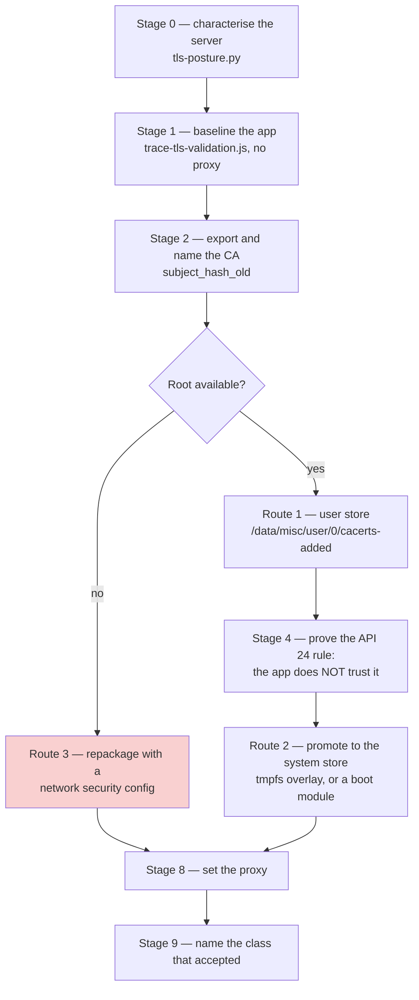
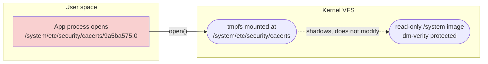

# Lab 01 — End-to-end interception on a physical device

**Difficulty:** Intermediate
**Time:** 3–4 hours
**Prerequisites:** [Chapter 35 README](../README.md), a rooted physical device or an emulator image
without Google Play, Burp Suite (Community is enough), OpenSSL on the host, `adb`, Frida 16+ on host
and device
**Applies to:** Android 7 (API 24) and later; every measurement below was taken on Android 11 (API 30)

---

## Objective

Take one real application on one real device from "no visibility at all" to "I am reading its HTTPS
request and response bodies in plain text", and be able to explain in one sentence what each step was
for. The deliverable is not a screenshot of Burp; it is one decoded request and response from an app
you are authorised to test, a stage-gate record saying which stage each attempt passed, and a one-line
statement of **which trust manager accepted your certificate**, taken from
`../scripts/trace-tls-validation.js` rather than guessed.

> **🧠 Mental Model**
> An interception proxy does not break TLS. It **terminates** one TLS connection and **originates**
> another. There are two encrypted connections — device-to-proxy and proxy-to-server — and the proxy
> holds the plaintext of both because it is an endpoint of both. Nothing is decrypted that was not
> first encrypted *to the proxy*. The whole difficulty of this lab is therefore one question: how do I
> make the app encrypt to me? The answer never changes. The app must **trust** the certificate I
> present. Interception is not a cryptographic attack; it is a trust-administration exercise.

> **⚠️ Warning — authorisation**
> Do this against an application you own, one you have written permission to test, or a deliberately
> vulnerable target. Installing a certificate authority on a device makes every application on it
> interceptable by whoever holds the matching private key, including your banking app. Use a test
> device, and treat the clean-up section at the end as part of the lab, not an afterthought.

[45-OAuth Lab 01](../../45-OAuth/labs/lab-01-intercept-the-flow.md) already captures a full
authorisation flow, and its setup says "install your Burp CA as a system CA — both routes are covered
in 35-SSL". **This is that coverage.** That lab is about the protocol carried inside the tunnel; this
one is about the tunnel. If you did that lab and it "just worked", come back anyway: the value here is
in the failures and in knowing which stage produced them.

---

## The reference device

Every measured number below came from this device, and yours will differ. Where a number matters, this
lab tells you how to measure it on **your** device rather than trust mine.

| Property | Value on the reference device |
|---|---|
| Model | Redmi `M2101K6P`, codename `sweetin` |
| Android version / API | 11 / 30, MIUI 12.5 |
| Root | Magisk plus APatch |
| System trust store | `/system/etc/security/cacerts` — **139** files |
| User trust store | `/data/misc/user/0/cacerts-added` — mode `0755`, owner `system:system` |
| Frida | `frida-server` on device, `frida` 16.1.6 on the host |

```bash
# host — establish the same facts about your own device first
adb devices -l
adb shell getprop ro.build.version.release; adb shell getprop ro.build.version.sdk
adb shell getprop ro.product.device
adb shell "su -c id"          # must print uid=0(root), or Route 2 is unavailable to you
```

> **🔍 Pentester's Note — the MIUI install trap**
> On the reference device `adb install app.apk` fails with `INSTALL_FAILED_USER_RESTRICTED`. That is
> not a broken APK; it is MIUI's "Install via USB" policy. On a rooted device, push and install as
> root instead, and use this form anywhere below that installs an APK:
> ```bash
> # host
> adb push app.apk /data/local/tmp/app.apk
> adb shell "su -c 'pm install -r /data/local/tmp/app.apk'"
> ```

---

## The shape of the exercise



Reading the diagram: stages 0 and 1 produce evidence *before* you change anything, which is what makes
every later result interpretable, and stage 2 is host-side file handling. The branch is the only place
root matters. Route 1 is included even though it usually fails, because watching it fail is the
fastest way to internalise Android's user-CA rule. Route 3 is shaded as attacker-controlled input
because repackaging changes the application under test: results afterwards describe *your* build.

---

## Setup

Start Burp, open **Proxy → Proxy settings → Proxy listeners**, edit the listener on port 8080 and set
**Bind to address** to *All interfaces*; a listener bound to `127.0.0.1` is invisible to the phone,
and that one setting causes a large share of "nothing appears in Burp" reports. Find the host's
address with `ip -4 addr show`, or `Get-NetIPAddress -AddressFamily IPv4` in PowerShell.

```bash
# host
curl -x 192.168.1.50:8080 -k https://example.com/ -o /dev/null -v   # prove the listener first
adb shell "su -c '/data/local/tmp/frida-server &'"
frida-ps -U | head                                                  # host can see device processes
adb shell "cmd package compile -m verify -f com.example.app"        # stop the JIT inlining hooks away
```

> **⚠️ Warning — Frida 16 command lines**
> Frida 16.1.6 has **no `--no-pause` flag**. Spawning with `-f` resumes the process automatically;
> `--pause` is the opt-in flag if you want it held. Pasting a 2019 blog post's
> `frida -U --no-pause -f com.example.app` into a Frida 16 shell produces an argument error that is
> easy to misread as "Frida is broken".

---

## Steps

### Stage 0 — Characterise the server before you touch the client

Run the chapter's posture script against every endpoint the app talks to, first, and keep the output.
Half the confusing results later are explained by something the *server* does.

```bash
# host
python3 ../scripts/tls-posture.py api.example.com
python3 ../scripts/tls-posture.py api.example.com --json > stage0-posture.json
```

So that you know what a real report looks like: measured against `badssl.com`, SSL 3.0 was refused
with **alert 40**, TLS 1.0, 1.1 and 1.2 were all **accepted** with 8 suites under 1.0 and 1.1 and 20
under 1.2, TLS 1.3 was refused, and the server enforced its own cipher order rather than the client's.
The chain was a leaf `CN=*.badssl.com` (RSA 2048, `sha256WithRSA`, SAN
`DNS:*.badssl.com, DNS:badssl.com`), an intermediate `C=US, O=Let's Encrypt, CN=YR2` (RSA 2048,
`CA:TRUE`, `pathLen=0`), and a root `C=US, O=ISRG, CN=Root YR` (RSA 4096). Measured against
`www.cloudflare.com`, SSL 3.0, TLS 1.0 and TLS 1.1 were all refused with **alert 70,
`protocol_version`**, while TLS 1.2 and TLS 1.3 were accepted with all three TLS 1.3 suites present.
The difference between the alerts is worth internalising: alert 70 is the server saying "I do not
speak that version", a clean refusal, whereas alert 40 is a generic handshake failure that can also
mean "I speak it, but not with any suite you offered". Against `expired.badssl.com` the script flags
`Leaf certificate has expired` with a `notAfter` of 2015-04-12, plus an expired intermediate — the
free, always-available version of one of the four certificates you build by hand in
[Lab 02](lab-02-deliberate-bad-certificate.md).

**Q1.** What is the lowest TLS version *your* endpoint accepts? Does any Android version the app still
supports negotiate that version by default?

**Q2.** The script prints an SPKI pin for the leaf. On the reference run that value was verified
byte-identical to the output of `openssl x509 -pubkey | openssl pkey -pubin -outform DER |
openssl dgst -sha256 -binary | openssl enc -base64` fed from `openssl s_client`. Verify yours the same
way rather than trusting one tool.

**Q3.** Nothing in this stage says anything about the app. Write one sentence explaining why a
perfectly configured server tells you nothing about whether the app validates certificates.

> **Gate A** — a saved posture report exists for every host the app talks to.

### Stage 1 — Baseline the app before you change anything

Attach the trace script with **no proxy set and no CA installed**, exercise the app normally, then ask
it what it saw by calling `verdict()` in the Frida REPL.

```bash
# host
frida -U -f com.example.app -l ../scripts/trace-tls-validation.js
```

Write down four things:

| What `verdict()` prints | Why it matters for the rest of the lab |
|---|---|
| The class name of every `TrustManager` | A platform name means the app took the default. An app name means somebody wrote their own, and you must read it. |
| The class name of every `HostnameVerifier` | The same distinction, applied to a **separate** check that fails independently. |
| The count of `checkServerTrusted` calls | **Zero calls while the app is plainly online means the TLS stack is native** — Flutter, Cronet, Unity, a bundled BoringSSL. No Java hook reaches it and no CA installation helps. |
| Any pinning evidence | Pinning does not change this lab, but it owns the last mile, and that belongs to `36-CertificatePinning`. |

On a stock app on the reference device, the platform trust manager chain observed live was, in
delegation order, `android.security.net.config.RootTrustManager`, then
`android.security.net.config.NetworkSecurityTrustManager`, then
`com.android.org.conscrypt.TrustManagerImpl` — three classes, one decision. `RootTrustManager` is the
entry point the platform installs, `NetworkSecurityTrustManager` applies the network security
configuration, and Conscrypt's `TrustManagerImpl` does the path-building arithmetic. When you later
say "this trust manager accepted my certificate", this is the chain you name a link in.

**Q4.** How many `checkServerTrusted` calls did you see, and which class made them?

**Q5.** If the answer is zero, confirm the app is actually making requests — `adb shell "ss -tnp"`
filtered on the pid will tell you. A native TLS stack and an idle app look identical in the verdict.

> **Gate B** — the app's trust manager and hostname verifier are named, before anything is touched.

### Stage 2 — Export the CA and give it the name the store requires

Export Burp's CA from **Proxy settings → Import / export CA certificate → Certificate in DER format**
and save it as `burp.der`. Inspect it before installing it; you are about to give this key authority
over every TLS connection on the device.

```bash
# host
openssl x509 -inform DER -in burp.der -noout -subject -issuer -dates -fingerprint -sha256
openssl x509 -inform DER -in burp.der -noout -text | grep -A2 "Basic Constraints"
```

`Basic Constraints` must read `CA:TRUE`; a certificate without it cannot sign anything, and an
occasional "installed but nothing works" report is exactly this.

Android's trust stores are **hash directories**: each certificate is stored in a file named after a
hash of its *subject*, so the runtime finds the issuer of a given certificate with a single `open()`
rather than a directory scan. The `.0` suffix is a collision counter.

> **⚠️ Warning — `subject_hash` is the wrong hash**
> OpenSSL has two subject hashes. `-subject_hash` is the SHA-1-based one from OpenSSL 1.0.
> `-subject_hash_old` is the MD5-based algorithm from OpenSSL 0.9.8. **Android uses the old one.** Get
> this wrong and the file lands in the directory, looks perfectly correct in `ls`, and is never found,
> because nothing ever looks for that name.

```bash
# host
HASH=$(openssl x509 -inform DER -in burp.der -noout -subject_hash_old)
echo "old (MD5, what Android wants)      : $HASH"
echo "new (SHA-1, what you must not use) : $(openssl x509 -inform DER -in burp.der -noout -subject_hash)"
cp burp.der "${HASH}.0"
```

On the reference device that command returned exactly `9a5ba575`, and the corresponding file in the
system store is `9a5ba575.0`.

The second question is **encoding**. Much published guidance converts to PEM and appends the OpenSSL
text dump. On the reference device, files in both stores are raw **DER**. Do not guess — read the
neighbours:

```bash
# device root
head -c 2 /system/etc/security/cacerts/9a5ba575.0 | xxd
```

`3082` means DER, an ASN.1 `SEQUENCE` with a two-byte length. `2d2d`, which is `--`, means PEM. Match
whatever your device already uses.

> **🔬 Under the Hood**
> This layout is inherited from OpenSSL's `c_rehash`; Conscrypt implements the same convention in Java,
> in
> `external/conscrypt/repackaged/platform/src/main/java/com/android/org/conscrypt/TrustedCertificateStore.java`,
> with the framework's configuration side under
> `frameworks/base/core/java/android/security/net/config/`. Lookup is **by subject**, so the file name
> is not decorative metadata — it is the index.

**Q6.** What is your CA's `subject_hash_old`? You need it in three more places.

> **Gate C** — a file named `<subject_hash_old>.0` exists, encoded the way the device's store is.

### Stage 3 — Find the trust stores on *your* device

```bash
# adb shell
ls -ld /system/etc/security/cacerts
ls -d /apex/com.android.conscrypt/cacerts /system/etc/security/cacerts
ls /apex/com.android.conscrypt/
```

Measured on the reference device, Android 11 / API 30: `/system/etc/security/cacerts` exists and holds
139 files, and `/apex/com.android.conscrypt/` exists but contains only `bin/`, `etc/`, `javalib/`,
`lib/` and `lib64/`. **There is no `cacerts` directory inside the APEX on API 30.**

That contradicts a good deal of recent tutorial writing, because the trust store *did* move into the
Conscrypt APEX — in **Android 14 (API 34)**, not before. Follow an Android 14 guide on an Android 11
device and you will spend an hour bind-mounting a path that does not exist. Run the `ls -d` above on
your own device and believe its output rather than any guide, this one included.

> **📖 Definition**
> An **APEX** (Android Pony EXpress) is a self-contained, versioned, signed filesystem image that lets
> Google update a modular part of the platform — Conscrypt, media codecs, timezone data — through Play
> system updates without a full OS image. Because it is mounted read-only from a signed image,
> anything that moves *into* an APEX becomes harder to modify on a rooted device, which is exactly why
> the Android 14 trust-store move broke every existing CA-installation script.

```bash
# adb shell — this WILL fail as uid 2000
ls -la /data/misc/user/0/cacerts-added/

# device root — this works
su -c "ls -la /data/misc/user/0/cacerts-added/"
su -c "ls -Zd /data/misc/user/0/cacerts-added /system/etc/security/cacerts"
```

Measured: `/data/misc/user/0/cacerts-added` is mode `0755`, owned `system:system`, with the SELinux
context `u:object_r:misc_user_data_file:s0`, while `/system/etc/security/cacerts` carries
`u:object_r:system_security_cacerts_file:s0`. The `adb shell` user — UID 2000, `shell` — cannot read
the user store; it needs root or the `system` UID. That is worth holding on to: the *user* store is
more strictly protected on disk than the *system* store, because it is app-writable state under
`/data`, whereas the system store is world-readable configuration.

A third directory, `/data/misc/user/0/cacerts-removed`, holds tombstones for system CAs the user has
disabled. All three are written by the `KeyChain` system app running as `system`, never by an app.

**Q7.** How many files are in your system store, and what does `ls /apex/com.android.conscrypt/` show?

### Stage 4 — Route 1: install as a *user* CA, and watch the app ignore it

This route is here so that you can *see* it fail. Install the CA the way an ordinary user would.

```bash
# host
adb push "${HASH}.0" /sdcard/Download/burp-ca.crt
```

On the device, open **Settings → Security → Encryption & credentials → Install a certificate → CA
certificate** and pick the file; on MIUI it sits under **Settings → Passwords & security → System
security → Encryption & credentials**. Confirm it landed with
`su -c "ls -la /data/misc/user/0/cacerts-added/"`, then test the browser, which is the one client that
will honour it:

```bash
# host — the browser request appears in Burp, decrypted; the app's will not
adb shell settings put global http_proxy 192.168.1.50:8080
adb shell am start -a android.intent.action.VIEW -d "https://example.com/"
frida -U -f com.example.app -l ../scripts/trace-tls-validation.js
adb logcat -v threadtime | grep -iE "SSLHandshake|CertPathValidator|Trust anchor"
```

On any app whose `targetSdkVersion` is 24 or greater, the requests fail. `verdict()` shows
`checkServerTrusted` calls that **threw**, and logcat shows
`java.security.cert.CertPathValidatorException: Trust anchor for certification path not found`
wrapped in a `javax.net.ssl.SSLHandshakeException`.

> **📖 Definition**
> From Android 7.0 (API 24), the **default network security configuration** for an app whose
> `targetSdkVersion` is 24 or higher trusts **only** the system CA store. User-installed CAs are
> excluded unless the app opts in with a `network_security_config` naming `user` as a trust anchor.
> Apps targeting API 23 or lower keep the old behaviour and trust both stores. This is the single most
> consequential change in the history of mobile interception, and it is why the browser works while
> the app does not.

**Q8.** What is the target's `targetSdkVersion`? Take it from the device, not from a blog:
`adb shell dumpsys package com.example.app | grep -i targetSdk`.

**Q9.** Quote the exact exception text from your logcat. Which of the three classes named in Stage 1
reported it?

> **🔍 Pentester's Note**
> "I installed the certificate and it still does not work" is this rule and nothing else, in the large
> majority of cases. Before reaching for a pinning bypass, prove where the CA actually is. A pinning
> bypass applied to a user-store problem does not work either, and now you have two uncontrolled
> variables instead of one.

### Stage 5 — Route 2: promote the CA to the system store

The system store is the one every app trusts by default. Getting a file into it on a modern device is
not a matter of `cp`, for three reasons that stack: `/system` is mounted **read-only**; **dm-verity**
hashes the partition, so even a successful write to the block device makes the device fail
verification at the next boot; and on API 30 `/system` may be a mounted image (EROFS or ext4) rather
than a plain writable partition, so "just remount it read-write" is often not available at all.

The answer to all three is the same: **do not modify `/system`. Cover it.** Mount a writable `tmpfs`
over the trust-store directory, populate it with every original certificate plus yours, and the
kernel's VFS serves your directory to every process that opens that path.



Reading the diagram: the app makes an ordinary `open()` on the ordinary path, and the kernel resolves
that path through the topmost mount at that point, which is your `tmpfs`. The read-only image
underneath still holds the original files and its verity hashes still match, because nothing wrote to
it. The app cannot tell the difference, which is the entire point.

#### 5a. The ephemeral method — do it by hand once

```bash
# device root
mkdir -p /data/local/tmp/cacerts-backup
cp /system/etc/security/cacerts/* /data/local/tmp/cacerts-backup/
ls /data/local/tmp/cacerts-backup | wc -l          # your stock count

mount -t tmpfs tmpfs /system/etc/security/cacerts
cp /data/local/tmp/cacerts-backup/* /system/etc/security/cacerts/
cp /data/local/tmp/9a5ba575.0 /system/etc/security/cacerts/

chown root:root /system/etc/security/cacerts/*
chmod 644 /system/etc/security/cacerts/*
chcon u:object_r:system_security_cacerts_file:s0 /system/etc/security/cacerts/*

ls /system/etc/security/cacerts | wc -l            # stock count + 1
```

The `chcon` line is not optional and is the step most often skipped. A file with the wrong SELinux
label is readable by root and invisible to the app process, producing the maddening symptom of a
certificate that is plainly present in `ls` and plainly absent from the app's view of the world.

> **⚠️ Warning — mount namespaces**
> A mount is only visible inside the mount namespace it was made in, and Android gives some processes
> their own. If the overlay appears to do nothing, apply it in PID 1's namespace and restart the app,
> then verify from inside the target process, which is the only view that matters:
> ```bash
> # device root
> nsenter --mount=/proc/1/ns/mnt -- sh -c "mount | grep cacerts"
> PID=$(pidof com.example.app); grep cacerts /proc/$PID/mountinfo
> ```
> If that `grep` prints nothing, the app is not seeing your overlay, whatever your shell sees.

#### 5b. The persistent method — a `trustusercerts` module

The reference device does this permanently with a Magisk/APatch module of the `trustusercerts` family.
Such a module runs at boot, reads `/data/misc/user/0/cacerts-added`, and rebuilds the system store as
an overlay of the stock certificates plus the promoted ones, so the workflow becomes: install the CA
through Settings as a *user* CA, reboot, and the module promotes it. This is the modern,
reboot-persistent way to get a CA into the system store without touching read-only `/system`.

```bash
# device root
mount | grep -c cacerts
mount | grep "etc/security/cacerts" | head -3
ls /system/etc/security/cacerts | wc -l
```

Measured on the reference device: `mount` reports `APatch on /system/etc/security/cacerts type tmpfs`
— the same trick as 5a, done for you at boot — with **139 individual bind mounts**, one per
certificate file, and `ls | wc -l` returns **139**. Stock for this device is 138; the 139th is the
PortSwigger/Burp CA `9a5ba575.0`, promoted from the user store.

> **🔬 Under the Hood**
> Why one bind mount per file rather than one for the directory? A bare tmpfs over the directory hides
> the originals, so the module would have to copy 138 certificates into RAM at every boot.
> Bind-mounting each original file into the tmpfs keeps the page cache shared with the read-only
> image, costs almost no memory, and means the module never ships a copy of the platform trust store —
> which would go stale with every OS update.

**Q10.** How many bind mounts does `mount | grep -c cacerts` report on your device, and does that
number equal your file count?

### Stage 6 — Measure the platform rule instead of believing it

Everything above asserted that system CAs are trusted by every target SDK while user CAs are not from
API 24. You can measure that claim directly, on your own device, without installing an app. The
platform builds its default configuration in
`android.security.net.config.NetworkSecurityConfig.getDefaultBuilder(ApplicationInfo)`; call it
yourself with synthetic `ApplicationInfo` values and read the answer. Attach to any app — you are
measuring the *platform*, not the app. The first line prints the overloads, because this signature has
changed across releases: on API 30 there is exactly **one**, taking `android.content.pm.ApplicationInfo`,
while other levels may take `(int targetSdkVersion, boolean debuggable)` instead.

```javascript
// Frida REPL
Java.perform(function () {
  var NSC     = Java.use('android.security.net.config.NetworkSecurityConfig');
  var AppInfo = Java.use('android.content.pm.ApplicationInfo');
  var Anchor  = Java.use('android.security.net.config.TrustAnchor');
  var SetCls  = Java.use('java.util.Set');

  NSC.getDefaultBuilder.overloads.forEach(function (o) { console.log(o.toString()); });

  function probe(targetSdk, debuggable) {
    var ai = AppInfo.$new();
    ai.targetSdkVersion.value = targetSdk;
    ai.flags.value = debuggable ? 0x2 : 0x0;   // ApplicationInfo.FLAG_DEBUGGABLE == 0x2

    var cfg = NSC.getDefaultBuilder(ai).build();
    var arr = Java.cast(cfg.getTrustAnchors(), SetCls).toArray();

    var found = false;
    for (var i = 0; i < arr.length; i++) {
      var subject = Java.cast(arr[i], Anchor).certificate.value.getSubjectDN().toString();
      if (subject.indexOf('PortSwigger') !== -1) { found = true; }
    }
    console.log('targetSdk=' + targetSdk + ' debuggable=' + debuggable +
                '  anchors=' + arr.length + '  myCA=' + (found ? 'TRUSTED' : 'absent'));
  }

  [23, 24, 28, 30, 34].forEach(function (s) { probe(s, false); });
  [23, 24, 30, 34].forEach(function (s) { probe(s, true); });
});
```

Measured on the reference device, with the Burp CA already promoted into the system store:

| `targetSdk` | `debuggable` | Anchors | The promoted CA |
|---|---|---|---|
| 23, 24, 28, 30, 34 | false | 139 each | trusted in every row |
| 23, 24, 30, 34 | true | 139 each | trusted in every row |

Every row is identical, which looks at first like a refutation of the API 24 rule and is in fact the
rule working exactly as written. **The CA is in the *system* store, so the user-store rule never
applies to it.** API 24 does not say "certificates the user installed are distrusted"; it says "the
*user store* is not a default trust anchor". Once a certificate is promoted out of that store its
provenance is forgotten, because the platform keeps no memory of who put it there. Had you stopped at
Route 1, the same probe would show the `debuggable=false, targetSdk>=24` rows *without* your CA — that
contrast is the lesson, and it is why this lab makes you do Route 1 first.

**Q11.** Run the probe before promoting your CA and again afterwards. Which rows changed?

**Q12.** Under what configuration would the `debuggable` column change the answer, and which chapter
owns that configuration?

> **Gate D** — the platform, asked directly, reports your CA as a trust anchor for the target's
> `targetSdkVersion`.

### Stage 7 — Route 3, for when you have no root

Without root the remaining option is to change the app rather than the device: decompile it, add a
network security configuration that trusts user-installed CAs, rebuild, re-sign.

```bash
# host
apktool d target.apk -o work/
# add res/xml/network_security_config.xml and reference it from the manifest:
#   <application android:networkSecurityConfig="@xml/network_security_config">
apktool b work/ -o patched.apk
apksigner sign --ks debug.keystore patched.apk
```

The XML itself, the `<trust-anchors>` element, the `debug-overrides` block and the precedence rules
between them are the subject of 44-NetworkSecurityConfig, and this lab deliberately does not duplicate
them. Two points belong here, because they are interception concerns rather than XML concerns.

> **⚠️ Warning — repackaging changes the thing you are testing**
> Re-signing replaces the app's signing certificate, and everything depending on it changes: Play
> Integrity attestation fails, `signature`-level permissions shared with the vendor's other apps stop
> being granted, `AndroidKeyStore` material bound to the old signature becomes unusable, and integrity
> self-checks fire. A finding produced against a repackaged build must be reported as such.

> **🔍 Pentester's Note**
> Route 3 has an honest advantage root does not: if it succeeds, it proves the app has **no pinning**,
> because a pinned app rejects the proxy CA regardless of which store it sits in.

### Stage 8 — Set the proxy and capture

```bash
# host
adb shell settings put global http_proxy 192.168.1.50:8080
adb shell settings get global http_proxy          # verify it took
adb shell am force-stop com.example.app           # many clients read the proxy once, at construction
```

> **⚠️ Warning — what the global proxy does and does not do**
> This setting is a system-wide **HTTP proxy** hint. It is honoured by `HttpURLConnection`, by OkHttp's
> default `ProxySelector` and by most Java-level clients, because they all consult
> `java.net.ProxySelector`, which reads it. It does **not** capture non-HTTP traffic such as raw TCP,
> MQTT or DNS; clients that build a socket directly and never ask `ProxySelector`; or native stacks
> that never touch the Java networking layer at all — Flutter's Dart `HttpClient`, Cronet, Unity, and
> anything statically linked against BoringSSL. When it is not enough, the named alternatives are a
> **transparent proxy** — redirect outbound 443 with
> `iptables -t nat -A OUTPUT -p tcp --dport 443 -j REDIRECT --to-port 8080` into a Burp listener in
> *invisible proxying* mode — or a **VPN-based capture** on the device. Both are legitimate; neither is
> walked through here, because each needs its own gate table.

**Q13.** Paste one full request line, its `Authorization` or session header with the value redacted,
and the first line of the response body. That is your deliverable.

**Q14.** Was any traffic *not* captured? Compare the hosts in Burp against the domain list you
extracted from the APK. A host that appears in the APK and never in Burp is either unused or using a
stack the proxy cannot see; find out which.

> **🔍 Pentester's Note — the keyguard false negative**
> On the reference device an app-originated Activity start is blocked while the keyguard is up, which
> looks exactly like "the app never launched" or "the deep link did nothing". Before trusting a
> negative result, run `adb shell "dumpsys trust" | grep -o "deviceLocked=[01]"`; `deviceLocked=1`
> means unlock the device and repeat the test.

### Stage 9 — Prove *which* trust manager accepted your certificate

Traffic in Burp is not the same as knowing why. Re-run the trace with the proxy live —
`frida -U -f com.example.app -l ../scripts/trace-tls-validation.js -o stage9-trace.txt` — and call
`verdict()` again. The `checkServerTrusted` counts should now show calls that **returned**, from the
platform chain you named in Stage 1. Write the sentence out explicitly, because this is the
finding-grade statement and "traffic appeared in Burp" is not:

> The certificate presented by the proxy was accepted by
> `android.security.net.config.RootTrustManager`, delegating to
> `com.android.org.conscrypt.TrustManagerImpl`, after the CA was promoted to the system store. No
> app-supplied trust manager was involved.

**Q15.** Did the verdict name any **app**-written trust manager or hostname verifier? If so, you have
crossed into `36-CertificatePinning` territory and should read that chapter before concluding
anything.

> **Gate E** — you can name the class that accepted your certificate, from tool output.

---

## The decision table — symptom to stage to fix

This is the most reusable artefact in the lab. When interception fails, do not restart from scratch;
find your symptom.

| Symptom | Failing stage | Most likely cause | Fix |
|---|---|---|---|
| Nothing at all in Burp, including from the browser | 8 | Listener bound to `127.0.0.1`, host firewall, or the setting did not take | Bind to all interfaces; `settings get global http_proxy`; test with `curl -x` from the host |
| Browser works, app shows a network error | 4 / 5 | The CA is in the **user** store and the app targets API 24+ | Promote it to the system store, or use Route 3 |
| Certificate visible in `ls`, app still refuses | 5 | Wrong SELinux label, owner, mode, or mount namespace | `chcon u:object_r:system_security_cacerts_file:s0`; check `/proc/<pid>/mountinfo` |
| Certificate installed but never found by anything | 2 | Named with `subject_hash` instead of `subject_hash_old`, or wrong encoding | Recompute with `-subject_hash_old`; match DER or PEM to the neighbours |
| Overlay works, then vanishes after a reboot | 5a | The `tmpfs` method is ephemeral by design | Use a `trustusercerts` boot module |
| Handshake **succeeds**, then the app errors or logs out | — | Certificate pinning: trust passed, the pin check failed afterwards | `36-CertificatePinning` owns this; the tool is [`ssl-pinning-bypass.js`](../../53-Frida/scripts/ssl-pinning-bypass.js) |
| App is online but zero `checkServerTrusted` calls | 1 | Native TLS stack — Flutter, Cronet, Unity, bundled BoringSSL | No Java hook helps; hook the native verify callback, or use a transparent proxy |
| Some hosts captured, others not | 8 | Per-connection stack differences, or a client ignoring `ProxySelector` | Compare against the APK's domain list; consider transparent proxying |
| Worked yesterday, not today | 5a | The reboot dropped the `tmpfs` overlay | Re-apply, or install the module |
| Only *your* device fails | 3 | Different Android version, different store path | Re-run `ls -d /apex/com.android.conscrypt/cacerts /system/etc/security/cacerts` |

**Q16.** Which row did you land on, and how long did you spend before looking at this table? The answer
is the argument for building one of these for every technique you learn.

---

## Clean-up — not optional

You have made this device interceptable by anyone holding your Burp private key. Undo it.

```bash
# host — 1. stop proxying
adb shell settings put global http_proxy :0
adb shell settings get global http_proxy

# device root — 2. drop an ephemeral overlay
umount /system/etc/security/cacerts
ls /system/etc/security/cacerts | wc -l          # back to the stock count

# device root — 3. remove the user CA, if you used Route 1
rm -f /data/misc/user/0/cacerts-added/9a5ba575.0
```

Settings → Security → Encryption & credentials → **Trusted credentials → User** removes a
user-installed CA by hand, and **Clear credentials** removes all of them. Verify from the platform's
point of view by re-running the Stage 6 probe: the anchor count should return to your stock number and
your CA should read `absent`. Reboot if the probe disagrees with `ls`.

> **⚠️ Warning — record what you installed**
> Write down in your engagement notes: the device, the date, the CA's subject, its `subject_hash_old`,
> which store you put it in, and whether you removed it. A CA left behind on a device that later
> returns to normal use is a real security incident that you caused; if the device is shared, tell
> whoever owns it.

---

## Hints

<details>
<summary>Hint 1 — the browser shows traffic but the app shows a network error</summary>

This is the API 24 default configuration and nothing else, nine times in ten. Confirm rather than
assume:

```bash
# host
adb shell dumpsys package com.example.app | grep -i targetSdk
adb shell "su -c 'ls /data/misc/user/0/cacerts-added/ /system/etc/security/cacerts/ | grep <yourhash>'"
```

If the hash appears only under `cacerts-added`, you are in Route 1 and the app is behaving correctly;
promote it. If it appears under `/system/etc/security/cacerts` and the app still fails, go to Hint 2.
</details>

<details>
<summary>Hint 2 — the file is in the system store but nothing sees it</summary>

```bash
# device root
ls -laZ /system/etc/security/cacerts/9a5ba575.0
head -c 2 /system/etc/security/cacerts/9a5ba575.0 | xxd
PID=$(pidof com.example.app); grep cacerts /proc/$PID/mountinfo
openssl x509 -inform DER -in /system/etc/security/cacerts/9a5ba575.0 -noout -subject_hash_old
```

Expect context `u:object_r:system_security_cacerts_file:s0` with mode `644` and owner `root:root`;
`3082` if your store is DER; at least one mountinfo line naming `cacerts`; and a hash matching the
file name. Whichever of the four fails is your cause — it is almost always one of them.
</details>

<details>
<summary>Hint 3 — I want to be sure it is pinning before I go to chapter 36</summary>

Pinning has a very specific signature: the **handshake completes**, and the failure comes *afterwards*.
The trace shows `checkServerTrusted` calls that **returned**, followed by an application-level error,
and logcat often names a pin set or raises `javax.net.ssl.SSLPeerUnverifiedException`. A trust failure
looks different: `checkServerTrusted` **throws**
`CertPathValidatorException: Trust anchor for certification path not found` and the handshake never
completes at all. Different lines in the log, different stages of the connection.
</details>

---

## Solution

<details>
<summary>Answers</summary>

**Q1–Q3.** Server posture and client validation are independent variables. A server can enforce TLS
1.3 only, with a perfect chain, while the app in front of it accepts any certificate on earth, because
validation is performed **by the client**. That is why `tls-posture.py`'s own header states it cannot
tell you whether the app trusts the endpoint.

**Q4–Q5.** The expected baseline on a stock app is a small number of `checkServerTrusted` calls made
through `android.security.net.config.RootTrustManager`. Zero calls with confirmed network activity
means a native TLS stack, and the correct response is to say so rather than to conclude the app
performs no validation.

**Q6–Q7.** The name comes from `subject_hash_old`, the MD5-based OpenSSL 0.9.8 algorithm: on the
reference device the Burp CA hashed to `9a5ba575` and the store file is `9a5ba575.0`, while
`subject_hash` produces a different value Android never looks for. On API 30
`/system/etc/security/cacerts` exists and `/apex/com.android.conscrypt/cacerts` does not, the APEX
holding only `bin/`, `etc/`, `javalib/`, `lib/` and `lib64/`; the store moved into the Conscrypt APEX
in Android 14 (API 34), so on API 34 or later expect the opposite result.

**Q8–Q10.** Any `targetSdkVersion` of 24 or higher gets the post-Nougat default, which trusts the
system store only. The exception originates in Conscrypt's `TrustManagerImpl` and surfaces as
`javax.net.ssl.SSLHandshakeException` wrapping
`java.security.cert.CertPathValidatorException: Trust anchor for certification path not found`; the
class that *reports* it is the outermost one, `RootTrustManager`, because that is what the app called.
The reference device shows 139 bind mounts for 139 files — one per certificate, because the module
bind-mounts each stock certificate individually into the tmpfs and adds the promoted one.

**Q11–Q12.** Before promotion, the `debuggable=false` rows with `targetSdk >= 24` show the stock anchor
count and report your CA as absent, while `targetSdk=23` shows one more anchor and reports it trusted;
after promotion every row reports it trusted, because the certificate is no longer a *user* CA at all.
The rule did not change, the certificate's location did. The `debuggable` column would only differ if
the app shipped a `network_security_config` with a `<debug-overrides>` block, which the platform
applies only when `FLAG_DEBUGGABLE` is set — that configuration language belongs to
44-NetworkSecurityConfig.

**Q13–Q16.** The deliverable is one decoded request and response. Any host present in the APK's string
table but absent from Burp deserves an explanation — unused endpoint, different network stack,
different port, or pinning that failed before the request was sent; "I did not see it" is not "it does
not exist". An app-written trust manager or hostname verifier means the app opted out of the platform
default, which may be a pin set and may be a trust-everything implementation: the two look identical in
a class list and are distinguished by the oracle and the deliberate-bad-certificate test in
[Lab 02](lab-02-deliberate-bad-certificate.md). On the decision table, the usual honest answer is
"forty minutes, and it was row two"; building one per technique is the difference between debugging
and guessing.

</details>

---

## Success criteria

- [ ] You recorded the device's Android version, API level and system store file count
- [ ] You ran `../scripts/tls-posture.py` against every host the app talks to and saved the JSON
- [ ] You baselined the app with `../scripts/trace-tls-validation.js` **before** installing anything,
      and can name its trust manager and hostname verifier classes from tool output
- [ ] You computed the CA's `subject_hash_old`, confirmed it differs from `subject_hash`, and checked
      the store's encoding rather than assuming DER or PEM
- [ ] You verified whether `/apex/com.android.conscrypt/cacerts` exists on **your** device
- [ ] You installed the CA as a user CA and **observed** the app refusing it, with the exception text
- [ ] You promoted the CA to the system store, set the SELinux context, and verified the mount from
      `/proc/<pid>/mountinfo`
- [ ] You measured `NetworkSecurityConfig.getDefaultBuilder` before and after promotion
- [ ] You captured one complete decoded request and response
- [ ] You named the class that accepted the certificate, from `verdict()` output
- [ ] You filled in the decision-table row that matched your failure, if you had one
- [ ] You reset the proxy with `settings put global http_proxy :0`
- [ ] You removed the CA, verified its removal, and **recorded** what you installed and where

---

## Where this goes next

You can now intercept an app that does not resist you, which proves your setup works and proves
nothing about the app. [Lab 02 — the deliberate bad certificate](lab-02-deliberate-bad-certificate.md)
presents the app with certificates it *should* refuse, the only test that produces evidence about the
app rather than about your device. If your handshake succeeded and the app failed anyway, that is
pinning and `36-CertificatePinning` owns it; if the app shipped its own trust manager, read it before
bypassing it. For the primitives underneath all of this, see
[34-Cryptography](../../34-Cryptography/README.md).
