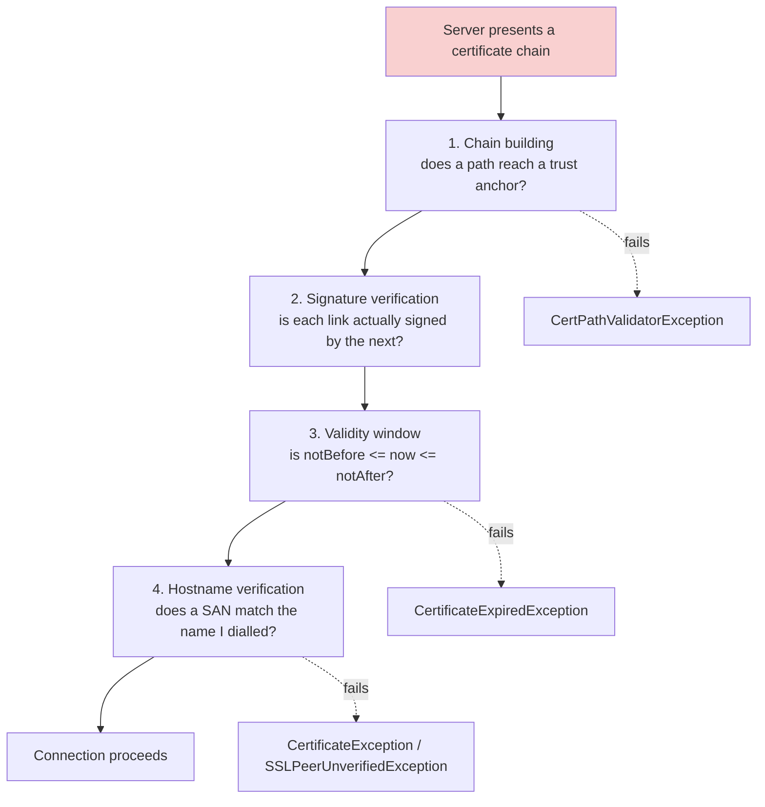

# Lab 02 — The deliberate bad certificate

**Difficulty:** Intermediate to advanced
**Time:** 3–5 hours
**Prerequisites:** [Chapter 35 README](../README.md) and [Lab 01](lab-01-end-to-end-interception.md)
completed, OpenSSL on the host, a rooted device or emulator, Frida 16+ on host and device
**Applies to:** every Android version; measurements below were taken on Android 11 (API 30)

---

## Objective

Present the application with certificates it **should refuse**, one defect at a time, and record what
it does. The output is a five-row result matrix, a per-host severity rating, and — if the app fails —
a finding that no developer can argue with, because it is a behaviour rather than an opinion about
code.

> **Mental Model**
> Reading code proves **intent**. Running the deliberate-bad-certificate test proves **behaviour**.
> The two disagree far more often than anyone expects: a `TrustManager` that looks correct is bypassed
> because the app builds its `SSLContext` somewhere else; a `TrustManager` that looks catastrophic is
> never installed on the client that matters. Only one of these two methods produces evidence, and it
> is the one where you hand the app something it should reject and watch.

> **Warning**
> A clean report from `../scripts/trace-tls-validation.js` proves **nothing on its own**. The script's
> own header says so: "Anything conclusive from silence — a TrustManager that never threw during your
> session is only interesting if you presented it something it should have rejected." Lab 01 ends with
> a green trace and no finding. That is the correct outcome of Lab 01 and the starting point of this
> lab.

---

## Why one bad certificate is not enough

TLS certificate validation is not a single check. It is at least four independent checks, and a client
can fail any subset of them while passing the rest.



Reading the diagram: steps 1 to 3 are the job of the `X509TrustManager`, and step 4 is the job of a
separate object, the `HostnameVerifier`, called by the socket or the HTTP client *after* the trust
manager has returned. Because they are different objects, written and configured separately, they
break separately. An app that passes step 1 and fails step 4 is fully interceptable by anyone holding
any certificate from any public CA — and its `TrustManager` will look immaculate under review.

> **Definition**
> **Hostname verification** is the check that the name you dialled appears in the certificate's
> `subjectAltName` (SAN) extension. It is *not* part of certificate chain validation and it is *not*
> performed by the `TrustManager`. A certificate for `evil.example.net` issued by a real, trusted CA is
> a perfectly valid certificate — it is not a valid certificate *for* `api.example.com`, and it
> is hostname verification, alone, that notices.

> **Warning — the common-name trap**
> A certificate carrying only a `CN=api.example.com` and **no SAN extension** fails hostname
> verification on every current client, Android included. `CN` as a hostname source was deprecated by
> RFC 2818 and removed from practice years ago. If your hand-made certificate is rejected by
> everything including your control case, check that your `openssl.cnf` actually emitted a SAN before
> you conclude the app is well-behaved.

---

## Setup

### The scratchpad rule

> **Warning — never commit a key or a certificate**
> Everything you generate below is key material. It goes in a scratch directory outside the
> repository, it is never committed, and it is deleted at the end of the lab. This lab deliberately
> ships **no** certificates and **no** keys: you generate your own so that no reader of these notes
> ever shares a private key with another reader.

```bash
# host
mkdir -p ~/labs/tls-scratch && cd ~/labs/tls-scratch
printf '*\n' > .gitignore     # belt and braces if this ever lands inside a repo
```

Everything from here runs in that directory.

### The configuration file

Create `openssl.cnf`. It is short, and every line of it matters.

```ini
# host — ~/labs/tls-scratch/openssl.cnf
[ req ]
default_bits       = 2048
prompt             = no
distinguished_name = dn
x509_extensions    = v3_leaf
req_extensions     = v3_leaf

[ dn ]
C  = GB
O  = LAB ONLY - DO NOT TRUST
CN = api.example.com

[ v3_leaf ]
basicConstraints = critical, CA:FALSE
keyUsage         = critical, digitalSignature, keyEncipherment
extendedKeyUsage = serverAuth
subjectAltName   = @alt_right

[ v3_leaf_wrong ]
basicConstraints = critical, CA:FALSE
keyUsage         = critical, digitalSignature, keyEncipherment
extendedKeyUsage = serverAuth
subjectAltName   = @alt_wrong

[ v3_ca ]
basicConstraints = critical, CA:TRUE, pathlen:0
keyUsage         = critical, keyCertSign, cRLSign
subjectKeyIdentifier = hash

[ alt_right ]
DNS.1 = api.example.com

[ alt_wrong ]
DNS.1 = not-the-app.example.net
```

The `O = LAB ONLY - DO NOT TRUST` line is not decoration. When one of these certificates turns up in a
capture six months from now, that string is what tells you it was yours.

### Two certificate authorities

You need **two** CAs, and the difference between them is the entire point of certificate 4.

| CA | Installed in the device trust store? | Role |
|---|---|---|
| `labca` | **yes** — promoted to the system store exactly as in Lab 01 | stands in for "a CA this device trusts" |
| `evilca` | **no**, never | stands in for "an attacker's CA" |

```bash
# host
openssl req -x509 -newkey rsa:2048 -nodes -days 30 -config openssl.cnf -extensions v3_ca \
  -subj "/C=GB/O=LAB ONLY - DO NOT TRUST/CN=Lab Trusted CA" \
  -keyout labca.key -out labca.crt

openssl req -x509 -newkey rsa:2048 -nodes -days 30 -config openssl.cnf -extensions v3_ca \
  -subj "/C=GB/O=LAB ONLY - DO NOT TRUST/CN=Lab Attacker CA" \
  -keyout evilca.key -out evilca.crt

openssl x509 -in labca.crt -noout -subject_hash_old
```

Install **only** `labca.crt` into the device's system store, by the procedure you already used in Lab
01: name it `<subject_hash_old>.0`, match the store's encoding, place it in the `tmpfs` overlay, set
mode `644`, owner `root:root` and the SELinux context
`u:object_r:system_security_cacerts_file:s0`. Then confirm it with Lab 01's Stage 6 Frida probe: the
anchor count should go up by exactly one.

> **Pentester's Note**
> You could sign the "wrong hostname" certificate with Burp's own CA instead — Burp can export its CA
> as a PKCS#12 including the private key, and `openssl pkcs12 -in burp.p12 -nocerts -nodes` extracts
> it. Using your own `labca` is better for one reason: at the end of the lab you delete a key that
> only ever existed on your machine, instead of leaving a device trusting a CA whose key ships inside
> everybody's Burp installation.

---

## Steps

### Step 1 — Build the four bad certificates and one control

Each certificate breaks **exactly one** thing. That is what makes the result matrix readable.

#### Control — valid chain, valid dates, correct hostname

```bash
# host
openssl req -new -newkey rsa:2048 -nodes -config openssl.cnf \
  -keyout control.key -out control.csr
openssl x509 -req -in control.csr -CA labca.crt -CAkey labca.key -CAcreateserial \
  -extfile openssl.cnf -extensions v3_leaf -days 30 -sha256 -out control.crt
```

The control exists so that a total failure of the rig — wrong port, wrong hostname, app not actually
connecting — cannot be mistaken for the app rejecting your certificates. **If the control is refused,
every other result in this lab is meaningless.**

#### Certificate 1 — self-signed, no chain at all

```bash
# host
openssl req -x509 -newkey rsa:2048 -nodes -days 30 -config openssl.cnf -extensions v3_leaf \
  -keyout bad1-selfsigned.key -out bad1-selfsigned.crt
```

This tests **chain building**: the certificate is its own issuer and no path reaches any trust anchor.
It is the crudest test and the one a "trust everything" `TrustManager` fails first.

#### Certificate 2 — valid chain from a trusted CA, wrong hostname

```bash
# host
openssl req -new -newkey rsa:2048 -nodes -config openssl.cnf \
  -subj "/C=GB/O=LAB ONLY - DO NOT TRUST/CN=not-the-app.example.net" \
  -keyout bad2-wronghost.key -out bad2-wronghost.csr
openssl x509 -req -in bad2-wronghost.csr -CA labca.crt -CAkey labca.key -CAcreateserial \
  -extfile openssl.cnf -extensions v3_leaf_wrong -days 30 -sha256 -out bad2-wronghost.crt

openssl x509 -in bad2-wronghost.crt -noout -text | grep -A1 "Subject Alternative Name"
```

This is the most important certificate in the lab, because it isolates **hostname verification**. The
chain is genuinely valid and terminates at a CA the device genuinely trusts. Everything the
`TrustManager` checks is correct. The only defect is that the SAN says `not-the-app.example.net` while
the app dialled `api.example.com`. An app that accepts this is interceptable by anyone who can obtain
*any* certificate from *any* CA the device trusts, which today means anyone with a domain name and
ninety seconds.

#### Certificate 3 — valid chain, correct hostname, expired

> **Warning — you cannot backdate with `-days`**
> `-days` counts forward from the current time, so `-days -100` does not produce an expired
> certificate; it produces an error or a nonsense validity window. Backdating needs one of the three
> approaches below. Check which your OpenSSL supports before you start: `openssl x509 -help 2>&1 |
> grep -i not_` and `openssl ca -help 2>&1 | grep -i startdate`.

The most portable route is `libfaketime`, which lies to OpenSSL about the current time:

```bash
# host — route A: libfaketime (works with every OpenSSL version)
faketime '2014-01-01 00:00:00' \
  openssl x509 -req -in control.csr -CA labca.crt -CAkey labca.key -CAcreateserial \
    -extfile openssl.cnf -extensions v3_leaf -days 30 -sha256 -out bad3-expired.crt
cp control.key bad3-expired.key
```

If `faketime` is unavailable, `openssl ca` takes explicit dates, at the cost of a small amount of CA
bookkeeping:

```bash
# host — route B: openssl ca with explicit dates
mkdir -p newcerts && touch index.txt && echo 01 > serial
cat >> openssl.cnf <<'EOF'

[ ca ]
default_ca = CA_lab

[ CA_lab ]
dir             = .
database        = ./index.txt
serial          = ./serial
new_certs_dir   = ./newcerts
certificate     = ./labca.crt
private_key     = ./labca.key
default_md      = sha256
policy          = policy_any
copy_extensions = copy
unique_subject  = no

[ policy_any ]
commonName = supplied
EOF

openssl ca -batch -config openssl.cnf -extensions v3_leaf \
  -startdate 140101000000Z -enddate 140201000000Z \
  -in control.csr -out bad3-expired.crt
cp control.key bad3-expired.key
```

Newer OpenSSL builds also accept `-not_before` and `-not_after` directly on `openssl x509 -req`; if
the `grep` above found them, that is the shortest route. Whichever you use, verify the result rather
than assume it:

```bash
# host
openssl x509 -in bad3-expired.crt -noout -dates
```

This tests the **validity window**. A zero-setup alternative exists if you only want the negative
case: `expired.badssl.com` presents a leaf whose `notAfter` is 2015-04-12, which
`../scripts/tls-posture.py` reports as `Leaf certificate has expired`, together with an expired
intermediate.

#### Certificate 4 — proper chain, correct hostname, from a CA the device does not trust

```bash
# host
openssl req -new -newkey rsa:2048 -nodes -config openssl.cnf \
  -keyout bad4-evilca.key -out bad4-evilca.csr
openssl x509 -req -in bad4-evilca.csr -CA evilca.crt -CAkey evilca.key -CAcreateserial \
  -extfile openssl.cnf -extensions v3_leaf -days 30 -sha256 -out bad4-evilca.crt
cat bad4-evilca.crt evilca.crt > bad4-evilca.chain.crt
```

At first glance this duplicates certificate 1 — both fail because no trust anchor is reachable. They
are not the same test, and the difference is diagnostic. Certificate 1 is a single self-signed leaf.
Certificate 4 is a well-formed two-level chain with a real signature on the leaf, correct extensions,
a correct SAN, and valid dates. Its **only** defect is the identity of the root.

> **Under the Hood**
> Home-grown `TrustManager` implementations fail these two differently, which is why both are worth
> presenting. A common broken pattern checks that `chain.length > 1`, or that the leaf's issuer
> distinguished name is non-empty, or that the leaf's signature verifies against `chain[1]` — and then
> returns. All three of those accept certificate 4 and reject certificate 1. Seeing that exact split
> in your matrix tells you the app is performing a *structural* check on the chain and never
> evaluating it against a trust anchor, which is a far more specific finding than "does not validate".

**Q1.** Print all five certificates and confirm each breaks exactly the property it is supposed to:

```bash
# host
for c in control bad1-selfsigned bad2-wronghost bad3-expired bad4-evilca; do
  echo "=== $c"
  openssl x509 -in $c.crt -noout -subject -issuer -dates
  openssl x509 -in $c.crt -noout -text | grep -A1 "Subject Alternative Name"
done
```

**Q2.** Verify chain building yourself, on the host, before you involve the device:

```bash
# host
openssl verify -CAfile labca.crt control.crt          # expect OK
openssl verify -CAfile labca.crt bad1-selfsigned.crt  # expect self-signed / unable to get issuer
openssl verify -CAfile labca.crt bad3-expired.crt     # expect certificate has expired
openssl verify -CAfile labca.crt bad4-evilca.crt      # expect unable to get local issuer
```

Note what `openssl verify` does **not** tell you about `bad2-wronghost.crt`: it verifies as `OK`,
because chain validation genuinely passes. Hostname verification is not `openssl verify`'s job either.

### Step 2 — Stand up the serving rig

The simplest possible TLS server is OpenSSL's own, and its simplicity is a feature: there is no web
framework in the path to blame.

```bash
# host — one terminal per certificate under test
openssl s_server -accept 8443 -www -cert control.crt         -key control.key
openssl s_server -accept 8443 -www -cert bad1-selfsigned.crt -key bad1-selfsigned.key
openssl s_server -accept 8443 -www -cert bad2-wronghost.crt  -key bad2-wronghost.key
openssl s_server -accept 8443 -www -cert bad3-expired.crt    -key bad3-expired.key
openssl s_server -accept 8443 -www -cert bad4-evilca.crt     -key bad4-evilca.key -cert_chain evilca.crt
```

`-www` makes the server answer a single HTTP request with a status page, so a client that completes
the handshake receives a real response and you can see the difference between "TLS failed" and "TLS
succeeded and the app disliked the body". `-cert_chain` sends the intermediate alongside the leaf; on
older OpenSSL builds the option may be spelled differently, so check `openssl s_server -help`.

Prove the rig from the host before involving the device:

```bash
# host
openssl s_client -connect 127.0.0.1:8443 -servername api.example.com </dev/null | head -20
```

#### Pointing the app at the rig

The app dials `api.example.com`, so you must make that name resolve to your server. Two workable
routes, in order of preference:

```bash
# device root — route A: hosts file plus adb reverse
#   /system/etc/hosts is on a read-only partition; use the same tmpfs trick as Lab 01
cp /system/etc/hosts /data/local/tmp/hosts.new
echo "127.0.0.1 api.example.com" >> /data/local/tmp/hosts.new
mount --bind /data/local/tmp/hosts.new /system/etc/hosts
```

```bash
# host — map the device's own port 443 back to your s_server
adb reverse tcp:443 tcp:8443
```

Binding port 443 on the device requires privilege; if `adb reverse` refuses, use route B instead:
point the hosts entry at your machine's LAN address (`192.168.1.50 api.example.com`) and run
`openssl s_server -accept 443` on the host. Route C, for apps that ignore `/etc/hosts` because they
resolve through their own DNS, is Burp in **invisible proxying** mode with a per-host certificate
configured to your bad certificate; it is slower to set up and it puts Burp's own logic in the path,
which is why it is the last resort rather than the first.

> **Warning**
> Undo the `mount --bind` on the hosts file at the end of the lab. A leftover hosts entry pointing a
> real API domain at a dead address is a confusing failure for whoever uses that device next, and if
> it points at a live host of yours, it is worse than confusing.

**Q3.** With the **control** certificate serving, does the app work normally? If not, stop. Fix the
rig. Nothing below means anything until this passes.

### Step 3 — Run the matrix

For each certificate, restart the app with the trace script attached, exercise the feature that talks
to that host, and record what happened on both sides.

```bash
# host
frida -U -f com.example.app -l ../scripts/trace-tls-validation.js -o bad1.txt
```

```bash
# host — the app's side of the story, in a second terminal
adb logcat -c
adb logcat -v threadtime | grep -iE "SSLHandshake|CertPath|Certificate|hostname|SSLPeerUnverified"
```

Record for every run: whether the handshake completed (visible at the `s_server` end), whether
`checkServerTrusted` returned or threw (visible in the trace), what logcat said, and what the app's UI
did.

| # | Certificate | Single defect | Handshake completed? | `checkServerTrusted` | Verdict |
|---|---|---|---|---|---|
| 0 | `control` | none — this is the control | | | |
| 1 | `bad1-selfsigned` | no path to any trust anchor | | | |
| 2 | `bad2-wronghost` | SAN does not match the dialled name | | | |
| 3 | `bad3-expired` | `notAfter` in the past | | | |
| 4 | `bad4-evilca` | well-formed chain, untrusted root | | | |

**Q4.** Fill the table in. Every cell. A blank cell is a test you did not actually run.

### Step 4 — What a correct rejection looks like

A rejection is a **pass**. This is the sentence that most often needs saying out loud in a debrief,
because a tester who has spent two hours getting interception working experiences a rejection as
failure and is tempted to keep escalating until something breaks.

| Defect | Typical logcat text |
|---|---|
| Untrusted or self-signed | `javax.net.ssl.SSLHandshakeException:` wrapping `java.security.cert.CertPathValidatorException: Trust anchor for certification path not found` |
| Expired | `java.security.cert.CertificateExpiredException: NotAfter: <date>`, usually inside a `CertPathValidatorException` |
| Hostname mismatch | `java.security.cert.CertificateException: No subject alternative DNS name matching api.example.com found`, or, from OkHttp, `javax.net.ssl.SSLPeerUnverifiedException: Hostname api.example.com not verified` |

Two details are worth noticing in that table. First, the hostname failure arrives from a **different
place** than the other two: the trust manager returned successfully and the verifier objected
afterwards, which is exactly the separation drawn in the first diagram. Second, the expiry failure
names the date, which makes it trivially self-documenting evidence for a report.

> **Pentester's Note**
> Capture the raw logcat lines, not a screenshot of an error toast. "The app displayed 'network
> error'" is weak evidence; `CertPathValidatorException: Trust anchor for certification path not
> found`, with a timestamp that matches your `s_server` log, is strong evidence, and it also proves
> *which* check fired.

**Q5.** For each rejection you observed, quote the exception class and the first line of its message.
Which of the four checks in the opening diagram fired?

### Step 5 — Read the matrix

Now convert observations into claims. Be precise about what each combination licenses, and about what
it does not.

| Observed pattern | What you may conclude |
|---|---|
| Control accepted; 1, 2, 3 and 4 all rejected | Default platform validation is intact for this host. **No finding.** This is the normal, healthy result. |
| Everything accepted, including 1 | The trust manager performs no validation at all. Confirm with the oracle in Step 6, then read the class named in the trace. |
| 1 and 4 rejected, 2 accepted | Chain validation is intact; the **`HostnameVerifier` is permissive**. The app is interceptable by anyone holding any certificate from any trusted CA. |
| 1, 2 and 4 rejected, 3 accepted | Chain and hostname checks are intact; the **validity window is not enforced**. Often a custom trust manager that catches `CertificateExpiredException`, and occasionally a device clock problem — check the clock before reporting. |
| 1 rejected, 4 accepted | The app performs a **structural** chain check without evaluating a trust anchor. Interceptable by any attacker who can present a two-level chain, which is everyone. |
| Control rejected | Your rig is wrong. Fix it; report nothing. |

> **Warning — one host is not the app**
> Every row above is a statement about **one hostname**. Apps routinely validate correctly on their
> main API host and sloppily on an analytics, CDN or crash-reporting host, because those go through a
> different library with a different `SSLContext`. Run the matrix per host, and say which host each
> row belongs to.

**Q6.** Write your conclusion as a single sentence of the form: "Against `<host>`, the application
accepted a certificate whose only defect was `<defect>`, which means `<the precise conclusion from the
table>`." If you cannot fill every slot, you do not have a finding yet.

### Step 6 — The zero-length-chain oracle

The oracle is a shortcut, not a substitute. It needs no proxy, no certificate and no network, which
makes it the fastest honest answer to "is this thing validating at all".

```javascript
// Frida REPL — after exercising the app so its TrustManagers exist
oracle()
```

The `X509TrustManager` contract requires `checkServerTrusted` to throw `IllegalArgumentException` when
handed a null or zero-length chain. Every conformant implementation does. A trust-everything
implementation returns quietly, because it never looks at its arguments.

Measured on the reference device, feeding a zero-length `X509Certificate[]` to each trust manager:

| Class | Result |
|---|---|
| `android.security.net.config.RootTrustManager` | threw `java.lang.IllegalArgumentException: null or zero-length parameter` |
| `android.security.net.config.NetworkSecurityTrustManager` | threw `java.lang.IllegalArgumentException: null or zero-length parameter` |
| `com.android.org.conscrypt.TrustManagerImpl` | threw `java.lang.IllegalArgumentException: null or zero-length parameter` |
| `android.net.SSLCertificateSocketFactory$1` | **returned normally — accepted a zero-length chain** |

The last row is not a bug you found. `android.net.SSLCertificateSocketFactory$1` is AOSP's own
deliberately-insecure `TrustManager`, the anonymous class returned behind
`SSLCertificateSocketFactory.getInsecure()`. The platform ships it, documents it as performing no
validation, and it is reachable from any app that asks. That makes it the perfect calibration weight
for the oracle: a known-permissive implementation that lives on every device, so you can prove your
oracle detects permissiveness before you point it at an app.

Reproduce it yourself:

```javascript
// Frida REPL
Java.perform(function () {
  var empty = Java.array('java.security.cert.X509Certificate', []);
  var TM = Java.use('android.net.SSLCertificateSocketFactory$1');
  try {
    TM.$new().checkServerTrusted(empty, 'RSA');
    console.log('RETURNED  -- accepted a zero-length chain. Performs no validation.');
  } catch (e) {
    console.log('threw     -- ' + e.message);
  }
});
```

If `$new()` is refused because the anonymous class takes an outer instance, force the class to exist
first by calling `android.net.SSLCertificateSocketFactory.getInsecure(0, null)`, then pick a live
instance off the heap with `Java.choose`, exactly as the script's own `oracle()` does.

> **Warning — what the oracle does not prove**
> A positive oracle result proves **that trust manager is permissive**. It does not prove the app is
> interceptable. The app may never use that trust manager for the endpoint you care about; a
> `network_security_config` pin set is enforced somewhere else entirely; and a permissive trust manager
> installed on a client that only fetches public images is a different finding from one on the login
> client. The oracle points you at the certificate test — it does not replace it.

**Q7.** Did the oracle name any trust manager that returned? Does the class name match one that
appeared in your Step 3 matrix as accepting a bad certificate? If the two disagree, explain why before
reporting either.

### Step 7 — Assign an honest severity

An app that accepts a bad certificate has a finding. The **size** of that finding depends entirely on
what crosses the affected connection, and this chapter requires you to say so rather than reach for
"High" because TLS is in the title.

Start by enumerating the affected hosts and what each carries:

```bash
# host — the app's own domain list is the starting point
apktool d target.apk -o work/ >/dev/null
grep -rhoE 'https://[a-zA-Z0-9.-]+' work/ | sort -u | head -50
```

Then map each affected host onto the rubric.

| What actually crosses that connection | Baseline severity | Why |
|---|---|---|
| Credentials, session cookies, bearer or refresh tokens | **Critical / High** | A network-position attacker obtains the account. Nothing else in the app matters. |
| Personal, health, financial or location data | **High** | Disclosure is the harm itself, and it is usually also a regulatory event. |
| Authenticated API traffic that can be **modified** | **High** | Response tampering changes what the app does: prices, balances, permission flags, feature gates. |
| Authenticated API traffic that can only be **read** | **Medium** | Disclosure of one user's data to an attacker already on their network. |
| Update manifests, remote configuration, script or code delivery | **High** | Controlling this connection is a path to controlling the app itself. |
| Public, static, unauthenticated assets — images, fonts, marketing copy | **Low** | No secret crosses. It remains a MASVS-NETWORK-1 failure and remains worth reporting, at Low. |

Then apply the modifiers, each of which moves the rating by roughly one step:

- **Attacker position required.** Any hostile network, including public Wi-Fi and a malicious VPN app,
  is the ordinary assumption. If the flaw is only reachable from a position that also implies device
  compromise, say so and lower it.
- **Pre-authentication reachability.** A flaw on the login call is worse than one behind a session,
  because the attacker needs nothing from the victim beforehand.
- **Persistence.** If the connection can be used to install, update or configure anything, the impact
  outlives the network position.
- **Breadth.** Every user on every version, or one legacy code path on one screen?

> **Pentester's Note**
> Write the severity sentence with the host in it. "The application accepts certificates signed by an
> untrusted CA on `analytics.vendor.example`, which carries a device identifier and no credentials —
> Low" and "The application accepts certificates signed by an untrusted CA on `api.example.com`, which
> carries the bearer token — Critical" are both honest, and shipping the first as Critical costs you
> the credibility you need for the second.

**Q8.** List every affected host, what crosses it, its rating from the rubric, and the modifiers you
applied. That list *is* the finding.

### Step 8 — Map it to MASVS

| Identifier | What it covers | How this lab tests it |
|---|---|---|
| **MASVS-NETWORK-1** | The app uses secure network protocols and settings for all traffic | Full capture from Lab 01, plus `../scripts/tls-posture.py` against every host, plus the control row of this matrix |
| **MASVS-NETWORK-2** | The app verifies the identity of the remote endpoint | The four deliberate bad certificates, plus the oracle as corroboration |

The testing method to name in a report is exactly this pair: **full capture plus the deliberate bad
certificate**. Full capture alone shows only that traffic could be read once you had installed a CA
you control, which is a statement about your device. The bad-certificate test shows what the app
accepts from a party you do *not* control, which is a statement about the app. Certificate pinning,
where it exists, sits on top of both and belongs to `36-CertificatePinning`; the XML that configures
trust anchors and pin sets belongs to `44-NetworkSecurityConfig`.

---

## Clean-up

```bash
# device root — remove the hosts override and the lab CA
umount /system/etc/hosts
rm -f /system/etc/security/cacerts/<labca_hash>.0
umount /system/etc/security/cacerts       # if you used an ephemeral overlay in Lab 01
```

```bash
# host
adb reverse --remove-all
adb shell settings put global http_proxy :0
rm -rf ~/labs/tls-scratch                 # every private key you made dies here
```

> **Warning**
> `rm -rf` on the scratch directory is the point at which `labca.key` and `evilca.key` stop existing.
> Until you run it, your machine holds a key for a CA that a device trusts. Record in your engagement
> notes that you created and removed it, exactly as Lab 01 required for the proxy CA.

---

## Hints

<details>
<summary>Hint 1 — every certificate is rejected, including the control</summary>

The rig is wrong, not the app. Work outwards from the server:

1. Does `openssl s_client -connect 127.0.0.1:8443 -servername api.example.com` complete on the host?
2. Does the device resolve `api.example.com` to your address? Check with
   `adb shell "getprop net.dns1"` and `adb shell ping -c1 api.example.com`.
3. Did the `mount --bind` on `/system/etc/hosts` actually take? `adb shell cat /system/etc/hosts`.
4. Is the app talking to a **different** host than you assumed? The trace script prints the negotiated
   socket for every connection; read it rather than guessing.
5. Is the app pinning? Pinning rejects the control too, which looks identical to a broken rig from the
   outside. The distinguishing evidence is that `checkServerTrusted` **returns** and the failure
   arrives afterwards.
</details>

<details>
<summary>Hint 2 — the expired certificate refuses to be created</summary>

`-days` cannot go backwards. Use `faketime`, or `openssl ca` with `-startdate` and `-enddate` in
`YYMMDDHHMMSSZ` form, or `-not_before`/`-not_after` if your OpenSSL build lists them in
`openssl x509 -help`. Then always confirm with `openssl x509 -noout -dates` before you serve it —
an accidentally *valid* "expired" certificate silently turns row 3 of your matrix into a second copy
of the control.
</details>

<details>
<summary>Hint 3 — the wrong-hostname certificate is rejected with a chain error, not a name error</summary>

That means your `labca` is not actually trusted by the device, so the test never reaches hostname
verification. Re-check the promotion: `subject_hash_old` name, DER or PEM matching the neighbours,
mode `644`, owner `root:root`, SELinux context `u:object_r:system_security_cacerts_file:s0`, and the
mount visible in `/proc/<pid>/mountinfo` for the app's own process. Re-run Lab 01's Stage 6 probe; the
anchor count must have increased by one.
</details>

<details>
<summary>Hint 4 — the trace shows no checkServerTrusted calls at all</summary>

Either the app never connected — check the `s_server` terminal, which prints a line per connection —
or its TLS stack is native. Flutter, Cronet, Unity and anything statically linked against BoringSSL
validate below the Java layer, where no `Java.use` hook reaches. The bad-certificate test still works
in that case, and is in fact the *only* thing that works: you cannot see the validation, but you can
still observe whether the connection succeeds. Report it that way, explicitly.
</details>

---

## Solution

<details>
<summary>Answers</summary>

**Q1–Q2.** The five certificates should differ in exactly one property each. `openssl verify` returns
`OK` for the control **and for `bad2-wronghost.crt`**, because chain validation genuinely passes for
the wrong-hostname certificate — the defect lives in a check `openssl verify` does not perform. That
is the whole reason certificate 2 exists as a separate row.

**Q3.** A refused control means the rig is broken, and the most common causes are DNS not pointing at
your server, the app using a host you did not expect, and pinning. Nothing else in the lab is
interpretable until the control passes.

**Q4–Q5.** The healthy result is: control accepted, all four rejected, with
`CertPathValidatorException` for 1 and 4, `CertificateExpiredException` for 3, and a hostname
exception for 2 arriving *after* a successful `checkServerTrusted`. That last detail is what proves
hostname verification is a separate stage rather than part of chain validation.

**Q6.** Precision matters here because each acceptance licenses a different claim. "Accepts
`bad2-wronghost` only" means the chain logic is fine and the `HostnameVerifier` is permissive — the
remediation is one line of code and the exposure is total. "Accepts `bad4-evilca` but rejects
`bad1-selfsigned`" means the app checks the *shape* of the chain and never evaluates a trust anchor.
Reporting either as the generic "does not validate certificates" makes the fix harder to find and the
finding easier to dispute.

**Q7.** The oracle and the matrix can legitimately disagree. The oracle inspects every trust manager
on the heap, including ones the app never uses for your endpoint, so a permissive class can show up in
the oracle while the endpoint you tested validates correctly — and a `network_security_config` or a
pin set can reject a certificate that a permissive trust manager would have accepted. When they
disagree, the matrix is the finding and the oracle is the explanation.

**Q8.** The rubric exists because severity is decided by what crosses the connection, not by the
mechanism. The same defect is Critical on the token-bearing host and Low on a static-asset host, and a
report that rates both the same is a report whose ratings carry no information. The affected-host
list, with what each carries, is the finding; the CVSS-style label is a summary of it.

</details>

---

## Success criteria

- [ ] All key material was generated in a scratch directory outside the repository, and deleted at the
      end
- [ ] Two CAs exist, and only one of them was installed in the device trust store
- [ ] You built a control plus four bad certificates, each breaking exactly one property
- [ ] You verified each certificate on the host with `openssl x509 -noout -dates` and `openssl verify`
      before serving it
- [ ] The expired certificate is genuinely expired, confirmed by its printed dates
- [ ] The control was accepted by the app, proving the rig works
- [ ] You ran all five certificates and filled in every cell of the matrix
- [ ] You captured raw logcat exception text for every rejection, not screenshots of error messages
- [ ] You identified which of the four validation checks fired for each rejection
- [ ] You ran `oracle()` and reproduced the `android.net.SSLCertificateSocketFactory$1` result
- [ ] You can state the oracle's limit in one sentence
- [ ] You enumerated the affected hosts and what crosses each one
- [ ] You assigned severity per host using the rubric, with the modifiers you applied written down
- [ ] You mapped the work to MASVS-NETWORK-1 and MASVS-NETWORK-2 and named the testing method
- [ ] The hosts override, the lab CA and the scratch directory were all removed, and the removal is
      recorded

---

## Where this goes next

You now have the two halves that make a defensible network finding: Lab 01 proved you can capture
traffic when the device trusts you, and this lab proved what the app accepts from a party it should
not trust. What remains is the layer above — an app that validates correctly and *additionally*
requires a specific key, which is certificate pinning and belongs to `36-CertificatePinning`, and the
declarative configuration that switches all of this on and off, which belongs to
`44-NetworkSecurityConfig`. If your matrix showed the app rejecting even the control, you are almost
certainly already looking at pinning, and [`ssl-pinning-bypass.js`](../../53-Frida/scripts/ssl-pinning-bypass.js)
is the tool — after you have recorded the measurement, never before. For the signature and
key-exchange primitives that make any of this meaningful, see
[34-Cryptography](../../34-Cryptography/README.md); for what this looks like inside a real
authorisation flow, see [45-OAuth Lab 01](../../45-OAuth/labs/lab-01-intercept-the-flow.md).
