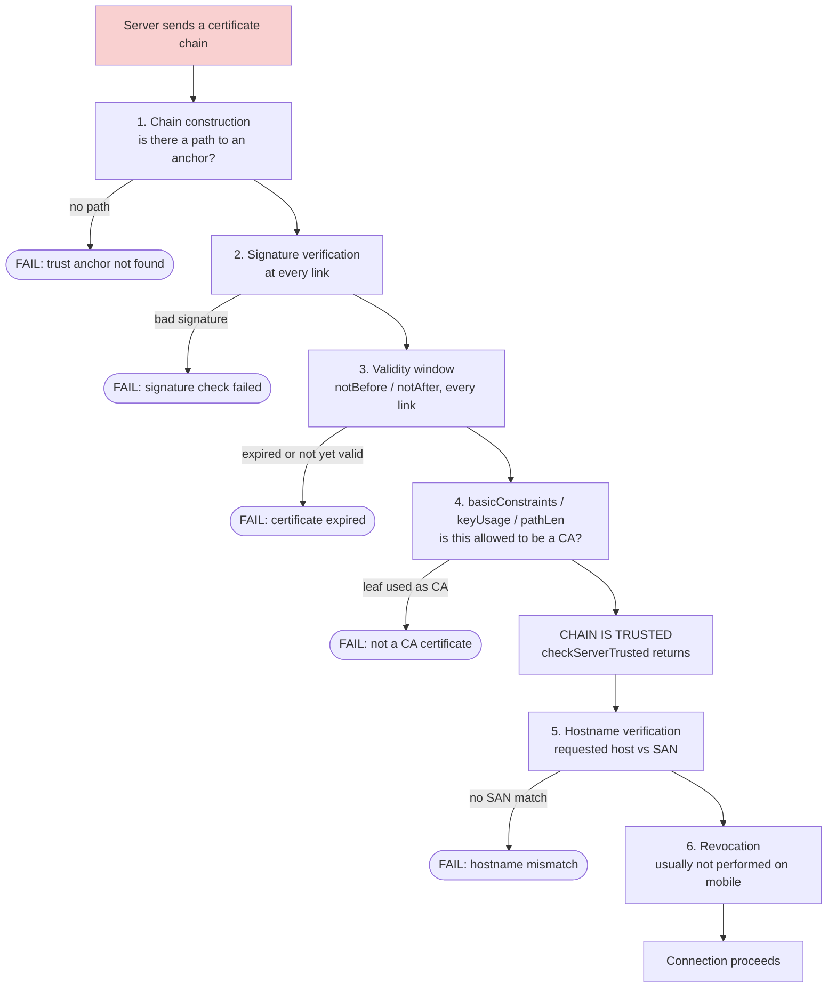

# Lab 03 — Dissecting Validation: Which Check Is This App Actually Doing?

**Difficulty:** Intermediate → Advanced
**Time:** 3–5 hours
**Prerequisites:** [Lab 01](lab-01-end-to-end-interception.md) (interception works and you know why),
[Chapter 35 README](../README.md), [34-Cryptography](../../34-Cryptography/README.md) for what a
signature and a hash actually are

---

## Objective

You are handed an app you did not write. By the end of this lab you can state, **with evidence for
each line**, which of the following that app performs:

1. chain construction — does a path from the server's certificate to a trust anchor exist at all?
2. signature verification at every link of that path
3. validity window (`notBefore` / `notAfter`) at every link
4. `basicConstraints` / `keyUsage` / `pathLen` — is each intermediate even *allowed* to be a CA?
5. **hostname verification** — a wholly separate step, run *after* the chain is trusted
6. revocation — and whether this app is one of the few that bothers

The deliverable is not "the app is interceptable". The deliverable is a sentence of the form: *"this
app performs checks 1–4 correctly, does not perform check 5, and does not perform check 6, and here
is the measurement that proves each clause."*

Lab 01 got traffic into your proxy. Lab 02 will hand the app a deliberately broken certificate. This
lab sits between them and is the analytical one: it is where you stop saying "TLS is broken in this
app" and start saying **which** part of TLS is broken, because those are different findings with
different fixes and very different severities.

> **🧠 Mental Model.** TLS validation is not one switch. It is a row of six independent switches
> wired in series, and an app can have any subset of them off. "Certificate validation is disabled"
> is the sentence of somebody who never looked at which switch it was. A permissive TrustManager
> (switches 1–4 off) and a permissive HostnameVerifier (switch 5 off) both let you intercept, but
> they cost an attacker completely different amounts of effort, and the developer fixes them with
> completely different code.

---

## Measurement baseline

Everything printed in this lab as "measured" was measured on this device. Yours will differ; the
whole point of the lab is that you re-measure rather than quote.

| Property | Value on the reference device |
|---|---|
| Device | Redmi `M2101K6P`, codename `sweetin` |
| Android | 11 (API 30), MIUI 12.5 |
| Root | Magisk plus APatch |
| Frida host | 16.1.6 |
| Frida server | matching build, running on the device |
| System trust store | `/system/etc/security/cacerts`, **139 files** |
| Conscrypt APEX | `/apex/com.android.conscrypt/` exists, **no `cacerts` directory** |
| User trust store | `/data/misc/user/0/cacerts-added/`, root-only |

> **⚠️ Warning — two environment facts that cost an hour each.** `adb install` on this device fails
> with `INSTALL_FAILED_USER_RESTRICTED`, which is MIUI policy and not a broken APK; the route that
> works is `adb push app.apk /data/local/tmp/app.apk` followed by
> `adb shell "su -c 'pm install -r /data/local/tmp/app.apk'"`. And Frida 16.1.6 has **no
> `--no-pause` flag** — spawning with `-f` resumes the process by default and `--pause` is the opt-in
> to *not* resume, so a command copied from an older tutorial fails on an unknown option.

---

## Part 0 — The six checks, named precisely

> **📖 Definition — trust anchor.** A certificate trusted because it is *present in a store you
> control*, not because anything vouched for it. Every chain terminates at one. On Android the stores
> are the system store (shipped with the OS) and the user store (installed by a human through
> Settings). An anchor is trusted by *placement*, which is why placing one is such a powerful act.

> **📖 Definition — certificate chain.** The ordered list `leaf, intermediate…, root` where each
> certificate is signed by the private key of the next. The server sends what it thinks the chain is;
> the client is not obliged to believe that ordering, and a good client rebuilds the path itself from
> the certificates it was handed plus the anchors it holds.

> **📖 Definition — SAN (Subject Alternative Name).** An X.509 extension listing the identities a
> certificate is valid for, as typed entries such as `DNS:api.example.com` and `IP:10.0.0.1`. It is
> the *only* field a current client consults when checking the hostname; the old `CN` (Common Name)
> field is no longer consulted by Chrome, by OkHttp, or by Android's platform verifier.



Read the diagram as a pipeline with five distinct exits. Steps 1 through 4 happen **inside**
`X509TrustManager.checkServerTrusted`, which has a `void` return type: it signals acceptance by
returning and rejection by throwing `CertificateException`. Step 5 happens **outside** that method,
in a separate object — a `HostnameVerifier`, or inside the HTTP stack's own logic — and it happens
*after* the chain has already been declared trustworthy. Step 6, if it happens at all, is a
network fetch of its own.

That structural split is the single most important thing in this lab. An app can validate the chain
perfectly and then accept a certificate issued for a completely different domain, because those two
statements are checked by two different objects that do not know about each other.

| # | Check | Where it lives | Typical failure text |
|---|---|---|---|
| 1 | Chain construction | `TrustManagerImpl` / `CertPathValidator` | `Trust anchor for certification path not found` |
| 2 | Signature verification | `CertPathValidator` | `signature check failed` |
| 3 | Validity window | `CertPathValidator` | `certificate expired on …` / `not valid until …` |
| 4 | `basicConstraints`, `keyUsage`, `pathLen` | `CertPathValidator` | `Certificate is not a CA certificate` / path length constraint violated |
| 5 | Hostname verification | `HostnameVerifier`, `OkHostnameVerifier`, Conscrypt | `Hostname api.bank.example not verified` |
| 6 | Revocation (OCSP/CRL) | almost nowhere, on mobile | — |

> **🔍 Pentester's Note.** Check 6 is the one to be honest about. Android's platform TLS stack does
> not perform online revocation checking by default, and neither does OkHttp. Certificate
> Transparency and short-lived certificates are the industry's answer to that gap, not OCSP. Writing
> "the app does not check revocation" as a finding against a mobile app, with no context, marks the
> report as machine-generated. Write it only when the app is in a threat model where a
> known-compromised certificate is a realistic input, and say so.

> **🔬 Under the Hood.** On the reference device (API 30) the platform's trust manager is a chain of
> three delegating objects, observed live rather than read from documentation:
> `android.security.net.config.RootTrustManager` delegates to
> `android.security.net.config.NetworkSecurityTrustManager`, which delegates to
> `com.android.org.conscrypt.TrustManagerImpl`. The first applies the app's network-security
> configuration, the second applies any declared pin set, and the third does the actual path
> building and signature arithmetic. The XML that configures the first is chapter 44's subject and
> the pin set enforced by the second is chapter 36's; this lab is about the third, plus the hostname
> step that sits outside all of them.

---

## Part 1 — Where trust comes from on *your* device

Before you can say what an app trusts, you must know what the platform offers it. Measure it; do not
assume it from a blog post, because this moved between releases.

```bash
# adb shell
ls /system/etc/security/cacerts | wc -l
ls -d /apex/com.android.conscrypt/cacerts 2>&1
```

Measured on the reference device: `139`, and `ls: /apex/com.android.conscrypt/cacerts: No such file
or directory`. The APEX exists; the trust store is not inside it. That directory only becomes the
live store in Android 14 (API 34), where the certificate store became an updatable Mainline
component. On API 30, `/system/etc/security/cacerts` is the store, full stop.

| API level | System store location | Notes |
|---|---|---|
| 24 → 33 | `/system/etc/security/cacerts` | User CAs no longer trusted by default from API 24 |
| 34+ | `/apex/com.android.conscrypt/cacerts` | Store became an updatable APEX; the old path may still exist and be stale |

Now the user store.

```bash
# device root
ls -laZ /data/misc/user/0/cacerts-added/
```

Measured: the directory is root-only, its SELinux context is
`u:object_r:misc_user_data_file:s0`, and the files inside are named after a hash with a `.0`
suffix. The hash is **not** the one most tutorials tell you to compute.

```bash
# host — proving which hash names the file
openssl x509 -inform DER -in 9a5ba575.0 -subject_hash_old -noout
# 9a5ba575
openssl x509 -inform DER -in 9a5ba575.0 -subject_hash -noout
# a different value entirely
```

Measured on a Burp CA file present on the device: the filename `9a5ba575.0` matches
`subject_hash_old`, the MD5-based hash from OpenSSL 0.9.8, and the file content is **DER**, not PEM.
Two facts that will cost you an hour if you get them wrong: the wrong hash name means the store
silently ignores the file, and PEM content in a store that expects DER means the same.

> **🔬 Under the Hood.** `subject_hash_old` exists because Android's trust store layout was frozen
> against OpenSSL 0.9.8's hashing before OpenSSL 1.0 changed it to SHA-1-based. Conscrypt kept
> compatibility rather than migrating every device's store. This is why a certificate you install
> through Settings works and a certificate you copy in by hand with a `subject_hash` name does not.

---

## Part 2 — The static route: what each bug looks like on disk

Static analysis cannot tell you what an app *did*. It can tell you what code exists, which is how you
know where to point the dynamic tools. Run it first because it is cheap.

### 2.1 Decompile and grep for the shapes

```bash
# host
jadx -d out-jadx/ target.apk
apktool d -o out-smali/ target.apk
```

```bash
# host — the four highest-value greps, in order of value
grep -rn "checkServerTrusted" out-jadx/sources/ | head -40
grep -rn "implements HostnameVerifier\|HostnameVerifier()" out-jadx/sources/ | head -40
grep -rn "setHostnameVerifier\|setDefaultHostnameVerifier" out-jadx/sources/ | head -40
grep -rn "AndroidCAStore\|getInsecure()\|ALLOW_ALL_HOSTNAME_VERIFIER" out-jadx/sources/ | head -40
```

The fourth line is the one people skip. `SSLCertificateSocketFactory.getInsecure()` and
`org.apache.http.conn.ssl.SSLSocketFactory.ALLOW_ALL_HOSTNAME_VERIFIER` are *platform-provided* ways
to disable validation: the app writes no suspicious class of its own, a grep for
`checkServerTrusted` finds nothing, and the app is still wide open.

### 2.2 The Smali signature of an empty `checkServerTrusted`

In JADX the bug is an empty method body, which reviewers read straight past because it looks like
boilerplate. In Smali it is unmistakable, because the *absence of any `invoke`* is visible:

```smali
# host — out-smali/smali/com/example/net/a$1.smali
.method public checkServerTrusted([Ljava/security/cert/X509Certificate;Ljava/lang/String;)V
    .registers 3
    return-void
.end method
```

Three lines. No `invoke-virtual`, no `invoke-static`, no `throw`, no `iget`. The method is handed the
chain in `p1` and the authentication type in `p2` and reads neither register. That shape — a method
whose declared descriptor ends in `)V`, whose name is `checkServerTrusted`, and whose entire body is
`return-void` — is the fingerprint.

A *correct* custom TrustManager, by contrast, delegates:

```smali
# host — a TrustManager that actually validates, for comparison
.method public checkServerTrusted([Ljava/security/cert/X509Certificate;Ljava/lang/String;)V
    .registers 4
    iget-object v0, p0, Lcom/example/net/SafeTm;->delegate:Ljavax/net/ssl/X509TrustManager;
    invoke-interface {v0, p1, p2}, Ljavax/net/ssl/X509TrustManager;->checkServerTrusted([Ljava/security/cert/X509Certificate;Ljava/lang/String;)V
    return-void
.end method
```

The difference is one `invoke-interface` — the entire distance between a shipping banking app that is
safe and one that is not.

### 2.3 The Smali signature of a permissive `HostnameVerifier`

```smali
# host
.method public verify(Ljava/lang/String;Ljavax/net/ssl/SSLSession;)Z
    .registers 4
    const/4 v0, 0x1
    return v0
.end method
```

Two instructions: load the constant 1, return it. `p1` is the hostname the app asked for and `p2` is
the session holding the certificate the server actually presented. Comparing those two is the
method's entire purpose, and this body compares nothing.

> **🧠 Mental Model.** Match on **shape, not name**. `checkServerTrusted` and `verify` are interface
> methods declared in `javax.net.ssl`, which is a platform package that R8 cannot rename — an
> override must keep the name and descriptor of the method it overrides or it stops overriding
> anything. What R8 *does* rename is the class: `com.example.net.LegacyTrustManager` becomes
> `c.a.b.f`, and the anonymous inner class becomes `a$1`. So the class name in your report is
> meaningless after obfuscation, and the method shape is unchanged. Search for the shape.

### 2.4 What R8 and ProGuard actually do to this

| Element | Survives obfuscation? | Why |
|---|---|---|
| `javax.net.ssl.X509TrustManager` interface name | Yes | Library class, not in the program being renamed |
| `checkServerTrusted` method name and descriptor | Yes | Renaming it would break the override |
| `HostnameVerifier.verify` name and descriptor | Yes | Same reason |
| The app's own class name | No | Renamed to something short |
| The empty body | Yes, and it may get *smaller* | R8 can strip a `getAcceptedIssuers` that nobody calls |
| Line numbers and local variable names | Usually removed | `-dontobfuscate` is rare in release builds |

Two consequences follow. First, a grep for `TrustManager` in class names finds fewer results in a
release build than a debug build, and finding none is not evidence of absence. Second, the shape
matching above works identically on an obfuscated APK, which is why it is the technique worth
learning.

```bash
# host — shape-based search across an obfuscated APK, ripgrep multiline
rg -U --multiline-dotall \
  '\.method public checkServerTrusted\(\[Ljava/security/cert/X509Certificate;Ljava/lang/String;\)V\n\s*\.(registers|locals) \d+\n\s*return-void' \
  -g '*.smali' out-smali/
```

Any hit is an empty `checkServerTrusted`, whatever the class ended up being called. **Do this now**
against builds of both [`../examples/InsecureTlsClient.java`](../examples/InsecureTlsClient.java) and
its fixed counterpart [`../examples/HardenedTlsClient.java`](../examples/HardenedTlsClient.java), and
record the hit counts before reading on.

---

## Part 3 — The dynamic route: measuring what actually ran

Static analysis found candidate code. It cannot tell you which candidate is installed on the socket
that carries the login request. For that, run the chapter's tracer.

```bash
# host — make hooks land reliably, then spawn (never attach)
adb shell "su -c 'cmd package compile -m verify -f com.example.app'"
frida -U -f com.example.app -l ../scripts/trace-tls-validation.js
```

Forcing `verify` compilation stops the JIT from inlining a hot method out from under a hook, which is
chapter 13's lesson applied here. Spawning rather than attaching matters because TLS machinery is
usually constructed during application startup: an attach arrives after the interesting constructor
has already run, and you measure nothing. Exercise the app — log in, pull a list, do whatever
generates the request you care about — then ask for the verdict:

```javascript
// Frida REPL
verdict()
```

Measured output against a real app on the reference device, abridged to the two lines that matter:

```text
TRUST MANAGERS SEEN: 5
  android.security.net.config.RootTrustManager
      origin        : platform
      checkServerTrusted: 1 call(s)  (accepted 0, rejected 1)
      ORACLE        : rejected a zero-length chain (conformant).
  android.net.SSLCertificateSocketFactory$1
      origin        : platform
      checkServerTrusted: 1 call(s)  (accepted 1, rejected 0)
      ORACLE        : accepted a ZERO-LENGTH chain.
                      This TrustManager performs no validation.
HOSTNAME VERIFIERS SEEN: 2
  com.android.okhttp.internal.tls.OkHostnameVerifier
      origin : platform
      verify : 0 call(s), 0 true, 0 false
```

### 3.1 Reading the `origin` field

The tracer classifies every TrustManager and HostnameVerifier it sees into one of three origins, and
that classification is where you spend your attention.

| `origin` | Meaning | What you do about it |
|---|---|---|
| `platform` | Class ships with Android or Conscrypt (`android.security.net.config.`, `com.android.org.conscrypt.`, `com.android.okhttp.`, `javax.net.ssl.`) | Nothing. The app accepted the default. Note it and move on. |
| `library` | A well-known third party (`okhttp3.`, `retrofit2.`, `com.android.volley.`, TrustKit, and so on) | Check the version, do not read the source. |
| `app` | Everything else | **Decompile it.** Somebody wrote this by hand, and hand-written trust code is where the bugs are. |

The reason `com.android.okhttp.` counts as platform is worth internalising: Android bundles its own
repackaged copy of OkHttp and uses it underneath `HttpsURLConnection`. A classifier without that
prefix reports `com.android.okhttp.internal.tls.OkHostnameVerifier` as app-written on **every app on
the device**, and sends you off to decompile a class the app never wrote. A tool that cries wolf on
100% of targets is worse than no tool.

> **🔍 Pentester's Note.** `verify: 0 call(s)` on the platform verifier, as in the measured output
> above, is not "hostname verification is disabled". It usually means the hostname check happened
> inside Conscrypt during the handshake rather than through a separate `HostnameVerifier` object, so
> no Java-level `verify` call existed to hook. Silence is not evidence. The way you turn silence
> into evidence is to present a certificate for the wrong name and see whether the connection
> survives — which is Lab 02, and it is not optional.

### 3.2 The interesting line in the measured output

`android.net.SSLCertificateSocketFactory$1` accepted a zero-length chain. Its origin is `platform`,
so the tracer did not flag it as app-written — and yet it performs no validation at all. That is not
a bug in the classifier. It is AOSP's own deliberately-insecure TrustManager, the anonymous inner
class behind `SSLCertificateSocketFactory.getInsecure()`, and it ships inside the platform on every
device.

> **⚠️ Warning.** The presence of that class on the heap does not prove the app under test uses it.
> Classes get loaded for many reasons. What proves use is a `checkServerTrusted` call attributed to
> it *while the app was making the request you care about*, which is why you exercise the app between
> starting the tracer and calling `verdict()`, and why the call counts are printed at all.

---

## Part 4 — The empty-chain oracle

```javascript
// Frida REPL
oracle()
```

The oracle hands every discovered TrustManager a zero-length certificate array:

```java
// what the oracle effectively calls, on each TrustManager it found
tm.checkServerTrusted(new X509Certificate[0], "RSA");
```

The `X509TrustManager` contract requires `IllegalArgumentException` for a null or zero-length chain.
Every conformant implementation throws it, because the first thing a real implementation does is
look at `chain[0]`. An implementation whose body is empty never looks at its argument, so it returns
quietly — and returning *is* accepting.

Measured on the reference device:

| Class | Result of `checkServerTrusted(new X509Certificate[0], "RSA")` |
|---|---|
| `android.security.net.config.RootTrustManager` | throws `java.lang.IllegalArgumentException: null or zero-length parameter` |
| `android.security.net.config.NetworkSecurityTrustManager` | throws the same |
| `com.android.org.conscrypt.TrustManagerImpl` | throws the same |
| `android.net.SSLCertificateSocketFactory$1` | **returns normally** |

Three of the four platform classes are conformant. The fourth is the platform's own opt-in
trust-nothing-checked implementation, and it answers instantly, with no proxy, no certificate and no
network traffic. That is what makes the oracle the fastest honest answer to "is this thing validating
at all".

> **⚠️ Warning — the oracle's stated limit.** A positive result proves **that TrustManager** is
> permissive. It does not prove the app is interceptable. The app may hold a permissive TrustManager
> for an analytics endpoint and a correct one for the API; a pin set declared in a
> network-security-config is enforced somewhere else entirely; and native TLS stacks are invisible to
> it. A positive oracle result is a *lead*, and Lab 02's deliberate-bad-certificate test is the
> confirmation.

A second limit is the reason to run the oracle *after* exercising the app rather than at spawn: it
needs a live instance on the heap, found with `Java.choose`. A TrustManager that has not been
constructed yet is reported as `no live instance on the heap, skipped`.

> **🔬 Under the Hood.** Everything the oracle does runs inside `Java.perform`, and this is not
> stylistic. Calling `Java.use` from a thread that is not attached to the ART VM does **not** raise a
> JavaScript error you can catch — it kills the target process silently. The symptom is an app that
> "crashes on its own" a second after your script loads, with nothing in your Frida console and
> nothing obviously wrong in the script. This was a real bug found while building this chapter's
> tooling. If your own script makes a target vanish, the first thing to check is whether a callback,
> a `setTimeout`, or an `Interceptor` handler is touching the Java bridge from outside
> `Java.perform`.

---

## Part 5 — The other half: what the server will accept

Client validation is only half the question. An app with a flawless TrustManager talking to a server
that still negotiates TLS 1.0 has a real, separate problem, and it is on the server side where you
can measure it without touching the device at all.

Extract the app's endpoints first — from the decompiled sources, from the string pool, and from the
tracer's own handshake log — then measure each one:

```bash
# host
python3 ../scripts/tls-posture.py api.example.com
python3 ../scripts/tls-posture.py --targets domains.txt
python3 ../scripts/tls-posture.py api.example.com --proxy 127.0.0.1:8080
```

### 5.1 A weak endpoint, measured

Measured against `badssl.com`:

```text
PROTOCOL VERSIONS   (raw ClientHello engine)
  SSL 3.0    refused   alert 40 handshake_failure
  TLS 1.0    ACCEPTED
  TLS 1.1    ACCEPTED
  TLS 1.2    ACCEPTED
  TLS 1.3    refused

CIPHER SUITES
  TLS 1.0     8 suites
  TLS 1.1     8 suites
  TLS 1.2    20 suites
  server enforces its own preference order

CHAIN
  [0] CN=*.badssl.com            RSA 2048  sha256WithRSAEncryption
      SAN: DNS:*.badssl.com, DNS:badssl.com
  [1] C=US, O=Let's Encrypt, CN=YR2   RSA 2048  CA:TRUE  pathLen=0
  [2] C=US, O=ISRG, CN=Root YR        RSA 4096
```

### 5.2 A hardened endpoint, measured

Measured against `www.cloudflare.com`:

```text
PROTOCOL VERSIONS   (raw ClientHello engine)
  SSL 3.0    refused   alert 70 protocol_version
  TLS 1.0    refused   alert 70 protocol_version
  TLS 1.1    refused   alert 70 protocol_version
  TLS 1.2    ACCEPTED
  TLS 1.3    ACCEPTED

CIPHER SUITES
  TLS 1.3    TLS_AES_128_GCM_SHA256
             TLS_AES_256_GCM_SHA384
             TLS_CHACHA20_POLY1305_SHA256
```

### 5.3 Alert 40 versus alert 70 — two different answers

This is the reading skill this part exists to teach.

| Alert | Name | What the server is saying | What you conclude |
|---|---|---|---|
| 40 | `handshake_failure` | "I have no cipher suite or parameter in common with you." | The **version** may well be enabled. You simply did not offer a suite it likes. Re-probe with a wider suite list before writing anything down. |
| 70 | `protocol_version` | "I refuse this protocol version." | The version is genuinely disabled. This is a definitive negative. |
| 48 | `unknown_ca` | "I did not recognise a CA you offered." | You are looking at client-certificate territory, not server configuration. |
| 112 | `unrecognized_name` | "SNI names a host I do not serve." | Wrong virtual host, not a security finding. |

`badssl.com` refuses SSL 3.0 with alert 40 and `www.cloudflare.com` refuses it with alert 70. Both
lines say "SSL 3.0 refused" in a summary, and they are not the same statement: one is a *cipher*
answer that happens to end the handshake, the other is an explicit *version* rejection. A scanner
that collapses them into one column will occasionally report a version as disabled when it is merely
unreachable with that scanner's default suite list.

> **🔍 Pentester's Note.** SSL 3.0 being reachable at all is the POODLE precondition
> (CVE-2014-3566), a padding-oracle attack against SSL 3.0's CBC construction. That is the only CVE
> this lab names, and it is named because it is the one where "the old version is merely available"
> is itself the vulnerability. For everything else, availability of an old version is a finding whose
> severity depends on whether any client will negotiate it.

### 5.4 Verifying the script's SPKI arithmetic

The script prints a base64 SHA-256 of each certificate's `SubjectPublicKeyInfo`, and that value was
verified byte-identical to the canonical OpenSSL pipeline below. Cross-check the tool against it once
so you trust the number afterwards; what the number is *used* for is chapter 36's subject.

```bash
# host
openssl x509 -in leaf.pem -pubkey -noout \
  | openssl pkey -pubin -outform DER \
  | openssl dgst -sha256 -binary | openssl enc -base64
```

> **⚠️ Warning.** `tls-posture.py` deliberately does **not** verify the chain against a trust store.
> The question that matters is what the *Android device's* store makes of the chain, not what your
> laptop's store makes of it. A green report from this tool says nothing whatsoever about whether the
> app trusts the endpoint, because validation happens in the client.

---

## Part 6 — Predict, then measure: patterns A, B, C, D

Open `../examples/InsecureTlsClient.java`. It contains four independent ways to throw away transport
security. Its fixed counterpart is `../examples/HardenedTlsClient.java`, which is the same file with
every decision made correctly, so the two diff line for line.

**Before running anything**, fill in this table from reading the source alone. Then run the tracer
against the built app, call `verdict()` and `oracle()`, and fill in the measured column.

| Pattern | What it does | Your prediction: `origin`? oracle result? which of checks 1–6 fail? | Measured |
|---|---|---|---|
| A | Anonymous `X509TrustManager` with an empty `checkServerTrusted`, installed with `HttpsURLConnection.setDefaultSSLSocketFactory` | | |
| B | `HostnameVerifier` whose body is `return true`, chain validation untouched | | |
| C | `TrustManagerFactory` initialised from the `AndroidCAStore` KeyStore | | |
| D | Correct TLS, `catch (SSLHandshakeException)`, retry over `http://` | | |

### 6.1 Pattern A — the trust-everything TrustManager

The tracer reports a class whose origin is `app`, with `<-- WRITTEN BY THIS APP. READ IT.` beside it,
and the oracle reports that it accepted a zero-length chain. Checks 1 through 4 are all gone at once,
because they all live inside the method that is empty. An attacker needs no certificate that anyone
issued — a self-signed certificate generated ten seconds ago is accepted.

Note the asymmetry that makes this bug so common: `checkServerTrusted` returns `void`. There is no
`return true` to write. Acceptance is expressed by *not throwing*, so the vulnerable implementation
contains **less** code than the correct one and no keyword anywhere says "insecure".

Because pattern A installs itself as the process-wide default socket factory, it also applies to
every `HttpsURLConnection` made afterwards, including ones inside third-party SDKs that never asked
for it. When you write this finding, say that.

### 6.2 Pattern B — the verifier that verifies nothing

The tracer reports an app-origin `HostnameVerifier` with `verify: N call(s), N true, 0 false`. The
oracle says nothing useful, because pattern B has no custom TrustManager to feed: **checks 1–4 pass
honestly here**. Only check 5 is missing.

This is the pattern people mis-rate. "The certificate was valid" sounds fine, and it is true. The
attacker's cost is one certificate for a domain they legitimately own, obtainable free in a minute
from a public CA, and it is accepted for your bank's API. The padlock is intact and the chain is
genuinely trusted. It is a complete authentication bypass at the price of a domain name.

> **🧠 Mental Model.** Chain validation answers "was this certificate issued by someone I trust?"
> Hostname verification answers "was it issued to the person I am trying to talk to?" A passport
> checked for forgery but not for the name printed inside is exactly as useful as this app's TLS.

### 6.3 Pattern C — re-opening the user store

`KeyStore.getInstance("AndroidCAStore")` contains **both** the system store and the user store.
Feeding it to a `TrustManagerFactory` produces a TrustManager that trusts everything in both, which
is precisely the pre-API-24 behaviour that the platform deliberately removed.

The oracle result is *conformant*: this TrustManager throws on a zero-length chain, because it is a
real Conscrypt `TrustManagerImpl` underneath. Every check is structurally present. The bug is not a
missing check, it is a **larger anchor set** — check 1 is answered correctly against a set of anchors
that now includes whatever the user, or whatever malware with Settings access, installed.

Severity here genuinely depends on intent. An enterprise MDM deployment may need it; a debugging
shortcut that survived to release is a finding. You cannot tell which from the bytecode, and the
honest report says so and asks the developer.

### 6.4 Pattern D — the punchline

Pattern D is the reason this lab exists.

```java
// ../examples/InsecureTlsClient.java, pattern D, abridged
try {
    return fetch(ENDPOINT, null, null);            // correct TLS, no shortcuts
} catch (SSLHandshakeException handshakeFailed) {
    String plain = ENDPOINT.replaceFirst("^https://", "http://");
    return fetch(plain, null, null);               // ... and now with no TLS at all
}
```

Run every technique in this lab against pattern D and here is what you get:

| Technique | Result on pattern D |
|---|---|
| Grep for `checkServerTrusted` | Nothing. There is no custom TrustManager. |
| Shape-match Smali for an empty method body | Nothing. |
| Tracer `verdict()` | All TrustManagers `platform`, all conformant. |
| Tracer `oracle()` | Every TrustManager rejects the zero-length chain. |
| `tls-posture.py` against the endpoint | Possibly a perfect report. |
| Every "SSL bypass" script you own | Nothing to bypass. |

The app's TLS code is correct. Every check 1 through 5 is performed, and performed properly. The bug
is in the **catch block**: a handshake failure — the one signal in the entire system that says
"somebody is in the middle" — is treated as a transient network error and answered by removing the
protection that produced the signal. The attacker does not need a certificate. They need only to make
the handshake fail, which they can do by presenting any invalid certificate or simply by resetting
the connection.

How you actually find it: watch the network, not the code. In the tracer's log you will see a
`checkServerTrusted` call that *threw* — and then, seconds later, a plaintext request on port 80 for
the same host. On API 28 and above the platform blocks that cleartext request by default and the app
gets an `IOException` instead, which is why the chapter-44 setting `cleartextTrafficPermitted="true"`
turns this dormant bug into a live one.

> **🔍 Pentester's Note.** Generalise the lesson. Your tools measure the code paths they were pointed
> at. Pattern D is invisible to all of them because the vulnerability is not *in* the TLS code — it
> is in what the application does when the TLS code says no. Always end a TLS assessment by asking:
> **what does this app do when the handshake fails?** Break the handshake deliberately and watch.
> That is Lab 02, and this is why it comes after this one.

---

## Part 7 — Honest severity: a rubric, and an exercise

Two apps both accept any certificate. One does it on the endpoint that carries the session token; the
other does it on the CDN that serves product thumbnails. Reporting both as "Critical — TLS validation
disabled" is what makes clients stop reading mobile reports.

### 7.1 The rubric

Score each finding on all five axes, then read the band.

| Axis | 0 | 1 | 2 | 3 |
|---|---|---|---|---|
| **Data on the channel** | Public, static assets | Non-identifying telemetry | Personal data | Credentials, tokens, financial or health data |
| **Direction of harm** | Read-only, public content | Read of private data | Write of app state | Code, configuration or update content the app will execute or obey |
| **Attacker position needed** | Nation-state on backbone | Compromised upstream ISP | Same Wi-Fi / hostile hotspot | Any host on the LAN, or an already-installed app with a VPN service |
| **Which check is missing** | Anchors merely widened (pattern C) | Hostname only, chain honest (pattern B) | Full trust bypass (pattern A) | Cleartext, on any path (pattern D triggered) |
| **Reachability** | Dead code, not called | Debug build only | Release, rare path | Release, every launch |

| Total | Band |
|---|---|
| 0–3 | Informational — record it, do not lead with it |
| 4–7 | Low to Medium |
| 8–11 | High |
| 12–15 | Critical |

The "attacker position" axis is the one people invert. A remote attacker on a backbone is *harder* to
be, so it scores lower. Any application on the device that holds `BIND_VPN_SERVICE`, or anybody
running the coffee shop's access point, is *easier* to be, so it scores higher.

### 7.2 The exercise

Score these four, from the same fictional app, and write one sentence of justification per axis.

1. The image CDN `img.example-cdn.com` is fetched over `http://`. Images are public product photos.
2. The analytics endpoint `metrics.example.com` uses pattern A. The payload contains a device
   identifier and a coarse location.
3. The login endpoint `api.example.com/v1/auth` uses pattern B. The chain is validated; only the
   hostname check is missing.
4. The app fetches a JSON feature-flag document from `config.example.com` using pattern D, and one of
   the flags disables an in-app fraud check.

<details>
<summary>Model answers — write yours first</summary>

**1. Image CDN over cleartext.** Data 0, direction 0, position 3, missing check 3, reachability 3 —
total 9, which lands in "High" and is *wrong*, and that is the point of the exercise. The direction
axis carries the truth: nothing private is exposed and nothing the app obeys is injected. Downgrade
it with a written justification, note that an attacker can still swap images to embarrass or phish
the user, and report it as Low. **A rubric you cannot argue with produces reports nobody believes.**

**2. Analytics with pattern A.** Data 2 (a device identifier plus coarse location is personal data),
direction 1, position 3, missing check 2, reachability 3 — total 11, High. The argument for
downgrading is "it's only analytics"; the argument against is that a device identifier plus location
is exactly the data a stalkerware operator on the same network wants, and it is transmitted on every
launch.

**3. Login with pattern B.** Data 3, direction 3 (the response is a session token the app then
obeys), position 3, missing check 1 — the chain *is* honestly validated, so the attacker must obtain
a genuine certificate for a domain they own — reachability 3. Total 13, Critical. The "missing check"
axis scores lower than pattern A precisely because the attacker's cost is non-zero, and the finding
is still Critical, because the cost is one free certificate.

**4. Feature flags with pattern D.** Data 1, direction 3 (the app *obeys* this document, and one
flag disables a fraud check), position 3, missing check 3, reachability 3 — total 13, Critical. Note
that the transported data is the least sensitive of the four and this is still the joint-worst
finding, because the harm axis is about what the app does with the bytes, not what the bytes are.

</details>

---

## Part 8 — Dead ends, and how to tell you are in one

| Symptom | Most likely cause | How to confirm |
|---|---|---|
| `verdict()` shows zero TrustManagers and zero handshakes, but the app is plainly online | The TLS stack is native — statically linked BoringSSL inside Flutter, Cronet, Unity or a custom `.so`. No Java hook reaches it. | `ls lib/*/ ` in the APK for `libflutter.so`, `libcronet*.so`, `libunity.so`. This is a **real result**, not "the app performs no validation". |
| The app dies about a second after your custom script loads, with no error anywhere | `Java.use` called from a thread not attached to the VM. It kills the process silently instead of raising. | Wrap every Java-bridge access in `Java.perform`, including inside `setTimeout` and `Interceptor` callbacks. |
| Hooks are installed but never fire on a method you can see in JADX | The JIT inlined it. | `adb shell "su -c 'cmd package compile -m verify -f com.example.app'"` and force-stop, then respawn. |
| Frida rejects your command line with an unknown option | You copied `--no-pause` from an older tutorial. | Frida 16.1.6 resumes by default; `--pause` is the opt-in. Drop the flag. |
| `adb install` fails with `INSTALL_FAILED_USER_RESTRICTED` | MIUI policy, not a broken APK. | Push to `/data/local/tmp` and install with `su -c 'pm install -r …'`. |
| Oracle prints `no live instance on the heap, skipped` | The TrustManager has not been constructed yet. | Exercise the app, then call `oracle()` again. |
| A certificate you hand-copied into the user store is ignored | Wrong filename hash or wrong encoding. | The name must be `subject_hash_old` with a `.0` suffix, and the content must be DER. |

---

## Success criteria

Phrase every answer as a claim plus the measurement that supports it. "I ran the tracer" is not an
answer; "the tracer attributed one `checkServerTrusted` call to `com.example.a$1`, origin `app`,
which returned rather than threw" is.

- [ ] Can you name all six checks, say which object performs each, and say which two are *not*
      performed inside `checkServerTrusted`?
- [ ] For your target app, which of the six does it perform? What is your evidence for each?
- [ ] How many files are in `/system/etc/security/cacerts` on **your** device, and does
      `/apex/com.android.conscrypt/cacerts` exist? What does the answer tell you about its API level?
- [ ] Can you name the three platform trust-manager classes in the delegation chain, in order, and
      say what each one contributes?
- [ ] Show the Smali shape of an empty `checkServerTrusted` and explain, without hand-waving, why R8
      cannot rename that method.
- [ ] Which classes did the tracer classify as `origin: app`, and what did you find when you
      decompiled them?
- [ ] What did the oracle report for each TrustManager, and what is the oracle's stated limit?
- [ ] Why does `android.net.SSLCertificateSocketFactory$1` accept a zero-length chain, and why is it
      not a classifier bug that its origin is `platform`?
- [ ] For one endpoint, was SSL 3.0 refused with alert 40 or alert 70, and why are those different
      answers?
- [ ] For patterns A, B, C and D: which check is missing, what does an attacker need, and what does
      the fix look like as code in `../examples/HardenedTlsClient.java`?
- [ ] Why does every technique in this lab fail to find pattern D, and what single question, asked at
      the end of every assessment, would have found it?
- [ ] Score your real finding on the rubric, and write the one sentence you would put in a report
      that a developer could act on without asking a follow-up question.

---

## Where this goes next

[Lab 02](lab-02-deliberate-bad-certificate.md) takes the leads produced here and converts them into
proof, by presenting a certificate the app *should* reject and observing whether it does. Nothing in
this lab is evidence until that test has run: a TrustManager that never threw is only interesting if
you gave it something it should have thrown at.

[Lab 04](lab-04-ctf-the-trusted-impostor.md), the CTF, then makes you exploit the exact distinction
Part 6.2 introduced — a chain that validates honestly against an anchor you control, and a hostname
check that never happens.

Pinning is chapter 36 and is a *later* gate than anything measured here; the XML that configures the
platform trust manager is chapter 44; the mathematics under the signature checks is
[34-Cryptography](../../34-Cryptography/README.md); the instrumentation framework, with its layered
bypass script at
[53-Frida/scripts/ssl-pinning-bypass.js](../../53-Frida/scripts/ssl-pinning-bypass.js), is chapter
53. The main chapter text is [../README.md](../README.md).
