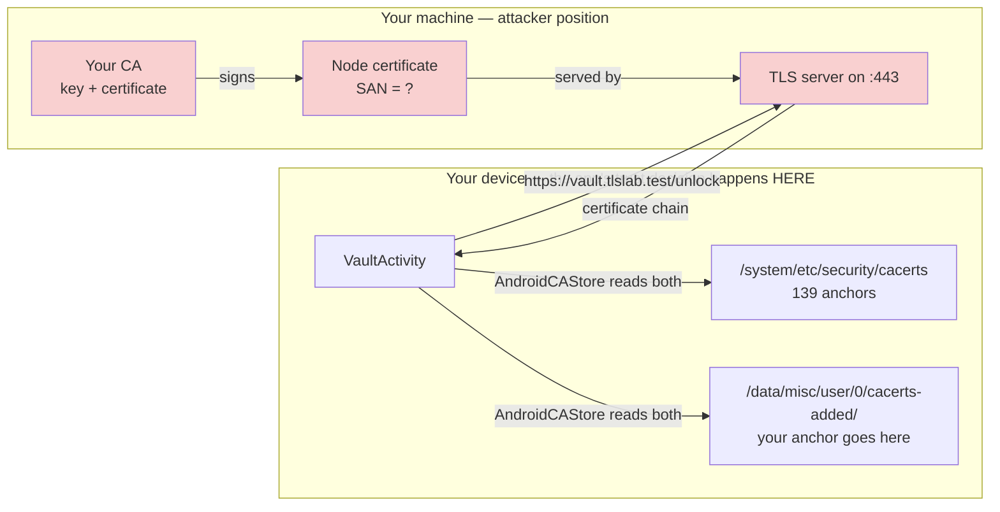

# Lab 04 — CTF: The Trusted Impostor

**Difficulty:** Advanced
**Time:** 3–6 hours
**Prerequisites:** [Lab 03](lab-03-dissecting-validation.md) in full — this challenge is unsolvable
without the six-check pipeline in Part 0 of that lab — plus [Chapter 35](../README.md) and a device
you own and have rooted

---

## The scenario

Vaultline ships a small Android client for its internal secret store. Their platform team read the
same advice everybody reads — *don't trust the user certificate store, don't accept any certificate,
check who you are actually talking to* — and they implemented all of it themselves, by hand, in one
class.

Their reasoning went like this. Every Vaultline server node carries a certificate that names the node,
issued by the Vaultline operations CA. The app therefore validates the chain, and then checks that the
certificate names the node it expects. Hostname verification — the platform's own `HostnameVerifier` —
was switched off deliberately, with a code comment explaining that it is redundant because the node
identity check is stricter. It is not stricter. It is a different check, of a different thing, and
that difference is this challenge.

**Recover the flag.** It is displayed by the app, on the device, when — and only when — you have
convinced it that it is talking to a genuine Vaultline node. **Flag format:**
`TLSLAB{lowercase_words_with_underscores}`, printable ASCII throughout; a solution that produces a
control character has gone wrong.

---

## Rules

**You may use:** `openssl` or any tool that produces X.509 certificates; your own TLS server on your
own machine; `adb`, root on your own device, and the device's certificate stores; `jadx`, `apktool`,
and the challenge source printed in full below; Frida **for observation only**, meaning
[`../scripts/trace-tls-validation.js`](../scripts/trace-tls-validation.js) and anything else that
reads and reports; and [`../scripts/tls-posture.py`](../scripts/tls-posture.py) against your own
server, to confirm that what you built is what you think you built.

**You may not use:**

- any hook, patch or script that *changes* a validation decision — including
  [`../../53-Frida/scripts/ssl-pinning-bypass.js`](../../53-Frida/scripts/ssl-pinning-bypass.js).
  Nothing here is pinned, so there is nothing for it to bypass, and the design punishes reaching for
  it: see the anti-frustration section
- APK patching, Smali editing, or repackaging the challenge
- editing the challenge source to weaken or remove a check, then rebuilding. Building the challenge
  as written is part of the lab; building a *different* challenge is not
- brute force of any kind. The flag is 31 bytes and the search space is not the point

**You must** generate every private key and certificate yourself, in a scratchpad — this repository
ships no keys, no certificates and no APKs, and yours must not end up in it either — and you must be
able to name, at the end, exactly which of the six validation checks from
[Lab 03](lab-03-dissecting-validation.md) the app performs and which it does not.

> **Warning.** The challenge app deliberately trusts the user certificate store and deliberately
> skips hostname verification. Build it, run it, uninstall it — and remove the CA you are about to
> generate when you are done. A CA left in the user store is a standing invitation to every app that
> behaves like this one.

---

## The challenge, as source

Two files. Put them in a scratchpad directory, not in this repository.

### `VaultActivity.java`

```java
// scratchpad — com/tlslab/ctf/VaultActivity.java
package com.tlslab.ctf;

import android.app.Activity;
import android.os.Bundle;
import android.os.StrictMode;
import android.util.Log;
import android.widget.TextView;
import java.io.*;
import java.net.URL;
import java.nio.charset.StandardCharsets;
import java.security.*;
import java.security.cert.*;
import java.util.*;
import javax.net.ssl.*;

/**
 * Vaultline secret-store client. Talks to one node and unlocks the vault.
 *
 * Security notes for reviewers:
 *   - We validate the chain against the platform anchors PLUS any CA the fleet
 *     provisioned on the device, because our operations CA is deployed by MDM.
 *   - We then confirm the node identity carried by the certificate. That is a
 *     stricter check than hostname verification, so the default HostnameVerifier
 *     is redundant and is replaced.
 */
public class VaultActivity extends Activity {

    private static final String TAG = "tlslab.ctf";

    /** The node this build talks to. */
    private static final String ENDPOINT = "https://vault.tlslab.test/unlock";

    /** The node identity this build demands, XOR-sealed with the key "ch35". */
    private static final String SEALED_ID = "021c4750101c1d410f1b5f5401464750101c";

    /** The vault contents, sealed under SHA-256 of the identity actually presented. */
    private static final String SEALED_FLAG =
            "680f9093fef72070ca0fe4dab5c2252c24f4b5f52cce68ca4cade298cc2e68";

    /** Set by NodeTrustManager, and by nothing else, when a node proves its identity. */
    private volatile String presentedIdentity = null;

    @Override
    protected void onCreate(Bundle savedInstanceState) {
        super.onCreate(savedInstanceState);
        TextView out = new TextView(this);
        setContentView(out);
        StrictMode.setThreadPolicy(new StrictMode.ThreadPolicy.Builder().permitAll().build());
        out.setText(run());
    }

    private String run() {
        try {
            SSLContext ctx = SSLContext.getInstance("TLS");
            ctx.init(null, new TrustManager[]{ new NodeTrustManager() }, new SecureRandom());

            HttpsURLConnection c = (HttpsURLConnection) new URL(ENDPOINT).openConnection();
            c.setSSLSocketFactory(ctx.getSocketFactory());
            c.setHostnameVerifier(new HostnameVerifier() {
                @Override
                public boolean verify(String hostname, SSLSession session) {
                    // NodeTrustManager has already established WHICH node this is.
                    // Comparing the URL's host to the certificate as well would only
                    // duplicate that, so we skip it.
                    return true;
                }
            });
            c.setConnectTimeout(8000);
            c.setReadTimeout(8000);

            String body = read(c.getInputStream());
            if (!body.trim().startsWith("UNLOCK")) {
                return "node answered, but did not send UNLOCK";
            }
            if (presentedIdentity == null) {
                return "LOCKED: connected, but no node identity was ever captured";
            }
            return reveal(presentedIdentity);
        } catch (Exception e) {
            Log.w(TAG, "vault", e);
            return "LOCKED: " + e;
        }
    }

    private String reveal(String identity) throws Exception {
        byte[] keystream = MessageDigest.getInstance("SHA-256")
                .digest(identity.getBytes(StandardCharsets.UTF_8));
        byte[] sealed = unhex(SEALED_FLAG);
        byte[] plain = new byte[sealed.length];
        for (int i = 0; i < sealed.length; i++) {
            plain[i] = (byte) (sealed[i] ^ keystream[i % keystream.length]);
        }
        String s = new String(plain, StandardCharsets.UTF_8);
        return s.startsWith("TLSLAB{") ? s : "impostor rejected";
    }

    /** Chain validation done honestly, then an identity check done at the wrong layer. */
    private final class NodeTrustManager implements X509TrustManager {

        private final X509TrustManager delegate;

        NodeTrustManager() throws Exception {
            // AndroidCAStore holds the SYSTEM anchors and the USER anchors.
            KeyStore anchors = KeyStore.getInstance("AndroidCAStore");
            anchors.load(null, null);
            TrustManagerFactory tmf = TrustManagerFactory.getInstance(
                    TrustManagerFactory.getDefaultAlgorithm());
            tmf.init(anchors);
            X509TrustManager found = null;
            for (TrustManager tm : tmf.getTrustManagers()) {
                if (tm instanceof X509TrustManager) { found = (X509TrustManager) tm; break; }
            }
            if (found == null) throw new IllegalStateException("no X509TrustManager available");
            delegate = found;
        }

        @Override
        public void checkClientTrusted(X509Certificate[] chain, String authType)
                throws CertificateException {
            throw new CertificateException("client authentication is not supported");
        }

        @Override
        public void checkServerTrusted(X509Certificate[] chain, String authType)
                throws CertificateException {
            if (chain == null || chain.length == 0) {
                throw new IllegalArgumentException("null or zero-length parameter");
            }
            // Checks 1-4: path building, signatures, validity windows, CA constraints.
            // Performed by Conscrypt, against system + user anchors. Nothing is skipped.
            delegate.checkServerTrusted(chain, authType);

            String dns = firstDnsName(chain[0]);
            if (dns == null) {
                throw new CertificateException("node identity absent: leaf has no dNSName SAN");
            }
            if (!dns.equals(nodeIdentity())) {
                throw new CertificateException("node identity mismatch: presented [" + dns + "]");
            }
            presentedIdentity = dns;
        }

        @Override
        public X509Certificate[] getAcceptedIssuers() {
            return delegate.getAcceptedIssuers();
        }
    }

    private static String firstDnsName(X509Certificate leaf) throws CertificateException {
        Collection<List<?>> sans;
        try {
            sans = leaf.getSubjectAlternativeNames();
        } catch (CertificateParsingException e) {
            throw new CertificateException("unparseable SAN extension", e);
        }
        if (sans == null) return null;
        for (List<?> entry : sans) {
            // GeneralName type 2 is dNSName. Type 7 is iPAddress.
            if (entry.size() >= 2 && entry.get(0) instanceof Integer
                    && ((Integer) entry.get(0)).intValue() == 2) {
                return String.valueOf(entry.get(1));
            }
        }
        return null;
    }

    private static String nodeIdentity() {
        byte[] sealed = unhex(SEALED_ID);
        byte[] key = "ch35".getBytes(StandardCharsets.UTF_8);
        byte[] out = new byte[sealed.length];
        for (int i = 0; i < sealed.length; i++) {
            out[i] = (byte) (sealed[i] ^ key[i % key.length]);
        }
        return new String(out, StandardCharsets.UTF_8);
    }

    private static byte[] unhex(String s) {
        byte[] out = new byte[s.length() / 2];
        for (int i = 0; i < out.length; i++) {
            out[i] = (byte) Integer.parseInt(s.substring(2 * i, 2 * i + 2), 16);
        }
        return out;
    }

    private static String read(InputStream in) throws Exception {
        Scanner s = new Scanner(in, "UTF-8").useDelimiter("\\A");
        try { return s.hasNext() ? s.next() : ""; } finally { s.close(); }
    }
}
```

### `AndroidManifest.xml`

```xml
<!-- scratchpad — AndroidManifest.xml -->
<manifest xmlns:android="http://schemas.android.com/apk/res/android"
          package="com.tlslab.ctf">
    <uses-permission android:name="android.permission.INTERNET"/>
    <application android:label="Vaultline">
        <activity android:name=".VaultActivity" android:exported="true">
            <intent-filter>
                <action android:name="android.intent.action.MAIN"/>
                <category android:name="android.intent.category.LAUNCHER"/>
            </intent-filter>
        </activity>
    </application>
</manifest>
```

> **Definition — sealed constant.** `SEALED_ID` and `SEALED_FLAG` are XOR-obfuscated, not
> encrypted. Obfuscation is not security and is not claimed to be here; the seal exists so that
> glancing at the source does not hand you the answer before you have done the reasoning. Decoding
> `SEALED_ID` by hand is a legitimate move. Decoding `SEALED_FLAG` without making the app print it is
> a way to have the string without having the lab, and the success criteria ask for on-device output.

### Build it

The repository ships **no APK**. Build with the same Gradle-free sequence used by
[`../../30-Activities/examples/build.sh`](../../30-Activities/examples/build.sh), which resolves the
SDK and the JDK for you; the shape of it is:

```bash
# host — build OUT OF TREE, into a scratchpad
OUT=$HOME/ctf-tlslab/build; mkdir -p "$OUT/classes"
AJ="$ANDROID_HOME/platforms/android-30/android.jar"
aapt2 link -I "$AJ" --manifest AndroidManifest.xml -o "$OUT/base.apk" --java "$OUT/gen"
javac --release 8 -bootclasspath "$AJ" -d "$OUT/classes" com/tlslab/ctf/VaultActivity.java
d8 --output "$OUT" $(find "$OUT/classes" -name '*.class')
# add classes.dex to base.apk, zipalign, then apksigner with a throwaway debug key

# install on the reference device, where plain `adb install` is refused
adb push "$OUT/vault.apk" /data/local/tmp/vault.apk
adb shell "su -c 'pm install -r /data/local/tmp/vault.apk'"
```

> **Warning.** On the MIUI reference device `adb install` fails with
> `INSTALL_FAILED_USER_RESTRICTED` regardless of the APK — vendor policy, not a broken build — so the
> push-then-`pm install`-as-root route above is the one that works. Frida 16.1.6 also has **no
> `--no-pause` flag**: spawning with `-f` resumes by default and `--pause` is the opt-in.

---

## The field: what stands between you and the flag



Read the diagram from the app outward. The app opens a connection to the name in `ENDPOINT` and you
are going to be the thing that answers. Everything on the right is yours to construct: a CA, a
certificate it signs, and a server that presents it. Everything on the left is the app's, and the
only part you may influence is which anchors the device holds — which the app made relevant to you by
reading `AndroidCAStore` instead of the default anchor set. Three independent sub-problems follow:

1. **Reach.** Make the app's request arrive at your server rather than at a name that does not resolve.
2. **Trust.** Make chain validation succeed. The app performs checks 1–4 honestly, delegating to
   Conscrypt, so your chain must be a real one.
3. **Identity.** Satisfy whatever the app believes proves it is talking to a Vaultline node — and this
   is where the challenge lives.

### Reach

The app asks for `vault.tlslab.test`, which resolves nowhere. Point it at your machine.

```bash
# device root — the direct route
mount -o rw,remount /
printf '%s\n' '192.0.2.10  vault.tlslab.test' >> /system/etc/hosts
```

Substitute your machine's address on the same network as the device. If the remount is refused — some
devices carry a read-only overlay — the alternatives are a Magisk module that overlays
`/system/etc/hosts`, a DNS server the device is pointed at, or the fallback below.

> **Pentester's Note — the fallback that also teaches something.** You may set `ENDPOINT` to
> `https://192.0.2.10/unlock`, a literal IP, before building. This is permitted. Note what changes:
> a literal IP means no SNI extension is sent, because SNI must carry a name, and a hostname check
> against an IP would have to match an `iPAddress` SAN entry rather than a `dNSName` one. Neither
> fact stops you here, and the reason it does not is itself a hint.

### Trust

The app trusts `AndroidCAStore`, which is the system anchors **plus** the user anchors. On API 30 the
platform stopped trusting the user store for apps that did not ask, and this app asked, so an anchor
you install is an anchor the app will use. You need a CA that is a *valid* CA, not merely a
self-signed certificate you called one: check 4 of the pipeline — `basicConstraints`, `keyUsage`,
`pathLen` — is performed honestly by Conscrypt.

> **Under the Hood.** `AndroidCAStore` is not a file. It is a `KeyStore` implementation supplied by
> Conscrypt that reads two directories and presents their union as one anchor set: the system store,
> `/system/etc/security/cacerts` (139 files on the reference device), and the user store,
> `/data/misc/user/0/cacerts-added/`. That union is the whole mechanism by which one `tmf.init(...)`
> call quietly restores what API 24 turned off — no manifest entry, no XML, nothing to review.

### Identity

Read `NodeTrustManager.checkServerTrusted` again, slowly. It performs one check the platform does
not, and the platform performs one it does not. Naming both, precisely, is the challenge.

---

## Your server

Any TLS server will do. This one is deliberately minimal, needs nothing installed, and answers every
path identically.

```python
# host — vault.py, run from your scratchpad:  sudo python3 vault.py
import http.server, ssl

class H(http.server.BaseHTTPRequestHandler):
    def do_GET(self):
        body = b"UNLOCK\n"
        self.send_response(200)
        self.send_header("Content-Length", str(len(body)))
        self.end_headers()
        self.wfile.write(body)

ctx = ssl.SSLContext(ssl.PROTOCOL_TLS_SERVER)
ctx.load_cert_chain("fullchain.pem", "node.key.pem")

srv = http.server.HTTPServer(("0.0.0.0", 443), H)
srv.socket = ctx.wrap_socket(srv.socket, server_side=True)
print("listening on :443")
srv.serve_forever()
```

Before you point the app at it, point the chapter's own tool at it, so that you debug one thing at a
time:

```bash
# host
python3 ../scripts/tls-posture.py 127.0.0.1
```

The chain section prints exactly what your server sends: every certificate, its subject, its issuer,
whether it is a CA, its `pathLen`, and its SANs. If that section does not say what you intended, no
work on the device will help. This is the highest-value habit in the lab: **verify your own artefacts
before you blame the target.**

---

## Hints

Work the problem first. Each hint is strictly stronger than the last.

<details>
<summary>Hint 1 — you are failing, but at which check?</summary>

"It doesn't work" is not a state you can act on. Get the app to tell you *which* of the six checks
rejected you, because they have different fixes.

```bash
# host — then call verdict() in the Frida REPL once the request has been made
adb shell "su -c 'cmd package compile -m verify -f com.tlslab.ctf'"
frida -U -f com.tlslab.ctf -l ../scripts/trace-tls-validation.js
```

Also watch the app's own exception text, which it puts on screen and in the log, with
`adb logcat -s tlslab.ctf:V`. Three failures look completely different, and each names its own cause:

| What you see | Which check said no |
|---|---|
| `Trust anchor for certification path not found` | 1 — chain construction. Your CA is not an anchor the app can reach. |
| `Certificate is not a CA certificate` or a path-length complaint | 4 — CA constraints on your issuer |
| `node identity absent` / `node identity mismatch` | The app's own extra check, after 1–4 already passed |

If you are seeing the third row, chain validation is *already solved* and the remaining problem is
entirely about what is in the certificate.
</details>

<details>
<summary>Hint 2 — your certificate probably is not what you think it is</summary>

Look at what you actually generated, rather than at the command you ran:

```bash
# host
openssl x509 -in node.crt.pem -noout -text | sed -n '/X509v3/,$p'
openssl x509 -in ca.crt.pem   -noout -text | grep -A1 "Basic Constraints"
```

Two mistakes account for nearly every failure here. First, `openssl x509 -req` signs a CSR and
**discards every extension in it** unless you pass `-extfile`, so the certificate you produced very
likely has no SAN and no `basicConstraints` — which is exactly why the app says the leaf has no
`dNSName` SAN. Second, your CA must really assert `CA:TRUE`; if you copied a recipe that produced an
end-entity certificate, Conscrypt refuses to build a path through it and you are looking at check 4
rather than at the challenge.
</details>

<details>
<summary>Hint 3 — count the checks, then count the ones this app performs</summary>

Take the six-check pipeline from Lab 03 and mark, from the source above, which the app performs:

| # | Check | Performed by this app? |
|---|---|---|
| 1 | Chain construction | Yes — `delegate.checkServerTrusted` |
| 2 | Signature verification | Yes — same call |
| 3 | Validity windows | Yes — same call |
| 4 | `basicConstraints` / `keyUsage` / `pathLen` | Yes — same call |
| 5 | **Hostname verification** | **No.** The `HostnameVerifier` returns `true` unconditionally. |
| 6 | Revocation | No, like nearly every mobile app |

Now ask the question the table sets up. Check 5 is the *only* step that ever compares the certificate
to the host in the URL. It does not run. So what is the app's identity check actually comparing the
certificate against — and does that thing have anything to do with `vault.tlslab.test`?
</details>

<details>
<summary>Hint 4 — the strongest hint, short of the answer</summary>

You have been trying to make the certificate match the host. Stop.

The app never compares the certificate to the host. It compares one `dNSName` SAN entry to a fixed
string that has nothing to do with the URL — and that fixed string is in the source, sealed under a
four-byte XOR with the key `ch35`. Decode `SEALED_ID` and issue a certificate for *that* name.

The certificate you need is valid for a name that is **not** the name the app dialled. Every
correctly-behaving TLS client would reject it; this one accepts it, because the step that would have
rejected it was deleted on the grounds that it was redundant.
</details>

---

## Solution

<details>
<summary>Full walkthrough — do not open this until you have genuinely tried</summary>

### 1. Decode the identity the app demands

`SEALED_ID` is XOR-sealed with the ASCII key `ch35`:

```bash
# host
python3 -c "
sealed = bytes.fromhex('021c4750101c1d410f1b5f5401464750101c')
key = b'ch35'
print(bytes(b ^ key[i % 4] for i, b in enumerate(sealed)).decode())
"
# attest.tlslab.test
```

The app demands a leaf certificate whose first `dNSName` SAN is `attest.tlslab.test`. The URL it
dials is `https://vault.tlslab.test/unlock`. **Those are different names**, and the only reason a
certificate for the first can be served for the second is that hostname verification does not run.

### 2. Build a CA that is really a CA

```bash
# host — in a scratchpad, never in this repository
mkdir -p ~/ctf-tlslab && cd ~/ctf-tlslab

openssl req -x509 -newkey rsa:2048 -sha256 -days 30 -nodes \
  -keyout ca.key.pem -out ca.crt.pem \
  -subj "/CN=TLSLAB Reader CA" \
  -addext "basicConstraints=critical,CA:TRUE,pathlen:0" \
  -addext "keyUsage=critical,keyCertSign,cRLSign"
```

### 3. Issue the node certificate — for the identity, not for the host

```bash
# host
openssl req -newkey rsa:2048 -sha256 -nodes \
  -keyout node.key.pem -out node.csr -subj "/CN=vaultline node"

cat > node.ext <<'EOF'
basicConstraints=critical,CA:FALSE
keyUsage=critical,digitalSignature,keyEncipherment
extendedKeyUsage=serverAuth
subjectAltName=DNS:attest.tlslab.test
EOF

openssl x509 -req -in node.csr -CA ca.crt.pem -CAkey ca.key.pem -CAcreateserial \
  -days 20 -sha256 -extfile node.ext -out node.crt.pem

cat node.crt.pem ca.crt.pem > fullchain.pem
openssl x509 -in node.crt.pem -noout -text | grep -A1 "Subject Alternative Name"
```

The `-extfile` is not optional. Without it `openssl x509 -req` produces a certificate with no
extensions at all, and the app rejects it with `node identity absent`.

### 4. Install your CA as an anchor

The simple route is Settings, which puts it in the user store — and the user store counts here
because the app reads `AndroidCAStore`. Convert to DER, push it somewhere visible, and install it
through *Settings, Security, Encryption and credentials, Install a certificate, CA certificate*.

The direct route writes the store yourself, and is worth doing once because it makes the naming rules
concrete: filenames are the OpenSSL `subject_hash_old` — the MD5-based hash, **not** `subject_hash` —
with a `.0` suffix, and the content is DER.

```bash
# host
openssl x509 -in ca.crt.pem -outform DER -out ca.der
H=$(openssl x509 -in ca.crt.pem -subject_hash_old -noout) && echo "$H"
adb push ca.der /data/local/tmp/$H.0
```

```bash
# device root
cp /data/local/tmp/$H.0 /data/misc/user/0/cacerts-added/
chown root:root /data/misc/user/0/cacerts-added/$H.0
chmod 644       /data/misc/user/0/cacerts-added/$H.0
chcon u:object_r:misc_user_data_file:s0 /data/misc/user/0/cacerts-added/$H.0
```

A file with the wrong hash name, or with PEM content, is ignored in silence — no error, no log line,
just a chain that will not build.

### 5. Answer as the node

```bash
# host
sudo python3 vault.py
```

```bash
# device root — make the name resolve to you
mount -o rw,remount /
printf '%s\n' '192.0.2.10  vault.tlslab.test' >> /system/etc/hosts
```

### 6. Run it and read the flag

```bash
# host
adb shell "su -c 'am start -n com.tlslab.ctf/.VaultActivity'"
adb logcat -s tlslab.ctf:V
```

The app prints `TLSLAB{san_is_not_the_hostname}`.

### 7. Prove you understand, by making it fail on purpose

Re-issue the leaf with `subjectAltName=DNS:vault.tlslab.test` — the "correct" certificate,
the one that matches the host — restart the server and run the app again. It fails with `node identity
mismatch: presented [vault.tlslab.test]`. That inversion is the lab: the certificate every real client
would accept is rejected, and the one every real client would reject is accepted, because the app
checks a name that is not the name it dialled.
</details>

---

## Anti-frustration: the three dead ends

### Dead end 1 — "my certificate has no SAN and I do not know why"

**Symptom:** the app says `node identity absent: leaf has no dNSName SAN`, and you are certain you put
a SAN in the CSR.

**Cause:** you did. `openssl x509 -req` throws CSR extensions away. A CSR's extensions are a
*request*; the CA decides what to issue, and OpenSSL's default decision is to issue nothing.

**How to tell you are here in ten seconds:** `openssl x509 -in node.crt.pem -noout -text | grep -c
"Subject Alternative Name"`. Zero means you are in this dead end. Re-issue with `-extfile`.

### Dead end 2 — "trust anchor for certification path not found"

**Symptom:** the app never gets as far as the identity check.

**Cause, in order of likelihood:** the CA file did not land in the store; it landed with a
`subject_hash` name instead of `subject_hash_old`; it landed as PEM where DER was required; you
served only the leaf and your CA is not actually an anchor on the device; or your "CA" certificate is
not a CA at all because `basicConstraints` says `CA:FALSE`.

**How to tell you are here:** the exception names the *anchor*, not the identity. Confirm what the
device believes with `ls /data/misc/user/0/cacerts-added/` in `adb shell`, then confirm what your
server sends with `python3 ../scripts/tls-posture.py 127.0.0.1` on the host. Those are two
independent facts, and if they disagree you have found your problem without touching the app.

### Dead end 3 — reaching for a bypass script

**Symptom:** you loaded a universal SSL-bypass script, the connection now succeeds, and the app
prints `LOCKED: connected, but no node identity was ever captured`.

**Cause:** the bypass replaced the app's TrustManager with one that checks nothing. The connection
therefore succeeds — and `presentedIdentity` is set only inside `NodeTrustManager`, which no longer
runs, so there is no key with which to unseal the flag. You have destroyed the evidence you needed.

This is deliberate, and it is the challenge's thesis. **Nothing here is pinned.** Chapter 36's
techniques have no purchase on a target that never pins, and reaching for them reflexively is the
habit this lab exists to break — a reflex trained by tutorials in which every Android TLS problem is
a pinning problem, when most of them are not.

**How to tell you are here:** the app connects and still says `LOCKED`. Detach Frida, restart the app,
and solve the certificate instead of the code.

---

## Debrief — why this works and what it teaches

### The bug, stated precisely

The developer replaced a check of the form *"does this certificate name the host I asked for?"* with
a check of the form *"does this certificate name a constant I compiled in?"* Both are identity
checks; only one is bound to the connection actually being made. The moment those two names can
differ, an attacker who can obtain a certificate for the *constant* — by controlling a CA the device
trusts, as here, or by owning that name legitimately — can answer for **any** host the app dials,
because nothing in the pipeline ever looks at the host again.

### Why chain validation could not save it

The app's checks 1 through 4 are not weakened in any way. Conscrypt built the path, verified every
signature, checked every validity window and enforced every CA constraint, and all of it passed
**honestly** for the winning certificate: it really was issued by a CA the device really trusts, and
it really is a valid, unexpired, correctly-constrained certificate. That is the point. Chain
validation answers *"was this issued by someone I trust?"* and hostname verification answers *"was it
issued to whom I am talking to?"* — no amount of the first substitutes for the second.

> **Mental Model.** The passport analogy, finished. Checks 1–4 confirm the passport is genuine:
> real paper, real signature, unexpired, issued by a real authority. Check 5 reads the *name* inside
> and compares it to the person you came to meet. Vaultline built a border post that examines the
> paper meticulously and then compares the name to a note in its own pocket — never to the person
> standing there.

### Why the user store mattered

The app made `AndroidCAStore` its anchor set, re-opening what API 24 deliberately closed. That is
Lab 03's pattern C, and it made the attack affordable: one self-signed CA and one install. Without
it you would have needed a certificate for `attest.tlslab.test` from a publicly trusted CA — which is
trivial for whoever owns that name, so **the identity bug remains exploitable even with the default
anchor set.**

### What you would write in the report

Not "TLS validation is disabled" — it is not. Something closer to:

> The client disables hostname verification (`HostnameVerifier.verify` returns `true`
> unconditionally) and substitutes a comparison of the leaf certificate's first `dNSName` SAN against
> a compile-time constant. Chain validation is performed correctly. The consequence is that any
> certificate bearing the constant SAN, from any CA the device trusts, is accepted for every endpoint
> the app contacts, with no relationship to the requested host. The client additionally anchors trust
> at `AndroidCAStore`, restoring pre-API-24 trust in user-installed CAs.
>
> Fix: delete the custom `HostnameVerifier` so the platform verifier runs; keep the node-identity
> check only as an *additional* constraint, never as a replacement; and initialise the
> `TrustManagerFactory` with `null` unless an MDM deployment genuinely requires otherwise.

Read that fix against [`../examples/HardenedTlsClient.java`](../examples/HardenedTlsClient.java),
which is the same code with each decision made correctly, and against
[`../examples/InsecureTlsClient.java`](../examples/InsecureTlsClient.java) pattern B, which is this
bug in its simplest form.

### Where the boundaries are

This challenge deliberately contains no pinning. Pinning is a *later* gate — it runs after trust
evaluation, it is chapter 36's subject, and an app can pin perfectly and still have this exact bug.
The XML that configures the platform's trust behaviour declaratively is chapter 44; the signature
mathematics behind check 2 is [34-Cryptography](../../34-Cryptography/README.md); the instrumentation
you used to *observe* is chapter 53. The trust model itself — the anchors, the chain, and the two
different identity questions — is [this chapter](../README.md), and everything else is built on it.

---

## Success criteria

- [ ] The app printed `TLSLAB{...}` **on the device**, and you have the logcat line or a screenshot
- [ ] You generated every key and certificate yourself, in a scratchpad outside this repository, and
      removed the CA from the device afterwards
- [ ] You can state which of the six checks the app performs and which it does not, and point at the
      line of source responsible for each answer
- [ ] You can explain why the certificate that *matches the host* is rejected while the one that does
      not match is accepted, and why chain validation passing honestly is not a mitigation
- [ ] You proved the inversion deliberately, by re-issuing with `DNS:vault.tlslab.test` and watching
      it fail
- [ ] You can explain why a pinning-bypass script produces a successful connection and no flag, and
      why that is not a bug in the challenge
- [ ] You can name both ways a certificate reaches the device's trust stores, the exact filename rule
      for a hand-installed one, and the encoding it must be in
- [ ] You wrote the finding in the language of *which check is missing*, not "TLS is broken"

---

## Notes for instructors

The flag is `TLSLAB{san_is_not_the_hostname}`, sealed under SHA-256 of the demanded identity
`attest.tlslab.test`. A determined reader can decode both constants offline and produce the flag
without completing a handshake; that is accepted, because the flag string is the lesson rather than a
token. If you run this competitively, replace `SEALED_FLAG` with a per-team token and require the
on-device output as the submission.

Expect the common failure at step 3, not step 1: participants issue a certificate for
`vault.tlslab.test` because that is what every tutorial does, get `node identity mismatch`, and read
it as "the app pins something". The teaching moment is that the message names the *presented*
identity and no expected one, which forces them back to the source. Hold Hint 4 until someone has
said, in their own words, that the app never compares the certificate to the URL.
