# 35 — SSL/TLS · Mind Map

One picture of the whole chapter. Read it outward from the centre: TLS exists to give three
properties over a wire that anyone can read and edit, and only one of those three — authentication —
is decided by software running *inside the app you are testing*. Everything else in this chapter
follows from that single asymmetry. The server's configuration is measurable from any laptop and is
almost never the finding; the client's trust decision is invisible from outside, is made by a method
whose accept path is an empty body, and is where the finding actually lives. The branches map onto
the sections of [the chapter README](README.md): why TLS exists, the handshake, where the anchors
live, the six validation steps, the four ways clients throw them away, how to measure each one, and
where this chapter stops and its neighbours begin. Use it as a revision map before an engagement or
an interview.

```mermaid
mindmap
  root((TLS and trust<br/>on Android))
    Why TLS exists
      The wire is hostile
        anyone on the path reads it
        anyone on the path edits it
        WiFi ISP corporate proxy
      Three properties
        Confidentiality
          nobody else reads it
          record layer encryption
        Integrity
          nobody alters it undetected
          AEAD tag or record MAC
        Authentication
          you are talking to who you think
          certificates and trust anchors
      Only the third is decided in the app
        the other two are protocol
        the third is a method somebody wrote
        that is why this chapter exists
      Without it
        credentials in plaintext
        session cookies replayed
        responses rewritten
        code downloaded and executed
    SSL versus TLS
      SSL 2 and SSL 3 are the old names
      TLS 1 0 was renamed SSL 3 1
      everyone still says SSL
      the API is called SSLContext
      only TLS 1 2 and 1 3 matter now
    The handshake
      ClientHello
        client random
        supported versions
        cipher suite list
        SNI names the host
        supported groups
        signature algorithms
      ServerHello
        server random
        one chosen suite
        chosen version
        TLS 1 3 hides it in supported versions
      Certificate message
        leaf first
        intermediates follow
        root usually omitted
      Key agreement
        ECDHE ephemeral
        forward secrecy
        static RSA has none
      Finished
        both sides prove the transcript
        after this the channel is real
      Alerts instead
        40 handshake failure
        42 bad certificate
        45 certificate expired
        46 certificate unknown
        48 unknown ca
        70 protocol version
        71 insufficient security
        86 inappropriate fallback
        112 unrecognized name SNI
      Who sent the alert
        server alert means server refused us
        client alert means the app refused the server
    What a certificate is
      A signed statement
        this public key belongs to this name
        signed by an issuer
      Fields that matter
        subject and issuer
        notBefore and notAfter
        subjectPublicKeyInfo
        subjectAltName
        basicConstraints CA and pathLen
        keyUsage and extKeyUsage
        signature algorithm
      Not a secret
        it is public by design
        the private key is the secret
      SPKI pin
        sha256 of subjectPublicKeyInfo
        base64
        survives certificate renewal
    Trust anchors
      What a CA really is
        a key whose signature you decided to believe
        no magic no authority
        just a list on your device
      System store
        /system/etc/security/cacerts on API 30
        139 files measured on the test device
        138 stock plus one promoted CA
        DER not PEM
        filename is subject hash old
        MD5 based OpenSSL 0 9 8 algorithm
        context system security cacerts file
      User store
        /data/misc/user/0/cacerts-added
        root only not readable as shell uid 2000
        context misc user data file
      Conscrypt APEX
        cacerts moved there in Android 14 API 34
        API 30 has no cacerts directory in the apex
        only bin etc javalib lib lib64
        verify with ls do not assume
      The API 24 change
        before Nougat user CAs were trusted
        from targetSdk 24 they are not
        measured 139 anchors at every targetSdk tested
        because the CA was promoted to the SYSTEM store
        so the user store rule never applied to it
        the fix is to stop it being a user CA
      Persisting a CA
        system partition is read only
        module builds a tmpfs overlay
        bind mounts every stock cert back
        plus the added one
        measured 139 individual bind mounts
    Validation steps
      Step 1 chain construction
        find a path from leaf to an anchor
        intermediates supplied by the server
        a missing intermediate breaks the path
      Step 2 signature verification
        each certificate signed by the next
        anchor signature is not checked
        you decided to trust it
      Step 3 validity window
        notBefore and notAfter
        device clock is part of the trust decision
      Step 4 basic constraints
        CA true required to sign
        pathLen limits chain depth
        historic bugs let leaves sign
      Step 5 hostname verification
        RFC 6125
        subjectAltName not commonName
        wildcards match one label
        SEPARATE from chain validation
      Step 6 revocation
        OCSP and CRL
        not performed by default on Android
        soft fail is the usual policy
      Then pinning
        after all six
        chapter 36 CertificatePinning owns it
    Platform machinery
      RootTrustManager
        to NetworkSecurityTrustManager
        to Conscrypt TrustManagerImpl
        measured live on API 30
      NetworkSecurityConfig
        getDefaultBuilder takes ApplicationInfo
        one overload on API 30
        decides which anchors apply
        the XML itself is chapter 44
      OkHostnameVerifier
        the default identity check
        platform repackages OkHttp
      SSLCertificateSocketFactory getInsecure
        AOSP ships a trust nothing manager
        measured accepts a zero length chain
        while all three real ones throw
    How it breaks
      Permissive TrustManager
        checkServerTrusted returns void
        accepting is NOT throwing
        an empty body compiles
        vulnerable version has LESS code
        attacker needs no certificate at all
      Permissive HostnameVerifier
        return true
        chain still validated honestly
        attacker needs one free valid cert
        for a domain they legitimately own
        padlock stays green
        not less severe just cheaper
      Trusting the user store in code
        AndroidCAStore holds system plus user
        reopens what API 24 closed
        invisible to a manifest review
      Cleartext fallback
        catch SSLHandshakeException
        retry over http
        every static check passes
        attacker only has to break the handshake
        blocked by default from API 28
      WebView proceed
        onReceivedSslError
        SslErrorHandler proceed
        same effect different mechanism
        chapter 43 WebView owns the widget
      Weak server posture
        SSL 3 0 accepted POODLE
        anonymous suites no authentication
        export and NULL suites
        static RSA no forward secrecy
        RC4 and 3DES and DES
      Native TLS stack
        Flutter Cronet Unity custom so
        no Java hook reaches it
        zero checkServerTrusted is a RESULT
        not an absence of validation
    How to test
      Posture prober
        tls posture py
        protocols per version
        suites in server preference order
        full chain parsed
        SPKI pin values
        measured badssl accepts TLS 1 0 and 1 1
        measured cloudflare refuses with alert 70
      Validation tracer
        trace tls validation js
        hooks the choke points
        SSLContext init and TrustManagerFactory
        reads the class name off the live object
        catches anonymous inner classes
        classifies platform library app
        bypasses nothing on purpose
      Empty chain oracle
        hand it a zero length chain
        contract requires IllegalArgumentException
        returning means it never looked
        no proxy no certificate no network
      Deliberate bad certificate
        the only conclusive test
        self signed for the right name
        valid cert for the WRONG name
        expired certificate
        each one isolates a different step
      Never conclude from silence
        a manager that never threw
        proves nothing
        unless you gave it something to reject
    Tooling
      openssl
        s client for a handshake
        s server to serve a bad cert
        subject hash old for the filename
        pubkey pipe for an SPKI pin
        verify for chain arithmetic
      adb
        settings put global http proxy
        adb reverse for USB only
        ls the trust stores
        mount to see the overlay
        install workaround via su and pm
      frida
        version 16.1.6 has no no-pause flag
        spawn resumes by default
        --pause opts in
        compile -m verify defeats inlining
        chapter 53 Frida owns the engine
      Burp or mitmproxy
        the proxy is not the hard part
        trust is
      jadx and apktool
        signatures survive renaming
        checkServerTrusted V is not renamed
        verify Z is not renamed
    Severity
      Grade the channel not the mechanism
        auth and token endpoints critical
        PII high
        authenticated API high
        static assets low
      Code executed from a response
        raise to critical
      Hostname only bug
        do not lower it
        one free certificate is the cost
      Debug only path
        informational with the proof
      A report where everything is High
        is a report where nothing is
    Boundaries
      This chapter owns
        the handshake
        trust anchors system and user
        chain validation
        hostname verification
        the deliberate bad certificate test
      Chapter 36 CertificatePinning
        pinning after trust succeeds
      Chapter 44 NetworkSecurityConfig
        the XML that configures anchors
      Chapter 34 Cryptography
        the primitives underneath
      Chapter 53 Frida
        the instrumentation engine
      Chapter 45 OAuth
        what travels on the channel
      Chapter 43 WebView
        the browser widget itself
```

---

## How to use this map

**Before an engagement.** Read *How to test* and *Trust anchors*. Those two branches are the working
half of the chapter. Everything you will actually type is in one of them, and the trust-store branch
is what stops you losing an afternoon to a CA that was installed in the wrong place.

**Before an interview.** Read *Validation steps*, *How it breaks* and *SSL versus TLS*. The single
question that separates candidates is whether they know that chain validation and hostname
verification are two different steps that fail independently — and can explain why the hostname-only
bug is not the milder of the two.

**When interception is not working.** Walk *Trust anchors* → *The API 24 change* first, then *How it
breaks* → *Native TLS stack*. Those two account for most of the cases where the proxy is silent and
the app shows no error you can see.

**When writing a finding.** Walk *Severity*. Grade what the channel carries, then apply the
modifiers, then say in writing why you did not grade it higher.

Full detail in [README.md](README.md); the command forms are in [cheatsheet.md](cheatsheet.md); the
questions people actually ask are in [faq.md](faq.md).
