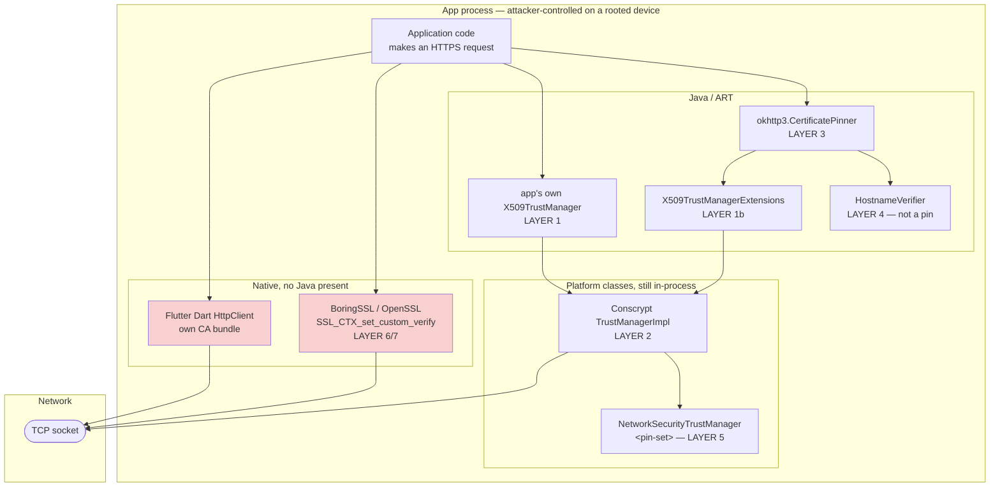
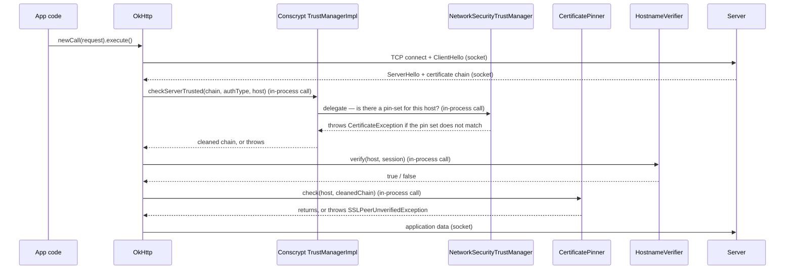
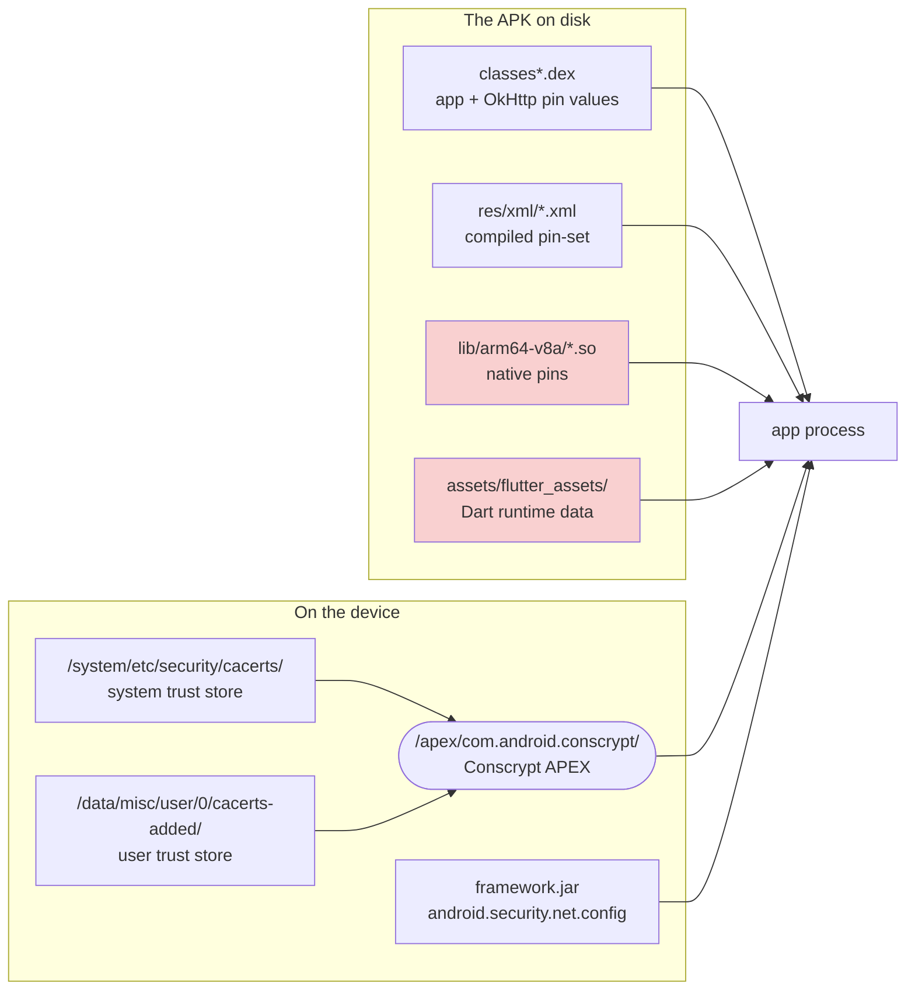
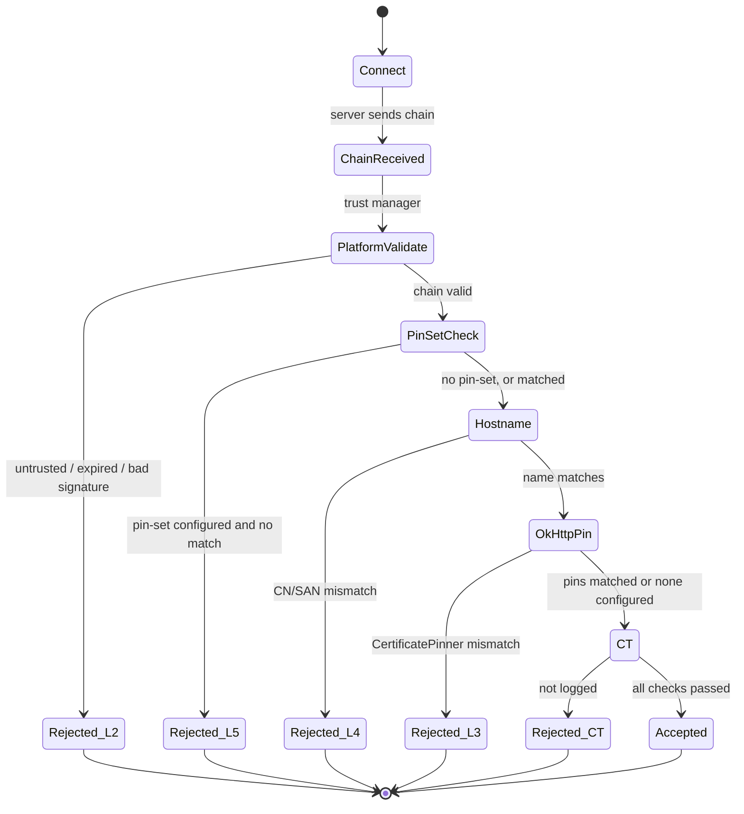
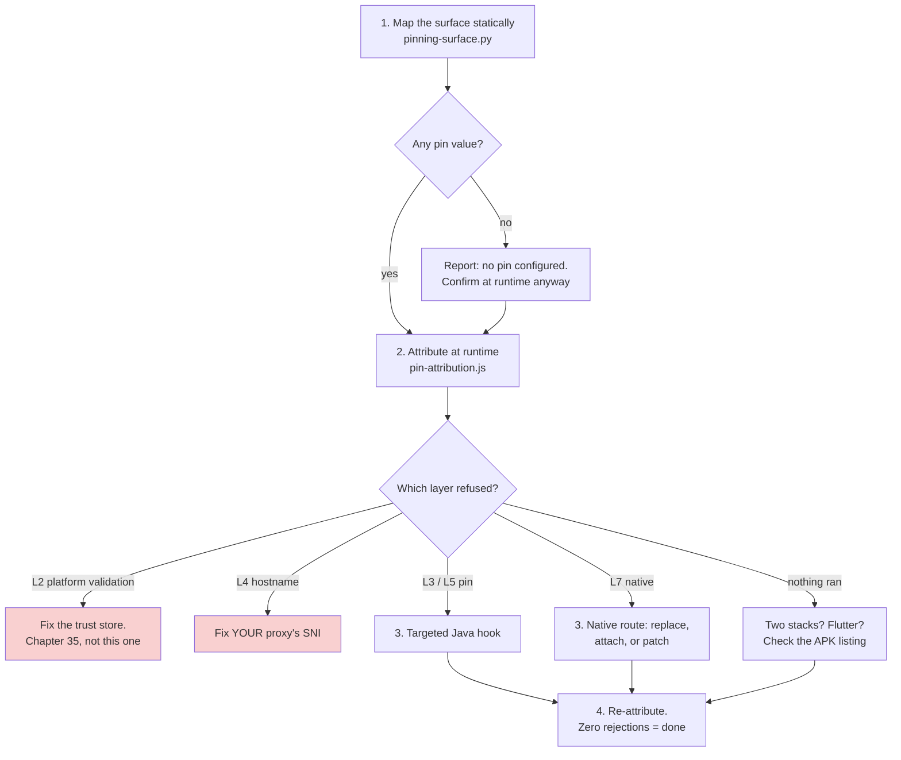
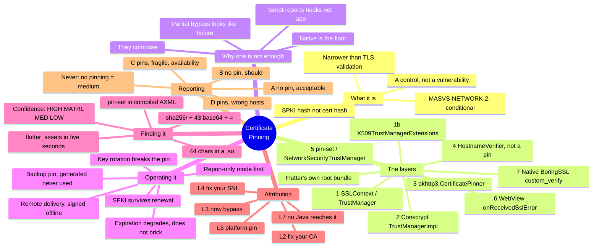

# 36 — Certificate Pinning

> After this chapter you will be able to find every layer at which an Android app can pin, decide
> whether an app actually pins or merely contains pinning code, attribute a rejected connection to
> the exact control that refused it, defeat a pin you built yourself at every one of those layers,
> and write the finding — including the one that says the absence of pinning is not a vulnerability.

**Prerequisites:** [03-Programming-Fundamentals](../03-Programming-Fundamentals/README.md),
[10-APK-Internals](../10-APK-Internals/README.md),
[15-Native-Code](../15-Native-Code/README.md), [16-JNI](../16-JNI/README.md),
[34-Cryptography](../34-Cryptography/README.md), [35-SSL](../35-SSL/README.md)
**Useful alongside:** [53-Frida](../53-Frida/README.md) for the runtime bypasses — but only some of
this chapter needs it. Finding whether an app pins, attributing a rejected connection to the layer
that refused it, and the static patching route all work without Frida, and
[53's opening callout](../53-Frida/README.md) explains why `frida-server` may not run on your image
at all. [44-NetworkSecurityConfig](../44-NetworkSecurityConfig/README.md) for the declarative
trust-anchor side.
**Applies to:** Android 5–16 (API 21–36). Behaviour that differs by API level is marked in Version
Matrix tables. Measurements in this chapter were taken on Android 11 / API 30 unless stated.

---

> **⚠️ Warning — scope and authorisation**
> **Only bypass pinning on applications you own or are contracted to assess.** Every technique here
> works identically against an app you have no right to touch, and the technique is not what makes
> it lawful. Detection is different: reading an APK that is already on your own device is not an
> attack, and this chapter's detector is deliberately built so you can point it at anything without
> crossing a line. The moment you attach a debugger to a third-party process to defeat its security
> control, you are somewhere else entirely.
>
> Where this chapter demonstrates against real installed applications, it **stops at detection** and
> says so.

---

## Table of Contents

1. [Introduction](#1-introduction)
2. [High-Level Architecture](#2-high-level-architecture)
3. [Deep Internal Working](#3-deep-internal-working)
4. [Source Code Walkthrough (AOSP)](#4-source-code-walkthrough-aosp)
5. [Security Perspective](#5-security-perspective)
6. [Reverse Engineering Perspective](#6-reverse-engineering-perspective)
7. [Dynamic Analysis](#7-dynamic-analysis)
8. [Static Analysis](#8-static-analysis)
9. [Examples](#9-examples)
10. [Common Interview Questions](#10-common-interview-questions)
11. [Common Mistakes](#11-common-mistakes)
12. [Hands-on Labs](#12-hands-on-labs)
13. [Summary](#13-summary)
14. [References](#14-references)

---

## 1. Introduction

### 1.1 The problem, in plain English

Imagine you are expecting a courier. You have never met them. When somebody knocks, how do you know
it is the right person?

The system we actually use is a chain of vouching. The courier shows an ID card. You do not know the
courier, but you recognise the issuing authority printed on the card, and you have decided in
advance that you trust that authority to check people before it issues cards. You are not verifying
the person; you are verifying that somebody you trust verified them.

That works, and it is how the entire secure web functions. It also has an obvious weakness that has
nothing to do with cryptography: **it depends on every authority you trust behaving correctly, for
everybody, forever.** Your front door accepts any card from any of a few hundred authorities. If one
of them is careless, or is compelled by a government, or gets breached, or has an employee who can
be bribed, then somebody who is not the courier gets a perfectly genuine card with the courier's
name on it, and your door opens.

Certificate pinning is the decision to stop relying on the general system for one specific visitor.
You say: *for this one person, I do not care what card they show me. I know their face.* You wrote
down something about them in advance — a photograph, a fingerprint, a password only they know — and
you check that instead.

That is the whole idea. Everything else in this chapter is mechanism.

### 1.2 The same story with the real words

> **📖 Definition — Certificate Authority (CA)**
> An organisation whose own certificate is pre-installed in your device's **trust store**, and whose
> signature on somebody else's certificate causes your device to accept it. Android ships with
> roughly 130–150 of them depending on version and OEM. Any one of them can issue a valid
> certificate for any domain name.

> **📖 Definition — TLS certificate**
> A signed document binding a **public key** to a name (`api.example.com`). The server proves it
> holds the matching private key during the handshake. Chapter [35-SSL](../35-SSL/README.md) covers
> the handshake and the trust decision in full; this chapter starts at the point where an app
> decides that a valid chain is not sufficient.

> **📖 Definition — Certificate pinning**
> The practice of an application accepting **only a specific, pre-known key or certificate** for a
> given host, rejecting every other certificate no matter how validly it chains to a trusted CA.

The gap pinning closes is precise and worth stating exactly, because most descriptions blur it:

**Standard TLS validation answers "did somebody I trust vouch for this?"**
**Pinning answers "is this the specific key I expected?"**

Those are different questions and the second is strictly narrower. An attacker who can make one CA —
any CA — issue a certificate for `api.example.com` defeats the first and not the second.

### 1.3 What would break without it

Consider the concrete scenarios pinning exists for. None of them are hypothetical; all have happened
repeatedly, and several are ordinary corporate practice rather than attacks:

| Scenario | Standard TLS | Pinned app |
|---|---|---|
| A CA is breached and issues certificates for domains it should not | Accepts the forged certificate. The chain is genuinely valid | Rejects: wrong key |
| A CA is compelled by a state to issue an interception certificate | Accepts | Rejects |
| A corporate MITM appliance installs its root on managed devices | Accepts, by design | Rejects, and the app breaks on the corporate network — which is a real operational cost, not a bug |
| A user is socially engineered into installing a "VPN profile" root | Accepts (if the app trusts the user store) | Rejects |
| An attacker has root on the device | Accepts, and also **defeats the pin**, because the pin is enforced by code in a process they control | Rejects nothing that matters |

That last row is the honest one and it is why this chapter opens where it does. **Pinning is not a
defence against an attacker who owns the device.** It is a defence against an attacker who owns a
*certificate authority* or the *network*. Confusing the two is the source of most bad reasoning
about pinning — in reports, in threat models, and in the design meetings where someone proposes
pinning as a response to "users might root their phones".

### 1.4 What pinning is not

Four things are constantly called pinning and are not. Getting these apart is the difference between
a report a developer respects and one they file.

**Restricting the trust store is not pinning.** An app that says
`<certificates src="system" />` and omits `src="user"` will refuse a certificate signed by a CA the
*user* installed. That is a trust-anchor decision — it narrows the set of acceptable *issuers* from
"system plus user" to "system". Pinning narrows to a specific *key*. The observable symptom is the
same (your proxy does not work), which is exactly why they get conflated. Chapter
[44-NetworkSecurityConfig](../44-NetworkSecurityConfig/README.md) owns the XML that expresses both.

**Hostname verification is not pinning.** Checking that the certificate's Common Name or Subject
Alternative Name matches the host you dialled is part of standard validation. It checks a *name*,
and names are free — an attacker with any CA gets a certificate for whatever name they like. A
hostname failure and a pin failure both surface as an `SSLException`, and telling them apart without
guessing is §7.3's subject.

**Certificate Transparency is not pinning.** CT requires that a certificate has been logged
publicly, so that mis-issuance is *detectable* after the fact. It is a detective control, not a
preventive one, and it fails *after* a successful pin check — which means a CT rejection is
frequently misattributed to the pin. The Appmattus library is the common Android implementation and
both this chapter's scripts flag it explicitly for that reason.

**A permissive `TrustManager` is not "weak pinning".** An `X509TrustManager` whose
`checkServerTrusted` has an empty body accepts every certificate from everybody. It is not a bad pin;
it is the removal of validation. It belongs to [35-SSL](../35-SSL/README.md) as a trust failure, and
its severity is two levels above a weak pin, because a weak pin still validates the chain.
[Example 4, case 3](examples/04-pins-that-are-not-pins.kt) shows what it looks like in real code.

### 1.5 The central claim: pinning is a control, not a vulnerability

This deserves its own section because more bad findings come from getting it wrong than from any
other single misunderstanding in mobile network testing.

**An app with no certificate pinning does not, by that fact, have a vulnerability.**

Pinning mitigates one threat: a certificate that chains to a CA the device trusts but that the
application owner did not authorise. If that threat is not in the application's model — and for a
great many applications it genuinely is not — then standard TLS validation with a modern trust store
is a complete and adequate control, and pinning would add **operational risk** (see §3.4 on renewal)
in exchange for nothing.

OWASP's own control is explicitly conditional. MASVS-NETWORK-2 reads, in substance, that the app
performs identity pinning *when the threat model requires it* — not universally. A report that lists
"no certificate pinning" as a finding without engaging with the threat model has skipped the part
that makes it a finding.

There is a mirror-image error worth naming too: reporting that an app **does** pin, on the strength
of `okhttp3.CertificatePinner` appearing in the DEX. That class ships with OkHttp whether or not a
single pin is configured. Measured against fourteen third-party applications on the reference device
(§8.1), **twelve presented a pinning "surface" and only four had a pin value anywhere in the APK.**
Reporting the surface would have produced twelve findings, eight of them wrong.

Your job with pinning is to test whether the control *works*, and to report its presence or absence
proportionately. §5.2 gives the wording.

### 1.6 Why one hook is not enough — stated up front

An Android app can pin at **six or seven independent places**, and they compose. Bypassing one leaves
the others running.

The failure mode is what makes this dangerous rather than merely tedious: **a partial bypass looks
exactly like a failed bypass.** You run a universal script, it reports nine hooks installed and zero
errors, logcat shows the pin being bypassed — and your proxy is empty, or half empty. Nothing in
that output distinguishes "there was nothing else" from "there was, in a C function I never saw".

The natural response is to try a different script, which is the wrong move and costs hours. The right
move is to know the surface before you start, which is ten minutes of `unzip` and `grep`.

That is this chapter's spine. Every section below serves it.

---

## 2. High-Level Architecture

### 2.1 The layers



What you are looking at is one process containing several **independent** trust decisions, drawn so
that the ones no Java hook reaches are shaded.

Read it in three parts. On the left and top, an ordinary OkHttp request passes through the pin
(`CertificatePinner`), which sits *above* trust validation, and then through the platform's trust
manager, which may itself enforce a `<pin-set>` declared in XML the app's own code never mentions.
In the middle, an app that supplied its own `TrustManager` takes a parallel route that skips the
first pin entirely. At the bottom, a native networking stack does its own TLS with its own
verification callback and, in Flutter's case, its own compiled-in list of root certificates — it
does not consult the Android trust store, it does not consult the network security config, and it
does not call a single Java method on the way.

The shading is the point. Everything unshaded is reachable by a Frida script that hooks Java
methods. Everything shaded is not.

### 2.2 Order of operations for one connection



Three consequences follow from this ordering, and each one answers a question people ask constantly.

**A pin failure proves the chain was otherwise valid.** `CertificatePinner.check` runs *after*
`checkServerTrusted` returned successfully. So "I installed my CA and now I get a pinning error" is
progress: your CA works, and only the pin is left. People routinely read it as a regression and go
back to fighting the trust store.

**A `<pin-set>` failure hides an OkHttp pin.** `NetworkSecurityTrustManager` throws during chain
validation, which is *before* `CertificatePinner.check` is reached. An app with both shows you only
the first. **A rejection at a lower layer hides every layer above it**, and this is why you cannot
enumerate an app's pins by removing them one at a time — you only ever see the first refusal.

**Hostname verification sits between them.** A name mismatch produces an error at a third,
distinct point, and it is most often *your* bug — a proxy generating a certificate for the wrong
SNI, or an app connecting by IP address to a certificate with no IP SAN.

### 2.3 Where the code physically lives



The APK contributes pins in three different formats — a base64 string in the DEX, a compiled XML
element, and a byte array in a shared object — and this is precisely why a single grep never finds
them all. The platform contributes Conscrypt (shipped as an **APEX**, an updatable system module
mounted at `/apex/com.android.conscrypt/`, so it can be updated independently of the OS release) and
the `android.security.net.config` classes in `framework.jar`.

The two trust stores at the bottom feed Conscrypt, and they are chapter 35's subject. They matter
here only for one reason: **a native TLS stack does not read either of them.** Installing a CA into
`/system/etc/security/cacerts/` changes nothing for Flutter's Dart HTTP client.

### 2.4 The decision tree you are actually walking



Five distinct rejection states, and from outside the process every one of them looks like "the app
will not talk to my proxy". Each demands a different response:

| Rejected at | What it means | What to do |
|---|---|---|
| L2, platform validation | Your CA is not trusted | Fix the trust store. Chapter 35, not this one |
| L5, `<pin-set>` | A declarative pin refused | Hook `NetworkSecurityTrustManager`, or edit the XML and repackage |
| L4, hostname | Name mismatch. **Usually your bug** | Fix your proxy's SNI handling, or the IP SAN |
| L3, `CertificatePinner` | The classic pin refused | Hook `CertificatePinner.check` |
| CT | Certificate Transparency refused | A separate control that runs after the pin |

Knowing which of the five you are in takes about two minutes with
[`pin-attribution.js`](scripts/pin-attribution.js). Guessing takes an afternoon. §7.2 covers it.

### 2.5 Pinning among its alternatives

Pinning is one answer to "how do I stop an unauthorised certificate working against my app". It is
not the only one, and a competent assessment knows what the app *could* have done instead.

| Approach | What it stops | Operational cost | Enforcement point |
|---|---|---|---|
| **Default platform validation** | Nothing beyond an invalid chain | None | In-process, platform code |
| **Trust-store restriction** (`src="system"` only) | A user-installed CA | None. It is the default on API 24+ | In-process, platform code |
| **A private trust store** (bundle your own roots) | Every public CA | Medium: you now run a CA | In-process, app code |
| **Certificate pinning** | Every certificate but yours | High: rotation, backups, expiry | In-process, app code |
| **Certificate Transparency** | Nothing directly; makes mis-issuance discoverable | Low for the app | In-process, library |
| **Mutual TLS** | An interceptor that lacks the client key | High: enrolment, provisioning, revocation | Both ends |
| **Attestation** (Play Integrity, key attestation) | A modified app or compromised device | Medium, plus a server component | **Remote server** |

Two observations that shape how you read an app.

**Only the last row's enforcement point is outside the app process.** Everything above it is an `if`
statement in code the attacker controls on a rooted device. That is not a criticism of pinning; it
is the reason pinning's threat model is a CA-level and network-level adversary rather than a
device-level one.

**The third row is under-used and under-recognised.** An app that bundles its own root certificates
and trusts only those has narrowed the issuer set to one CA it operates — most of pinning's benefit,
with a rotation story that is a certificate reissue rather than an app release. It looks like
pinning to a scanner (a PEM in `res/raw/`) and it is not. This chapter's detector grades that
evidence as `MATRL` rather than `HIGH` for exactly this reason.

---

## 3. Deep Internal Working

This is the longest section, and it is organised layer by layer because that is how you will use it:
you will arrive here knowing which layer refused you and wanting to know what that layer is.

### 3.1 Layer 1 — `SSLContext` and `X509TrustManager`

**What.** `javax.net.ssl.X509TrustManager` is an interface with three methods. The one that matters:

```java
void checkServerTrusted(X509Certificate[] chain, String authType)
        throws CertificateException;
```

The contract is unusual and worth stating precisely because it is the source of the most dangerous
mistake in this whole area: **the method returns nothing.** Acceptance is signalled by returning
normally. Rejection is signalled by throwing. Therefore an implementation with an empty body accepts
everything, and *an empty body is what you get if you implement the interface and do not think about
it.*

**Why it exists.** Before Android's network security config (API 24), an app that needed to trust a
private CA — a corporate internal service, a device on a local network, a staging environment — had
no declarative way to say so. The only mechanism was to write a `TrustManager`. Millions of Stack
Overflow answers followed, and the top-voted ones were all "here is a TrustManager that accepts
everything".

**When it runs.** Whenever an `SSLContext` built with that trust manager creates a socket. That
covers `HttpsURLConnection` if the app sets a default `SSLSocketFactory`, OkHttp if the app calls
`sslSocketFactory(factory, trustManager)`, and any hand-rolled `SSLSocket` code.

**Where the decision is made.** Entirely inside the app process, in Java, in a method whose only
control-flow output is "threw" or "did not throw". That is a one-line change for an instrumentation
framework and it is why this layer falls first to every bypass ever written.

**How it interacts with the platform.** Critically: **supplying your own `SSLContext` bypasses the
platform's `NetworkSecurityTrustManager`.** An app can have a perfectly good `<pin-set>` in XML that
never executes, because the connection was made through a custom context that never consulted it.
That interaction surprises developers and it is worth checking for specifically — an app that
"pins in XML" and also builds its own `SSLContext` may be pinning nowhere.

| Component | Type | Notes |
|---|---|---|
| `javax.net.ssl.X509TrustManager` | interface | Three methods; `checkServerTrusted` is the decision |
| `javax.net.ssl.TrustManagerFactory` | class | `getTrustManagers()` returns the array; `init(null)` gives the platform default |
| `javax.net.ssl.SSLContext` | class | `init(km, tm, random)` — the `tm` array is the injection point |
| `javax.net.ssl.TrustManager` | marker interface | The array's element type |

### 3.2 Layer 1b — `X509TrustManagerExtensions`, the sanctioned way

**What.** `android.net.http.X509TrustManagerExtensions` (API 17+) wraps a platform `X509TrustManager`
and adds one method:

```java
List<X509Certificate> checkServerTrusted(X509Certificate[] chain,
                                         String authType,
                                         String host)
        throws CertificateException;
```

Two differences from layer 1 matter enormously.

**It takes the hostname.** So the implementation can apply a different pin set per host, which the
two-argument overload structurally cannot.

**It returns the cleaned chain.** This is the important one and it is the reason this API exists.

> **📖 Definition — chain cleaning**
> The server sends a list of certificates. That list may be in the wrong order, may contain
> certificates irrelevant to the path being built, may omit an intermediate the client has cached,
> and may present a root that the client replaces with a cross-signed alternative it prefers. The
> **cleaned chain** is the path the trust manager actually built and validated — which can differ,
> certificate for certificate, from what arrived on the wire.

> **🔍 Pentester's Note — the hand-rolled pin's classic bug**
> A pin that compares against the **wire chain** lets the attacker choose which certificates the app
> inspects. Add a certificate whose key matches the pin but which plays no part in the validated
> path, and a naive implementation matches it and accepts. A pin that compares against the
> **cleaned chain** does not have this problem, because the platform decided what is in it.
>
> This bug is invisible in testing, because a legitimate server sends a clean chain. It shows up
> only when someone deliberately constructs a hostile one. When you review a hand-rolled pinner,
> this is the first thing to check, and [example 3](examples/03-spki-pin-with-backup/SpkiPinner.kt)
> shows the correct shape.

### 3.3 Layer 2 — Conscrypt's `TrustManagerImpl`

**What.** Conscrypt is Android's JCA security provider: it implements `SSLSocket`, `SSLContext`,
`SSLEngine` and the JCA cryptographic primitives on top of BoringSSL. Since Android 10 it ships as
an **APEX** (`com.android.conscrypt`), an updatable module mounted at `/apex/`, so Google can ship
TLS fixes without an OS update. It lives in AOSP at `external/conscrypt/`.

`com.android.org.conscrypt.TrustManagerImpl` is the platform's `X509TrustManager` implementation —
the thing you get from `TrustManagerFactory.getInstance(...).init(null)`.

**Why it matters for pinning.** Modern OkHttp does not go through `SSLContext.init` for
verification. It obtains the platform trust manager and calls it **directly**, which means:

> **⚠️ Warning**
> A bypass that only hooks `SSLContext.init` and `TrustManagerFactory.getTrustManagers` — layer 1 —
> misses Conscrypt entirely on a modern app. This is the single most common reason a bypass script
> written for Android 6 does nothing on Android 11.

**The methods, and why there are three of them.** Signatures have changed across releases, and a
bypass has to handle all of them:

| Method | Where it appears | Returns | Notes |
|---|---|---|---|
| `checkServerTrusted(chain, authType)` | all | `void` | The `X509TrustManager` interface method |
| `checkServerTrusted(chain, authType, host)` | API 17+ | `List<X509Certificate>` | The extensions path; returns the cleaned chain |
| `checkTrustedRecursive(...)` | modern | `List<X509Certificate>` | The internal worker that builds and validates the path |
| `verifyChain(...)` | roughly API 24–27 | the chain | The older internal name for similar work |

`ssl-pinning-bypass.js` hooks all four, guarded, precisely because you cannot know in advance which
exist on the device in front of you. That is what its layer 2 block is doing.

**Three class names.** `com.android.org.conscrypt.TrustManagerImpl` is the platform copy;
`org.conscrypt.TrustManagerImpl` is an app-bundled copy (some apps ship their own Conscrypt to get
modern TLS on old devices); `com.google.android.gms.org.conscrypt.TrustManagerImpl` is the copy the
Play Services provider installer drops in. **An app that bundles its own provider is not affected by
hooks on the platform class**, which is a real and under-appreciated bypass failure.

### 3.4 SPKI pinning versus certificate pinning — signatures in practice

This subsection is the one to read twice. It is where the operational half of pinning lives, and
getting it wrong is how pinning takes applications offline.

#### 3.4.1 What is actually hashed

A pin, in both OkHttp's `sha256/` format and Android's `<pin-set>`, is:

```
base64( SHA-256( DER encoding of the certificate's SubjectPublicKeyInfo ) )
```

> **📖 Definition — SubjectPublicKeyInfo (SPKI)**
> An ASN.1 structure inside every X.509 certificate containing exactly two things: an
> `AlgorithmIdentifier` (which algorithm and parameters, e.g. `id-ecPublicKey` with `prime256v1`)
> and a `BIT STRING` holding the public key itself. It is the *key*, plus enough metadata to
> interpret it. It is **not** the certificate: it contains no subject name, no issuer, no validity
> dates, and no signature.

Base64 of a 32-byte digest is always exactly 44 characters ending in a single `=`. That shape is
what makes a configured pin findable by grep and is the basis of the high-confidence signature in
[`pinning-surface.py`](scripts/pinning-surface.py).

#### 3.4.2 Why SPKI and not the certificate

Because **the certificate changes and the key need not.**

A certificate expires. Renewal produces a new certificate: new serial number, new validity dates,
new signature, often a new issuing intermediate. If the pin were over the certificate, every renewal
would invalidate it.

Renewal does not have to produce a new key pair. Reissuing over the same key gives a byte-identical
SubjectPublicKeyInfo, hence a byte-identical pin, hence a pin that survives the renewal untouched.

**Measured, while writing this chapter.** A freshly generated P-256 key, a CSR over that key, and a
self-signed certificate over that key were each fed to
[`spki-pin.sh`](scripts/spki-pin.sh):

```
# host
$ ./spki-pin.sh --key  /tmp/t.key   ->  sha256/9kpcM2xMdQMgIHWjnYmDX5dCfSp2YeCRGPmSxNNxFLk=
$ ./spki-pin.sh --csr  /tmp/t.csr   ->  sha256/9kpcM2xMdQMgIHWjnYmDX5dCfSp2YeCRGPmSxNNxFLk=
$ ./spki-pin.sh --cert /tmp/t.pem   ->  sha256/9kpcM2xMdQMgIHWjnYmDX5dCfSp2YeCRGPmSxNNxFLk=
```

Three artefacts, three formats, one value. **The pin is a property of the key, not of the
certificate.** [Lab 03](labs/lab-03-attribute-the-rejection.md) has you reproduce that and then
watch a key rotation break an app that a certificate renewal did not.

The same script's chain output against a live host, also measured:

```
# host
$ ./spki-pin.sh --host www.google.com
  server sent 3 certificate(s)

    [1/3] LEAF          changes at EVERY renewal
        subject : CN=www.google.com
        key alg : id-ecPublicKey
        PIN     : sha256/3Mfk5RNIroRm3FlWtgOhJ81dPlIe1zToS7H0bGEm5lk=

    [2/3] INTERMEDIATE  survives leaf renewal, breaks on CA rotation
        subject : C=US, O=Google Trust Services, CN=WR2
        PIN     : sha256/YPtHaftLw6/0vnc2BnNKGF54xiCA28WFcccjkA4ypCM=

    [3/3] ROOT/last     stable for years, pins you to the CA
        subject : C=US, O=Google Trust Services LLC, CN=GTS Root R1
        PIN     : sha256/hxqRlPTu1bMS/0DITB1SSu0vd4u/8l8TjPgfaAp63Gc=
```

Cross-checked against the canonical one-liner
(`openssl x509 -pubkey -noout | openssl pkey -pubin -outform der | openssl dgst -sha256 -binary
| openssl enc -base64`), which produced the identical leaf value.

#### 3.4.3 What to pin, and what each choice costs

| Pin target | Survives leaf renewal | Survives key rotation | Who else can impersonate you | Typical lifetime |
|---|---|---|---|---|
| Leaf key | ✅ if the key is reused | ❌ | nobody | Weeks to years, depending on the issuer |
| Your own private intermediate | ✅ | ✅ | anybody who can get a certificate from *your* intermediate — i.e. you | Years |
| A public CA's intermediate | ✅ | ✅ | **any customer of that CA** | Years, but CAs rotate them without announcement |
| A public CA root | ✅ | ✅ | **any customer of that CA** | Decades |

The third row is the trap. Pinning a public CA's intermediate feels safe because the value is stable
— and it reduces your protection to "the attacker must obtain a certificate from this one CA", which
for a large commercial CA is a purchase, not an attack. It is a genuine choice for some threat
models and a mistake in most.

The fourth row is worse in one specific way people do not expect: it means an intercepting proxy
whose certificate happens to chain to that root passes your pin.

#### 3.4.4 Backup pins

> **📖 Definition — backup pin**
> A pin over a key pair that has been generated, pinned, and **never used**. It has no certificate.
> It sits offline until the primary key must be replaced.

A pin set accepts a connection if **any** pin matches. So adding a backup does not weaken the
control: an attacker still needs a private key you chose and hold. What it buys is the ability to
rotate the primary key without shipping an app update.

Without one, the recovery path from a compromised or lost key is: ship a new app version, wait for
review, wait for rollout, and accept that users who cannot reach your API may also not be reaching
your update mechanism. That is not a recovery path; it is an outage with a slow ending.

```bash
# host — generating a backup pin takes about four seconds
openssl ecparam -genkey -name prime256v1 -noout -out backup.key
./spki-pin.sh --key backup.key
# then: put backup.key in the HSM/vault and never touch it until you need it
```

**A pin set with one pin is a finding.** Not because one pin is cryptographically weaker, but
because it makes key rotation impossible without a release, which guarantees the pin will eventually
be either wrong or quietly removed. §5.2 has the wording, and it leads with availability rather than
security — which is what gets it fixed.

#### 3.4.5 Expiration, and the platform's own answer to bricking

Android's `<pin-set>` takes an `expiration` attribute. Past that date, **the pin set is ignored** and
the connection falls back to ordinary chain validation.

That is strictly weaker security, chosen deliberately. The platform authors preferred "degrade to
normal TLS" over "brick the application with no server-side remedy". Once you have watched a key
rotation kill a pinned app in [Lab 03 §6.3](labs/lab-03-attribute-the-rejection.md), the choice is
hard to argue with.

Set it shorter than your slowest realistic update rollout. A `<pin-set>` with no `expiration` is a
permanent commitment to a key you may not control in three years.

Note the asymmetry: **OkHttp's `CertificatePinner` has no expiration mechanism at all.** A pin
configured in Kotlin is enforced until the code changes. Apps that pin in code and want an escape
hatch must build one — which is what [example 5](examples/05-enterprise-pin-rotation.kt) does.

### 3.5 Layer 3 — OkHttp's `CertificatePinner`

**What.** `okhttp3.CertificatePinner` holds a set of `(pattern, pin)` entries and one method that
matters:

```java
void check(String hostname, List<Certificate> peerCertificates)
        throws SSLPeerUnverifiedException;
```

**When.** After the trust manager accepted, and after hostname verification. See §2.2.

**How the pattern matches.** This is where quiet failures live:

| Pattern | Matches | Does not match |
|---|---|---|
| `example.com` | `example.com` | `api.example.com`, `www.example.com` |
| `*.example.com` | `api.example.com` | `example.com`, `a.b.example.com` |
| `**.example.com` | `api.example.com`, `a.b.example.com` | `example.com` |

**A host with no matching pattern is not pinned, and the pinner accepts.** That is correct behaviour
— "no pins configured" means "not pinned", not "denied" — and it is the most under-reported pinning
finding there is. An app that pins `api.example.com` while sending its OAuth token to
`auth.example.com` has a pinned data API and an unpinned credential exchange.

**What the exception tells you.** OkHttp's message is unusually generous and is a complete diagnosis
on its own:

```
Certificate pinning failure!
  Peer certificate chain:
    sha256/<computed from what was actually presented>: CN=api.example.com
    sha256/<next in chain>: CN=Some Intermediate CA
  Pinned certificates for api.example.com:
    sha256/<what you configured>
```

Read **both** lists. If none of the computed values resembles your configured value, you hashed the
wrong thing (§3.4.1). If the computed leaf is stable across runs and simply is not in your list, your
pin is stale.

**Where the pins are readable at runtime.** The `CertificatePinner` object holds them, and
`CertificatePinner.Builder.add` is called once, during startup. That is why
[`pin-attribution.js`](scripts/pin-attribution.js) insists on spawning with `-f`: attaching to a
running process means the builder already ran and the configuration trace is lost. Tracing that one
method recovers an obfuscated app's pin set without decompiling anything.

**Obfuscation.** R8 renames application classes but keeps library classes it is told to keep, and
`okhttp3` is almost always kept because reflection and the `@Keep` rules in OkHttp's consumer
ProGuard file demand it. When it *is* renamed, hook by signature rather than by name — see
[53-Frida](../53-Frida/README.md)'s class enumerator.

### 3.6 Layer 5 — `network_security_config` at runtime

The XML belongs to [44-NetworkSecurityConfig](../44-NetworkSecurityConfig/README.md). What happens
when it runs belongs here.

**The classes.** `android.security.net.config.NetworkSecurityTrustManager` wraps the platform trust
manager and enforces the `<pin-set>` for the domain being connected to.
`android.security.net.config.RootTrustManager` is the top-level dispatcher that picks the right
per-domain configuration.

**Why this layer confuses people more than any other:**

- **There is no app code.** The app may contain no networking classes of its own, no OkHttp, no
  `TrustManager` — and still refuse your proxy. Reading its DEX explains nothing.
- **The developer may not know.** A `<pin-set>` added by a security team, a dependency's manifest
  merge, or a template is invisible in the Kotlin.
- **It applies to every stack in the process** that uses the platform trust manager. One XML element
  pins `HttpsURLConnection`, OkHttp, Volley and Retrofit simultaneously.
- **It does not apply to a custom `SSLContext`** (§3.1), or to a native TLS stack (§3.8). So it
  covers everything and nothing, depending on the app.

**Expiry behaviour** is §3.4.5. **Debug overrides**: `<debug-overrides>` applies only when the APK is
`android:debuggable`. Verify that rather than assuming it — `aapt2 dump badging` tells you, and a
release APK shipped debuggable makes the block live in production.

### 3.7 Flutter, and the TLS stack that ignores you

Flutter deserves its own subsection because it defeats more pinning bypasses than any actual pin.

**What Flutter ships.** `libflutter.so` (the engine), `libapp.so` (your Dart code, AOT-compiled to
machine code) and `assets/flutter_assets/`. Chapter
[17-Libraries](../17-Libraries/README.md) covers identifying them; what matters here is what is
*inside* `libflutter.so`.

**BoringSSL is statically linked into the engine, and Dart's `HttpClient` uses its own root
certificate list, compiled into the binary.** Not the Android system trust store. Not the user trust
store. Not the network security config.

The consequences are stark and every one of them contradicts a habit:

| Habit | Effect on Flutter's Dart traffic |
|---|---|
| Install your CA in the user store | Nothing |
| Install your CA in the **system** store (root, Magisk module) | Nothing |
| Hook `okhttp3.CertificatePinner` | Nothing |
| Hook `TrustManagerImpl.checkServerTrusted` | Nothing |
| Hook `NetworkSecurityTrustManager` | Nothing |
| Edit `res/xml/network_security_config.xml` and repackage | Nothing |
| `settings put global http_proxy` | Nothing — Dart's `HttpClient` does not read it |

**And none of that is pinning.** Flutter's default behaviour is ordinary certificate validation
against a bundled root list. There is no pin. It simply happens to be immune to everything you do to
the Android trust store, which produces symptoms identical to a pin and gets written up as one.

**What does work**, in rough order of effort:

- `SecurityContext` in Dart can be given extra trusted certificates, but that is the app's choice,
  not yours.
- Hook the native `ssl_crypto_x509_session_verify_cert_chain` / the BoringSSL verification path
  inside `libflutter.so`. The symbol is stripped in release builds, so this is a pattern-matching
  exercise in a disassembler — there are maintained community scripts that locate it by byte
  signature per engine version, and they break on every engine update, which tells you how fragile
  the approach is.
- Force the traffic through a proxy at the network layer (transparent redirect / `iptables`), which
  gets you the TCP stream but not past the certificate check.
- Patch the bundled root list in `libflutter.so` to include your CA. Same length constraint problem
  as any binary patch, but the list is PEM text and therefore findable.

**Identifying it takes seconds** and should be the first thing you check when a bypass "does
nothing":

```bash
# host
unzip -l target.apk | grep -E 'libflutter\.so|libapp\.so|flutter_assets'
```

**Measured on the reference device:** of fourteen third-party apps scanned,
`com.vendor.homeservices`, `com.vendor.loyalty` and `com.vendor.oemshop` are Flutter applications.
`com.vendor.loyalty` is the instructive one — it is Flutter **and** carries a genuine configured
OkHttp pin in its Java code (`sha256/V5L96iSCz0XLFgvKi7YVo6M4SIkOP9zSkDjZ0EoU6b8=`, found statically
in `classes24.dex`). Two stacks, two trust decisions, one reachable from Java and one not. Bypassing
the OkHttp pin would yield the Java traffic and none of the Dart traffic — and the bypass script
would report success.

> **🔍 Pentester's Note**
> If some of an app's traffic appears in your proxy and some does not, stop hooking and start
> counting stacks. Two networking stacks in one process is a far more common explanation than a
> failed hook, and it is visible in the APK listing in five seconds.

### 3.8 Layers 6 and 7 — native TLS

**What.** An app can perform TLS entirely in native code with a statically linked BoringSSL or
OpenSSL. Flutter, Cronet, Unity, some React Native configurations, most payment and anti-fraud SDKs,
and any app that wanted to make interception harder.

**The two entry points that matter:**

```c
/* BoringSSL — modern */
void SSL_CTX_set_custom_verify(SSL_CTX *ctx, int mode,
        enum ssl_verify_result_t (*callback)(SSL *ssl, uint8_t *out_alert));

/* OpenSSL — classic */
void SSL_CTX_set_verify(SSL_CTX *ctx, int mode,
        int (*callback)(int preverify_ok, X509_STORE_CTX *ctx));
```

**Return values.** BoringSSL's `ssl_verify_result_t`:

| Value | Constant | Meaning |
|---|---|---|
| 0 | `ssl_verify_ok` | Accept |
| 1 | `ssl_verify_invalid` | Reject; the handshake fails |
| 2 | `ssl_verify_retry` | Call me again later (asynchronous verification) |

OpenSSL's classic callback is simpler and different: return 1 to accept **this certificate**, 0 to
fail the handshake. It is called **once per certificate**, with a `depth` (0 is the leaf, higher is
towards the root), and `preverify_ok` carrying the library's own verdict. That per-certificate shape
is why OpenSSL pinning code so often contains a subtle bug — it is easy to accept at depth 0 and
forget the callback fires again for the issuers.

**The signature of a native pin**, and the thing to look for:

```
SSL_CTX_set_custom_verify(ctx, mode = 0 /* SSL_VERIFY_NONE */, cb = <non-null>)
```

Mode 0 means "library, do not verify". A non-null callback alongside it means the app took the
entire decision into its own code. [`pin-attribution.js`](scripts/pin-attribution.js) calls this out
explicitly when it sees it.

**Why no Java hook reaches this.** There is no Java on the path. The decision is a C function's
return value, invoked by BoringSSL during the handshake, in a thread that may never have touched
ART. A Frida script that hooks all six Java layers, and reports six successes, has not been within a
mile of it.

**What does reach it:**

| Route | When to use it | Fragility |
|---|---|---|
| `Interceptor.replace` on `SSL_CTX_set_custom_verify` | The symbol is exported | Breaks if statically linked and stripped |
| `Interceptor.attach` on the callback, `retval.replace(0)` in `onLeave` | You located the callback | Robust: the original body still runs |
| `Interceptor.replace` on the callback | Last resort | Skips the original's bookkeeping — a classic source of a crash three screens later |
| Patch the pin constant in `.rodata` | You want no runtime instrumentation | Survives Frida detection; needs repackaging |
| Patch the comparison branch | The constant is computed | Watch for inlining |

> **⚠️ Warning — inlining, and chapter 18's measured lesson**
> [18-ARM §5.4](../18-ARM/README.md) records a patch that provably worked against a function that
> provably no longer mattered: `lc_verify_signature` was patched to `return 1`, verified returning
> 1, and the caller still refused — because clang had **inlined** the check and the patched copy was
> called by nothing. A small `spki_pin`-style helper at `-O2` is exactly the shape that gets
> inlined. If your patch is correct and the pin still rejects, check for inlining before assuming
> the patch failed.

> **⚠️ Warning — the `NativeCallback` GC trap**
> A `NativeCallback` must remain reachable from JavaScript for as long as native code might invoke
> it. Created inside a function and not stored, it is collected, and BoringSSL later calls freed
> memory — crashing at a moment and place with no visible relationship to your hook.
> `ssl-pinning-bypass.js` keeps a module-level `NATIVE_KEEP` array for exactly this reason; copy the
> pattern.

**Where a `NEEDED libssl.so` finding leads.** [15-Native-Code](../15-Native-Code/README.md) teaches
you to read the dynamic section. A `DT_NEEDED` entry naming `libssl.so` means this library links
against a TLS implementation — so this is a place a native pin can live, and it is the thread that
brings you here:

```bash
# host — NDK llvm-readelf
llvm-readelf -d lib/arm64-v8a/libtarget.so | grep NEEDED
llvm-readelf --dyn-syms lib/arm64-v8a/libtarget.so | grep -i 'SSL_CTX_set'
```

Note the caution 15 also gives you: `DT_SONAME` is a claim, not a fact. A library called
`libinnocent.so` whose `DT_SONAME` says `libssl.so.1.1` appears in the module list under that name.
Trust the symbols, not the filename.

### 3.9 Layer 6 — WebView

A `WebView` has its own network stack (Chromium's) and its own error path:

```java
public void onReceivedSslError(WebView view, SslErrorHandler handler, SslError error)
```

The default implementation calls `handler.cancel()`. An app that overrides it and calls
`handler.proceed()` accepts every certificate error, which is the WebView equivalent of the empty
`checkServerTrusted`. Google Play has rejected apps for exactly this for years, so it is less common
than it was, but it persists in hybrid apps and in code paths reached only in error states.

Two things worth knowing:

- **The WebView does not consult `okhttp3.CertificatePinner`.** An app that pins its API and loads
  its help pages in a WebView has an unpinned WebView, and that WebView may share cookies with the
  pinned session.
- **`WebViewClient.onReceivedSslError` is the hook**, and it is in the "extras" block of
  `ssl-pinning-bypass.js` rather than the numbered layers because it is an error-path override
  rather than a pin.

Chapter [43-WebView](../43-WebView/README.md) owns the rest.

### 3.10 Why one layer is not enough — the composition table

Everything above, as one table. Read the last column as "what happens if you address only this
layer".

| # | Layer | Where | Hookable from Java | Bypassing only this leaves |
|---|---|---|---|---|
| 1 | `SSLContext` / custom `X509TrustManager` | app DEX | ✅ | Conscrypt, OkHttp's pin, `<pin-set>`, native |
| 1b | `X509TrustManagerExtensions` | platform + app | ✅ | the same, minus layer 1 |
| 2 | Conscrypt `TrustManagerImpl` | APEX | ✅ | OkHttp's pin, `<pin-set>` if a custom context is used, native |
| 3 | `okhttp3.CertificatePinner` | app DEX | ✅ | everything below it, and every non-OkHttp stack |
| 4 | `HostnameVerifier` | app + platform | ✅ | not a pin at all |
| 5 | `<pin-set>` / `NetworkSecurityTrustManager` | `framework.jar` | ✅ | OkHttp's pin, native |
| 6 | WebView `onReceivedSslError` | `framework.jar` | ✅ | everything else |
| 7 | Native BoringSSL / OpenSSL | app `.so` | ❌ | — this is the floor |
| — | Flutter's bundled root list | `libflutter.so` | ❌ | — not a pin, behaves like one |
| — | Certificate Transparency | app DEX | partly | fails *after* the pin, so it is misattributed |

**Measured distribution.** Across fourteen third-party applications on the reference device
(§8.1 has the full table), seven presented **four or five** layers of surface. For any of those, a
bypass addressing OkHttp alone covers one fifth of the problem, and the other four fifths fail
silently.

### 3.11 Version matrix

| API | Release | What changed for pinning |
|---|---|---|
| 17 | 4.2 | `X509TrustManagerExtensions` arrives — the sanctioned per-host, cleaned-chain API |
| 21 | 5.0 | `TrustManagerImpl` internals reshuffled; older bypasses start missing methods |
| 24 | 7.0 | **Network security config arrives.** `<pin-set>` becomes available. Apps targeting 24+ no longer trust the user CA store by default — the single biggest change to interception workflows |
| 26 | 8.0 | Conscrypt takes over more of the provider surface |
| 28 | 9.0 | Cleartext blocked by default for apps targeting 28+; some Bouncy Castle algorithms removed |
| 29 | 10 | **Conscrypt becomes an APEX**, updatable independently of the OS |
| 30 | 11 | The reference device for this chapter. `TrustManagerImpl.checkTrustedRecursive` is the live path |
| 31+ | 12+ | Further APEX updates change Conscrypt internals without an OS release — do not assume a method signature from a device you tested last year |

> **⚠️ Warning**
> Because Conscrypt is an APEX, **two devices on the same Android release can have different
> `TrustManagerImpl` internals.** A bypass that works on one may find a missing overload on the
> other. This is why every hook in `ssl-pinning-bypass.js` is individually guarded and a missing
> class is reported rather than fatal.

### 3.12 Certificate Transparency — the control that fails after the pin

Certificate Transparency deserves its own subsection here for one practical reason: **when it
rejects, people blame the pin.**

> **📖 Definition — Certificate Transparency (CT)**
> A public, append-only, cryptographically verifiable log of issued certificates. A CA submits a
> certificate to one or more logs and receives a **Signed Certificate Timestamp (SCT)**, a promise
> that the certificate has been logged. A client can require that a certificate carry valid SCTs
> from a sufficient number of independent logs, which means a mis-issued certificate cannot be used
> secretly — it must be logged, and domain owners can watch the logs for certificates they did not
> request.

**How it differs from pinning:**

| | Pinning | Certificate Transparency |
|---|---|---|
| Type | Preventive | Detective |
| Stops mis-issuance | For your app, in real time | No — makes it *discoverable* after issuance |
| Per-app configuration | Required, and ongoing | None |
| Operational burden | High: rotation, backups, expiry | Essentially none for the app |
| Fails when | The key you pinned is replaced | The certificate lacks sufficient SCTs |
| Ecosystem effect | Protects only apps that adopt it | Protects everyone, including apps that do nothing |

**On Android there is no platform CT enforcement for apps.** Chrome enforces CT for the web; an
Android app that wants it uses a library, and in practice that library is Appmattus's
`certificatetransparency`. It installs an OkHttp interceptor, or a wrapping `TrustManager`.

**Why it gets misattributed.** The interceptor runs **after** the handshake and after
`CertificatePinner.check` has already accepted. So the sequence an operator sees is:

1. Bypass the pin. Frida reports success.
2. The connection still fails, with an `SSLPeerUnverifiedException` or an `IOException` from the
   interceptor.
3. Conclusion: "the pin bypass didn't work."

It did work. Something else refused. Your proxy's certificate has no SCTs — it was issued by a CA
that is not in any public log, because it is *your* CA — and CT correctly rejects it.

**Detecting it:**

```bash
# host
grep -a -c 'com/appmattus/certificatetransparency' classes*.dex
```

Both this chapter's scripts flag it explicitly.
[`pinning-surface.py`](scripts/pinning-surface.py) reports it in a separate "adjacent control"
category rather than as a pin, and `ssl-pinning-bypass.js` **detects but does not stub** it, with a
comment saying exactly why: it is not safely stubbable, and knowing it is present is worth more than
a fragile attempt to disable it.

**Handling it.** The interceptor typically exposes a policy or an excluded-hosts list. Hooking the
verifier's decision method is possible but library-version-specific. The clean approach for an
authorised test is to disable it in a test build; the pragmatic one is to hook the single method
that returns the verification result, which you find by enumerating the library's classes.

### 3.13 Mutual TLS and client-certificate pinning

Pinning is usually discussed as the client checking the server. The reverse — and the two together —
is common in banking, healthcare, and any app with a hardware-backed identity, and it changes what
you can do.

> **📖 Definition — mutual TLS (mTLS)**
> Both ends present certificates. The server requests a client certificate during the handshake
> (`CertificateRequest`), and the client proves possession of the matching private key. The server
> then applies its own policy to the client certificate — which may itself be a pin.

**Why it matters to you:** with mTLS, **an intercepting proxy cannot complete the handshake to the
server at all**, even with pinning fully bypassed on the client. Your proxy does not have the
client's private key. Bypassing the client's pin gets you the client-to-proxy leg and nothing
beyond it.

**What the app looks like:**

```kotlin
// The client identity comes from a KeyStore. On modern Android that KeyStore
// is frequently "AndroidKeyStore", which means the private key is hardware
// backed and NOT EXTRACTABLE -- see 49-KeyStore and 50-HardwareBackedSecurity.
val keyManagerFactory = KeyManagerFactory.getInstance(KeyManagerFactory.getDefaultAlgorithm())
keyManagerFactory.init(clientKeyStore, password)

val context = SSLContext.getInstance("TLS").apply {
    init(keyManagerFactory.keyManagers, arrayOf(pinningTrustManager), null)
}
```

**The three cases, in increasing difficulty:**

| Client key location | Can your proxy present it? | Approach |
|---|---|---|
| A `.p12` or `.bks` in `assets/` or `res/raw/`, with the password in the DEX | Yes | Extract it, load it into Burp's client-certificate settings. This is a **finding** in itself |
| A `.p12` in app-private storage, provisioned at enrolment | Yes, with root | Pull it from `/data/data/<pkg>/`, extract the password from the app |
| `AndroidKeyStore`, hardware-backed, `setUserAuthenticationRequired` | **No** | The private key cannot leave the TEE. You cannot proxy. Options: hook at the `SSL_read`/`SSL_write` boundary (§7.5), or use the app's own signing routine as an oracle |

That last row is the honest one, and it is the case where a *pinning* mindset fails you. There is no
pin to bypass; there is a key you cannot obtain. The technique that works is the one
[53-Frida](../53-Frida/README.md)'s `sign-oracle.js` embodies: **you do not break the crypto, you
borrow it** — expose the app's own signing routine over `rpc.exports` and let the device sign for
you.

**A shipped client certificate with a hard-coded password is a real finding** and a more interesting
one than most pinning findings, because it is a *shared* credential: every installation has the same
key, so extracting it once compromises the channel for everyone. Grade it accordingly.

### 3.14 Pinning against the app's own identity — the sibling controls

Three controls are frequently confused with pinning because they are all "the app checks something
cryptographic and refuses if it does not match". Distinguishing them is worth a table:

| Control | What is pinned | Enforced by | Chapter |
|---|---|---|---|
| Certificate pinning | The **server's** public key | The app | This one |
| APK signature checking | The **app's own** signing certificate | The app, and the platform at install time | [38-TamperDetection](../38-TamperDetection/README.md) |
| Update / payload signing | A **publisher's** key over downloaded content | The app | [34-Cryptography](../34-Cryptography/README.md) |
| Play Integrity / attestation | The **device and app state**, signed by Google | A remote server | [50-HardwareBackedSecurity](../50-HardwareBackedSecurity/README.md) |

The fourth row is the only one whose enforcement point is not inside the app process, and that is
precisely why it resists a rooted attacker in a way the first three do not. When a developer asks
"how do I stop people bypassing my pinning?", the honest answer is usually "you cannot, and the
control you actually want is in row four".

---

## 4. Source Code Walkthrough (AOSP)

Paths below are real locations in the AOSP tree and in OkHttp's repository. Read them on
[cs.android.com](https://cs.android.com/), which cross-references and shows history;
[07-AOSP](../07-AOSP/README.md) covers the navigation technique. **No line numbers are quoted
anywhere in this chapter** — they move between releases and a wrong one is worse than none.

### 4.1 The files that matter

| Path | What lives there |
|---|---|
| `external/conscrypt/common/src/main/java/org/conscrypt/TrustManagerImpl.java` | The platform trust manager: chain building, validation, the `checkServerTrusted` overloads |
| `external/conscrypt/common/src/main/java/org/conscrypt/OpenSSLProvider.java` | The JCA registry — the authoritative list of what this device supports |
| `external/conscrypt/common/src/main/java/org/conscrypt/NativeCrypto.java` | The JNI surface between Conscrypt's Java and BoringSSL. The boundary you cross when moving from Java hooks to native hooks |
| `external/conscrypt/common/src/main/java/org/conscrypt/TrustedCertificateStore.java` | Where the system and user trust stores are read from disk |
| `frameworks/base/core/java/android/security/net/config/NetworkSecurityTrustManager.java` | `<pin-set>` enforcement — the class that throws when a declared pin does not match |
| `frameworks/base/core/java/android/security/net/config/RootTrustManager.java` | Per-domain dispatch: picks the `NetworkSecurityConfig` for the host |
| `frameworks/base/core/java/android/security/net/config/NetworkSecurityConfig.java` | The parsed configuration object, including the pin set and its expiry |
| `frameworks/base/core/java/android/security/net/config/Pin.java` | One pin: a digest algorithm and the digest bytes |
| `frameworks/base/core/java/android/security/net/config/PinSet.java` | The set, plus `expirationTime` |
| `frameworks/base/core/java/android/security/net/config/XmlConfigSource.java` | The parser for `res/xml/network_security_config.xml` |
| `frameworks/base/core/java/android/net/http/X509TrustManagerExtensions.java` | The sanctioned per-host, cleaned-chain API |
| `libcore/ojluni/src/main/java/javax/net/ssl/SSLContext.java` | `init(km, tm, random)` — the layer-1 injection point |
| `libcore/ojluni/src/main/java/javax/net/ssl/TrustManagerFactory.java` | `getTrustManagers()` |
| `external/boringssl/src/ssl/ssl_x509.cc` | `SSL_CTX_set_verify`, `SSL_CTX_set_custom_verify` |
| `external/boringssl/src/ssl/handshake_client.cc` | Where the verification callback is invoked during the handshake |
| `okhttp3/CertificatePinner.kt` (square/okhttp) | The pin itself: parsing, matching, and the exception text |

### 4.2 Tracing one connection from Kotlin to the kernel

Follow a single OkHttp request all the way down. This is the trace worth being able to reproduce
from memory in an interview, and it is what makes the ordering in §2.2 concrete.

**Step 1 — the app.**

```kotlin
// app code
val client = OkHttpClient.Builder()
    .certificatePinner(CertificatePinner.Builder().add("api.example.com", "sha256/…").build())
    .build()
client.newCall(Request.Builder().url("https://api.example.com/v1/me").build()).execute()
```

**Step 2 — OkHttp reaches the platform.** OkHttp's `RealConnection.connectTls` builds an
`SSLSocket` from the platform `SSLSocketFactory`, configures ALPN and the cipher suites, and calls
`startHandshake()`. Before that, it has obtained an `X509TrustManager` — the platform default unless
the app supplied one — and wrapped it for the extensions path.

**Step 3 — Conscrypt does the handshake.** `SSLSocket` here is Conscrypt's
`ConscryptFileDescriptorSocket` (or `ConscryptEngineSocket`). `startHandshake` descends into
`NativeCrypto`, whose methods are `native` and land in
`external/conscrypt/common/src/jni/main/cpp/conscrypt/native_crypto.cc`, which calls BoringSSL's
`SSL_do_handshake`.

**Step 4 — BoringSSL calls back into Java.** When the server's certificate arrives, BoringSSL
invokes the verification callback Conscrypt installed. That callback crosses back into Java — this
is the interesting bit, and the reason Java hooks work at all on the platform stack — and calls
`TrustManagerImpl.checkServerTrusted`.

**Step 5 — chain building and validation.** `TrustManagerImpl` builds a path from the presented
certificates to a trust anchor in `TrustedCertificateStore`, reading
`/system/etc/security/cacerts/` and, if the configuration permits,
`/data/misc/user/0/cacerts-added/`. Internally the work happens in `checkTrustedRecursive`, which
returns the **cleaned chain** — the path it actually built.

**Step 6 — the platform pin.** If the app has a network security config, the trust manager in play
is `RootTrustManager`, which selects the `NetworkSecurityConfig` for `api.example.com` and delegates
to `NetworkSecurityTrustManager`. That class validates first and then compares the cleaned chain
against its `PinSet`, throwing `CertificateException` on mismatch. This throw propagates out of
`startHandshake` as an `SSLHandshakeException`.

**Step 7 — hostname verification.** Back in OkHttp, `OkHostnameVerifier.verify(host, session)`
compares the host against the certificate's SANs.

**Step 8 — the OkHttp pin.** `CertificatePinner.check(hostname, peerCertificates)` computes
`sha256(SPKI)` for each certificate in the cleaned chain and looks for any configured pin matching
the hostname pattern. No match, and it throws `SSLPeerUnverifiedException` with the two-list message
from §3.5.

**Step 9 — the kernel.** Everything above happens over a socket obtained by `socket(2)` and
`connect(2)`, with data moved by `read(2)`/`write(2)`. The kernel has no idea any of this occurred;
from its perspective an app opened a TCP connection and exchanged bytes. **That is the structural
point of this whole chapter:** every trust decision in the list is made in userspace, in the app's
own address space, by code the app itself provides or loads. There is no kernel enforcement of
certificate pinning, no SELinux policy about it, and no Binder call to a system service that could
adjudicate it. A pin is an `if` statement in a process the attacker controls.

### 4.3 `Pin` and `PinSet` — the shape of a declared pin

`frameworks/base/core/java/android/security/net/config/Pin.java` is about as small as a class gets:
a digest algorithm string (`"SHA-256"`) and a byte array. `PinSet.java` holds a `Set<Pin>` and an
`expirationTime` (milliseconds since epoch, or `Long.MAX_VALUE` when no expiry was declared).

Two behaviours worth reading in the source rather than believing from a blog:

**The expiry check.** `NetworkSecurityConfig` reports whether the pin set is expired, and
`NetworkSecurityTrustManager` skips pin enforcement when it is. Fall back, not fail closed — §3.4.5.

**Which certificates are hashed.** The pin comparison runs over the **cleaned** chain that
validation produced, not the wire chain. This is the platform doing correctly what §3.2 warns
hand-rolled implementations get wrong, and it is a strong argument for `<pin-set>` over a bespoke
`TrustManager`.

### 4.4 `XmlConfigSource` — where the XML becomes objects

`frameworks/base/core/java/android/security/net/config/XmlConfigSource.java` parses
`res/xml/network_security_config.xml` at first use. Notable:

- The `expiration` attribute is parsed with a strict `yyyy-MM-dd` format and a malformed value is a
  **parse error**, not a silent skip. One of the few places this file format fails loudly.
- `digest="SHA-256"` is the only accepted digest. There is no SHA-1 option, unlike OkHttp's legacy
  `sha1/` prefix.
- Configuration is resolved per domain with the most specific `<domain-config>` winning, falling
  back to `<base-config>` and then to the platform default.

Chapter [44-NetworkSecurityConfig](../44-NetworkSecurityConfig/README.md) walks the full grammar.

### 4.5 OkHttp's `CertificatePinner`

Not AOSP, but you will read it more often than most AOSP files. In `square/okhttp`, the Kotlin
source of `CertificatePinner` contains:

- `Pin` — a pattern, a hash algorithm (`sha256/` or the deprecated `sha1/`), and the digest.
- `findMatchingPins(hostname)` — the wildcard matching from §3.5.
- `check(hostname, peerCertificates)` — the loop that computes `sha256(SPKI)` per certificate and
  compares. The SPKI comes from `certificate.publicKey.encoded`, which is the same DER structure
  §3.4.1 describes.
- The exception text, assembled from both lists.

`check$okhttp` exists in OkHttp 4 as the Kotlin internal entry point, which is why any bypass or
watcher must handle both names.

### 4.6 BoringSSL's verification hook

`external/boringssl/src/ssl/ssl_x509.cc` defines `SSL_CTX_set_verify` and
`SSL_CTX_set_custom_verify`, storing the callback and mode on the `SSL_CTX`.
`external/boringssl/src/ssl/handshake_client.cc` is where the certificate message is processed and
the callback is invoked.

Reading this is worth an hour if you intend to work on native pinning, for one specific reason: it
shows you that `custom_verify` **replaces** the library's own chain verification rather than
supplementing it. An app that installs a custom verify callback with `SSL_VERIFY_NONE` has no
backstop — a bug in its pin comparison is not caught by anything. That is a real weakness in the
native-pinning pattern and it is worth raising with a developer who has built one, alongside the
one-line fix: call `SSL_get_verify_result()` and refuse anything the library already rejected,
*then* apply the pin.

---

## 5. Security Perspective

### 5.1 Authorisation, stated plainly

Bypassing pinning is technically identical whether the app is yours or not. The authorisation is the
only difference, and it is the whole difference.

| Activity | Needs |
|---|---|
| Running `pinning-surface.py` on an APK already on your device | Nothing. It is a read of a file you have |
| Reading a third-party APK in `jadx` | Ordinarily fine; check the licence terms if you plan to publish |
| Attaching Frida to a third-party app to defeat its pin | **Written authorisation.** In most jurisdictions this is unauthorised access to a computer system regardless of how trivial the control was |
| Intercepting a third-party app's traffic on your own network | Depends on jurisdiction and on whose data it is. Your own account on your own device is the defensible case |
| Publishing a working bypass for a named third-party app | A separate decision with a separate risk profile |

This chapter demonstrates against real installed applications **only up to detection**, and says so
each time. [Lab 01](labs/lab-01-map-the-pinning-surface.md) is built so it cannot cross the line;
[Lab 02](labs/lab-02-defeat-a-two-layer-pin.md) gives you a target you built.

### 5.2 How to report pinning honestly

Four findings, four templates. Use them; they are the difference between a report that changes
behaviour and one that gets argued with.

**Finding A — the app does not pin, and that is acceptable.**

> The application relies on platform certificate validation and does not implement certificate
> pinning. Cleartext traffic is disabled and the user trust store is not consulted (target SDK 34;
> no `<certificates src="user"/>`), so interception requires a certificate chaining to a system CA.
> Given the data handled and the threat model agreed at scoping, this is an adequate transport
> control. **No action required.**

**Finding B — the app does not pin, and it should.**

> The application transmits [payment instructions / authentication credentials / health data] and
> relies solely on platform certificate validation. A certificate mis-issued by, or extracted from,
> any of the ~140 CAs in the Android trust store would permit full interception and modification.
> Given [threat model reason], identity pinning is warranted (MASVS-NETWORK-2).
> **Recommended:** a `<pin-set>` over the service's SPKI with a backup pin and an `expiration` no
> longer than the slowest supported update rollout.

**Finding C — the app pins, and the pinning is fragile.**

> The pin set for `api.example.com` contains a single pin over the current leaf certificate's public
> key, with no backup pin and no expiration. Certificate renewal that rotates the key pair — the
> default behaviour of most automated issuance — will invalidate the pin for every installed copy of
> the application simultaneously, with no server-side remedy.
> **Severity: this is an availability risk introduced by a security control, not a security
> weakness.** Recommended: add a pin over an offline backup key, and set an expiration.

That bolded sentence is what gets it fixed. A developer who reads "your pinning is misconfigured"
argues; a developer who reads "this will take your app down on renewal day" acts.

**Finding D — the app pins, and the pinning does not cover what matters.**

> Certificate pinning is enforced for `api.example.com` only. The application additionally transmits
> to `auth.example.com` (OAuth token exchange) and `flags.example.com`, neither of which is pinned;
> the analytics SDK maintains its own unpinned HTTP client. The control does not cover the
> credential exchange it was presumably intended to protect.

**And the finding to never write:**

> ❌ The application does not implement certificate pinning. **Severity: Medium.**

with no threat-model sentence. That is the most common bad finding in mobile network testing, and
the reason clients stop reading mobile reports.

### 5.3 How developers misuse it

| Misuse | Consequence | Detect by |
|---|---|---|
| Pinning the leaf with no backup | Outage on the next key rotation | `<pin-set>` or `CertificatePinner` with one pin |
| Hashing the certificate instead of the SPKI | The pin never matches; pinning gets removed in frustration | Exception shows configured value resembling nothing in the chain |
| Pinning a public CA's intermediate | Reduces the attacker's task to "buy a certificate from this CA" | Compare the pin against the chain: is it the leaf or an issuer? |
| Pinning against the wire chain, not the cleaned chain | Attacker chooses which certificates you inspect | Hand-rolled `TrustManager` not using `X509TrustManagerExtensions` |
| Pinning one host out of several | The interesting endpoint is unpinned | Enumerate app URLs, diff against pinned patterns |
| A build flag that disables pinning, wired to a constant | Pinning is absent in the release build | The pin string is absent from the release DEX although the code is present |
| Catching the pin exception and retrying without pinning | The control is decorative | `catch (SSLPeerUnverifiedException)` followed by a second client |
| An unauthenticated remote kill switch for pinning | Pinning can be turned off by the network | Remote config that gates the pinner without a signature check |
| No `expiration` on a `<pin-set>` | A permanent commitment to a key | The attribute is simply absent |

The last-but-one is worth dwelling on. [Example 5](examples/05-enterprise-pin-rotation.kt) builds a
*correct* remotely-configurable pinning engine, and the thing that makes it correct is that the
configuration is **signed with an offline key** and carries a monotonic version. An implementation
that reads `enforce_pinning: false` from a plain HTTP response, or from a remote-config SDK with
weaker authentication than the TLS it is gating, has built a remote switch for its own security
control. When you assess a rotatable pinning design, **that switch is the highest-value finding in
it.**

### 5.4 How attackers abuse pinning

Pinning is a control, and controls can be used by anybody. Malware pins.

| Use | Why |
|---|---|
| Banking trojans pin to their C2 | Stops the incident responder reading the exfiltration, on the responder's own analysis device |
| Commercial spyware pins and additionally validates a client certificate | Mutual TLS, so a researcher cannot even talk to the C2 without the client key |
| Ad-fraud SDKs pin to their reporting endpoint | Prevents the host app's developer from seeing what the SDK sends |
| Packers pin the payload download | Makes the second stage unobtainable without defeating the pin |

The consequence for [69-MalwareAnalysis](../69-MalwareAnalysis/README.md) is direct: pinning bypass
is a *malware analysis* skill as much as a pentest skill, and the native techniques in §3.8 are the
ones that matter, because malware authors know that Java pins are trivially defeated.

There is a second, less obvious abuse: **pinning as anti-analysis signalling.** An app whose pin
fails can tell its server that interception was attempted. A pin that reports rather than merely
refuses is a tripwire, and [example 5](examples/05-enterprise-pin-rotation.kt)'s telemetry hook is
the benign version of exactly that mechanism. When you defeat a pin in an engagement, consider that
the failure may have been reported before you succeeded.

### 5.5 Vulnerability classes, honestly

There is no CVE for "app does not pin", and there should not be. The vulnerability classes that
genuinely exist in this area are:

| Class | What it is | Where it bites |
|---|---|---|
| **Improper certificate validation** (CWE-295) | The real weakness class. A permissive `TrustManager`, `onReceivedSslError` calling `proceed()`, a hostname verifier returning `true` | This is what most "pinning" findings actually are, and it is a genuine high-severity issue |
| **Trust of a user-installed CA** | An app targeting an old SDK, or explicitly declaring `<certificates src="user"/>` in production | Enables interception with no root |
| **Pin bypassable by configuration** | A remote or local switch that disables pinning without authentication | Turns the control off remotely |
| **Pinning implemented against the wire chain** | §3.2 | Attacker-chosen certificates satisfy the pin |
| **CA ecosystem incidents** | Historical mis-issuance and CA distrust events — the reason pinning and Certificate Transparency exist | Not app bugs; they are the threat pinning addresses |

> **⚠️ Warning — do not invent identifiers**
> There are well-known historical CA incidents that motivate pinning, and there are many CVEs in
> individual apps for improper certificate validation. Cite the **class** (CWE-295) and describe the
> issue rather than attaching a CVE number you are not certain of. A wrong CVE in a report is worse
> than no CVE, because it is checkable and it is checked.

### 5.6 Bug bounty patterns

What actually pays, and what does not:

| Pattern | Typical outcome |
|---|---|
| "App does not implement certificate pinning" | **Rejected**, on almost every programme, and usually with a canned response. It is in the standard out-of-scope list |
| "Pinning can be bypassed with Frida on a rooted device" | **Rejected.** That is the expected property, not a finding |
| Permissive `TrustManager` accepting any certificate | **Accepted**, usually medium to high. This is CWE-295, not pinning |
| A pin bypass triggered by something the *network* controls | **Accepted.** If an attacker on the network can turn pinning off, the control is meaningless |
| An unauthenticated remote-config switch disabling pinning | **Accepted**, often high |
| Pinning covers the API but not the token endpoint | **Sometimes accepted**, depending on what the unpinned endpoint carries |
| A debug build shipped with `<debug-overrides>` live | **Accepted.** Check `aapt2 dump badging` for `debuggable` |

The pattern is consistent: **the payout is for a control that fails without attacker privilege on
the device.** A bypass that requires root is not that.

### 5.7 OWASP MASVS and MASTG mapping

| Control | Text, in substance | This chapter |
|---|---|---|
| **MASVS-NETWORK-1** | The app secures all network traffic according to current best practice | §3.6, §3.9, and chapters [35](../35-SSL/README.md) and [44](../44-NetworkSecurityConfig/README.md) |
| **MASVS-NETWORK-2** | The app performs identity pinning for all remote endpoints **under the developer's control** | The whole chapter. Note the qualifier — this is not a universal requirement |
| **MASVS-RESILIENCE-*** | Impede dynamic analysis and tampering | Pinning as a *resilience* control, which is where a pin against a rooted device actually belongs |

> **🔍 Pentester's Note**
> Cite the **control id**, not the MASTG test id. Control ids are stable across MASTG refactors;
> test ids have moved more than once, and a report citing a retired test id looks stale.
>
> Note also which category MASVS puts pinning-against-a-rooted-device in: **RESILIENCE**, not
> NETWORK. That is the project agreeing with §1.3 — pinning is a network control against a CA-level
> attacker, and any expectation that it withstands device compromise belongs to a different
> category with different, explicitly best-effort, expectations.

### 5.8 How forensic analysts and defenders approach it

**On a device.** Pinning failures are logged. `logcat` shows OkHttp's `Certificate pinning failure!`
with both pin lists, and Conscrypt logs handshake failures. On a compromised device under
investigation, a burst of pinning failures from a legitimate app is evidence that something was
intercepting — a malicious VPN profile, an installed root, or a proxy.

**Server side.** An app implementing [example 5](examples/05-enterprise-pin-rotation.kt)'s telemetry
reports pin mismatches. A rise in the mismatch rate concentrated in one geography or one carrier is
a detection signal for large-scale interception; a rise everywhere at once is your own rotation
going wrong. Distinguishing those two is the operational value of report-only mode.

**In an APK, retrospectively.** Pins in an old app version tell you which key was in production
when it shipped. That is occasionally useful in incident timelines, and it is entirely recoverable
with the static techniques in §8.

### 5.9 Should this app pin? A decision table

The question a developer will actually ask you, and the one a report should answer. Work down; the
first row that matches decides.

| If | Then | Because |
|---|---|---|
| The endpoints are **not under your control** (a third-party API) | **Do not pin** | You cannot see their key rotations. You will be broken by somebody else's routine maintenance |
| The app must work behind **corporate TLS inspection** | **Do not pin**, or pin with an enterprise-config escape hatch | Pinning is exactly what breaks a compliant MITM appliance, and the enterprise will win that argument |
| There is **no capacity to run a rotation** — no key ceremony, no offline backup, no staged rollout | **Do not pin** | A pin you cannot rotate is an outage with a delayed fuse |
| The app handles **payment instructions, authentication credentials, health data, or anything with a regulatory obligation** | **Pin**, with a backup and an expiry | The threat model plausibly includes a CA-level adversary, and the regulator will ask |
| The organisation is a **plausible target for a state-level or CA-level adversary** | **Pin** | This is the threat pinning exists for |
| The app is a **general consumer app** with no unusual exposure, targeting a modern SDK with cleartext disabled and no user-CA trust | **Do not pin.** Say so, in writing | Standard validation is an adequate control. Pinning adds operational risk for no threat in the model |
| Someone proposed pinning to stop **users rooting their phones** | **Do not pin, and correct the premise** | Pinning does nothing against an attacker with root. This is a category error, and the control they want is server-side authorisation or attestation |

> **🧠 Mental Model**
> Pinning trades **availability** for **integrity against one specific adversary**. If you cannot
> name that adversary in a sentence, you are paying the availability cost for nothing. If you can,
> the cost is worth budgeting for properly — which means a backup key, an expiry, and a rehearsed
> rotation, not just a string in a Gradle file.

### 5.10 What a competent pinning assessment covers

A checklist, in the order that is fastest:

- [ ] Map the surface statically. Which layers, and is there a **pin value** or only a surface?
- [ ] Enumerate **every host** the app contacts, including third-party SDKs, and diff against the
      pinned patterns. The gap is usually the finding.
- [ ] Confirm at runtime that the pin check **runs and accepts** on a good connection. A pin that
      never executes is not a control.
- [ ] Attribute a deliberate failure to a layer. Confirm it fails **closed**.
- [ ] Check for a backup pin. Count the pins.
- [ ] Check for an `expiration`, and whether it has passed.
- [ ] Check whether anything can **disable** pinning: a build flag, a shared preference, a remote
      config value, a debug intent, a deep link. Check the authentication on that path.
- [ ] Check `<debug-overrides>` and whether the shipped APK is `debuggable`.
- [ ] Check whether the app builds its own `SSLContext`, which would bypass a declared `<pin-set>`.
- [ ] Check for a second networking stack. Count `.so` files. Check for Flutter.
- [ ] If mTLS is in use, check where the client key lives and whether it is extractable.
- [ ] Write the finding proportionately, per §5.2.

---

## 6. Reverse Engineering Perspective

### 6.1 In `jadx` — what a pin looks like decompiled

**OkHttp pin, unobfuscated:**

```java
// jadx output
CertificatePinner certificatePinner = new CertificatePinner.Builder()
    .add("api.example.com", new String[]{"sha256/AAAAAAAAAAAAAAAAAAAAAAAAAAAAAAAAAAAAAAAAAAA="})
    .build();
OkHttpClient client = new OkHttpClient.Builder()
    .certificatePinner(certificatePinner)
    .build();
```

**The same after R8**, which keeps `okhttp3` names but renames the app class and may move the
constant into a static initialiser:

```java
// jadx output
public final class a {
    private static final String[] b = {"sha256/AAAAAAAAAAAAAAAAAAAAAAAAAAAAAAAAAAAAAAAAAAA="};

    public static OkHttpClient a() {
        return new OkHttpClient.Builder()
            .certificatePinner(new CertificatePinner.Builder().add("api.example.com", b).build())
            .build();
    }
}
```

The library type names survive, and they are the anchor. Search jadx for `CertificatePinner` and you
land on the configuration regardless of what the surrounding class is called.

**A pinning `TrustManager`, done correctly:**

```java
// jadx output — note the three-argument call and the returned list
public List<X509Certificate> checkServerTrusted(X509Certificate[] chain, String authType,
                                                String host) throws CertificateException {
    List<X509Certificate> cleaned = this.extensions.checkServerTrusted(chain, authType, host);
    for (X509Certificate cert : cleaned) {
        String pin = Base64.encodeToString(
            MessageDigest.getInstance("SHA-256").digest(cert.getPublicKey().getEncoded()),
            Base64.NO_WRAP);
        if (this.pins.contains(pin)) return cleaned;
    }
    throw new CertificateException("pin mismatch");
}
```

Four tells that this is a real pin: `X509TrustManagerExtensions`, `getPublicKey().getEncoded()`,
`SHA-256`, and a `throw` on the failure path.

**A permissive `TrustManager`, which is not a pin at all:**

```java
// jadx output
public void checkServerTrusted(X509Certificate[] chain, String authType) {
}
```

That empty body is the whole vulnerability. See [example 4](examples/04-pins-that-are-not-pins.kt).

### 6.2 In Smali

Smali is where you confirm what jadx guessed. The permissive trust manager is unmistakable:

```smali
# smali — checkServerTrusted with an empty body
.method public checkServerTrusted([Ljava/security/cert/X509Certificate;Ljava/lang/String;)V
    .locals 0
    .annotation system Ldalvik/annotation/Throws;
        value = {
            Ljava/security/cert/CertificateException;
        }
    .end annotation

    return-void
.end method
```

`.locals 0` and a bare `return-void` mean the method does nothing. There is no branch, no `throw`,
no comparison. It accepts everything.

Compare a real pin comparison, which has a recognisable shape:

```smali
# smali — the SPKI computation inside a pinning trust manager
    const-string v0, "SHA-256"
    invoke-static {v0}, Ljava/security/MessageDigest;->getInstance(Ljava/lang/String;)Ljava/security/MessageDigest;
    move-result-object v1

    # cert.getPublicKey().getEncoded()  <- the SubjectPublicKeyInfo, DER encoded
    invoke-virtual {p1}, Ljava/security/cert/X509Certificate;->getPublicKey()Ljava/security/PublicKey;
    move-result-object v2
    invoke-interface {v2}, Ljava/security/PublicKey;->getEncoded()[B
    move-result-object v3

    invoke-virtual {v1, v3}, Ljava/security/MessageDigest;->digest([B)[B
    move-result-object v4

    # Base64.encodeToString(digest, Base64.NO_WRAP)   NO_WRAP == 2
    const/4 v5, 0x2
    invoke-static {v4, v5}, Landroid/util/Base64;->encodeToString([BI)Ljava/lang/String;
    move-result-object v6

    # compare against the configured pin
    sget-object v7, Lcom/example/a;->PIN:Ljava/lang/String;
    invoke-virtual {v6, v7}, Ljava/lang/String;->equals(Ljava/lang/Object;)Z
    move-result v8
    if-nez v8, :accepted

    new-instance v9, Ljava/security/cert/CertificateException;
    const-string v10, "pin mismatch"
    invoke-direct {v9, v10}, Ljava/security/cert/CertificateException;-><init>(Ljava/lang/String;)V
    throw v9

    :accepted
    return-void
```

That sequence — `getPublicKey`, `getEncoded`, `digest`, `encodeToString` with `0x2`, `equals`,
conditional `throw` — is a public-key pin, and you can recognise it whatever the class is called.
Note `const/4 v5, 0x2`: that is `Base64.NO_WRAP`, and seeing `0x0` (`Base64.DEFAULT`) there instead
is a bug, because the trailing newline stops the comparison ever succeeding.

**Patching it in smali** is a two-line change — replace the body with `return-void`, or invert the
`if-nez` — and [10-APK-Internals lab 02](../10-APK-Internals/labs/lab-02-unpack-modify-rebuild-resign.md)
covers the repackage-and-resign loop.

### 6.3 In the APK on disk

| Artefact | Where | How it appears |
|---|---|---|
| OkHttp pin value | `classes*.dex` | `sha256/` + 43 base64 chars + `=`, in the string pool |
| `<pin-set>` | `res/xml/*.xml`, compiled AXML | The element name `pin-set` survives in the string pool |
| Config reference | `AndroidManifest.xml` | `networkSecurityConfig` attribute |
| Native pin | `lib/*/*.so` | A bare 44-char base64 string, or a byte array with no string at all |
| Bundled trust store | `res/raw/`, `assets/` | A `.bks`, `.p12`, or PEM text |
| Flutter | `lib/*/libflutter.so`, `libapp.so`, `assets/flutter_assets/` | Presence is the finding |

### 6.4 In a native library

A native pin has to do specific work, and the work is recognisable even after stripping:

1. Get the peer chain — `SSL_get_peer_full_cert_chain` or `SSL_get_peer_certificate`.
2. Serialise the SPKI — `i2d_X509_PUBKEY`.
3. Hash it — `SHA256` / `EVP_Digest`.
4. Compare 32 or 44 bytes against a constant.

```bash
# host — the fast triage
llvm-readelf --dyn-syms libtarget.so | grep -iE 'SSL_CTX_set_(custom_)?verify|i2d_X509_PUBKEY'
strings -a libtarget.so | grep -E '^[A-Za-z0-9+/]{43}=$'
llvm-objdump -s -j .rodata libtarget.so | less
```

When the string search fails — because the constant is XORed, or stored as raw digest bytes — look
for the **structure** instead. In Ghidra: find the call to `SHA256` (or the inlined round constants
`0x428a2f98`, `0x71374491`, … which give away an inlined SHA-256), then follow the output buffer to
the comparison. The buffer it is compared against is the pin.

> **🧠 Mental Model**
> You can obfuscate a constant. You cannot obfuscate the need to do the work. A pin must hash a key
> and compare the result to something; the hash and the comparison are structural and they survive
> every string-level obfuscation. That is why `pinning-surface.py` reports the verify entry point
> separately from the pin value — one survives obfuscation and the other does not.

### 6.5 What obfuscation does, and what it does not

| Technique | Defeats | Does not defeat |
|---|---|---|
| R8 class renaming | Name-based greps and class-name hooks | Library type names it keeps, signature-based hooks |
| String encryption in the DEX | `grep 'sha256/'` | A hook on `CertificatePinner.Builder.add`, which sees the decrypted value |
| XOR-ing the native constant | `strings` | Reading the deobfuscated buffer at comparison time; recognising the loop |
| Storing the digest as raw bytes | Every base64 grep | Structural analysis of the comparison |
| Computing the pin from parts at runtime | All static analysis | `pin-attribution.js` tracing the builder |
| Multiple redundant comparison sites | A single patch | Hooking the shared helper, or patching them all |
| Anti-Frida / anti-debug | Runtime instrumentation | Static patching and repackaging |

**The last row is the interesting one.** Obfuscation and anti-instrumentation push you between
static and dynamic approaches, and an app that hardens one usually leaves the other open. The
[CTF](labs/lab-04-ctf-the-pin-that-moved.md) is built around exactly that trade: the intended solve
uses no runtime instrumentation at all.

[40-Obfuscation](../40-Obfuscation/README.md) makes the general case, and its
`apk-obfuscation-triage.sh` explicitly notes that a `NEEDED libssl.so` finding points here.

### 6.6 A worked patch, end to end

The reverse engineer's version of "bypass the pin", with no Frida involved. This is the route that
survives anti-instrumentation and it is the intended solve for parts of the
[CTF](labs/lab-04-ctf-the-pin-that-moved.md).

**Step 1 — unpack.**

```bash
# host
apktool d target.apk -o target-src
```

**Step 2 — locate the pin configuration in smali.**

```bash
# host
grep -rn "CertificatePinner" target-src/smali*/ | head
grep -rn "sha256/" target-src/smali*/ | head
```

You are looking for the `Builder.add` call sites, which look like this:

```smali
# smali — building the pin set
    new-instance v0, Lokhttp3/CertificatePinner$Builder;
    invoke-direct {v0}, Lokhttp3/CertificatePinner$Builder;-><init>()V

    const-string v1, "api.example.com"

    const/4 v2, 0x1
    new-array v2, v2, [Ljava/lang/String;
    const/4 v3, 0x0
    const-string v4, "sha256/AAAAAAAAAAAAAAAAAAAAAAAAAAAAAAAAAAAAAAAAAAA="
    aput-object v4, v2, v3

    invoke-virtual {v0, v1, v2}, Lokhttp3/CertificatePinner$Builder;->add(Ljava/lang/String;[Ljava/lang/String;)Lokhttp3/CertificatePinner$Builder;
    move-result-object v0

    invoke-virtual {v0}, Lokhttp3/CertificatePinner$Builder;->build()Lokhttp3/CertificatePinner;
    move-result-object v0
```

**Step 3 — choose the patch.** Three options, and the choice matters:

| Patch | Effect | Detectability |
|---|---|---|
| Replace the pin string with your proxy's pin | The pin still works, pointed at you | Lowest. An integrity check that verifies "pinning code is intact" passes |
| Remove the `Builder.add` call | An empty pin set, which accepts everything | Medium. The pin string may still be in the DEX, unreferenced |
| Stub `CertificatePinner.check` in the library's own smali | Global, catches every call site | Highest, and the most reliable when there are many |

The first is usually the right answer, and it is the one people think of last. Compute your proxy's
pin and substitute it — same length, so no offsets move:

```bash
# host
./scripts/spki-pin.sh --host api.example.com    # through the proxy: gives the PROXY's leaf pin
```

Then edit the `const-string` in place.

**Step 4 — for a global stub**, find `smali*/okhttp3/CertificatePinner.smali` and replace the body
of `check`:

```smali
# smali — CertificatePinner.check, stubbed
.method public final check(Ljava/lang/String;Ljava/util/List;)V
    .locals 0
    .annotation system Ldalvik/annotation/Throws;
        value = {
            Ljavax/net/ssl/SSLPeerUnverifiedException;
        }
    .end annotation

    return-void
.end method
```

Returning is accepting (§3.5). Note `.locals 0` — if the original used registers you must not leave
a larger `.locals` claiming registers you no longer set, and you must remove any leftover
instructions, or `dexlib` will produce a DEX that verifies incorrectly at runtime.

**Step 5 — rebuild and sign.**

```bash
# host
apktool b target-src -o target-patched.apk
zipalign -p -f 4 target-patched.apk target-aligned.apk
apksigner sign --ks debug.keystore --ks-pass pass:android target-aligned.apk
apksigner verify --print-certs target-aligned.apk
```

**Step 6 — install.** On the MIUI reference device, `adb install` is refused with a misleading
`INSTALL_FAILED_USER_RESTRICTED`; root is not subject to the gate:

```bash
# host
adb push target-aligned.apk /data/local/tmp/t.apk
adb shell "su -c 'pm install -r /data/local/tmp/t.apk'"
```

**Step 7 — what breaks, and what to expect.**

| Symptom | Cause |
|---|---|
| The app refuses to start | Signature checking. The app verified its own signing certificate — [38-TamperDetection](../38-TamperDetection/README.md) |
| The app starts but the feature is missing | Play Integrity / server-side attestation refused the modified build |
| Everything works and the pin still rejects | You patched a Java pin and the refusal is native, or in a `<pin-set>` |
| `apktool b` fails on resources | A common `apktool` version issue; try `--use-aapt2`, or patch the DEX directly with `baksmali`/`smali` and leave resources untouched |

[10-APK-Internals lab 02](../10-APK-Internals/labs/lab-02-unpack-modify-rebuild-resign.md) covers
this loop in full, including the signature-scheme subtleties.

---

## 7. Dynamic Analysis

### 7.1 The workflow, in the order that works

Almost every published pinning workflow starts by running a bypass. That is step four.



The first two steps take twelve minutes between them and eliminate every ambiguity that makes step
three frustrating. The diagram's two shaded boxes are the outcomes where **pinning was never your
problem** — and they are, in practice, roughly half of all "the pinning bypass isn't working"
reports.

### 7.2 `pin-attribution.js` — watch, do not bypass

[`scripts/pin-attribution.js`](scripts/pin-attribution.js) is the instrument this chapter is built
around. It wraps every pin check rather than replacing it:

```
result = original(args)          <- the real check still runs
if it threw  -> report WHICH layer threw, with the chain it rejected
rethrow                          <- the app behaves exactly as before
```

```bash
# host — deoptimise first, or hooks on hot methods may not fire
adb shell cmd package compile -m verify -f com.example.app
adb shell am force-stop com.example.app

# ALWAYS spawn. Pinning is configured during startup.
frida -U -f com.example.app -l scripts/pin-attribution.js --no-pause
```

What it gives you that a bypass cannot:

**The configuration.** It traces `CertificatePinner.Builder.add`, so you see the pin set as the app
builds it — which recovers pins from an obfuscated app without decompiling anything:

```
[cfg ] CertificatePinner.Builder.add("api.example.com", sha256/AAA…, sha256/BBB…)
```

**The attribution.** A rejection prints a box naming the layer:

```
################################################################
#  REJECTED BY: L3 okhttp3.CertificatePinner.check
#  host=api.example.com
#  exception : Certificate pinning failure! …
################################################################
```

**The pin you would need.** For every certificate it observes, it computes and prints
`sha256/BASE64` — the same value `spki-pin.sh` produces, the same value OkHttp expects. Paste-ready.

**The baseline.** Run it with **no** proxy first. Seeing a pin check *run and accept* is the only
positive proof that the control is live; an app whose `CertificatePinner.check` never fires is not
pinning no matter what its DEX says.

**The native verdict.** It attaches to the verify callback and reports its return value, mapping
`1` to `ssl_verify_invalid` in plain English, rather than leaving you to guess.

Honest limits, also in the script's header: it cannot see a pin inside a stripped, statically linked
native stack that exports nothing; it cannot see a check the app never runs; and a rejection at one
layer does not prove the others *would* have accepted, because they may never have been reached.

### 7.3 `ssl-pinning-bypass.js` — every layer it addresses, and why one is not enough

[53-Frida](../53-Frida/README.md) owns Frida. This section owns what
[its pinning script](../53-Frida/scripts/ssl-pinning-bypass.js) is doing and why it is shaped that
way. Read it alongside the source.

#### Layer 1 — `SSLContext.init` and `TrustManagerFactory.getTrustManagers`

The script registers a permissive `X509TrustManager` at runtime with `Java.registerClass`, then
substitutes it in two places: the `TrustManager[]` passed to `SSLContext.init`, and the array
returned by `TrustManagerFactory.getTrustManagers`.

*Why both.* They are two independent routes to the same array. An app may build its context from a
factory it obtained itself, never calling `init` with its own array.

*What it leaves.* Everything. Modern OkHttp does not verify through `SSLContext` — see §3.3 — so on
a current app this layer alone changes nothing observable.

#### Layer 2 — Conscrypt `TrustManagerImpl`

Three class names (platform, app-bundled, Play Services) and four method names
(`checkTrustedRecursive`, `verifyChain`, `checkServerTrusted`, across overloads), each hooked
independently and each guarded.

*Why the return types differ.* `checkTrustedRecursive` returns `List<X509Certificate>`, so the hook
returns an empty `ArrayList`; `verifyChain` returns the chain it was given, so the hook echoes the
input; some `checkServerTrusted` overloads are `void`. The script inspects
`ov.returnType.className` and branches. Returning the wrong type here throws inside the hook and the
app sees an exception it never expected — which looks like the pin still working.

*Why "not present" is not an error.* No app uses every layer, and Conscrypt's internals move with
the APEX. The script reports and skips.

*What it leaves.* OkHttp's `CertificatePinner`, which runs afterwards and independently.

#### Layer 3 — `okhttp3.CertificatePinner`

`check` and `check$okhttp`, all overloads. The return is `void`, so **returning is accepting** — the
hook body is empty apart from logging.

*What it leaves.* Every non-OkHttp stack in the process, `<pin-set>`, and native. On an app that
does not use OkHttp at all, this layer is a no-op and the script says "not present" — which reads
as "not applicable" and is one of the ways a partial bypass hides.

#### Layer 4 — `HostnameVerifier`

Two halves: replacing the default on `HttpsURLConnection`, and enumerating loaded classes to find
every implementation of the interface and force `verify` to `true`.

*Why enumeration.* A custom verifier will be called `a.b.c.d` after R8. There is no name to look up;
the only reliable discriminator is `getInterfaces()`.

*Why this is not a pin.* §1.4. It is here because it produces failures people attribute to pinning.

#### Layer 5 — `NetworkSecurityTrustManager` and `RootTrustManager`

`checkServerTrusted` and `checkPins`. There is **no app code to hook** at this layer — the pin is
declared in XML and enforced by the platform.

*Why apps with no networking code still refuse you.* This layer. It is also why a "pinning bypass"
written entirely around OkHttp sometimes fails on an app containing no OkHttp at all.

The script also forces `NetworkSecurityConfig.isCleartextTrafficPermitted` to `true`, which is not
pinning but is the same file and the same class family, and is frequently what you actually need.

#### Layer 6 — native TLS

Enumerates **every loaded module**, not just `libssl.so`, because a statically linked BoringSSL puts
the symbol in the app's own library. For each, it looks up `SSL_CTX_set_custom_verify` and
`SSL_CTX_set_verify` and replaces them so that the real function is called with `SSL_VERIFY_NONE`
and the script's own always-accept callback.

*Why `NATIVE_KEEP`.* The GC trap from §3.8.

*Why the deferred re-scan after six seconds.* Many apps `dlopen` their networking library lazily, so
the first pass finds nothing. The script re-runs the sweep.

*What it cannot do.* If the symbols are not exported — statically linked and stripped, which is the
normal case for Flutter and for any app that cared — there is nothing to find, and the script says
so:

```
[.] skipped LAYER 6 (native TLS) (no BoringSSL/OpenSSL verify symbols in any loaded module)
```

**That line is the one to read carefully.** It is not "there is no native pinning". It is "I could
not see one from here".

#### The extras, and why they exist

Apache HttpClient (legacy enterprise apps), TrustKit, Appmattus Certificate Transparency,
`WebViewClient.onReceivedSslError`. The CT entry is only *detected*, not stubbed, because CT fails
**after** a successful pin check and is therefore constantly misattributed — knowing it is present
is worth more than a fragile attempt to disable it.

#### The composition problem, restated

The script's closing line is `[*] N hook(s) installed, M skipped.` That is an honest report about
**hooks**. It is not a report about the app, and it cannot be, because a hook framework knows only
what it hooked.

| What the script says | What it means | What it does not mean |
|---|---|---|
| `9 hooks installed` | Nine methods were successfully replaced | That nine layers were in use |
| `3 skipped` | Three classes were absent | That those layers do not exist in this app |
| `LAYER 6: no symbols` | No exported verify symbol was visible | That there is no native pin |
| No errors | Nothing threw during installation | That interception will work |

**Run `pinning-surface.py` first and you know what "skipped" means in this app.** That is the whole
argument.

### 7.4 Objection

[54-Objection](../54-Objection/README.md) owns the tool. For pinning:

```bash
# host
objection -g com.example.app explore
android sslpinning disable
```

It is a curated set of Java hooks and it is excellent for a quick check on a Java-pinned app. Two
things to know:

- It does not address native pinning. Same limits as layers 1–5 above.
- `android sslpinning disable --quiet` suppresses the per-call output, which is the output you
  actually want when you are trying to work out which layer is involved.

For attribution, prefer `pin-attribution.js`; for a fast disable on an app you have already mapped,
objection is quicker to type.

### 7.5 Native tracing when nothing is exported

When the verify symbols are gone, you still have the traffic. BoringSSL's read and write functions
are the last chokepoint before the socket, and they see **plaintext**:

```javascript
// frida -U -f com.example.app -l ssl-io.js --no-pause
// Dump plaintext at the TLS boundary. Works regardless of pinning, because it
// reads AFTER decryption and BEFORE encryption.
['SSL_read', 'SSL_write'].forEach(function (name) {
    var addr = Module.findExportByName(null, name);
    if (addr === null) { console.log('[.] ' + name + ' not exported'); return; }
    Interceptor.attach(addr, {
        onEnter: function (args) {
            this.buf = args[1];
            this.name = name;
        },
        onLeave: function (retval) {
            var n = retval.toInt32();
            if (n <= 0) return;
            try {
                console.log('=== ' + this.name + ' ' + n + ' bytes ===');
                console.log(Memory.readUtf8String(this.buf, Math.min(n, 2048)));
            } catch (e) {
                console.log(hexdump(this.buf, { length: Math.min(n, 256) }));
            }
        }
    });
    console.log('[+] ' + name + ' @ ' + addr);
});
```

> **🔍 Pentester's Note**
> This is often the *right* answer rather than a fallback. You wanted the traffic, not the bypass.
> Reading it at the TLS boundary gives you request and response bodies without touching a single
> trust decision, without a proxy, and without the app being able to tell. What it does **not** give
> you is the ability to *modify* traffic, which is what a proxy is for. Decide which you need.

When `SSL_read`/`SSL_write` are not exported either, you are into signature-based location in a
disassembler — [57-Ghidra](../57-Ghidra/README.md) and [18-ARM](../18-ARM/README.md).

### 7.6 Proxy plumbing, and why native traffic vanishes

`adb shell settings put global http_proxy host:port` sets a value that `java.net.ProxySelector`
consults. **Native code that calls `connect(2)` directly never sees it.** Neither does Flutter's
Dart `HttpClient`.

So an app with a native stack sends nothing to your proxy even with pinning entirely defeated. The
symptom — some traffic present, some absent — is diagnostic of two stacks, not of a broken hook.

The fix is at the network layer:

```bash
# device root — redirect one app's TLS traffic to your proxy
# The OUTER quotes are load-bearing; without them the device sees
# `su -c iptables -t nat ...` and su -c runs only `iptables` with no arguments.
adb shell "su -c 'iptables -t nat -A OUTPUT -p tcp --dport 443 \
    -m owner --uid-owner 10123 -j DNAT --to-destination 192.168.1.10:8080'"
```

> **⚠️ Warning**
> Without `-m owner --uid-owner`, that rule affects **the whole device**, including apps you are not
> testing, on a phone somebody uses. Get the uid from `adb shell dumpsys package com.example.app |
> grep userId`. Remove your rule specifically afterwards; check what else is in the chain first:
> ```bash
> adb shell "su -c 'iptables -t nat -L OUTPUT -n --line-numbers'"
> ```

Cleanup discipline is not optional on a daily-driver device. Every lab in this chapter ends with an
explicit cleanup section for that reason.

### 7.7 When Frida says "hooked" and traffic still fails — the checklist

In the order that resolves fastest:

| # | Check | Command / observation |
|---|---|---|
| 1 | Did the app try at all? | `adb logcat`, or a TCP connection at the proxy. `/ping`-style endpoints exist for this |
| 2 | Is the proxy reachable from the device? | Browse to it from the device's browser |
| 3 | Did you spawn or attach? | Pinning is configured at startup. Use `-f` |
| 4 | Were the methods AOT-compiled? | `cmd package compile -m verify -f <pkg>`, then force-stop |
| 5 | Which layer refused? | `pin-attribution.js`. Stop guessing |
| 6 | Is there a second stack? | `unzip -l target.apk \| grep '\.so$'` |
| 7 | Is it Flutter? | `grep flutter_assets`. If yes, §3.7 |
| 8 | Is the app bundling its own Conscrypt? | `grep -a 'org/conscrypt' classes*.dex` |
| 9 | Is CT failing after the pin passed? | `grep -a appmattus classes*.dex` |
| 10 | Is the app detecting Frida and behaving differently? | [37-RootDetection](../37-RootDetection/README.md), [38-TamperDetection](../38-TamperDetection/README.md) |

Steps 1 to 4 resolve more cases than steps 5 to 10 combined, and none of them is about pinning.

### 7.8 A complete, targeted Frida script

Universal bypasses are blunt: they change behaviour everywhere, which makes the app's behaviour
afterwards uninterpretable. Once you know the surface, a targeted script is better — it changes one
thing, so anything that still fails is a *different* thing.

This one handles exactly the OkHttp pin, reports what it saw, and leaves everything else alone. It
is complete and runnable as written.

```javascript
// frida -U -f com.example.app -l okhttp-pin-only.js --no-pause
//
// PURPOSE   Neutralise ONLY okhttp3.CertificatePinner, and report every pin
//           decision so the effect is interpretable. Everything else -- the
//           trust manager, the network security config, native TLS -- is left
//           running deliberately, so that a remaining failure is informative
//           rather than ambiguous.
//
// USAGE     Deoptimise first:
//               adb shell cmd package compile -m verify -f com.example.app
//           Spawn, never attach: the pin set is built during startup.
//
// WILL NOT  Get you traffic if the app also pins elsewhere. That is the point.
//           Work on an app whose okhttp3 classes were renamed by R8.
//           Touch Flutter, Cronet, or any native TLS stack.
//
// AUTHORISED TESTING ONLY.

'use strict';

Java.perform(function () {
    var seen = { accepted: 0, bypassed: 0, hosts: {} };

    // ---- 1. Trace the configuration as it is built. This runs once, at
    //         startup, which is why -f is mandatory. It recovers the pin set
    //         from an obfuscated app without decompiling anything.
    var Builder = null;
    try { Builder = Java.use('okhttp3.CertificatePinner$Builder'); } catch (e) { }
    if (Builder !== null && Builder.add !== undefined) {
        Builder.add.overloads.forEach(function (ov) {
            ov.implementation = function () {
                try {
                    var pattern = String(arguments[0]);
                    var pins = arguments[1];
                    var list = [];
                    for (var i = 0; i < pins.length; i++) list.push(String(pins[i]));
                    console.log('[cfg] pin set: ' + pattern + '  ->  ' + list.join(', '));
                    if (list.length < 2) {
                        console.log('      NOTE: ' + list.length + ' pin(s). No backup pin ' +
                                    'means key rotation requires an app release.');
                    }
                } catch (e) { console.log('[cfg] Builder.add(...)'); }
                return ov.apply(this, arguments);
            };
        });
        console.log('[+] tracing CertificatePinner.Builder.add');
    } else {
        console.log('[.] okhttp3.CertificatePinner$Builder absent -- no OkHttp, or renamed');
    }

    // ---- 2. Neutralise the check, but report what it WOULD have decided.
    //         Calling through first tells you whether the pin was actually
    //         going to reject -- which distinguishes "the pin refused me" from
    //         "the pin was never the problem".
    var CP = null;
    try { CP = Java.use('okhttp3.CertificatePinner'); } catch (e) { }
    if (CP === null) {
        console.log('[-] okhttp3.CertificatePinner not present. Nothing to do here.');
        return;
    }

    ['check', 'check$okhttp'].forEach(function (name) {
        if (CP[name] === undefined) return;
        CP[name].overloads.forEach(function (ov) {
            ov.implementation = function () {
                var host = '?';
                try { host = String(arguments[0]); } catch (e) { }
                seen.hosts[host] = (seen.hosts[host] || 0) + 1;
                try {
                    ov.apply(this, arguments);
                    seen.accepted++;
                    console.log('[ok ] ' + name + '(' + host + ') would have ACCEPTED anyway');
                } catch (e) {
                    seen.bypassed++;
                    console.log('[!! ] ' + name + '(' + host + ') would have REJECTED:');
                    console.log('      ' + String(e.message).split('\n').join('\n      '));
                    console.log('      -> bypassed');
                }
                // Returning without rethrowing IS accepting. check() is void.
            };
        });
        console.log('[+] neutralised okhttp3.CertificatePinner.' + name);
    });

    // ---- 3. Periodic summary, so an empty proxy has an explanation on screen.
    setInterval(function () {
        var hosts = Object.keys(seen.hosts);
        console.log('[sum] pin checks: ' + seen.accepted + ' would-accept, ' +
                    seen.bypassed + ' bypassed, hosts: ' +
                    (hosts.length ? hosts.join(', ') : 'NONE'));
        if (hosts.length === 0) {
            console.log('      No CertificatePinner.check has run. Either the app has not ' +
                        'made a request, or its traffic does not go through OkHttp at all.');
        }
    }, 20000);
});
```

Three things this gives you that a universal script does not.

**It tells you whether the pin was going to reject.** Calling through and catching means the log
distinguishes "the pin refused and I bypassed it" from "the pin accepted anyway, so it was never
what stopped you". That single distinction resolves a large share of confused sessions.

**It tells you the hosts.** Every host that reaches the pinner is logged. A host that appears in
your proxy but never in this log is not going through OkHttp.

**It tells you when nothing happened.** `hosts: NONE` after twenty seconds of exercising the app is
a complete diagnosis: OkHttp is not the stack, and you should be looking at §3.7.

### 7.9 What was and was not exercised on the reference device

Recorded honestly, in the repository's convention of separating measurement from documentation.

**Measured on the attached Redmi `M2101K6P` (Android 11 / API 30, rooted, frida-server 16.1.6):**

- [`pinning-surface.py`](scripts/pinning-surface.py) was run against **fourteen third-party
  packages** installed on the device, pulling each APK with `adb` and analysing it on the host. The
  results are the table in §8.1 and they are measurements, not estimates. Three Flutter apps were
  identified this way, and one configured OkHttp pin was recovered from a DEX.
- [`spki-pin.sh`](scripts/spki-pin.sh) was run against a live host and against a locally generated
  key, CSR and certificate. The key/CSR/certificate agreement in §3.4.2 and the three-certificate
  chain output in §3.4.2 are both real output, and the leaf pin was cross-checked against the
  canonical `openssl` pipeline.
- Device state was read-only throughout: `pm list packages`, `pm path`, `adb pull`, `getprop`. No
  package was installed, force-stopped, instrumented or modified, and no setting was written.

**Documented but not executed on this device:**

- **No third-party application was instrumented or intercepted.** Every dynamic technique in §7 is
  described against the two-layer example app in [`examples/`](examples/README.md), which the reader
  builds. Running `pin-attribution.js` against, say, `com.vendor.loyalty` would have produced a
  richer transcript and would not have been authorised, so it was not done. The gap is recorded here
  rather than papered over.
- The native build in [`examples/02-two-layer-pinning/`](examples/02-two-layer-pinning/README.md)
  requires a BoringSSL or OpenSSL built for Android, which is a dependency the reader supplies. The
  C is hand-reviewed and the API usage matches the BoringSSL and OpenSSL headers, but **it has not
  been through a compiler on this machine**, and per the repository's own standard that means it is
  not a verified example. Treat the build step as the first exercise.

---

## 8. Static Analysis

### 8.1 `pinning-surface.py` — and what it measured

[`scripts/pinning-surface.py`](scripts/pinning-surface.py) reports **which layers an app appears to
pin at, before you try any bypass.** It installs nothing and reads nothing from a running process
(except optionally `/proc/<pid>/maps` with `--live`), which is what makes it safe to point at a
third-party app.

```bash
# host
python3 -B scripts/pinning-surface.py --apk ./target.apk
python3 -B scripts/pinning-surface.py --package com.example.app
python3 -B scripts/pinning-surface.py --sweep --limit 20
python3 -B scripts/pinning-surface.py --apk ./target.apk --json
```

**The confidence grading is the design.** Four levels, and the distinction between the top two is
the whole point:

| Level | Means | Example evidence |
|---|---|---|
| `HIGH` | A configured **pin value** | `sha256/` + 43 base64 chars + `=`; a `<pin-set>` element |
| `MATRL` | Embedded **trust material**, purpose ambiguous | A PEM certificate in the DEX or a `.so` |
| `MED` | The app **took control of trust** | Custom `X509TrustManager`; `X509TrustManagerExtensions` |
| `LOW` | A library **containing** pinning code is present | `okhttp3.CertificatePinner` in the type pool |

`MATRL` exists as its own class because a pinned CA and a bundled private trust store are
byte-identical from outside, and calling a bundled root list "certificate pinning" in a report is a
real and common error.

**Measured on the reference device** — Redmi `M2101K6P`, Android 11 / API 30 — against fourteen
third-party packages already installed. **Detection only; none of these apps was instrumented,
intercepted or modified.**

The `com.vendor.*` package names are **pseudonyms**; every dex count, library count, pin value
verdict and surface classification beside them is the real measured result. The pseudonyms are the
same ones used in chapters 28, 33, 43, 44, 48, 55, 56 and 68, so a row here can be matched to the
same application there — see [72-RealWorldFindings §4](../72-RealWorldFindings/references/README.md).

| Package | dex | libs | Pin value | Trust material | Surface |
|---|---:|---:|---|---|---|
| `com.vendor.professionalnet` | 1 | 0 | — | — | L5 |
| `com.vendor.streaming` | 1 | 0 | — | — | L5 |
| `com.vendor.socialmedia` | 1 | 0 | **L5** | — | L5 |
| `com.vendor.marketplace` | 14 | 44 | **L5** | L1 | L1, L1b, L3, L5, L7 |
| `com.vendor.grocery` | 9 | 10 | — | L1 | L1, L1b, L3, L5, L7 |
| `com.vendor.hrapp` | 4 | 2 | — | — | L1, L1b, L3 |
| `com.vendor.homeservices` | 3 | 7 | — | L1 | L1, L1b, L3, L5, L7 |
| `com.vendor.loyalty` | 26 | 14 | **L3** | L1 | L1, L1b, L3, L5, L7 |
| `com.vendor.oemshop` | 5 | 13 | — | L1, L7 | L1, L1b, L3, L7 |
| `com.vendor.remotectl` | 3 | 14 | — | L1, L7 | L1, L3, L5, L7 |
| `com.vendor.filemanager` | 8 | 4 | — | L1 | L1, L3, L5 |
| `com.vendor.appstore` | 6 | 5 | **L3** | L1 | L1, L1b, L3, L5 |
| `com.mobilehackinglab.fridaone` | 3 | 0 | — | — | — |
| `com.vendor.fileexplorer` | 1 | 0 | — | — | L1 |

Four things that table establishes, none of which is folklore:

1. **Four of fourteen have a pin value anywhere in the APK. Twelve have a surface.** Reporting the
   surface would produce twelve findings, eight of them wrong.
2. **Seven show four or five layers of surface.** A single-layer bypass addresses a fifth of the
   problem on half the sample.
3. **Three are Flutter apps** — `com.vendor.homeservices`, `com.vendor.loyalty`,
   `com.vendor.oemshop` — where every Java hook is irrelevant to the Dart traffic (§3.7).
4. **`com.vendor.loyalty` is Flutter *and* carries a genuine OkHttp pin**
   (`sha256/V5L96iSCz0XLFgvKi7YVo6M4SIkOP9zSkDjZ0EoU6b8=`, `classes24.dex`). Two stacks, two
   decisions, one hookable from Java.

> **⚠️ Warning — read the first two rows honestly**
> `com.vendor.professionalnet` and `com.vendor.streaming` report 1 dex and 0 native libraries because
> what is installed is a **stub APK** (the professional-network app's `base.apk` measured 334 KB). Those two rows
> describe the *install*, not the application, and the table would be misleading if it did not say
> so. When a scan reports implausibly little for a large app, check the APK size before drawing a
> conclusion.

### 8.2 Doing it by hand

Everything the tool does is four greps, and being able to reproduce them is what lets you debug the
tool's answer.

**A configured OkHttp / NSC pin value:**

```bash
# host
mkdir -p /tmp/dexes && unzip -o -j target.apk 'classes*.dex' -d /tmp/dexes
grep -a -o -h -E 'sha256/[A-Za-z0-9+/]{43}=' /tmp/dexes/*.dex | sort -u
```

The 43-character suffix is what makes this useful. `grep 'sha256/'` alone matches OkHttp's own
parser constant and hits on essentially every app that uses OkHttp — which is the mechanism behind
the "certificate pinning detected" false positive.

**A declared `<pin-set>`:**

```bash
# host
unzip -o -j target.apk 'res/xml/*' -d /tmp/nsc 2>/dev/null
grep -l -a 'pin-set' /tmp/nsc/* 2>/dev/null

# then decode it properly
aapt2 dump xmltree --file res/xml/network_security_config.xml target.apk
```

`aapt2` gives you the pins, the `expiration`, and — most valuable — the **domains**, which is what
turns "the app pins" into "the app pins one of the five hosts it talks to".

`apktool d target.apk` is the alternative and gives readable XML for the whole app, at the cost of a
much slower run.

**A native TLS stack:**

```bash
# host
unzip -l target.apk | grep '\.so$'
unzip -o -j target.apk 'lib/arm64-v8a/*.so' -d /tmp/libs
for f in /tmp/libs/*.so; do
    if strings -a "$f" | grep -q 'SSL_CTX_set_custom_verify\|SSL_CTX_set_verify'; then
        echo "verify entry point: $f"
    fi
    strings -a "$f" | grep -E '^[A-Za-z0-9+/]{43}=$' | sed "s|^|pin-shaped in $f: |"
done
llvm-readelf -d /tmp/libs/*.so | grep NEEDED
```

**A permissive or pinning trust manager:**

```bash
# host
grep -a -c 'checkServerTrusted' /tmp/dexes/*.dex
grep -a -c 'X509TrustManagerExtensions' /tmp/dexes/*.dex
```

A hit tells you the app took control of trust. It does **not** tell you which direction — a pin or
an accept-everything stub — and only decompilation answers that. §6.1 shows both shapes.

**Flutter, in five seconds:**

```bash
# host
unzip -l target.apk | grep -E 'libflutter\.so|libapp\.so|flutter_assets'
```

### 8.3 In source, when you have it

```bash
# host — a source tree
grep -rn "CertificatePinner\|certificatePinner" --include=*.kt --include=*.java .
grep -rn "X509TrustManager\|checkServerTrusted" --include=*.kt --include=*.java .
grep -rn "sslSocketFactory\|SSLContext.getInstance" --include=*.kt --include=*.java .
grep -rn "onReceivedSslError" --include=*.kt --include=*.java .
grep -rn "pin-set\|networkSecurityConfig" --include=*.xml .
grep -rn "SSL_CTX_set_custom_verify\|SSL_CTX_set_verify" --include=*.c --include=*.cpp .
```

In Gradle, look for what is *not* there as much as what is:

```bash
# host
grep -rn "okhttp\|trustkit\|certificatetransparency" --include=build.gradle --include=*.gradle.kts .
```

And the single highest-value source-level check, which no scanner performs: **find the build flag.**

```bash
# host
grep -rn "ENABLE_PINNING\|PINNING_ENABLED\|isDebug\|BuildConfig.DEBUG" --include=*.kt --include=*.java . \
  | grep -i -A2 -B2 pin
```

A pinning branch gated on a constant that is always `false` compiles away entirely — the pin string
is not even in the release DEX, so static analysis of the APK reports *no pinning* while the
developer sincerely believes there is some. [Example 4, case 2](examples/04-pins-that-are-not-pins.kt)
is that exact shape, and it is the most common real-world pinning failure there is.

### 8.4 MobSF and other automated scanners

[55-MobSF](../55-MobSF/README.md) owns the tool. On pinning specifically, expect:

| Scanner output | Reality |
|---|---|
| "App uses certificate pinning" | Usually means `okhttp3.CertificatePinner` is on the classpath. Verify with the 43-character grep |
| "App does not use certificate pinning" | May be true, may be a build flag that folded the branch away, may be native |
| "Insecure TrustManager found" | Usually correct and usually the highest-severity real finding. Confirm the body is empty |
| "Certificate/pin found in resources" | Could be a bundled trust store rather than a pin. `MATRL`, in this chapter's grading |

The reason to know this: a client will run a scanner too, and being able to explain why one of its
findings is a false positive is [STYLE-GUIDE §7](../STYLE-GUIDE.md)'s definition of senior.

### 8.5 Diffing pins across app versions

An under-used technique that answers questions nothing else does.

```bash
# host — extract the pin set from two versions
for v in v1.apk v2.apk; do
    mkdir -p "/tmp/$v.d" && unzip -o -j "$v" 'classes*.dex' -d "/tmp/$v.d" >/dev/null
    grep -a -o -h -E 'sha256/[A-Za-z0-9+/]{43}=' "/tmp/$v.d"/*.dex | sort -u > "/tmp/$v.pins"
done
diff /tmp/v1.apk.pins /tmp/v2.apk.pins
```

Or with the detector's JSON output, which also covers the `<pin-set>` and native cases:

```bash
# host
python3 -B scripts/pinning-surface.py --apk v1.apk --json > /tmp/v1.json
python3 -B scripts/pinning-surface.py --apk v2.apk --json > /tmp/v2.json
diff <(python3 -B -c "import json,sys;print('\n'.join(sorted(f['label']+' '+str(f.get('sample','')) for f in json.load(open('/tmp/v1.json'))[0]['findings'])))") \
     <(python3 -B -c "import json,sys;print('\n'.join(sorted(f['label']+' '+str(f.get('sample','')) for f in json.load(open('/tmp/v2.json'))[0]['findings'])))")
```

What the diff tells you:

| Change between versions | What it means |
|---|---|
| A pin **added** | A rotation is in progress, or a new pinned host was introduced. The added value is very likely the new key's backup |
| A pin **removed** | The old key has been retired — or pinning was quietly weakened |
| All pins **removed** | Pinning was abandoned. Worth asking why; it is usually an outage |
| Pins **unchanged for years** | The key has not rotated. Check the certificate's actual key against the pin: if they still match, the operator has been reusing the key across renewals, which is exactly the discipline pinning requires |
| A pin appears in the `.so` but disappears from the DEX | Pinning moved to native code, deliberately, to make it harder to bypass |

The last row is a genuine and observable hardening signal, and noticing it in a re-test is the kind
of finding that demonstrates you looked rather than re-ran a tool.

### 8.6 A five-minute triage, as one command

For when someone hands you an APK and asks "does it pin?"

```bash
# host
apk="$1"; d=$(mktemp -d)
unzip -o -j "$apk" 'classes*.dex' -d "$d" >/dev/null 2>&1
unzip -o -j "$apk" 'lib/arm64-v8a/*.so' -d "$d/libs" >/dev/null 2>&1

echo "== configured OkHttp / NSC pin values =="
grep -a -o -h -E 'sha256/[A-Za-z0-9+/]{43}=' "$d"/*.dex 2>/dev/null | sort -u

echo "== pin-set declared? =="
unzip -l "$apk" | grep -q 'res/xml' && \
  { unzip -o -j "$apk" 'res/xml/*' -d "$d/xml" >/dev/null 2>&1; \
    grep -l -a 'pin-set' "$d"/xml/* 2>/dev/null; }

echo "== native TLS =="
for f in "$d"/libs/*.so; do
    [ -e "$f" ] || continue
    strings -a "$f" 2>/dev/null | grep -q 'SSL_CTX_set' && echo "verify entry point: $(basename "$f")"
    strings -a "$f" 2>/dev/null | grep -E '^[A-Za-z0-9+/]{43}=$' | sed "s|^|pin-shaped in $(basename "$f"): |"
done

echo "== second stack? =="
unzip -l "$apk" | grep -E 'libflutter\.so|libapp\.so|flutter_assets|libcronet|libmonodroid|libunity'

echo "== trust taken over? =="
grep -a -c 'checkServerTrusted' "$d"/*.dex 2>/dev/null | grep -v ':0$'

rm -rf "$d"
```

That is `pinning-surface.py` without the confidence grading, and it is enough to answer the question
in the room. Use the script when you need the grading, the split handling, and the JSON.

---

## 9. Examples

Five graded examples. All ship as real files under [`examples/`](examples/README.md); the code below
is the load-bearing part of each, with the reasoning.

### 9.1 Simple — the smallest correct pin, and the four ways it goes wrong

Full file: [`examples/01-simple-okhttp-pin.kt`](examples/01-simple-okhttp-pin.kt)

```kotlin
fun goodClient(): OkHttpClient {
    val pinner = CertificatePinner.Builder()
        // Primary: the SPKI of the key currently in production.
        .add("api.example.com", "sha256/AAAAAAAAAAAAAAAAAAAAAAAAAAAAAAAAAAAAAAAAAAA=")
        // Backup: a key held offline, never yet presented by any server.
        .add("api.example.com", "sha256/BBBBBBBBBBBBBBBBBBBBBBBBBBBBBBBBBBBBBBBBBBB=")
        .build()
    return OkHttpClient.Builder().certificatePinner(pinner).build()
}
```

Two pins, not one, and they are not two certificates for the same key. That is the entire difference
between a pin you can operate and a pin that will one day take the app offline.

The file also ships three wrong versions, each of which is a real production bug:

| Variant | Why it is wrong | How it presents |
|---|---|---|
| `brittleClient` | One pin, on the leaf, no backup | Works until the next key rotation, then fails for everyone at once |
| `wrongHashClient` | Pins the certificate fingerprint, not the SPKI | Parses fine, never matches, developer concludes pinning is broken |
| `partiallyPinnedClient` | Pins the API host; the token endpoint is a different host | Silent. Nothing errors and the pinned host really is pinned |

### 9.2 Intermediate — an app that pins at two layers

Full example: [`examples/02-two-layer-pinning/`](examples/02-two-layer-pinning/README.md)

This is the chapter's core artefact. Layer A is `okhttp3.CertificatePinner`; layer B is an SPKI
comparison inside a BoringSSL `custom_verify` callback in
[`native_pin.c`](examples/02-two-layer-pinning/native_pin.c). Neither knows about the other and each
is sufficient to refuse a connection.

The Java half is ordinary:

```kotlin
object JavaLayer {
    fun buildClient(): OkHttpClient {
        val pinner = CertificatePinner.Builder()
            .add(PINNED_HOST, PIN_PRIMARY)
            .add(PINNED_HOST, PIN_BACKUP)
            .build()
        return OkHttpClient.Builder().certificatePinner(pinner).build()
    }
}
```

The native half is where the lesson is:

```c
static enum ssl_verify_result_t verify_pin_callback(SSL *ssl, uint8_t *out_alert)
{
    STACK_OF(X509) *chain = SSL_get_peer_full_cert_chain(ssl);
    /* ... */
    for (int i = 0; i < n; i++) {
        X509 *cert = sk_X509_value(chain, i);
        char pin[128];
        if (spki_pin(cert, pin, sizeof(pin)) < 0) continue;
        if (strcmp(pin, PIN_PRIMARY_B64) == 0) return ssl_verify_ok;
        if (strcmp(pin, PIN_BACKUP_B64) == 0)  return ssl_verify_ok;
    }
    return ssl_verify_invalid;
}
```

There is no Java on that path. A Frida script hooking all six Java layers, and reporting six
successes, has not been within a mile of this function.

The class that reports the outcome is the honest version of something most apps get wrong:

```kotlin
fun fetchBoth(path: String) {
    val a = fetchViaJava(path)
    val b = fetchViaNative(path)
    if (a.isSuccess && b.isFailure) {
        Log.w(TAG, "Java layer bypassed, native layer still pinning. " +
                   "A bypass script would report total success here.")
    }
}
```

Most real apps catch a generic `IOException` and log "network error", and that single decision is
why diagnosing a pin failure from outside is harder than it needs to be — for the tester *and* for
the developer's own support team.

[Lab 02](labs/lab-02-defeat-a-two-layer-pin.md) has you build this, bypass layer A, watch nine hooks
report success, get half the traffic, and correctly diagnose why.

### 9.3 Advanced — a correct hand-rolled SPKI pin with a backup

Full file: [`examples/03-spki-pin-with-backup/SpkiPinner.kt`](examples/03-spki-pin-with-backup/SpkiPinner.kt)
plus the declarative equivalent in
[`network_security_config.xml`](examples/03-spki-pin-with-backup/network_security_config.xml).

In production you should use `CertificatePinner` or a `<pin-set>`. This exists so you can *assess*
somebody else's hand-rolled pin, which you will meet constantly.

The order of operations is the whole design:

```kotlin
@Throws(CertificateException::class)
fun checkServerTrusted(chain: Array<out X509Certificate>, authType: String,
                       host: String): List<X509Certificate> {

    // 1 and 2: platform validation FIRST, and take the CLEANED chain back.
    val cleaned: List<X509Certificate> = extensions.checkServerTrusted(chain, authType, host)

    val pinSet = pinSets[host]
        ?: return cleaned                      // not pinned is an ACCEPT, correctly
    if (pinSet.isExpired()) return cleaned     // fall back, do not fail closed

    // 3: compare over the cleaned chain, accept on first match.
    val presented = cleaned.map { spkiPin(it) }
    for (pin in presented) {
        if (pinSet.pins.any { constantTimeEquals(it, pin) }) return cleaned
    }
    onPinFailure(host, presented)
    throw CertificateException("pin mismatch for $host …")
}
```

Step 2 is the one almost always missing in the wild, and it is invisible in testing because a
legitimate server sends a clean chain (§3.2).

The backup requirement is enforced as a **precondition**, not documented as a suggestion:

```kotlin
init {
    require(pins.size >= 2) {
        "a pin set needs a backup pin: ${pins.size} configured for $host"
    }
}
```

Construction time is the only place that mistake can be caught before it ships.

Two honest notes in that file worth repeating here. The constant-time comparison is included because
hand-rolled pinners get criticised for `==`, and **the criticism is mostly cargo cult** — the pin is
a public value derivable by anyone who can connect. Do not report a `String.equals` pin comparison as
a timing vulnerability. And the two-argument `checkServerTrusted` overload has no hostname, so it
cannot pin; the file says so rather than pretending otherwise, and notes that an assessment should
check whether anything reaches it.

### 9.4 Real application — five things shipped as pinning that are not

Full file: [`examples/04-pins-that-are-not-pins.kt`](examples/04-pins-that-are-not-pins.kt)

You will assess far more apps that *believe* they pin than apps that do.

| Case | What it is | Detect | Severity |
|---|---|---|---|
| 1 | `CertificatePinner.Builder().build()` — no `.add()` anywhere | No 43-char base64 in the DEX; zero `Builder.add` calls at runtime | Informational |
| 2 | Pinning behind a constant `false` flag; R8 deleted the branch | The pin **string** is absent although the code shape is present | The app is unpinned |
| 3 | Empty-bodied `checkServerTrusted` | `.locals 0` + `return-void` in smali | **High** — CWE-295. Worse than no pinning |
| 4 | Pins `api.example.com`; the token endpoint is `auth.example.com` | Diff app URLs against pinned patterns | Depends on what the unpinned host carries |
| 5 | No pinning at all | — | **Often not a finding.** Depends entirely on the threat model |

Case 2 deserves emphasis because it is the most common and the least detectable:

```kotlin
private const val ENABLE_PINNING = false      // was going to be BuildConfig.DEBUG

fun case2_deadFlag(): OkHttpClient {
    val builder = OkHttpClient.Builder()
    if (ENABLE_PINNING) {
        // R8 removes this entire block. The digest never reaches the APK.
        builder.certificatePinner(/* … */)
    }
    return builder.build()
}
```

The developer's answer to "do you pin?" is a sincere yes. The shipped APK contains no pin. Only
comparing the source against the shipped DEX, or testing it, finds this.

Case 5 is the one that makes the file worth reading. An app with no pinning is not automatically a
finding, and §5.2's Finding A is the write-up.

### 9.5 Enterprise — signed, rotatable pinning with a kill switch

Full file: [`examples/05-enterprise-pin-rotation.kt`](examples/05-enterprise-pin-rotation.kt)

Organisations that pin at scale do not ship pins. They ship a pinning engine and deliver the pins.

**The circularity, and how it breaks.** To fetch pins you need a connection; to trust the connection
you want pins. Pinning the config endpoint just moves the problem. The way out is to stop caring
about the transport: the document is **signed with an offline key** whose public half is compiled
into the app. It can be served over plain HTTP from a CDN an attacker controls and the design holds.
Sign the artefact, not the pipe — the same reasoning as code signing.

```kotlin
fun applyConfig(document: ByteArray, signature: ByteArray): Boolean {
    if (!ConfigVerifier.verify(document, signature)) { /* telemetry; refuse */ return false }
    val parsed = PinConfig.parse(String(document, Charsets.UTF_8))

    val existing = current.get()
    if (existing != null && parsed.version <= existing.version) {
        // Rollback protection. Without this, an attacker who can serve an old
        // document reinstates a pin for a key they have compromised.
        return false
    }
    current.set(parsed)
    return true
}
```

**Report-only mode is what makes the design operable**, and it is what separates an organisation
that pins successfully from one that tried once and gave up:

```kotlin
if (!enforce) {
    return OkHttpClient.Builder()
        .addNetworkInterceptor { chain ->
            val peer = chain.connection()?.handshake()?.peerCertificates.orEmpty()
            val presented = peer.filterIsInstance<X509Certificate>().map(::spkiPin)
            if (presented.none { it in pins }) {
                telemetry("pin_would_have_failed", /* … */)
            }
            chain.proceed(chain.request())
        }.build()
}
```

Roll a new pin set out in report-only, watch the mismatch rate across every region, carrier and OEM,
and enable enforcement only when it is zero. A pin set that is wrong for 3% of users is invisible in
staging and catastrophic in production.

**Stale config falls back to bootstrap pins, still enforcing** — not to no pinning, because
otherwise an attacker who can block the config fetch has also disabled pinning.

**What this looks like from the outside**, which is the pentester's half:

- The pin is **not in the APK**. `pinning-surface.py` finds only bootstrap pins, or none. Absence of
  a pin string is not absence of pinning.
- Behaviour changes between runs and between users, because the config changed or the rollout is
  staged. "It worked yesterday" is a real observation.
- The config fetch is usually **not** pinned, by design. You can intercept it, and you cannot forge
  it — but you can **replay an old one**, and whether the app implements the version check above is
  a legitimate and under-tested attack.
- **The kill switch is the highest-value finding.** If `enforce` can be flipped by anything other
  than a signature-verified document — a plain HTTP response, a shared preference, a debug intent, a
  remote-config SDK with weaker authentication — then pinning can be disabled remotely and the
  control is worth nothing.

---

## 10. Common Interview Questions

### 10.1 Beginner

**Q. What is certificate pinning?**
Standard TLS asks "did somebody I trust vouch for this certificate?" Pinning asks the narrower
question "is this the specific key I expected?" The app carries a pre-known value — normally a
SHA-256 hash of the certificate's SubjectPublicKeyInfo — and refuses any certificate whose key does
not match, no matter how validly it chains to a trusted CA.

**Q. Why would an app want that when TLS already validates the certificate?**
Because validation trusts about 140 certificate authorities, any one of which can issue a
certificate for any domain. A CA that is breached, compelled, or careless produces a genuinely valid
certificate for your domain that you did not authorise. Pinning removes the CAs from the trust
decision for that one host.

**Q. What is actually being hashed in a pin?**
The DER encoding of the certificate's SubjectPublicKeyInfo — an algorithm identifier plus the public
key bit string. Not the certificate. That is why the pin survives certificate renewal on the same
key.

**Q. Where do you find a pin in an APK?**
Four places, and you need all four: a `sha256/` string in `classes*.dex` (OkHttp), a `<pin-set>` in
compiled `res/xml/`, a base64 or byte constant in `lib/*/*.so` (native), and nowhere at all if the
pins are delivered by remote config.

**Q. Is an app without certificate pinning vulnerable?**
Not by that fact alone. Pinning mitigates one threat — an unauthorised certificate from a trusted
CA. If that threat is not in the app's model, ordinary TLS validation is adequate and pinning adds
operational risk for nothing. OWASP's MASVS-NETWORK-2 is explicitly conditional on the threat model.

### 10.2 Intermediate

**Q. An app uses OkHttp and you find `okhttp3.CertificatePinner` in the DEX. Does it pin?**
No. That class ships with OkHttp whether or not a pin is configured — `OkHttpClient` references it
unconditionally. Look for a **pin value**: `sha256/` followed by 43 base64 characters and a `=`.
Measured on fourteen real apps, twelve had the class and four had a value.

**Q. Why does `CertificatePinner` run after the trust manager rather than instead of it?**
Because pinning is an *additional* constraint, not a replacement for validation. Running it after
means an expired certificate whose key happens to match a pin is still rejected. It also means a pin
failure proves the chain was otherwise valid — so "I installed my CA and now I get a pinning error"
is progress.

**Q. You disabled pinning with a universal Frida script, it reported nine hooks and no errors, and
your proxy is empty. What do you check first?**
Whether the app tried at all, then whether the proxy is reachable, then whether you spawned rather
than attached. If all three are fine, count networking stacks: `unzip -l target.apk | grep '\.so$'`.
A native TLS stack is the answer far more often than a failed hook, and Flutter is the most common
case — its Dart client uses a BoringSSL statically linked into `libflutter.so` with its own compiled
root list, so no Java hook and no trust store change affects it.

**Q. What is the difference between restricting the trust store and pinning?**
Trust-store restriction narrows the acceptable *issuers* — for instance system CAs only, not user
CAs. Pinning narrows to a specific *key*. The symptom is identical (your proxy fails) which is why
they get conflated, but the controls differ in strength and in what breaks them.

**Q. Why is a single-pin pin set a finding?**
Because it makes key rotation impossible without an app release. When the key must change — a
compromise, a CA that will not reissue, a lost HSM — every installed copy of the app fails
simultaneously and no server-side change fixes it. The severity is availability, not confidentiality,
and phrasing it that way is what gets it fixed.

### 10.3 Senior

**Q. Walk me from `client.newCall(request).execute()` to the kernel.**
OkHttp builds a Conscrypt `SSLSocket` and calls `startHandshake`, which descends through
`NativeCrypto` JNI into BoringSSL's `SSL_do_handshake`. When the certificate arrives BoringSSL calls
back into Java to `TrustManagerImpl.checkServerTrusted`, which builds a path against
`TrustedCertificateStore` and returns the cleaned chain — or, if a network security config exists,
`RootTrustManager` selects a per-domain `NetworkSecurityConfig` and `NetworkSecurityTrustManager`
enforces its `<pin-set>` first. Back in OkHttp, `OkHostnameVerifier.verify` then
`CertificatePinner.check` run. Underneath it all is `socket(2)`, `connect(2)`, `read(2)`, `write(2)`.
**The kernel enforces none of it.** Every trust decision is an `if` statement in the app's own
address space.

**Q. Why is hooking `SSLContext.init` insufficient on a modern app?**
Because modern OkHttp obtains the platform `TrustManagerImpl` and calls it directly, never routing
verification through an `SSLContext` the hook would have seen. That is the single biggest reason a
bypass written for Android 6 does nothing on Android 11.

**Q. An app has a `<pin-set>` in XML and also builds a custom `SSLContext`. What happens?**
The custom context replaces the platform trust manager for those connections, so
`NetworkSecurityTrustManager` never runs and the `<pin-set>` is not enforced on that path. The app
can have a perfectly good declared pin that does nothing. Worth checking for specifically.

**Q. A hand-rolled pinner compares against the chain the server sent. What is wrong with that?**
The attacker chooses what is in the wire chain. Adding a certificate whose key matches the pin, but
which plays no part in the validated path, satisfies a naive comparison. The correct approach uses
`X509TrustManagerExtensions.checkServerTrusted`, which returns the **cleaned** chain the platform
actually built. The bug is invisible in testing because a legitimate server sends a clean chain.

**Q. You need to defeat a native pin in a stripped, statically linked BoringSSL. Options?**
Four, in decreasing fragility: replace `SSL_CTX_set_custom_verify` if the symbol is exported; locate
the callback by structure (`SSL_get_peer_full_cert_chain` → `i2d_X509_PUBKEY` → SHA-256 →
comparison) and `Interceptor.attach` with `retval.replace(0)` in `onLeave`; patch the pin constant in
`.rodata` to your own proxy's pin, which keeps the pin working and points it at you; or patch the
branch. Prefer `onLeave` over `Interceptor.replace` so the original body's bookkeeping still runs.
And check for inlining before concluding a patch failed — chapter 18 records a patch that provably
worked against a function that provably no longer mattered.

**Q. What is a backup pin and why does it not weaken the control?**
A pin over a key pair generated and pinned but never used. A pin set accepts if any pin matches, so
an attacker still needs a private key you chose and hold. What it buys is the ability to rotate the
primary key without an app release.

### 10.4 Staff engineer

**Q. Design pinning for an app with 40 million installs, a two-week release cycle, and a
certificate managed by a different team.**
Do not ship pins. Ship an engine and deliver pins in a document signed with an offline key, with a
monotonic version for rollback protection and an expiry. Compile in bootstrap pins over the
longest-lived element you control — your own private intermediate — used until the first verified
fetch and again if the delivered config goes stale, still enforcing. Add report-only mode: compute
pins and report mismatches without refusing, so a rollout is validated against real users before it
is enforced. Add telemetry on both mismatch *and* success, because a drop in successes is the
earliest signal that a rotation went wrong somewhere invisible. Accept explicitly that this moves
the security to the signing key, and treat that key accordingly.

**Q. What is the failure mode of that design and how do you detect it?**
The kill switch. If `enforce` can be set by anything weaker than a signature-verified document, an
attacker who controls that channel disables pinning entirely. Detection: audit every path that can
set it, including remote-config SDKs, shared preferences, debug intents, and deep links. In an
assessment, that switch is the highest-value finding in the whole design.

**Q. Your app is Flutter. What is your pinning strategy and what does it cost?**
Flutter's Dart `HttpClient` uses a bundled root list and ignores the Android trust store, so you
already have de facto immunity to user-installed CAs — but that is not pinning and should not be
reported as such. Real pinning means either `SecurityContext` with a restricted trust set, or a
`badCertificateCallback` comparing the SPKI, or pinning in a platform channel on the Java side. The
cost is that your pins now live in `libapp.so` as AOT machine code, so rotating them requires a
release, and the remote-delivery design above is much harder to build. Weigh that against the fact
that the trust store immunity you already have covers most of the threat.

**Q. When would you advise a team NOT to pin?**
When the endpoints are not under their control (you cannot pin a third-party API whose key rotation
you do not see); when there is no operational capacity to run a key ceremony and a rollout; when the
app must work behind corporate TLS inspection; when the data does not warrant the availability risk.
The honest answer in a great many cases is that the engineering effort buys more security spent
somewhere else entirely.

### 10.5 Principal engineer

**Q. Pinning is enforced by code in a process the attacker controls. Is it worth anything?**
Yes, against the attacker it is aimed at. The threat model is a CA-level or network-level adversary,
and against that adversary the enforcement point is not attacker-controlled at all. It is worth
nothing against an adversary with root on the device — and that is not a flaw in pinning, it is a
category error in the expectation. MASVS puts pinning-against-device-compromise under RESILIENCE
rather than NETWORK for exactly this reason, and RESILIENCE controls are explicitly best-effort:
their value is measured in attacker hours, not in impossibility.

**Q. Certificate Transparency exists. Does pinning still make sense?**
They solve overlapping problems with different properties. CT makes mis-issuance *detectable* after
the fact and requires no per-app configuration or operational burden. Pinning makes it
*ineffective* against your app specifically, in real time, at the cost of an ongoing operational
commitment. CT is the better fit for the ecosystem; pinning is the better fit when you cannot
tolerate the window between issuance and detection. An app doing both should know that CT fails
*after* the pin, and that its failures get misattributed.

**Q. How would you evaluate whether pinning was worth it, after the fact?**
Two numbers. The security number: how many mis-issuance events affecting your domains occurred
during the period, from CT logs — for most organisations this is zero, and pinning prevented nothing
because nothing happened. The cost number: incidents, support volume, and engineering time spent on
pin rotation, plus any outage minutes attributable to a pin. If the second exceeds the first for
several years running, pinning is a cost centre with a tail-risk justification, and that is a
legitimate thing to say out loud rather than a heresy.

**Q. An attacker with root defeats every pin. Where would you spend the effort instead?**
On the assumption that the client is untrusted. Server-side authorisation on every request rather
than client-side gating; short-lived, audience-scoped tokens; anomaly detection on the server;
binding sensitive operations to hardware-backed keys with attestation
([49-KeyStore](../49-KeyStore/README.md),
[50-HardwareBackedSecurity](../50-HardwareBackedSecurity/README.md)). Those controls survive a
compromised client because their enforcement point is not on the client. Pinning does not, and no
amount of layering changes that.

**Q. Argue against your own position.**
Pinning's real value may be economic rather than cryptographic. Every layer raises the cost of
casual, scaled interception — the mass-market analytics SDK, the commodity MITM box, the researcher
with an hour. Most attacks are opportunistic, and controls that only stop opportunists still remove
most of the volume. The counter-argument to *that* is that it is unfalsifiable, and that it is used
to justify effort that would demonstrably help more elsewhere. Both positions are defensible; the
one that is not defensible is holding either without having done the second question's arithmetic.

---

## 11. Common Mistakes

### 11.1 Developer mistakes

| Mistake | Consequence | Fix |
|---|---|---|
| One pin, no backup | Outage on the next key rotation, unfixable server-side | Generate a backup key today, pin it, keep it offline |
| Hashing the certificate, not the SPKI | The pin never matches | `openssl x509 -pubkey -noout \| openssl pkey -pubin -outform der \| openssl dgst -sha256 -binary \| base64` |
| `Base64.DEFAULT` instead of `NO_WRAP` | A trailing newline makes the comparison always fail | `Base64.NO_WRAP` (value 2) |
| Pinning a public CA's intermediate | Reduces the attack to "buy a certificate from that CA" | Pin your own key, or your own private intermediate |
| Pinning against the wire chain | The attacker chooses what you inspect | `X509TrustManagerExtensions.checkServerTrusted`; use the returned chain |
| Pinning one host of several | The credential endpoint is unpinned | Enumerate every host the app contacts, including SDKs |
| A pinning branch behind a constant flag | R8 removes it; the release is unpinned | Wire the flag to the build type and verify the shipped DEX |
| No `expiration` on a `<pin-set>` | A permanent commitment to a key | Set it shorter than the slowest update rollout |
| Empty `checkServerTrusted` "temporarily" | Accepts every certificate from everybody | Delete it. Use `<debug-overrides>` for a debug CA |
| `onReceivedSslError` calling `proceed()` | The WebView accepts any certificate | Call `cancel()`; fix the underlying certificate |
| Catching the pin exception and retrying unpinned | The control is decorative | Fail closed and surface it |
| An unauthenticated switch that disables pinning | Remote disable of your own control | Sign the configuration; verify before applying |
| Writing a custom `SSLContext` and also a `<pin-set>` | The XML never runs | Pick one. Prefer the XML |

### 11.2 Pentester mistakes

| Mistake | Why it costs you |
|---|---|
| Reporting "no certificate pinning" as a vulnerability without a threat-model sentence | The most common bad finding in mobile network testing. Clients stop reading |
| Reporting "the app uses pinning" because `CertificatePinner` is in the DEX | It is in every OkHttp app. Twelve of fourteen measured apps had the surface; four had a pin |
| Running a universal bypass before mapping the surface | You cannot interpret the result. "No traffic" has six causes |
| Reading "9 hooks installed, 0 errors" as "pinning is defeated" | It is a report about hooks, not about the app |
| Treating "skipped LAYER 6" as "there is no native pinning" | It means "no exported symbol was visible" |
| Assuming a trust-store failure is a pin failure | Rejection at L2 means fix your CA; at L3 means bypass. Opposite actions |
| Blaming the pin for a hostname mismatch | Usually your proxy's SNI, or a missing IP SAN |
| Attaching instead of spawning | Pinning is configured at startup; you missed it |
| Forgetting `cmd package compile -m verify` | Hooks silently do not fire on AOT-compiled methods |
| Not noticing Flutter | Every Java hook is irrelevant. Five seconds of `unzip -l` |
| Reporting a `String.equals` pin comparison as a timing vulnerability | The pin is a public value. This is cargo cult |
| Bypassing pinning on a third-party app "to check" | Unauthorised access. Detection is fine; instrumentation is not |
| Leaving the proxy, the CA, and an `iptables` rule on a client device | Unprofessional at best |

### 11.3 Reverse engineer mistakes

| Mistake | Why it misleads |
|---|---|
| `grep 'sha256/'` without the 43-character suffix | Matches OkHttp's own parser constant; hits on every OkHttp app |
| Concluding "no pin" because `strings` found nothing in the `.so` | One XOR defeats `strings`. Look for the *structure* instead |
| Looking only at `classes.dex` | Pins land in `classes24.dex` as often as not. Multi-dex is the norm |
| Reading only `paths[0]` from `pm path` | Splits hold the native libraries. You will report "0 native libs" for a Flutter app |
| Trusting `DT_SONAME` | A library can call itself `libssl.so.1.1` and be anything |
| Patching a function that was inlined | Chapter 18's measured case: the patch works and the caller never calls it |
| `Interceptor.replace` on a callback with side effects | Skips the original's bookkeeping; crashes later, somewhere unrelated |
| Letting a `NativeCallback` be garbage-collected | Native code calls freed memory. Keep a module-level reference |
| Assuming `TrustManagerImpl` has the methods you remember | It is an APEX. Two devices on the same Android release can differ |
| Treating a PEM in the DEX as a pin | A bundled private trust store looks identical. Read the code that loads it |
| Forgetting the app may ship its own Conscrypt | Hooks on `com.android.org.conscrypt` miss `org.conscrypt` entirely |

---

## 12. Hands-on Labs

Four labs, in order. Lab 02 is the one this chapter exists for.

| Lab | Difficulty | Time | What you do |
|---|---|---|---|
| [01 — Map the pinning surface](labs/lab-01-map-the-pinning-surface.md) | Beginner | 60–90 min | Measure the surface of every app on your device. **Detection only** |
| [02 — Defeat a two-layer pin](labs/lab-02-defeat-a-two-layer-pin.md) | Intermediate → advanced | 3–5 h | Build it, bypass Java, watch it still fail, diagnose it, defeat native three ways |
| [03 — Attribute the rejection](labs/lab-03-attribute-the-rejection.md) | Intermediate | 2–3 h | Attribute failures to layers; run a real renewal and a real key rotation |
| [04 — CTF: the pin that moved](labs/lab-04-ctf-the-pin-that-moved.md) | Hard (CTF) | 3–6 h | An oracle that refuses to accept "I disabled it" as an answer |

### 12.1 Lab 01 — map before you hook

**Objective.** Produce a per-app map of the pinning surface for the apps already on your device, and
articulate the difference between a **pin value**, **trust material**, and a **surface**.

**Why it is first.** Every ambiguity in labs 02 to 04 is resolved by ten minutes of static work.
The lab also builds the discipline that keeps you legal: it is detection only, and its success
criteria include "you did not bypass, hook, patch or intercept anything".

**Success looks like** five packages analysed, one reproduced by hand with `unzip` and `grep`, at
least one Flutter app identified, and a two-sentence finding that does not contain the phrase "the
application implements certificate pinning" unqualified.

### 12.2 Lab 02 — defeat a two-layer pin you built yourself

**Objective.** Experience "Java bypassed, native still pinning" from the inside, on an app whose
source you wrote.

**The designed failure.** You bypass the Java pin, Frida reports nine hooks and zero errors, logcat
confirms the pin was bypassed — and half the traffic is missing. The lab makes you stop and answer
five questions before continuing, because the natural response (try a different script) is the wrong
one and costs hours.

**Then** you defeat the native pin three ways — intercepting the installer, replacing the callback,
and patching the constant — and say which you would use in the field. Including the route that
keeps the pin working and points it at your own proxy, which passes an integrity check that verifies
"the pinning code is intact".

**Success looks like** zero rejections from `pin-attribution.js`, both layers accepting, and a
device restored to the state you found it in.

### 12.3 Lab 03 — attribute the rejection, and survive renewal

**Objective.** Two halves of one skill. Attacking: name the layer that refused, with evidence, in
under two minutes. Defending: understand *why* SPKI pinning survives renewal by watching it survive
one and not the other.

**The measurement that lands.** You renew a certificate on the same key — different serial,
different expiry, **identical pin**, app unaffected. Then you rotate the key: valid certificate,
trusted CA, correct hostname, and **every installed copy of the app dies at once**. Then the backup
pin rescues it with no update.

**Success looks like** four independent pin computations agreeing, rejections produced at L2, L3, L4
and L7 with each correctly interpreted, and two written findings — the defensive one leading with
availability rather than security.

### 12.4 Lab 04 — CTF: the pin that moved

**Objective.** Get `CTF{...}` from an app and server you build, where a universal bypass gets you a
decoy flag in ninety seconds and never gets you the real one.

**The design.** The server's oracle requires an `X-Accepted-Pin` header naming the key it is
currently serving, filled in by the app from the certificate its native gate actually accepted. A
client with all verification disabled cannot fill it in, and the server says so. There are three
distinct refusal messages and each names what went wrong.

The intended elegant solve uses **no runtime instrumentation of the app at all**: recover the
XOR-obfuscated native pin, notice it matches neither pin in the DEX, and rotate the server to the key
the gate was pinned to all along.

**Support files:** [`labs/ctf-pin-that-moved/`](labs/ctf-pin-that-moved/README.md) — the server
([`challenge_server.py`](labs/ctf-pin-that-moved/challenge_server.py)), the app's Java half
([`PinGate.kt`](labs/ctf-pin-that-moved/PinGate.kt)) and its native gate
([`pin_gate.c`](labs/ctf-pin-that-moved/pin_gate.c)). Instructor notes, including both flags and the
grading rubric, are in that directory's README §3.

**Success looks like** the real flag, plus a write-up whose severity paragraph does not say
"critical".

### 12.5 Scripts these labs use

| Script | Purpose |
|---|---|
| [`scripts/pinning-surface.py`](scripts/pinning-surface.py) | Which layers does this app appear to pin at? Detection only |
| [`scripts/pin-attribution.js`](scripts/pin-attribution.js) | Which layer *rejected* this connection? Watches without disabling |
| [`scripts/spki-pin.sh`](scripts/spki-pin.sh) | Compute the pin for a host, certificate, key or CSR; emit ready-to-paste config |
| [`../53-Frida/scripts/ssl-pinning-bypass.js`](../53-Frida/scripts/ssl-pinning-bypass.js) | The six-layer bypass, explained layer by layer in §7.3 |

---

## 13. Summary

### 13.1 Key points

- **Pinning answers a narrower question than TLS validation.** Validation asks "did somebody I trust
  vouch for this?"; pinning asks "is this the specific key I expected?"
- **A pin is over the SubjectPublicKeyInfo, not the certificate.** That is why it survives
  certificate renewal on the same key — verified: a key, its CSR and its certificate all produce the
  identical pin.
- **Pinning is a control, not a vulnerability.** An app with no pinning is not automatically a
  finding. OWASP's MASVS-NETWORK-2 is conditional on the threat model, and reporting otherwise is
  the most common bad finding in mobile network testing.
- **Presence of pinning code is not presence of a pin.** Measured across fourteen third-party apps:
  twelve had a pinning surface, four had a pin value.
- **An app can pin at six or seven independent layers, and they compose.** Bypassing one leaves the
  others running, and a partial bypass looks exactly like a failed one.
- **A bypass script reports on its hooks, not on the app.** "9 hooks installed, 0 errors" is honest
  about the hooks and silent about everything else.
- **Native pins are the floor.** No Java hook reaches a decision made in a C function, and "skipped
  LAYER 6" means "no exported symbol was visible", not "there is no native pin".
- **Flutter is not pinning and defeats bypasses anyway.** Its Dart client uses a BoringSSL
  statically linked into `libflutter.so` with its own compiled root list; the system trust store,
  the network security config and every Java hook are all irrelevant to it.
- **A rejection at a lower layer hides every layer above it.** You cannot enumerate an app's pins by
  observing failures.
- **A single-pin pin set is a finding** — an availability finding. Without a backup, key rotation
  requires an app release and every installed copy fails at once.
- **`<pin-set expiration>` falls back to normal validation rather than failing closed.** The
  platform chose degradation over bricking, and once you have seen a rotation kill a pinned app the
  choice is hard to argue with.
- **Attribution beats bypassing.** Naming the layer that refused is a two-minute step that replaces
  an hour of guessing, and half of "the pinning bypass isn't working" turns out not to be pinning.
- **Only bypass pinning on apps you own or are engaged to test.** Detection on an APK you already
  have is fine; instrumenting somebody else's process is not.

### 13.2 Mind map



### 13.3 Condensed cheat sheet

| Question | Answer |
|---|---|
| What is hashed? | DER `SubjectPublicKeyInfo`, SHA-256, base64. 44 chars ending `=` |
| Compute it | `openssl x509 -pubkey -noout \| openssl pkey -pubin -outform der \| openssl dgst -sha256 -binary \| base64` |
| Find a configured pin | `grep -a -o -E 'sha256/[A-Za-z0-9+/]{43}=' classes*.dex` |
| Find a `<pin-set>` | `grep -l -a 'pin-set' res/xml/*` then `aapt2 dump xmltree` |
| Find native pinning | `llvm-readelf --dyn-syms lib.so \| grep SSL_CTX_set` |
| Find Flutter | `unzip -l app.apk \| grep flutter_assets` |
| Map the surface | `python3 -B scripts/pinning-surface.py --package <pkg>` |
| Attribute a rejection | `frida -U -f <pkg> -l scripts/pin-attribution.js --no-pause` |
| Bypass (yours only) | `frida -U -f <pkg> -l ../53-Frida/scripts/ssl-pinning-bypass.js --no-pause` |
| Hooks not firing | `adb shell cmd package compile -m verify -f <pkg>` then force-stop |
| Rejected at L2 | Your CA is not trusted. Chapter 35 |
| Rejected at L3 | Chain valid, pin refused. Now bypass |
| Rejected at L4 | Hostname mismatch. Usually your SNI |
| Native return values | 0 `ssl_verify_ok`, 1 `ssl_verify_invalid`, 2 `ssl_verify_retry` |
| Native pin signature | `SSL_CTX_set_custom_verify(ctx, mode=0, cb != NULL)` |
| Safest native hook | `Interceptor.attach` + `retval.replace(0)` in `onLeave` |
| Backup pin | `openssl ecparam -genkey -name prime256v1 -noout -out backup.key` then pin it |
| Pin set with 1 pin | A finding. Availability, not confidentiality |
| No pinning at all | Often not a finding. Write the threat-model sentence |

### 13.4 Quick revision

One line each. If you cannot answer, the section is named.

1. What exactly is hashed to produce a pin? (§3.4.1)
2. Why does that hash survive certificate renewal? (§3.4.2)
3. Name six places an Android app can pin. (§3.10)
4. Why is a partial bypass indistinguishable from a failed one? (§1.6)
5. Why does hooking `SSLContext.init` miss modern OkHttp? (§3.3)
6. What does `CertificatePinner` do for a host with no matching pattern? (§3.5)
7. Why does a `<pin-set>` failure hide an OkHttp pin? (§2.2)
8. What is the cleaned chain and why must a pin use it? (§3.2)
9. Why does installing a system CA do nothing for Flutter? (§3.7)
10. What does `SSL_CTX_set_custom_verify(ctx, 0, cb)` tell you? (§3.8)
11. What are BoringSSL's three `ssl_verify_result_t` values? (§3.8)
12. Why prefer `retval.replace` over `Interceptor.replace`? (§3.8)
13. What happens when a `<pin-set>` expires, and why? (§3.4.5)
14. What is a backup pin and why does it not weaken the set? (§3.4.4)
15. Why is a single-pin pin set a finding, and of what kind? (§5.2, Finding C)
16. When is "no certificate pinning" not a finding? (§1.5, §5.2 Finding A)
17. Why is `okhttp3.CertificatePinner` in the DEX not evidence of pinning? (§8.1)
18. Rejection at L2 versus L3: what do you do differently? (§2.4)
19. Why must you spawn rather than attach to trace a pin set? (§3.5)
20. What is the highest-value finding in a remotely-configurable pinning design? (§5.3)
21. What did chapter 18 measure about patching an inlined check? (§3.8)
22. Which MASVS category covers pinning against a rooted device, and why does that matter? (§5.7)

---

## 14. References

Annotated, with a Related-chapters table, in
[`references/README.md`](references/README.md). The essentials:

### AOSP source

| Path | Why |
|---|---|
| `external/conscrypt/common/src/main/java/org/conscrypt/TrustManagerImpl.java` | The platform trust manager: chain building, the `checkServerTrusted` overloads |
| `external/conscrypt/common/src/main/java/org/conscrypt/NativeCrypto.java` | The JNI boundary between Conscrypt and BoringSSL |
| `frameworks/base/core/java/android/security/net/config/NetworkSecurityTrustManager.java` | `<pin-set>` enforcement |
| `frameworks/base/core/java/android/security/net/config/PinSet.java` | The pin set and its expiry |
| `frameworks/base/core/java/android/net/http/X509TrustManagerExtensions.java` | The sanctioned per-host, cleaned-chain API |
| `external/boringssl/src/ssl/ssl_x509.cc` | `SSL_CTX_set_verify`, `SSL_CTX_set_custom_verify` |

### Official documentation

- [Network security configuration](https://developer.android.com/privacy-and-security/security-config)
  — the `<pin-set>` element, `expiration`, and the trust-anchor rules.
- [Security with HTTPS and SSL](https://developer.android.com/privacy-and-security/security-ssl) —
  Google's own account, including the warning about pinning's operational risk.
- [OkHttp `CertificatePinner`](https://square.github.io/okhttp/4.x/okhttp/okhttp3/-certificate-pinner/)
  — the pattern syntax and the exception format.
- [Conscrypt](https://github.com/google/conscrypt) — the provider itself.
- [BoringSSL](https://boringssl.googlesource.com/boringssl/) — the native layer.

### OWASP

- [MASVS-NETWORK](https://mas.owasp.org/MASVS/06-MASVS-NETWORK/) — NETWORK-1 and the **conditional**
  NETWORK-2.
- [MASTG](https://mas.owasp.org/MASTG/) — the Android network testing procedures.

### RFCs and standards

- [RFC 5280](https://www.rfc-editor.org/rfc/rfc5280) — X.509, including the SubjectPublicKeyInfo
  structure that a pin hashes.
- [RFC 7469](https://www.rfc-editor.org/rfc/rfc7469) — HTTP Public Key Pinning. **Deprecated for the
  web**, and worth reading precisely for why: the failure modes it documents are the ones mobile
  pinning still has.
- [RFC 6962](https://www.rfc-editor.org/rfc/rfc6962) / [RFC 9162](https://www.rfc-editor.org/rfc/rfc9162)
  — Certificate Transparency, the control pinning is often compared to.
- [RFC 8446](https://www.rfc-editor.org/rfc/rfc8446) — TLS 1.3.

### Related chapters

| Chapter | Relationship |
|---|---|
| [35-SSL](../35-SSL/README.md) | **TLS and trust** — the handshake, trust anchors, user-CA behaviour, permissive `TrustManager`s. Everything up to the point an app goes beyond standard validation |
| [44-NetworkSecurityConfig](../44-NetworkSecurityConfig/README.md) | **The XML**, including `<pin-set>` as a declaration. This chapter owns its runtime behaviour |
| [53-Frida](../53-Frida/README.md) | The instrumentation engine, and `ssl-pinning-bypass.js` itself. §7.3 explains what that script is doing |
| [15-Native-Code](../15-Native-Code/README.md) | ELF and the dynamic section — where a `NEEDED libssl.so` finding comes from |
| [17-Libraries](../17-Libraries/README.md) | Library identification, including Flutter's `libflutter.so` and `libapp.so` |
| [34-Cryptography](../34-Cryptography/README.md) | SHA-256, DER, and signatures — the primitives a pin is built from |
| [43-WebView](../43-WebView/README.md) | The WebView's own trust path |
| [40-Obfuscation](../40-Obfuscation/README.md) | What renaming and string encryption do to a pin, and what they cannot touch |
| [18-ARM](../18-ARM/README.md) | Patching native code, and the measured lesson about inlining |
| [57-Ghidra](../57-Ghidra/README.md) | Locating a native pin by structure when the string is gone |
| [10-APK-Internals](../10-APK-Internals/README.md) | Unpack, modify, rebuild, resign — the loop behind every static patch |
| [71-OWASP-Mobile](../71-OWASP-Mobile/README.md) | Mapping findings to MASVS controls |
| [37-RootDetection](../37-RootDetection/README.md) | The sibling control: also enforced in-process, also defeated on a device you own |
| [69-MalwareAnalysis](../69-MalwareAnalysis/README.md) | Pinning as the attacker's tool: C2 channels you have to open |
