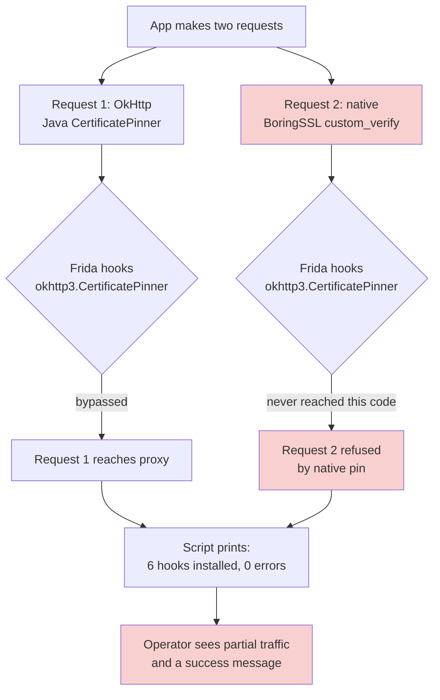

# Lab 02 — Defeat a two-layer pin you built yourself

> **Difficulty:** intermediate → advanced
> **Time:** 3–5 hours, and the middle hour is the one that teaches
> **Prerequisites:** [Lab 01](lab-01-map-the-pinning-surface.md),
> [15-Native-Code](../../15-Native-Code/README.md), [16-JNI](../../16-JNI/README.md),
> [18-ARM](../../18-ARM/README.md), [53-Frida](../../53-Frida/README.md)
> **Authorisation:** you build the target. There is no third-party app in this lab and there must
> not be. The technique is identical against a real target; the authorisation is what separates a
> penetration test from an offence.

---

## 1. The failure this lab is designed to give you

You are going to bypass a certificate pin, watch Frida report that every hook installed
successfully, watch logcat report that the pin was bypassed, and get **no traffic in your proxy**.

That is not a mistake in the lab. It is the lab.

The experience is worth staging deliberately because in the field it is indistinguishable from a
dozen other problems, and the natural response — try a different bypass script — is exactly wrong.
Having felt it once on an app whose source you wrote, you will recognise it in thirty seconds on an
app whose source you have never seen.

The shape:



The script's success message is honest — it *did* install six hooks. It has no way to know about a
decision made in a C function it never saw. Nothing in the output distinguishes "there was nothing
else to bypass" from "there was, and it is still running".

---

## 2. Objectives

By the end you can:

- [ ] Build an Android app that pins at a Java layer and a native layer independently.
- [ ] Confirm both layers statically, with [`pinning-surface.py`](../scripts/pinning-surface.py),
      before running any hook.
- [ ] Bypass the Java layer and correctly diagnose the remaining failure as a *second* pin rather
      than a failed bypass.
- [ ] Locate a native pin's comparison in a stripped `.so`.
- [ ] Defeat the native pin three different ways — replacing the installer, replacing the callback,
      and patching the comparison — and say which you would use in the field and why.
- [ ] Explain why "the app has no `sha256/` string" does not mean "the app does not pin".

---

## 3. Setup

### 3.1 Environment

| Component | Reference version | Check |
|---|---|---|
| Device | Redmi `M2101K6P`, Android 11 / API 30, rooted | `adb shell "su -c id"` |
| frida-server | 16.1.6, running on device | `adb shell ps -A \| grep frida` |
| frida (host) | matching major version | `frida --version` |
| NDK | r25c (25.2.9519653) | `ls $ANDROID_SDK/ndk` |
| BoringSSL or OpenSSL for Android | any recent | see §3.3 |
| Burp Suite or mitmproxy | any | listening on your host |

### 3.2 The target

Build [`examples/02-two-layer-pinning/`](../examples/02-two-layer-pinning/README.md). Follow its
README exactly, and note two things it says that matter here:

- **Set real pins.** The placeholders (`AAAA…`) match nothing, so both layers would reject
  everything and you would learn nothing about which one spoke.
- **Build outside this repository.** No `.so` and no `.apk` may be committed.

Pin both layers to your **real server's** certificate, not your proxy's. The whole exercise is to
make the pins refuse the proxy.

```bash
# host — get the real pin for a host you control
cd 36-CertificatePinning/scripts
./spki-pin.sh --host your.lab.host --emit okhttp
```

Paste the primary value into `PIN_PRIMARY` in `PinnedApiClient.kt` **and** `PIN_PRIMARY_B64` in
`native_pin.c`.

### 3.3 Install

MIUI refuses `adb install` on this device with a misleading `INSTALL_FAILED_USER_RESTRICTED`. Root
is not subject to the gate:

```bash
# host
adb push app-debug.apk /data/local/tmp/ch36.apk
adb shell "su -c 'pm install -r /data/local/tmp/ch36.apk'"
```

### 3.4 Proxy

```bash
# host
adb shell settings put global http_proxy 192.168.1.10:8080     # your host:port
```

Install your proxy CA as a **system** CA, not a user CA — on API 24+ apps do not trust the user
store by default, and you want the proxy's chain to be *valid* so that the only thing rejecting it
is the pin. Chapter [35-SSL](../../35-SSL/README.md) owns the trust-store mechanics; chapter
[62-Magisk](../../62-Magisk/README.md) has the module that does it without remounting `/system`.

> **Warning — remember to undo this**
> `http_proxy` is a global setting on a daily-driver phone. Write down that you set it. The cleanup
> in §10 is not optional.

---

## 4. Phase 0 — map before you hook

This is Lab 01's discipline applied to your own app.

```bash
# host
python3 -B ../scripts/pinning-surface.py --apk app-debug.apk
```

Expected, and you should confirm each line rather than skimming:

```
[3. OkHttp CertificatePinner]
    + [HIGH ] CONFIGURED OkHttp/NSC pin value
              value: ... sha256/<your primary>, sha256/<your backup>

[7. Native TLS (BoringSSL / OpenSSL)]
    + [HIGH ] CONFIGURED pin value in a native library
              where: app-debug.apk!lib/arm64-v8a/libnativepin.so
    + [MED  ] BoringSSL/OpenSSL custom verify
              where: app-debug.apk!lib/arm64-v8a/libnativepin.so

VERDICT: PIN CONFIGURED at 2 layer(s): 3. OkHttp CertificatePinner,
         7. Native TLS (BoringSSL / OpenSSL)
```

**Write down "two layers" now**, on paper, before you start. In forty minutes you will be staring at
a proxy with half the traffic in it, and the note you wrote is what stops you from concluding that
Frida is broken.

### 4.1 Confirm by hand

```bash
# host
unzip -o -j app-debug.apk 'classes*.dex' -d /tmp/lab02 && \
  grep -a -o -h -E 'sha256/[A-Za-z0-9+/]{43}=' /tmp/lab02/*.dex | sort -u

unzip -o -j app-debug.apk 'lib/arm64-v8a/libnativepin.so' -d /tmp/lab02 && \
  strings -a /tmp/lab02/libnativepin.so | grep -E '^[A-Za-z0-9+/]{43}=$'
```

Notice the difference in the two greps. The Java pin carries its `sha256/` prefix because that is
what `CertificatePinner.add` parses. The native pin is a bare base64 string, because `strcmp` does
not need a prefix. **A grep for `sha256/` finds the Java pin and misses the native one entirely** —
which is a small, concrete illustration of why "no pin string in the DEX" proves nothing.

---

## 5. Phase 1 — establish the baseline

Before any bypass. Run the app, exercise both buttons, and watch:

```bash
# host
adb logcat -c
adb logcat -s ch36-twolayer:V ch36-nativepin:V
```

Expected:

```
I ch36-twolayer: layer A: OkHttp CertificatePinner configured for your.lab.host
I ch36-twolayer: layer B: libnativepin.so loaded
E ch36-twolayer: LAYER A REJECTED (OkHttp CertificatePinner): Certificate pinning failure!
      Peer certificate chain:
        sha256/<your proxy's leaf>: CN=your.lab.host
      Pinned certificates for your.lab.host:
        sha256/<your real primary>
        sha256/<your real backup>
E ch36-nativepin: native pin rejected: no pin matched. leaf was sha256/<your proxy's leaf>
E ch36-twolayer: LAYER B REJECTED (native SPKI compare)
```

Both layers reject. The proxy shows the TLS handshake for the OkHttp request and an aborted
connection; it shows the native request's handshake too, or nothing at all, depending on whether the
native code reaches your proxy — see §7.3.

> **Under the Hood — what a pin failure proves**
> OkHttp's message lists the presented pin *and* the expected pins. That the message exists at all
> means the chain was **already accepted by the trust manager**: `CertificatePinner.check` runs after
> validation, not instead of it. So "I get a pinning error" is proof that your CA installation
> worked. People frequently read it as the opposite and go back to fighting the trust store.

Now run the attribution script, which will be your instrument for the rest of the lab:

```bash
# host
adb shell cmd package compile -m verify -f com.pentest.ch36.twolayer
frida -U -f com.pentest.ch36.twolayer -l ../scripts/pin-attribution.js --no-pause
```

It hooks nothing destructively. It wraps each check, lets it run, and reports who said no:

```
[cfg ] CertificatePinner.Builder.add("your.lab.host", sha256/..., sha256/...)
[+] watching okhttp3.CertificatePinner (2 method(s)); pin set readable
[cfg ] libnativepin.so!SSL_CTX_set_custom_verify(ctx=0x..., mode=1, cb=0x...)
[+] attached to native verify callback @0x... (libnativepin.so!SSL_CTX_set_custom_verify)

################################################################
#  REJECTED BY: L3 okhttp3.CertificatePinner.check
#  host=your.lab.host
#  exception : Certificate pinning failure! ...
################################################################

################################################################
#  REJECTED BY: L7 native verify callback @0x... 
#  callback returned 1 (1 = ssl_verify_invalid, 2 = ssl_verify_retry)
################################################################
```

**Two boxes, two layers.** You now have, on screen, the thing that a bypass script structurally
cannot tell you.

---

## 6. Phase 2 — bypass the Java layer, and sit with the result

Now do the thing everybody does first.

```bash
# host
frida -U -f com.pentest.ch36.twolayer \
      -l ../../53-Frida/scripts/ssl-pinning-bypass.js --no-pause
```

Output, roughly:

```
==================================================
  ssl-pinning-bypass.js
  six-layer TLS validation bypass
==================================================

[+] LAYER 1: SSLContext.init
[+] LAYER 1: TrustManagerFactory.getTrustManagers
[+] LAYER 2: com.android.org.conscrypt.TrustManagerImpl.checkTrustedRecursive (2 overload(s))
[+] LAYER 3: okhttp3.CertificatePinner (2 method(s))
[+] LAYER 4: HttpsURLConnection hostname verifiers
[.] skipped android.security.net.config.NetworkSecurityTrustManager (not present)
[*] 9 hook(s) installed, 3 skipped.
```

Exercise the app. In the proxy: **the OkHttp request appears.** In logcat:

```
I ch36-twolayer: layer A result: OK
E ch36-nativepin: native pin rejected: no pin matched. leaf was sha256/<proxy leaf>
E ch36-twolayer: LAYER B REJECTED (native SPKI compare)
W ch36-twolayer: Java layer bypassed, native layer still pinning.
```

### 6.1 Stop and answer these before continuing

Do not skip this. Write the answers down.

1. **How many hooks did the script report installing?** Nine.
2. **How many of those nine touched layer B?** Zero.
3. **Did the script report an error, a warning, or any hint that something remained?** No. It
   reported `LAYER 6 (native TLS)` as skipped if no exported symbol was found — and "skipped" reads
   as "not applicable", not as "there is a pin here I cannot reach".
4. **If you had not written this app, what would you have concluded?** Almost certainly: "the
   bypass partially worked, some traffic is missing, maybe the app uses a second client, let me try
   objection instead."
5. **What is the cheapest observation that would have told you the truth?** The static map in
   Phase 0. Ten minutes, before any of this.

### 6.2 Look at the script's own layer 6

Re-read [`ssl-pinning-bypass.js`](../../53-Frida/scripts/ssl-pinning-bypass.js) lines 490–590. It
*does* handle native TLS — it enumerates every loaded module and replaces
`SSL_CTX_set_custom_verify` and `SSL_CTX_set_verify` wherever the symbol is exported. Whether it
works on your build depends on one thing:

```bash
# host
llvm-readelf --dyn-syms /tmp/lab02/libnativepin.so | grep -i 'custom_verify\|set_verify'
```

- **Symbol present** (dynamically linked against a shared `libssl.so`, or exported): the bypass
  script's layer 6 catches it and everything works. Good — but it worked by *luck of the
  build configuration*, not because the script understood the app.
- **Symbol absent** (statically linked and the linker dropped the name): the script's layer 6 finds
  nothing, reports "no BoringSSL/OpenSSL verify symbols in any loaded module", and you are exactly
  where the field puts you. Continue to Phase 3.

If your build exported the symbol, rebuild with `-Wl,--exclude-libs,ALL` and a version script that
exports only the two JNI functions, so you get the hard case. That is the realistic one — every
shipping Flutter app is in it.

---

## 7. Phase 3 — defeat the native pin

Three routes, in increasing order of what they demand of you and decreasing order of fragility.

### 7.1 Route A — intercept the installer

Even with the symbol stripped from the dynamic table, the call to `SSL_CTX_set_custom_verify` still
happens. If the library is statically linked, the call is a direct branch to a local address, so
there is no import to hook — but you can find the *callback* another way: it is passed as the third
argument, and the app calls the installer exactly once, at connection setup.

If the symbol IS available:

```javascript
// frida -U -f com.pentest.ch36.twolayer -l route-a.js --no-pause
// Replace the installer so BoringSSL calls OUR callback instead of the app's.
const setCustomVerify = Module.findExportByName(null, 'SSL_CTX_set_custom_verify');

// ssl_verify_ok == 0 in BoringSSL's ssl_verify_result_t.
const alwaysOk = new NativeCallback(function (ssl, outAlert) {
    console.log('[+] custom_verify -> ssl_verify_ok');
    return 0;
}, 'int', ['pointer', 'pointer']);

const original = new NativeFunction(setCustomVerify, 'void',
                                    ['pointer', 'int', 'pointer']);

Interceptor.replace(setCustomVerify, new NativeCallback(function (ctx, mode, cb) {
    console.log('[*] intercepted SSL_CTX_set_custom_verify(mode=' + mode + ', cb=' + cb + ')');
    original(ctx, 0 /* SSL_VERIFY_NONE */, alwaysOk);
}, 'void', ['pointer', 'int', 'pointer']));
```

> **Warning — the GC trap**
> `alwaysOk` and `original` must stay reachable from JavaScript for the lifetime of the process.
> A `NativeCallback` created inside a function and not stored anywhere is collected, and BoringSSL
> then calls freed memory — which crashes minutes later, in a place with no relationship to the
> hook. Chapter [53-Frida §7.5](../../53-Frida/README.md) covers this; `ssl-pinning-bypass.js`
> keeps a `NATIVE_KEEP` array for exactly this reason.

### 7.2 Route B — find and replace the callback itself

When the installer is not hookable, find the callback. Three ways in, all of them worth doing once:

**By string reference.** The pin is in `.rodata`. Find it, then find who references it.

```bash
# host
llvm-objdump -s -j .rodata /tmp/lab02/libnativepin.so | grep -A2 -B2 'AAAA'
```

Then open the library in [Ghidra](../../57-Ghidra/README.md), go to the string, and use
*References → Show References to Address*. The function that reads it is `verify_pin_callback`.

**By its shape.** A BoringSSL custom-verify callback has a distinctive signature: two pointer
arguments, an `int` return, and it calls `SSL_get_peer_full_cert_chain`. Even stripped, the call to
`i2d_X509_PUBKEY` followed by `SHA256` followed by a comparison is recognisable — it is the pin
computation and there is not much else it could be.

**By tracing the handshake.** Attach to `SSL_do_handshake` or `SSL_connect` and use Frida's
`Stalker`, or set a breakpoint and step. Heavy, but it always works.

Once you have the address:

```javascript
// frida -U -f com.pentest.ch36.twolayer -l route-b.js --no-pause
// Replace the callback wholesale. Offset from `frida-ps`/`Module.getBaseAddress`.
const lib = Process.getModuleByName('libnativepin.so');
const CALLBACK_OFFSET = 0x0000;          // <- fill in from your analysis

const cb = lib.base.add(CALLBACK_OFFSET);
const keep = new NativeCallback(function (ssl, outAlert) {
    return 0;                             // ssl_verify_ok
}, 'int', ['pointer', 'pointer']);
Interceptor.replace(cb, keep);
console.log('[+] replaced native verify callback at ' + cb);
```

Much more reliable variant, and the one to reach for in the field — do not replace, just change the
return value:

```javascript
Interceptor.attach(cb, {
    onLeave: function (retval) {
        if (retval.toInt32() !== 0) {
            console.log('[*] native pin said ' + retval.toInt32() + ', forcing ssl_verify_ok');
            retval.replace(0);
        }
    }
});
```

`onLeave` + `retval.replace` is safer than `Interceptor.replace` because the original function still
runs. Any bookkeeping it does — freeing memory, updating state, writing a log the app later checks —
still happens. A wholesale replacement skips all of it, and that is a classic source of a crash
three screens later that looks unrelated to the hook.

### 7.3 Route C — patch the comparison

The most durable, and the only one that survives an app that detects Frida.

The comparison is a `strcmp` against a constant. Two ways to defeat it without instrumenting
anything at runtime:

**Patch the constant.** Replace the pinned base64 in `.rodata` with the pin for *your proxy's* key.
Same length — base64 of SHA-256 is always 44 characters — so it is a byte-for-byte overwrite with no
relocation to fix:

```bash
# host
./spki-pin.sh --host your.lab.host        # through the proxy, gives the PROXY's leaf pin
python3 -B - <<'EOF'
old = b"AAAAAAAAAAAAAAAAAAAAAAAAAAAAAAAAAAAAAAAAAAA="
new = b"<44 chars of your proxy's pin>"
assert len(old) == len(new)
d = open('/tmp/lab02/libnativepin.so','rb').read()
assert d.count(old) == 1, d.count(old)
open('/tmp/lab02/libnativepin.so.patched','wb').write(d.replace(old, new))
print("patched")
EOF
```

Repack, re-sign, reinstall — [10-APK-Internals lab 02](../../10-APK-Internals/labs/lab-02-unpack-modify-rebuild-resign.md)
has that loop.

This is elegant: the pin still works, it just pins to you. Nothing is disabled, no check is skipped,
and an integrity check that verifies "the pinning code is intact" passes.

**Patch the branch.** Find the conditional after the `strcmp` and invert or NOP it.

> **Warning — chapter 18's lesson applies here**
> `18-ARM` §5.4 records a patch that provably worked against a function that provably no longer
> mattered: `lc_verify_signature` was patched to `return 1`, verified returning 1, and the caller
> still refused — because clang had **inlined** the check, and the patched copy was called by
> nothing. If you patch `verify_pin_callback` and the pin still rejects, check for inlining before
> assuming the patch failed. `-O2` inlines aggressively, and `spki_pin` in `native_pin.c` is small
> enough to be a candidate.

### 7.4 Verify

Whichever route you took:

```bash
# host
frida -U -f com.pentest.ch36.twolayer -l ../scripts/pin-attribution.js --no-pause
```

Success looks like **zero** `REJECTED BY` boxes and a summary showing accepts at both layers:

```
=================== pin attribution summary ===================
  L3 okhttp3.CertificatePinner.check
      accepted 1   rejected 0
  L7 native verify callback @0x...
      accepted 1   rejected 0

  certificates observed, as pins you could configure:
      sha256/<your proxy's leaf>   CN=your.lab.host
==============================================================
```

And both requests in the proxy.

### 7.5 If the native request still does not reach the proxy

You may have defeated the pin and still see nothing, for a reason that has nothing to do with
pinning:

**`native_pin.c` calls `connect(2)` directly.** `adb shell settings put global http_proxy` sets a
value that `java.net.ProxySelector` consults. Native code that opens its own socket never looks at
it. This is a genuinely common field observation — some of an app's traffic in the proxy and some
not — and the fix is not another hook. It is a transparent redirect:

```bash
# host — one option; see 02-Linux-Basics for iptables on Android
adb shell "su -c 'iptables -t nat -A OUTPUT -p tcp --dport 443 -j DNAT --to-destination 192.168.1.10:8080'"
```

> **Warning**
> That rule affects the **whole device**, including apps you are not testing, on a daily-driver
> phone. Restrict it by uid (`-m owner --uid-owner <app uid>`) and remove it immediately afterwards.
> `adb shell "su -c 'iptables -t nat -F OUTPUT'"` flushes the chain — check what else was in it first.

---

## 8. Phase 4 — now do it the right way round

Reset. Uninstall, reinstall, no hooks.

```bash
# host
adb shell "su -c 'pm uninstall com.pentest.ch36.twolayer'"
adb shell "su -c 'pm install -r /data/local/tmp/ch36.apk'"
```

Now run the whole workflow in the order this chapter argues for, and time it:

1. `pinning-surface.py --apk app-debug.apk` → **two layers**. (30 seconds)
2. `pin-attribution.js` → confirm both layers run and both reject. (2 minutes)
3. Address layer 3 with a targeted hook — not a universal script.
4. Address layer 7 with route A, B or C.
5. `pin-attribution.js` again → confirm zero rejections.

Compare against the time you spent in Phase 2 and 3 wondering what was wrong. That difference,
multiplied across a real engagement, is the argument for the whole approach.

---

## 9. Extensions

<details>
<summary>Extension 1 — make the native pin harder</summary>

Modify `native_pin.c` so the pin is not a plain string:

- XOR the constant with a fixed byte and decode it on the stack at comparison time. Re-run
  `pinning-surface.py` — the `HIGH` finding disappears and only the `MED` verify-symbol finding
  remains. **The tool got weaker and the app did not get more secure**; that is the honest lesson
  about obfuscation, and [40-Obfuscation](../../40-Obfuscation/README.md) makes the general case.
- Compare against the digest bytes rather than base64, so there is no 44-character string at all.
- Call the comparison from three places so patching one does nothing.

Then defeat it again. Which route from §7 still works unchanged?
</details>

<details>
<summary>Extension 2 — add a third layer</summary>

Add a `<pin-set>` in `res/xml/network_security_config.xml` (copy
[example 3](../examples/03-spki-pin-with-backup/network_security_config.xml)) pinning the same host
to a value that matches nothing.

Now the OkHttp request fails *before* `CertificatePinner.check` is reached, because
`NetworkSecurityTrustManager` throws during chain validation — a layer *below* the OkHttp pin.
Watch `pin-attribution.js`: the L5 box appears and the L3 box does not, because L3 never runs.

That ordering is the answer to a question that confuses people constantly: **a rejection at one
layer hides every layer above it.** You cannot enumerate an app's pins by removing them one at a
time and seeing what fails — you only ever see the first one.
</details>

<details>
<summary>Extension 3 — the honest severity exercise</summary>

You have now defeated a two-layer pin on a rooted device with Frida.

Write the finding. Then answer: what did the pin actually cost the attacker, and who is the attacker
in your scenario? If the answer is "someone with root and a debugger on the victim's own phone",
then the pin was never protecting against them, and defeating it demonstrates the technique rather
than a vulnerability.

This is the paragraph that separates a report a developer acts on from one they dismiss. Section
[5.2](../README.md#52-how-to-report-pinning-honestly) has the wording.
</details>

<details>
<summary>Extension 4 — do it without Frida at all</summary>

Route C, taken all the way: patch the `.so`, repack, re-sign, install. No instrumentation on the
device, nothing to detect. Then check whether the app notices — add a check to `PinnedApiClient.kt`
that verifies its own APK signature and see how much that changes (spoiler:
[38-TamperDetection](../../38-TamperDetection/README.md) is a whole chapter for a reason).
</details>

---

## 10. Cleanup — do not skip this

This is a daily-driver phone.

```bash
# host
adb shell settings put global http_proxy :0
adb shell settings get global http_proxy               # expect ":0" or "null"

adb shell "su -c 'pm uninstall com.pentest.ch36.twolayer'"
adb shell rm -f /data/local/tmp/ch36.apk

# if you used the iptables rule in 7.5, check the chain and remove ONLY your rule
adb shell "su -c 'iptables -t nat -L OUTPUT -n --line-numbers'"
```

Also remove the system CA you installed for this lab, unless you keep a permanent testing CA
deliberately — chapter [62-Magisk](../../62-Magisk/README.md) covers making that reversible with a
module rather than a `/system` remount, which is exactly why the module approach is worth the setup.

Verify the app is gone and the device is where you found it:

```bash
# host
adb shell pm list packages | grep ch36                 # expect nothing
```

---

## 11. Success criteria

- [ ] You built an app that pins at two independent layers and confirmed both statically.
- [ ] You ran a universal bypass, saw it report complete success, and got only half the traffic.
- [ ] You can state, in one sentence, why the script could not have known.
- [ ] You defeated the native pin by at least **two** of the three routes in §7.
- [ ] You used `onLeave` + `retval.replace` at least once and can say why it is safer than
      `Interceptor.replace`.
- [ ] `pin-attribution.js` shows zero rejections and both layers accepting.
- [ ] You checked for inlining before concluding a patch had failed.
- [ ] The device is back to its original state: proxy cleared, app uninstalled, no leftover
      iptables rule.

---

## 12. What you should take away

**A pinning bypass reports on its hooks, not on the app.** It cannot tell you about a decision made
somewhere it never looked, and its success message is honest about the hooks and silent about
everything else. That silence is the failure mode.

The remedy is not a better script. It is knowing the surface first — which is ten minutes of
`unzip` and `grep`, and which you now have a tool for.

---

**Next:** [Lab 03 — attribute the rejection, and survive renewal](lab-03-attribute-the-rejection.md).
