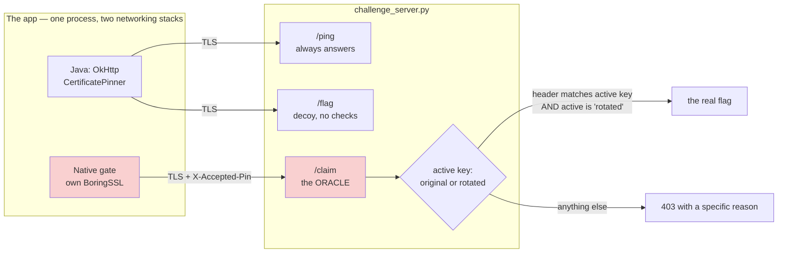

# Lab 04 — CTF: the pin that moved

> **Difficulty:** hard (CTF)
> **Time:** 3–6 hours
> **Prerequisites:** [Lab 01](lab-01-map-the-pinning-surface.md),
> [Lab 02](lab-02-defeat-a-two-layer-pin.md), [Lab 03](lab-03-attribute-the-rejection.md),
> [18-ARM](../../18-ARM/README.md), [57-Ghidra](../../57-Ghidra/README.md),
> [53-Frida](../../53-Frida/README.md)
> **Authorisation:** you build and run both ends. Server, app, keys, CA — all yours.

---

## 1. The brief

You have an app. It talks to one server over TLS. Somewhere in it is a flag.

You will get a flag quickly. It will be the wrong one, and the server will tell you why in plain
English. Getting the right one requires something a universal bypass structurally cannot give you.

**Flag format:** `CTF{...}`, plain ASCII.

---

## 2. Rules

1. **No reading the source of the target.** [`PinGate.kt`](ctf-pin-that-moved/PinGate.kt),
   [`pin_gate.c`](ctf-pin-that-moved/pin_gate.c) and §3 of
   [`ctf-pin-that-moved/README.md`](ctf-pin-that-moved/README.md) are the answer. You build from
   them; you do not consult them while solving. If you cannot resist, have someone else build the
   APK and hand you only that.
2. `challenge_server.py` **is** in scope. Reading it, running it, and controlling it are all part of
   the challenge. It is your server.
3. Any tool: Frida, Ghidra, radare2, `objdump`, a hex editor, `openssl`, patience.
4. Record what you tried and what each attempt produced. Half the value of this lab is the
   transcript, and §7 asks for it.

---

## 3. Setup

### 3.1 Server

```bash
# host
cd 36-CertificatePinning/labs/ctf-pin-that-moved
python3 -B challenge_server.py --setup
python3 -B challenge_server.py --serve --port 8443
```

The setup step prints three pin values. **If you are solving, have the person who builds the APK
keep them.** If you are doing both roles, note them, build, then deliberately forget which is which
— the challenge is recovering that mapping from the binary.

### 3.2 App

Build per [`ctf-pin-that-moved/README.md`](ctf-pin-that-moved/README.md) §2, **stripped**. Install
with the root fallback on the MIUI reference device:

```bash
# host
adb push app-debug.apk /data/local/tmp/ctf.apk
adb shell "su -c 'pm install -r /data/local/tmp/ctf.apk'"
```

### 3.3 Confirm reachability before anything else

```bash
# host
adb logcat -c && adb logcat -s ch36-ctf:V ch36-ctf-native:V
```

Tap *Ping* in the app. You want:

```
pong
active-key=original
```

If you do not get that, stop and fix it. Infrastructure problems and challenge difficulty look
identical from the outside, and `/ping` exists so you never have to guess which one you are in.

---

## 4. The challenge

Three buttons. Three behaviours worth understanding before you touch a hook.

| Button | What it does |
|---|---|
| **Ping** | `GET /ping` over the Java client. Always works |
| **Get flag** | `GET /flag` over the Java client, which is pinned |
| **Claim** | `GET /claim` through the native path |

Get the real flag.

### 4.1 The topology

You are allowed to know this much. Everything below is visible from outside the app with the tools
from labs 01 and 03; drawing it saves you the twenty minutes of confusion that is not the point of
the exercise.



Three things that diagram tells you and that are worth stating before you start.

**The two stacks do not share anything.** Not a socket, not a trust decision, not the proxy setting.
Whatever you do to the Java client has no effect on the Claim path.

**`/flag` performs no checks.** Anything that completes a handshake gets the decoy. That is why
receiving it proves nothing — and why "I got a flag" is not "I solved it".

**The oracle has two conditions, not one.** The header must name the currently-served key, *and* the
currently-served key must be the rotated one. Satisfying the first without the second gets you a
403 that says so in as many words. That second condition is the whole reason "disable everything"
loses: it forces you to have caused a specific acceptance rather than a blanket one.

### 4.2 What you are allowed to assume

To keep the difficulty in the right place:

- The pin values printed by `--setup` are **not** secret. If you built the APK yourself you saw
  them. The challenge is working out *which one is where*, and what to do about it.
- The server is a normal HTTP server behind TLS. There is no web vulnerability in it and hunting for
  one is a waste of your time.
- The flag is not in the APK, not in the server's source (except as a constant you are not meant to
  read), and not reachable by guessing a URL.
- Everything you need is observable from the app's behaviour, the binary, and the server's replies.

---

## 5. Checkpoints

Do not read ahead. Each checkpoint is a thing you should be able to state before continuing; if you
cannot, you are guessing rather than solving.

<details>
<summary>Checkpoint 1 — before running any hook, what does the APK tell you?</summary>

```bash
# host
python3 -B ../../scripts/pinning-surface.py --apk app-debug.apk
```

You should be able to answer:

- How many pin **values** are in the DEX? Where?
- Is there a native TLS stack? What is the evidence?
- Does the native library contain a pin value? What does the tool say, and what does its
  **confidence grade** for that finding mean?

The gap between what the tool finds in the DEX and what it finds in the `.so` is the first real clue
in this challenge, and it is available in thirty seconds.
</details>

<details>
<summary>Checkpoint 2 — you got a flag. Why is it not the flag?</summary>

Run the universal bypass, tap **Get flag**, and you have a `CTF{...}` string in about ninety seconds.

Now ask the question that separates a solver from a script runner: **what did the server have to
verify in order to give me that?** Read the response. Read `/ping` again. Compare what each endpoint
required.

If a response arrives no matter what you did, it is not evidence about what you did.
</details>

<details>
<summary>Checkpoint 3 — the Claim button fails. Which layer refused?</summary>

Do not guess. Instrument:

```bash
# host
adb shell cmd package compile -m verify -f com.pentest.ch36.ctf
frida -U -f com.pentest.ch36.ctf -l ../../scripts/pin-attribution.js --no-pause
```

Then answer:

- Did any **Java** layer run for the Claim request? (If not: what does that tell you about where the
  request came from?)
- Did the native watcher find a verify symbol? If not, what does the script suggest instead?
- Read logcat for `ch36-ctf-native`. What does the gate say about the leaf it saw?
</details>

<details>
<summary>Checkpoint 4 — you have a leaf pin from logcat. Now what?</summary>

The gate logs the SPKI of the certificate it was presented and then rejects it. So you know what the
server is serving. You do **not** know what the gate wants.

Two ways to find out. Both are legitimate solves:

- **Read it out of the binary.** The pin is not a string, so `strings` fails. But the code that
  produces it has to exist. Look for a short loop over a constant array feeding a comparison.
- **Read it out of memory.** Whatever obfuscation is used, the plaintext exists at the moment of the
  comparison. Attach at the right point and read the buffer.

Then compare what you recover against the pins in the DEX. If it matches none of them, the gate is
pinned to a key you have not seen.
</details>

<details>
<summary>Checkpoint 5 — the gate wants a key the server is not serving</summary>

You control the server. Read `challenge_server.py --help`.

If the gate accepts because the server now serves the key it was pinned to, you have solved it with
**no runtime instrumentation of the app at all**. That is the intended elegant solve, and it is
worth doing that way even if you have already got there by force.
</details>

<details>
<summary>Checkpoint 6 — you forced the gate to accept, and /claim still refuses</summary>

Read the server's response text; it is specific for a reason. Three different refusals mean three
different things, and each names what went wrong.

Then look at what the request actually sent — `Interceptor.attach` on `SSL_write` and dump the
buffer:

```javascript
// frida -U -f com.pentest.ch36.ctf -l dump-write.js --no-pause
const w = Module.findExportByName(null, 'SSL_write');
if (w !== null) {
    Interceptor.attach(w, {
        onEnter: function (args) {
            try { console.log(Memory.readUtf8String(args[1], args[2].toInt32())); }
            catch (e) { }
        }
    });
}
```

Look at the headers. Is the one the server wants present? Is it right? Where would the app have got
its value from, and does that source still have a value after what you did to it?
</details>

---

## 6. Hints

<details>
<summary>Hint 1 — I cannot find anything in the .so</summary>

Do not look for a base64 string; look for the *work*. Any pin, however hidden, must eventually:

1. get the peer's certificate,
2. serialise its SubjectPublicKeyInfo (`i2d_X509_PUBKEY`),
3. hash it (`SHA256`),
4. compare 44 bytes against something.

Steps 2 and 3 are library calls with recognisable shapes even after stripping. Step 4 is a short
comparison against a buffer. Find step 4 and follow the buffer backwards.

`pinning-surface.py` grading the native library `MED` rather than `HIGH` is itself the clue: it
found the verify entry point and not a pin value. Structure survived; the string did not.
</details>

<details>
<summary>Hint 2 — Frida cannot find the verify symbol</summary>

Correct. The library is stripped and BoringSSL is statically linked, so
`Module.findExportByName(null, 'SSL_CTX_set_custom_verify')` returns null. That is the realistic
case and every shipping Flutter app is in it.

Work from the JNI entry point, which **is** exported (it has to be, or Java could not call it):

```javascript
// frida -U -n com.pentest.ch36.ctf
const lib = Process.getModuleByName('libpingate.so');
console.log(JSON.stringify(lib.enumerateExports(), null, 2));
console.log('base: ' + lib.base);
```

From the JNI function, follow calls in a disassembler. The gate is two or three frames in.
</details>

<details>
<summary>Hint 3 — I replaced the callback and the handshake works, but /claim says 400</summary>

You are very close, and this is the designed lesson. The handshake succeeding is not the goal; the
server is asking a question you have destroyed the app's ability to answer.

Something the original code did, on the path you replaced, is now not happening. Ask: what did the
gate produce *besides* an accept/reject verdict? Where would it have put it?

`retval.replace()` in `onLeave` keeps the original body running. `Interceptor.replace` does not.
That difference is the whole hint.
</details>

<details>
<summary>Hint 4 — nothing I do to the app produces the flag</summary>

Stop attacking the app. Re-read the rules: the server is yours.

The gate is pinned to a key. Which one? Is the server serving it? What could you change that does
not involve the app at all?
</details>

<details>
<summary>Hint 5 — full solution outline</summary>

1. `pinning-surface.py` finds two pin values in the DEX and none in the `.so`, plus a verify entry
   point in the `.so`. **Two Java pins, one native pin that is hidden.**
2. Bypass Java, tap *Get flag*, receive the decoy. Note that `/flag` required nothing.
3. `pin-attribution.js` plus logcat: the Claim request involves no Java layer, and the native gate
   rejects the leaf, logging its SPKI.
4. Recover the gate's expected pin — from the XOR loop in Ghidra, or from memory at comparison time.
5. It matches neither DEX pin. It is the pin of a key the server has not served.
6. `challenge_server.py --rotate`.
7. Tap *Claim*. The gate accepts legitimately, fills in `X-Accepted-Pin` from the certificate it
   really saw, and the oracle returns the flag — with **no hook running**.

The alternative ending, equally valid: rotate first, then patch the XOR table so the gate accepts
the rotated key. The header is populated from the presented certificate either way.
</details>

---

## 6a. Running this as a workshop

If you are facilitating rather than solving, a few notes from the design.

**Split the roles.** One person builds the APK from
[`ctf-pin-that-moved/`](ctf-pin-that-moved/README.md) and keeps the pin mapping; everyone else gets
only the APK and the server address. That preserves the discovery, which is most of the value.

**Do not tell them about `--rotate` and do not hide it.** `challenge_server.py --help` lists it. A
solver who reads the tool they were given will find it; one who only attacks the app will not. That
asymmetry is deliberate — "the server is yours too" is written in the rules and most people skip it.

**Expect the decoy within ten minutes** and the real flag in two to four hours. If nobody has moved
past the decoy after ninety minutes, release Hint 3 — it points at the difference between
`Interceptor.replace` and `retval.replace` without giving away the rotation.

**The moment to watch for** is when someone says "the native gate is broken, it rejects everything".
That is the correct observation from the wrong frame: the gate is not broken, it is pinned to a key
the server is not serving. Ask them what would make it not-broken, and stop talking.

**Common derailments** and the one-line nudge for each:

| They are stuck on | Say |
|---|---|
| Hunting a web vulnerability in the server | "The server is a plain HTTP server behind TLS. Read what `/claim` requires." |
| Trying more bypass scripts | "What did the last one change, and what did it prove?" |
| Convinced the native library is broken | "What key is it expecting, and is that the key you are serving?" |
| Forged the header from the DEX pin | "Read the 403. It is answering a specific question." |
| Cannot find anything in the `.so` | "Stop looking for a string. What work must a pin do?" |

---

## 7. Deliverable

A short write-up. Not a screenshot of the flag — the flag is the least interesting thing you will
produce here.

1. **The map.** Which layers, found how, before any instrumentation.
2. **The decoy.** What you got, why it was worthless, and what the server had to verify to hand it
   over (nothing).
3. **The attribution.** Which layer refused the Claim request, and the evidence.
4. **The recovery.** How you got the hidden pin, and what tools.
5. **The solve.** What you changed and why it worked.
6. **The failed attempts**, with what each taught. Weight this section heavily; it is where the
   learning is.
7. **The honest severity paragraph.** You defeated a two-layer pin on a rooted device with a
   debugger. What was the pin actually protecting against, and was that attacker you?

---

## 8. Success criteria

- [ ] You have `CTF{pins_move_and_so_must_your_assumptions}`.
- [ ] You can explain why the decoy flag is worthless in one sentence.
- [ ] You mapped both layers statically before hooking anything.
- [ ] You recovered a pin that is not a string in the binary.
- [ ] You can explain why `Interceptor.replace` on the callback defeats the pin and loses the
      challenge.
- [ ] You solved it — or can describe the solve — **without any runtime instrumentation of the app**.
- [ ] Your write-up contains an honest severity paragraph that does not say "critical".

---

## 9. Cleanup

```bash
# host
cd 36-CertificatePinning/labs/ctf-pin-that-moved
python3 -B challenge_server.py --clean
rm -rf /tmp/ch36-ctf
adb shell "su -c 'pm uninstall com.pentest.ch36.ctf'"
adb shell rm -f /data/local/tmp/ctf.apk
adb shell settings put global http_proxy :0
adb shell settings get global http_proxy
```

---

## 10. What this challenge was actually about

Every technique in this lab appears in the previous three. Nothing here is a new tool.

What is new is the **oracle**, and the oracle exists to break one specific habit: treating a
successful bypass as a successful assessment. A bypass proves that you could turn a check off. It
proves nothing about what the check was for, what else was checking, or whether the thing you turned
off was the thing that mattered.

The server in this challenge refuses to accept "I disabled it" as an answer and demands "I know
which key was accepted, and why". That is the same question a good report answers, and the same one
a bypass script cannot.

> **🧠 Mental Model**
> A pin is a claim about a key. Defeating the pin is easy on a device you own. Understanding *which*
> key, *which* layer, and *why the app expected that one* is the part that survives contact with a
> developer who wrote the code.

---

**Back to:** [chapter README](../README.md) · **Labs:**
[01](lab-01-map-the-pinning-surface.md) ·
[02](lab-02-defeat-a-two-layer-pin.md) ·
[03](lab-03-attribute-the-rejection.md) · 04
