# 36 — Certificate Pinning · Mind Map

One map of the whole chapter. Follow a branch to its leaves, then open the section named in
[README.md](README.md).

```mermaid
mindmap
  root((36<br/>Certificate<br/>Pinning))

    ((1. What it is))
      Narrower question than TLS
        TLS asks did someone I trust vouch
        Pinning asks is this THE key
      Hash of the SPKI
        AlgorithmIdentifier plus BIT STRING
        DER encoded, SHA-256, base64
        44 chars ending in one equals
        NOT the certificate hash
      A control, not a vulnerability
        MASVS-NETWORK-2 is conditional
        No pinning is often not a finding
        Presence of the class is not a pin
      What it is NOT
        Trust store restriction
        Hostname verification
        Certificate Transparency
        A permissive TrustManager

    ((2. The layers))
      1 SSLContext and TrustManager
        init and getTrustManagers
        Empty body accepts everything
        Bypasses a declared pin-set
      1b X509TrustManagerExtensions
        Takes the hostname
        Returns the CLEANED chain
        The sanctioned API
      2 Conscrypt TrustManagerImpl
        An APEX, updatable
        Three class names
        Modern OkHttp calls it DIRECTLY
      3 okhttp3.CertificatePinner
        Runs AFTER validation
        Void return, returning is accepting
        No pattern means not pinned
      4 HostnameVerifier
        Not a pin
        Usually YOUR SNI bug
      5 pin-set in XML
        NetworkSecurityTrustManager
        No app code to hook
        Expiration degrades, not bricks
      6 WebView onReceivedSslError
        Own stack, own trust
      7 Native BoringSSL
        SSL_CTX_set_custom_verify
        mode 0 plus callback equals a pin
        NO Java hook reaches it
      Flutter root bundle
        Not a pin, behaves like one
      Certificate Transparency
        Fails AFTER the pin
        Misattributed constantly

    ((3. Why one is not enough))
      They compose
      A partial bypass looks like a failure
      The script reports hooks, not the app
        9 installed 0 errors is about hooks
        skipped LAYER 6 means no symbol seen
      A lower rejection hides the layers above
      Native is the floor
      Measured
        12 of 14 apps have a surface
        4 of 14 have a pin value
        7 of 14 have 4 or more layers
        3 of 14 are Flutter

    ((4. Operating it))
      SPKI survives renewal
        Key CSR and cert give one pin
        Key rotation breaks it
      Backup pin
        Generated, pinned, never used
        Any pin matching accepts
        One pin is a finding
      Expiration
        Falls back to normal validation
        Chosen over bricking
        OkHttp has no equivalent
      What to pin
        Leaf: no one else can impersonate
        Own intermediate: rotatable
        Public CA intermediate: any customer
      Remote delivery
        Sign the artefact not the pipe
        Monotonic version, rollback protection
        Report-only mode first
        The kill switch is the finding

    ((5. Finding it))
      Static
        sha256 slash plus 43 base64 plus equals
        pin-set in compiled AXML
        44 chars bare in a .so
        flutter_assets in five seconds
        NEEDED libssl.so
      Confidence grading
        HIGH a pin value
        MATRL certs, ambiguous
        MED trust taken over
        LOW library on the classpath
      Traps
        grep sha256 slash alone is useless
        Read every split, not paths zero
        classes24.dex counts too
        DT_SONAME is a claim

    ((6. Attribution))
      Watch, do not bypass
        Wrap, call through, report, rethrow
      L2 fix your CA
      L3 now bypass
      L4 fix your SNI
      L5 platform pin
      L7 no Java reaches it
      Nothing ran means wrong stack
      Baseline first
        A check that accepts proves it is live

    ((7. Defeating it))
      Java
        Targeted beats universal
        Spawn, never attach
        Deoptimise first
      Native
        Replace the installer
        Attach plus retval.replace
        Patch the constant to YOUR pin
        Patch the branch
      Traps
        NativeCallback GC
        Inlining, chapter 18
        Interceptor.replace loses side effects
      Static route
        Patch the smali, resign
        Survives Frida detection
        Then signature checks bite

    ((8. Reporting))
      A no pin, adequate
      B no pin, should pin
      C pins, fragile, AVAILABILITY
      D pins, wrong hosts
      Never
        No pinning equals medium
        Class in DEX equals pinning
        Frida on root equals finding
      Authorisation
        Detection on your own APK is fine
        Instrumenting others is not
```

---

## How to use this map

**Left to right is the workflow.** Branches 5, 6 and 7 are the order you work in: find the surface,
attribute the rejection, then defeat only what needs defeating. Branch 8 is what you write down.

**Branch 3 is the chapter's argument.** Every other branch exists to support it.

**Branch 4 is the half most pentesters skip** and the half a developer will actually ask about. A
tester who can explain why the pin will break on renewal day is worth more to a client than one who
can only bypass it.

---

## Related maps

| Chapter | Map covers |
|---|---|
| [35-SSL](../35-SSL/README.md) | The handshake, trust anchors, and the user-CA store |
| [44-NetworkSecurityConfig](../44-NetworkSecurityConfig/README.md) | The XML grammar in full |
| [53-Frida](../53-Frida/README.md) | The instrumentation engine |
| [15-Native-Code](../15-Native-Code/README.md) | ELF, `DT_NEEDED`, and the dynamic section |
| [17-Libraries](../17-Libraries/README.md) | Identifying Flutter, React Native, Cronet and friends |
