# 37 — Root Detection

> After this chapter you will be able to enumerate every root-detection technique an Android app can
> realistically use, locate each one in a compiled binary, defeat it with code you wrote yourself, and
> explain to the developer who wrote it exactly what the control was — and was not — worth.

**Prerequisites:** [02-Linux-Basics](../02-Linux-Basics/README.md),
[09-Android-App-Internals](../09-Android-App-Internals/README.md),
[15-Native-Code](../15-Native-Code/README.md), [16-JNI](../16-JNI/README.md),
[21-App-Sandbox](../21-App-Sandbox/README.md)
**Useful alongside:** [62-Magisk](../62-Magisk/README.md) — the thing most of these checks are
looking for, and where hiding it is covered; this chapter enumerates and locates the checks without
needing it. [53-Frida](../53-Frida/README.md) for the runtime defeats in §7 — locating each check in
a binary and defeating it by static patch needs neither, and
[53's opening callout](../53-Frida/README.md) explains why `frida-server` may not run on your image
at all.
**Applies to:** Android 5–16 (API 21–36). Behaviour differences are marked in Version Matrix tables.

---

> Everything in this chapter targets an app you own, an app you are contracted to assess, or a
> deliberately vulnerable lab target. See [SECURITY.md](../SECURITY.md) for authorised-testing scope.

---

## Table of Contents

1. [Introduction](#1-introduction)
2. [High-Level Architecture](#2-high-level-architecture)
3. [Deep Internal Working](#3-deep-internal-working)
4. [Source Code Walkthrough (AOSP)](#4-source-code-walkthrough-aosp)
5. [Security Perspective](#5-security-perspective)
6. [Reverse Engineering Perspective](#6-reverse-engineering-perspective)
7. [Dynamic Analysis](#7-dynamic-analysis)
8. [Static Analysis](#8-static-analysis)
9. [Examples](#9-examples)
10. [Common Interview Questions](#10-common-interview-questions)
11. [Common Mistakes](#11-common-mistakes)
12. [Hands-on Labs](#12-hands-on-labs)
13. [Summary](#13-summary)
14. [References](#14-references)

---

## 1. Introduction

### 1.1 The problem, stated in plain English

Imagine you rent out a flat. You install a lock on the front door and hand the tenant a key. Now
imagine a different arrangement: you are a bank, and you have handed a customer a *safe* — and the
customer takes that safe home, puts it in their own garage, and owns every tool in the garage. The
safe is now sitting inside territory the attacker completely controls. They can weigh it, X-ray it,
drill it, put it in a press, or lie to it about what time it is.

An Android application on a rooted phone is the safe in the garage.

The normal Android security model assumes a specific shape of threat: **app A is protected from app
B**, and both are protected from a malicious website or a hostile network. The operating system holds
the line, because the operating system is trusted and the apps are not. That model is the subject of
[20-Security-Architecture](../20-Security-Architecture/README.md) and
[21-App-Sandbox](../21-App-Sandbox/README.md), and it works well.

Root detection exists because a category of applications faces a *different* threat model, one the
platform was never designed to solve:

> **Definition — the "user is the attacker" threat model**
> A threat model in which the person holding the device is the adversary you are defending against,
> rather than the party you are defending. It applies whenever the app is enforcing a rule *against*
> its own user: a bank limiting transfers, a DRM client refusing to hand over a decrypted film, a
> game preventing the player from giving themselves infinite gold, an enterprise MDM agent asserting
> the device is compliant.

In that model, the operating system is no longer a trusted referee, because the user can replace it.

### 1.2 What "root" actually is

> **Definition — root**
> On any Linux-based system, including Android, **root** is the user account with UID (user
> identifier) 0. The kernel special-cases UID 0 in its permission checks: a process running as UID 0
> bypasses the standard discretionary access control (DAC) checks on files and can perform
> privileged system calls. "Rooting" a phone means arranging for a mechanism by which a chosen
> process can obtain UID 0 on demand.

Android ships without that mechanism on purpose. A retail (`user` build) Android device has:

- No `su` binary in any executable path.
- `adbd` (the ADB daemon) refusing to run as root because `ro.debuggable` is `0`.
- Verified Boot (AVB) checking every system partition against a signature rooted in hardware, so an
  attacker cannot write a `su` binary into `/system` and reboot.
- SELinux in enforcing mode, which applies *mandatory* access control on top of UID checks. Even UID
  0 is confined by its SELinux domain. This is why "I have root but still get permission denied" is
  such a common experience — see [22-SELinux](../22-SELinux/README.md).

Rooting therefore requires breaking or bypassing at least one of those. The dominant modern method
is **Magisk**, covered in depth in [62-Magisk](../62-Magisk/README.md), which patches the boot image
so that its own `init` runs first, mounts an overlay filesystem, and provides a `su` implementation
plus a daemon that brokers root requests. Crucially, Magisk is *systemless*: it does not modify the
real `/system` partition, which both preserves OTA updates and — importantly for this chapter —
removes several classic detection signals.

### 1.3 Why applications care

Different industries care for different reasons, and the reason determines how aggressive the
control is and what a realistic recommendation looks like.

| Sector | What they are actually afraid of | Consequence of root |
|---|---|---|
| Retail banking / payments | Malware with root reading the screen, the keyboard, or the app's private storage; automated fraud rings | Direct financial loss; regulatory exposure (PSD2 SCA, PCI MPoC) |
| DRM / streaming video | Extraction of decrypted content keys or plaintext frames | Loss of studio licensing; contractual penalties. Widevine L1 vs L3 is decided by hardware, not by this check |
| Games with in-app purchase | Memory editors (GameGuardian), automated farming bots, purchase spoofing | Economy collapse; loss of paying-player revenue |
| Enterprise MDM / BYOD | A "compliant" device that is actually a lab machine belonging to nobody | Corporate data on an uncontrolled device |
| Health / identity / government | Regulatory requirements that mandate a device-integrity signal | Certification failure |
| Ride-hailing / delivery / gig | GPS spoofing at scale, fake accounts, incentive farming | Marketplace fraud |

Notice that in almost every row, the *real* loss happens on a server. The bank loses money when a
transfer executes on its backend. The game economy collapses when its server accepts a purchase
receipt it should have rejected. That observation is the seed of the honest framing that runs through
this entire chapter.

### 1.4 The honest framing: this cannot be won on the client

> **Mental Model**
> Every root check is a question the app asks *itself*, on hardware the attacker owns, using code the
> attacker can rewrite, receiving answers from an operating system the attacker replaced. The app is
> a detective interrogating a witness, in a room built by the suspect, where the suspect wrote the
> witness's script. The detective is not stupid — but the game is rigged and no amount of cleverness
> un-rigs it.

Say it precisely. A client-side root check is a function `boolean isRooted()`. The attacker's goal is
to make the process behave as though that function returned `false`. They can achieve that by:

1. Changing the environment so the check genuinely returns `false` (hide `su`, unmount overlays).
2. Changing the inputs the check sees (hook `File.exists`, hook `stat()`, hook the property read).
3. Changing the function's return value (hook the method, patch the branch).
4. Changing the *caller* so it never asks (patch out the call site, or invert the branch that acts on
   the result).
5. Removing the consequence (patch the `finish()` / `System.exit()` / dialog that follows).

Steps 3, 4 and 5 do not depend on the sophistication of the check at all. A native, obfuscated,
whitebox-crypto-protected, timing-hardened root check that ends with a `JNI_TRUE`/`JNI_FALSE` return
into Java still ends with a single branch in DEX bytecode that anyone can flip.

The only way to change the game is to move the decision to somewhere the attacker does not control,
namely **the server**, and to give the server evidence it can actually trust, namely **hardware-backed
remote attestation**. On Android that is the Play Integrity API (formerly SafetyNet Attestation),
whose verdict is signed by Google and validated server-side, and Key Attestation from the hardware
keystore ([49-KeyStore](../49-KeyStore/README.md),
[50-HardwareBackedSecurity](../50-HardwareBackedSecurity/README.md)).

> **Warning**
> "Client-side detection is a speed bump" does not mean "do not implement it". Speed bumps work on
> the population that is driving slowly by accident. A cheap root check removes the entire class of
> casual, unmotivated, script-following attacker at a cost of a few hundred lines. It removes exactly
> zero of the motivated ones. Implement it *and* know its value. The failure mode to avoid is not
> implementing the check — it is **believing the check**.

### 1.5 Why developers must read the attacker's half

This chapter is written so that both readers get what they need from the same text. A tester needs
the bypass. A developer needs to understand *why* their control failed, because a developer who has
never watched their root check die in four seconds under Frida will keep spending sprint capacity on
check number twenty-seven instead of on server-side attestation, which is where the actual defence
lives.

Every technique below therefore ends with two things: **the developer's best-available hardening**
and **an honest assessment of what the control is worth**. If you only read one column, read the
second.

---

## 2. High-Level Architecture

### 2.1 What is on the device after rooting

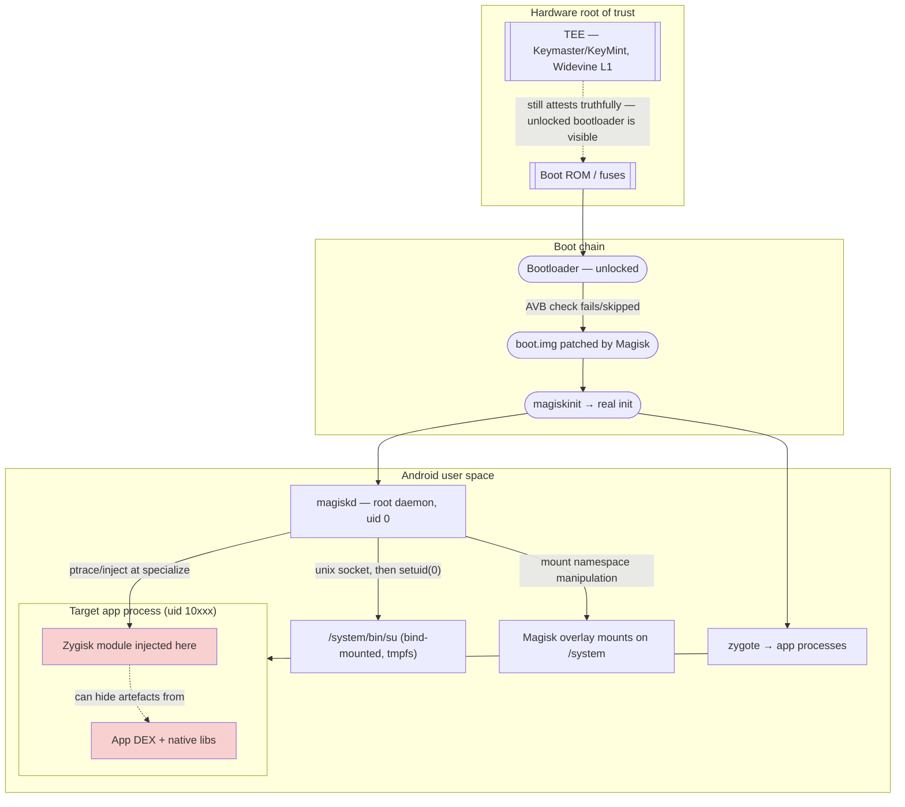

Read that diagram from the bottom of the trust chain upward, because it explains precisely which
detections are meaningful and which are theatre.

The bootloader is unlocked, so Android Verified Boot cannot vouch for the boot image. Magisk's
patched boot image runs `magiskinit` before the real `init`, which lets it set up its own filesystem
view before anything else exists. From that point on, Magisk owns user space: it runs a root daemon
(`magiskd`), it can bind-mount files over the read-only system image without ever writing to the real
partition, and with **Zygisk** it can inject code into the Zygote process and therefore into every
app that Zygote forks.

The critical asymmetry is the dotted line at the bottom. The TEE — the Trusted Execution Environment,
a separate secure processor context — is *not* under Magisk's control, and it knows the bootloader is
unlocked because the bootloader state was measured before Android existed. That is why hardware key
attestation and Play Integrity's `MEETS_DEVICE_INTEGRITY` verdict remain meaningful while every
filesystem check in the diagram does not. Everything Magisk can reach, Magisk can lie about.
Everything sealed behind the TEE, it cannot.

### 2.2 The detection surface map

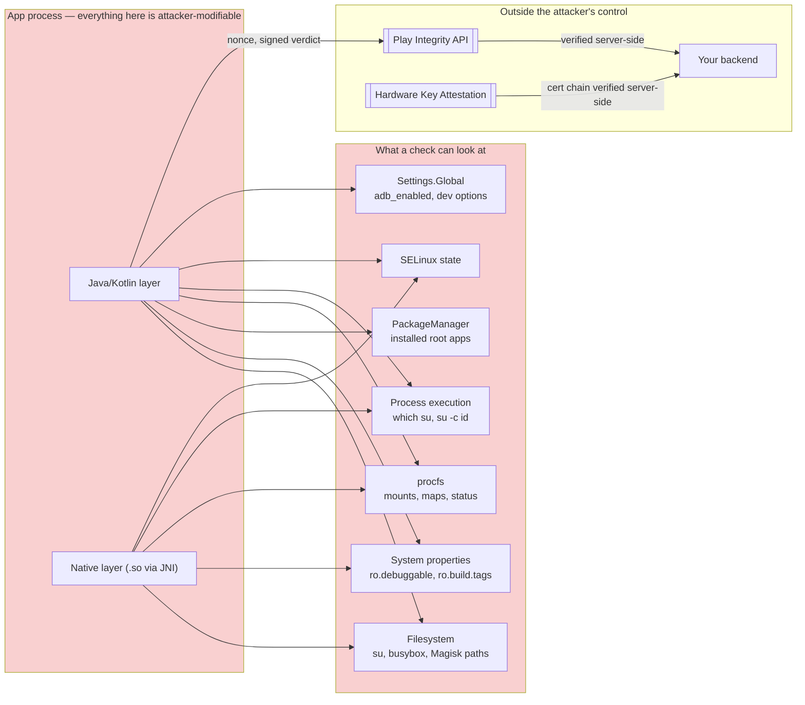

The left two boxes are painted as attacker-controlled for a reason: the app's own code *and every
answer it receives from the local system* are inside the blast radius. The only arrows that leave the
red zone and reach something trustworthy are the two attestation paths, and both of them are only
worth anything if the verdict is verified **on the server**, not parsed and trusted in the app.

### 2.3 Where a check runs, and why that decides your approach

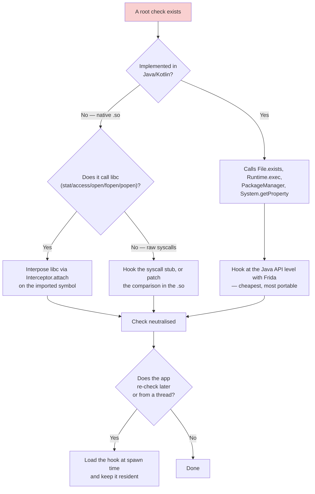

This flowchart is the strategic decision you make within the first ten minutes of every root-detection
engagement, and getting it wrong wastes hours. The single most common wasted afternoon in this area
is hooking `java.io.File.exists` for forty minutes on an app whose check is a native `access("/system/bin/su", F_OK)`
that never touches the Java layer at all. Section 3 is organised so that you can tell those apart
quickly, and section 7 gives you a tracer script that answers the question empirically instead of by
guesswork.

### 2.4 The trust boundary, drawn honestly

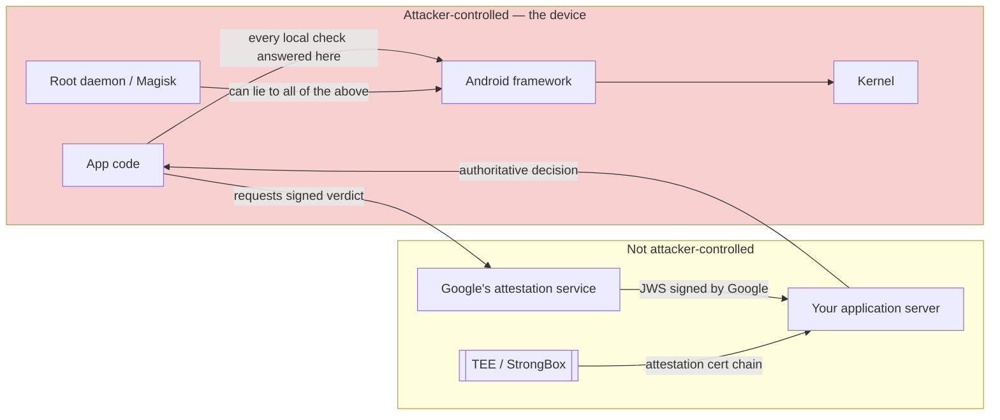

The boundary is drawn between the whole device and the outside world. That placement offends
developers when they first see it, and it is nonetheless correct. Note the last arrow: the server
sends the decision back to the app, and the app can ignore it. This is why the correct design is not
"the server tells the app to refuse the transfer" but "the server refuses the transfer". The
distinction between *informing the client of a decision* and *enforcing the decision server-side* is
the entire subject in one sentence.

---

## 3. Deep Internal Working

This section is the catalogue. Every entry follows the same shape:

1. **How it works** — the mechanism, precisely.
2. **Implementation** — code a developer would actually write, in Java and where relevant in C.
3. **How it appears** in JADX, Smali, and Ghidra.
4. **How to find it fast** — the search that locates it in seconds.
5. **Bypass** — working code.
6. **Developer's best hardening** — the strongest version of the control.
7. **What it is worth** — the honest assessment.

### 3.0 Reference: the artefact tables everything else refers to

Before the individual techniques, here are the raw lists. Every checker in the wild is some subset of
these.

**Binary paths commonly probed:**

| Path | Why it is checked |
|---|---|
| `/system/bin/su`, `/system/xbin/su` | Classic "system-modifying" root location |
| `/sbin/su`, `/sbin/.magisk/...` | Magisk's historical private mount root |
| `/su/bin/su` | SuperSU systemless mode |
| `/data/local/su`, `/data/local/bin/su`, `/data/local/xbin/su` | Old exploit drop locations |
| `/system/sd/xbin/su` | Legacy apps2sd layouts |
| `/system/bin/failsafe/su` | Legacy |
| `/vendor/bin/su`, `/product/bin/su`, `/system_ext/bin/su` | Newer partition layouts |
| `/system/xbin/busybox`, `/system/bin/busybox`, `/data/local/busybox` | BusyBox implies a modified image |
| `/system/app/Superuser.apk`, `/system/app/SuperSU/SuperSU.apk` | Pre-installed manager |
| `/system/etc/init.d/`, `/etc/init.d/` | Boot scripts; stock Android has none |
| `/dev/com.koushikdutta.superuser.daemon/` | Old Superuser daemon socket |
| `/cache/magisk.log`, `/data/adb/magisk`, `/data/adb/modules` | Magisk state |
| `/init.magisk.rc`, `/sbin/magisk`, `/sbin/magiskinit`, `/sbin/magiskpolicy` | Magisk binaries |

> **Measured — the classic `su` path probe answers differently depending on who asks, and the
> `su` it finds is not the one doing the rooting.** On `sdk_gphone16k_x86_64` (Android 15 / API 35):
>
> ```
> # adb shell (uid 2000, in group "shell")
> $ ls -ld /system/xbin ; ls -l /system/xbin/su
> drwxr-x---  2 root shell  4096 /system/xbin
> -rwsr-x---  1 root shell 51224 /system/xbin/su
>
> # the same path, from an app, same device, same minute
> $ run-as <pkg> test -e /system/xbin/su   ->  Permission denied
> ```
>
> Three lessons, and the last is the one that matters:
>
> - **A `userdebug` build ships AOSP's `su` by design.** The binary at `/system/xbin/su` rejects
>   `-c` and takes `su <uid> <cmd>` — AOSP's calling convention, which is also why this AVD needs
>   `su 0 <cmd>`. The syntax quirk and the file's presence are **one fact, not two**.
> - **That is not the `su` providing root here.** This device is *also* rooted with **Magisk 30.7**
>   — `magiskd` running as root, its binary at `/debug_ramdisk/magisk`, and Magisk's own `su` at
>   `/debug_ramdisk/su`. So the file the classic probe finds and the mechanism actually granting root
>   are **two different binaries in two different places**, and the probe finds only the harmless
>   one. `/system/bin/su` and `/sbin/su` — the other two most-probed paths — do not exist at all.
> - **`/system/xbin` is `0750 root:shell`, so an app cannot traverse it.** The classic path probe
>   returns TRUE from `adb shell` and FALSE from the app that would actually run it. **A root check
>   verified from `adb shell` has not been verified.**
>
> The combination is the worst case for a path-based detector: on this device it fires from the
> shell on a binary that grants nothing, and from the app — where it matters — it misses a device
> that genuinely *is* rooted. **Presence of `su` at a well-known path is neither necessary nor
> sufficient.** [63-LSPosed](../63-LSPosed/README.md) measured the same shape for
> `new File("/data/adb/lspd").exists()`, which returns identical results whether or not LSPosed is
> installed, because the refusal happens at `/data/adb`.
>
> This is the same vantage trap [39-EmulatorDetection](../39-EmulatorDetection/README.md) measured in
> the property namespace: **root sees ~1,062 properties, the shell ~678, an app ~638**, and the
> `ro.boottime.*` family is **111 to root and 0 to both the shell and an app**. Run every detection
> probe **as the app**, or the result describes your shell rather than the target — and be especially
> wary of a measurement taken with `adb root` in effect, which is how 39's own figures were first
> published wrong.

**Package names commonly probed:**

| Package | Product |
|---|---|
| `com.topjohnwu.magisk` | Magisk Manager (frequently renamed/hidden by users) |
| `com.noshufou.android.su`, `com.noshufou.android.su.elite` | Superuser |
| `eu.chainfire.supersu` | SuperSU |
| `com.koushikdutta.superuser` | Superuser (ClockworkMod) |
| `com.thirdparty.superuser` | Superuser fork |
| `com.yellowes.su` | Root manager |
| `com.zachspong.temprootremovejb`, `com.ramdroid.appquarantine` | Root cloaking / obscuring apps |
| `com.devadvance.rootcloak`, `com.devadvance.rootcloakplus` | Root cloaking (Xposed) |
| `de.robv.android.xposed.installer` | Xposed framework — hooking, not root per se |
| `com.saurik.substrate` | Cydia Substrate |
| `com.formyhm.hideroot`, `com.amphoras.hidemyroot` | Root hiders |
| `com.chelpus.lackypatch`, `com.dimonvideo.luckypatcher`, `com.android.vending.billing.InAppBillingService.LACK` | IAP patching |
| `com.kingroot.kinguser`, `com.kingo.root`, `com.smedialink.oneclickroot`, `com.alephzain.framaroot` | One-click rooting tools |

**System properties commonly probed:**

| Property | Stock retail value | Suspicious value | What it means |
|---|---|---|---|
| `ro.build.tags` | `release-keys` | `test-keys` | Image signed with public AOSP test keys — custom ROM |
| `ro.build.type` | `user` | `userdebug`, `eng` | Development build |
| `ro.debuggable` | `0` | `1` | `adbd` will run as root; every app is `run-as`-able |
| `ro.secure` | `1` | `0` | Historically disabled ADB security; largely vestigial now |
| `service.adb.root` | absent | `1` | `adbd` was restarted as root |
| `ro.boot.verifiedbootstate` | `green` | `orange`, `yellow`, `red` | AVB state; `orange` = bootloader unlocked |
| `ro.boot.flash.locked` | `1` | `0` | Bootloader unlocked |
| `ro.boot.veritymode` | `enforcing` | `disabled`, `logging` | dm-verity turned off |
| `ro.boot.vbmeta.device_state` | `locked` | `unlocked` | Same signal, different key |
| `ro.build.selinux` | `1` | `0` | Legacy SELinux indicator |
| `sys.oem_unlock_allowed` | `0` | `1` | OEM unlocking enabled in Developer Options |
| `ro.build.fingerprint` | vendor string | contains `lineage`, `aosp`, `generic` | Custom ROM |
| `ro.modversion`, `ro.cm.version`, `ro.lineage.version` | absent | present | LineageOS/CyanogenMod |

---

### 3.1 The `su` binary on disk

#### How it works

`su` is a setuid-root executable: a program whose file mode has the setuid bit set and whose owner is
root, so that when any user executes it, the resulting process runs with root's effective UID. Stock
Android ships no such file anywhere on the executable path. Therefore *any* `su` on the filesystem is
prima facie evidence that the device has been modified.

The check is a filesystem existence test against a hardcoded list of paths. Under the hood,
`java.io.File.exists()` performs a `stat`/`access` system call, so this is ultimately a kernel
question about a path.

> **Definition — setuid**
> A file permission bit (`04000`). When the kernel executes a file with this bit set, it sets the new
> process's effective UID to the *file owner's* UID instead of the caller's. It is the standard UNIX
> mechanism for controlled privilege elevation and is how `su`, `sudo` and `passwd` work.

#### Implementation

```java
// Java — developer side. Naive but extremely common.
public final class SuBinaryCheck {

    private static final String[] SU_PATHS = {
        "/data/local/su", "/data/local/bin/su", "/data/local/xbin/su",
        "/sbin/su", "/su/bin/su", "/system/bin/su", "/system/bin/.ext/su",
        "/system/bin/failsafe/su", "/system/sd/xbin/su", "/system/usr/we-need-root/su",
        "/system/xbin/su", "/system/xbin/busybox", "/vendor/bin/su",
        "/cache/su", "/data/su", "/dev/su"
    };

    /** Returns the first suspicious path found, or null. */
    public static String find() {
        for (String path : SU_PATHS) {
            if (new java.io.File(path).exists()) {
                return path;
            }
        }
        return null;
    }
}
```

The same check in native code, which is the version that matters:

```c
// C — JNI, compiled into libintegrity.so. This does NOT go through the Java layer at all.
#include <jni.h>
#include <unistd.h>
#include <sys/stat.h>

static const char *kSuPaths[] = {
    "/system/bin/su", "/system/xbin/su", "/sbin/su", "/su/bin/su",
    "/vendor/bin/su", "/data/local/tmp/su", "/data/local/bin/su", NULL
};

JNIEXPORT jboolean JNICALL
Java_com_example_integrity_NativeCheck_suOnDisk(JNIEnv *env, jclass clazz) {
    struct stat st;
    for (int i = 0; kSuPaths[i] != NULL; i++) {
        /* access() answers "can I reach this path", stat() answers "what is it".
           Using both makes a single-function hook insufficient. */
        if (access(kSuPaths[i], F_OK) == 0) return JNI_TRUE;
        if (stat(kSuPaths[i], &st) == 0)     return JNI_TRUE;
    }
    return JNI_FALSE;
}
```

> **Under the Hood**
> `access()` and `stat()` are different system calls (`faccessat` and `newfstatat` on modern arm64
> bionic) that both ultimately resolve the path through the kernel's VFS layer. A Java-level hook on
> `File.exists()` intercepts *neither*, because the native code never enters the ART runtime. This is
> the single most important structural fact in this chapter, and it is why section 7 ships a libc
> hook as well as a Java hook.

#### How it appears in JADX / Smali / Ghidra

In JADX, an unobfuscated version is unmistakable — a `String[]` of paths and a loop. Even after
ProGuard/R8 renaming ([41-ProGuard](../41-ProGuard/README.md),
[42-R8](../42-R8/README.md)), **the string literals survive**, because renaming does not touch string
constants:

```java
// JADX output after R8 — class and method names are gone, the strings are not.
public final class a {
    private static final String[] a = {"/system/bin/su", "/system/xbin/su", "/sbin/su", ...};
    public static boolean a() {
        for (String str : a) {
            if (new File(str).exists()) return true;
        }
        return false;
    }
}
```

In Smali the array initialisation is a `fill-array-data` block or a sequence of `const-string` /
`aput-object` pairs, and the test itself is a virtual call:

```smali
# smali — the recognisable core
    new-instance v2, Ljava/io/File;
    invoke-direct {v2, v1}, Ljava/io/File;-><init>(Ljava/lang/String;)V
    invoke-virtual {v2}, Ljava/io/File;->exists()Z
    move-result v3
    if-eqz v3, :cond_next
    const/4 v0, 0x1
```

In Ghidra, the native version shows a string table in `.rodata` and calls to imported `access` /
`stat` (often `__xstat`/`fstatat64` depending on the NDK and API level). The decompiler typically
renders it as a `for` loop over a pointer array with a call to `access` and a comparison against 0.
Look at the **imports table** first (`Symbol Tree → Imports`): the presence of `access`, `stat`,
`__xstat`, `fopen`, `popen`, `system` in a library that otherwise has no reason to touch the
filesystem is itself the finding.

#### How to find it fast

```bash
# host — strings in the DEX (works even after R8 renaming)
jadx -d out app.apk >/dev/null 2>&1
grep -rn "/system/xbin/su\|/system/bin/su\|/sbin/su" out/sources/ | head -50

# host — strings in every native library, without unpacking by hand
unzip -o app.apk 'lib/*' -d libs/
for f in $(find libs -name '*.so'); do
  echo "== $f"
  strings -a "$f" | grep -E '(^|/)su$|/su/bin|magisk|supersu|busybox|test-keys' 
done
```

#### Bypass

Java level:

```javascript
// frida — neutralise File.exists() for root-related paths only.
// Blanket-returning false breaks the app; be surgical.
Java.perform(function () {
    var File = Java.use("java.io.File");
    var BAD = /su$|busybox|magisk|supersu|superuser|\/sbin\/|init\.d|\.magisk/i;

    File.exists.implementation = function () {
        var p = this.getAbsolutePath();
        if (BAD.test(p)) {
            console.log("[hide] File.exists(" + p + ") -> false");
            return false;
        }
        return this.exists();
    };
});
```

Native level — see [`scripts/native-root-bypass.js`](scripts/native-root-bypass.js) for the complete
version; the core is:

```javascript
// frida — intercept libc access() so native checks see ENOENT.
var accessPtr = Module.getExportByName("libc.so", "access");
Interceptor.attach(accessPtr, {
    onEnter: function (args) {
        this.path = args[0].readUtf8String();
        this.hide = /su$|magisk|busybox|superuser/i.test(this.path || "");
    },
    onLeave: function (retval) {
        if (this.hide) {
            console.log("[hide] access(" + this.path + ") -> -1");
            retval.replace(ptr(-1));
        }
    }
});
```

The most reliable, tool-free bypass is not a hook at all: **make the statement true**. Magisk's
DenyList (or, better, the mount-namespace isolation Magisk performs for denied apps) removes the
`su` bind-mount from the target process's own view of the filesystem, so the check honestly finds
nothing. See section 3.14.

#### Developer's best hardening

Do the check in native code, using more than one syscall, on strings that are assembled at runtime
rather than stored as literals (so `strings` does not find them), and — critically — do not act on
the result locally. Report it as one signal among many to your server, alongside a Play Integrity
token, and let the server decide. Also probe *unlikely* paths that a lazy bypass script's regex will
not match: a hook keyed on the substring `su` will happily let `/data/adb/modules` through.

#### What it is worth

**Low.** It is the first check every bypass script in existence handles. Its only genuine value is
raising the floor: it catches a device with an old, sloppy root install and it costs almost nothing.
Treat a positive as one weak signal, never as an authorisation decision.

---

### 3.2 `su` on `PATH`, and `which su`

#### How it works

Rather than hardcoding paths, the check reads the `PATH` environment variable and tests each
directory for a `su` entry — or shells out to `which su`, which does exactly that in a subprocess.

#### Implementation

```java
// Java — PATH-walking variant.
public static boolean suOnPath() {
    String path = System.getenv("PATH");
    if (path == null) return false;
    for (String dir : path.split(":")) {
        if (new java.io.File(dir, "su").exists()) return true;
    }
    return false;
}

// Java — subprocess variant.
public static boolean whichSu() {
    Process p = null;
    try {
        p = Runtime.getRuntime().exec(new String[]{"/system/xbin/which", "su"});
        java.io.BufferedReader r = new java.io.BufferedReader(
                new java.io.InputStreamReader(p.getInputStream()));
        return r.readLine() != null;
    } catch (Throwable t) {
        return false;
    } finally {
        if (p != null) p.destroy();
    }
}
```

> **Warning — a real developer bug**
> The `whichSu()` above hardcodes `/system/xbin/which`, which does not exist on many modern devices
> (toybox lives in `/system/bin`). The `exec` throws `IOException`, the `catch` returns `false`, and
> the check silently never fires. This exact bug ships in production apps. When you are testing, a
> check that never runs is not a check you need to bypass — but it *is* a finding worth reporting,
> because the developer believes they have a control they do not have.

#### How it appears

The `Runtime.getRuntime().exec(...)` call is one of the loudest signals in any DEX. In Smali:

```smali
# smali
    invoke-static {}, Ljava/lang/Runtime;->getRuntime()Ljava/lang/Runtime;
    move-result-object v0
    const-string v1, "which"
    ...
    invoke-virtual {v0, v1}, Ljava/lang/Runtime;->exec([Ljava/lang/String;)Ljava/lang/Process;
```

In native code the equivalents are `popen("which su", "r")` or `system("su -c id")`, both visible in
the import table.

#### How to find it fast

```bash
# host
grep -rn "getRuntime()\.exec\|ProcessBuilder\|System.getenv(\"PATH\")" out/sources/ | head
grep -rn "\"which\"\|which su" out/sources/
```

#### Bypass

```javascript
// frida — kill both Runtime.exec and ProcessBuilder for root-flavoured commands.
Java.perform(function () {
    var Runtime = Java.use("java.lang.Runtime");
    var IOException = Java.use("java.io.IOException");
    var SUSPECT = /(^|\/|\s)su(\s|$)|which\s+su|magisk|busybox|mount|getprop|id$/i;

    // exec has many overloads; enumerate them rather than guessing.
    Runtime.exec.overloads.forEach(function (ov) {
        ov.implementation = function () {
            var joined = "";
            for (var i = 0; i < arguments.length; i++) {
                var a = arguments[i];
                if (a === null || a === undefined) continue;
                joined += (a.$className === "[Ljava.lang.String;" || Array.isArray(a))
                        ? Array.prototype.join.call(a, " ") : a.toString();
                joined += " ";
            }
            if (SUSPECT.test(joined)) {
                console.log("[hide] Runtime.exec(" + joined.trim() + ") -> IOException");
                throw IOException.$new("No such file or directory");
            }
            return ov.apply(this, arguments);
        };
    });

    var PB = Java.use("java.lang.ProcessBuilder");
    PB.start.implementation = function () {
        var cmd = this.command().toString();
        if (SUSPECT.test(cmd)) {
            console.log("[hide] ProcessBuilder.start(" + cmd + ") -> IOException");
            throw IOException.$new("No such file or directory");
        }
        return this.start();
    };
});
```

> **Pentester's Note**
> Throwing `IOException` is usually more faithful than returning a fake empty `Process`, because that
> is exactly what the framework does when the binary is absent, and defensive code paths are already
> written to handle it. Returning `null` will crash apps that immediately call `getInputStream()`.

#### Developer's best hardening

Do not shell out at all. Spawning a process from an app is expensive, noisy in logcat, trivially
hooked, and on modern Android increasingly restricted by SELinux. If you want this signal, use
`access()` in native code over a runtime-constructed path list.

#### What it is worth

**Very low.** Additionally it is one of the checks most likely to be *broken* in production, per the
warning above.

---

### 3.3 Executing `su` and looking at the result

#### How it works

Instead of asking whether the file exists, the app tries to *use* it: `su -c id` and then parse for
`uid=0`. On a rooted device with a root manager installed, this triggers a user-visible root-grant
prompt, which is itself the signal — even a denial proves a root broker exists.

#### Implementation

```java
// Java — the "actually try it" check.
public static boolean canExecuteSu() {
    Process process = null;
    try {
        process = Runtime.getRuntime().exec(new String[]{"su", "-c", "id"});
        java.io.BufferedReader in = new java.io.BufferedReader(
                new java.io.InputStreamReader(process.getInputStream()));
        String line = in.readLine();
        return line != null && line.contains("uid=0");
    } catch (Exception e) {
        return false;   // "su" not found -> not rooted (as far as this check knows)
    } finally {
        if (process != null) process.destroy();
    }
}
```

> **Warning — for developers**
> This check has a serious usability cost. On a legitimately rooted developer device it pops a root
> prompt, and on some root implementations a *pending* prompt blocks `readLine()` for as long as the
> user ignores it. Apps have shipped ANRs (Application Not Responding) caused by running this on the
> main thread. If you must do it, do it off the main thread with a timeout.

#### Bypass

Covered by the `Runtime.exec` hook in 3.2. The native equivalents need their own treatment:

```javascript
// frida — block popen()/system() invocations that smell like root probing.
["popen", "system"].forEach(function (name) {
    var p = Module.findExportByName("libc.so", name);
    if (!p) return;
    Interceptor.attach(p, {
        onEnter: function (args) {
            var cmd = args[0].readUtf8String();
            this.block = /su\b|magisk|which|mount|getprop|busybox/i.test(cmd || "");
            if (this.block) console.log("[hide] " + name + "(" + cmd + ") blocked");
        },
        onLeave: function (retval) {
            if (this.block) retval.replace(name === "popen" ? ptr(0) : ptr(-1));
        }
    });
});
```

#### What it is worth

**Low, but noisier than 3.1.** Its one advantage is that it detects a root manager that hides the
binary path but still answers requests. Its cost in user experience is real.

---

### 3.4 Root manager packages via `PackageManager`

#### How it works

The app asks `PackageManagerService` whether specific packages are installed, using
`getPackageInfo(name, 0)` and treating the absence of `NameNotFoundException` as "installed", or by
enumerating `getInstalledPackages()` / `getInstalledApplications()` and matching against a list.

#### Version Matrix — package visibility

| API level | Behaviour |
|---|---|
| ≤ 29 (Android 10) | Any app can enumerate all installed packages, and `getPackageInfo` on any package succeeds |
| ≥ 30 (Android 11) | **Package visibility filtering.** An app targeting API 30+ sees only packages it declares in `<queries>`, plus a small always-visible set. `getPackageInfo` on an invisible package throws `NameNotFoundException` even though it is installed |

This matters enormously. An app targeting API 30+ that checks for `com.topjohnwu.magisk` **without a
`<queries>` entry will always get "not installed"** — the check is dead code. Conversely, an app that
declares a long `<queries>` list of root-manager package names has told you, in its manifest, exactly
what it looks for. That is a free intelligence gift during static analysis.

#### Implementation

```java
// Java — the two idioms.
public static boolean rootAppInstalled(android.content.Context ctx, String[] packages) {
    android.content.pm.PackageManager pm = ctx.getPackageManager();
    for (String p : packages) {
        try {
            pm.getPackageInfo(p, 0);
            return true;                       // no exception => present and visible
        } catch (android.content.pm.PackageManager.NameNotFoundException ignored) { }
    }
    return false;
}

public static boolean rootAppInstalledByEnumeration(android.content.Context ctx, java.util.Set<String> bad) {
    for (android.content.pm.ApplicationInfo ai :
            ctx.getPackageManager().getInstalledApplications(0)) {
        if (bad.contains(ai.packageName)) return true;
    }
    return false;
}
```

```xml
<!-- AndroidManifest.xml — required from API 30 for the first idiom to work at all -->
<queries>
    <package android:name="com.topjohnwu.magisk" />
    <package android:name="eu.chainfire.supersu" />
    <package android:name="com.noshufou.android.su" />
</queries>
```

#### How to find it fast

```bash
# host — the manifest tells you the target list outright
apktool d -f app.apk -o out_apk >/dev/null
grep -A2 -B2 "<queries>" -r out_apk/AndroidManifest.xml
# and in code
grep -rn "getInstalledPackages\|getInstalledApplications\|getPackageInfo(" out/sources/ | head -30
```

#### Bypass

```javascript
// frida — lie to PackageManager. Handles both idioms.
Java.perform(function () {
    var BAD = [
        "com.topjohnwu.magisk", "com.topjohnwu.magisk.debug",
        "eu.chainfire.supersu", "com.noshufou.android.su",
        "com.koushikdutta.superuser", "com.thirdparty.superuser",
        "com.yellowes.su", "com.devadvance.rootcloak", "com.devadvance.rootcloakplus",
        "de.robv.android.xposed.installer", "com.saurik.substrate",
        "com.dimonvideo.luckypatcher", "com.chelpus.lackypatch",
        "com.ramdroid.appquarantine", "com.kingroot.kinguser", "com.kingo.root"
    ];
    var isBad = function (n) { return n && BAD.indexOf(n.toString()) !== -1; };

    var PM = Java.use("android.app.ApplicationPackageManager");
    var NNFE = Java.use("android.content.pm.PackageManager$NameNotFoundException");

    PM.getPackageInfo.overloads.forEach(function (ov) {
        ov.implementation = function (name) {
            if (isBad(name)) {
                console.log("[hide] getPackageInfo(" + name + ") -> NameNotFoundException");
                throw NNFE.$new(name.toString());
            }
            return ov.apply(this, arguments);
        };
    });

    PM.getApplicationInfo.overloads.forEach(function (ov) {
        ov.implementation = function (name) {
            if (isBad(name)) throw NNFE.$new(name.toString());
            return ov.apply(this, arguments);
        };
    });

    // Filter enumeration results. The returned object is a ParceledListSlice-backed List.
    ["getInstalledPackages", "getInstalledApplications"].forEach(function (m) {
        PM[m].overloads.forEach(function (ov) {
            ov.implementation = function () {
                var list = ov.apply(this, arguments);
                var ArrayList = Java.use("java.util.ArrayList");
                var out = ArrayList.$new();
                var it = list.iterator();
                var removed = 0;
                while (it.hasNext()) {
                    var item = it.next();
                    var pkg = item.packageName ? item.packageName.value
                            : item.applicationInfo.value.packageName.value;
                    if (isBad(pkg)) { removed++; continue; }
                    out.add(item);
                }
                if (removed) console.log("[hide] " + m + " filtered " + removed + " package(s)");
                return out;
            };
        });
    });
});
```

> **Under the Hood**
> Hooking `android.content.pm.PackageManager` (the abstract class) does nothing. The concrete
> implementation an app receives from `Context.getPackageManager()` is
> `android.app.ApplicationPackageManager`, which marshals a Binder call to `PackageManagerService` in
> `system_server`. Hook the concrete class. This "hooked the abstract class and nothing happened"
> mistake wastes more beginner hours than any other in Frida work.

#### Developer's best hardening

Use `<queries>` correctly so the check actually functions, and understand that you are checking for a
package name a user can trivially change: Magisk's app supports **stub/repackaging**, which installs
the manager under a random package name with a random label specifically to defeat this.

#### What it is worth

**Very low, and falling.** Package visibility rules broke many of these checks silently, Magisk
repackaging defeats the rest, and a user can have root without any manager app installed.

---

### 3.5 Magisk-specific artefacts

#### How it works

Magisk is the dominant root solution, so checks have specialised for it. The artefacts fall into
several groups:

| Artefact | Detail | Still present on current Magisk? |
|---|---|---|
| `/sbin/magisk`, `/sbin/magiskinit`, `/sbin/magiskpolicy`, `/sbin/su` | Older Magisk mounted its tools in `/sbin` | No — modern Magisk uses a randomly named tmpfs directory under `/debug_ramdisk` or similar |
| `/sbin/.magisk/`, `/sbin/.core/` | Magisk private mount root | Renamed/randomised |
| `/data/adb/magisk/`, `/data/adb/modules/`, `/data/adb/magisk.db` | Persistent Magisk state | Yes — but `/data/adb` is `0700 root:root`, so an app UID cannot even `stat` inside it |
| `/cache/.disable_magisk`, `/cache/magisk.log` | Legacy | Mostly gone |
| `init.magisk.rc` in the root directory | Legacy | Gone |
| A tmpfs mount not present on a stock device, visible in `/proc/self/mounts` | The systemless overlay | Yes — this is the durable one, see 3.8 |
| The `magisk` unix domain socket in the abstract namespace | Magisk's daemon socket, visible in `/proc/net/unix` | Randomised in modern versions |
| Property `init.svc.magiskd` | Service state | Hidden by MagiskHide historically; DenyList now |

#### Implementation

```java
// Java — Magisk artefact sweep.
private static final String[] MAGISK_PATHS = {
    "/sbin/magisk", "/sbin/magiskinit", "/sbin/magiskpolicy", "/sbin/.magisk",
    "/sbin/.core", "/data/adb/magisk", "/data/adb/modules", "/data/adb/magisk.db",
    "/cache/magisk.log", "/init.magisk.rc", "/system/addon.d/99-magisk.sh"
};
```

```c
/* C — reading /proc/net/unix for a magisk socket. Historically effective. */
static int magisk_socket_present(void) {
    FILE *f = fopen("/proc/net/unix", "r");
    if (!f) return 0;
    char line[512];
    int found = 0;
    while (fgets(line, sizeof line, f)) {
        if (strstr(line, "magisk")) { found = 1; break; }
    }
    fclose(f);
    return found;
}
```

> **Pentester's Note**
> `/proc/net/unix` was for years the highest-value Magisk detection, because the daemon socket name
> was a fixed string. Modern Magisk randomises it per boot. When you meet a native check that opens
> `/proc/net/unix` you are almost certainly looking at code written against an older Magisk, and it
> may already be failing on the version you are testing. Confirm before you spend time bypassing it.

#### Bypass

`/data/adb` is mode `0700` owned by root, so on a *correctly configured* device an unprivileged app
gets `EACCES` from `stat()` regardless — which many checkers incorrectly treat as "not present".
For the rest, the file-hiding hooks of 3.1 plus the `fopen` hook below cover it:

```javascript
// frida — make fopen() on procfs/Magisk paths fail, and sanitise the ones we must allow.
var fopenPtr = Module.getExportByName("libc.so", "fopen");
Interceptor.attach(fopenPtr, {
    onEnter: function (args) {
        this.path = args[0].readUtf8String();
        this.deny = /magisk|\/data\/adb|\/proc\/net\/unix/.test(this.path || "");
    },
    onLeave: function (retval) {
        if (this.deny) {
            console.log("[hide] fopen(" + this.path + ") -> NULL");
            retval.replace(ptr(0));
        }
    }
});
```

For a durable, tool-free result, use Magisk's **DenyList** with Zygisk enabled (section 3.14).

#### Developer's best hardening

Do not chase paths. The durable Magisk signal is structural — an unexpected overlay in the mount
table, or an unexpected private mount namespace — not a filename. And even that is defeated by
Zygisk's isolated namespace. This is precisely where a developer should stop investing and move the
budget to Play Integrity.

#### What it is worth

**Low against a current Magisk, moderate against a stale one.** The value decays every release. Any
detection written against a specific Magisk internal has a shelf life measured in months.

---

### 3.6 Filesystem writability tests

#### How it works

On a stock device, `/system`, `/vendor`, `/product` and `/` are mounted read-only and are protected
by dm-verity. If the app can create a file in one of them — or even merely observes that the mount
flags say `rw` — the device has been modified. This is a *behavioural* test rather than a
*name-based* one, which makes it slightly more interesting than 3.1.

#### Implementation

```java
// Java — writability probe.
public static boolean systemIsWritable() {
    String[] dirs = {"/system", "/system/bin", "/system/sbin", "/system/xbin",
                     "/vendor/bin", "/sbin", "/etc", "/proc", "/"};
    for (String d : dirs) {
        java.io.File f = new java.io.File(d);
        if (f.exists() && f.canWrite()) return true;
    }
    return false;
}
```

```java
// Java — mount-flag parsing variant, more reliable than canWrite().
public static boolean systemMountedRw() throws java.io.IOException {
    java.io.BufferedReader r = new java.io.BufferedReader(
            new java.io.FileReader("/proc/mounts"));
    String line;
    while ((line = r.readLine()) != null) {
        String[] parts = line.split(" ");
        if (parts.length < 4) continue;
        String mountPoint = parts[1], options = parts[3];
        if (("/system".equals(mountPoint) || "/vendor".equals(mountPoint) || "/".equals(mountPoint))
                && options.startsWith("rw")) {
            return true;
        }
    }
    r.close();
    return true;
}
```

> **Warning — a subtle bug in the wild**
> `File.canWrite()` on `/system` returns the result of an `access(path, W_OK)` call. As UID 0 this
> returns success even when the filesystem is read-only, because DAC is checked before the mount
> flags. Conversely, some devices legitimately mount `/proc` `rw`. Both directions produce false
> results. The mount-flag parse is the correct implementation, and the `canWrite` version is the one
> you will meet more often.

#### Bypass

```javascript
// frida — canWrite() lies, and /proc/mounts gets sanitised (see 3.8).
Java.perform(function () {
    var File = Java.use("java.io.File");
    File.canWrite.implementation = function () {
        var p = this.getAbsolutePath();
        if (/^\/(system|vendor|product|sbin|etc|system_ext)($|\/)|^\/$/.test(p)) {
            console.log("[hide] File.canWrite(" + p + ") -> false");
            return false;
        }
        return this.canWrite();
    };
});
```

#### Developer's best hardening

Parse `/proc/mounts` properly, in native code, and look for the *shape* of a Magisk overlay rather
than the `rw` flag alone. Combine with `ro.boot.veritymode`. Understand that a systemless root leaves
`/system` genuinely read-only, so this check misses the most common modern setup entirely.

#### What it is worth

**Low.** It detects the 2014-era rooting model — modifying `/system` — which almost nobody uses now.

---

### 3.7 System property checks

#### How it works

Android's property system is a shared-memory key/value store, readable by any process, populated by
`init` from the build's `prop` files and by `setprop` at runtime. See section 4.2 for the internals.
Several properties directly encode "this is not a production build" or "verified boot failed".

The Java surface is `System.getProperty` (which does **not** read Android properties — a common
confusion), `android.os.SystemProperties` (a hidden framework class, reached via reflection), or
`Runtime.exec("getprop")`. The native surface is `__system_property_get` from bionic.

> **Warning — two different "properties"**
> `java.lang.System.getProperty("os.version")` reads the **JVM system properties** table, which is a
> different thing from Android's build properties. `android.os.SystemProperties.get("ro.build.tags")`
> reads the Android property store. Apps that use the former to look for `ro.build.tags` get `null`
> and silently never fire. When you see `System.getProperty` in a root check, read the key carefully
> before assuming it works.

#### Implementation

```java
// Java — reflection into the hidden SystemProperties class.
public static String getProp(String key) {
    try {
        Class<?> sp = Class.forName("android.os.SystemProperties");
        java.lang.reflect.Method get = sp.getMethod("get", String.class, String.class);
        return (String) get.invoke(null, key, "");
    } catch (Throwable t) {
        return "";
    }
}

public static boolean buildIsSuspicious() {
    String tags = android.os.Build.TAGS;                 // public, no reflection needed
    if (tags != null && tags.contains("test-keys")) return true;
    if ("1".equals(getProp("ro.debuggable"))) return true;
    if ("0".equals(getProp("ro.secure"))) return true;
    if (!"user".equals(getProp("ro.build.type"))) return true;
    String vbs = getProp("ro.boot.verifiedbootstate");
    if (vbs != null && !vbs.isEmpty() && !"green".equals(vbs)) return true;
    if ("0".equals(getProp("ro.boot.flash.locked"))) return true;
    return false;
}
```

```c
/* C — the native read, which bypasses every Java hook. */
#include <sys/system_properties.h>

static int prop_suspicious(void) {
    char value[PROP_VALUE_MAX] = {0};

    if (__system_property_get("ro.build.tags", value) > 0 && strstr(value, "test-keys"))
        return 1;
    if (__system_property_get("ro.debuggable", value) > 0 && value[0] == '1')
        return 1;
    if (__system_property_get("ro.boot.verifiedbootstate", value) > 0 && strcmp(value, "green") != 0)
        return 1;
    if (__system_property_get("ro.boot.flash.locked", value) > 0 && value[0] == '0')
        return 1;
    return 0;
}
```

> **Under the Hood — why `ro.boot.verifiedbootstate` is the interesting one**
> `ro.boot.*` properties are set by the bootloader and passed to the kernel on the command line
> (`/proc/cmdline`), then imported by `init`. `verifiedbootstate=orange` means the bootloader is
> unlocked and the boot image is unverified. That value originates *outside Android*, before any of
> the attacker's user-space code exists. It is therefore the single most trustworthy local signal in
> this whole chapter — which is a low bar, because an attacker with root can still `setprop` over it
> and can also edit `/proc/cmdline`'s visible content through a hook. But it correlates almost
> perfectly with the honest state of the device, and it is the same fact the TEE reports to Play
> Integrity.

#### How it appears

In JADX, look for `Build.TAGS`, `Class.forName("android.os.SystemProperties")`, and the string
`test-keys`. In Ghidra, look for imports of `__system_property_get` and `.rodata` strings beginning
`ro.`.

#### How to find it fast

```bash
# host
grep -rn "test-keys\|ro\.debuggable\|ro\.secure\|verifiedbootstate\|SystemProperties" out/sources/ | head -40
for f in $(find libs -name '*.so'); do strings -a "$f" | grep -E '^ro\.|test-keys|__system_property'; done
```

#### Bypass

```javascript
// frida — cover all three property surfaces.
Java.perform(function () {
    var SAFE = {
        "ro.build.tags": "release-keys",
        "ro.build.type": "user",
        "ro.debuggable": "0",
        "ro.secure": "1",
        "ro.boot.verifiedbootstate": "green",
        "ro.boot.flash.locked": "1",
        "ro.boot.veritymode": "enforcing",
        "ro.boot.vbmeta.device_state": "locked",
        "sys.oem_unlock_allowed": "0",
        "service.adb.root": ""
    };

    // 1) android.os.Build static fields.
    var Build = Java.use("android.os.Build");
    Build.TAGS.value = "release-keys";
    Build.FINGERPRINT.value = Build.FINGERPRINT.value.replace("test-keys", "release-keys");

    // 2) The hidden SystemProperties class.
    var SP = Java.use("android.os.SystemProperties");
    SP.get.overload("java.lang.String").implementation = function (k) {
        if (k in SAFE) { console.log("[spoof] " + k + " -> " + SAFE[k]); return SAFE[k]; }
        return this.get(k);
    };
    SP.get.overload("java.lang.String", "java.lang.String").implementation = function (k, d) {
        if (k in SAFE) { console.log("[spoof] " + k + " -> " + SAFE[k]); return SAFE[k]; }
        return this.get(k, d);
    };

    // 3) Native reads.
    var pget = Module.findExportByName("libc.so", "__system_property_get");
    if (pget) {
        Interceptor.attach(pget, {
            onEnter: function (args) {
                this.key = args[0].readUtf8String();
                this.out = args[1];
            },
            onLeave: function (retval) {
                if (this.key in SAFE) {
                    var v = SAFE[this.key];
                    this.out.writeUtf8String(v);
                    console.log("[spoof native] " + this.key + " -> " + v);
                    retval.replace(ptr(v.length));
                }
            }
        });
    }
});
```

> **Warning**
> Modern bionic frequently resolves properties through `__system_property_find` +
> `__system_property_read_callback` rather than `__system_property_get`. If your spoof appears to do
> nothing, trace both. `frida-trace -U -i "__system_property*" -f com.target` answers this in one
> command.

#### Developer's best hardening

Read the properties natively, read `ro.boot.verifiedbootstate` specifically, and **send the value to
your server** rather than acting on it. A server that sees `verifiedbootstate=green` in the same
request as a Play Integrity token that says `MEETS_BASIC_INTEGRITY` only has caught a liar, and that
inconsistency is a far stronger signal than either value alone.

#### What it is worth

**Moderate — the highest of the purely local checks.** `verifiedbootstate` is genuinely informative
and its provenance is outside Android. It is still spoofable locally; its value is as corroborating
evidence sent to a server, not as a local gate.

---

### 3.8 `/proc/self/mounts` and `/proc/mounts`

#### How it works

`/proc/<pid>/mounts` (and the symlink `/proc/mounts`) lists the mount table **as seen by that
process's mount namespace**. Magisk works by manipulating mount namespaces, so what appears here is
one of the more structural signals available.

Suspicious patterns:

| Pattern | Meaning |
|---|---|
| `/system` or `/` with `rw` | Classic system-modifying root |
| A `tmpfs` mounted at `/sbin`, `/system/bin`, `/system/xbin`, or a random `/debug_ramdisk` path | Magisk's tool overlay |
| `overlay` / `overlayfs` on system partitions | Magisk modules, or a `userdebug` build's `adb remount` |
| Mount source `/dev/block/loop*` on `/system/...` paths | Magisk module images |
| An unusually large number of bind mounts under `/system` | Module file replacements |
| `/data/adb` appearing at all | Magisk state directory |

#### Implementation

```java
// Java — mount table analysis.
public static boolean suspiciousMounts() {
    try (java.io.BufferedReader r = new java.io.BufferedReader(
            new java.io.FileReader("/proc/self/mounts"))) {
        String line;
        while ((line = r.readLine()) != null) {
            if (line.contains("magisk")) return true;
            if (line.contains("/data/adb")) return true;
            String[] p = line.split(" ");
            if (p.length < 4) continue;
            String src = p[0], dst = p[1], type = p[2], opts = p[3];
            if ("tmpfs".equals(type) &&
                (dst.startsWith("/sbin") || dst.startsWith("/system/") || dst.equals("/system")))
                return true;
            if (("overlay".equals(type) || "overlayfs".equals(type)) && dst.startsWith("/system"))
                return true;
            if ((dst.equals("/system") || dst.equals("/")) && opts.startsWith("rw"))
                return true;
        }
    } catch (Exception ignored) { }
    return false;
}
```

#### Bypass

There are two levels. The blunt one filters the file content:

```javascript
// frida — return a sanitised /proc/self/mounts by redirecting opens to a scrubbed copy.
// Strategy: intercept open()/fopen() on the mounts paths and substitute a clean file we wrote first.
// Prepare the clean file on the device beforehand:
//   adb shell "grep -v -E 'magisk|/data/adb|tmpfs /sbin|overlay /system' /proc/self/mounts > /data/local/tmp/mounts.clean"
var CLEAN = "/data/local/tmp/mounts.clean";
var TARGETS = ["/proc/self/mounts", "/proc/mounts", "/proc/self/mountinfo"];

["open", "openat", "fopen"].forEach(function (fn) {
    var p = Module.findExportByName("libc.so", fn);
    if (!p) return;
    Interceptor.attach(p, {
        onEnter: function (args) {
            var idx = (fn === "openat") ? 1 : 0;
            var path = args[idx].readUtf8String();
            if (path && TARGETS.indexOf(path) !== -1) {
                console.log("[redirect] " + fn + "(" + path + ") -> " + CLEAN);
                args[idx].writeUtf8String(CLEAN);   // only safe if CLEAN is not longer
            }
        }
    });
});
```

> **Warning**
> Writing over the argument buffer in place is only safe if the replacement string is no longer than
> the original, and only if the buffer is writable. `/data/local/tmp/mounts.clean` (26 chars) is
> shorter than `/proc/self/mountinfo` — no it is not. Count your characters, or allocate a new buffer
> with `Memory.allocUtf8String()` and replace the pointer instead. The version in
> [`scripts/native-root-bypass.js`](scripts/native-root-bypass.js) does it the safe way.

The Java side needs its own treatment because `FileReader` goes through `open()` in libcore's native
layer, so the libc hook *does* catch it — but `BufferedReader.readLine()` filtering is easier to
reason about:

```javascript
// frida — filter lines as they are read, regardless of which file it is.
Java.perform(function () {
    var BR = Java.use("java.io.BufferedReader");
    var BAD = /magisk|\/data\/adb|tmpfs\s+\/sbin|overlay\s+\/system|\bsu\b/i;
    BR.readLine.overload().implementation = function () {
        var line = this.readLine();
        while (line !== null && BAD.test(line.toString())) {
            console.log("[hide] dropped mount line: " + line);
            line = this.readLine();
        }
        return line;
    };
});
```

> **Pentester's Note**
> The `BufferedReader.readLine` hook above is broad — it affects *every* line-oriented read in the
> app, including legitimate ones. It is superb for a five-minute triage and dangerous for a long
> session because it can corrupt an app's own data parsing. Narrow it once you know which file the
> check reads.

The clean solution is again Magisk DenyList, which gives the target process a mount namespace with
none of the module mounts in it.

#### Developer's best hardening

Compare the mount table against an expected profile for the device's fingerprint, in native code, and
report anomalies to the server rather than deciding locally. Look at `/proc/self/mountinfo` too,
which exposes mount IDs, parent IDs and the peer group — richer structure and less commonly
sanitised by bypass scripts.

#### What it is worth

**Moderate against a naive root, low against Zygisk DenyList.** It is one of the better ideas in the
catalogue and Magisk specifically engineered around it.

---

### 3.9 `/proc/self/maps` — injected libraries

#### How it works

`/proc/<pid>/maps` lists every memory mapping in a process, including the file backing each one. If a
hooking framework has injected a library, its path appears here. This overlaps heavily with anti-Frida
work, which is [38-TamperDetection](../38-TamperDetection/README.md)'s territory, but root-detection
libraries routinely scan for it too because Xposed/LSPosed and Magisk modules are root-dependent.

Strings looked for: `frida`, `gum-js-loop`, `gadget`, `xposed`, `substrate`, `magisk`, `zygisk`,
`riru`, `libmemtrack_real` (a Riru artefact), `lsposed`.

#### Implementation

```c
/* C — the standard maps scan. */
static int maps_has_injection(void) {
    FILE *f = fopen("/proc/self/maps", "r");
    if (!f) return 0;
    char line[1024];
    static const char *needles[] = {
        "frida", "gum-js-loop", "gadget", "libriru", "zygisk",
        "xposed", "substrate", "magisk", "lsposed", NULL
    };
    while (fgets(line, sizeof line, f)) {
        for (int i = 0; needles[i]; i++) {
            if (strstr(line, needles[i])) { fclose(f); return 1; }
        }
    }
    fclose(f);
    return 0;
}
```

#### Bypass

Covered in depth in [38-TamperDetection](../38-TamperDetection/README.md) section on anti-Frida. In
summary: filter the file at the read layer, run Frida in a mode that does not leave a named mapping
(`frida-gadget` renamed, or an in-memory injection), and rename the Frida threads.

#### What it is worth

**Moderate as an anti-hooking signal, weak as a root signal.** A rooted device with no hooks loaded
produces nothing here.

---

### 3.10 SELinux state

#### How it works

SELinux (Security-Enhanced Linux) provides mandatory access control on top of UNIX permissions.
Android has required it in **enforcing** mode for all processes since Android 5.0. A device with
SELinux permissive is either a development build or has been deliberately weakened — historically a
step in many rooting procedures.

The state is readable from `/sys/fs/selinux/enforce` (`1` = enforcing) and the policy version from
`/sys/fs/selinux/policyvers`. `getenforce` is the shell command.

#### Implementation

```java
// Java — read the sysfs node directly.
public static boolean selinuxPermissive() {
    try (java.io.FileInputStream in = new java.io.FileInputStream("/sys/fs/selinux/enforce")) {
        int c = in.read();
        return c == '0';
    } catch (Exception e) {
        return false;   // node unreadable — inconclusive, but treated as "fine"
    }
}
```

```c
/* C — via libselinux, which is available to apps on Android. */
extern int is_selinux_enabled(void);
extern int security_getenforce(void);

static int selinux_weak(void) {
    if (!is_selinux_enabled()) return 1;
    return security_getenforce() != 1;
}
```

> **Under the Hood**
> Magisk does *not* set SELinux permissive. It uses `magiskpolicy` to inject targeted allow rules into
> the loaded policy — the system remains "enforcing" while containing rules that permit the Magisk
> daemon's domain to do what it needs. So a modern rooted device reports `Enforcing`, and this check
> passes. A more sophisticated variant reads `/sys/fs/selinux/policy` (root-only) or counts rules,
> which an app cannot do.

#### Bypass

Rarely needed, because the check usually passes anyway. If required:

```javascript
// frida — force the enforce node to read as "1".
var openat = Module.getExportByName("libc.so", "openat");
// (Full redirect implementation in scripts/native-root-bypass.js)
Java.perform(function () {
    var FIS = Java.use("java.io.FileInputStream");
    // Simpler: intercept the higher-level read of that specific path.
});
```

#### What it is worth

**Very low today.** It was meaningful in 2015. Magisk's targeted policy patching made it obsolete.

---

### 3.11 Developer options, ADB, and `/data/local/tmp`

#### How it works

Three related signals, none of which is actually root, all of which appear in root checks:

| Signal | API | What it really means |
|---|---|---|
| `Settings.Global.ADB_ENABLED` | `Settings.Global.getInt(cr, Settings.Global.ADB_ENABLED, 0)` | USB debugging is on |
| `Settings.Global.DEVELOPMENT_SETTINGS_ENABLED` | same pattern | Developer options unlocked |
| `Settings.Secure.INSTALL_NON_MARKET_APPS` (deprecated API 26+) | Sideloading allowed | Pre-Oreo only; replaced by per-source `REQUEST_INSTALL_PACKAGES` |
| `ApplicationInfo.FLAG_DEBUGGABLE` on self | The app's own debuggable flag | Belongs in [38-TamperDetection](../38-TamperDetection/README.md) |
| Contents/permissions of `/data/local/tmp` | Where `frida-server` and exploit payloads are staged | A world-writable staging directory that is normal on every device |

#### Implementation

```java
// Java — the developer-options family.
public static boolean adbEnabled(android.content.Context ctx) {
    return android.provider.Settings.Global.getInt(
            ctx.getContentResolver(),
            android.provider.Settings.Global.ADB_ENABLED, 0) == 1;
}

public static boolean devOptionsEnabled(android.content.Context ctx) {
    return android.provider.Settings.Global.getInt(
            ctx.getContentResolver(),
            android.provider.Settings.Global.DEVELOPMENT_SETTINGS_ENABLED, 0) == 1;
}
```

```java
// Java — /data/local/tmp inspection, looking for staged tooling.
public static boolean toolingStaged() {
    java.io.File tmp = new java.io.File("/data/local/tmp");
    java.io.File[] kids = tmp.listFiles();
    if (kids == null) return false;   // app UID usually cannot list it — see note
    for (java.io.File k : kids) {
        String n = k.getName().toLowerCase();
        if (n.contains("frida") || n.contains("server") || n.contains("busybox")) return true;
    }
    return false;
}
```

> **Warning — for developers**
> `/data/local/tmp` is mode `0771 shell:shell` on modern Android. An ordinary app UID cannot list it;
> `listFiles()` returns `null` and this check is dead. It is also worth remembering that ADB being
> enabled is not a vulnerability and is not root — blocking users who have Developer Options on
> generates support tickets from your own QA team and from every technically literate customer.

#### Bypass

```javascript
// frida — return 0 for the developer-options settings.
Java.perform(function () {
    var Global = Java.use("android.provider.Settings$Global");
    Global.getInt.overload("android.content.ContentResolver", "java.lang.String", "int")
        .implementation = function (cr, name, def) {
            if (name === "adb_enabled" || name === "development_settings_enabled") {
                console.log("[spoof] Settings.Global." + name + " -> 0");
                return 0;
            }
            return this.getInt(cr, name, def);
        };
    Global.getInt.overload("android.content.ContentResolver", "java.lang.String")
        .implementation = function (cr, name) {
            if (name === "adb_enabled" || name === "development_settings_enabled") return 0;
            return this.getInt(cr, name);
        };
});
```

#### What it is worth

**Near zero as a root signal, and actively user-hostile.** Report it as a false-positive-prone control
when you find it. It is, however, a reasonable *risk* signal for a bank to log — just not to block on.

---

### 3.12 Native `stat()` / `access()` checks that bypass Java hooks

This is the technique that separates a competent root check from a checkbox one, and it deserves its
own treatment even though the mechanism has already appeared above.

#### How it works

Every Java filesystem API eventually reaches libcore's `Libcore.os` → `Posix` JNI layer → bionic
libc → a syscall. A Frida hook on `java.io.File.exists()` intercepts step one. A native check written
in C jumps straight to step three. Nothing you do in `Java.perform` will ever see it.

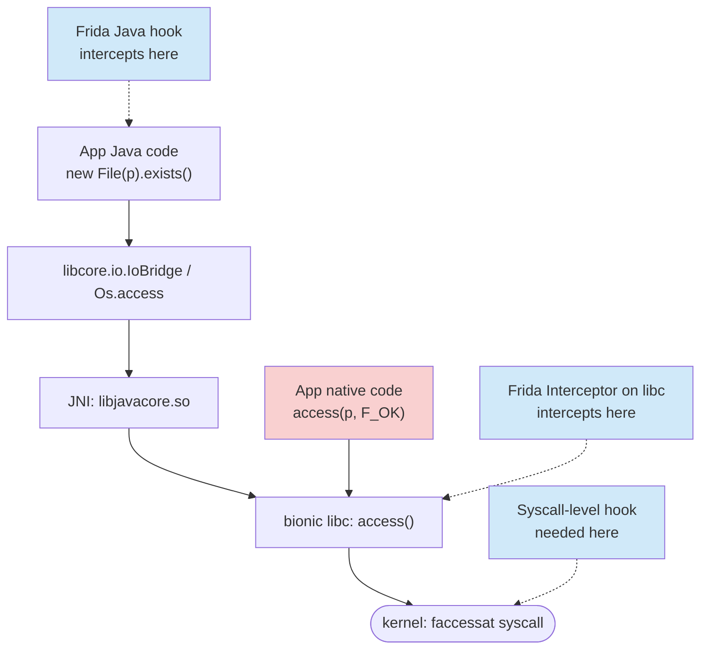

The diagram makes the hierarchy explicit. A hook placed lower in the stack catches everything above
it. Hooking `libc.so!access` catches *both* the Java path and the native path, which is why the libc
interposition script is the one you should reach for by default. Hooking at the Java level is faster
to write and easier to reason about, but it only ever covers one branch.

#### The escalation: raw syscalls

A determined implementation avoids libc entirely:

```c
/* C — invoking the syscall directly, with no libc symbol to hook. */
#include <sys/syscall.h>
#include <unistd.h>
#include <fcntl.h>

static int raw_access(const char *path) {
#if defined(__aarch64__)
    /* faccessat(AT_FDCWD, path, F_OK, 0) */
    return (int) syscall(__NR_faccessat, AT_FDCWD, path, F_OK, 0);
#else
    return (int) syscall(__NR_access, path, F_OK);
#endif
}
```

Even `syscall()` is a libc export and therefore hookable, but truly hostile code emits the `svc #0`
instruction inline with assembly, at which point there is no symbol at all.

> **Pentester's Note**
> When you have hooked `access`, `stat`, `open`, `openat`, `fopen`, `faccessat` and `syscall`, and the
> app *still* detects root, you are almost certainly looking at inline syscall assembly. At that
> point, stop hooking and start patching: find the comparison in Ghidra, note the offset, and either
> patch the `.so` on disk or write the byte at runtime with `Memory.patchCode`. Section 7.6 shows
> both.

#### Bypass — the layered libc interposition

The full script is [`scripts/native-root-bypass.js`](scripts/native-root-bypass.js). Its structure is
worth understanding rather than copying:

1. Build one allow/deny predicate over paths, used by every hook, so behaviour is consistent.
2. Hook the *path-taking* functions: `open`, `openat`, `fopen`, `access`, `faccessat`, `stat`,
   `stat64`, `lstat`, `__xstat`, `fstatat`, `newfstatat`, `readlink`, `opendir`, `realpath`.
3. Hook the *command-taking* functions: `system`, `popen`, `execve`, `execv`, `execvp`.
4. Hook the property reader: `__system_property_get` and `__system_property_read_callback`.
5. For each, return the *correct error* — `-1` with `errno = ENOENT` for path functions, `NULL` for
   `fopen`/`opendir`, so the caller's error handling looks natural.

Setting `errno` correctly matters more than beginners expect:

```javascript
// frida — set errno so the failure is indistinguishable from a genuine ENOENT.
var ENOENT = 2;
var errnoLocation = Module.findExportByName("libc.so", "__errno");
var setErrno = new NativeFunction(errnoLocation, 'pointer', []);
// inside onLeave:
//   setErrno().writeS32(ENOENT);
//   retval.replace(ptr(-1));
```

#### Developer's best hardening

Use raw syscalls with inline assembly, verify the syscall's own return path has not been patched by
checking the first bytes of your own function against a stored copy, and randomise which of several
equivalent syscalls you use per invocation. All of this raises the attacker's cost from minutes to
hours. It does not raise it to "impossible", and the app still ends with a branch someone can flip.

#### What it is worth

**Meaningfully higher than the Java equivalents — perhaps an hour of a competent tester's time, and
effectively total protection against a copy-pasted "universal root bypass" script.** That is a real
benefit against low-skill attackers and against automated fraud tooling, which is exactly the
population most apps actually face.

---

### 3.13 The RootBeer library

RootBeer (`com.scottyab.rootbeer`) is by a wide margin the most common third-party root-detection
library in the Android ecosystem. If you test ten apps with root detection, you will meet it in
several. Recognising it instantly is worth real time.

#### What it checks

| RootBeer method | Technique | Section here |
|---|---|---|
| `detectRootManagementApps()` | Known root manager packages via PackageManager | 3.4 |
| `detectPotentiallyDangerousApps()` | Lucky Patcher, root cloakers, etc. | 3.4 |
| `detectRootCloakingApps()` | RootCloak, Hide My Root | 3.4 |
| `checkForSuBinary()` | `su` in a path list | 3.1 |
| `checkForBusyBoxBinary()` | `busybox` in a path list | 3.1 |
| `checkForDangerousProps()` | `ro.debuggable=1`, `ro.secure=0` | 3.7 |
| `checkForRWPaths()` | Mount table parse for `rw` on system partitions | 3.6/3.8 |
| `detectTestKeys()` | `Build.TAGS` contains `test-keys` | 3.7 |
| `checkSuExists()` | `Runtime.exec("which su")` | 3.2 |
| `checkForRootNative()` | The **native** variant, in `librootbeer.so` — `su` existence via native code | 3.12 |
| `checkForMagiskBinary()` | Magisk binary paths | 3.5 |
| `isRooted()` | Runs the above set | — |
| `isRootedWithBusyBoxCheck()` | Same plus BusyBox | — |
| `isRootedWithoutBusyBoxCheck()` | Same minus BusyBox | — |

#### How to recognise it

```bash
# host — the giveaways, any one of which is conclusive
grep -rn "com.scottyab.rootbeer\|RootBeer\|rootbeer" out/sources/ | head
unzip -l app.apk | grep -i rootbeer            # librootbeer.so in lib/*/
strings -a libs/lib/arm64-v8a/librootbeer.so | head -40
```

Even after R8 renaming, the native library filename `librootbeer.so` and the JNI symbol
`Java_com_scottyab_rootbeer_RootBeerNative_checkForRoot` survive, because JNI symbols are resolved by
name at runtime.

#### Bypass — the complete treatment

```javascript
// frida — RootBeer total bypass. Covers Java surface and the native library.
// Usage: frida -U -f com.target.app -l rootbeer-bypass.js
Java.perform(function () {
    // ---- Java surface -------------------------------------------------------
    try {
        var RootBeer = Java.use("com.scottyab.rootbeer.RootBeer");
        var falseMethods = [
            "isRooted", "isRootedWithBusyBoxCheck", "isRootedWithoutBusyBoxCheck",
            "detectRootManagementApps", "detectPotentiallyDangerousApps",
            "detectRootCloakingApps", "checkForSuBinary", "checkForBusyBoxBinary",
            "checkForDangerousProps", "checkForRWPaths", "detectTestKeys",
            "checkSuExists", "checkForRootNative", "checkForMagiskBinary",
            "isRootedWithEmulatorCheck"
        ];
        falseMethods.forEach(function (m) {
            if (RootBeer[m] === undefined) return;
            RootBeer[m].overloads.forEach(function (ov) {
                ov.implementation = function () {
                    console.log("[rootbeer] " + m + "() -> false");
                    return false;
                };
            });
        });
        console.log("[rootbeer] Java surface neutralised");
    } catch (e) {
        console.log("[rootbeer] class not found (renamed or absent): " + e);
    }

    // ---- Native surface -----------------------------------------------------
    // Even if the Java class was renamed by R8, the JNI symbol is exported by name.
    var sym = Module.findExportByName("librootbeer.so",
                  "Java_com_scottyab_rootbeer_RootBeerNative_checkForRoot");
    if (sym) {
        Interceptor.replace(sym, new NativeCallback(function () {
            console.log("[rootbeer] native checkForRoot() -> 0");
            return 0;
        }, 'int', ['pointer', 'pointer', 'pointer']));
    }

    // setLogDebugMessages / native setLogDebugMessages are harmless; leave them.
});
```

> **Pentester's Note**
> If `Java.use("com.scottyab.rootbeer.RootBeer")` throws `ClassNotFoundException` but
> `librootbeer.so` is present, the app has shaded/renamed the library. Enumerate loaded classes with
> `Java.enumerateLoadedClasses()` and grep for methods named `isRooted`, or hook the native symbol
> only — the JNI name is not renamed, so it remains a reliable anchor.

#### What it is worth

**Low.** RootBeer's own documentation is admirably honest about this: it says outright that it will
not stop a determined attacker and is intended to raise the bar. It is a reasonable library used
badly by developers who then treat its boolean as truth.

---

### 3.14 Magisk DenyList, Zygisk, and the arms race

#### What the mechanisms are

> **Definition — MagiskHide (historical)**
> A Magisk feature, removed in Magisk v24, that actively unmounted Magisk's modifications from the
> mount namespace of processes on a hide list and hid the Magisk daemon's traces from them.

> **Definition — DenyList (current)**
> The successor. For each process on the list, Magisk's daemon **reverts** the process's mount
> namespace to a clean state before the app's code runs, so the app sees no Magisk mounts, no
> overlay, and no `su`. It does *not* actively fight detection beyond that.

> **Definition — Zygisk**
> Magisk's Zygote-injection mechanism. It loads Magisk's code into the Zygote process, which means
> every forked app process starts with Magisk's hook infrastructure available. It gives modules the
> ability to run inside app processes, and it enables "DenyList in Zygisk mode", where the unmounting
> happens at process specialisation — the earliest possible point.

Around this ecosystem sit third-party modules — Shamiko, and various "hide" modules — that go further
by intercepting the app's attempts to observe Magisk. Naming any specific module's current capability
in a written chapter is a bad idea because they change fast; what matters is the shape of the game.

#### The arms race, drawn

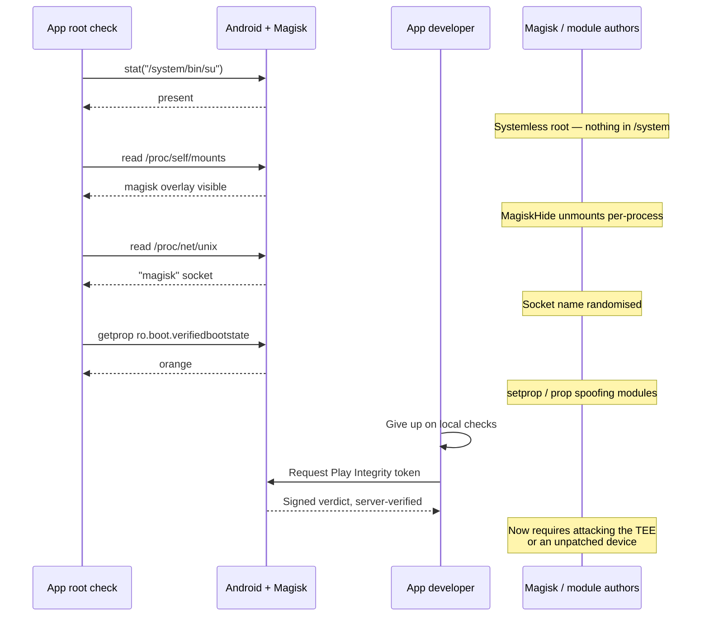

Every arrow in that diagram represents months of engineering on both sides. The important reading is
the shape: each individual detection was defeated within one Magisk release cycle, and the *only*
step that changed the economics was moving to attestation.

#### Practical guidance for the tester

When you are asked to bypass root detection on an authorised target, try these in order, cheapest
first:

| Step | Effort | When it works |
|---|---|---|
| 1. Add the target to Magisk DenyList, enable Zygisk, force-stop, relaunch | 1 minute | Surprisingly often — many apps only do filesystem and mount checks |
| 2. Add a hiding module | 5 minutes | Handles most property and namespace checks |
| 3. Frida Java-layer hooks (`scripts/java-root-bypass.js`) | 5 minutes | Java-implemented checks |
| 4. Frida libc-layer hooks (`scripts/native-root-bypass.js`) | 15 minutes | Native checks that use libc |
| 5. Run the tracer (`scripts/root-check-tracer.js`) to identify *which* check fires | 20 minutes | Always — do this before step 6 |
| 6. Targeted hook or `Memory.patchCode` on the specific function | 1–3 hours | Inline syscalls, custom crypto-verified checks |
| 7. Static patch of the DEX/`.so` and re-sign | 2–6 hours | When you need a persistent artefact, or Frida is itself detected |

> **Pentester's Note**
> Step 5 is the one juniors skip and seniors do first. Knowing *which* check fired turns an
> open-ended fight into a specific, small task. The tracer script in this chapter exists exactly for
> that, and it is the most valuable file in the folder.

#### What all of this is worth

**The honest summary of the whole section:** on a device the attacker fully controls, root detection
is a cost function, not a boundary. A well-built native check with anti-hooking costs a skilled
attacker a few hours once, after which the bypass is reusable forever and shareable in a Discord
channel. The developer's engineering budget is far better spent making the *server* refuse to act on
requests from a device whose attestation verdict is unacceptable.

---

### 3.15 Play Integrity API — the only meaningful signal

#### How it works

> **Definition — remote attestation**
> A process in which a device produces a statement about its own state that is **signed by a key the
> device's owner cannot extract**, so that a remote party can verify the statement's authenticity
> independently of the device's software.

The Play Integrity API (which superseded SafetyNet Attestation; SafetyNet was fully deprecated and
shut down for new integrations) works like this:

1. Your server generates a random **nonce** and sends it to the app.
2. The app calls `IntegrityManager.requestIntegrityToken()` with that nonce.
3. Google Play services collects device signals, including hardware-backed evidence from the TEE, and
   obtains a **JWS-signed token** from Google's servers.
4. The app passes the opaque token to **your server**.
5. Your server calls Google's Play Integrity decode endpoint (or verifies the JWS itself) and
   receives a structured verdict.

The verdicts that matter:

| Field | Values | Meaning |
|---|---|---|
| `deviceIntegrity.deviceRecognitionVerdict` | `MEETS_DEVICE_INTEGRITY` | Genuine Android device with a stock, verified boot |
| | `MEETS_BASIC_INTEGRITY` | Device passes basic checks but boot is not verified — includes most rooted and many emulated devices |
| | `MEETS_STRONG_INTEGRITY` | Hardware-backed evidence of a recent security patch and verified boot |
| | *(empty array)* | Failed everything, or an emulator/unrecognised device |
| `appIntegrity.appRecognitionVerdict` | `PLAY_RECOGNIZED` | The APK is unmodified and Play-distributed — this is [38-TamperDetection](../38-TamperDetection/README.md)'s subject |
| | `UNRECOGNIZED_VERSION` | Modified or sideloaded |
| `accountDetails.appLicensingVerdict` | `LICENSED` / `UNLICENSED` | Play account owns the app |

#### Implementation — the correct pattern

```java
// Java — app side. Note: the app never interprets the verdict.
StandardIntegrityManager manager =
        IntegrityManagerFactory.createStandard(getApplicationContext());

manager.prepareIntegrityToken(
        StandardIntegrityManager.PrepareIntegrityTokenRequest.builder()
                .setCloudProjectNumber(CLOUD_PROJECT_NUMBER)
                .build())
    .addOnSuccessListener(tokenProvider -> {
        // requestHash binds the token to the specific request being made.
        String requestHash = sha256Hex(canonicalRequestBody);
        tokenProvider.request(
                StandardIntegrityManager.StandardIntegrityTokenRequest.builder()
                        .setRequestHash(requestHash)
                        .build())
            .addOnSuccessListener(token ->
                    api.performTransfer(canonicalRequestBody, token.token()));
    });
```

```text
Server side (pseudocode — language irrelevant, placement is the point):

  verdict = playIntegrity.decodeIntegrityToken(token)
  assert verdict.requestDetails.requestHash == sha256(receivedBody)   // anti-replay binding
  assert verdict.requestDetails.timestampMillis is within 60s
  assert "MEETS_DEVICE_INTEGRITY" in verdict.deviceIntegrity.deviceRecognitionVerdict
  assert verdict.appIntegrity.appRecognitionVerdict == "PLAY_RECOGNIZED"
  assert verdict.appIntegrity.packageName == "com.example.bank"
  if any assertion fails: refuse the transaction, log, and return a generic error
```

#### The three ways developers get this wrong

1. **Verifying the token in the app.** If the app decodes the JWS and branches on the result, the
   attacker hooks the branch and the whole mechanism is worth nothing. The token must be opaque to
   the app.
2. **No nonce / no request binding.** Without a server-supplied nonce or a `requestHash` bound to the
   specific request, an attacker captures one good token from a clean device and replays it forever
   from a rooted one. This is the single most common implementation flaw and it completely negates
   the control.
3. **Failing open.** Google's service can be slow or unavailable, and developers add a
   "if we could not get a verdict, allow it" path. Attackers then block the network path to
   Google's endpoint. Fail closed, or degrade to a reduced-risk mode, but never treat "no verdict" as
   "good verdict".

> **Pentester's Note — how to test an integrity integration**
> Do not start by trying to defeat Play Integrity. Start by determining **where the verdict is
> evaluated**. Hook the network layer, capture the request that carries the token, and then replay
> that exact request from a different device or at a later time. If the server accepts it, the
> nonce/binding is missing and you have a serious finding that does not require breaking any
> cryptography. Then remove the token entirely and see whether the server still serves the request —
> "fail open" is astonishingly common. These two tests take fifteen minutes and find real bugs; the
> alternative approach takes days and finds none.

#### What it is worth

**High — provided the verdict is verified server-side, bound to the request, and failure is closed.**
It is the only control in this chapter whose evidence originates outside the attacker's control. It
is not perfect: unpatched devices, some vendor implementations, and certain emulator/cloud-device
configurations can produce `MEETS_BASIC_INTEGRITY` or better in circumstances a defender would not
like, and a determined actor can farm tokens from clean devices if the binding is weak. But the
economics are entirely different from a `File.exists("/system/bin/su")`.

---

## 4. Source Code Walkthrough (AOSP)

Understanding where the answers come from tells you where to intercept them. This section traces four
paths from a public API into the kernel.

### 4.1 `File.exists()` → `faccessat` syscall

**Path:** `libcore/ojluni/src/main/java/java/io/File.java`

```java
// AOSP — File.java, illustrative excerpt
public boolean exists() {
    SecurityManager security = System.getSecurityManager();
    if (security != null) security.checkRead(path);
    if (isInvalid()) return false;
    // BlockGuard hook: this is why StrictMode can see file access
    return ((fs.getBooleanAttributes(this) & FileSystem.BA_EXISTS) != 0);
}
```

`fs` is a `UnixFileSystem` (`libcore/ojluni/src/main/java/java/io/UnixFileSystem.java`), whose
`getBooleanAttributes` calls into `Libcore.os.stat()`. `Libcore.os` is a `BlockGuardOs` wrapping a
`Posix` instance (`libcore/luni/src/main/java/libcore/io/Posix.java`), and `Posix.stat` is a native
method implemented in `libcore/luni/src/main/native/libcore_io_Posix.cpp`. That C++ calls bionic's
`stat()`, which on arm64 issues `newfstatat`.

The chain, therefore:

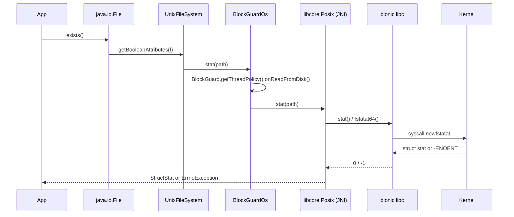

Two interception points are visible and both are used in practice. Hooking `java.io.File.exists`
catches only apps that use `File`. Hooking `libcore.io.Posix.stat` (or `Os.stat`) catches every Java
filesystem API — `File`, `FileInputStream`, `Files`, and `RandomAccessFile` — in a single hook, which
is a genuinely better choice that most bypass scripts miss:

```javascript
// frida — one hook covering every Java filesystem path check.
Java.perform(function () {
    var Os = Java.use("libcore.io.Libcore").os.value.getClass();  // BlockGuardOs instance
    // In practice, hook the class directly:
    var BlockGuardOs = Java.use("libcore.io.BlockGuardOs");
    var ErrnoException = Java.use("android.system.ErrnoException");
    var BAD = /su$|magisk|busybox|superuser|\/data\/adb|\/sbin\//i;

    BlockGuardOs.stat.implementation = function (path) {
        if (BAD.test(path)) {
            console.log("[hide] Os.stat(" + path + ") -> ENOENT");
            throw ErrnoException.$new("stat", 2);   // ENOENT
        }
        return this.stat(path);
    };
    BlockGuardOs.access.implementation = function (path, mode) {
        if (BAD.test(path)) return false;
        return this.access(path, mode);
    };
});
```

### 4.2 The property system

**Files:** `bionic/libc/bionic/system_property_*.cpp`, `system/core/init/property_service.cpp`

Android properties live in a set of memory-mapped files under `/dev/__properties__`, one per property
"context" (SELinux label). Every process maps them **read-only**; only `init` can write, and writers
must go through a socket (`/dev/socket/property_service`) where `init` enforces SELinux rules on who
may set what.

```cpp
// bionic — the read path, simplified
int __system_property_get(const char* name, char* value) {
  const prop_info* pi = __system_property_find(name);
  if (pi != nullptr) {
    __system_property_read_callback(pi, [](void* cookie, const char*, const char* v, uint32_t) {
        strcpy(reinterpret_cast<char*>(cookie), v);
    }, value);
    return strlen(value);
  }
  value[0] = 0;
  return 0;
}
```

Three consequences for testing:

1. Reads never leave the process — no syscall, no IPC. That is why property reads are fast and why
   `strace` will not show them.
2. Because the read is a memory access into a mapped region, a *sufficiently* determined check could
   read the region directly and bypass any symbol hook. This is rare but it exists.
3. `SystemProperties.get()` in Java is a thin JNI wrapper
   (`frameworks/base/core/jni/android_os_SystemProperties.cpp`) over the same bionic function, which
   is why hooking the native symbol covers the Java path as well.

### 4.3 `PackageManager.getPackageInfo` across Binder

**Files:** `frameworks/base/core/java/android/app/ApplicationPackageManager.java`,
`frameworks/base/services/core/java/com/android/server/pm/ComputerEngine.java`

```java
// ApplicationPackageManager.java — the client side
@Override
public PackageInfo getPackageInfo(String packageName, int flags)
        throws NameNotFoundException {
    return getPackageInfoAsUser(packageName, flags, getUserId());
}
```

That reaches `IPackageManager.getPackageInfo` over Binder into `system_server`, where the modern
implementation applies **app-visibility filtering** based on the caller's UID before returning
anything. If the caller cannot see the package, the service returns `null`, and the client converts
that to `NameNotFoundException`.

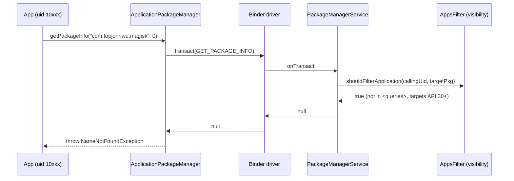

The diagram shows exactly why a root check that omits `<queries>` silently dies on Android 11+, and
why reading the manifest's `<queries>` block is a fast way to learn what an app looks for.

### 4.4 `Runtime.exec` down to `execve`

**Files:** `libcore/ojluni/src/main/java/java/lang/ProcessBuilder.java`,
`libcore/ojluni/src/main/java/java/lang/UNIXProcess.java` (or `ProcessImpl` in newer trees),
`libcore/luni/src/main/native/java_lang_ProcessManager.cpp`

`Runtime.exec` builds a `ProcessBuilder`, which calls into `ProcessManager.exec`, which
`fork()`s and `execve()`s in the child. On Android, an app spawning a process inherits the app's
SELinux domain (`untrusted_app`), which is why many `exec` attempts that would work in a shell fail
from inside an app — a fact worth remembering when you are deciding whether a check even functions.

---

## 5. Security Perspective

### 5.1 How attackers abuse root detection itself

The control has its own attack surface, which testers routinely forget to examine.

- **Denial of service / availability.** An overly aggressive check that kills the app on a false
  positive is a self-inflicted outage. Custom ROMs like LineageOS trip `test-keys` checks while being
  perfectly ordinary user devices. Reporting a false-positive-prone check is legitimate security work.
- **Information disclosure.** Some implementations log the detected artefact — `Log.e("Security",
  "Root found at " + path)` — which is a free map of the check for anyone reading logcat.
- **Fingerprinting and privacy.** Enumerating all installed packages to hunt for root managers is, on
  older API levels, a broad privacy intrusion, and Google Play policy now restricts
  `QUERY_ALL_PACKAGES` to specific use cases. An app doing this without justification is a policy
  finding as well as a privacy one.
- **The check as an oracle.** If the app behaves differently in a detectable way, an attacker can use
  it to determine facts about the device from a lower-privileged context.
- **Local privilege confusion.** Some implementations execute a discovered `su` binary to test it,
  which is executing an attacker-supplied binary. If an attacker can plant a file at a probed path
  that the app is willing to execute, the check becomes an execution primitive. This is rare and it
  has happened.

### 5.2 How developers misuse it

| Misuse | Consequence |
|---|---|
| Treating `isRooted()` as an authorisation decision | Every protected action is one hooked boolean away |
| Doing the check once, at `Application.onCreate()` | Attacker attaches after start, or hooks before it runs with `frida -f` |
| Acting locally (`finish()`, `System.exit()`) instead of telling the server | Trivially patched; also loses the fraud signal entirely |
| Blocking rather than degrading | Support burden, app-store reviews, and no security benefit against real attackers |
| Copying a 2016 blog's path list and never revisiting | Checks stop matching reality; false confidence |
| No `<queries>` on API 30+ | Package checks silently return "clean" forever |
| Verifying a Play Integrity token in-app | Reduces a strong control to a weak one |
| Failing open when attestation is unavailable | Attacker blocks the network path |

### 5.3 Real vulnerability classes

Rather than inventing CVE identifiers, here are the recurring *classes* that appear in real reports:

- **Attestation replay.** A Play Integrity or SafetyNet token accepted without a server-issued nonce
  or request binding, allowing one token from a clean device to authorise unlimited requests from
  compromised ones. This is the most consequential and most common finding in this space.
- **Client-side verdict evaluation.** The app receives the verdict, parses it, and decides. Hook the
  parse.
- **Root check gating the UI only.** The protected API endpoint still works when called directly, so
  the "protection" is cosmetic. Test by replaying the request outside the app.
- **Debug/test bypass left in release.** A build-config flag, a debug menu, an intent extra, or a
  particular value in `SharedPreferences` that disables the check. Search for `BuildConfig.DEBUG` and
  for any preference key read before the check.
- **Downgrade to an unprotected code path.** The app checks root before the "secure" flow but an
  older, still-present API version of the flow skips it.

For platform-level CVEs relevant to *obtaining* root — the exploits themselves — see
[70-VulnerabilityResearch](../70-VulnerabilityResearch/README.md); this chapter is about detecting
the state, not achieving it.

### 5.4 OWASP MASVS / MASTG mapping

| Identifier | Requirement | How this chapter maps |
|---|---|---|
| **MASVS-RESILIENCE-1** | The app validates the integrity of the platform | This entire chapter. Note MASVS is explicit that these are *resilience* controls, not security controls |
| **MASVS-RESILIENCE-2** | The app implements anti-tampering | [38-TamperDetection](../38-TamperDetection/README.md) |
| **MASVS-RESILIENCE-3** | The app implements anti-static-analysis | [40-Obfuscation](../40-Obfuscation/README.md) |
| **MASVS-RESILIENCE-4** | The app implements anti-dynamic-analysis | [38-TamperDetection](../38-TamperDetection/README.md), Frida detection |
| MASTG-TEST-0238 / "Testing Root Detection" | The test procedure | Sections 7 and 8 here |

> **Pentester's Note — how to write the finding**
> MASVS treats resilience controls as a separate, *optional* profile precisely because they are not
> security boundaries. Write your report accordingly. "Root detection can be bypassed" is a weak
> finding on its own and a good reviewer will push back on it. The strong finding is: "The
> application's security decisions are made client-side and the server does not independently
> validate device integrity; consequently [specific business impact]." Lead with the server.

### 5.5 How malware abuses root

Malware sits on the opposite side of this chapter and uses it as reconnaissance:

- Banking trojans check for root to decide **which** attack to use — with root, read the target app's
  private storage directly; without it, fall back to accessibility-service overlay attacks.
- Some families deliberately **avoid** rooted devices, on the theory that a rooted device is more
  likely to be a researcher's analysis machine. This is the same code, used as anti-analysis.
- Droppers check for root to decide whether to attempt a privilege-escalation exploit at all.

See [69-MalwareAnalysis](../69-MalwareAnalysis/README.md).

### 5.6 Forensic perspective

An analyst examining a device asks the same questions from the other direction, and the artefacts in
section 3.0 are the checklist: presence and timestamps of `/data/adb/*`, Magisk module directories,
the boot image's signature state, `ro.boot.verifiedbootstate` recorded at capture time, the install
history of a root manager in `PackageManagerService`'s records, and `/data/adb/magisk.db` (which
records which apps were granted root, and when). That database is often the single most useful
artefact on a rooted device under examination.

---

## 6. Reverse Engineering Perspective

### 6.1 The five-minute triage

Before opening a decompiler, run this. It answers "is there root detection, and what kind" for
perhaps eighty percent of apps.

```bash
# host — root-detection triage
APK=app.apk
mkdir -p triage && cd triage
unzip -o "../$APK" >/dev/null

echo "=== DEX strings ==="
for d in classes*.dex; do
  strings -a "$d" | grep -E '(^|/)su$|/system/(bin|xbin)/su|magisk|supersu|superuser|busybox|test-keys|ro\.debuggable|RootBeer|rootbeer|/proc/self/mounts|which su'
done | sort -u

echo "=== Native libraries ==="
for so in $(find lib -name '*.so' 2>/dev/null); do
  hits=$(strings -a "$so" | grep -cE '(^|/)su$|magisk|test-keys|ro\.debuggable|/proc/self/(mounts|maps)')
  [ "$hits" -gt 0 ] && echo "$so : $hits hits" 
done

echo "=== Imports suggesting native filesystem probing ==="
for so in $(find lib -name '*.so' 2>/dev/null); do
  syms=$(readelf --dyn-syms "$so" 2>/dev/null | grep -cE ' (access|stat|__xstat|fopen|popen|system|__system_property_get)$')
  [ "$syms" -gt 0 ] && echo "$so : $syms suspicious imports"
done
```

### 6.2 In JADX

Search (`Ctrl+Shift+F` in the GUI, or `jadx --search`) for these, in order of yield:

| Search term | What it finds |
|---|---|
| `/system/xbin/su` | Path lists — the highest-yield single string |
| `test-keys` | Build tag check |
| `magisk` | Magisk-specific checks |
| `RootBeer` / `rootbeer` | The library |
| `Runtime.getRuntime().exec` | Subprocess checks |
| `SystemProperties` | Property reflection |
| `/proc/self/mounts` | Mount table checks |
| `System.loadLibrary` | Which native libraries exist, and therefore where native checks live |
| `isRooted`, `isDeviceRooted`, `checkRoot`, `detectRoot` | Method names — often survive obfuscation because they are on a public interface |

After R8, expect class and method names to be single letters. **String literals, JNI symbol names,
manifest component names, and reflection targets survive obfuscation** — build your search around
those. See [40-Obfuscation](../40-Obfuscation/README.md) for what does and does not survive.

If strings are *encrypted* (a common commercial obfuscator feature), the giveaway is a static method
called with a base64-ish or byte-array argument everywhere a string should be. Hook that decryptor
once and dump every string in the app; that is usually faster than analysing any individual check.

### 6.3 In Smali

The canonical patterns, which you should be able to recognise on sight:

```smali
# smali — pattern 1: File existence loop
.method public static a()Z
    .locals 4
    sget-object v0, Lcom/x/a;->b:[Ljava/lang/String;
    array-length v1, v0
    const/4 v2, 0x0
    :goto_0
    if-ge v2, v1, :cond_1
    aget-object v3, v0, v2
    new-instance p0, Ljava/io/File;
    invoke-direct {p0, v3}, Ljava/io/File;-><init>(Ljava/lang/String;)V
    invoke-virtual {p0}, Ljava/io/File;->exists()Z
    move-result p0
    if-eqz p0, :cond_0
    const/4 v0, 0x1
    return v0
    :cond_0
    add-int/lit8 v2, v2, 0x1
    goto :goto_0
    :cond_1
    const/4 v0, 0x0
    return v0
.end method
```

```smali
# smali — pattern 2: test-keys check
    sget-object v0, Landroid/os/Build;->TAGS:Ljava/lang/String;
    if-eqz v0, :cond_0
    const-string v1, "test-keys"
    invoke-virtual {v0, v1}, Ljava/lang/String;->contains(Ljava/lang/CharSequence;)Z
    move-result v0
```

```smali
# smali — pattern 3: the native bridge. This is the one to look for when Java-level
# hooks do nothing.
.method public static native nativeCheckRoot()Z
.end method
```

**The universal static patch.** Whatever the method does, if it returns a `boolean`, this is the
patch:

```smali
# smali — before
.method public static isDeviceRooted()Z
    .locals 4
    # ... fifty lines of checks ...
.end method

# smali — after
.method public static isDeviceRooted()Z
    .locals 1
    const/4 v0, 0x0
    return v0
.end method
```

Set `.locals` to at least the number of registers you use (here 1), rebuild with `apktool b`,
zipalign, and re-sign. Remember that re-signing changes the signature, which will trip the
techniques in [38-TamperDetection](../38-TamperDetection/README.md) — the two chapters interlock, and
in practice you patch both at once.

### 6.4 In Ghidra / IDA (native)

Workflow for a native root check:

1. Open the `.so`. Check `Symbol Tree → Imports` for `access`, `stat`, `__xstat`, `fopen`, `popen`,
   `system`, `__system_property_get`, `opendir`. Their presence tells you the technique before you
   read a line of code.
2. Look at `Exports` for `Java_*` symbols. Those are the JNI entry points, and their names give you
   the Java class and method they back — obfuscation does not rename them, because the JNI linker
   resolves them by name.
3. `Search → For Strings`, filter for `su`, `magisk`, `/proc`, `ro.`. Then use `References → Show
   References to Address` on each hit to find the function that uses it.
4. In the decompiler, the shape you are looking for is a loop over a pointer array with a call to
   `access`/`stat` and a comparison to 0, or a `strstr` against a `.rodata` needle.
5. Note the address of the **comparison or the return**, not the check. Patching the return is a
   one-instruction change; defeating the check is not.

For arm64, the two patches you will use most:

```text
Return 0 (false) unconditionally, arm64:
    MOV  W0, #0        ->  bytes  00 00 80 52
    RET                ->  bytes  C0 03 5F D6

Return 1 (true) unconditionally, arm64:
    MOV  W0, #1        ->  bytes  20 00 80 52
    RET                ->  bytes  C0 03 5F D6
```

Applying that at runtime rather than on disk avoids re-signing:

```javascript
// frida — patch a native function to return 0, no file modification required.
var base = Module.findBaseAddress("libintegrity.so");
var target = base.add(0x12a40);          // offset from Ghidra
Memory.patchCode(target, 8, function (ptr) {
    var w = new Arm64Writer(ptr, { pc: target });
    w.putMovRegU64('x0', 0);
    w.putRet();
    w.flush();
});
console.log("[patch] libintegrity.so+0x12a40 now returns 0");
```

### 6.5 What obfuscation does to all of this

| Obfuscation | Effect on your search | Counter |
|---|---|---|
| R8/ProGuard renaming | Class/method names become `a`, `b` | Search strings, not names. JNI symbols and manifest names survive |
| String encryption | Path literals no longer greppable | Find and hook the decryptor; dump all strings at runtime |
| Control-flow flattening | Decompiler output becomes a state machine | Work at the Smali/assembly level; or ignore the internals and patch the return |
| Native migration (checks moved to `.so`) | Nothing in the DEX | The tracer script; libc hooks |
| Packers / runtime DEX loading | `classes.dex` contains only a loader | Dump the real DEX from memory at runtime — see [68-ReverseEngineering](../68-ReverseEngineering/README.md) |
| Anti-Frida | Your hooks get detected | [38-TamperDetection](../38-TamperDetection/README.md) |

---

## 7. Dynamic Analysis

### 7.1 The methodology, before any tool

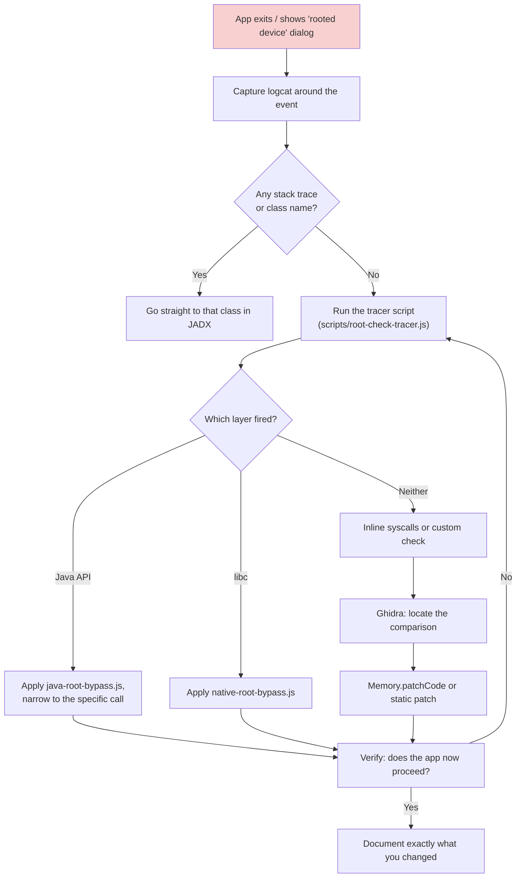

The loop back from "no" to the tracer is the important edge. Root detection is almost never a single
check; it is five to twenty checks, and defeating them is an iterative process of running the tracer,
neutralising what fired, and running again.

### 7.2 First: read the logs

```bash
# host — the cheapest possible first step, and it works more often than you would think
adb logcat -c
adb shell am force-stop com.target.app
adb shell monkey -p com.target.app -c android.intent.category.LAUNCHER 1
adb logcat -v threadtime | grep -iE "root|magisk|su |integrity|security|tamper|jailbreak"
```

Developers log. A single line like `RootChecker: su found at /system/xbin/su` saves you an hour.

### 7.3 The tracer — find out which check fires

This is the most valuable script in the chapter. Full version:
[`scripts/root-check-tracer.js`](scripts/root-check-tracer.js). It does **not** bypass anything; it
observes and reports, with a Java stack trace for every hit, so you learn *where* the check lives.

```bash
# host
frida -U -f com.target.app -l scripts/root-check-tracer.js
```

Typical output:

```text
[TRACE] File.exists("/system/xbin/su")  <- com.target.security.b.a(SourceFile:41)
[TRACE] File.exists("/sbin/su")         <- com.target.security.b.a(SourceFile:41)
[TRACE] SystemProperties.get("ro.build.tags") -> release-keys  <- com.target.security.b.c(SourceFile:88)
[TRACE] native access("/system/bin/su") from libintegrity.so+0x9c40
[TRACE] native fopen("/proc/self/mounts") from libintegrity.so+0xa112
```

Two seconds of output tells you: the Java checks live in `com.target.security.b`, and there is *also*
a native library doing its own work. Now you know the shape of the problem.

### 7.4 The Java-layer bypass

Full version: [`scripts/java-root-bypass.js`](scripts/java-root-bypass.js). Load with `-f` (spawn),
never `-n` (attach), because most checks run in `Application.onCreate()` before you could possibly
attach.

```bash
# host
frida -U -f com.target.app -l scripts/java-root-bypass.js --no-pause
```

### 7.5 The native-layer bypass

Full version: [`scripts/native-root-bypass.js`](scripts/native-root-bypass.js).

```bash
# host
frida -U -f com.target.app -l scripts/native-root-bypass.js --no-pause
```

> **Warning — the library-not-loaded race**
> If the check lives in a library loaded by `System.loadLibrary()` during `onCreate`, your
> `Module.findExportByName` at script-load time returns `null` because the library is not mapped yet.
> Hook `android_dlopen_ext` (or `dlopen`) and install your interceptors from its `onLeave` when the
> target library name appears. The native script handles this; it is the single most common reason a
> native bypass "does nothing".

```javascript
// frida — the dlopen trampoline pattern, in isolation.
var dlopenExt = Module.findExportByName(null, "android_dlopen_ext");
Interceptor.attach(dlopenExt, {
    onEnter: function (args) { this.path = args[0].readUtf8String(); },
    onLeave: function () {
        if (this.path && this.path.indexOf("libintegrity.so") !== -1) {
            console.log("[dlopen] target library loaded, installing hooks");
            installNativeHooks();
        }
    }
});
```

### 7.6 Objection

```bash
# host
objection -g com.target.app explore
# in the objection REPL
android root disable          # applies a set of common root-check hooks
android hooking list classes | grep -i root
android hooking watch class com.target.security.RootChecker
```

`android root disable` is a convenience wrapper over roughly the Java-layer hooks in 7.4. It is a
good first thirty seconds and rarely the complete answer. Its value is that it takes no time at all.

### 7.7 `strace` — seeing every path the app touches

```bash
# device root
PID=$(pidof -s com.target.app)
strace -f -p $PID -e trace=openat,faccessat,newfstatat,execve -s 200 2>&1 | grep -iE "su|magisk|busybox|/proc/"
```

Better still, catch it from process start:

```bash
# device root — trace from the very first instruction
adb shell "su -c 'setenforce 0'"                       # may be needed for strace to attach; note this changes the device state
adb shell am force-stop com.target.app
adb shell "su -c 'strace -f -o /data/local/tmp/t.log -e trace=openat,faccessat,execve \
    \$(pidof -s zygote64)'" &
```

> **Pentester's Note**
> `strace` shows you the ground truth that no hook can lie about, and it catches inline-syscall checks
> that defeat every Frida interceptor. When a bypass mysteriously fails, `strace` is the tool that
> tells you why. It is under-used because it is slower to read than Frida output; learn to read it
> anyway.

### 7.8 A complete worked session

```bash
# host — 1. Establish the baseline: does it detect?
adb shell am force-stop com.target.app
adb shell monkey -p com.target.app -c android.intent.category.LAUNCHER 1
# App shows "This device appears to be rooted."

# host — 2. Cheapest option first: Magisk DenyList
#   (Magisk app → Settings → enable Zygisk → Configure DenyList → tick com.target.app)
adb shell am force-stop com.target.app
adb shell monkey -p com.target.app -c android.intent.category.LAUNCHER 1
# Still detected. So the check is not (only) mount/su based.

# host — 3. Find out what fires
frida -U -f com.target.app -l scripts/root-check-tracer.js --no-pause
# Output shows: SystemProperties.get("ro.build.tags") and native access() calls

# host — 4. Targeted bypass
frida -U -f com.target.app \
      -l scripts/java-root-bypass.js \
      -l scripts/native-root-bypass.js --no-pause
# App proceeds to the login screen.

# host — 5. Confirm nothing is deferred: exercise the sensitive flows
#   (many apps re-check before a transfer, not at startup)
```

Step 5 is the one that separates a finished job from an embarrassing one. Root checks frequently run
again immediately before the interesting action.

---

## 8. Static Analysis

### 8.1 Manifest

```bash
# host
apktool d -f app.apk -o out_apk >/dev/null
```

Look for:

| Manifest element | Why it matters |
|---|---|
| `<queries><package android:name="com.topjohnwu.magisk"/>` | The exact list of packages the app hunts for |
| `<uses-permission android:name="android.permission.QUERY_ALL_PACKAGES"/>` | Broad enumeration; also a Play policy question |
| `android:debuggable` | Should be absent in release |
| `com.google.android.play.integrity` metadata / dependency | An attestation integration exists — go find where the token is verified |
| Services/receivers with `Integrity`, `Security`, `Root` in the name | Direct pointers |

### 8.2 DEX

```bash
# host — the grep set that finds root detection in a decompiled tree
jadx -d out app.apk >/dev/null 2>&1
PAT='/system/(bin|xbin)/su|/sbin/su|(^|")su(")|magisk|supersu|superuser|busybox|test-keys|ro\.debuggable|ro\.secure|verifiedbootstate|/proc/self/mounts|/proc/self/maps|RootBeer|isRooted|checkRoot|detectRoot|SystemProperties|getRuntime\(\)\.exec'
grep -rnE "$PAT" out/sources/ | tee root-hits.txt | wc -l
# Then cluster by package to find the checker class:
awk -F: '{print $1}' root-hits.txt | sed 's|/[^/]*$||' | sort | uniq -c | sort -rn | head
```

That last line is the trick worth remembering: it tells you which *package directory* has the most
hits, which is almost always the security package.

### 8.3 Native libraries

```bash
# host
unzip -o app.apk 'lib/*' -d libs >/dev/null
for so in $(find libs -name '*.so'); do
  echo "=== $so"
  # exported JNI entry points — these name the Java classes
  readelf --dyn-syms "$so" 2>/dev/null | awk '{print $8}' | grep '^Java_' 
  # imports that indicate what it does
  readelf --dyn-syms "$so" 2>/dev/null | grep UND | grep -E 'access|stat|fopen|popen|system|property|ptrace|dlopen'
  # strings
  strings -a "$so" | grep -E '(^|/)su$|magisk|test-keys|/proc/self|ro\.[a-z.]+' | sort -u | head -20
done
```

### 8.4 With radare2

```bash
# host
r2 -A libs/lib/arm64-v8a/libintegrity.so
[0x00000000]> iz~su            # strings containing "su"
[0x00000000]> ii~access        # imports
[0x00000000]> axt @@ str.*su*  # cross-references to those strings
[0x00000000]> afl~Java_        # JNI entry points
[0x00000000]> pdf @ sym.Java_com_target_NativeCheck_isRooted
```

### 8.5 MobSF and automated tools

MobSF flags root-detection strings and will tell you whether RootBeer is present. Treat its output as
a lead, not a finding: it produces false positives (a path string in an unused library, a string in a
third-party SDK that never runs) and false negatives (anything in native code with encrypted
strings). Verify every hit dynamically before it enters a report.

### 8.6 Gradle and dependencies

```bash
# host — if you have source access
grep -rn "rootbeer\|play-integrity\|safetynet\|integrity" build.gradle* app/build.gradle*
```

A `com.google.android.play:integrity` dependency tells you attestation exists, which redirects your
whole test plan toward section 3.15's three failure modes rather than toward filesystem hooks.

---

## 9. Examples

> **Verified against a compiler.** `examples/native_root_check.c` compiles **clean** with
> `-Wall -Wextra` using `aarch64-linux-android21-clang` from **NDK 25.2.9519653** and links as a
> shared library. Zero diagnostics matters for this file specifically: it is written to be dropped
> into a reader's own app as a starting point, and a detection routine that arrives with warnings is
> one nobody reads carefully.

### 9.1 Simple — a single check with a local consequence

The archetype, and the one you will meet in small apps.

```java
// Java — MainActivity.java
public class MainActivity extends AppCompatActivity {
    @Override protected void onCreate(Bundle savedInstanceState) {
        super.onCreate(savedInstanceState);
        if (new File("/system/xbin/su").exists()) {
            Toast.makeText(this, "Rooted device not supported", Toast.LENGTH_LONG).show();
            finish();
            return;
        }
        setContentView(R.layout.activity_main);
    }
}
```

**Bypass, three ways, in increasing durability.** Hook `File.exists`; hook `Activity.finish`; or
patch the Smali `if-eqz` to `if-nez`. The `finish()` hook deserves a note because it generalises to
*every* app in this class:

```javascript
// frida — do not fight the check, remove the consequence.
Java.perform(function () {
    Java.use("android.app.Activity").finish.implementation = function () {
        console.log("[block] finish() called by " +
            Java.use("android.util.Log").getStackTraceString(
                Java.use("java.lang.Exception").$new()));
        // deliberately do nothing
    };
});
```

**Assessment:** worthless as security, twenty seconds to bypass. Its only merit is honesty — it does
not pretend to be more than it is.

### 9.2 Intermediate — a multi-signal checker with a score

```java
// Java — RootDetector.java. A weighted approach, which is a real improvement.
public final class RootDetector {

    public static final class Result {
        public final int score;
        public final java.util.List<String> signals;
        Result(int score, java.util.List<String> signals) {
            this.score = score; this.signals = signals;
        }
    }

    public static Result evaluate(android.content.Context ctx) {
        java.util.List<String> hits = new java.util.ArrayList<>();
        int score = 0;

        String su = SuBinaryCheck.find();
        if (su != null) { hits.add("su:" + su); score += 40; }

        if (android.os.Build.TAGS != null && android.os.Build.TAGS.contains("test-keys")) {
            hits.add("test-keys"); score += 25;
        }
        if ("1".equals(getProp("ro.debuggable"))) { hits.add("ro.debuggable"); score += 20; }

        String vbs = getProp("ro.boot.verifiedbootstate");
        if (vbs != null && !vbs.isEmpty() && !"green".equals(vbs)) {
            hits.add("vbstate:" + vbs); score += 45;
        }
        if (suspiciousMounts())          { hits.add("mounts");   score += 35; }
        if (rootAppInstalled(ctx, PKGS)) { hits.add("rootapp");  score += 30; }
        if (NativeCheck.suOnDisk())      { hits.add("native-su"); score += 40; }

        return new Result(score, hits);
    }
}
```

```java
// Java — and the correct way to use that result.
RootDetector.Result r = RootDetector.evaluate(this);
// WRONG: if (r.score > 50) { finish(); }
// RIGHT: attach the signals to the next server request and let the server decide.
apiClient.setDeviceRiskSignals(r.score, r.signals);
```

**Why the scoring approach is better:** it survives a single false positive (a LineageOS user does not
get locked out over `test-keys` alone), and it produces a *risk signal* rather than a binary. Both
properties matter more for the business than the detection strength does.

**Bypass:** run the tracer,seven signals fire, and hook the five cheap ones plus the native
one. Or — much faster — hook `evaluate` itself to return `new Result(0, emptyList)`. Always look for
the aggregation point; there is usually exactly one, and it is the cheapest place to intervene.

### 9.3 Advanced — native check with obfuscated strings and no Java surface

```c
/* C — libintegrity.c. Strings are XOR-obfuscated so `strings` finds nothing,
   the check uses raw syscalls, and the result is folded into a value the caller
   needs rather than returned as a boolean. */
#include <jni.h>
#include <string.h>
#include <sys/syscall.h>
#include <unistd.h>
#include <fcntl.h>

static void deobf(const unsigned char *in, size_t n, char *out, unsigned char key) {
    for (size_t i = 0; i < n; i++) out[i] = (char) (in[i] ^ key);
    out[n] = '\0';
}

/* "/system/xbin/su" XOR 0x5A, generated at build time */
static const unsigned char P0[] = { 0x75,0x29,0x2f,0x2f,0x2c,0x3f,0x37,0x75,0x22,0x38,0x33,0x34,0x75,0x29,0x2f };

static int raw_faccessat(const char *p) {
#if defined(__aarch64__)
    return (int) syscall(__NR_faccessat, AT_FDCWD, p, F_OK, 0);
#else
    return (int) syscall(__NR_access, p, F_OK);
#endif
}

/* Returns a key-derivation salt. On a rooted device the salt is wrong, so
   decryption downstream fails with a generic error rather than a root message. */
JNIEXPORT jint JNICALL
Java_com_target_crypto_Native_deriveSalt(JNIEnv *env, jclass c, jint base) {
    char path[64];
    deobf(P0, sizeof P0, path, 0x5A);
    int rooted = (raw_faccessat(path) == 0);
    return rooted ? (base ^ 0x5EED) : base;
}
```

Three things make this genuinely harder than everything before it:

1. **No string to grep.** `strings` on the `.so` yields nothing useful.
2. **No libc symbol to hook.** `syscall()` is still a symbol, but the check does not call `access`.
3. **No boolean to flip.** The root state changes a *value* that is used later. The app does not show
   a "rooted" message; it shows "could not connect", ten screens away from the check. This
   **decoupling of detection from consequence** is the single most effective anti-tamper design
   pattern in this entire chapter, and almost nobody implements it.

**How you actually beat it.** Not by hooking. You `strace` the process, see a `faccessat` on
`/system/xbin/su` that no hook accounted for, find the call site in Ghidra by cross-referencing the
`syscall` PLT entry, read the surrounding function, and patch the `eor` (XOR) instruction or the
comparison. Budget an hour or two. That is exactly the cost that a defender is buying, and it is a
real, if bounded, purchase.

### 9.4 Real application — a banking app's layered posture

A representative (composite, not a specific product) architecture:

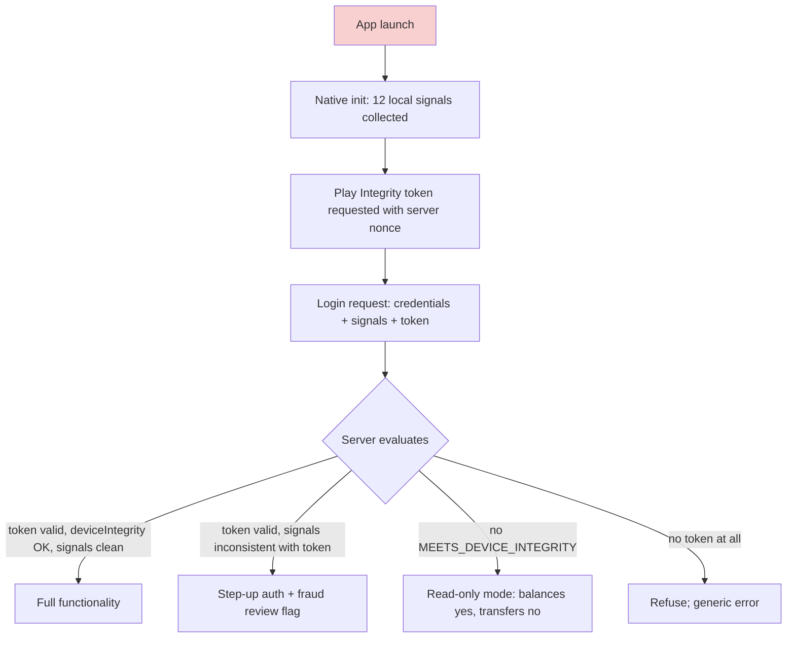

Note what is *not* here: the app never shows a "rooted device" dialog and never exits. Everything is a
server-side decision about which capabilities to grant. The consequences are graduated, so a false
positive costs a customer some features rather than all of them, and an attacker cannot tell which
signal tripped.

**Testing this properly** means ignoring the root checks almost entirely and going after the three
things that actually decide the outcome: is the token bound to the request; does the server fail open;
and does the read-only mode actually enforce server-side, or does it merely hide buttons in the UI?
That last question is answered by replaying the transfer API call directly and is the finding that
pays for the engagement.

### 9.5 Enterprise — MDM compliance attestation

An enterprise MDM agent has a genuinely different problem: it is *asked* by a management server
whether the device is compliant, and the answer must be trustworthy to the server, not to the app.

```java
// Java — the shape of a defensible enterprise compliance report.
public final class ComplianceReport {

    /** Everything here is EVIDENCE for the server, not a decision. */
    public static org.json.JSONObject collect(android.content.Context ctx,
                                              String serverNonce) throws Exception {
        org.json.JSONObject o = new org.json.JSONObject();
        o.put("fingerprint", android.os.Build.FINGERPRINT);
        o.put("securityPatch", android.os.Build.VERSION.SECURITY_PATCH);
        o.put("verifiedBootState", getProp("ro.boot.verifiedbootstate"));
        o.put("bootloaderLocked", getProp("ro.boot.flash.locked"));
        o.put("localRootSignals", new org.json.JSONArray(
                RootDetector.evaluate(ctx).signals));

        // The load-bearing part: hardware key attestation with the server's nonce.
        java.security.KeyStore ks = java.security.KeyStore.getInstance("AndroidKeyStore");
        ks.load(null);
        java.security.KeyPairGenerator kpg = java.security.KeyPairGenerator.getInstance(
                java.security.KeyProperties.KEY_ALGORITHM_EC, "AndroidKeyStore");
        kpg.initialize(new android.security.keystore.KeyGenParameterSpec.Builder(
                    "attest-" + System.currentTimeMillis(),
                    android.security.keystore.KeyProperties.PURPOSE_SIGN)
                .setDigests(android.security.keystore.KeyProperties.DIGEST_SHA256)
                .setAttestationChallenge(serverNonce.getBytes("UTF-8"))
                .build());
        kpg.generateKeyPair();

        java.security.cert.Certificate[] chain =
                ks.getCertificateChain("attest-" + System.currentTimeMillis());
        org.json.JSONArray certs = new org.json.JSONArray();
        for (java.security.cert.Certificate c : chain) {
            certs.put(android.util.Base64.encodeToString(c.getEncoded(),
                      android.util.Base64.NO_WRAP));
        }
        o.put("attestationChain", certs);
        return o;
    }
}
```

The server verifies the certificate chain up to a Google hardware attestation root, checks that the
challenge matches the nonce it issued, and reads the `verifiedBootState` and `deviceLocked` fields
**from inside the attestation extension** — values produced by the TEE, not by the app. Those values
cannot be forged by root, which is the entire point. See
[50-HardwareBackedSecurity](../50-HardwareBackedSecurity/README.md) and
[49-KeyStore](../49-KeyStore/README.md) for the attestation extension's structure.

**The pentester's angle:** the local signals are noise. Attack the chain verification. Does the server
verify the chain to a *pinned* Google root, or does it merely parse the leaf? Does it check the
revocation status? Does it compare the challenge? Does it reject a software-backed (`ATTESTATION_SECURITY_LEVEL: SOFTWARE`)
attestation? Each of those is a real finding and each is more valuable than any Frida script.

---

## 10. Common Interview Questions

### Beginner

**Q: What is root, and how is a phone rooted?**
Root is UID 0, the Linux superuser, for which the kernel bypasses standard permission checks. Android
ships no way to obtain it. Rooting means installing one, most commonly by unlocking the bootloader and
flashing a Magisk-patched boot image, so that a daemon running as root can grant UID 0 to chosen
processes on request.SELinux still applies to root, so root is necessary but not always
sufficient.

**Q: Name five ways an app can detect root.**
Existence of a `su` binary at known paths; installed root-manager packages via `PackageManager`;
`Build.TAGS` containing `test-keys`; a writable `/system` or a Magisk overlay in `/proc/self/mounts`;
and executing `su -c id` to see whether it succeeds. A good answer adds that all five are local and
therefore defeatable.

**Q: Why is `File.exists("/system/bin/su")` a weak check?**
Because the app is asking the operating system a question, and on a rooted device the attacker
controls the operating system's answer — and, more directly, because the attacker can hook
`File.exists` or patch the branch that consumes its result. Also because modern systemless root does
not put anything in `/system` at all.

### Intermediate

**Q: You hook `java.io.File.exists()` and the app still detects root. Give four explanations.**
(1) The check is in native code and never enters the Java layer. (2) The check uses a different Java
API — `Os.access`, `FileInputStream`, `Files.exists`. (3) The check is not filesystem-based at all —
properties, mounts, packages. (4) The check ran before your hook was installed, because you attached
instead of spawning. The correct next step is to run a tracer rather than guess.

**Q: What is the difference between hooking `File.exists` and hooking `libc.so!access`?**
`File.exists` is at the top of the stack and only covers Java callers using that specific API.
`libc!access` is near the bottom and covers *both* Java callers (because libcore ultimately calls
libc) and native callers. Hooking lower catches more, at the cost of affecting unrelated code, so you
must be more careful about which paths you deny.

**Q: An app targeting API 33 checks for `com.topjohnwu.magisk` with `getPackageInfo` and it never
fires, even on a device where Magisk Manager is installed. Why?**
Package visibility filtering, introduced in Android 11. An app targeting API 30+ can only see
packages declared in its `<queries>` element or matching a visible intent filter. Without the
declaration, `PackageManagerService` returns null and the client throws `NameNotFoundException`. The
check is dead code, and that is worth reporting to the developer.

**Q: Why does Magisk's DenyList sometimes defeat a check with no hooking at all?**
Because Magisk implements root systemlessly using mount namespace manipulation. DenyList causes the
target process to be given a mount namespace with Magisk's modifications reverted, so `su` genuinely
is not present in that process's view of the filesystem and the mount table genuinely is clean. The
check is not fooled; it is correct, about a deliberately constructed reality.

### Senior

**Q: Design a root-detection strategy for a banking app. Be specific about where each decision is
made.**
Collect local signals natively — `verifiedbootstate`, mount-table shape, `su` presence via multiple
syscalls — but never act on them in the app. Request a Play Integrity token bound to a server-issued
nonce and to a hash of the request being made. Send signals plus token to the server on every
sensitive operation, not just at login. The server verifies the token's signature, checks the request
binding and timestamp, and cross-references the client-reported signals against the attested verdict —
inconsistency between the two is itself a strong fraud signal. The server then makes a graduated
decision: full access, step-up authentication, read-only, or refusal. Fail closed on a missing token.
Enforce every capability server-side so that a client that ignores the decision gains nothing.

**Q: Explain the trust boundary and why client-side detection sits on the wrong side of it.**
The boundary runs between the device — all of it, including the kernel — and your infrastructure. The
attacker controls everything on the device side: they can modify your code, hook the runtime, replace
the OS, and lie to any local API. A client-side check is a computation performed entirely inside the
attacker's territory, so its output is attacker-chosen. Attestation moves the evidence-production
step behind a hardware root of trust and the verification step onto your server, putting both on the
correct side of the boundary.

**Q: How would you approach an app whose native root check uses inline syscall assembly?**
Stop hooking, since there is no symbol to attach to. Use `strace` on the process to see the syscalls
that actually occur, which reveals the paths being probed. In Ghidra, locate the `svc` instruction
and read the surrounding function to find where the result is compared or stored. Then either patch
the comparison at runtime with `Memory.patchCode`, or patch the `.so` on disk and repackage. If the
result is deliberately decoupled from the consequence, trace forward from the stored value with a
memory write watchpoint to find where it is eventually consumed.

**Q: What is the most common serious flaw in a Play Integrity integration?**
Missing request binding: no server-issued nonce, or a `requestHash` that is not tied to the specific
request. That lets an attacker obtain one valid token from a clean device and replay it indefinitely
from a compromised one, which reduces a hardware-backed control to nothing. Second most common is
failing open when the attestation service is unreachable.

### Staff Engineer

**Q: You have a fixed budget of thirty engineer-days for mobile anti-fraud. Allocate it and justify
the allocation.**
Roughly: two days for a minimal native local-signal collector — not because it stops anyone, but
because it feeds the fraud model and is cheap; six days for a correct Play Integrity integration with
server-issued nonces, request binding, and fail-closed handling; eight days for the server-side risk
engine that consumes both and makes graduated decisions; six days ensuring every sensitive capability
is enforced server-side rather than gated in the UI, which is where the actual vulnerabilities are;
four days for monitoring, alerting on verdict distributions, and an on-call runbook for the day
Google's service degrades; four days of buffer. Deliberately zero days on adding root check numbers
fifteen through thirty, because their marginal value is approximately nil and each one adds false
positives and support cost.

**Q: How do you measure whether your integrity controls are working?**
Not by counting blocked users. Measure the distribution of attestation verdicts over time, the
fraud-loss rate segmented by verdict, the false-positive rate proxied by support contacts from users
blocked or degraded, and the delta in confirmed fraud after a control ships. If a control blocks
users but does not move the fraud-loss number, it is costing you money and buying nothing, and you
should say so out loud.

**Q: A product manager wants to block all rooted devices. Make the counter-argument, and then make the
argument for.**
Against: rooted users are a small, disproportionately technical and vocal population; blocking them
generates reviews, support load, and press; the block is trivially bypassed by exactly the attackers
you care about, so you pay the full cost and receive a fraction of the benefit; and it converts a
useful graduated risk signal into a binary you can no longer tune. For: in some regulated contexts a
documented control is required regardless of efficacy; in a DRM context a contractual obligation to a
content owner may demand it; and for a small number of extremely high-risk operations, refusing
outright is a defensible product decision. The resolution is to block *operations*, not *users*, and
to do it server-side.

### Principal Engineer

**Q: Is remote attestation good for the ecosystem? Argue both sides.**
For: it is the only mechanism that gives a server evidence about a client that the client's owner
cannot forge, which meaningfully reduces large-scale automated fraud and is the difference between an
enforceable and a decorative control. Against: it concentrates the power to decide which software
configurations are "legitimate" in a small number of vendors; it structurally disadvantages
alternative operating systems, de-Googled devices, and users who exercise control over hardware they
own; and it has been used to enforce business rules — such as blocking modified but harmless clients —
that have nothing to do with security. A serious answer engages with the fact that both are true
simultaneously, and proposes mitigations such as graduated rather than binary policies, published
criteria, and appeal mechanisms.

**Q: Design a device-integrity signal that a defender can trust without a single vendor being the
arbiter.**
Expect a discussion of a hardware root of trust with a vendor-independent verification path,
measured-boot logs with independently reproducible reference measurements, attestation of *properties*
rather than *identity* (zero-knowledge or selective-disclosure style), user consent and transparency
about what is attested, and the hard problems: who publishes reference measurements, how firmware
updates are handled without breaking every verifier, and how the scheme resists an owner who has
physical access and unlimited time. A candidate who says "this is fundamentally hard because physical
access defeats everything eventually, so the goal is cost and scale, not impossibility" is thinking
correctly.

**Q: Ten years from now, what should the root-detection section of a mobile security standard say?**
A strong answer argues that it should say almost nothing about detection and a great deal about
enforcement placement: that every security decision must be enforced on the server; that client
signals may inform risk scoring but must never gate authorisation; that attestation must be bound to
requests and fail closed; and that controls must degrade capability rather than deny access, to
preserve both usability and the value of the signal.

---

## 11. Common Mistakes

### Developer mistakes

- **Trusting the boolean.** Building an `if (isRooted()) denyEverything()` gate and considering the
  problem solved. Every technique in section 3 ends at that one branch.
- **Checking once at startup.** An attacker attaches or hooks before your code runs, or
  restarts the check's state. Re-evaluate before sensitive operations, and understand that this only
  raises cost.
- **Acting locally instead of reporting.** Calling `System.exit()` destroys the fraud signal and gains
  nothing, because the exit is one hook away.
- **Copying a path list from a 2016 blog post.** Half the paths no longer exist and the check misses
  modern systemless root entirely.
- **Forgetting `<queries>` on API 30+**, leaving package checks permanently silent.
- **`System.getProperty("ro.build.tags")`** instead of `SystemProperties.get(...)`, which always
  returns null.
- **Hardcoding `/system/xbin/which`,** which is absent on modern devices, so the `exec` throws and the
  check is dead.
- **Running `su -c id` on the main thread,** producing ANRs when the root prompt blocks.
- **Verifying the Play Integrity token in the app** rather than on the server.
- **No nonce or request binding** on the attestation token, permitting unlimited replay.
- **Failing open** when the attestation service is unreachable.
- **Logging the detection result,** handing the attacker a map of the checks in logcat.
- **Blocking users instead of blocking operations,** which maximises support cost and minimises
  security benefit.

### Pentester mistakes

- **Attaching instead of spawning.** `frida -U -n com.app` misses everything in `Application.onCreate`.
  Use `-f`.
- **Hooking the abstract `PackageManager`** instead of `ApplicationPackageManager`, then concluding
  Frida is broken.
- **Blanket-returning `false` from `File.exists`,** which breaks the app in ways that look like the
  root check firing.
- **Not running a tracer first,** and spending an hour hooking the wrong layer.
- **Declaring victory at the login screen** without exercising the sensitive flows, where the app
  re-checks.
- **Reporting "root detection bypassed" as the finding.** The finding is what the bypass gave you
  access to, and whether the server independently validated anything.
- **Missing that a check is broken.** Half the value you deliver is telling the developer that their
  control has silently never worked.
- **Changing device state (`setenforce 0`, DenyList entries) and forgetting it,** then reporting
  behaviour that does not reproduce on a normal device.
- **Ignoring the attestation integration** because the local checks are more fun. The attestation
  bugs are the ones with impact.
- **Testing on an emulator** and reporting that a control does not exist, when the app disabled the
  feature because it detected the emulator — see
  [39-EmulatorDetection](../39-EmulatorDetection/README.md).

### Reverse engineer mistakes

- **Assuming the DEX is the whole story.** Always check `lib/` and always check for runtime DEX
  loading.
- **Assuming a `.so` present in the APK is loaded.** Confirm from `/proc/<pid>/maps` at runtime.
- **Patching the check rather than the consequence,** when the consequence is a single instruction
  and the check is five hundred.
- **Not noticing decoupling.** If the detection result feeds a key derivation or a value used much
  later, the crash you are debugging is not the check.
- **Reading `strings` output and assuming the string is used.** Cross-reference it.
- **Forgetting that re-signing a patched APK trips signature verification.** Read
  [38-TamperDetection](../38-TamperDetection/README.md) before you repackage.
- **Ignoring `strace`** because Frida is more comfortable. `strace` is the only tool that cannot be
  lied to by a hook you did not install.

---

## 12. Hands-on Labs

Full lab material lives in [`labs/`](labs/).

| Lab | Objective | Difficulty |
|---|---|---|
| [Lab 01 — Build and break your own root check](labs/lab-01-build-and-break.md) | Write a nine-signal root checker, then defeat each signal in turn and record the cost of each bypass | Beginner |
| [Lab 02 — Native check, no Java surface](labs/lab-02-native-check.md) | Implement the check in C with obfuscated strings and raw syscalls; bypass it with libc hooks, then with `strace` plus a patch | Intermediate |
| [Lab 03 — Trace, identify, neutralise](labs/lab-03-trace-and-neutralise.md) | Given an unknown binary with twelve checks and no source, use the tracer to identify and defeat every one | Advanced |
| [Lab 04 — CTF: The decoupled check](labs/lab-04-ctf-decoupled.md) | An app that shows no root message and "fails to connect"; find the check, find the consequence, and recover the flag | CTF |

**Assignment.** Write your own tracer from scratch before reading
[`scripts/root-check-tracer.js`](scripts/root-check-tracer.js). The act of deciding which functions
are worth instrumenting is where the understanding lives; a copied script gives you output you cannot
extend.

---

## 13. Summary

### Key points

- Root detection exists for the "user is the attacker" threat model, which the Android sandbox was
  never designed to address.
- Root is UID 0. Modern root is systemless (Magisk), so it leaves `/system` untouched and defeats an
  entire generation of checks by construction.
- Every local check is a computation performed inside attacker-controlled territory. Its output can be
  changed at the environment, the input, the return value, the call site, or the consequence.
- The layer a check runs at decides your approach. Java-level checks fall to `Java.perform` hooks;
  native checks require libc interposition; inline-syscall checks require patching.
- Hooking `libc.so!access`/`stat`/`open` covers both the Java and native paths at once, because
  libcore ultimately calls libc.
- `ro.boot.verifiedbootstate` is the strongest purely local signal, because its value originates in
  the bootloader, before Android exists.
- Package-name checks silently died for apps targeting API 30+ without a `<queries>` declaration.
- RootBeer is the library you will meet most often; it has a native component whose JNI symbol name
  survives obfuscation and makes an excellent hook anchor.
- Magisk DenyList plus Zygisk defeats a surprising number of apps with no hooking at all — try it
  first, it costs sixty seconds.
- Run a tracer before you write a single hook. Knowing which check fired converts an open-ended fight
  into a small task.
- The only control worth real engineering budget is server-verified remote attestation, bound to a
  server-issued nonce, failing closed, feeding a graduated server-side decision.
- The highest-impact findings in this area are attestation replay, client-side verdict evaluation,
  fail-open handling, and server endpoints that do not enforce what the UI hides.

### Mind map

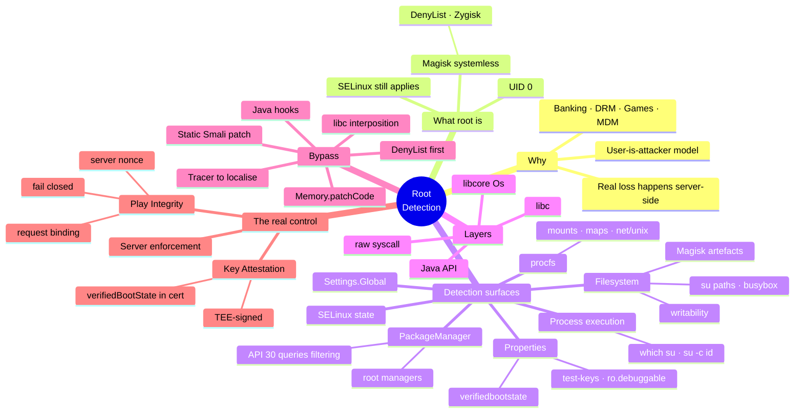

### Condensed cheat sheet

| Need | Action |
|---|---|
| Is there root detection at all | `strings classes*.dex \| grep -E 'su$\|magisk\|test-keys'` |
| Which package holds the checker | grep hits, then cluster by directory |
| Is there a native check | `readelf --dyn-syms lib/*/*.so \| grep -E 'access\|stat\|property'` |
| Which check is firing | `frida -U -f pkg -l scripts/root-check-tracer.js` |
| Fastest possible bypass attempt | Magisk DenyList + Zygisk, force-stop, relaunch |
| Java-layer bypass | `frida -U -f pkg -l scripts/java-root-bypass.js` |
| Native-layer bypass | `frida -U -f pkg -l scripts/native-root-bypass.js` |
| RootBeer specifically | Hook the Java methods **and** `Java_com_scottyab_rootbeer_RootBeerNative_checkForRoot` |
| Hook covers Java + native filesystem | `Interceptor.attach(Module.getExportByName("libc.so","access"), ...)` |
| Library not loaded yet | Hook `android_dlopen_ext`, install from `onLeave` |
| Ground truth, unhookable | `strace -f -e trace=openat,faccessat,execve -p $(pidof -s pkg)` |
| Return false, arm64 patch | `MOV W0,#0; RET` = `00 00 80 52 C0 03 5F D6` |
| Smali "always false" | `.locals 1` / `const/4 v0, 0x0` / `return v0` |
| Test the attestation, not the check | Replay the token; remove the token; check the server's behaviour |

### Quick revision

- What is UID 0, and why is SELinux still relevant after you have it?
- Why does systemless root defeat `/system` writability checks by construction?
- Which single Frida hook covers both Java and native filesystem existence checks, and why?
- What happened to package-name checks in Android 11, and how do you tell from the manifest?
- Where does `ro.boot.verifiedbootstate` come from, and why does that matter?
- Name three ways a root check can be defeated without touching the check itself.
- What does Magisk DenyList actually do to the target process?
- Why is `Java.use("android.content.pm.PackageManager")` the wrong class to hook?
- What are the three ways a Play Integrity integration is commonly broken?
- Why is "root detection can be bypassed" a weak finding, and what is the strong version?

---

## 14. References

### AOSP source

- `libcore/ojluni/src/main/java/java/io/File.java` — `exists()` and the `UnixFileSystem` path
- `libcore/luni/src/main/java/libcore/io/Posix.java`, `BlockGuardOs.java` — the JNI filesystem layer
- `libcore/luni/src/main/native/libcore_io_Posix.cpp` — where Java filesystem calls enter native code
- `bionic/libc/bionic/system_property_get.cpp` and `system/core/init/property_service.cpp` — the
  property store, reader and writer sides
- `frameworks/base/core/jni/android_os_SystemProperties.cpp` — the Java bridge to properties
- `frameworks/base/core/java/android/app/ApplicationPackageManager.java` — the concrete
  `PackageManager` an app receives
- `frameworks/base/services/core/java/com/android/server/pm/AppsFilter.java` — package visibility
  filtering
- `system/core/init/` — `init`, and how `ro.boot.*` properties arrive from the kernel command line
- `external/selinux/libselinux/src/getenforce.c` — SELinux state reading
- Android Code Search: https://cs.android.com/

### Official Android documentation

- Play Integrity API — https://developer.android.com/google/play/integrity
- Play Integrity verdicts and their meanings — https://developer.android.com/google/play/integrity/verdicts
- Key and ID Attestation — https://developer.android.com/privacy-and-security/security-key-attestation
- Verified Boot — https://source.android.com/docs/security/features/verifiedboot
- Android Verified Boot 2.0 (AVB) — https://android.googlesource.com/platform/external/avb/
- Package visibility filtering — https://developer.android.com/training/package-visibility
- SELinux on Android — https://source.android.com/docs/security/features/selinux

### OWASP

- OWASP MASVS — https://mas.owasp.org/MASVS/
- MASVS-RESILIENCE — https://mas.owasp.org/MASVS/11-MASVS-RESILIENCE/
- OWASP MASTG — https://mas.owasp.org/MASTG/
- MASTG Android anti-reversing and platform-integrity tests — https://mas.owasp.org/MASTG/tests/

### Tooling and projects

- Magisk — https://topjohnwu.github.io/Magisk/
- Magisk DenyList documentation — https://github.com/topjohnwu/Magisk/blob/master/native/src/core/deny/cli.cpp
- Zygisk — https://topjohnwu.github.io/Magisk/guides.html
- RootBeer — https://github.com/scottyab/rootbeer
- Frida — https://frida.re/docs/android/
- Objection — https://github.com/sensepost/objection

### Related chapters

- [21-App-Sandbox](../21-App-Sandbox/README.md) — the model root breaks
- [22-SELinux](../22-SELinux/README.md) — why root is not omnipotence
- [38-TamperDetection](../38-TamperDetection/README.md) — signature checks, anti-debug, anti-Frida
- [39-EmulatorDetection](../39-EmulatorDetection/README.md) — the sibling control
- [40-Obfuscation](../40-Obfuscation/README.md) — what survives R8 and what does not
- [49-KeyStore](../49-KeyStore/README.md) — hardware-backed keys and attestation
- [50-HardwareBackedSecurity](../50-HardwareBackedSecurity/README.md) — the TEE and StrongBox
- [53-Frida](../53-Frida/README.md) — how the hooks in this chapter actually work
- [62-Magisk](../62-Magisk/README.md) — Magisk internals in depth
- [67-BypassingProtections](../67-BypassingProtections/README.md) — the general methodology
- [71-OWASP-Mobile](../71-OWASP-Mobile/README.md) — MASVS mapping in full
