# 37 — Root Detection · Mind Map

One picture of the whole chapter. Read it outward from the centre.

The centre is a single uncomfortable fact: a root check is a question the app asks *itself*, on
hardware the attacker owns, using code the attacker can rewrite, answered by an operating system the
attacker replaced. Every branch below is either a way of asking that question (detection surfaces), a
way of changing the answer (bypass), a way of making the question harder to answer falsely
(hardening), or the one move that changes the game entirely (attestation, which produces evidence
outside the attacker's territory).

Each branch corresponds to a section of [the chapter README](README.md). Use it as a revision map
before an engagement or an interview.

```mermaid
mindmap
  root((Root<br/>Detection))
    Why it exists §1
      User-is-the-attacker model
        app enforces a rule against its own user
        platform never designed for this
      Who cares
        banking and payments
        DRM and streaming
        games with IAP
        enterprise MDM
        health identity government
        gig and ride-hailing
      Where the loss actually happens
        on the server
        which is where the control belongs
      Honest framing
        speed bump not boundary
        implement it and know its value
        failure mode is believing the check
    What root is §1.2
      UID 0
        kernel skips DAC checks
        setuid bit on su
      SELinux still applies
        root is not omnipotence
        magiskpolicy adds targeted allow rules
      Verified Boot
        AVB measures before Android exists
        verifiedbootstate green orange yellow red
      Magisk
        systemless by design
        patched boot image magiskinit
        magiskd brokers root over a socket
        bind mounts and mount namespaces
        Zygisk injects into zygote
        DenyList reverts the namespace
    Detection surfaces §3
      Filesystem §3.1
        su path list
        busybox
        Superuser.apk init.d
        Magisk artefacts §3.5
          data adb 0700 root
          sbin randomised now
      PATH and subprocess §3.2 §3.3
        System.getenv PATH
        which su
        su -c id then grep uid=0
        ANR risk on main thread
      PackageManager §3.4
        known manager packages
        API 30 queries filtering kills it
        Magisk stub repackaging
      Writability §3.6
        canWrite on system dirs
        mount flags rw
      Properties §3.7
        Build.TAGS test-keys
        ro.debuggable ro.secure
        ro.boot.verifiedbootstate
          strongest local signal
          provenance outside Android
        System.getProperty is the WRONG table
      procfs §3.8 §3.9
        self mounts tmpfs overlay
        self mountinfo richer less sanitised
        self maps injected libraries
        net unix magisk socket now randomised
      SELinux state §3.10
        enforce node
        obsolete Magisk stays enforcing
      Settings.Global §3.11
        adb_enabled
        development_settings_enabled
        near zero as a root signal
      Native §3.12
        access stat open fopen popen system
        __system_property_get
        ["raw syscall via syscall()"]
        inline svc assembly
      RootBeer §3.13
        most common library in the wild
        Java surface plus librootbeer.so
        JNI symbol survives R8
    Layers and where to hook
      Java API
        File.exists Runtime.exec PM SystemProperties
        cheapest most portable
      libcore Os
        BlockGuardOs catches every Java FS API
      libc
        catches Java AND native at once
        the default choice
      raw syscall
        no symbol to attach to
        strace then patch
    Bypass §7
      Do it in order
        DenyList and Zygisk first
        hiding module
        java-root-bypass.js
        native-root-bypass.js
        tracer to localise
        targeted hook or patchCode
        static patch and re-sign
      Five places to intervene
        change the environment
        change the inputs
        change the return value
        change the caller
        remove the consequence
      Rules that save hours
        spawn never attach
        hook the concrete class
        surgical not blanket
        set errno so failure looks natural
        allocate strings never overwrite in place
        re-run after late dlopen
      Tools
        Frida Interceptor and Java.perform
        Objection android root disable
        strace ground truth
        Ghidra imports then Java_ exports
        Memory.patchCode
    Reverse engineering §6
      Five minute triage
        DEX strings
        so strings and imports
        Java_ exports
      What survives obfuscation
        string literals
        JNI symbols
        manifest names
        reflection targets
      Smali patterns
        File loop
        Build.TAGS contains
        declared native method
      Universal patch
        locals 1 const 0 return
      arm64 patches
        MOV W0 #0 RET
    Developer hardening
      Native not Java
      Multiple syscalls per artefact
      Strings assembled at runtime
      Probe paths a lazy regex misses
      Decouple detection from consequence
        the most effective pattern here
        almost nobody implements it
      Score do not gate
      Report signals to the server
      Never act locally
    The real control §3.15
      Play Integrity
        server issued nonce
        requestHash binds the request
        token opaque to the app
        server decodes and decides
        fail closed
      Key Attestation
        TEE signed cert chain
        verifiedBootState inside the extension
        challenge equals server nonce
      Server enforcement
        block operations not users
        graduated degradation
        inconsistency between signals and verdict is itself evidence
      How it is broken
        verdict evaluated in app
        no nonce so tokens replay
        fail open when Google is unreachable
    Findings that matter §5
      Attestation replay
      Client-side verdict evaluation
      Fail-open handling
      UI-only enforcement of a server capability
      A control that silently never ran
        missing queries element
        hardcoded system xbin which
        System.getProperty on a build property
```

---

## How to use this map

**Before an engagement.** Read the *Detection surfaces* and *Layers* branches. They tell you what to
look for in the five-minute triage and which layer to hook once you find it.

**During an engagement.** Work down the *Bypass* branch in order. The order is the whole point:
DenyList costs a minute and works surprisingly often, the tracer costs twenty minutes and converts an
open-ended fight into a small task, and everything below that costs hours.

**When writing the report.** Read the *Findings that matter* branch. "Root detection bypassed" is not
a finding. What the bypass gave you access to, and whether the server independently validated
anything, is.

**When advising a developer.** Read *Developer hardening* and *The real control* together, in that
order. The first is what to do with the budget they have already spent; the second is where the next
budget should go.

---

## Related maps

- [38-TamperDetection](../38-TamperDetection/README.md) — signature checks, anti-debug, anti-Frida
- [39-EmulatorDetection](../39-EmulatorDetection/README.md) — the sibling control, same trust boundary
- [62-Magisk](../62-Magisk/README.md) — the mechanisms on the other side of the arms race
- [67-BypassingProtections](../67-BypassingProtections/README.md) — the general methodology
