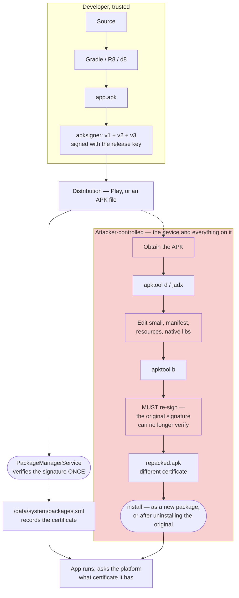
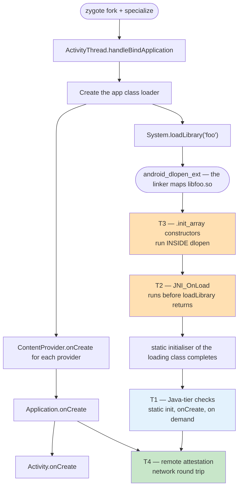
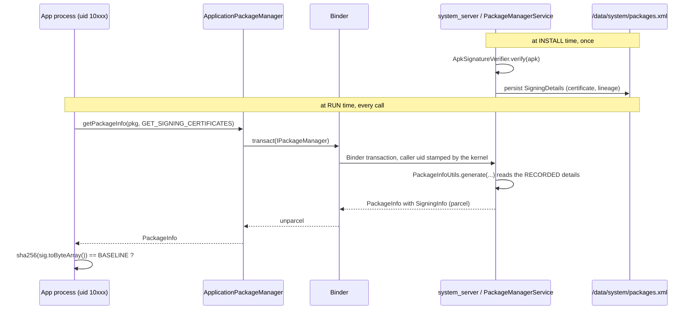
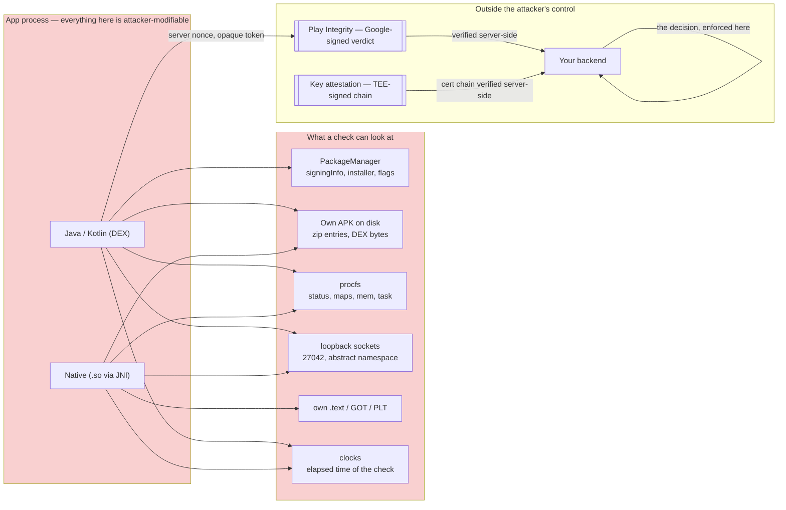
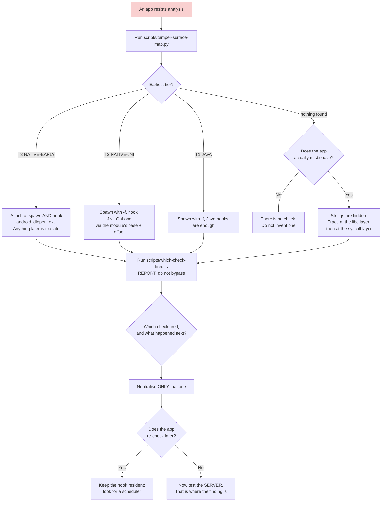
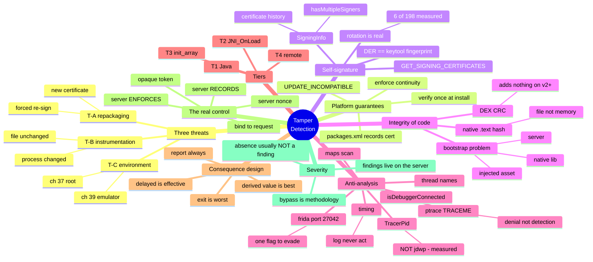

# 38 — Tamper Detection

> After this chapter you will be able to enumerate every integrity and anti-analysis control an
> Android app can perform on *itself*, explain precisely what each one proves and what it does not,
> find each one in a compiled APK before you attempt any bypass, build an app that detects its own
> repackaging and watch it fire, and — the part most reports get wrong — write an honest severity for
> the absence of all of it.

**Prerequisites:** [02-Linux-Basics](../02-Linux-Basics/README.md),
[09-Android-App-Internals](../09-Android-App-Internals/README.md),
[10-APK-Internals](../10-APK-Internals/README.md),
[12-DEX-Internals](../12-DEX-Internals/README.md),
[16-JNI](../16-JNI/README.md), [17-Libraries](../17-Libraries/README.md),
[34-Cryptography](../34-Cryptography/README.md),
[37-RootDetection](../37-RootDetection/README.md)

**Useful alongside:** [49-KeyStore](../49-KeyStore/README.md) — cited throughout for hardware key
attestation (§3.7 there), which this chapter points at for depth rather than depends on.
[53-Frida](../53-Frida/README.md) for the runtime bypasses; finding every integrity control in an
APK before you attempt one, and building an app that detects its own repackaging, both work without
it, and [53's opening callout](../53-Frida/README.md) explains why `frida-server` may not run on
your image at all.

**Applies to:** Android 5–16 (API 21–36). `GET_SIGNING_CERTIFICATES` and `SigningInfo` are API 28+;
`getInstallSourceInfo()` is API 30+; APK Signature Scheme v3.1 is API 33+. Every version-gated
statement is marked in a Version Matrix table, and every claim marked **measured** was verified on a
physical device named in §7.9.

---

> **⚠️ Warning — scope and authorisation**
> This chapter is written for **authorised testing**: an app you built, an app you are contracted to
> assess, or a deliberately vulnerable lab target. Defeating an integrity check on software you have
> no permission to test is unauthorised access in most jurisdictions, regardless of how trivial the
> check was. Everything in `examples/` and `labs/` builds and attacks an app that this chapter ships
> the source for. Third-party applications appear here only as *detection* targets — read with a
> static analyser, never modified, never installed in a modified form.

---

## Table of Contents

1. [Introduction](#1-introduction)
2. [High-Level Architecture](#2-high-level-architecture)
3. [Deep Internal Working](#3-deep-internal-working)
4. [Source Code Walkthrough (AOSP)](#4-source-code-walkthrough-aosp)
5. [Security Perspective](#5-security-perspective)
6. [Reverse Engineering Perspective](#6-reverse-engineering-perspective)
7. [Dynamic Analysis](#7-dynamic-analysis)
8. [Static Analysis](#8-static-analysis)
9. [Examples](#9-examples)
10. [Common Interview Questions](#10-common-interview-questions)
11. [Common Mistakes](#11-common-mistakes)
12. [Hands-on Labs](#12-hands-on-labs)
13. [Summary](#13-summary)
14. [References](#14-references)

---

## 1. Introduction

### 1.1 The problem, in plain English

Think about a bottle of medicine. Somewhere between the factory and your bathroom cabinet, dozens of
people could have opened it. The manufacturer cannot follow the bottle around, cannot post a guard in
the warehouse, and certainly cannot stand in your kitchen. So they do the only thing available: they
put a **foil seal** across the neck.

The seal does not stop anyone opening the bottle. A determined person removes it in four seconds with
a knife. What the seal does is make opening the bottle *leave a mark* — and, crucially, make the
**next person to look** able to tell. The pharmacist checks it. You check it. And because everyone
knows the seal exists, the casual tamperer does not bother, because their tampering will be noticed
by somebody.

Now change one detail, and the whole picture changes with it. Suppose the only person who ever
inspects the seal is *the bottle itself*. The bottle has a little sensor, it checks its own foil, and
if the foil is broken it refuses to dispense. And suppose the person you are worried about is the one
holding the bottle, in their own kitchen, with a full toolbox.

That is Android tamper detection. The app is the bottle. The seal is the APK signature. The sensor is
a few lines of Java. And the toolbox belongs to the adversary.

> **🧠 Mental Model**
> Tamper detection is a **tamper-evident seal that the sealed object inspects itself**. Its value is
> real but narrow: it makes modification *noticeable*, which raises the cost of the cheapest attacks
> and makes the expensive attacks leave evidence. Its limit is structural and cannot be engineered
> away: the inspector runs inside the thing being inspected, on hardware the adversary owns.

Everything else in this chapter follows from holding both halves of that sentence at once. A reader
who takes only the first half writes checks and believes them. A reader who takes only the second
half writes "client-side checks are pointless" in a report and is wrong in a way that costs their
client money. The correct position has two clauses joined by "and", and §5.3 makes it concrete enough
to put in a findings table.

### 1.2 What "tamper" actually means — three different things

The word is used loosely, and the looseness causes bad reports and worse engineering. Three distinct
threats travel under the same label, they have different detections, different costs, and different
correct responses.

| # | Threat | What the attacker does | What it looks like on disk | What it looks like at runtime |
|---|---|---|---|---|
| **T‑A** | **Repackaging** | Decompiles the APK, edits Smali or resources, rebuilds, **re-signs with their own key**, distributes | A different APK: different bytes, different signature, usually a different certificate | The app's own certificate no longer matches the one the developer shipped |
| **T‑B** | **Runtime instrumentation** | Leaves the APK alone; injects into the running process with Frida, LSPosed, a debugger, or a memory editor | **Nothing.** The file on disk is byte-identical to the one the developer signed | Foreign libraries mapped in, hooks installed, a tracer attached, threads that do not belong |
| **T‑C** | **Hostile environment** | Runs the unmodified app on a device that lies: root, an emulator, a modified system image | Nothing | System APIs return values the platform would not normally produce |

The three are independent. You can repackage without instrumenting. You can instrument without
repackaging. And an app running on a perfectly clean device can still be repackaged.

**This chapter owns T‑A and T‑B.** T‑C is split: root detection belongs to
[37-RootDetection](../37-RootDetection/README.md), emulator detection to
[39-EmulatorDetection](../39-EmulatorDetection/README.md),
and the platform-integrity signals that answer T‑C properly — Verified Boot and
the Play Integrity platform side — belong to
[20-Security-Architecture](../20-Security-Architecture/README.md) and, for hardware key attestation,
to [49-KeyStore](../49-KeyStore/README.md) §3.7.

> **⚠️ Warning — the distinction is not academic**
> The single most common conceptual error in this area is treating T‑A and T‑B as one problem. They
> have *opposite* detection properties. A signature check catches T‑A perfectly and T‑B not at all,
> because in T‑B the signature is genuinely correct. A `/proc/self/maps` scan catches T‑B and T‑A not
> at all, because a repackaged app has a perfectly ordinary address space. An app that ships only a
> signature check and believes it has "anti-tampering" has covered half the problem and does not
> know which half.

### 1.3 Why the platform does not just do this for you

Android *does* verify integrity — once, at install time, thoroughly, and then never again for that
installed copy.

When you `adb install` an APK, the package manager verifies its signature before writing anything to
`/data/app`. The mechanism is [10-APK-Internals](../10-APK-Internals/README.md)'s subject and §3.1
below summarises the parts this chapter depends on. The result of that verification is *recorded*:
the certificate is stored in `/data/system/packages.xml`, and from then on the platform's job is to
enforce **continuity**, not integrity. It refuses an update signed by a different key. It refuses to
grant a `signature`-protection-level permission to a package with the wrong certificate.

That is a genuinely strong guarantee and it solves a genuinely important problem: **an app cannot be
modified in place by another app**. What it does not solve is the problem this chapter exists for.

The platform never asks "is this the APK the developer published?" It asks "is this APK internally
consistent, and is it signed by the same key as the copy that was here before?" A repackaged APK,
signed by an attacker's key and installed as a fresh package, satisfies both conditions completely.
It is a valid, correctly signed, internally consistent Android application. It is simply not *yours*.

> **📖 Definition — repackaging**
> Taking a published APK, modifying its code, resources or manifest, re-signing it with a key the
> attacker controls, and distributing the result. Because Android will not install a modified APK
> under the original signature, re-signing is not optional — it is forced. That forced step is the
> hook on which every anti-repackaging control in this chapter hangs.

Two more platform facts complete the picture, and both are measurable in one command each:

- **The platform tells the app which certificate it was installed with.** That is
  `PackageManager.getPackageInfo(pkg, GET_SIGNING_CERTIFICATES)`, and it is the entire foundation of
  §3.2. The app does not have to parse its own APK; it asks the system what the system verified.
- **The platform will not let a differently-signed APK replace an installed one.** Measured on the
  chapter's device: installing a re-signed build over the original returned
  `INSTALL_FAILED_UPDATE_INCOMPATIBLE: Existing package com.pentest.ch38.integrity signatures do not
  match newer version; ignoring!` This is why real repackaging campaigns either change the package
  name or target users who have never installed the genuine app.

### 1.4 What tamper detection actually buys — stated precisely

Not "nothing". Not "security". Something specific and worth naming, because a control you cannot
price is a control you cannot argue about.

| It buys | Mechanism | Honest size of the win |
|---|---|---|
| **Elimination of the zero-effort attacker** | The person who found a modded APK on a forum, or who followed a four-step blog post, hits a wall and stops | Large in population terms, zero against anyone motivated. Most of the attack volume, almost none of the attack *risk* |
| **Forced cost increase for everyone else** | Each tier — Java, JNI, ELF constructor — is a separate thing to find and defeat. The mapper in §8 exists because *finding* them is itself work | Minutes to hours per app version. Multiplied by every release, this is real money for an attacker running at scale |
| **Detectability** | Even a defeated check can report before it dies. The evidence leaves the device and the server sees a population signal | This is the most under-used property in the whole field. See §5.8 |
| **Legal and contractual clarity** | Circumventing a technical protection measure has a different legal character from using an API. Certification regimes (PCI MPoC, some banking supervisors) simply require the control to exist | Not a security property, and it is dishonest to present it as one. It is still a real reason apps ship these controls |
| **Attacker time spent on the wrong thing** | An attacker who spends an afternoon defeating twenty local checks is an attacker who did not spend that afternoon on your API | Real, and the most underrated item in the table |

And what it does **not** buy, with equal precision:

- It does not make the app secure on a compromised device. It cannot. §1.5 explains why in
  mechanical terms.
- It does not protect data. If the attacker can hook your integrity check, they can hook your
  decryption routine, and the second is usually easier.
- It does not substitute for server-side enforcement, ever, under any configuration.

### 1.5 Why every local check is ultimately defeatable — the mechanism, not the slogan

Say it as a mechanism rather than as a mood.

A tamper check is a computation. It has **inputs** (values read from the OS and from files),
**logic** (comparison against a baseline), an **output** (a value), a **call site** (something that
invokes it), and a **consequence** (something the app does with the output). All five live inside a
process the attacker can inspect, modify and replace.

```
   [ inputs ] --> [ logic ] --> [ output ] --> [ call site ] --> [ consequence ]
       ^              ^             ^               ^                  ^
       |              |             |               |                  |
   hook the       patch the     hook the       delete the         patch the
   file read      comparison    method's       invocation         dialog/exit
   or the API                   return
```

Five attack points, and only the first two are affected by how clever the check is. A check written
in hand-obfuscated ARM64 with whitebox crypto and inline syscalls still, eventually, produces a value
that something branches on — and that branch is one instruction.

> **🧠 Mental Model**
> Hardening a local check is like reinforcing one link of a chain whose other four links you also
> hold. The reinforcement is real; the chain still breaks at whichever link is cheapest. The only way
> to change the outcome is to move a link **outside the attacker's reach**, which on Android means
> the server, informed by hardware-backed attestation.

This is the point where a lot of writing on the subject turns nihilistic — "client-side security is
impossible, don't bother". That conclusion does not follow, and §1.4's table is the reason. The
correct conclusion is narrower and more useful:

> **⚠️ Warning**
> **Implement it, and do not believe it.** The failure mode is not writing the check. The failure
> mode is writing the check and then designing the system as though the check were true. An app that
> hides the "transfer money" button when it detects tampering, and whose `/api/transfer` endpoint
> accepts the request anyway, has *no* control — it has a UI preference.

### 1.6 The severity question, up front

This chapter states its most contested position in §1 rather than burying it in §5, because it is the
thing readers most need and most often get wrong.

> **🔍 Pentester's Note — absent tamper detection is usually NOT a finding**
> "The application does not implement anti-tampering controls" is, on its own, **not a
> vulnerability**. It is the absence of a hardening measure. Hardening measures matter against a
> specific threat model — one that includes an attacker in physical or root control of the device —
> and if that threat model does not apply to the application, the absence is not a defect. It is a
> reasonable engineering decision.
>
> A note-taking app, an internal enterprise tool on managed devices, a public transit timetable, a
> weather app: none of these need tamper detection, and reporting its absence against them wastes the
> client's remediation budget on work with no security return. Worse, it trains developers to treat
> your report as a checklist to be argued down rather than a set of risks to be fixed.
>
> **When it *is* a finding, it is a finding about something else** — see §5.4. The real findings in
> this area are almost always about the *server*: an attestation token that replays, a verdict
> evaluated on the client, an endpoint that enforces nothing. Those have real severity because they
> have real impact.

§5.3 gives you the wording to put in a report for each case, including the case where the client
asked you to test tamper detection specifically.

### 1.7 What this chapter owns, and what it does not

| Topic | Owner | Why |
|---|---|---|
| APK signing schemes v1/v2/v3/v3.1/v4, the APK Signing Block, `apksigner` | [10-APK-Internals](../10-APK-Internals/README.md) §6.5 | The format is theirs; this chapter consumes it |
| Root detection and its bypass, including native root checks | [37-RootDetection](../37-RootDetection/README.md) | Environment, not app integrity |
| Emulator detection | [39-EmulatorDetection](../39-EmulatorDetection/README.md) | Environment. It grades every signal by cost to defeat and measures which published checks still fire |
| General bypass methodology and the adversarial back-and-forth | chapter 67 | **This chapter owns the controls; 67 owns defeating them.** §6.6 shows one-line neutralisations so you can *understand* each control, and stops there |
| Obfuscation, R8, string encryption | [40-Obfuscation](../40-Obfuscation/README.md) | §6.3 covers only what obfuscation does *to* these checks |
| Verified Boot, the platform side of Play Integrity | [20-Security-Architecture](../20-Security-Architecture/README.md) | Platform, not app |
| Hardware key attestation, the attestation certificate extension | [49-KeyStore](../49-KeyStore/README.md) §3.7 | Keystore's subject; §5.8 here cites it |
| ELF constructors and the dynamic linker | [17-Libraries](../17-Libraries/README.md) | Mechanism is theirs; §3.13 uses it |
| **Self-signature verification, DEX/APK integrity, anti-debug, anti-instrumentation, and where each of them runs** | **This chapter** | |

---

## 2. High-Level Architecture

### 2.1 The life of a tampered app



Read the diagram along the red path and one node does all the work: **`RESIGN`**. It is the only step
the attacker cannot skip, and it is not a design choice on their part — the platform forces it.

Every byte of the APK is covered by the v2 and v3 signatures ([10-APK-Internals](../10-APK-Internals/README.md)
§6.5). Change one byte of one Smali file and the digest no longer matches, so the installer rejects
the file. The attacker's only option is to sign it themselves, with a key they have, which is
necessarily not the developer's key. That is what makes runtime self-signature verification possible
at all: the app is not asking "was I modified?", which it cannot answer, but "who signed me?", which
the platform answers for it.

Note also the two `INSTALL` nodes. The right-hand one is annotated "or after uninstalling the
original", and that is a measured constraint, not a hypothetical: installing the re-signed build over
the original was refused outright. §3.1 gives the exact error.

### 2.2 The five tiers — when each check runs



This diagram is the chapter's organising idea and it is worth studying before anything else, because
it determines what an analyst can and cannot observe.

- **T3 — ELF constructors.** A function marked `__attribute__((constructor))` lands in the
  `.init_array` section. The dynamic linker calls everything in `.init_array` as part of `dlopen()`,
  *before `dlopen()` returns*. So this code runs before `System.loadLibrary()` returns, before the
  loading class's static initialiser finishes, before `Application.onCreate`, and before any Frida
  script that waits for `Java.perform`. [17-Libraries](../17-Libraries/README.md) owns the linker
  mechanism and ships an `.init_array` lab; **this chapter owns what a security check looks like when
  it lives there**, which is §3.13 and `examples/tamper_check.c`.
- **T2 — `JNI_OnLoad`.** ART calls it exactly once per library, when the library is loaded. This is
  the tier the repository's other chapters promised most often, and it is where a serious native
  anti-analysis routine actually lives.
- **T1 — Java.** Everything in DEX. Overwhelmingly the most common tier, and the cheapest to defeat.
- **T4 — remote.** The only tier whose decision can be made off the device.
- **T0** — not on this diagram because it is not a runtime tier at all: it is the signing scheme,
  which constrains what the attacker had to do before the process existed.

> **🔍 Pentester's Note**
> If a target has a T3 or T2 tier, a Frida script loaded at `Java.perform` time has **already lost**
> the first round — the check ran, decided something, and possibly recorded it, before your script
> existed. That is why `scripts/tamper-surface-map.py` reports the earliest tier present as its
> headline output. Knowing that number before you start is worth more than any individual hook.

### 2.3 Where a self-signature check gets its answer



Three things in this sequence matter and none of them is obvious from the API name.

First, **the app is not reading its own APK**. It is asking `system_server` what `system_server`
recorded when it verified the APK at install time. That is a much stronger position than parsing your
own file — the verification was done by privileged code, before your process existed.

Second, **the answer crosses a Binder boundary and then enters attacker territory**. The
unmarshalling, the `SigningInfo` object, the `toByteArray()` call, the digest, and the comparison all
happen inside a process the attacker owns. The strength of the platform's half does not transfer to
the app's half. See [25-Binder](../25-Binder/README.md) for why the *caller identity* on this
transaction is unforgeable while the *returned data* is entirely rewritable once it arrives.

Third, **the last line is the whole attack surface**. `sha256(...) == BASELINE` is one comparison,
one branch, in DEX bytecode. §6.2 shows exactly what it looks like in Smali and how few bytes it
takes to invert.

### 2.4 The detection surface, drawn honestly



The two red boxes are red for the same reason as in
[37-RootDetection](../37-RootDetection/README.md)'s equivalent diagram, and the reason bears
repeating because it is the thing developers resist hardest: **the app's own code and every answer it
receives from the local system are inside the blast radius**. `PackageManager` returns truthfully;
the truth is then handed to code the attacker rewrote.

Note the last arrow deliberately loops back to `SRV`. That is not a drawing error. The correct design
is not "the server tells the app to refuse the transfer" — the app can ignore that. It is "the server
refuses the transfer".

### 2.5 A decision tree for the first ten minutes



The bottom-right node is the one that distinguishes a useful engagement from a fun afternoon.
Defeating the client-side checks is *reconnaissance*. The finding is what the server does when a
tampered client talks to it, and §5.13 turns that into a repeatable procedure.

---

## 3. Deep Internal Working

This is the catalogue. Every entry follows the same shape:

1. **What it is** — the mechanism, precisely.
2. **What it actually proves** — stated narrowly, because the gap between what a check proves and
   what developers think it proves is where all the bad engineering lives.
3. **Implementation** — code a developer would really write.
4. **How it fails** — and roughly what the failure costs an attacker.

### 3.1 What the platform guarantees before your code runs

Runtime integrity checking only makes sense on top of install-time verification, so the boundary
needs stating even though the detail belongs to
[10-APK-Internals](../10-APK-Internals/README.md) §6.5.

| Scheme | API | What it covers | Why this chapter cares |
|---|---|---|---|
| **v1 (JAR)** | all | Per-entry digests listed in `MANIFEST.MF`. Does **not** cover the zip structure, and entries not listed are not covered at all | An app that only has v1 can be modified in ways the signature does not notice. On such an app a DEX/asset hash check is worth real money |
| **v2** | 24+ | The whole file, in 1 MiB chunks, excluding only the signing block itself | Any byte change forces a re-sign. This is what makes §3.2 work |
| **v3** | 28+ | As v2, plus a **proof-of-rotation lineage** so a key can be replaced over time | Breaks the naive "compare against one hash" check — see §3.3 |
| **v3.1** | 33+ | Rotation targeted at newer platforms only | Present on modern devices; harmless here but visible in `apksigner verify -v` |
| **v4** | 30+ | Merkle tree in a sibling `.idsig` file, for incremental install | Irrelevant to runtime checks; mentioned so you do not misread `apksigner` output |

**Measured, on the chapter's device (i9000S, Android 13 / API 33).** Signing-scheme versions recorded
by the package manager for all 198 installed packages, read from `dumpsys package packages`:

```bash
# host
adb shell 'dumpsys package packages' | grep -E "^  Package \[|^    signatures=" \
  | grep -o "version:[0-9]*" | sort | uniq -c
```

```
      9 version:0
      2 version:1
      1 version:2
    186 version:3
```

`version:` here is `SigningDetails.signatureSchemeVersion`. **186 of 198 packages are v3**, one is v2,
two are v1, and nine record version 0 — packages for which the platform holds no signing details in
that structure (framework-internal entries). The practical reading: on a modern device you should
expect v3 and treat a v1-only APK as an anomaly worth a second look.

The build produced by `examples/build.sh` verifies as:

```
Verified using v1 scheme (JAR signing): true
Verified using v2 scheme (APK Signature Scheme v2): true
Verified using v3 scheme (APK Signature Scheme v3): true
Verified using v3.1 scheme (APK Signature Scheme v3.1): false
Verified using v4 scheme (APK Signature Scheme v4): false
Number of signers: 1
```

And the continuity rule, measured directly — this is the platform refusing a signature change:

```
# host
$ adb install -r repacked.apk
Failure [INSTALL_FAILED_UPDATE_INCOMPATIBLE: Existing package
com.pentest.ch38.integrity signatures do not match newer version; ignoring!]
```

> **🔬 Under the Hood**
> That refusal is not a signature *verification* failure. `repacked.apk` verifies perfectly — it is
> correctly signed, by a different key. The failure is the **continuity** check comparing the new
> package's `SigningDetails` against the recorded ones, taking the rotation lineage into account. The
> distinction matters when you read the error: "signatures do not match" means "not the same signer
> as before", not "corrupt".

### 3.2 Self-signature verification — the core of this chapter

**What it is.** The app asks the platform which certificate was used to sign the APK it is running
from, hashes it, and compares that hash against a value baked into the app at build time.

**What it actually proves.** That *the file this process was loaded from was signed by the holder of
a specific private key*. Read that sentence three times, because every word is load-bearing and the
common paraphrases are all wrong:

- It does **not** prove the code is unmodified. A repackager who modifies the code and re-signs
  produces an internally consistent APK — consistent with *their* key.
- It does **not** prove the app is running normally. Frida changes nothing on disk, so this check
  passes with a fully hooked process (threat T‑B, §1.2).
- It does **not** prove the device is honest.

What it *does* do is convert an unanswerable question into an answerable one. "Was I modified?" is
unanswerable from inside. "Who signed the file I was loaded from?" is answered by privileged code
that ran before the process existed. And because §2.1's diagram forces the attacker to re-sign, the
answer changes exactly when the attacker acts.

#### 3.2.1 The API, in full

```java
// The modern form, API 28+. Compiles against any recent android.jar.
PackageInfo pi = pm.getPackageInfo(pkg, PackageManager.GET_SIGNING_CERTIFICATES);
SigningInfo si = pi.signingInfo;
```

| Constant | Value | API | Returns | Notes |
|---|---|---|---|---|
| `GET_SIGNATURES` | `0x00000040` | 1, deprecated at 28 | `PackageInfo.signatures` | On a **rotated** app returns only the *original* signer. Deprecated for exactly this reason |
| `GET_SIGNING_CERTIFICATES` | `0x08000000` | 28+ | `PackageInfo.signingInfo` | Rotation-aware. The correct flag on any device that has it |

`SigningInfo`'s surface is small and every method has a trap attached:

| Method | Returns | The trap |
|---|---|---|
| `hasMultipleSigners()` | `boolean` | "Multiple signers" means an APK signed by several keys **at once**, not a rotation history. Confusing the two is the most common bug in this code |
| `getApkContentsSigners()` | `Signature[]` | Valid only when `hasMultipleSigners()` is true. On a single-signer app the platform documents this as returning the current signer, but code that calls it unconditionally is code that has not thought about rotation |
| `getSigningCertificateHistory()` | `Signature[]` | The rotation **lineage**, oldest first, current last. Valid only when `hasMultipleSigners()` is false |
| `hasPastSigningCertificates()` | `boolean` | True when the key has been rotated |

```java
Signature[] sigs;
if (si.hasMultipleSigners()) {
    sigs = si.getApkContentsSigners();          // signed by N keys simultaneously
} else {
    sigs = si.getSigningCertificateHistory();   // one signer, possibly rotated
}
```

> **⚠️ Warning — the single most common implementation bug**
> `sigs[0]` is *not* "the certificate". On a single-signer rotated app, `sigs[0]` is the **oldest**
> certificate in the lineage and `sigs[sigs.length - 1]` is the current one. Code that hardcodes
> index 0 works perfectly until the day the developer rotates their key, and then breaks in a way
> nobody can reproduce on a fresh install. Compare against *every* element.

#### 3.2.2 What is inside a `Signature`

Despite the name, `android.content.pm.Signature` is **not a signature**. It is a wrapper around the
**DER encoding of an X.509 certificate**.

> **📖 Definition — DER**
> Distinguished Encoding Rules: the canonical binary encoding for ASN.1 structures, including X.509
> certificates. "Canonical" is the important part — a given certificate has exactly one DER encoding,
> which is what makes hashing it a stable identifier. See
> [34-Cryptography](../34-Cryptography/README.md).

`Signature.toByteArray()` returns those DER bytes. So:

```java
String fingerprint = sha256Hex(sig.toByteArray());
```

produces exactly the value that every other tool in the ecosystem calls the certificate's SHA-256
fingerprint. **Verified end to end** while writing this chapter, on a key generated by
`examples/build.sh`:

```bash
# host
$ keytool -list -v -keystore dev.ks -storepass android -alias ch38dev | grep SHA256
         SHA256: F4:A7:65:58:CF:5F:C9:E7:CC:C0:EC:A4:94:58:27:5E:92:6C:C5:46:30:96:5C:87:30:51:68:38:3A:49:C2:4F

$ apksigner verify -v --print-certs clean.apk | grep 'SHA-256 digest'
Signer #1 certificate SHA-256 digest: f4a76558cf5fc9e7ccc0eca49458275e926cc54630965c87305168383a49c24f
```

and the app, running on the device, logged:

```
D1 self-signature = PASS | getSigningCertificateHistory -> 1 cert(s):
   f4a76558cf5fc9e7... | expected f4a76558cf5fc9e7...
```

Three independent tools, one number. That equivalence is worth verifying yourself once, because it is
what lets you compute the expected value at build time without ever running the app.

> **🔬 Under the Hood**
> `Signature.hashCode()` returns a **32-bit** hash of the certificate bytes. You will meet apps that
> compare against it, and `dumpsys` prints it (`signatures:[b448b773]`). It is not a security-grade
> identifier — 32 bits is far too few to rely on for collision resistance — but in practice nobody
> attacks it by finding a collision. They patch the branch, which costs less. This is a recurring
> theme: the weakest part of these controls is almost never the cryptography.

#### 3.2.3 Key rotation is real, and it breaks naive checks

APK Signature Scheme v3 introduced **proof of rotation**: a lineage in which each old key signs an
endorsement of the next, so the platform can accept an update signed by a new key. See
[10-APK-Internals](../10-APK-Internals/README.md) §6.5 for the structure.

Developers dismiss this as theoretical. It is not.

**Measured, on the chapter's device.** Of 198 installed packages, **six carry a non-empty rotation
lineage** — and they are not obscure:

```
com.android.vending                        past signatures:[e3ca78d8 flags: 17, 98deb0ca flags: 17]
com.google.android.gms                     past signatures:[e3ca78d8 flags: 17, 98deb0ca flags: 17]
com.google.android.gsf                     past signatures:[e3ca78d8 flags: 17, 98deb0ca flags: 17]
com.google.android.tts                     past signatures:[e3ca78d8 flags: 17, 98deb0ca flags: 17]
com.google.android.syncadapters.calendar   past signatures:[e3ca78d8 flags: 17, 98deb0ca flags: 17]
com.google.android.apps.restore            past signatures:[bc1898b8 flags: 17, b19a990d flags: 17]
```

The Play Store, Google Play services and the Google Services Framework have all rotated their signing
keys on this device. An app that pins the Play Store's certificate — which apps do, to verify that
they were installed by the real Play Store — and pins only one value, breaks.

The `flags:` field is the set of capabilities the *old* certificate retains, from
`SigningDetails.CertCapabilities`. `17` is `1 | 16`. Read the constant list in
`frameworks/base/core/java/android/content/pm/SigningDetails.java` rather than trusting the
arithmetic in any document, including this one — the capability set has been extended before.

Reproduce it yourself:

```bash
# host — which packages on this device have rotated their signing key
adb shell 'dumpsys package packages' \
  | grep -E "^  Package \[|^    signatures=" \
  | awk '/^  Package \[/{p=$0} /past signatures:\[[^]]/{print p; print "    "$0}'
```

The correct client-side pattern is either "accept any certificate in the lineage" (what
`examples/LayeredTamperDetector.java` does) or, when checking a *peer* package, use the platform's
own lineage-aware API:

```java
// Rotation-aware peer check. The platform walks the lineage for you.
boolean ok = pm.hasSigningCertificate(
        "com.android.vending",
        expectedCertDerBytes,
        PackageManager.CERT_INPUT_RAW_X509);
```

#### 3.2.4 Version matrix

| Behaviour | API 21–27 | API 28–29 | API 30–32 | API 33+ |
|---|---|---|---|---|
| `GET_SIGNING_CERTIFICATES` | absent | available | available | available |
| `GET_SIGNATURES` | the only option | deprecated; returns original signer only on rotated apps | deprecated | deprecated |
| `SigningInfo` | absent | available | available | available |
| `hasSigningCertificate()` | absent | available | available | available |
| `getInstallSourceInfo()` | absent | absent | available | available |
| `getInstallerPackageName()` | available | available | deprecated | deprecated |
| v3.1 signatures accepted | no | no | no | yes |
| Package visibility filtering affects peer queries | no | no | **yes** (targetSdk 30+ needs `<queries>`) | yes |

That last row is easy to miss and it silently breaks peer-signature checks: on `targetSdk` 30+, a
package you have not declared in `<queries>` is invisible, and `getPackageInfo` throws
`NameNotFoundException` rather than returning a wrong answer. See
[32-Manifest](../32-Manifest/README.md) and
[23-Permissions](../23-Permissions/README.md).

### 3.3 The causal chain — why a signature check catches repackaging

Written out as a chain, because each link is a place the chain can break and each break is a real
finding.

1. The v2/v3 signature covers every byte of the APK.
2. Therefore any modification invalidates it.
3. Therefore the installer will reject the modified APK.
4. Therefore the attacker must re-sign.
5. Therefore the attacker signs with a key they hold.
6. Therefore the certificate differs from the developer's.
7. Therefore `getPackageInfo(..., GET_SIGNING_CERTIFICATES)` returns a different certificate.
8. Therefore the hash differs from the baseline.
9. Therefore the comparison fails.
10. Therefore the app knows.

Now break each link and see what you get. This table is the fastest way to understand why the
control is worth something and why it is not worth much:

| Break | How | Consequence | Cost |
|---|---|---|---|
| 1 | The app is v1-only | Some modifications do not invalidate anything | Depends on the app |
| 3–5 | Do not repackage at all — instrument at runtime instead | The chain never starts; the signature is genuinely correct | Requires root or a gadget build |
| 7 | Hook `getPackageInfo` and return the original `Signature` | Check passes | Minutes |
| 8 | Hook `MessageDigest.digest` for that one input | Check passes | Minutes |
| 9 | Patch the comparison, or the branch after it | Check passes | Minutes, and survives a reboot if patched statically |
| 10 | Patch the consequence — the `finish()`, the `System.exit`, the dialog | Check "fails" and nothing happens | Minutes |

Steps 7 through 10 do not care how sophisticated the check is. That is §1.5's five attack points,
made concrete.

> **🔍 Pentester's Note**
> When you report a bypassed signature check, name the **link** you broke. "Signature verification
> can be bypassed" is unactionable. "The verdict is a single `boolean` returned by
> `c.d.e.a.b(Context)` and consumed by one `if` in `LoginActivity.onCreate`; inverting it is one
> Smali instruction and survives reboot" is a finding a developer can respond to — probably by moving
> the decision server-side, which is the response you actually want.

### 3.4 APK and DEX self-hashing

**What it is.** The app opens its own APK — the path is `ApplicationInfo.sourceDir`, or equivalently
`Context.getPackageCodePath()` — and digests something inside it. Usually `classes.dex`; sometimes an
asset; occasionally the whole file.

```java
String apk = ctx.getApplicationInfo().sourceDir;
try (ZipFile zf = new ZipFile(apk)) {
    ZipEntry e = zf.getEntry("classes.dex");
    long crc = e.getCrc();          // from the central directory
    long size = e.getSize();
}
```

**What it actually proves — and the measurement that settles it.** On a v2+ APK, against a
repackager: **nothing that the signature check did not already tell you.**

Here is the proof, from the chapter's own experiment. `clean.apk` and `repacked.apk` differ *only* in
the signing key — the repackaging step in `examples/build.sh` strips the signature and re-signs
without touching a single class. Both were installed and run on the device:

```
# clean.apk
D1 self-signature = PASS | ... f4a76558cf5fc9e7... | expected f4a76558cf5fc9e7...
D4 dex identity   = UNKNOWN | classes.dex crc=5e504f9e size=15240

# repacked.apk
D1 self-signature = FAIL | ... e9ff1d0f2f5df217... | expected f4a76558cf5fc9e7...
D4 dex identity   = UNKNOWN | classes.dex crc=5e504f9e size=15240
```

**The DEX CRC is identical — `5e504f9e` in both.** A DEX hash check would have said "clean" about the
repackaged build, while the signature check correctly said "tampered". Conversely, had the attacker
changed a class, the CRC would have changed *and* the signature would have changed, so the DEX check
would have added a second alarm to an alarm already ringing.

When a DEX/APK hash check *is* worth having:

| Situation | Why it helps |
|---|---|
| **v1-only APK** | v1 does not cover the zip structure or unlisted entries, so a zip-level modification can leave the v1 signature valid. Here a content hash is genuinely additive |
| **Dynamically loaded code** | An app that loads a secondary DEX, a downloaded plugin, or a JAR from storage has code the APK signature never covered. Hash *that*. This is the highest-value version of the check and almost nobody does it |
| **Assets that carry policy** | A config file, a pinning set, a rules file. The signature covers it, but a hash gives a distinct, loggable alarm |
| **Native library integrity** | See §3.12 |
| **You want a second, differently-shaped alarm** | Defence in depth is a real thing. Just do not count it twice in a risk assessment |

#### 3.4.1 The bootstrap problem

This is the part that is genuinely interesting, and it is why `IntegrityGate.java` reports the DEX CRC
rather than comparing it.

**You cannot compile the digest of a file into that file.** Adding the constant changes the bytes the
constant describes. Every real implementation solves this by putting the expected value somewhere the
digest does not cover, and there are exactly three places:

| Where the baseline lives | How it works | Attacker cost | Downside |
|---|---|---|---|
| **A native library** | `libcheck.so` holds the expected DEX digest; the DEX holds nothing | Must find and patch the `.so` as well — a different toolchain and a different skill | The `.so` is itself unprotected; and who checks the checker? |
| **An asset injected after dexing** | The build pipeline dexes, hashes, then writes `assets/integrity.bin` into the zip | Cheap to find, cheap to edit | Adds a custom build step that breaks silently when someone changes the pipeline |
| **The server** | The app sends its computed digest; the server compares | The attacker must lie over the network, which is at least visible | Requires connectivity; and if the app sends a value it computed, it can send any value |

> **🧠 Mental Model**
> The bootstrap problem is a small instance of the whole chapter's problem. Wherever you put the
> baseline, it is on the attacker's device — *unless* you put it on the server, at which point the
> question becomes "why is the client computing the answer at all?" Follow that thought to its end
> and you arrive at remote attestation, which is §5.8.

### 3.5 Installer package and install source

**What it is.** Asking the platform which package installed this one.

```java
if (Build.VERSION.SDK_INT >= 30) {
    InstallSourceInfo isi = pm.getInstallSourceInfo(pkg);
    String installing  = isi.getInstallingPackageName();   // who wrote it
    String initiating  = isi.getInitiatingPackageName();   // who asked
    String originating = isi.getOriginatingPackageName();  // where it came from
} else {
    String installer = pm.getInstallerPackageName(pkg);    // deprecated at 30
}
```

**What it actually proves.** That a string in `packages.xml` says what it says. That is all.

- `pm install -i com.android.vending /path/to.apk` sets it to whatever the caller claims.
- A sideloaded app returns `null` from the legacy API, and `null` **must** be treated as UNKNOWN, not
  as tampered. Measured: the chapter's `adb install`-ed build logged
  `getInstallSourceInfo().getInstallingPackageName() -> null (sideloaded)`. A debug build on a
  developer's desk is not an attack.

This is anti-fraud telemetry, not a security control, and it belongs in the catalogue mainly so you
can recognise it and rate it correctly when you find it. It does catch the specific, real case of a
modded APK distributed through a third-party store — because that store's package name shows up.

### 3.6 The `debuggable` flag

**What it is.** Reading `ApplicationInfo.FLAG_DEBUGGABLE` (`0x00000002`) on your own package.

```java
boolean dbg = (ctx.getApplicationInfo().flags & ApplicationInfo.FLAG_DEBUGGABLE) != 0;
```

**What it actually proves.** That *this package's manifest* declares `android:debuggable="true"`.
Consequences of that flag: a JDWP debugger can attach, and `adb shell run-as <pkg>` can read the
app's private data directory.

**What it does not prove.** Anything about the device. `ro.debuggable=1` on an engineering build
makes every app debuggable without touching any manifest, and this check does not see that. Reading
`ro.debuggable` is a *different* check with a *different* meaning; conflating them is common and
wrong.

**Why it belongs in a tamper chapter.** Because in practice the realistic way this flag becomes set
on a release app is that somebody decompiled it, added the attribute, and re-signed. It is a
repackaging signal wearing a debugging costume — and the signature check will have fired too.

**Measured.** The same app built twice, once without the attribute and once with:

```
# release manifest
D2 debuggable flag = PASS | ApplicationInfo.flags=0x30a83e44 FLAG_DEBUGGABLE=false

# manifest with android:debuggable="true", re-signed
D2 debuggable flag = FAIL | ApplicationInfo.flags=0x30a83e46 FLAG_DEBUGGABLE=true
```

`0x...44` to `0x...46` — bit 1 set, exactly as documented. Lab 01 walks you through producing both.

### 3.7 `TracerPid`

**What it is.** Reading `/proc/self/status` and parsing the `TracerPid:` line.

```
$ adb shell 'cat /proc/$$/status | grep -E "^(Name|Pid|PPid|TracerPid)"'
Name:   sh
Pid:    17710
PPid:   729
TracerPid:      0
```

> **📖 Definition — procfs**
> A virtual filesystem in which files are generated by the kernel at the moment they are read. There
> is no `/proc/self/status` on disk; reading it runs kernel code that formats the current state of
> the calling process. The formatting for this file lives in `fs/proc/array.c` in the Linux tree.

`TracerPid` holds the PID of the process currently `ptrace`-attached to this one, or `0`.

**What it actually proves.** That somebody is ptrace-attached **right now**. Not a second ago. Not
that they ever were. Nothing about instrumentation that does not use ptrace.

#### 3.7.1 A measured result that contradicts the common belief

The widespread claim is that `TracerPid` detects "a debugger". It does not detect *the* debugger most
Android developers mean.

**Measured on the chapter's device.** The lab app was rebuilt with `android:debuggable="true"`,
installed, and a JDWP debugger attached over `adb forward … jdwp:<pid>`:

```bash
# host — attach jdb to the app's JDWP transport
adb forward tcp:8700 jdwp:$(adb shell pidof com.pentest.ch38.integrity)
jdb -connect com.sun.jdi.SocketAttach:hostname=localhost,port=8700
```

`jdb` connected and enumerated the app's threads, which is proof of a fully working debugger session:

```
> Group system:
  (java.lang.Thread)0x595d  Signal Catcher                     cond. waiting
  (java.lang.Thread)0x595e  ADB-JDWP Connection Control Thread cond. waiting
  (java.lang.Thread)0x595f  Jit thread pool worker thread 0    running
  ...
```

While that session was live:

```bash
# host — read the app's own status through run-as
adb shell "run-as com.pentest.ch38.integrity cat /proc/$PID/status | grep TracerPid"
```

```
TracerPid:      0
```

> **⚠️ Warning — measured, and it contradicts a very common table**
> **A JDWP debugger does not set `TracerPid`.** JDWP is a protocol spoken by ART over a socket, not a
> `ptrace` attach, so the kernel's tracer field is untouched. An app that relies on `TracerPid` to
> detect "debugging" will happily run under Android Studio's debugger.
>
> The check that *does* catch JDWP is `android.os.Debug.isDebuggerConnected()`, which asks the
> runtime rather than the kernel. **They are different questions and you need both.** An app that
> ships only one of them has a hole shaped exactly like the other.

What `TracerPid` *does* catch: `gdb`/`lldb` on the native side, `strace`, and `frida-server` when it
injects by ptrace. That is a useful set. It is just not the set most people think.

#### 3.7.2 Implementation notes

The Java version is trivial and correspondingly easy to hook. The native version — `open()`,
`read()`, `strstr()` — is in `examples/tamper_check.c`, and it deliberately uses `open`/`read`
rather than `fopen`/`fgets`, because the first thing an analyst hooks is `fopen`, and watching that
hook miss is instructive.

A hardened version polls: a check that runs once at startup is defeated by attaching one second
later. `examples/LayeredTamperDetector.java` treats a stale sweep as a failed sweep for the same
reason.

### 3.8 `ptrace(PTRACE_TRACEME)` — self-attach

**What it is.** A process calls `ptrace(PTRACE_TRACEME, 0, 0, 0)`, which asks the kernel to make its
parent its tracer.

```c
if (ptrace(PTRACE_TRACEME, 0, NULL, NULL) == -1) {
    /* somebody is already tracing us */
}
```

**What it actually proves — and the three things people get wrong.**

1. **It is a denial, not a detection.** A process may have at most one tracer. Once the slot is
   taken, any later `PTRACE_ATTACH` — from a debugger or from `frida-server` — fails with `EPERM`.
   Calling it does not tell you anyone tried; it stops them succeeding.
2. **Calling it twice turns it into a detection.** The second call fails if, and only if, somebody
   else already holds the slot. Which also means an app that calls it twice by accident detects
   itself. `examples/tamper_check.c` documents this explicitly.
3. **It is worthless if the attacker was there first.** Spawn the process under Frida
   (`frida -U -f com.target.app`) and the tracer slot is taken before your library is even mapped.
   Anti-debug that assumes it runs first is anti-debug that loses to `-f`.

A more aggressive variant forks a **watchdog** that ptraces the parent. Now the check lives in a
second process, and hooking `ptrace` in the app does nothing, because the call happens elsewhere. The
mapper flags `fork`/`waitpid` alongside `ptrace` for this reason — though at WEAK confidence, because
those are also the most ordinary libc calls there are.

### 3.9 Frida and instrumentation detection

This is the anti-T‑B half of the chapter. Everything here answers "is something injected into me
*right now*", and the file on disk is irrelevant.

| Signal | Mechanism | What it proves | Attacker cost to evade |
|---|---|---|---|
| **TCP 27042 / 27043** | `connect()` to loopback | Something is listening on frida-server's *default* port | **One flag.** `frida-server -l 127.0.0.1:1337` |
| **Abstract-namespace sockets** | Scan `/proc/net/unix` for frida-shaped names | Frida's IPC endpoints exist | Low — names are patchable |
| **`/proc/self/maps` entries** | Read the map, look for `frida-agent`, `gum-js-loop`, `linjector`, `gadget` | An instrumentation library is mapped in | Medium: rename the agent, or hook the read |
| **Thread names** | `/proc/self/task/*/comm` contains `gmain`, `gum-js-loop`, `pool-frida` | Frida's runtime threads exist | Medium |
| **`/proc/self/mem` scan** | Search the process's own memory for Frida's magic strings | Artefacts present even when file names are changed | Higher — but expensive to run, and false-positive-prone |
| **Inline-hook detection** | Read the first bytes of a known libc export and check for a `B`/`BR` trampoline | A function has been hooked | High, and the most technically interesting of the set |
| **Breakpoint scan** | Look for `BRK`/`SVC` patterns in your own `.text` | Software breakpoints planted | High |
| **Timing** | Measure your own checks; a hooked function is orders of magnitude slower | Something is intercepting | Low to evade, and false-positive-prone in the other direction |

> **⚠️ Warning — the port check is the canonical example of "correct but cheap"**
> A loopback connect to 27042 is not *wrong*. The mechanism is sound and it really does detect a
> default frida-server. It is simply worth about ten seconds of an attacker's time. Knowing the
> difference between a check that is **incorrect** and a check that is **correct but cheap to evade**
> is most of what makes a good report — the remediation is completely different. You do not fix the
> port check; you stop relying on it.

**Measured baseline.** On the chapter's device, with no instrumentation present, the lab app reported:

```
D6 frida default port = PASS | 127.0.0.1:27042 -> ConnectException
D7 maps scan          = PASS | 2448 mappings, 0 anonymous executable, hits=[]
```

Two numbers worth keeping. **2,448 mappings** is what a live, ordinary app process looks like on
Android 13 — a check that sees a dozen is a check whose `/proc` reads are being filtered, and that
absence is itself a signal. And **0 anonymous executable mappings**: the folklore that "an RWX page
means you are hooked" needs qualifying, because ART's JIT code cache produces executable anonymous
mappings legitimately on a warm process. Count them, do not judge on them.

### 3.10 `/proc/self/maps` scanning

**What it is.** Reading the process's own memory map and looking for names that should not be there.

```
639b41a000-639b425000 r--p 00000000 fc:04 1546   /system/bin/sh
639b425000-639b467000 r-xp 0000b000 fc:04 1546   /system/bin/sh
...
```

Each line is one VMA: address range, permissions, file offset, device, inode, and the backing path if
there is one. The file is generated on read by the kernel (`fs/proc/task_mmu.c` in the Linux tree).

**What it actually proves.** That a mapping whose backing path or anonymous name matches a needle is
present. It is one of the more expensive checks to evade *properly*, because the attacker must either
rename the artefacts, load them without a name, or intercept the read. All three are documented
techniques; none is a one-liner in the way the port check is.

**Where the Java version loses.** `new FileReader("/proc/self/maps")` goes
`java.io.FileReader` → libcore `BlockGuardOs` → `Posix` → `libc open()`. Every layer is hookable, and
the Java layer is the easiest. The native version in `examples/tamper_check.c` is the same check one
tier down, where `Java.perform` cannot reach it.

> **🔬 Under the Hood**
> A single hook on `libc.so!openat` catches **both** tiers at once, because the Java filesystem stack
> ultimately calls libc. That is the same observation
> [37-RootDetection](../37-RootDetection/README.md) makes about filesystem-based root checks, and it
> is why the tracer in `scripts/which-check-fired.js` instruments libc rather than only Java: a `[N]`
> line with no matching `[J]` line tells you instantly that the check is native.

### 3.11 Native self-integrity — hashing your own `.text`

**What it is.** A shared library reads its own file, or its own mapped pages, and digests the code
section.

Locating your own file from inside a library:

```c
Dl_info info;
dladdr((void *)&some_function_in_this_library, &info);
/* info.dli_fname is the path the linker loaded us from */
```

**What it actually proves — and the limitation that dominates everything else.**

Hashing the **file** proves the file on disk is unmodified. It says nothing about memory. And every
hooking framework in existence works by modifying **memory**, not files.

That asymmetry is the whole story:

| The attacker's approach | Does a file hash catch it? |
|---|---|
| Patch bytes in `libfoo.so` inside the APK, re-sign | Yes — and so does the signature check, more cheaply |
| Let the library load cleanly, then `mprotect` + overwrite the mapped page | **No.** The file is untouched |
| Install a Frida `Interceptor` on a function in the library | **No** |
| Patch the GOT/PLT so a call goes elsewhere | **No** — `.text` is byte-identical |

Hashing the **mapped pages** instead does catch inline hooks, and is what serious implementations do.
It is also much harder to get right: you must exclude relocated regions, exclude the GOT, and handle
the fact that on modern Android an `.so` with `extractNativeLibs="false"` is not a standalone file at
all — `dli_fname` is the APK path with the entry appended, and `fopen` on it fails. `tamper_check.c`
returns `UNKNOWN` in that case and says why, rather than pretending.

> **🔍 Pentester's Note**
> [18-ARM](../18-ARM/README.md) records the other side of this from a measurement: a check function
> was patched to `return 1`, verified as returning 1, and the protected routine *still* refused —
> because the compiler had inlined the check and the patched copy was called by nobody. Integrity
> checks and inlining interact badly in both directions. When a patch that "works" does not work,
> suspect inlining before you suspect a second check.

### 3.12 Tiers and ordering — the part that decides your whole approach

The order in which things run is not trivia. It determines what an analyst can see.

| Tier | Where the code lives | When it runs | Can a spawn-time Frida script see it? |
|---|---|---|---|
| **T3** | `.init_array` of a `.so` | Inside `dlopen()`, before it returns | Only if you hook `android_dlopen_ext` and act in `onEnter` |
| **T2** | `JNI_OnLoad` | Right after the constructors, before `System.loadLibrary` returns | Yes, if you are attached and hook early |
| **T1a** | Static initialiser of a class | First use of that class | Yes |
| **T1b** | `ContentProvider.onCreate` | **Before `Application.onCreate`** | Yes — but note the ordering; this trips people up |
| **T1c** | `Application.onCreate` | Standard app startup | Yes |
| **T1d** | `Activity.onCreate`, or on demand | Later | Yes, easily |
| **T4** | Server | Whenever the app asks | The request is visible; the decision is not |

Two orderings are worth memorising because they are counter-intuitive:

- **`ContentProvider.onCreate` runs before `Application.onCreate`.** A library that wants to
  initialise "as early as possible" without asking the developer to change anything registers a
  no-op provider. This is exactly how several analytics and anti-fraud SDKs bootstrap, and it means
  a check can run before the app's own `Application` class does. See
  [27-ContentProviders](../27-ContentProviders/README.md) and
  [09-Android-App-Internals](../09-Android-App-Internals/README.md).
- **ELF constructors run before `JNI_OnLoad`.** Verify it yourself: `examples/tamper_check.c` logs
  `E0` from its constructor and `JNI_OnLoad entered` afterwards, always in that order.

**Measured.** The compiled library, built with the NDK's `aarch64-linux-android21-clang` at `-O2
-Wall -Wextra` with zero warnings, contains exactly what the tier model predicts:

```
$ llvm-readelf -S libch38.so | grep -E "init_array|\.text"
  [13] .text        PROGBITS   0000000000001f94 000f94 0008bc 00  AX
  [17] .init_array  INIT_ARRAY 00000000000039d8 0019d8 000008 00  WA

$ llvm-readelf --dyn-syms libch38.so | grep -E "JNI_OnLoad|ptrace"
    13: ...  FUNC  GLOBAL DEFAULT  UND  ptrace@LIBC
    22: ...  FUNC  GLOBAL DEFAULT   13  JNI_OnLoad
```

One `.init_array` entry (8 bytes on a 64-bit target = one function pointer), `JNI_OnLoad` exported,
`ptrace` imported and undefined. That triple — a constructor, an early entry point, and an imported
`ptrace` — is the fingerprint `scripts/tamper-surface-map.py` looks for, and running the mapper's own
ELF parser against this library reproduced `llvm-readelf` exactly.

### 3.13 Timing checks

**What it is.** Measure how long your own checks take. Instrumentation is slow: a hooked function is
a jump into a trampoline, into an interpreter, and back.

**What it actually proves.** That something took longer than a threshold. That is a much weaker
statement than it sounds, in both directions:

- **False positives are endemic.** A cold start on a loaded phone, a GC pause, a low-end device at
  minimum CPU frequency, or a user who backgrounded the app mid-check all blow past any threshold.
- **False negatives are trivial.** An attacker who hooks the clock — `clock_gettime`,
  `System.nanoTime`, `SystemClock.elapsedRealtime` — makes time whatever they want.

**Measured, for calibration.** The lab app's seven Java-tier checks, which include a socket connect
and two `/proc` reads, took **82,411 µs** on a cold first run and **61,514 µs** warm, on an API 33
device. That is 60–80 **milliseconds** for checks that "should" take microseconds — the cost is
dominated by class loading and the Binder round trip, not by the checks themselves. Anyone setting a
timing threshold from first principles rather than from measurement will set it wrong.

Ship timing as a signal you **log**, never one you act on. `examples/tamper_check.c` says exactly
that in the code.

### 3.14 What the app does about it — the consequence catalogue

Finding the check is half the job. What the app does next is the other half, and the design choice
here matters more than the checks do.

| Consequence | Attacker's experience | Developer cost | Verdict |
|---|---|---|---|
| **`System.exit()` / `killProcess`** immediately | Instant, obvious, trivially located — hook `System.exit` and read the stack | Low | Worst option. Maximum user harm, minimum attacker cost |
| **Dialog then exit** | Even easier: the message string leads straight to the check | Low | Slightly worse than the above, because the string is a search term |
| **Silent feature degradation** | Confusing; the app "works" but something fails later | Medium | Much better. Destroys the feedback loop |
| **Delayed failure** — set a flag now, fail 90 seconds later in unrelated code | Genuinely painful to diagnose | Medium | Very effective, and see the warning below |
| **Corrupt a derived value** — mix the verdict into a key | There is no branch to invert; wrong verdict produces wrong crypto | Medium-high | The best local design. `LayeredTamperDetector.deriveSessionKey` demonstrates it |
| **Report and continue** | Attacker may not notice at all | Low | Underrated. The server learns; the attacker learns nothing |
| **Server decides** | The client is not a participant in the decision | High | The only one that is actually a control |

> **⚠️ Warning — delayed consequences cut both ways**
> A delayed, silent failure is attacker-hostile *and* user-hostile. When it misfires on an honest
> user — an OEM that reports a surprising flag, a device where `/proc` reads fail — that user gets an
> unexplained failure minutes after the real cause, and your support team gets a ticket nobody can
> reproduce. This is not a hypothetical: the same property that makes it hard for an attacker to
> correlate makes it hard for **you** to correlate. Ship it with telemetry that records the verdict,
> or you will be debugging blind.

### 3.15 The full catalogue, with what each check proves and its bypass cost

This table is the chapter in one page. `cheatsheet.md` carries a printable version.

| ID | Check | Tier | What it PROVES | What it does NOT prove | Bypass cost |
|---|---|---|---|---|---|
| **D1** | Self-signature vs baseline | T1/T2 | The APK was signed by a specific key | Code unmodified at runtime; device honest | **Minutes** — hook `getPackageInfo`, or patch the comparison |
| **D2** | `FLAG_DEBUGGABLE` on self | T1 | This manifest sets `debuggable` | Device-wide `ro.debuggable` | **Seconds** — one boolean |
| **D3** | Installer package | T1 | A string in `packages.xml` | Anything at all, really | **Seconds** — `pm install -i` |
| **D4** | DEX/APK hash | T1/T2 | File bytes match a baseline | In-memory patching; dynamically loaded code | **Minutes** — and adds nothing over D1 on a v2+ APK |
| **D5** | `TracerPid` | T1/T2/T3 | Somebody is ptracing right now | JDWP debugging (**measured**: stays 0); non-ptrace hooking | **Minutes** — hook the read, or patch the parse |
| **D6** | Frida default port | T1/T2 | Something listens on 27042 | Frida on any other port | **Seconds** — one flag |
| **D7** | `/proc/self/maps` scan | T1/T2/T3 | A named artefact is mapped in | A renamed or memory-loaded agent | **Minutes to hours** — hook the read, or rename |
| **D8** | Thread names | T1/T2 | Frida's runtime threads exist | Anything after they are renamed | Minutes |
| **D9** | `ptrace(TRACEME)` | T2/T3 | *Denies* attach; detects only on second call | Anything if the attacker spawned you | **Zero** if attached first |
| **D10** | Native `.text` file hash | T2/T3 | The `.so` on disk is unmodified | **Any in-memory hook** | Minutes — and often irrelevant |
| **D11** | Mapped-page hash | T2/T3 | The code in memory is unmodified | Data-only attacks; GOT/PLT if excluded | **Hours** — the most expensive local check to defeat |
| **D12** | Inline-hook detection | T2/T3 | A specific function's prologue is intact | Functions you did not check | Hours |
| **D13** | Timing | any | Something took longer than a threshold | Almost nothing; huge FP rate | **Minutes** — hook the clock |
| **D14** | Peer-app signature | T1 | Another package's certificate | That the peer is behaving | Minutes |
| **D15** | Play Integrity / attestation | T4 | **A Google-signed statement about the device and app** | Nothing, if the verdict is evaluated on the client | **Hours to impossible** if server-verified with a server nonce; **seconds** if not |

> **🧠 Mental Model**
> Read the rightmost column top to bottom. Fourteen rows cost minutes. One row — D15, and only when
> implemented correctly — costs more. That is not an argument for skipping the other fourteen; it is
> an argument for knowing which one you are relying on.

---

## 4. Source Code Walkthrough (AOSP)

Read these on [cs.android.com](https://cs.android.com/), which cross-references and shows history.
[07-AOSP](../07-AOSP/README.md) covers navigation technique. **No line numbers appear below** — file
paths are stable across releases and line numbers are not.

### 4.1 `Signature` — the object your check receives

`frameworks/base/core/java/android/content/pm/Signature.java`

This is the class the whole chapter turns on, and the first thing to notice is its own documentation:
it represents a signing certificate, not a signature. Its fields are the DER bytes plus a lazily
computed `mHashCode`.

The parts worth reading, and what each tells you:

- **`toByteArray()`** returns a *copy* of the certificate bytes. It is a copy because the array is
  mutable and the object is shared — which incidentally means hooking it (§6.6) is safe and does not
  corrupt platform state.
- **`hashCode()`** is `Arrays.hashCode(mSignature)`, memoised. Thirty-two bits, which is why
  `dumpsys` can print `signatures:[b448b773]` compactly and why nobody should use it as a security
  identifier.
- **`equals()`** compares the byte arrays. Note it is *not* constant-time, which is correct here:
  there is no secret to leak, because the certificate is public by construction.
- **`Signature(String)`** parses a hex string. Its presence explains a pattern you will meet in
  decompiled apps — a hardcoded hex certificate rebuilt into a `Signature` for comparison.

### 4.2 `SigningInfo` and `SigningDetails` — rotation

`frameworks/base/core/java/android/content/pm/SigningInfo.java`
`frameworks/base/core/java/android/content/pm/SigningDetails.java`

`SigningInfo` is a thin `Parcelable` wrapper around `SigningDetails`, which is where the real
structure lives: the current signers, the `pastSigningCertificates` lineage, the signature scheme
version, and the per-certificate capability flags.

> **🔬 Under the Hood**
> `SigningDetails` used to be a nested class inside `PackageParser` and was promoted to a top-level
> class in the Android 13 (T) timeframe. If you are reading an older tree, or an older write-up, look
> for `PackageParser.SigningDetails`. The `CertCapabilities` constants — the `flags: 17` seen in §3.2.3
> — live inside it in both layouts.

The four public methods on `SigningInfo` map onto `SigningDetails` fields directly, and the
`hasMultipleSigners()` branch in §3.2.1 exists because the two cases are stored in *different*
fields: multiple simultaneous signers in one, the rotation lineage in the other. That is why calling
the wrong accessor returns an empty array rather than an error.

### 4.3 The path from `getPackageInfo` to `system_server`

Trace one complete call, from the app's API down to the recorded data.

**Step 1 — the concrete class.**
`frameworks/base/core/java/android/app/ApplicationPackageManager.java`

`android.content.pm.PackageManager` is **abstract**. The object an app actually holds is
`ApplicationPackageManager`. This is the single most important practical fact in this section,
because hooking the abstract class does nothing:

```javascript
// Frida — WRONG: PackageManager is abstract, this hooks nothing useful
Java.use('android.content.pm.PackageManager').getPackageInfo...

// Frida — RIGHT
Java.use('android.app.ApplicationPackageManager').getPackageInfo...
```

`ApplicationPackageManager.getPackageInfo(String, int)` normalises the flags and calls through to
`getPackageInfoAsUser`, which invokes the `IPackageManager` Binder proxy.

**Step 2 — the Binder hop.** The kernel stamps the caller's UID and PID into the transaction; the
sender cannot forge them. [25-Binder](../25-Binder/README.md) demonstrates that with a measurement
rather than an assertion. For this chapter the consequence is one-directional: `system_server` knows
who is asking, and the *answer* it sends back is still just data once it lands in the app.

**Step 3 — the server side.**
`frameworks/base/services/core/java/com/android/server/pm/PackageManagerService.java`, and on modern
trees the read path in
`frameworks/base/services/core/java/com/android/server/pm/ComputerEngine.java`.

The service resolves the package, applies visibility filtering (§3.2.4's `<queries>` row), and builds
the `PackageInfo`.

**Step 4 — assembling `PackageInfo`.**
`frameworks/base/services/core/java/com/android/server/pm/parsing/PackageInfoUtils.java`

This is where `GET_SIGNING_CERTIFICATES` is honoured. The logic to look for is the branch that
populates `signingInfo` from the package's stored `SigningDetails` — and, separately, the legacy
branch that populates `signatures` for `GET_SIGNATURES`. Reading both side by side is the clearest
possible explanation of why the deprecated flag behaves differently on rotated apps: they are
literally different code paths reading different fields.

**Step 5 — where the data came from.**
`frameworks/base/services/core/java/com/android/server/pm/Settings.java` reads and writes
`/data/system/packages.xml`. The certificate your app sees at runtime was written here at install
time. On the device:

```bash
# host — requires root; shown for orientation, not as a step you must run
# The outer double quotes are load-bearing; the inner escapes are the price of
# a pattern that itself contains double quotes.
adb shell "su -c 'grep -A2 \"<package name=\\\"com.example\\\"\" /data/system/packages.xml'"
```

**Step 6 — what verified it in the first place.**
`frameworks/base/core/java/android/util/apk/ApkSignatureVerifier.java` and its per-scheme siblings
`ApkSignatureSchemeV3Verifier.java`, `ApkSignatureSchemeV2Verifier.java`. The descending ladder
(v4 → v3 → v2 → v1) and the "not found versus found-but-invalid" distinction are walked in
[10-APK-Internals](../10-APK-Internals/README.md) §8. `tools/apksig/` is the same logic in the form
`apksigner` uses.

### 4.4 `TracerPid`, in the kernel

Android's kernel is Linux, so this is the mainline path:

- `fs/proc/array.c` — the function that formats `/proc/<pid>/status`. `TracerPid` is emitted from the
  task's `ptrace` parent, resolved into the *reader's* PID namespace. That namespace detail is why
  the number can differ between readers, and why a containerised reader can see `0` where another
  sees a PID.
- `kernel/ptrace.c` — `ptrace_attach` and `ptrace_traceme`. The one-tracer-per-task invariant that
  §3.8 depends on is enforced here.
- `fs/proc/task_mmu.c` — the `maps` file. Each VMA is formatted on read; there is no cached copy to
  race against.

> **🔬 Under the Hood**
> Because these files are generated on read, there is no "stale" answer and no cache to poison. That
> is genuinely good for the defender — and completely irrelevant, because the attacker does not need
> to poison the kernel's answer. They intercept the read. The kernel's honesty stops at the syscall
> boundary, and everything above that boundary belongs to the attacker.

### 4.5 The linker and ELF constructors

`bionic/linker/linker_soinfo.cpp` — `soinfo::call_constructors()` walks `.preinit_array` and
`.init_array` and calls each function pointer. It is invoked from the `dlopen` path in
`bionic/linker/linker.cpp`, *before* `dlopen()` returns to its caller.

`art/runtime/java_vm_ext.cc` — `JavaVMExt::LoadNativeLibrary()` is what `System.loadLibrary()`
eventually reaches. It calls `android_dlopen_ext`, then looks up `JNI_OnLoad` with `dlsym` and calls
it if present, checking the returned JNI version.

Put those two together and the T3-before-T2 ordering in §3.12 is not a convention, it is structural:
`JNI_OnLoad` is looked up *after* `dlopen` returned, and `dlopen` cannot return until the
constructors have run. [17-Libraries](../17-Libraries/README.md) covers the linker in depth.

### 4.6 Where the debuggable flag comes from

`frameworks/base/core/java/android/content/pm/ApplicationInfo.java` defines `FLAG_DEBUGGABLE = 1<<1`.
The value is set during manifest parsing, in the package parsing code under
`frameworks/base/services/core/java/com/android/server/pm/pkg/parsing/`, from the
`android:debuggable` attribute. `ro.debuggable` is a *separate* mechanism read by
`system/core/init/` and by ART, which is why §3.6 insists the two checks are different questions.

---

## 5. Security Perspective

### 5.1 How attackers abuse these controls

The controls themselves are attacked, and they are also *used* by attackers. Both directions matter.

**Attacking them:**

| Technique | Target | Notes |
|---|---|---|
| Hook the input | `getPackageInfo`, `File.exists`, `openat` | Cheapest; survives obfuscation because the platform API name cannot be renamed |
| Hook the output | The check method itself | Requires finding it, which obfuscation makes harder — this is [40-Obfuscation](../40-Obfuscation/README.md)'s actual contribution |
| Patch the branch | Smali or ARM64 | Persistent; survives reboot; needs a re-sign, which trips D1 — hence "patch both or neither" |
| Delete the call site | Smali | Often easier than patching the check |
| Patch the consequence | `System.exit`, the dialog, `finish()` | Works without ever finding the check |
| Attach before the check | `frida -U -f` | Defeats the entire T2/T3 tier advantage and `ptrace(TRACEME)` outright |

> **🔍 Pentester's Note — "patch both or neither"**
> [37-RootDetection](../37-RootDetection/README.md) repeats this and it is worth stating from this
> side. If you patch an app's root check statically, you must re-sign, which changes the certificate,
> which trips its signature check — so you now have to patch that too. If instead you hook at
> runtime, you touch neither. **Choose your approach for the whole app at once, not per-check.**

**Using them:** malware ships the same catalogue, for the opposite reason. §5.14.

### 5.2 How developers misuse them

| Anti-pattern | Why it happens | What it costs |
|---|---|---|
| **One boolean, one branch** | It is the obvious way to write it | The entire control reduces to one instruction |
| **Check once at startup** | `onCreate` feels like the right place | Attach one second later and the check never runs again |
| **`if (!ok) System.exit()`** | Feels decisive | Fastest possible hook anchor for the attacker; worst possible experience for a false-positive user |
| **UNKNOWN treated as PASS** | The `catch` block returns `true` | A device where `/proc` is unreadable is treated as clean. **This is the most common bug in the whole area** |
| **Baseline hardcoded as a single hash** | Rotation is not on the radar | Breaks on key rotation. Six packages on the test device have rotated (§3.2.3) |
| **`sigs[0]`** | The array usually has one element | Rejects the app's own past self after rotation |
| **Trusting `getInstallerPackageName`** | It sounds authoritative | `pm install -i` |
| **Client-side verdict evaluation** | The SDK returns a token; parsing it feels natural | Converts a hardware-backed guarantee into a local boolean. **§5.5** |
| **Client-generated attestation nonce** | Nobody said it had to come from the server | Full replay. **§5.5** |
| **Hiding UI instead of enforcing** | The API already exists; hiding the button is a one-line change | No control at all |
| **Blocking the main thread** | The check does I/O | ANR, or `NetworkOnMainThreadException`. The lab app runs its gate on a worker for exactly this reason |

### 5.3 Honest severity — how to write this up

The most valuable page in this chapter for anyone who writes reports.

**Case 1 — the app has no tamper detection, and its threat model does not include a compromised
device.**

> **Not a finding.** Do not raise it. If a checklist forces a row, write it as *Informational* and
> say why it is not a defect:
>
> *"The application performs no runtime integrity self-verification. This is a hardening control that
> is only meaningful against an attacker with root or physical control of the device. The
> application's threat model does not include that attacker, and its sensitive operations are
> authorised server-side. No action recommended."*

**Case 2 — the app has no tamper detection, and its threat model *does* include a compromised
device** (banking, payments, DRM, gambling, an enterprise agent asserting compliance, a client
enforcing a rule against its own user).

> **Low, and phrased as hardening, not as vulnerability.**
>
> *"The application implements no anti-tampering or anti-instrumentation controls. Given the
> application's threat model, this permits an attacker to repackage or instrument the client at
> negligible cost, without leaving any signal the operator could act on. This is not exploitable on
> its own — every finding it enables is listed separately — but its absence removes both a cost floor
> and a detection opportunity. Recommend a layered client-side control set **and**, more importantly,
> server-verified device integrity for the operations listed in section X."*
>
> Note what that wording does: it refuses to inflate, it names the threat model as the reason, and it
> points at the control that actually helps.

**Case 3 — the app has tamper detection and you bypassed it.**

> **Still not a finding on its own.** "Root/tamper detection can be bypassed" is true of every app
> ever written, and reporting it as Medium is why developers stop reading reports. Report it as
> *Informational* — as **methodology**, documenting how you obtained the access that enabled your
> real findings.
>
> It becomes a genuine finding only when the bypass is *unreasonably* cheap for the app's stated
> assurance level: a payments app whose entire control is one `boolean` in one `Activity`, where the
> product claims hardware-backed device binding. Then the finding is **"the control does not deliver
> the assurance the design assumes"**, and the severity comes from what depends on that assumption.

**Case 4 — the server does not enforce.**

> **This is the real finding, and it is usually High.** See §5.4.

> **⚠️ Warning — the severity trap that gets tools and juniors every time**
> An automated scanner reports "no root/tamper detection" as Medium on every app it sees. It is
> nearly always wrong, and repeating it uncritically damages your credibility on the findings that
> *are* real. If you cannot state the threat model in which the absence matters, you do not have a
> finding.

### 5.4 The findings that *are* real

Every one of these is about the server or about a design assumption, not about the presence or
absence of a client check.

| Finding | Typical severity | How to prove it |
|---|---|---|
| **Attestation token replays** | High | Capture a valid request, replay it unchanged later, from a different device. Success means the nonce is not server-issued or not single-use |
| **The endpoint accepts a request with no token at all** | High | Strip the field. **The fastest test in this chapter, and it catches an astonishing number of integrations** |
| **The verdict is evaluated on the client** | High | Hook the evaluating method to return the allowing value and confirm the privileged operation still completes server-side |
| **Fail-open on attestation error** | High | Block the attestation host, or return an error, and see whether the operation proceeds |
| **The server does not check `requestPackageName`** | Medium–High | A token minted by a different app on the same device is accepted |
| **The server does not check the app's certificate digest** | Medium–High | A repackaged, differently-signed client still transacts |
| **UI-only enforcement** | High | Call the API directly with a valid session. If the operation succeeds while the UI hides it, there is no control |
| **The integrity signal is never recorded** | Low–Medium | A defeated control that also produces no telemetry is a control with zero residual value |

> **🔍 Pentester's Note**
> Notice that **seven of those eight can be demonstrated without bypassing a single client-side
> check**. Several need only a proxy. That is the practical argument for spending your time on the
> server: the findings are more severe, easier to prove, and cannot be argued away with "the user
> would have to root their phone".

### 5.5 The three ways a Play Integrity integration is broken

Enough apps get these wrong that they deserve naming. `examples/ServerVerifiedIntegrity.java`
implements all three as compilable anti-patterns, each annotated with how a tester proves it.

1. **Client-generated nonce.** A nonce the client invents is not a nonce. Collect one verdict on a
   clean device, replay forever. The server must issue it, store it, and consume it exactly once.
2. **Client-side verdict evaluation.** The app decodes the token, reads
   `deviceRecognitionVerdict`, and branches. This is strictly *worse* than a naive local check: same
   security, plus a network round trip, a Play Services dependency, and weeks of engineering.
3. **Fail-open.** `catch (Exception e) { proceed(); }`. The attacker does not beat the attestation —
   they break it, by blocking the endpoint or running without Play Services.

And three server-side omissions, in order of how often they occur:

- The nonce is read but never consumed (replay).
- `appIntegrity.certificateSha256Digest` is not checked (a repackaged client passes).
- `requestDetails.requestPackageName` is not checked (a token from another app is accepted).

The platform side of these verdicts — what `MEETS_DEVICE_INTEGRITY` actually measures, and how it
relates to Verified Boot — is [20-Security-Architecture](../20-Security-Architecture/README.md)'s
subject. The hardware key attestation alternative, including the certificate extension field by
field, is [49-KeyStore](../49-KeyStore/README.md) §3.7.

### 5.6 Why "many checks, one boolean" collapses

An app runs twenty checks. Each is native, obfuscated, timing-hardened. All twenty results are folded
into `boolean tampered`. One `if`.

The security of that design is the security of one branch. Twenty checks did not multiply the
attacker's work; they added to the work of *finding* the branch, and finding the branch is the easy
part — the tracer in §7 finds it by watching `System.exit` and reading the stack.

Two structural fixes, both in `examples/LayeredTamperDetector.java`:

- **Do not produce a boolean.** Fold results into a state word that is used as *key material*. A
  wrong verdict produces a wrong key, and the failure surfaces as a server-side rejection far from
  the check. There is no branch to invert because there is no branch. The honest limit: an attacker
  who spoofs the *inputs* still gets the right key. This defeats branch-flipping, not input-spoofing,
  and that is still a real improvement.
- **Do not have one call site.** Five call sites at five times means patching one yields a partially
  working app and a confusing bug, which costs a debugging cycle. That is the entire economics of
  client-side hardening, honestly stated.

### 5.7 What a good local design looks like

Five properties, none of them clever. Cleverness does not survive; structure does.

1. **No single boolean, no single branch.**
2. **No single call site.**
3. **Consequence separated from detection**, in time and in code.
4. **The evidence leaves the device**, regardless of what the client does about it.
5. **UNKNOWN fails closed.** A check that could not run is not a check that passed. Almost every real
   implementation gets this backwards, and it is the cheapest bug in the list to fix.

### 5.8 Move the decision — what "server-side" actually means

"Do it server-side" is repeated so often that it has stopped carrying information. Concretely, four
rules, each of which is a separate thing to get right:

- **R1 — the nonce comes from the server**, tied to the specific operation.
- **R2 — the verdict is never parsed on the client.** The token is opaque; it goes to the server.
- **R3 — the token is bound to the request**, not to the session, by hashing the request into what
  the server issued.
- **R4 — the server *enforces*.** Not "the server tells the client to refuse". The server refuses.

And one more that is not about attestation at all, and is the highest-value item in the whole
chapter:

- **R5 — the server *records*.** Even a fully defeated client-side control has residual value if its
  verdict reaches the server, because populations are visible from there and are not visible from
  anywhere else. If 0.02% of installs report a non-healthy state and that becomes 4% overnight, you
  know within hours. No client-side control can give you that, and it survives the control being
  bypassed — the bypassing population is itself the signal.

### 5.9 Failing closed, failing open, and the honest trade

Fail-closed is right for security and wrong for availability, and the correct answer depends on the
business, not on the security team. What is *not* negotiable is that the choice be made deliberately
and recorded.

| Situation | Fail closed | Fail open |
|---|---|---|
| `/proc` unreadable | Treat as FAIL — correct; nothing legitimate makes it unreadable | Treat as PASS — this is the common bug |
| Attestation service unreachable | Block the operation | Allow it — defensible for a login, indefensible for a transfer |
| Device has no Play Services | Block | Allow — but then say so in the threat model, because it is a documented bypass route |
| Check threw an unexpected exception | FAIL | PASS — never do this silently |

> **🔍 Pentester's Note**
> When you find fail-open behaviour, the finding is **not** "the app fails open". It is *"the server
> accepts requests carrying no integrity token"*. The first is a design opinion the developer can
> argue with; the second is a request you can paste into the report.

### 5.10 Real vulnerability classes

Rather than invent CVE identifiers, here are the classes that recur, each described precisely enough
to recognise. [70 — Vulnerability Research](../70-VulnerabilityResearch/README.md) covers the
research methodology that turns one of these classes into a reportable finding.

- **Signature-check bypass via a second code path.** The app checks its signature in the main flow
  and not in a deep-link, push-notification or widget entry point. Real, common, and found by
  enumerating entry points rather than by hooking — see [26-Intent](../26-Intent/README.md).
- **Integrity check that runs after the sensitive work.** The check is in `onResume`; the key is
  decrypted in `onCreate`.
- **Attestation replay** (§5.5).
- **The "protected" build differs from the shipped build.** The vendor's hardening step runs in CI
  and someone ships a debug variant. Detectable in thirty seconds with `apksigner verify -v` plus the
  mapper.
- **The check leaks the baseline.** An error message, a log line, or a crash report containing the
  expected hash. Then the attacker does not need to find the comparison; they need to satisfy it.
- **Time-of-check to time-of-use.** The APK is hashed at startup and the file is replaced afterwards.
  Rare on Android because `/data/app` is not app-writable, but real for downloaded plugin code.
- **The anti-tamper library is itself the vulnerability.** A native protection layer that parses
  untrusted input — a licence blob, a downloaded rules file — inside a memory-unsafe parser. The
  protection increases attack surface. This is a genuinely underexplored area.

### 5.11 OWASP MASVS / MASTG mapping

| Control | Text | Where this chapter covers it |
|---|---|---|
| **MASVS-RESILIENCE-1** | The app validates the integrity of the platform | §3.9–3.11 (instrumentation), and 37-RootDetection for root, 20-Security-Architecture for Verified Boot |
| **MASVS-RESILIENCE-2** | The app implements anti-tampering mechanisms | **§3.2–3.6, §3.11 — this chapter's core** |
| **MASVS-RESILIENCE-3** | The app implements anti-static-analysis mechanisms | [40-Obfuscation](../40-Obfuscation/README.md) |
| **MASVS-RESILIENCE-4** | The app implements anti-dynamic-analysis techniques | **§3.7–3.10, §3.13 — this chapter** |

[71-OWASP-Mobile](../71-OWASP-Mobile/README.md) holds the full mapping. Two cautions when using
MASVS here, both of which follow directly from §5.3:

1. **RESILIENCE is explicitly conditional in MASVS v2.** It applies to apps whose threat model
   includes a compromised device. Applying it to every app is a misreading of the standard, not a
   strict interpretation of it.
2. **MASTG resilience tests describe how to *test for the presence* of a control.** "The control is
   absent" is a test result, not a severity. The severity comes from §5.3.

### 5.12 How pentesters test this, end to end

A repeatable procedure. Notice how little of it is bypass work.

1. **Triage the container.** `apksigner verify -v --print-certs`. Which schemes? Debug key
   (`CN=Android Debug`)? v1-only?
2. **Map the surface.** `python3 -B scripts/tamper-surface-map.py target.apk`. Record the earliest
   tier and the STRONG rows only.
3. **Run the app clean.** Baseline behaviour, baseline logcat.
4. **Run it under instrumentation with the tracer**, not a bypass:
   `frida -U -f pkg -l scripts/which-check-fired.js`. Record which check fires and what happens next.
5. **Neutralise only what blocks you**, and record the cost in minutes. That number goes in the
   report as methodology.
6. **Now test the server.** Strip the token. Replay the token. Send the request the UI hides. Call
   the endpoint with a session obtained from a clean device.
7. **Write it up per §5.3.** The client-side work is Informational methodology; the server-side
   results are the findings.

### 5.13 How malware uses the same catalogue

Every technique in §3 appears in malware, for the mirror-image reason: analysts are the attacker.

| Technique | Malware's purpose |
|---|---|
| `TracerPid`, `ptrace(TRACEME)` | Refuse to run under a debugger, so a dynamic analyst sees nothing |
| Emulator/sandbox detection | Behave benignly in the sandbox; the sample is classified clean |
| `/proc/self/maps` scanning | Detect Frida in an analysis harness |
| Self-signature check | **Anti-tamper for the malware author** — prevent researchers or rival crews modifying the sample and prevent trivial re-signing for analysis |
| Packing plus a runtime integrity check on the unpacked payload | Make static analysis useless and detect unpacking |
| Timing | Detect single-stepping |

> **🔍 Pentester's Note**
> When a sample refuses to run, the tracer script in §7 is exactly the right first move, and its
> "report, do not bypass" default is exactly the right default: on malware you want to know what it
> checked before you change anything, because the check itself is intelligence about who wrote it.
> [69 — Malware Analysis](../69-MalwareAnalysis/README.md) covers that method in full.

### 5.14 Forensics

An analyst reconstructing an incident asks a different question: *was this app the genuine one?*

| Artefact | Where | What it tells you |
|---|---|---|
| Recorded certificate | `/data/system/packages.xml` | Which key signed the installed copy. Compare against the vendor's published fingerprint |
| `dumpsys package <pkg>` | live device | `signatures=PackageSignatures{... version:N, signatures:[hash], past signatures:[...]}` — scheme version and lineage in one line |
| Installer / install source | same | Whether it came from Play or was sideloaded |
| APK on disk | `/data/app/…/base.apk` | Hash it; compare against the vendor's build |
| `firstInstallTime` / `lastUpdateTime` | `dumpsys package` | When the substitution happened |

The one-liner worth memorising:

```bash
# host — scheme version, current signer, and rotation lineage for one package
adb shell dumpsys package com.example | grep -E "signatures=|firstInstallTime|installerPackageName"
```

On the chapter's device this printed, for a system app:

```
signatures=PackageSignatures{ea9dd1 version:3, signatures:[b448b773], past signatures:[]}
```

---

## 6. Reverse Engineering Perspective

### 6.1 What a signature check looks like in JADX

Decompiled, before obfuscation, a self-signature check is unmistakable:

```java
// jadx output — unobfuscated
public static boolean m(Context context) {
    try {
        PackageInfo packageInfo = context.getPackageManager()
                .getPackageInfo(context.getPackageName(), 134217728);
        SigningInfo signingInfo = packageInfo.signingInfo;
        Signature[] signatureArr = signingInfo.getApkContentsSigners();
        MessageDigest messageDigest = MessageDigest.getInstance("SHA-256");
        byte[] digest = messageDigest.digest(signatureArr[0].toByteArray());
        return Arrays.equals(digest, f2318a);
    } catch (Exception unused) {
        return false;
    }
}
```

The recognisable markers, in the order you should look for them:

| Marker | Why it is a giveaway |
|---|---|
| **`134217728`** | `0x08000000` = `GET_SIGNING_CERTIFICATES`. jadx prints it as decimal. **Search for this number.** It is the single best string in the whole chapter |
| **`64`** | `0x40` = `GET_SIGNATURES` — the legacy path |
| `SigningInfo`, `getApkContentsSigners` | Cannot be renamed: platform API |
| `MessageDigest.getInstance("SHA-256")` immediately after | The digest of the certificate |
| `Arrays.equals(...)` against a `static final byte[]` | **The baseline.** Click through to it and you have the expected value |
| `catch (Exception unused) { return false; }` | Note this one returns `false` on error, which fails *closed*. Many return `true` |

```bash
# host — find it in one command
jadx -d out target.apk
grep -rn "134217728\|GET_SIGNING_CERTIFICATES\|getApkContentsSigners" out/sources/ | head -40
```

### 6.2 The same check in Smali

```smali
# smali/com/example/a/b.smali — the check, and the branch that matters
.method public static a(Landroid/content/Context;)Z
    .locals 4

    invoke-virtual {p0}, Landroid/content/Context;->getPackageManager()Landroid/content/pm/PackageManager;
    move-result-object v0

    invoke-virtual {p0}, Landroid/content/Context;->getPackageName()Ljava/lang/String;
    move-result-object v1

    const v2, 0x8000000                       # GET_SIGNING_CERTIFICATES

    invoke-virtual {v0, v1, v2}, Landroid/content/pm/PackageManager;->getPackageInfo(Ljava/lang/String;I)Landroid/content/pm/PackageInfo;
    move-result-object v0

    iget-object v0, v0, Landroid/content/pm/PackageInfo;->signingInfo:Landroid/content/pm/SigningInfo;
    invoke-virtual {v0}, Landroid/content/pm/SigningInfo;->getApkContentsSigners()[Landroid/content/pm/Signature;
    move-result-object v0

    const/4 v1, 0x0
    aget-object v0, v0, v1
    invoke-virtual {v0}, Landroid/content/pm/Signature;->toByteArray()[B
    move-result-object v0

    const-string v1, "SHA-256"
    invoke-static {v1}, Ljava/security/MessageDigest;->getInstance(Ljava/lang/String;)Ljava/security/MessageDigest;
    move-result-object v1
    invoke-virtual {v1, v0}, Ljava/security/MessageDigest;->digest([B)[B
    move-result-object v0

    sget-object v1, Lcom/example/a/b;->a:[B     # <-- THE BASELINE
    invoke-static {v0, v1}, Ljava/util/Arrays;->equals([B[B)Z
    move-result v0

    return v0
.end method
```

And the whole check, defeated:

```smali
.method public static a(Landroid/content/Context;)Z
    .locals 1
    const/4 v0, 0x1
    return v0
.end method
```

Three lines. That is the honest measure of a Java-tier signature check's resistance to a static
patch — and the reason the interesting engineering question is not "how do I make the check better"
but "what should happen when it fails".

> **⚠️ Warning**
> Patching Smali means rebuilding and **re-signing**, which changes the certificate, which is exactly
> what this check detects. So a static patch of *this* method must also handle every other place the
> app checks its signature. This is the "patch both or neither" rule
> ([37-RootDetection](../37-RootDetection/README.md)) in its purest form: here, the thing you must
> patch and the thing that detects your patching are the same method.

### 6.3 What obfuscation does to it

R8 renames what it can. It cannot rename platform APIs, and that asymmetry is the whole story.

| Element | Survives R8? | Consequence |
|---|---|---|
| `getPackageInfo`, `SigningInfo`, `toByteArray` | **Yes** — platform API | Your search terms still work |
| `0x8000000` | **Yes** — it is a constant | The best single search term there is |
| `"SHA-256"` | Yes, unless string encryption is applied | |
| The app's own method name | No — becomes `a`, `b`, `c` | Cannot search by name |
| The baseline `byte[]` field name | No | But the *array contents* are still in the DEX |
| `Java_com_example_Foo_check` (JNI) | **Yes** — the runtime resolves JNI by name | **The best hook anchor in an obfuscated app** |

The practical consequence is that obfuscation raises the cost of *reading* the check, not of *finding*
it. [40-Obfuscation](../40-Obfuscation/README.md) covers what string encryption and control-flow
flattening add — and, importantly, what they do not.

### 6.4 In the APK on disk

```bash
# host — the container-level triage, in four commands
unzip -l target.apk | grep -E "META-INF|classes.*dex|lib/"
apksigner verify -v --print-certs target.apk
unzip -p target.apk AndroidManifest.xml | head -c 64 | xxd | head -4
python3 -B ../10-APK-Internals/examples/parse_signing_block.py target.apk
```

What to look for:

- **v1-only** — then a DEX/asset hash check is genuinely worth something (§3.4).
- **`CN=Android Debug`** — a debug-signed build in the wild. Interesting on its own.
- **Unknown IDs in the signing block** — pairs that are not v2/v3/v3.1/verity. They are not digested
  and can carry a payload. [10-APK-Internals](../10-APK-Internals/README.md) §6.5 covers this.
- **Extra entries under `META-INF/`** — not covered by v1 signing. On a v2+ APK these are almost
  always Kotlin module metadata, which is why the mapper rates the row WEAK.

### 6.5 In a native library

Opening a suspected protection library in Ghidra ([57-Ghidra](../57-Ghidra/README.md)), these are the
shapes to recognise:

| Pattern | What it is |
|---|---|
| A function in `.init_array` | T3 tier. **Look here first** — Ghidra shows `.init_array` as a data section of pointers; follow each |
| `JNI_OnLoad` calling several `static` functions before `GetEnv` | T2 tier, the classic layout |
| `ptrace` import with an immediate `0` first argument | `PTRACE_TRACEME` |
| `fopen("/proc/self/maps")` then a `strstr` loop | Maps scan. The **needle** in `strstr` is the interesting operand |
| `socket` / `connect` with `htons(0x69A2)` | `0x69A2` = 27042. Frida port check |
| A loop over a page-aligned range accumulating into a register | Self-hashing over `.text` |
| `dladdr(&some_local_function, ...)` | The library locating its own file — §3.11 |
| `clock_gettime` bracketing a block | Timing check |

`strings` is worth running first, but parse rather than grep: the mapper's ELF reader distinguishes
"imports `ptrace`" from "the word ptrace appears somewhere", and only the first is a claim worth
acting on.

### 6.6 The one-line neutralisations — for understanding, not as a methodology

Each of these exists so you can *confirm* a mechanism, not as a bypass playbook. The general
methodology and the adversarial back-and-forth belong to chapter 67.

```javascript
// Frida REPL — confirm D1 is what is blocking you, by returning the ORIGINAL cert
Java.perform(function () {
    var Sig = Java.use('android.content.pm.Signature');
    Sig.toByteArray.implementation = function () {
        console.log('[+] Signature.toByteArray intercepted');
        return this.toByteArray();   // pass through first; observe before you lie
    };
});
```

```javascript
// Frida REPL — confirm D5 by watching the read rather than faking it
Interceptor.attach(Module.getExportByName('libc.so', 'openat'), {
    onEnter: function (a) {
        var p = a[1].readCString();
        if (p && p.indexOf('/proc/self/status') >= 0) {
            console.log('[+] status read from ' + this.returnAddress);
        }
    }
});
```

```javascript
// Frida REPL — find the CONSEQUENCE without finding the check
Java.perform(function () {
    Java.use('java.lang.System').exit.implementation = function (c) {
        console.log(Java.use('android.util.Log')
            .getStackTraceString(Java.use('java.lang.Exception').$new()));
        // do not call through: see who wanted us dead
    };
});
```

That third snippet is the highest-value three lines in the chapter. On an app that "just closes",
hooking `System.exit` and printing the stack usually identifies the check in one run, without any
static analysis at all.

---

## 7. Dynamic Analysis

### 7.1 The method

Map, then trace, then target. In that order, every time.

1. **Map statically** — `scripts/tamper-surface-map.py`. Two minutes, no device, tells you the
   earliest tier.
2. **Trace at runtime** — `scripts/which-check-fired.js`. Tells you which check fired and what
   happened next.
3. **Target one thing.** Then re-run the tracer to confirm nothing else woke up.

The temptation is to skip to a blanket bypass script. It often works, and when it does not you have
no information at all. §2.5's flowchart is this method in diagram form.

### 7.2 `scripts/which-check-fired.js`

```bash
# host — ALWAYS spawn. Most integrity checks run before you could attach.
frida -U -f com.target.app -l scripts/which-check-fired.js
```

Reading the output:

| Prefix | Meaning | What to do |
|---|---|---|
| `[J]` | Java-tier hit, with a stack trace | Go straight to that class in jadx |
| `[N]` | Native-tier hit, with `module+offset` | Open that module at that offset in Ghidra |
| `[!]` | A **consequence** — `System.exit`, `killProcess` | Read the stack; it names the caller |
| `[i]` | Informational | Setup and suppression notices |

Three interpretations worth internalising:

- **`[N]` lines with no `[J]` lines** — the check is native. Stop writing Java hooks.
- **Neither, but the app still dies** — inline syscalls, or a tier that ran before your script.
  Switch to `strace` (§7.6) or a static patch.
- **`[!]` with a stack that names an unfamiliar class** — you have found the consequence without
  finding the check, which is often the faster route (§6.6).

The script's `BLOCK_EXIT` option is the one bypass it performs, and it is opt-in for a reason: it is
the difference between an app that dies before printing anything and an app that tells you
everything. Turn it on only after a clean run.

### 7.3 Per-check recipes

```javascript
// Which flag did the app pass to getPackageInfo? Hook the CONCRETE class.
Java.perform(function () {
    var APM = Java.use('android.app.ApplicationPackageManager');
    APM.getPackageInfo.overload('java.lang.String', 'int').implementation =
        function (pkg, flags) {
            console.log('getPackageInfo(' + pkg + ', 0x' + (flags >>> 0).toString(16) + ')');
            return this.getPackageInfo(pkg, flags);
        };
});
```

```javascript
// What is the app hashing? Certificate-sized inputs only, or you will drown.
Java.perform(function () {
    Java.use('java.security.MessageDigest').digest.overload('[B').implementation =
        function (input) {
            var out = this.digest(input);
            if (input.length > 300 && input.length < 4096) {
                console.log('digest(' + input.length + ') — certificate-sized');
            }
            return out;
        };
});
```

```javascript
// Native: what needle is the maps scan looking for? strstr is where it decides.
Interceptor.attach(Module.getExportByName(null, 'strstr'), {
    onEnter: function (a) { this.n = a[1].readCString(); },
    onLeave: function (r) {
        if (this.n && this.n.length > 3) {
            console.log('strstr("' + this.n + '") -> ' + (r.isNull() ? 'miss' : 'HIT'));
        }
    }
});
```

```javascript
// When does each library arrive? Anything in its .init_array has ALREADY run.
Interceptor.attach(Module.getExportByName(null, 'android_dlopen_ext'), {
    onEnter: function (a) { console.log('dlopen ' + a[0].readCString()); }
});
```

### 7.4 Objection

```bash
# host
objection -g com.target.app explore
```

```
android hooking watch class_method android.app.ApplicationPackageManager.getPackageInfo --dump-args
android hooking watch class android.content.pm.SigningInfo
android hooking list class_methods java.security.MessageDigest
```

Objection is fast for reconnaissance and its `android root disable` covers the root half. It does
*not* have a built-in for signature spoofing, and that is fine — §7.2's tracer is the better first
move anyway. See [54 — Objection](../54-Objection/README.md) for what the tool does cover.

### 7.5 ADB and logcat

Often the fastest diagnostic in the whole chapter:

```bash
# host — catch the app dying and see what it said first
adb logcat -c
adb shell am start -n com.target.app/.MainActivity
adb logcat -d | grep -iE "integrity|tamper|signature|debugger|frida|SIGABRT|FATAL"
```

Apps that die on an integrity failure very often log something first, because the developer needed to
debug it too. Chapter [77-UsefulCommands](../77-UsefulCommands/README.md) makes the same point.

Useful one-liners:

```bash
# host — is the process even reaching onCreate?
adb shell ps -A | grep com.target.app

# host — what does the platform say about the installed copy
adb shell dumpsys package com.target.app | grep -E "signatures=|flags=|installerPackageName|versionName"

# host — is it debuggable
adb shell "run-as com.target.app id" 2>&1 | head -1
```

That last one is a neat trick: `run-as` succeeds only for a debuggable package, so its failure is a
one-command answer to "is `FLAG_DEBUGGABLE` set".

### 7.6 `strace` — the ground truth

When a check is invisible to Frida because it uses inline syscalls, `strace` still sees it, because
the kernel does.

```bash
# device, root
strace -f -e trace=openat,ptrace,connect,newfstatat -p $(pidof -s com.target.app)
```

You cannot hook a syscall out of `strace`'s view without hooking the kernel. If the app reads
`/proc/self/status` and your Frida hooks show nothing, `strace` is how you prove the read is
happening at all — which converts "my hook is wrong" into "my hook is in the wrong place".

### 7.7 When nothing shows up

A decision procedure, because this situation is common and demoralising:

| Observation | Most likely cause | Next move |
|---|---|---|
| Mapper found nothing, app behaves normally | There is no check | Stop. Do not invent one |
| Mapper found nothing, app dies | Strings are encrypted or computed | `strace`; hook `libc` broadly; look for a packer |
| Mapper found T3, tracer silent | Your script attached after the constructor | Hook `android_dlopen_ext` and act in `onEnter` |
| Tracer shows the check passing, app still dies | Wrong check, or a second one | Hook `System.exit` and read the stack |
| App dies with no Java stack at all | Native `abort()` / `_exit` | `Interceptor.attach` on `abort` and `_exit`; get a native backtrace |
| Works once, fails on relaunch | A persisted verdict in `SharedPreferences` or a file | Diff the data directory before and after |

That last row deserves emphasis. An app that records "this device is compromised" on disk keeps
failing after you fix the check. Clearing app data resets it — and finding *where* it was written is
itself a finding worth reporting, because a persisted flag with no server component is a support
burden waiting to happen.

### 7.8 Building and driving the lab app

Everything in `examples/` is buildable with no Gradle and no network:

```bash
# host — build the clean APK and the attacker-signed repackage
cd 38-TamperDetection/examples
./build.sh --repack

# host — install the clean one, run it, read the verdicts
./build.sh --install
adb shell am start -n com.pentest.ch38.integrity/.MainActivity
adb logcat -d -s CH38:V
```

Expected on a clean device (this is the measured output, reformatted):

```
D1 self-signature     = PASS    | getSigningCertificateHistory -> 1 cert(s): f4a76558… | expected f4a76558…
D2 debuggable flag    = PASS    | ApplicationInfo.flags=0x30a83e44 FLAG_DEBUGGABLE=false
D3 installer package  = UNKNOWN | getInstallSourceInfo()… -> null (sideloaded)
D4 dex identity       = UNKNOWN | classes.dex crc=5e504f9e size=15240
D5 TracerPid          = PASS    | TracerPid=0
D6 frida default port = PASS    | 127.0.0.1:27042 -> ConnectException
D7 maps scan          = PASS    | 2448 mappings, 0 anonymous executable, hits=[]
SUMMARY checks=7 fail=0 unknown=2 elapsed_us=82411
```

Then the same app, re-signed with a different key and nothing else changed:

```
D1 self-signature     = FAIL    | … e9ff1d0f2f5df217… | expected f4a76558cf5fc9e7…
D4 dex identity       = UNKNOWN | classes.dex crc=5e504f9e size=15240      <-- IDENTICAL
SUMMARY checks=7 fail=1 unknown=2 elapsed_us=61514
```

Lab 01 walks the whole experiment, including the `INSTALL_FAILED_UPDATE_INCOMPATIBLE` you will hit
on the way.

### 7.9 What was measured here, on what, and what was not

Stated plainly, because a version-gated claim you cannot attribute is a claim you cannot trust.

**Device used for every measurement in this chapter:**

```
$ adb devices -l
80062527052150   device product:i9000S model:i9000S device:i9000S
$ adb shell getprop ro.product.model      -> i9000S
$ adb shell getprop ro.build.version.sdk  -> 33
$ adb shell getprop ro.build.version.release -> 13
$ adb shell which su                      -> (nothing)
$ adb shell ps -A -o NAME | grep frida    -> (nothing)
```

**Android 13 / API 33, and — importantly — NOT rooted.** No `su`, no `frida-server`. The repository's
other device, a rooted Redmi at API 30, was not attached during this work.

| Claim | Status |
|---|---|
| Self-signature check fires on re-sign | **Measured**, end to end, both builds installed and run |
| DEX CRC identical across clean and repacked | **Measured** |
| `INSTALL_FAILED_UPDATE_INCOMPATIBLE` on signature change | **Measured** |
| `FLAG_DEBUGGABLE` transition `0x…44` → `0x…46` | **Measured** |
| JDWP debugger does not set `TracerPid` | **Measured**, with `jdb` attached and enumerating threads |
| `keytool` fingerprint = `apksigner` digest = `sha256(Signature.toByteArray())` | **Measured**, three tools, one value |
| 186/198 packages are v3; 6 have a rotation lineage | **Measured** |
| 2,448 mappings, 0 anonymous executable, in a live app | **Measured** |
| Gate timing 82 ms cold / 62 ms warm | **Measured** |
| `.init_array` before `JNI_OnLoad` | **Verified structurally** (compiled, `llvm-readelf`), **not observed at runtime** — the library was not loaded by an installed app |
| Frida-based bypasses in §6.6 and §7.3 | **Not executed.** The device is unrooted and has no `frida-server`. The scripts are syntax-checked (`node --check`) and written against documented APIs. **Treat them as unverified against a live target** |
| Anti-Frida checks firing under a real Frida session | **Not measured**, same reason |

> **⚠️ Warning**
> That last block is the honest limit of this chapter's empirical half. The *controls* were built,
> installed and observed. The *bypasses* were not run against a live instrumented process. A reader
> with a rooted device should re-run §7.2 and §7.3 and record what actually happens — and if the
> results differ from what is written here, the device wins.

---

## 8. Static Analysis

### 8.1 The mapper

```bash
# host — one APK, human-readable
python3 -B scripts/tamper-surface-map.py target.apk

# host — a corpus, machine-readable, for diffing releases
python3 -B scripts/tamper-surface-map.py --json /path/to/apks/ > surface.json

# host — show the strings behind each row
python3 -B scripts/tamper-surface-map.py --verbose target.apk
```

It parses the DEX `string_ids` table properly rather than running `strings`, and it parses the ELF
dynamic symbol table rather than grepping — so it can distinguish "imports `ptrace`" from "the word
ptrace appears in this file". Its ELF reader was checked against `llvm-readelf` on a library built
for this chapter and agreed exactly.

Its headline output is the **earliest runtime tier present**, because that single fact determines
your whole approach (§2.2).

### 8.2 The false-positive problem, measured on this chapter's own tool

The first version of the mapper reported a self-signature surface in **18 of 18** apps in the test
corpus. That is not a finding, that is a broken tool: `getPackageInfo` is how every analytics SDK
reads its own `versionName`, and one 0.3 MB stub matched on that string alone.

The fix was to split every row into **STRONG** (essentially one reason to be present:
`GET_SIGNING_CERTIFICATES`, `getApkContentsSigners`, `hasSigningCertificate`) and **WEAK**
(ingredients: `getPackageInfo`, `ZipFile`, `CRC32`, `com.android.vending`), and to anchor several
patterns — an unanchored `getPackageInfo` matched the Kotlin lambda class
`CoreFeature$getPackageInfo$2`, and an unanchored `frida` would match a package called
`fridayplanner`.

> **🔍 Pentester's Note**
> This is the same lesson chapters 33, 36 and 52 measured independently: **a sweep produces leads,
> not findings, and a checker that flags everything flags nothing.** The mapper now prints WEAK rows
> under a banner that says not to put them in a report. Believe the banner.

### 8.3 Corpus results — what real apps actually ship

**Measured.** Eighteen APKs: Google's own packages pulled from the test device, five commercial apps
from a range of sectors, two deliberately-vulnerable training apps, and the chapter's own lab build.
Commercial third-party apps are reported in aggregate and not named, because this repository may be
published; the Google packages are named because their behaviour is a matter of public record.

| STRONG control | Apps (of 18) |
|---|---|
| v2+ signing block present | **18** |
| APK/DEX self-hashing surface (`INT-DEX`) | 14 |
| Root-detection strings (chapter 37's subject) | 13 |
| **Self-signature verification (`SIG-SELF`)** | **13** |
| Installer / install-source check | 10 |
| Emulator-detection strings | 9 |
| JDWP debugger check (`isDebuggerConnected`) | 8 |
| `JNI_OnLoad` present in a bundled library | 7 |
| `TracerPid` check | 5 |
| Peer-app signature check | 5 |
| **Remote attestation (`ATT-REMOTE`)** | **5** |
| `/proc/self/maps` scan (Java tier) | 3 |
| `/proc/self/maps` scan (native tier) | 2 |
| Frida-specific artefact hunting | 2 |
| Hardware key attestation | 2 |
| **`ptrace` imported by a bundled library** | **1** |

Five things worth drawing out, because they contradict common assumptions:

1. **Everything is v2+.** The "v1-only APK" case in §3.4 is now rare enough that finding one is
   itself notable.
2. **Self-signature verification is common (13/18) but attestation is not (5/18).** The cheap control
   is widespread; the one that actually moves the needle is not.
3. **Native anti-debug is rare.** Exactly **one** app in eighteen imports `ptrace` — and it was a
   grocery delivery app, not a bank. The mental image of every serious app shipping hardened native
   anti-debug is wrong.
4. **The earliest tier is usually T3, and it usually means nothing.** Eight apps have `.init_array`
   entries, but almost every native library has constructors (C++ static initialisers, for one). The
   mapper rates `NAT-INITARRAY` WEAK for this reason. *A constructor exists* is not *a check lives in
   a constructor*.
5. **One large, well-known app showed zero STRONG controls in its base APK** — because its native
   code and much of its logic ship in split APKs, which the base file does not contain. **Analyse the
   splits.** A conclusion drawn from `base.apk` alone can be exactly backwards.

### 8.4 Doing it by hand

```bash
# host — the single best grep in this chapter
apktool d -f -o out target.apk
grep -rn "0x8000000\|GET_SIGNING_CERTIFICATES" out/smali*/ | head

# host — the Java-tier catalogue, in one pass
grep -rnE "getApkContentsSigners|getSigningCertificateHistory|hasSigningCertificate|\
FLAG_DEBUGGABLE|isDebuggerConnected|/proc/self/(status|maps|mem)|27042|\
getInstallerPackageName|getInstallSourceInfo|requestIntegrityToken" out/smali*/ | head -40

# host — the native tier: what do the libraries IMPORT
for so in out/lib/*/*.so; do
  echo "== $so"
  llvm-readelf --dyn-syms "$so" 2>/dev/null \
    | awk '$7=="UND"{print $8}' \
    | grep -E "^(ptrace|fork|syscall|dl_iterate_phdr|dladdr|mprotect|sigaction)$"
done

# host — and what do they EXPORT
llvm-readelf --dyn-syms out/lib/arm64-v8a/libfoo.so | grep -E "JNI_OnLoad|Java_"

# host — do they have constructors
llvm-readelf -S out/lib/arm64-v8a/libfoo.so | grep init_array
```

### 8.5 The manifest

The mapper deliberately does not parse binary AXML; that parser lives in
[10-APK-Internals](../10-APK-Internals/README.md). For the two attributes that matter here:

```bash
# host
aapt2 dump xmltree --file AndroidManifest.xml target.apk | grep -iE "debuggable|extractNativeLibs"
python3 -B ../10-APK-Internals/examples/parse_axml.py target.apk | grep -i debuggable
```

`android:debuggable="true"` on a production build is worth reporting on its own — it enables `run-as`
and a JDWP attach, which is a real weakening independent of any tamper question. See
[32-Manifest](../32-Manifest/README.md).

### 8.6 An empty report is not evidence of absence

The mapper matches strings. Four things defeat it completely:

1. **String encryption.** `"/proc/self/status"` becomes a decrypt call.
2. **Computed strings.** Built character by character, or from a resource, or XOR'd with a constant.
3. **Packing.** The real DEX is decrypted at runtime; the shipped one is a stub. Chapter 40 covers
   unpacking, and [13-ART](../13-ART/README.md) ships `dump-loaded-dex.js` for exactly this.
4. **Everything in the native tier with no strings at all** — path bytes built on the stack.

How to tell an honestly-empty app from a hidden one, in order of cost:

| Signal | Reading |
|---|---|
| Tiny `classes.dex` next to a large `.so` | Packed. The DEX is a loader |
| A DEX whose string table is mostly short, high-entropy blobs | String encryption |
| `.so` with almost no printable strings but a large `.text` | Strings on the stack, or encrypted |
| App behaves identically under Frida and without | There probably is no check. **Consider believing it** |
| App dies under Frida but the mapper is empty | Something is hidden. Go to `strace` |

That fourth row is the one people skip. Most apps have no tamper detection, and an empty report from
a well-built tool is usually just true.

---

## 9. Examples

Five graded examples. The full sources are in [`examples/`](examples/); this section walks the
decisions rather than reprinting whole files.

### 9.1 Simple — a self-signature check in twenty lines

```java
// The smallest correct version. Correct, and not sufficient. See below.
public static boolean signedByUs(Context ctx) throws Exception {
    PackageManager pm = ctx.getPackageManager();
    PackageInfo pi = pm.getPackageInfo(ctx.getPackageName(),
                                       PackageManager.GET_SIGNING_CERTIFICATES);
    SigningInfo si = pi.signingInfo;
    if (si == null) return false;                      // fail closed

    Signature[] sigs = si.hasMultipleSigners()
            ? si.getApkContentsSigners()
            : si.getSigningCertificateHistory();       // rotation-aware

    MessageDigest md = MessageDigest.getInstance("SHA-256");
    for (Signature s : sigs) {                          // EVERY cert, not [0]
        if (Arrays.equals(md.digest(s.toByteArray()), EXPECTED_SHA256)) return true;
    }
    return false;
}
```

Four decisions in twenty lines, each of which is the fix for a bug in §5.2:

- `GET_SIGNING_CERTIFICATES`, not `GET_SIGNATURES` — rotation-aware.
- The `hasMultipleSigners()` branch — the two accessors are not interchangeable.
- The loop over *every* certificate — survives rotation.
- `return false` on the null path — fails closed.

What it still is: one method, one boolean, one call site. §9.3 fixes that.

### 9.2 Intermediate — the seven-check reporting gate

[`examples/repack-detector/IntegrityGate.java`](examples/repack-detector/IntegrityGate.java) is the
teaching version, and its one unusual decision is that it returns a **report**, not a boolean:

```java
public enum Verdict { PASS, FAIL, UNKNOWN }
public static List<CheckResult> runAll(Context ctx);   // id, name, verdict, EVIDENCE
```

`UNKNOWN` as a first-class value is the point. A checker that returns "clean" because it could not
read `/proc` is worse than no checker, because it manufactures confidence. Every check in the file
distinguishes "ran and passed" from "could not run".

The file is deliberately *not* hardened: readable names, plaintext constants, one call site. It
exists to be understood and then attacked in labs 01 and 04.

Build and run it with `./build.sh --install`; §7.8 has the measured output.

### 9.3 Advanced — the layered detector

[`examples/LayeredTamperDetector.java`](examples/LayeredTamperDetector.java) is the same catalogue
written the way a competent defender would. The interesting method is:

```java
public static byte[] deriveSessionKey(byte[] serverNonce) {
    long s = STATE.get();
    if (LAST_RUN_MS.get() == 0L || staleBy() > 15 * 60 * 1000L) s = 0L;  // stale == failed
    MessageDigest md = MessageDigest.getInstance("SHA-256");
    md.update(serverNonce);
    for (int i = 0; i < 8; i++) md.update((byte) ((s >>> (8 * i)) & 0xff));
    return md.digest();
}
```

There is no branch on any check result anywhere in the class's consumers. A failed check contributes
nothing to the state word, the state word feeds a key derivation, and a wrong key produces a
server-side rejection minutes later in code that mentions nothing about integrity.

Read the honest limit in the file's own comments: **this defeats branch-flipping, not
input-spoofing.** An attacker who hooks `Signature.toByteArray` to return the original certificate
gets the healthy state word and the right key. It is a real improvement and it is not a solution.

### 9.4 Real application — the native tier

[`examples/tamper_check.c`](examples/tamper_check.c) implements six checks at T2 and one at T3.
Compiled for this chapter with the NDK's `aarch64-linux-android21-clang` at `-O2 -Wall -Wextra`,
**zero warnings**.

```c
__attribute__((constructor))
static void ch38_early(void) {          /* T3: runs inside dlopen() */
    char ev[256];
    ch38_verdict v = check_tracer_pid(ev, sizeof(ev));
    LOGI("E0 .init_array constructor  %-7s | %s", verdict_name(v), ev);
}

JNIEXPORT jint JNICALL JNI_OnLoad(JavaVM *vm, void *reserved) {   /* T2 */
    LOGI("JNI_OnLoad entered — running native tier before any app Java code");
    ch38_run_all();
    ...
}
```

Three deliberate choices worth copying:

- `open`/`read` rather than `fopen`/`fgets` for `/proc/self/status`, because `fopen` is the first
  thing an analyst hooks.
- `check_self_file` returns **UNKNOWN** when `fopen` on `dli_fname` fails, and the comment explains
  why: with `extractNativeLibs="false"` the path is `…/base.apk!/lib/arm64-v8a/libx.so`, which is not
  a file. Reporting UNKNOWN beats pretending.
- `JNI_OnLoad` does **not** return `JNI_ERR` on failure, and says why: failing closed is right in
  production and wrong in a lab, and `UnsatisfiedLinkError` is indistinguishable from a packaging
  bug, which makes it a terrible production diagnostic.

Build it with the command in the file header. Lab 02 wires it into an app.

### 9.5 Enterprise — the server-verified design

[`examples/ServerVerifiedIntegrity.java`](examples/ServerVerifiedIntegrity.java) is the counterpart,
and the only design in this chapter that is actually a control.

```java
public String performAttested(String operationId, String requestBody) throws Exception {
    String digest = sha256Hex(requestBody.getBytes(UTF8));   // R3: bind to THIS request
    String nonce  = backend.requestNonce(operationId, digest);  // R1: SERVER issues it
    String token  = provider.requestToken(nonce);               // R2: opaque, never parsed
    return backend.submit(operationId, requestBody, token);     // R4: server enforces
}
```

Four lines, and the **order** is the security property. Step 2 before step 3 defeats replay. Step 1
feeding step 2 defeats "attest the login, then do whatever you like".

The file also ships all three anti-patterns as compilable methods, each annotated with how a tester
proves it — because "this is wrong" is not a finding and "here is the request that demonstrates it"
is. The server-side pseudocode at the bottom lists the three assertions people omit, in order of how
often they omit them.

---

## 10. Common Interview Questions

### Beginner

**Q. What is tamper detection, in one sentence?**
An app checking, at runtime, whether it has been modified or is being instrumented — a tamper-evident
seal that the sealed object inspects itself.

**Q. If an attacker modifies an APK, why can they not keep the original signature?**
Because the v2/v3 signature covers every byte of the file. Any change invalidates it, and the
installer rejects an APK whose signature does not verify. Re-signing is forced, not chosen.

**Q. What does a self-signature check actually prove?**
That the APK this process was loaded from was signed by the holder of a specific key. Not that the
code is unmodified in memory, and not that the device is honest.

**Q. Which flag do you pass to `getPackageInfo` today, and why not the old one?**
`GET_SIGNING_CERTIFICATES` (`0x08000000`), API 28+. `GET_SIGNATURES` returns only the *original*
signer on a key-rotated app, so it gives the wrong answer for exactly the apps that changed.

**Q. What is `TracerPid`?**
A line in `/proc/self/status` holding the PID of the process ptrace-attached to this one, or 0. It
proves somebody is ptracing you right now, and nothing else.

### Intermediate

**Q. Why does a DEX CRC check add nothing on a modern APK?**
Any change to `classes.dex` invalidates the v2 signature, so the attacker re-signs, so the signature
check fires anyway. Measured: a clean build and a repackaged one had the identical CRC `5e504f9e`,
and only the signature check noticed the difference.

**Q. Where does the expected DEX hash live, and why is that a problem?**
It cannot live in the DEX — adding it changes the file it describes. That is the bootstrap problem.
The three real answers are a native library, an asset injected after dexing, or the server; each
moves the problem rather than solving it.

**Q. Does `TracerPid` detect Android Studio's debugger?**
No — measured. JDWP is a socket protocol spoken by ART, not a ptrace attach, so `TracerPid` stayed 0
with `jdb` fully attached and enumerating threads. `Debug.isDebuggerConnected()` is the check that
catches it. They are different questions.

**Q. Why hook `ApplicationPackageManager` rather than `PackageManager`?**
`PackageManager` is abstract. The object the app holds is `ApplicationPackageManager`. Hooking the
abstract class silently does nothing — the same trap chapter 37 documents for root checks.

**Q. What is the difference between `hasMultipleSigners()` and `hasPastSigningCertificates()`?**
The first means the APK is signed by several keys *simultaneously*. The second means the key has been
*rotated* over time. They select different accessors and confusing them returns an empty array.

### Senior

**Q. An app runs twenty native, obfuscated, timing-hardened checks and folds them into one boolean.
How strong is it?**
As strong as one branch. The checks add to the cost of *finding* the branch, and finding it is the
easy part — hook `System.exit` and read the stack. The fix is structural: no boolean, several call
sites, and a consequence separated from the detection in time and in code.

**Q. Design the consequence. What should the app do when a check fails?**
Not exit. Report it to the server unconditionally, degrade silently or corrupt a derived value rather
than branching, and let the server make the decision that matters. And state the cost out loud: a
delayed silent failure is attacker-hostile *and* user-hostile, and it will generate support tickets
nobody can reproduce.

**Q. You find that the app checks its signature and, on failure, hides the transfer button. Severity?**
The finding is not the tamper check. It is that `/api/transfer` accepts the request regardless. That
is High, it is proven with a proxy and no bypass at all, and it is the finding the client can act on.

**Q. Why is `.init_array` more interesting than `JNI_OnLoad` to an analyst?**
Because it runs inside `dlopen()`, before `dlopen()` returns, before `System.loadLibrary()` returns,
and before any script waiting on `Java.perform` exists. To see it you must hook
`android_dlopen_ext` and act in `onEnter`. Everything later has already lost the first round.

**Q. Your static mapper reports a self-signature check in 18 of 18 apps. What do you conclude?**
That the mapper is broken, not that every app checks its signature. `getPackageInfo` is how every
SDK reads its own `versionName`. Split the patterns into strong and weak, anchor them, and re-run —
which is exactly what happened while writing this chapter.

### Staff Engineer

**Q. Justify the engineering budget for client-side tamper detection to a sceptical VP.**
It removes essentially all of the attack *volume* and none of the attack *risk*; it raises per-release
cost for scaled attackers; and — the argument that actually wins — it is the only way to get a
population-level signal that clients are being modified, which you cannot get from anywhere else. Then
say plainly that the budget for the *decision* belongs server-side, and that spending on check number
twenty-seven instead of on attestation is spending in the wrong place.

**Q. How would you version and roll out a change to these checks?**
Behind a server-controlled flag, in report-only mode first, with the verdict recorded as telemetry
before anything enforces on it. You will discover your false-positive rate on real devices, and it
will be higher than you expect. Never ship a new integrity check in enforcing mode on day one.

**Q. An attestation integration is being designed. Name the three things that will be got wrong.**
A client-generated nonce; the verdict parsed and evaluated on the client; and fail-open on error.
Plus, on the server, a nonce that is read but never consumed.

**Q. Your app must work offline. What happens to the integrity story?**
It degrades honestly. Cache a recent attestation with a short lifetime, allow low-risk operations
offline, and queue high-risk ones for when connectivity returns. Do *not* invent a local substitute
for the server's decision — that is how fail-open gets written. Say which operations are gated, in
the threat model, in writing.

### Principal Engineer

**Q. Is client-side tamper detection worth having at all?**
Yes, with the scope stated precisely: it eliminates the zero-effort attacker, raises per-version cost
for everyone else, and produces a detection signal that survives its own bypass. It is not a control
over a motivated adversary and must never be a link in a security decision. The failure mode is not
building it; it is designing the system as though it were true.

**Q. Where is the real boundary in this problem?**
Between the device and everything outside it. Not between Java and native, not between obfuscated and
plain. Every local tier is on the same side of that line. The only mechanisms that cross it are a
TEE-signed attestation and a decision made by a server — and both are worth nothing if the server
does not enforce.

**Q. What would change your mind about the value of these controls?**
Evidence that a control raises cost by orders of magnitude rather than by minutes, and survives a
motivated attacker over multiple releases. Mapped-page integrity checking (D11) is the only candidate
in the catalogue, and even it falls to a patient attacker who patches after the check. The measurement
that would change the picture is a well-run bug bounty programme publishing time-to-bypass per
release; absent that, we are all reasoning from anecdote.

**Q. How do you keep a team from over-investing here?**
Make them write the severity first, per §5.3, and make them name the threat model in which the
absence matters. A team that cannot write that paragraph is a team about to spend a quarter on
hardening that protects nothing.

---

## 11. Common Mistakes

### 11.1 Developer mistakes

| Mistake | Consequence | Fix |
|---|---|---|
| `catch (Exception e) { return true; }` | A device where a read fails is treated as clean. **The most common bug in the area** | Fail closed. UNKNOWN is not PASS |
| `sigs[0]` | Rejects the app's own past self after rotation | Loop over every certificate |
| One hardcoded certificate hash | Breaks on rotation. Six packages on the test device have rotated | Accept the lineage, or use `hasSigningCertificate` |
| Check once in `onCreate` | Attach one second later and it never runs again | Re-check, and treat a stale result as a failed one |
| `if (tampered) System.exit(0)` | Best possible hook anchor for the attacker; worst possible experience for a false positive | Report, degrade, or corrupt a derived value |
| Blocking the main thread | ANR or `NetworkOnMainThreadException` | Run the gate on a worker, as the lab app does |
| Trusting `getInstallerPackageName` | `pm install -i` sets it to anything | Treat as telemetry |
| Treating `null` installer as tampered | Every debug build fails | `null` means sideloaded, which means UNKNOWN |
| Comparing with `String.equals` and calling it constant-time | Against a local attacker this buys nothing anyway | Know when it is theatre. It matters on the server, not here |
| Hiding UI instead of enforcing | No control at all | Enforce server-side |
| Shipping a new check in enforcing mode | Support tickets nobody can reproduce | Report-only first, always |
| Assuming the check protects the data | If the check is hookable, so is the decryption | Design as though the check will fail |

### 11.2 Pentester mistakes

| Mistake | Why it is wrong |
|---|---|
| **Reporting absent tamper detection as Medium** | It is a hardening control. Without a threat model that includes a compromised device, it is not a defect. See §5.3 |
| Reporting "root/tamper detection bypassed" as a finding | True of every app ever written. It is methodology, not a vulnerability |
| Stopping once the client is bypassed | The findings are on the server. Seven of the eight in §5.4 need no client bypass at all |
| Writing a blanket bypass script first | When it fails you have no information. Map, trace, then target |
| Hooking `PackageManager` | Abstract class. Hook `ApplicationPackageManager` |
| Assuming `TracerPid` catches every debugger | Measured: JDWP leaves it at 0 |
| Believing a WEAK static hit | `getPackageInfo` matched 18/18 apps. A sweep produces leads |
| Concluding "no checks" from an empty report | Encryption, packing and stack-built strings all produce empty reports |
| Analysing only `base.apk` | One app in the corpus showed zero controls in base and shipped its native code in splits |
| Not recording bypass cost | "Twenty minutes with one Frida hook" is the number that makes the report actionable |

### 11.3 Reverse engineer mistakes

| Mistake | Why it hurts |
|---|---|
| Patching Smali and forgetting the re-sign trips the signature check | "Patch both or neither" |
| Patching a function the compiler inlined | 18-ARM measured exactly this: the patch provably works and the function is called by nobody |
| Attaching instead of spawning | T2 and T3 have already run |
| Hooking `fopen` only | A check using `open`/`read` walks straight past |
| Hooking Java only when `[N]` lines are present | The tracer tells you which tier; believe it |
| Neutralising everything at once | You cannot tell which change mattered, and you miss checks you never hooked |
| Forgetting a persisted verdict | Clearing app data resets it; not knowing that costs an hour |
| Reading `strings` output as symbol imports | "The word ptrace appears" is not "imports ptrace". Parse the ELF |
| Assuming a native check must be sophisticated | One app in eighteen imports `ptrace` at all |

---

## 12. Hands-on Labs

Full material in [`labs/`](labs/). Every lab attacks software this chapter ships the source for.

| Lab | Objective | Difficulty |
|---|---|---|
| [Lab 01 — Build an app that detects its own repackaging](labs/lab-01-detect-your-own-repackaging.md) | Build, sign, install and run the detector; then repackage it with a different key and watch the check fire. Measure what changed and what did not | Beginner |
| [Lab 02 — Anti-analysis in `JNI_OnLoad` and before it](labs/lab-02-jni-onload-anti-analysis.md) | Build the native tier, prove the `.init_array`-before-`JNI_OnLoad` ordering, and find each check in the compiled `.so` | Intermediate |
| [Lab 03 — Map before you bypass](labs/lab-03-map-the-detector.md) | Run the mapper over a corpus, adjudicate its output by hand, and quantify its false-positive rate. Then predict the runtime behaviour and check your prediction | Advanced |
| [Lab 04 — CTF: the app that works fine and then does not](labs/lab-04-ctf-silent-integrity.md) | An app with no error message, a delayed consequence and a decoupled check. Find the check, find the consequence, recover the flag | CTF |

**Assignment.** Before reading [`scripts/tamper-surface-map.py`](scripts/tamper-surface-map.py),
write your own DEX string extractor. Parsing `string_ids` is forty lines and it is the difference
between a tool you can extend and a tool you can only run.

---

## 13. Summary

### Key points

- Tamper detection is a **tamper-evident seal inspected by the sealed object**. Real value, narrow
  scope, structural limit.
- Three distinct threats hide under one word: **repackaging** (T‑A), **runtime instrumentation**
  (T‑B), and **hostile environment** (T‑C). A signature check catches T‑A perfectly and T‑B not at
  all. This chapter owns T‑A and T‑B; 37 and 39 own T‑C.
- The platform verifies signatures **once, at install**, then enforces **continuity**, not integrity.
  A repackaged APK is a perfectly valid Android app — just not yours.
- Self-signature verification works because **re-signing is forced**. It converts "was I modified?",
  which is unanswerable, into "who signed me?", which privileged code answered before you existed.
- `GET_SIGNING_CERTIFICATES` (`0x08000000`) and `SigningInfo`, not the deprecated `GET_SIGNATURES`.
  Branch on `hasMultipleSigners()`. Compare against **every** certificate, because **key rotation is
  real** — six packages on the test device have rotated, including the Play Store and GMS.
- `sha256(Signature.toByteArray())` equals the `keytool` fingerprint and `apksigner`'s certificate
  digest. Verified with three tools on one key.
- **A DEX CRC check adds nothing over a signature check on a v2+ APK** — measured: clean and
  repackaged builds had the identical CRC, and only the signature check noticed.
- The **bootstrap problem**: you cannot compile a file's digest into that file. Three answers, all of
  which move the problem rather than solving it.
- **`TracerPid` does not detect a JDWP debugger** — measured, with `jdb` attached. Use
  `Debug.isDebuggerConnected()` for that. Different questions.
- `ptrace(PTRACE_TRACEME)` is a **denial**, not a detection, and costs nothing to defeat if the
  attacker spawned the process.
- The **tier** a check runs at decides your whole approach: T3 `.init_array` runs inside `dlopen()`;
  T2 `JNI_OnLoad` before `loadLibrary` returns; T1 Java whenever; T4 remote. Map it first.
- **Many checks, one boolean, collapses to one branch.** Fix it structurally: no boolean, many call
  sites, consequence separated from detection.
- **A sweep produces leads, not findings.** The mapper's own self-signature row matched 18/18 apps
  before it was split into strong and weak.
- Real corpus numbers: 18/18 v2+ signed, 13/18 with a self-signature surface, 5/18 with remote
  attestation, **1/18 importing `ptrace`**.
- **Absent tamper detection is usually not a finding.** It is hardening, and it matters only against
  a threat model that includes a compromised device. The real findings are attestation replay,
  client-side verdict evaluation, fail-open handling, and endpoints that enforce nothing.
- The only tier whose decision is not made on the attacker's hardware is the server — with a
  server-issued nonce, an opaque token, request binding, and **enforcement**, not notification.
- Even a defeated control has residual value **if its verdict reaches the server**. Populations are
  visible from there and from nowhere else.

### Mind map



### Condensed cheat sheet

| Need | Action |
|---|---|
| Which schemes signed this APK | `apksigner verify -v --print-certs app.apk` |
| Certificate fingerprint | `keytool -list -v -keystore k.ks \| grep SHA256` — same value |
| Does the app check its own signature | `grep -rn "0x8000000\|GET_SIGNING_CERTIFICATES" out/smali*/` |
| Full static surface, by tier | `python3 -B scripts/tamper-surface-map.py app.apk` |
| Which check fired at runtime | `frida -U -f pkg -l scripts/which-check-fired.js` |
| Find the consequence without the check | Hook `System.exit`, print the stack |
| Hook the right PackageManager | `Java.use('android.app.ApplicationPackageManager')` |
| Native check, invisible to Frida | `strace -f -e trace=openat,ptrace,connect -p $(pidof -s pkg)` |
| Which library arrived when | Hook `android_dlopen_ext` |
| Is it debuggable | `adb shell "run-as pkg id"` — fails unless `FLAG_DEBUGGABLE` |
| Signing scheme + rotation, live device | `adb shell dumpsys package pkg \| grep signatures=` |
| Native imports and exports | `llvm-readelf --dyn-syms lib.so \| grep -E "ptrace\|JNI_OnLoad"` |
| Constructors present | `llvm-readelf -S lib.so \| grep init_array` |
| Smali "always true" | `.locals 1` / `const/4 v0, 0x1` / `return v0` |
| Test the thing that matters | Strip the token. Replay the token. Call the endpoint the UI hides |

### Quick revision

- Why is re-signing forced, and what does that buy the defender?
- What does a self-signature check prove, in one sentence, with no extra clauses?
- Which flag, which class, which two accessors — and why does `sigs[0]` break?
- Why does a DEX CRC add nothing on a v2+ APK, and when does it add something?
- State the bootstrap problem and its three answers.
- Does `TracerPid` catch Android Studio's debugger? What does?
- Is `ptrace(PTRACE_TRACEME)` a detection or a denial, and when is it worthless?
- Name the four tiers in execution order and say which one a `Java.perform` hook cannot see.
- Why does "twenty checks, one boolean" collapse, and what are the two structural fixes?
- Give the four rules of a correct attestation integration, and the three ways it gets broken.
- When is absent tamper detection a finding, and how do you word it when it is not?
- What is the single fastest test in this chapter?

---

## 14. References

Annotated in [`references/README.md`](references/README.md), with a Related-chapters table.

### AOSP source

- `frameworks/base/core/java/android/content/pm/Signature.java` — the object your check receives; DER
  certificate bytes, `toByteArray()`, the 32-bit `hashCode()`
- `frameworks/base/core/java/android/content/pm/SigningInfo.java` — the API surface for
  `GET_SIGNING_CERTIFICATES`
- `frameworks/base/core/java/android/content/pm/SigningDetails.java` — current signers, the rotation
  lineage, `CertCapabilities`. Was `PackageParser.SigningDetails` before Android 13
- `frameworks/base/core/java/android/content/pm/PackageManager.java` — the flag constants
- `frameworks/base/core/java/android/app/ApplicationPackageManager.java` — the **concrete** class an
  app holds. Hook this one
- `frameworks/base/services/core/java/com/android/server/pm/PackageManagerService.java`,
  `.../ComputerEngine.java` — the `system_server` side
- `frameworks/base/services/core/java/com/android/server/pm/parsing/PackageInfoUtils.java` — where
  `GET_SIGNING_CERTIFICATES` is honoured
- `frameworks/base/services/core/java/com/android/server/pm/Settings.java` — reads and writes
  `/data/system/packages.xml`
- `frameworks/base/core/java/android/util/apk/ApkSignatureVerifier.java` and the per-scheme verifiers
  — install-time verification
- `tools/apksig/` — the `apksigner` implementation
- `frameworks/base/core/java/android/content/pm/ApplicationInfo.java` — `FLAG_DEBUGGABLE`
- `bionic/linker/linker_soinfo.cpp`, `bionic/linker/linker.cpp` — `.init_array` and `dlopen`
- `art/runtime/java_vm_ext.cc` — `LoadNativeLibrary`, and the `JNI_OnLoad` lookup
- `fs/proc/array.c`, `fs/proc/task_mmu.c`, `kernel/ptrace.c` (Linux) — `TracerPid`, `maps`, the
  one-tracer invariant
- Android Code Search: https://cs.android.com/

### Official Android documentation

- Application signing — https://source.android.com/docs/security/features/apksigning
- APK Signature Scheme v2 — https://source.android.com/docs/security/features/apksigning/v2
- APK Signature Scheme v3 (rotation) — https://source.android.com/docs/security/features/apksigning/v3
- `PackageManager` — https://developer.android.com/reference/android/content/pm/PackageManager
- `SigningInfo` — https://developer.android.com/reference/android/content/pm/SigningInfo
- `Signature` — https://developer.android.com/reference/android/content/pm/Signature
- `InstallSourceInfo` — https://developer.android.com/reference/android/content/pm/InstallSourceInfo
- Play Integrity API — https://developer.android.com/google/play/integrity
- Play Integrity verdicts — https://developer.android.com/google/play/integrity/verdicts
- Key and ID Attestation — https://developer.android.com/privacy-and-security/security-key-attestation
- `apksigner` — https://developer.android.com/tools/apksigner
- Debug your app — https://developer.android.com/studio/debug

### OWASP

- MASVS — https://mas.owasp.org/MASVS/
- MASVS-RESILIENCE — https://mas.owasp.org/MASVS/09-MASVS-RESILIENCE/
- MASTG — https://mas.owasp.org/MASTG/
- MASTG Android tests index — https://mas.owasp.org/MASTG/tests/android/

### Tooling

- Frida — https://frida.re/docs/android/
- Objection — https://github.com/sensepost/objection
- jadx — https://github.com/skylot/jadx
- apktool — https://apktool.org/
- Ghidra — https://ghidra-sre.org/
- Android NDK — https://developer.android.com/ndk

### Related chapters

- [10-APK-Internals](../10-APK-Internals/README.md) — the signing schemes, the APK Signing Block, and
  `parse_signing_block.py`. **Read §6.5 before this chapter's §3.2**
- [12-DEX-Internals](../12-DEX-Internals/README.md) — the DEX layout the mapper parses
- [13-ART](../13-ART/README.md) — the execution model these checks run inside; `dump-loaded-dex.js`
- [16-JNI](../16-JNI/README.md) — the `JNI_OnLoad` boundary
- [17-Libraries](../17-Libraries/README.md) — `.init_array`, the linker, and the tier below `JNI_OnLoad`
- [18-ARM](../18-ARM/README.md) — patching native checks, and why inlining defeats a working patch
- [20-Security-Architecture](../20-Security-Architecture/README.md) — Verified Boot and the platform
  side of device integrity
- [25-Binder](../25-Binder/README.md) — why the caller identity on `getPackageInfo` is unforgeable and
  the returned data is not
- [32-Manifest](../32-Manifest/README.md) — `android:debuggable`, `<queries>` and package visibility
- [34-Cryptography](../34-Cryptography/README.md) — DER, digests, and JWS
- [36-CertificatePinning](../36-CertificatePinning/README.md) — the sibling control; what bites you
  after you repackage
- [37-RootDetection](../37-RootDetection/README.md) — the environment half. **"Patch both or neither"**
- [40-Obfuscation](../40-Obfuscation/README.md) — what survives R8, and what it does to these checks
- [49-KeyStore](../49-KeyStore/README.md) — hardware key attestation, §3.7
- [52-StaticAnalysis](../52-StaticAnalysis/README.md) — sweep discipline; leads versus findings
- [53-Frida](../53-Frida/README.md) — how the hooks work, and why gadget mode costs a signature
- [56-JADX](../56-JADX/README.md) — reading the decompiled check, and why the decompiler can lie
- [57-Ghidra](../57-Ghidra/README.md) — recognising these shapes in a native library
- [60-ADB](../60-ADB/README.md) — the device-side commands used throughout §7
- [71-OWASP-Mobile](../71-OWASP-Mobile/README.md) — the full MASVS mapping
- [77-UsefulCommands](../77-UsefulCommands/README.md) — the triage one-liners
- [79-Glossary](../79-Glossary/README.md) — `TracerPid`, `/proc/<pid>/status`, and the rest
- [50 — Hardware-Backed Security](../50-HardwareBackedSecurity/README.md),
  [51 — Dynamic Analysis](../51-DynamicAnalysis/README.md), [65 — Hooking](../65-Hooking/README.md),
  [67 — Bypassing Protections](../67-BypassingProtections/README.md),
  [69 — Malware Analysis](../69-MalwareAnalysis/README.md) and
  [70 — Vulnerability Research](../70-VulnerabilityResearch/README.md) are written and referenced in
  the text, as is [39 — Emulator Detection](../39-EmulatorDetection/README.md), which owns the
  emulator half of threat T-C, and [68 — Reverse Engineering](../68-ReverseEngineering/README.md),
  which owns the investigation method these controls are meant to slow down. **Every chapter this
  one defers to now exists.**
  **67 owns the bypass methodology; this chapter owns the controls.**
