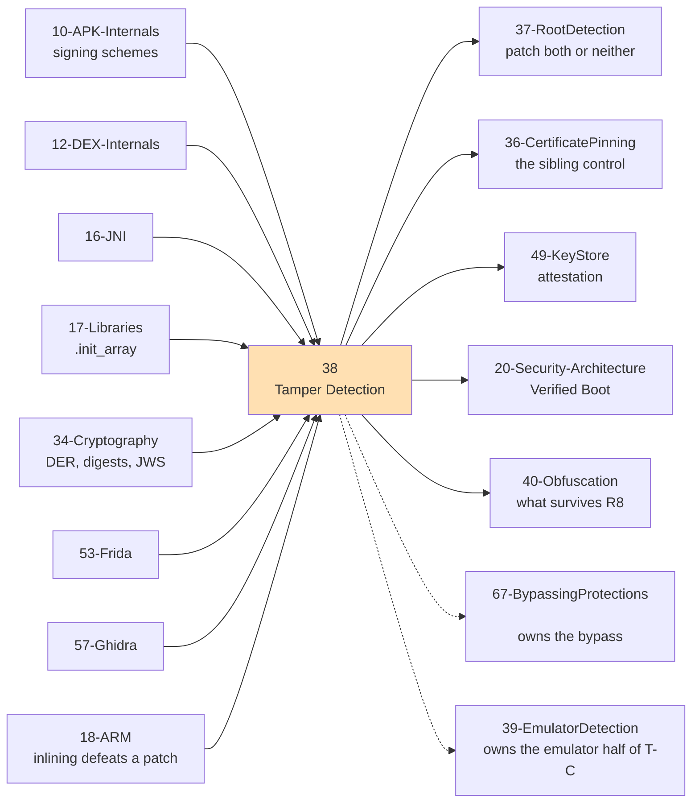

# 38 — Tamper Detection · Mind Map

One diagram for the whole chapter. Render it anywhere Mermaid works, or read it as an outline.
Full treatment in [README.md](README.md); the dense tables are in [cheatsheet.md](cheatsheet.md).

```mermaid
mindmap
  root((38<br/>Tamper<br/>Detection))
    Why it exists
      Tamper-evident seal
        inspected by the sealed object
      User-is-attacker threat model
        banking · payments · DRM
        gambling · MDM compliance
      Platform verifies ONCE at install
        then enforces CONTINUITY
        not integrity
      A repackaged APK is VALID
        just not yours
    Three threats - do not conflate
      T-A Repackaging
        edit then RE-SIGN
        different certificate
        caught by D1 D4
        invisible to D5-D13
      T-B Instrumentation
        Frida · LSPosed · debugger
        file on disk UNCHANGED
        caught by D5-D13
        invisible to D1 D4
      T-C Environment
        root - chapter 37
        emulator - chapter 39
        Verified Boot - chapter 20
    Self-signature verification
      The causal chain
        v2/v3 covers every byte
        modification invalidates
        installer rejects
        attacker MUST re-sign
        certificate changes
        app notices
      The API
        GET_SIGNING_CERTIFICATES
          0x08000000 · API 28+
        SigningInfo
          hasMultipleSigners
          getApkContentsSigners
          getSigningCertificateHistory
          hasPastSigningCertificates
        hasSigningCertificate
          lineage-aware peer check
        GET_SIGNATURES
          deprecated at 28
          original signer only
      Signature is a CERTIFICATE
        DER encoded X.509
        toByteArray
        sha256 == keytool fingerprint
        hashCode is only 32 bits
      Key rotation is REAL
        measured 6 of 198 packages
        Play Store · GMS · GSF
        never sigs[0]
        loop the whole lineage
      What it proves
        signed by a specific key
      What it does NOT prove
        code unmodified in memory
        device honest
        process not instrumented
    Code integrity
      DEX/APK hashing
        adds nothing on v2+
        measured identical CRC
        worth it on v1-only
        worth it for loaded DEX
      Bootstrap problem
        cannot hash a file into itself
        native library
        asset injected after dexing
        the server
      Native .text hash
        hashes the FILE
        misses every in-memory hook
      Mapped-page hash
        catches inline hooks
        the only expensive local check
    Anti-analysis
      TracerPid
        /proc/self/status
        kernel generates on read
        MEASURED - JDWP leaves it 0
        catches gdb strace frida-ptrace
      isDebuggerConnected
        asks ART not the kernel
        the check that DOES catch JDWP
      ptrace PTRACE_TRACEME
        DENIAL not detection
        one tracer per process
        second call detects
        worthless if attacker spawned you
      Frida artefacts
        port 27042
          one flag to evade
        abstract sockets
        maps entries
        thread names
        /proc/self/mem scan
      Inline hook detection
        read own prologue
      Timing
        log it - never act on it
        hook the clock defeats it
        measured 82ms for 7 checks
    Tiers - decides everything
      T0 container
        signing schemes
      T3 .init_array
        INSIDE dlopen
        before JNI_OnLoad
        chapter 17 owns the linker
      T2 JNI_OnLoad
        before loadLibrary returns
      T1 Java
        ContentProvider.onCreate FIRST
        then Application.onCreate
        cheapest to defeat
      T4 remote
        the only one off-device
    Consequence design
      exit is the WORST
        best hook anchor
        worst UX on false positive
      dialog then exit
        the string leads to the check
      silent degradation
      delayed failure
        attacker-hostile
        AND user-hostile
      corrupt a derived value
        no branch to invert
        best local design
      report and continue
        underrated
      server decides
        the only real control
    The real control
      R1 server issues the nonce
      R2 token never parsed on client
      R3 bind token to the REQUEST
      R4 server ENFORCES not notifies
      R5 server RECORDS
        populations visible only here
        survives its own bypass
      Three client anti-patterns
        client-generated nonce
        client parses the verdict
        fail open
      Three server omissions
        nonce not consumed
        cert digest not checked
        package name not checked
    Severity - get this right
      Absence is usually NOT a finding
        it is hardening
        needs a threat model
      Bypass is METHODOLOGY
        true of every app
      The real findings
        token replays
        endpoint accepts no token
        verdict evaluated on client
        fail open
        UI-only enforcement
      7 of 8 need no client bypass
    Analysis method
      MAP first
        tamper-surface-map.py
        earliest tier is the headline
        STRONG vs WEAK
        18 of 18 false positive lesson
      TRACE second
        which-check-fired.js
        report do not bypass
        hook System.exit find the caller
      TARGET third
        one check at a time
      Then TEST THE SERVER
    Boundaries
      37 root detection
      39 emulator detection
      40 obfuscation
      10 signing schemes
      49 key attestation
      20 Verified Boot
      67 bypass methodology
```

---

## Reading it as an outline

The mind map has five load-bearing branches; everything else hangs off them.

1. **Three threats.** Repackaging, instrumentation and environment are different problems with
   opposite detection properties. Getting this wrong is the root cause of most bad engineering and
   most bad reports in this area.
2. **The causal chain.** Self-signature verification works only because re-signing is *forced* by the
   platform. Ten links; break any one and the control is gone; six of the ten are broken in minutes.
3. **Tiers.** `.init_array` → `JNI_OnLoad` → Java → remote. This ordering determines what an analyst
   can observe and therefore determines the whole approach. Map it before you touch anything.
4. **Consequence design.** What the app *does* about a failed check matters more than the checks. The
   spectrum runs from `System.exit` (worst) to a server decision (only real control).
5. **Severity.** Absent tamper detection is usually not a finding. The real findings live on the
   server, and seven of the eight need no client-side bypass at all.

---

## Cross-chapter map

The solid arrows into 38 are prerequisites; the arrows out are chapters that consume this one. The
dotted arrows are chapters that did not exist when this one was written — **67 owns defeating these
controls; 38 owns the controls themselves.**
