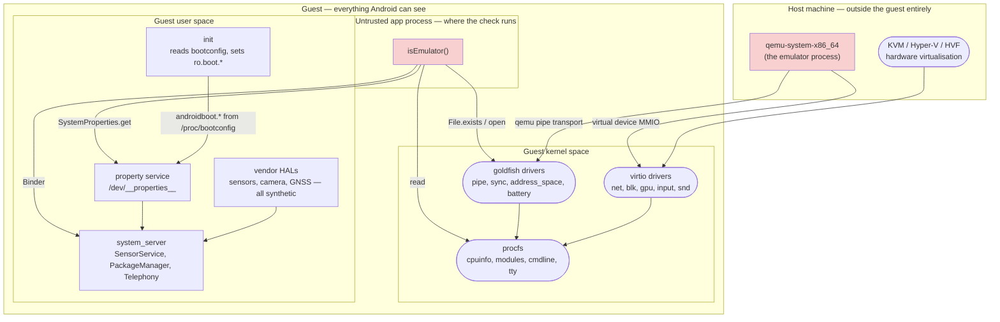
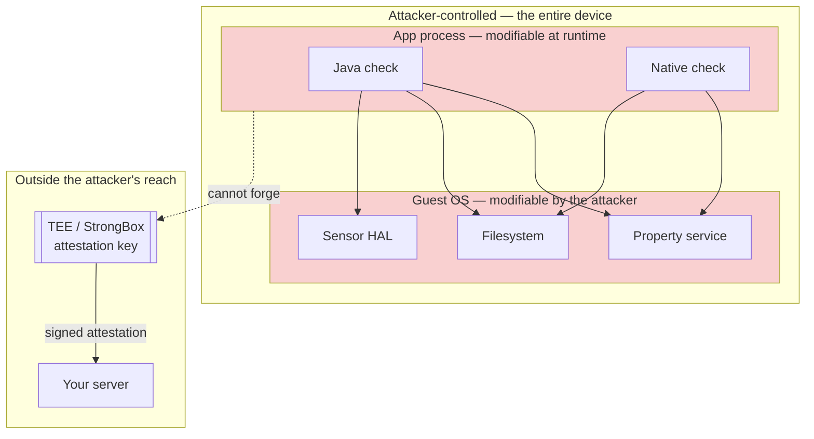
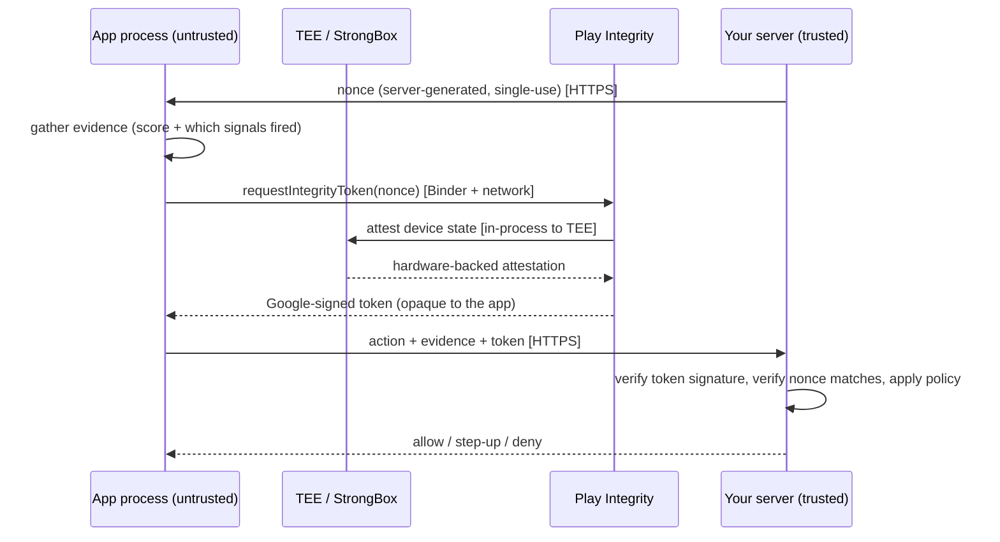
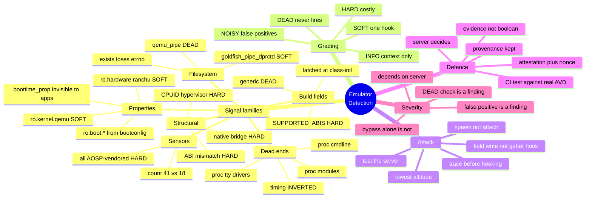

# 39 — Emulator Detection

> After this chapter you will be able to enumerate every signal an Android app can use to decide it is
> running on an emulator, grade each one honestly by how much it costs an attacker to defeat, find
> each in a compiled binary, and tell a developer which of their checks have silently never worked —
> because you will have measured all of them on a real phone and a real emulator side by side.

**Prerequisites:** [02-Linux-Basics](../02-Linux-Basics/README.md),
[09-Android-App-Internals](../09-Android-App-Internals/README.md),
[15-Native-Code](../15-Native-Code/README.md), [16-JNI](../16-JNI/README.md),
[21-App-Sandbox](../21-App-Sandbox/README.md), [22-SELinux](../22-SELinux/README.md),
[37-RootDetection](../37-RootDetection/README.md)
**Useful alongside:** [53-Frida](../53-Frida/README.md) for the runtime defeats — the measurement
that makes this chapter worth reading (every signal, taken on a real phone and a real emulator side
by side) is `getprop` and `ls`, not instrumentation, and
[53's opening callout](../53-Frida/README.md) explains why `frida-server` may not run on the very
API 35 emulator this subject cares about.
**Applies to:** Android 5–16 (API 21–36). Every measured claim names the device and API level it was
measured on. Behaviour differences are marked in Version Matrix tables.

---

> Everything in this chapter targets an app you own, an app you are contracted to assess, or a
> deliberately vulnerable lab target. See [SECURITY.md](../SECURITY.md) for authorised-testing scope.

---

## Table of Contents

1. [Introduction](#1-introduction)
2. [High-Level Architecture](#2-high-level-architecture)
3. [Deep Internal Working](#3-deep-internal-working)
4. [Source Code Walkthrough (AOSP)](#4-source-code-walkthrough-aosp)
5. [Security Perspective](#5-security-perspective)
6. [Reverse Engineering Perspective](#6-reverse-engineering-perspective)
7. [Dynamic Analysis](#7-dynamic-analysis)
8. [Static Analysis](#8-static-analysis)
9. [Examples](#9-examples)
10. [Common Interview Questions](#10-common-interview-questions)
11. [Common Mistakes](#11-common-mistakes)
12. [Hands-on Labs](#12-hands-on-labs)
13. [Summary](#13-summary)
14. [References](#14-references)

---

## 1. Introduction

### 1.1 The problem, stated in plain English

A wine merchant can tell a real bottle of Burgundy from a fake without opening it. Not by one test —
by a hundred small ones. The glass has the right seam. The punt is the right depth. The label paper
takes ink a particular way. The capsule is the right alloy. The cork is branded to the right depth.
A forger can match any single one of those. Matching all hundred, consistently, on every bottle,
costs more than the wine is worth.

That is emulator detection. The app is the merchant. The emulator is the forgery. And — this is the
part that most published material gets wrong — **no single test is the test.** The whole method is
the accumulation of cheap independent observations, each individually forgeable, into a judgement
that is expensive to forge as a set.

An app that checks one property and calls it emulator detection has looked at the label and nothing
else.

### 1.2 What an emulator actually is

> **Definition — emulator**
> A program that runs software written for one machine on a different machine, by simulating the
> first machine's processor, memory and devices. The Android Emulator is a fork of **QEMU** (Quick
> EMUlator, an open-source machine emulator), configured with a synthetic hardware platform that
> Android's kernel and vendor code know how to drive.

Two words appear constantly in this chapter and they are not interchangeable:

> **Definition — goldfish and ranchu**
> **goldfish** is the name of the original virtual hardware platform the Android Emulator presented
> to the guest: a synthetic set of devices (a timer, a framebuffer, a battery, a "pipe" for talking
> to the host) with no real-world counterpart. **ranchu** is its successor, built on **virtio** —
> the standard paravirtualised device interface used across the Linux virtualisation world.
> "Paravirtualised" means the guest knows it is virtual and cooperates, rather than being fooled by a
> simulated real device.
>
> Modern AVDs are **ranchu**, but a handful of goldfish drivers survive alongside virtio ones. That
> hybrid is why `Build.HARDWARE` reads `ranchu` while `/dev/goldfish_sync` still exists — a fact
> measured in [§3.6](#36-device-nodes-and-the-single-most-out-of-date-check-in-the-field).

> **Definition — virtualisation vs emulation**
> **Emulation** simulates a processor's instructions in software: an ARM binary on an x86 host has
> every instruction decoded and executed by a program. **Virtualisation** runs the guest's
> instructions on the real CPU, with a hypervisor trapping only the privileged ones. The modern
> Android Emulator on an x86 host **virtualises** the x86 guest (through KVM, Hyper-V or the
> Hypervisor.Framework) and does *not* emulate instruction by instruction.
>
> That distinction is the reason [§3.10](#310-timing-and-why-this-chapter-refuses-to-grade-it-above-info)
> can show, with measured numbers, that the emulator is *faster* than a real phone. The folklore that
> emulators are slow describes 2012, when they really were interpreting every instruction.

### 1.3 Why applications care

Emulator detection almost never exists on its own. It is nearly always the same gate as root
detection, guarding the same feature, written by the same team, for one of these reasons:

| Sector | What they are actually afraid of | Why an *emulator* specifically |
|---|---|---|
| Retail banking / payments | Automated fraud at scale | One analyst with one phone is slow. One analyst with 500 emulator instances is a fraud farm |
| Games with in-app purchase | Bots, multi-accounting, memory editors | Emulators are the cheapest way to run 50 accounts on one desktop; the whole "Android emulator for PC gaming" industry exists for this |
| Ride-hailing / delivery / gig | GPS spoofing, incentive farming | An emulator's location is a text box. A phone's location needs hardware or a mock-location app |
| Anti-fraud / identity | Device fingerprint reuse | An emulator snapshot restores an identical device to a known-good state, defeating device-reputation systems |
| DRM / streaming | Content key extraction | Widevine on an emulator is L3 (software) — but this is decided by the DRM stack, not by an `isEmulator()` check |
| Malware, from the other side | **Your analysis** | Malware detects emulators to hide from sandboxes. Chapter [69-MalwareAnalysis](../69-MalwareAnalysis/README.md) meets this as an obstacle; here you learn what it is reading |

Notice the recurring word: **scale**. That is the honest reason emulator detection exists, and it is
a genuinely better reason than the one usually given for root detection. A rooted phone is one
attacker with one device. An emulator is one attacker with a *fleet*. Raising the per-instance cost
from "clone the VM" to "own another phone" is a real economic win even though the control is trivially
defeatable in any single instance.

Hold on to that framing. It is what makes the honest severity in
[§5.7](#57-honest-severity-how-to-rate-a-missing-or-broken-emulator-check) defensible instead of
performative.

### 1.4 The honest framing: this cannot be won, and it is not trying to be

Every claim in [37-RootDetection §1.4](../37-RootDetection/README.md) applies here unchanged: the
code runs on hardware the attacker owns, so any decision it takes can be changed. This chapter adds
two claims specific to emulators.

**First: the emulator is *more* honest than a rooted phone, not less.** A stock AVD makes no attempt
to hide. It sets `ro.kernel.qemu=1`, names itself `sdk_gphone16k_x86_64`, and vendors every sensor to
"AOSP". Detection succeeds against the default configuration essentially always. What defeats it is
not the emulator — it is the *modified* emulator, or the emulator plus a hooking framework, which is
a different adversary.

**Second, and this is the finding that shapes the whole chapter: the published checklists have
rotted.** Emulator detection is dominated by blog posts and Stack Overflow answers written between
2012 and 2018 and copied forward without re-testing. Measuring them is not a formality. Measured on
an **Android 15 / API 35 AVD** for this chapter:

- **`/dev/qemu_pipe` does not exist.** It is the single most-cited check in the field.
- **`Build.FINGERPRINT` contains no `generic`.** The second most-cited check.
- **`/proc/tty/drivers` cannot be read by an app at all**, and contains no `goldfish` even when it can.
- **The network operator name is `T-Mobile`**, not `Android`.

Four of the best-known checks in the discipline, all returning "not an emulator" on an emulator. The
measurements are in [§3](#3-deep-internal-working) and the full table is in
[§3.14](#314-the-grading-table-every-signal-measured-on-both-devices).

> **Mental Model**
> Root detection asks *"has this device been modified?"* Emulator detection asks *"is this device
> real?"* They feel like the same question and they are not. A rooted phone is real hardware that
> lies about its integrity. An emulator is honest software that is not hardware at all. That is why
> the signal sets barely overlap — and why an app needs both.

### 1.5 What this chapter owns, and what it does not

| Topic | Owner | This chapter's role |
|---|---|---|
| **Every emulator/virtualisation signal, what it reads, and how strong it is** | **This chapter** | — |
| Root: what it is, how it is detected | [37-RootDetection](../37-RootDetection/README.md) | The sibling control. Same trust boundary, different signals. §3.13 explains the overlap |
| Repackaging, signature and anti-debug controls | [38-TamperDetection](../38-TamperDetection/README.md) | 38 owns the controls; this chapter supplies its "hostile environment" (T-C) half for emulators |
| **The general bypass methodology and the escalation ladder** | [67-BypassingProtections](../67-BypassingProtections/README.md) | **67 owns defeating checks; this chapter owns the signals.** §7 here bypasses signals to *prove* they fire, and stops there |
| Frida mechanics | [53-Frida](../53-Frida/README.md) | Assumed |
| Magisk, DenyList, Zygisk | [62-Magisk](../62-Magisk/README.md) | Cited where a module hides a signal |
| Hardware attestation — the only signal with a root of trust off-device | [50-HardwareBackedSecurity](../50-HardwareBackedSecurity/README.md) | §3.15 cites it as the correct answer |
| Malware that detects *your* sandbox | [69-MalwareAnalysis](../69-MalwareAnalysis/README.md) | Same signals, adversary reversed. §5.6 |
| Obfuscation applied to these checks | [40-Obfuscation](../40-Obfuscation/README.md) | §6.5 covers only what obfuscation does *to* them |

> **Pentester's Note**
> If you arrived here because **an app works on your phone and misbehaves on your emulator**, you do
> not need the whole chapter. Run [`scripts/emu-signal-map.py`](scripts/emu-signal-map.py) against
> the APK to see which signals it reads, then [`scripts/emu-trace.js`](scripts/emu-trace.js) to see
> which one fired. Come back for the rest afterwards.

### 1.6 The device pair every number in this chapter came from

No claim below is quoted from a blog post. Each was measured on one or both of these, and the tables
say which:

| | **Physical** | **Emulator** |
|---|---|---|
| Model | Redmi `M2101K6P` (`sweetin`) | `sdk_gphone16k_x86_64` (AVD `Pixel_6_Pro_API_35`) |
| Android / API | 11 / **30** | 15 / **35** |
| ABI | `arm64-v8a` | `x86_64` (with `arm64-v8a` translation) |
| Kernel | 4.14.180-perf | 6.6.50-android15 |
| Build type | `user`, `release-keys` | `userdebug`, `dev-keys` |
| State | Rooted (Magisk/APatch), frida-server present | Stock AVD image, `adb root` available |

> **Warning — the API levels differ, and that is a limitation**
> The phone is API 30 and the AVD is API 35. Where a difference could plausibly be an *API-level*
> difference rather than an *emulator* difference, this chapter says so explicitly rather than
> claiming the stronger result. The clearest example is package-visibility filtering in
> [§3.8](#38-packages-features-and-the-api-30-visibility-trap). Two devices are not a survey, and
> nothing here should be read as "all emulators" or "all phones".

---

## 2. High-Level Architecture

### 2.1 Where the signals come from



The diagram is drawn to make one structural point that decides everything else in the chapter: **the
app sits at the bottom, and every arrow into it is long.**

Read it from the top. The host runs a QEMU process which, on any modern setup, hands the guest's
instructions to the CPU through a hardware virtualisation interface rather than interpreting them.
That process presents two families of virtual device to the guest kernel: standard **virtio** devices,
which are indistinguishable from those on any Linux VM anywhere, and a residue of **goldfish**
devices, which are specific to the Android Emulator and are therefore the interesting ones.

Those devices surface in the guest as kernel drivers, which register nodes in `/dev` and entries in
`/proc` and `/sys`. Separately, the emulator passes a block of configuration to the guest's `init`
through the kernel's bootconfig, which turns every `androidboot.X` key into a read-only system
property `ro.boot.X`. That is why `ro.boot.qemu.avd_name` contains the literal name of your AVD — the
emulator told the guest, and the guest wrote it down where any app can read it.

Finally the vendor HALs — the modules that would normally talk to a sensor hub or a camera ISP — are
synthetic implementations that fabricate plausible values, and `system_server` serves those values to
apps over Binder as though they were real.

The app's check is the red box at the bottom. Every arrow reaching it crosses at least one layer the
attacker can interpose on: a property read, a file open, a Binder call. That is not a flaw in any
particular check. It is the shape of the problem, and it is why [§3.2](#32-why-a-single-boolean-is-the-wrong-shape)
argues about the *shape* of the logic before discussing a single signal.

### 2.2 The detection surface, by cost to defeat

```mermaid
flowchart LR
    subgraph Cheap["Minutes to defeat — one hook or one resetprop"]
        A["System properties<br/>ro.kernel.qemu, ro.hardware"]
        B["Build.* fields<br/>MODEL, FINGERPRINT, HARDWARE"]
        C["File.exists on /dev nodes"]
        D["Telephony MCC/MNC"]
    end
    subgraph Medium["Hours — needs a consistent fake population"]
        E["Sensor enumeration<br/>count, vendors, resolutions"]
        F["Installed package set"]
        G["Native libc reads<br/>__system_property_get"]
    end
    subgraph Hard["Days, or impossible in the guest"]
        H["CPUID hypervisor bit"]
        I["ABI / native bridge<br/>ARM code on an x86 platform"]
        J(["Kernel: /proc/modules, virtio drivers"])
    end
    subgraph Offdevice["Not on the device at all"]
        K[["Hardware key attestation<br/>TEE-signed, server-verified"]]
    end

    Cheap --> Medium --> Hard --> Offdevice
    style A fill:#f9d0d0
    style B fill:#f9d0d0
    style C fill:#f9d0d0
    style D fill:#f9d0d0
```



This is the chapter's spine, and it is ordered by **what it costs an attacker**, not by what is easy
to write.

The red band on the left is where essentially all real-world emulator detection lives, and all of it
falls to a single Frida hook or a single `resetprop` command. That is not an argument against writing
those checks — they still stop the analyst who has not read this chapter, and the whole economic
argument in [§1.3](#13-why-applications-care) is about raising cost, not about being unbeatable. It
*is* an argument against believing them.

The middle band costs more because the attacker must fake a *population* rather than a *value*. Forty
one sensors with plausible vendor strings, sample rates and power figures is a much larger lie than
one property, and — crucially — an inconsistent lie is itself detectable.

The third band is genuinely hard because the signal is produced below the guest's user space. The
`hypervisor` bit is reported by the physical CPU through CPUID; nothing in the guest can clear it. The
ABI mismatch exists because the code is *actually* being translated, and hiding it would mean not
translating. These are the signals worth writing native, and they are measured in
[§3.9](#39-abi-and-the-native-bridge--the-most-expensive-signal-to-fake).

The fourth band is not really detection. Hardware key attestation moves the question off the device
entirely, and it is the only entry here that an attacker with full control of the device cannot forge.
[§3.15](#315-the-only-signal-that-actually-holds-attestation) explains why, and why almost nobody
implements it correctly.

### 2.3 The trust boundary, drawn honestly



Everything inside the large red boundary is attacker territory. The app process is in it. The property
service is in it. The kernel is in it. An attacker who owns the device can change any value the app
reads and any decision the app takes, and the only question is how long it takes them.

Two boxes sit outside. The TEE holds an attestation key the app process cannot extract or forge — this
is the measured claim from [50-HardwareBackedSecurity](../50-HardwareBackedSecurity/README.md), where
a device whose `ro.boot.verifiedbootstate` property said `green` produced a TEE-signed attestation
saying `Unverified`. **The property lied; the hardware did not.** That single result is the strongest
available argument for the architecture in [§3.15](#315-the-only-signal-that-actually-holds-attestation).

And your server is outside, which is the point every chapter in this part of the repository converges
on: the client can gather evidence, but only the server can safely act on it.

---

## 3. Deep Internal Working

This is the longest section. It works through every signal family: **what** it is, **why** it exists,
**where** it comes from inside Android, **how** an app reads it, and **how strong it actually is** —
with the measurement that produced that grade.

### 3.0 Reference: the grading vocabulary

Every signal in this chapter carries one of five grades. They describe **strength**, not truth.

| Grade | Meaning | What it costs an attacker |
|---|---|---|
| **HARD** | Costly to fake; survives a naive Java hook, or is produced below the guest OS | Hours to days, or requires kernel/hypervisor work |
| **SOFT** | A single value read through one API | Minutes — one Frida hook or one `resetprop` |
| **DEAD** | Widely published, **measured not to fire** on a current AVD | Nothing. It never fires |
| **NOISY** | Fires on real devices too | Nothing — and it costs the *developer*, in false positives |
| **INFO** | Context. Useful in combination, never a verdict alone | — |

> **Warning — a signal's presence in a table is not a claim about its strength**
> This is the most important sentence in the chapter. Published checklists are flat lists, which
> silently implies every entry is worth the same. They are not. Four of the best-known entries are
> **DEAD**, and two signals that fire on the physical Redmi used here are **NOISY** in a way that
> makes a naive check report a real phone as an emulator. Grade before you count.

### 3.1 The three questions a check is really asking

Before any individual signal, be precise about the question, because apps routinely conflate three
different ones and then act on the wrong answer:

| Question | Signal family | What a `true` actually licenses you to conclude |
|---|---|---|
| **Is this virtual hardware?** | CPUID, virtio, goldfish drivers, sensor synthesis | The code is not running on a phone's SoC. Says nothing about who is watching |
| **Is this a development image?** | `ro.build.type`, `ro.build.tags`, `ro.debuggable`, `ro.secure` | The image was not signed for retail. **True of custom ROMs on real phones too** |
| **Is this an analysis environment?** | Frida, debuggers, `adb` state, instrumentation | Someone is looking. This is chapters [38](../38-TamperDetection/README.md) and [67](../67-BypassingProtections/README.md), not this one |

An app that wants "am I being analysed?" and writes an emulator check has answered a different
question. Real analysis happens on rooted physical phones at least as often as on emulators — the
Redmi used for this chapter is exactly that — so an emulator check is a *poor proxy* for the
analysis question and a *good proxy* for the fleet-fraud question in [§1.3](#13-why-applications-care).

### 3.2 Why a single boolean is the wrong shape

Nearly every real implementation looks like this:

```java
// The shape almost everyone writes. The problem is not the checks.
public static boolean isEmulator() {
    return Build.FINGERPRINT.startsWith("generic")
        || Build.MODEL.contains("Emulator")
        || new File("/dev/qemu_pipe").exists();
}
```

Three defects, and only the third is about the checks themselves.

**It collapses to one return value.** Whatever the app learns, it hands the attacker exactly one
branch to control. [67-BypassingProtections](../67-BypassingProtections/README.md) calls this
**seam 3 — the verdict**, and it is the cheapest place in the entire pipeline to intervene:

```javascript
// Frida REPL - defeats every check inside isEmulator(), present and future
Java.use("com.example.Security").isEmulator.implementation = function () { return false; };
```

The developer can add fifty more checks inside that method and the hook above still wins. Effort
spent adding checks *behind* a single boolean buys nothing.

**It short-circuits.** `||` stops at the first `true`, so the app never learns how many signals fired.
"One weak signal fired" and "eleven signals including two HARD ones fired" produce an identical value,
and those are wildly different confidence levels. Worse, the short-circuit means the *later* checks
are never executed on the very devices where they would be most informative — so the developer cannot
tell from telemetry which of their checks work.

**Every check in it is DEAD.** Measured on the API 35 AVD: the fingerprint does not start with or
contain `generic`, the model does not contain `Emulator`, and `/dev/qemu_pipe` does not exist. This
exact function — which is close to verbatim the top Stack Overflow answer — **returns `false` on a
stock current emulator.**

The shape that is worth writing accumulates evidence and keeps it:

```java
// The shape worth writing. Score plus provenance, not a boolean.
public final class EnvironmentEvidence {
    private final List<String> fired = new ArrayList<>();
    private int score = 0;

    /** @param weight  HARD signals 40, SOFT 10, NOISY 3. Never let NOISY alone reach threshold. */
    void add(String signal, boolean present, int weight) {
        if (present) { fired.add(signal); score += weight; }
    }
    int score()          { return score; }
    List<String> fired() { return fired; }   // provenance: WHICH signals, not just how many
}
```

That still has a seam — everything does — but hooking it now costs the attacker a hook per call site
rather than one hook total, and the app can send `fired()` to a server that decides. The decision
belongs there anyway ([§5.8](#58-the-correct-architecture)).

> **Mental Model**
> A check that returns a boolean has thrown away its evidence and kept its conclusion. That is exactly
> backwards. The evidence is what the server needs, what your telemetry needs, and what makes a
> false positive diagnosable. Keep the evidence; let something less attackable draw the conclusion.

### 3.3 System properties — what they are and how an app reads them

> **Definition — system property**
> A key–value pair in a small database the Android platform keeps in shared memory. Keys are
> dotted strings like `ro.product.model`; values are strings of at most 91 characters
> (`PROP_VALUE_MAX` is 92 including the terminator). Keys beginning `ro.` are **read-only**: the
> property service refuses to change them after they are first set.

Properties are the single largest emulator signal family, so it is worth understanding the mechanism
before the values.

The store lives in files under `/dev/__properties__`, mapped **read-only** into every process. A read
is therefore *not* IPC — no Binder, no socket, no server. It is a lock-free walk of a trie in the
caller's own address space. That has one consequence that matters enormously for
[§7](#7-dynamic-analysis): **there is no server-side interception point.** You cannot intercept a
property read the way you can intercept a Binder call. You must hook the reader.

Writes go the other way: a client sends the change over a socket to `init`, which owns the store and
enforces both the `ro.` immutability rule and SELinux type checks on the key.

An app has three ways in, and they end in the same place:

| Route | Layer | Hooked by |
|---|---|---|
| `android.os.Build.MODEL` | Static final, populated at class-init from a property | Reflection on the field — **not** a `SystemProperties.get` hook (see below) |
| `SystemProperties.get("ro.x")` (reflection; `@hide`) | Java | One `Java.use` hook |
| `__system_property_get("ro.x", buf)` | libc, native | `Interceptor.attach` on the native symbol |

> **Warning — `Build` fields are latched, and this breaks the obvious bypass**
> Every `Build` field is a `public static final` assigned in a static initialiser. Static
> initialisers run **once**, when the class is first loaded — which for `android.os.Build` is during
> process startup, long before your Frida script attaches. Hooking `SystemProperties.get` after
> attach therefore changes **nothing** about `Build.MODEL`: the value was read and latched already.
>
> This is the single most common reason a beginner reports "my property hook does not work". It
> works. You are reading a cached copy. The fix is to overwrite the field itself, and
> [`scripts/emu-bypass.js`](scripts/emu-bypass.js) does both.

#### 3.3.1 The properties, measured on both devices

| Property | Redmi M2101K6P (real) | API 35 AVD | Grade | Note |
|---|---|---|---|---|
| `ro.kernel.qemu` | *unset* | `1` | SOFT | The classic. Still fires |
| `ro.boot.qemu` | *unset* | `1` | SOFT | From bootconfig |
| `ro.boot.qemu.avd_name` | *unset* | `Pixel_6_Pro_API_35` | SOFT | Literally names your AVD |
| `ro.hardware` | `qcom` | `ranchu` | SOFT | Strongest single property |
| `ro.boot.hardware` | `qcom` | `ranchu` | SOFT | Same value, bootconfig source |
| `ro.product.board` | `sweetin` | `goldfish_x86_64` | SOFT | `goldfish` survives here |
| `ro.build.characteristics` | `default` | `emulator` | SOFT | Explicit and rarely spoofed |
| `ro.hardware.egl` | `adreno` | `emulation` | SOFT | Graphics stack |
| `ro.hardware.gralloc` | *unset* | `ranchu` | SOFT | |
| `ro.hardware.vulkan` | `adreno` | `ranchu` | SOFT | |
| `ro.soc.model` | *unset* | `ranchu` | SOFT | Ironic: the SoC "model" is the emulator |
| `ro.dalvik.vm.native.bridge` | `0` | `libndk_translation.so` | **HARD** | See [§3.9](#39-abi-and-the-native-bridge--the-most-expensive-signal-to-fake) |
| `ro.serialno` | `84f7a024` | `EMULATOR35X3X11X0` | SOFT | Prefix is the tell |
| `ro.build.tags` | `release-keys` | `dev-keys` | NOISY | True of every custom ROM |
| `ro.build.type` | `user` | `userdebug` | NOISY | Same |
| **`qemu.hw.mainkeys`** | **`0`** | *unset* | **NOISY** | **Set on the REAL phone. See below** |
| **`ro.kernel.qemu.gles`** | **`0`** | *unset* | **NOISY** | **Set on the REAL phone. See below** |

> **Under the Hood — the inversion, and it is measured, not theoretical**
> The last two rows are the wrong way round, and this is one of the more useful findings in the
> chapter. A very common heuristic is *"enumerate the properties; if any key contains `qemu`, it is
> an emulator."* Run from an app on the physical Redmi:
>
> ```
> $ adb shell "run-as com.pentest.ch39 getprop | grep -iE 'qemu|goldfish|ranchu'"
> [qemu.hw.mainkeys]: [0]
> [ro.kernel.qemu.gles]: [0]
> ```
>
> **Two `qemu`-named properties on a retail Xiaomi phone, and neither is set on the emulator.**
> `qemu.hw.mainkeys` is a legacy key controlling whether the navigation bar is drawn; OEMs adopted it
> from the emulator's configuration and kept it. The name-matching heuristic reports this phone as an
> emulator, and reports the emulator as a phone. Match on **values and specific keys**, never on the
> substring `qemu` in a key name.

#### 3.3.2 The `ro.boottime.*` surface, and why it is a trap

Enumerating properties on the emulator turns up a whole family that looks like a goldmine:

```
# adb shell (uid 2000) on the emulator
[ro.boottime.qemu-props]:            [7137914100]
[ro.boottime.qemu-props-bootcomplete]: [36301890500]
[ro.boottime.ranchu-net]:            [12104384500]
[ro.boottime.ranchu-setup]:          [36324871500]
[ro.boottime.goldfish-logcat]:       [14445812900]
```

Five properties naming emulator-only `init` services. It looks like an excellent check.

**It is unreachable from an app — and from the shell. It is root-only**, which is worse for a
detector and was established by measuring all three vantages rather than two:

```
# host - the same property, read three ways. Re-verified independently.
$ adb shell getprop ro.boottime.qemu-props
                                          # <- empty
$ adb shell "run-as <pkg> getprop ro.boottime.qemu-props"
                                          # <- empty
$ adb shell "su 0 getprop ro.boottime.qemu-props"
11456737100
$ adb shell "su 0 getprop -Z ro.boottime.qemu-props"
u:object_r:boottime_prop:s0
```

Counted across the whole family: **111 `ro.boottime.*` properties visible to root, 0 to the shell,
0 to an app.**

> **CORRECTED — this passage originally showed the shell reading the value.** That transcript was
> taken with root in effect, the same error as the count table below. The SELinux mechanism described
> here was right; the vantage attached to it was not.
>
> **The corrected version is a stronger argument, not a weaker one.** A signal that only root can
> read is useless to the app that needs it *and* useless to the shell you would normally test from —
> so it looks like an excellent check right up until it is deployed, and there is no vantage short of
> root from which the disappointment is visible. Contrast it with the emulator-indicating
> `init.svc.*` properties, of which an app sees **35** and the shell **36**: nearly identical, and
> those are the ones a real detector can actually use.

The property's SELinux type is `boottime_prop`, and neither `untrusted_app` nor `shell` has read
permission on it. The value is not missing; the caller is not allowed to know it exists. This is
[22-SELinux](../22-SELinux/README.md)'s mandatory access control applied to the property store, and
it generalises:

| Domain | Properties visible on the AVD | Properties visible on the Redmi |
|---|---|---|
| `root` | **~1055–1062** | n/a |
| `shell` (uid 2000) | **~673–678** | **863** |
| `untrusted_app` | **~633–638** | **816** |

**~424 of the AVD's properties are invisible to an app — but only ~40 of those are the shell's to
see.** The gap that matters is *root* versus app, not shell versus app.

> **CORRECTED — this table originally read `shell = 1053`, and that figure was `root`.**
> The original row put `root` at 1050 and `shell` at 1053, which should have been the tell: two
> different domains cannot see effectively the same property set when one of them is subject to
> `boottime_prop` and the other is not. Re-measured twice, independently, by two later chapters:
>
> | Method | shell | app | root |
> |---|---:|---:|---:|
> | `getprop \| wc -l`, ×3, stable | **678** | **638** | **1062** |
> | 74-CaseStudies, this chapter's own documented command | **673** | **633** | **1055** |
>
> Both reproduce the **app** figure (633–638 against the published 634) and both reproduce the
> published *shell* figure as **root**. The small drift between runs is real — `init.svc.*` values
> change as services start and stop — but it is tens of properties, not four hundred. The likely
> cause is that the shell run was taken while `adb root` was in effect, or through `su`.
>
> **The lesson survives the correction and gets sharper.** "Test as the app, not as the shell" is
> still right, but for a different reason than this chapter first claimed: the shell is only
> *slightly* better off than an app, so a shell test is a decent proxy for reachability and a
> **terrible** proxy for *root*. The dramatic number came from measuring root and labelling it shell
> — which is exactly the vantage confusion the section is about, committed inside the section that
> teaches it.

Measured with `__system_property_foreach` from [`examples/emu_probe.c`](examples/emu_probe.c) run in
each context, and cross-checked with `getprop`.

> **Pentester's Note — this is the methodology trap of the whole chapter**
> `adb shell` is not an app. When you test a property check from the shell and it works, you have
> proved nothing about whether the app can do it. The repo-wide discipline from
> [60-ADB](../60-ADB/README.md) applies here with unusual force: **prove reachability from an app,
> not from the shell.** Every "an app can read X" claim in this chapter was produced by
> [`examples/EmulatorSignals.java`](examples/EmulatorSignals.java) running as an app uid.

#### 3.3.3 Where `ro.boot.*` actually comes from

Worth understanding because it explains why these are harder to fake than build-time strings.

The emulator passes configuration to the guest through the kernel's **bootconfig** — a block appended
to the initramfs, exposed at `/proc/bootconfig`. On the measured AVD:

```
# adb shell as root - /proc/bootconfig, abridged
androidboot.qemu = "1"
androidboot.qemu.avd_name = "Pixel_6_Pro_API_35"
androidboot.hardware = "ranchu"
androidboot.hardware.vulkan = "ranchu"
androidboot.serialno = "EMULATOR35X3X11X0"
androidboot.veritymode = "enforcing"
```

Android's `init` reads every `androidboot.X` key and sets the read-only property `ro.boot.X`. That is
the entire mechanism, and it is in `system/core/init/init.cpp` and
`system/core/init/property_service.cpp` in AOSP.

Two consequences. First, `ro.boot.hardware` is not a string in the build — it came from outside the
guest, so faking it means either patching `init` or intercepting the reader. Second — and this is a
detail almost nothing published gets right — **`/proc/cmdline` no longer carries these**. Older
emulators put `androidboot.hardware=ranchu` on the kernel command line; the measured AVD's
`/proc/cmdline` is:

```
console=ttynull stack_depot_disable=on cgroup_disable=pressure bootconfig 8250.nr_uarts=1
clocksource=pit page_shift=14 no_timer_check console=0 ndns=2 loop.max_part=7 ...
```

No `androidboot.hardware` anywhere. It moved to bootconfig. A check grepping `/proc/cmdline` for
`ranchu` is **DEAD** — and doubly so, because `/proc/cmdline` is `EACCES` for apps anyway
([§3.11](#311-what-an-app-can-actually-read-from-proc)).

### 3.4 Enumerating the whole property store from native code

There is no public Java API to *list* properties — `SystemProperties` offers only `get`. But libc
exports `__system_property_foreach`, so native code can walk the entire trie. Almost no published
emulator check does this, and it is strictly stronger than checking keys one at a time, because an
attacker who spoofs `ro.kernel.qemu` individually leaves the rest of the family in place.

From [`examples/emu_probe.c`](examples/emu_probe.c):

```c
/* Called once per property in the trie. */
static void foreach_cb(const prop_info *pi, void *cookie)
{
    struct prop_scan *s = (struct prop_scan *)cookie;
    char name[PROP_NAME_MAX + 1], value[PROP_VALUE_MAX + 1];

    memset(name, 0, sizeof(name));
    memset(value, 0, sizeof(value));
    __system_property_read(pi, name, value);

    s->total++;
    if (contains_ci(name, "qemu") || contains_ci(name, "goldfish") ||
        contains_ci(name, "ranchu") || contains_ci(name, "genymo")) {
        s->emu_named++;
    }
}
```

Measured under an app uid on both devices:

| | Total properties | With emulator-ish names |
|---|---|---|
| Redmi M2101K6P | 816 | **2** |
| API 35 AVD | 634 | **26** |

Two against twenty-six is a usable separation — but note the real phone is **not zero**, which is the
[§3.3.1](#331-the-properties-measured-on-both-devices) inversion again. A threshold of "more than
zero" misclassifies the Redmi. A threshold of "more than five" separates these two devices cleanly,
and that threshold is an *empirical* choice that needs re-validating against a device fleet, not a
constant to copy out of this chapter.

> **Under the Hood — why native enumeration resists the Java hook**
> `SystemProperties.get` is one Java method; hooking it covers every Java property read in the
> process. `__system_property_foreach` is a libc symbol reached with no Java frame at all. A
> `Java.use`-based bypass does not see it, and the analyst has to move down to
> `Interceptor.attach(Module.getExportByName("libc.so", ...))`. That is a real escalation in effort,
> which is the whole reason serious checks are written in C. It is not unbeatable — nothing is — but
> it costs more, and cost is the only currency this control trades in.

### 3.5 Build fields — the most-cited and most-rotted family

`android.os.Build` is where every tutorial starts. Measured on both devices, from an app:

| Field | Redmi (real) | API 35 AVD | Classic check | Verdict |
|---|---|---|---|---|
| `FINGERPRINT` | `Redmi/sweetin/sweetin:11/RKQ1.200826.002/V12.5.10.0.RKFINXM:user/release-keys` | `google/sdk_gphone16k_x86_64/emu64xa16k:15/AE3A.240806.043/12960925:userdebug/dev-keys` | `.startsWith("generic")` | **DEAD** |
| `MODEL` | `M2101K6P` | `sdk_gphone16k_x86_64` | `.contains("Emulator")` | **DEAD** |
| | | | `.contains("sdk_gphone")` | SOFT — works |
| `BRAND` | `Redmi` | `google` | `.startsWith("generic")` | **DEAD** |
| `DEVICE` | `sweetin` | `emu64xa16k` | `.startsWith("generic")` | **DEAD** |
| `PRODUCT` | `sweetin` | `sdk_gphone16k_x86_64` | `.contains("sdk")` | SOFT — works |
| `MANUFACTURER` | `Xiaomi` | `Google` | `.contains("Genymotion")` | SOFT |
| `HARDWARE` | `qcom` | `ranchu` | `== "goldfish" \|\| == "ranchu"` | SOFT — works |
| `BOARD` | `sweetin` | `goldfish_x86_64` | `.contains("goldfish")` | SOFT — works |
| `BOOTLOADER` | `unknown` | `unknown` | `== "unknown"` | **NOISY** — identical on both |
| `HOST` | `c5-miui-ota-bd237.bj` | `r-493e2f23732658be-xnq5` | — | INFO |
| `TAGS` | `release-keys` | `dev-keys` | `.contains("test-keys")` | NOISY |
| `SUPPORTED_ABIS` | `arm64-v8a,armeabi-v7a,armeabi` | `x86_64,arm64-v8a` | — | **HARD** |

Four rows are worth dwelling on.

**`generic` is gone, four times over.** `FINGERPRINT`, `BRAND` and `DEVICE` all used to contain it.
The AVD naming scheme moved to `sdk_gphone*` / `emu64x*` years ago. Any check written against
`generic` has been quietly returning `false` on real emulators ever since, and because the failure is
a silent false negative, nobody noticed.

**`BOOTLOADER` is `unknown` on both devices.** A check for `Build.BOOTLOADER.equals("unknown")`
appears in several widely-copied snippets. It flags this retail Xiaomi. Straightforwardly NOISY.

**`HARDWARE` is the best field on the list**, because it comes from bootconfig rather than a
build-time string ([§3.3.3](#333-where-roboot-actually-comes-from)).

**`SUPPORTED_ABIS` is the only HARD row**, and [§3.9](#39-abi-and-the-native-bridge--the-most-expensive-signal-to-fake)
is about why.

### 3.6 Device nodes, and the single most out-of-date check in the field

Here is the finding that most justifies measuring instead of reciting.

**`/dev/qemu_pipe` is the most-cited emulator check in existence.** It appears in RootBeer-adjacent
snippets, in commercial SDK documentation, in conference slides, and in almost every blog post on the
subject. Measured on a stock Android 15 / API 35 AVD, from an app and from a native binary reading
`errno` directly:

```
path   /dev/qemu_pipe   ENOENT (classic check, gone on modern AVDs)   REAL
```

**It does not exist.** Nor do three of its usual companions. What *does* exist is a differently-named
set:

```
# adb shell as root on the API 35 AVD
$ ls -la /dev/ | grep -iE 'goldfish|qemu'
crw-rw-rw- 1 system system 10, 121 goldfish_address_space
crw-rw-rw- 1 system system 10, 120 goldfish_pipe_dprctd
crw-rw-rw- 1 system system 10, 119 goldfish_sync
```

The pipe is now `goldfish_pipe_dprctd` — "deprecated", named by the very kernel module that still
provides it. Measured, from an app, on both devices:

| Path | Redmi | API 35 AVD | Grade |
|---|---|---|---|
| `/dev/qemu_pipe` | absent | **absent** | **DEAD** |
| `/dev/socket/qemud` | absent | **absent** | **DEAD** |
| `/system/bin/qemu-props` | absent | **absent** | **DEAD** |
| `/system/bin/qemud` | absent | **absent** | **DEAD** |
| `/system/lib/libc_malloc_debug_qemu.so` | absent | **absent** | **DEAD** |
| `/dev/goldfish_pipe` | absent | **absent** | **DEAD** |
| `/dev/goldfish_pipe_dprctd` | absent | **present**, mode 666 | SOFT |
| `/dev/goldfish_sync` | absent | **present**, mode 666 | SOFT |
| `/dev/goldfish_address_space` | absent | **present**, mode 666 | SOFT |
| `/sys/module/goldfish_pipe` | absent | **present** | SOFT |
| `/sys/bus/platform/drivers/goldfish_pipe` | absent | **present** | SOFT |

Six DEAD checks against five that work. If you audit an app and find it checking `/dev/qemu_pipe`,
you have found a control that has never fired in production, and telling the developer that is worth
more than bypassing it.

#### 3.6.1 `exists()` throws away the information you need

> **Definition — `errno`**
> A thread-local integer libc sets when a system call fails, saying *why*. `ENOENT` (2) means "no such
> file". `EACCES` (13) means "permission denied" — the file may well exist.

Java's `File.exists()` ends in `faccessat(AT_FDCWD, path, F_OK, 0)` and returns `false` for both. An
app written in Java therefore **cannot distinguish "there is no emulator here" from "I am not allowed
to look"** — and those warrant opposite conclusions. A `false` from EACCES is not evidence of a real
device; it is evidence of nothing.

Native code can tell, which is why [`examples/emu_probe.c`](examples/emu_probe.c) reports it:

```c
if (stat(path, &st) == 0) {
    verdict = "EMU";                 /* present */
} else if (errno == ENOENT) {
    verdict = "REAL";                /* genuinely absent */
} else {
    verdict = "UNKNOWN";             /* EACCES and friends - we do not know */
}
```

That third branch is the one Java cannot express, and collapsing it into `false` is a systematic bias
toward "not an emulator" in every Java-layer filesystem check ever written.

### 3.7 Sensors — the best cheap signal, and why

Sensors are the strongest signal an app can read without native code, for a structural reason: **it
is a population, not a value.**

Measured from an app, `SensorManager.getSensorList(Sensor.TYPE_ALL)`:

| | Redmi M2101K6P | API 35 AVD |
|---|---|---|
| Sensor count | **41** | **18** |
| Distinct vendor strings | `qualcomm`, `TDK-Invensense`, `xiaomi`, `XiaoMi`, `Rohm`, `akm`, `ams AG`, `Xiaomi` | `AOSP`, `The Android Open Source Project` |
| Vendored AOSP/Goldfish | **0 / 41** | **18 / 18** |
| Has step counter | yes | **no** |

Three separable signals here, and the second is the good one.

**Count** is weak on its own — a cheap phone may have fifteen sensors and a tablet fewer — but 41 vs
18 is a wide gap.

**Vendor strings are the strong signal.** Every one of the AVD's sensors is vendored to the AOSP
project, because they are all implemented by the same synthetic HAL. The Redmi's name six different
real silicon vendors, because six different physical parts are fitted, sourced from different
suppliers, each contributing its own driver string. Faking that means inventing a self-consistent bill
of materials — plausible vendors, plausible part-to-sensor mapping, plausible resolutions and power
figures for each. That is a much larger lie than one property, and an *inconsistent* fake (a
`TDK-Invensense` magnetometer, say, when TDK does not make one) is itself a signal.

Note also `Goldfish 3-axis Accelerometer`, the literal sensor name on the AVD. A name check is a
one-line SOFT signal; the vendor *distribution* is the HARD one.

> **Warning — the false-positive that matters here**
> A device with **zero** sensors is not necessarily an emulator. Android TV boxes, some kiosk
> hardware and many automotive head units have no accelerometer. Check
> `PackageManager.FEATURE_TELEVISION` and `UiModeManager.getCurrentModeType()` before treating an
> empty sensor list as emulation, or you will refuse service to a real customer on a real device.

### 3.8 Packages, features, and the API 30 visibility trap

Measured from an app with `targetSdkVersion 30`:

| | Redmi | API 35 AVD |
|---|---|---|
| `getInstalledPackages(0).size()` | **224** | **88** |
| `getSystemAvailableFeatures().length` | **88** | **96** |

The package count looks like a fine signal — a real user's phone accumulates apps, a fresh AVD has
few. It is **NOISY** for a reason that catches a lot of production code:

> **Warning — package visibility filtering, and the silent failure it causes**
> From **API 30**, an app that targets 30 or higher cannot see arbitrary installed packages. Unless
> it holds `QUERY_ALL_PACKAGES` (a Play-policy-restricted permission) or declares a `<queries>`
> element, `getInstalledPackages()` returns a **filtered** list — and the filtering is silent, with no
> exception and no warning.
>
> A package-counting check written before API 30 and never revisited therefore sees a handful of
> packages on *every* device and concludes "suspiciously few packages: emulator" on real phones. The
> numbers above are already filtered; unfiltered, the Redmi has 198+ packages by
> [38-TamperDetection](../38-TamperDetection/README.md)'s independent count. **A check whose
> behaviour silently changed under it at API 30 is one of the most common live defects in this
> area.**

The *feature* count is more interesting than it looks, because it goes the "wrong" way — the emulator
advertises **more** features (96) than the phone (88). A naive "fewer features means emulator" check
is inverted here. The AVD advertises a fuller telephony feature set
(`telephony.calling`, `telephony.messaging`, `telephony.radio.access`, `telephony.subscription`) than
the API 30 phone does, partly because those feature constants are newer than API 30.

The genuinely usable package signal is not the count but specific **emulator-only packages**. Measured
present on the AVD and absent on the Redmi:

```
com.android.emulator.multidisplay
com.android.emulator.radio.config
```

But even here, anchor the match. Both devices carry packages containing the word `emulation`:

```
com.android.internal.display.cutout.emulation.corner     # on BOTH devices
com.android.internal.display.cutout.emulation.waterfall  # on BOTH devices
```

Those are display-cutout overlays present on every modern Android device. A substring match on
`emulat` flags the Redmi. Match on **full package names**.

### 3.9 ABI and the native bridge — the most expensive signal to fake

This is the strongest signal an app can gather on the device, and it deserves care because it is also
the most misunderstood.

Measured:

| | Redmi | API 35 AVD |
|---|---|---|
| `Build.SUPPORTED_ABIS` | `arm64-v8a, armeabi-v7a, armeabi` | **`x86_64, arm64-v8a`** |
| `ro.dalvik.vm.native.bridge` | `0` | **`libndk_translation.so`** |
| `/proc/cpuinfo` model name | `AArch64 Processor rev 14` | `Android virtual processor` |
| `/proc/cpuinfo` `hypervisor` flag | absent | **present** |

> **Definition — native bridge**
> A translation layer that lets an Android device execute native code compiled for a *different*
> instruction set. An x86_64 emulator uses one (`libndk_translation.so`; historically Intel's
> `libhoudini.so`) so that apps shipping only `arm64-v8a` libraries still run. It works by translating
> ARM machine code into x86 machine code at run time.

A physical arm64 phone advertises **only** ARM ABIs. Advertising both an x86 and an ARM ABI means a
translator is installed, which in practice means an emulator or an x86 Chromebook-style environment.

The strong version of the check is not to read the property but to **exploit the fact directly**, and
this is what [`examples/emu_probe.c`](examples/emu_probe.c) does:

```c
#if defined(__aarch64__)
#  define BUILD_ARCH "arm64-v8a"
#elif defined(__x86_64__)
#  define BUILD_ARCH "x86_64"
#endif
    ...
    __system_property_get("ro.product.cpu.abi", abi);
    if (strcmp(BUILD_ARCH, abi) != 0) {
        row("abi", "build arch vs ro.product.cpu.abi", detail, "EMU");
    }
```

The binary knows what it was compiled for at compile time — a constant baked into `.rodata`, not a
value read from anywhere. If an arm64 binary is executing while the platform claims `x86_64`,
translation is happening. **Demonstrated**, by running the arm64 build of the probe on the x86_64 AVD:

```
# adb shell on the x86_64 emulator, running the ARM64 build
# built for: arm64-v8a
abi  build arch vs ro.product.cpu.abi  compiled=arm64-v8a platform=x86_64  EMU
abi  ro.dalvik.vm.native.bridge        libndk_translation.so              EMU
```

To defeat this, the attacker must make the platform *claim* `arm64-v8a` while still translating — and
then every genuinely-x86 component disagrees. It is not impossible, but it is a coherent-lie problem
rather than a one-value problem.

The **`hypervisor` CPUID bit** is the other HARD member of this family and is even better, with one
caveat.

> **Definition — the CPUID hypervisor bit**
> On x86, bit 31 of the `ECX` register returned by `CPUID` leaf 1 is reserved as the "hypervisor
> present" bit. Real silicon leaves it clear; virtualisation software sets it by convention so guests
> can detect they are virtualised. Linux surfaces it as the `hypervisor` flag in `/proc/cpuinfo`.
> The guest cannot clear it, because the value is produced by the CPU when the hypervisor traps the
> `CPUID` instruction — it never passes through guest-controlled memory.

Measured present on the AVD, absent on the Redmi, readable by an app from `/proc/cpuinfo` on both.

> **Warning — this signal is architecture-specific and its absence proves nothing**
> There is no ARM equivalent. An arm64 emulator image (which Apple-silicon developers use routinely)
> has no `hypervisor` flag, so a `false` here is meaningless on arm64. A check that treats "no
> hypervisor flag" as "real device" is correct on x86 and wrong everywhere else. Gate it on
> `Build.SUPPORTED_ABIS` containing an x86 ABI.

### 3.10 Timing, and why this chapter refuses to grade it above INFO

Timing-based emulator detection is folklore. The claim is that emulated instructions are slower than
real ones, so a benchmark that runs slowly implies emulation.

It was measured. Identical C source, compiled by the same NDK, run under an **app uid** on both
devices — a 20-million-iteration integer ALU loop:

| Device | ns per iteration |
|---|---|
| Redmi M2101K6P — real arm64 phone | **3.516** |
| Pixel_6_Pro_API_35 AVD — x86_64 | **2.398** |

**The emulator is 1.47× faster than the physical phone.** Not slower. Faster.

That is not an anomaly, it is the expected result once you know the mechanism from
[§1.2](#12-what-an-emulator-actually-is): the x86_64 guest's instructions run on the host's real CPU
through hardware virtualisation. There is no interpretation. A desktop CPU beating a 2021 midrange
phone's Cortex-A cores is unremarkable — and thermal throttling makes the phone's number *worse*
under sustained load, which is exactly when a benchmark runs.

Even the translated case does not rescue the folklore. Running the **arm64** build of the same probe
on the x86_64 emulator, where every ARM instruction is translated to x86:

| Configuration | ns per iteration |
|---|---|
| arm64 code on real arm64 phone | 3.516 |
| **arm64 code translated onto x86_64 emulator** | **3.026** |

Binary translation still beat the real ARM CPU. `libndk_translation.so` compiles hot blocks once and
reuses them, so a tight loop pays translation cost on the first pass and runs native x86 thereafter.

> **Warning — do not ship a timing threshold**
> Any constant you pick from measurements on your own hardware will misclassify real devices in the
> field. Phones vary by an order of magnitude across the price range; the same phone varies by a
> factor of two between cold and thermally throttled. A threshold that separates *your* laptop's
> emulator from *your* phone separates nothing in a fleet of a million devices.
>
> There is a narrow legitimate use: comparing `clock_gettime(CLOCK_MONOTONIC)` against
> `CLOCK_THREAD_CPUTIME_ID` to spot a **single-stepping debugger**, where the discrepancy is orders
> of magnitude rather than percent. That is anti-debug, and it belongs to
> [38-TamperDetection](../38-TamperDetection/README.md). It is not emulator detection.

This chapter grades all timing signals **INFO** and uses none of them in any scoring example.

### 3.11 What an app can actually read from `/proc`

Measured from an app uid on **both** devices, using the native probe so `errno` is visible:

| Path | Redmi (app) | AVD (app) | Usable? |
|---|---|---|---|
| `/proc/cpuinfo` | readable, 1996 B | readable, 3028 B | **yes** |
| `/proc/self/mounts` | readable, 3937 B | readable, 4086 B | **yes** |
| `/proc/self/maps` | readable | readable | yes |
| `/proc/tty/drivers` | **EACCES** | **EACCES** | **no** |
| `/proc/cmdline` | **EACCES** | **EACCES** | **no** |
| `/proc/modules` | **EACCES** | **EACCES** | **no** |

Three of the six most-published `/proc` checks **cannot be performed by an app at all.**

This is worth stating precisely because it is such a good example of the shell-versus-app trap. From
`adb shell` on the emulator, `/proc/modules` reads beautifully and contains exactly what you want:

```
# adb shell (uid 2000) - looks like a perfect signal
goldfish_sync           20480  5 - Live 0x... (OE)
goldfish_pipe           12288 70 - Live 0x... (OE)
goldfish_battery        12288  0 - Live 0x... (OE)
goldfish_address_space  20480  3 - Live 0x... (OE)
```

Four goldfish kernel modules, unambiguous. An analyst who tests this from the shell will write it up
as a strong signal. From an app:

```
content  /proc/modules goldfish  cannot open: errno=13 Permission denied  UNKNOWN
```

The restriction is `/proc` hardening — `kptr_restrict` and the SELinux policy for `untrusted_app`,
which has no `read` on `proc_modules`. `/proc/tty/drivers` and `/proc/cmdline` are blocked the same
way, on **both** devices, so this is platform behaviour and not an emulator quirk.

And even from root, `/proc/tty/drivers` on the AVD contains no `goldfish` at all:

```
# adb shell as root on the API 35 AVD
/dev/tty     /dev/tty      5   0 system:/dev/tty
hvc          /dev/hvc    229 0-63 system
g_serial     /dev/ttyGS  234 0-7 serial
serial       /dev/ttyS     4 64-95 serial
```

`hvc` is the virtio console — the ranchu-era replacement for the goldfish tty. So the classic
`/proc/tty/drivers` check fails **twice over**: an app cannot read the file, and the content would not
match if it could. Firmly **DEAD**.

The mount table is readable and gives a decent INFO signal — measured from an app, **263** entries on
the Redmi against **156** on the AVD — though the number moves with OEM, API level and APEX count, so
it is context rather than a verdict.

### 3.12 Telephony — a check that decayed into uselessness

The historical giveaways were the operator name `Android`, the MCC/MNC `310260`, and the line-1
number `15555215554`. Measured:

| | Redmi | API 35 AVD | Grade |
|---|---|---|---|
| `getNetworkOperator()` (MCC/MNC) | `40490` | `310260` | SOFT |
| `getSimOperator()` | `40410` | `310260` | SOFT |
| `getNetworkOperatorName()` | `airtel` | **`T-Mobile`** | **DEAD** |
| `getSimOperatorName()` | `airtel` | **`T-Mobile`** | **DEAD** |

The **name check is dead**: `310260` is genuinely T-Mobile US's MCC/MNC, and the emulator now resolves
it to the correct carrier name like any real device would. A check for the literal string `Android`
never fires.

The **numeric check still works**, but only against a default AVD — the MCC/MNC is a one-line
emulator console command to change.

The **line-1 number and IMEI checks are dead for a different and more interesting reason**: since
**API 29** an ordinary app cannot read either. `getLine1Number()` and `getImei()` require
`READ_PRIVILEGED_PHONE_STATE`, a signature-level permission an ordinary app cannot hold. So the famous
`15555215554` check is not merely stale — **it has been unreachable from third-party apps for six API
levels.** If you find it in an app, it is dead code, and its presence tells you the check was written
before 2019 and never revisited.

### 3.13 How this differs from root detection — the overlap, precisely

[37-RootDetection](../37-RootDetection/README.md) is the sibling chapter and the two are constantly
confused. The signal sets barely intersect:

| Signal | Root detection | Emulator detection | Why |
|---|---|---|---|
| `su` binary on `PATH` | **yes** | no | An emulator has no `su`; a stock AVD is not rooted |
| Magisk artefacts | **yes** | no | Orthogonal |
| `ro.build.tags=test-keys` | yes | yes | **The overlap.** Both read it; it means "not a retail image" |
| `ro.debuggable` / `ro.secure` | yes | yes | Same — a development image, whatever the reason |
| `ro.kernel.qemu`, `ro.hardware` | no | **yes** | Virtual hardware, nothing to do with privilege |
| Sensor population | no | **yes** | Root does not change your sensors |
| CPUID hypervisor bit | no | **yes** | |
| Writable `/system` | **yes** | no | An unrooted AVD's `/system` is read-only too |
| `/proc/self/maps` for injected `.so` | **yes** | no | That is instrumentation — chapter 38 |

Two rows overlap, and both are the NOISY "this is not a retail build" family. Everything else is
disjoint.

> **Mental Model**
> Root detection asks about **privilege**. Emulator detection asks about **hardware**. A rooted
> physical phone is high-privilege real hardware. A stock emulator is low-privilege fake hardware.
> They are opposite corners of the same square, which is why an app that wants to exclude both must
> implement both — and why a "device integrity" claim backed by only one of them is half a claim.
>
> The Redmi used for this chapter is the awkward third corner: **rooted real hardware**, which passes
> every emulator check in this chapter and fails every check in chapter 37.

### 3.14 The grading table: every signal, measured on both devices

The consolidated result. Every row was measured with
[`examples/EmulatorSignals.java`](examples/EmulatorSignals.java) or
[`examples/emu_probe.c`](examples/emu_probe.c) on the two devices in
[§1.6](#16-the-device-pair-every-number-in-this-chapter-came-from).

| # | Signal | Redmi (real) | AVD (API 35) | Grade | Defeated by |
|---|---|---|---|---|---|
| 1 | `ro.kernel.qemu == 1` | unset | `1` | SOFT | `resetprop`, or one hook |
| 2 | `ro.boot.qemu == 1` | unset | `1` | SOFT | Same |
| 3 | `ro.boot.qemu.avd_name` set | unset | `Pixel_6_Pro_API_35` | SOFT | Same |
| 4 | `ro.hardware` in {goldfish, ranchu} | `qcom` | `ranchu` | SOFT | Same |
| 5 | `ro.build.characteristics` = emulator | `default` | `emulator` | SOFT | Same |
| 6 | `ro.hardware.egl` = emulation | `adreno` | `emulation` | SOFT | Same |
| 7 | `ro.soc.model` = ranchu | unset | `ranchu` | SOFT | Same |
| 8 | `ro.serialno` starts EMULATOR | `84f7a024` | `EMULATOR35X3X11X0` | SOFT | Same |
| 9 | `Build.FINGERPRINT` has `generic` | false | **false** | **DEAD** | Nothing — never fires |
| 10 | `Build.MODEL` has `Emulator` | false | **false** | **DEAD** | Nothing |
| 11 | `Build.MODEL` has `sdk_gphone` | false | true | SOFT | Field overwrite |
| 12 | `Build.HARDWARE` goldfish/ranchu | false | true | SOFT | Field overwrite |
| 13 | `Build.BOOTLOADER` = unknown | **true** | true | **NOISY** | — flags real phone |
| 14 | `Build.TAGS` test/dev-keys | false | true | NOISY | Also true of custom ROMs |
| 15 | `/dev/qemu_pipe` exists | false | **false** | **DEAD** | Nothing |
| 16 | `/dev/socket/qemud` exists | false | **false** | **DEAD** | Nothing |
| 17 | `/system/bin/qemu-props` exists | false | **false** | **DEAD** | Nothing |
| 18 | `libc_malloc_debug_qemu.so` exists | false | **false** | **DEAD** | Nothing |
| 19 | `/dev/goldfish_pipe_dprctd` exists | false | **true** | SOFT | Hook `File.exists` / `stat` |
| 20 | `/dev/goldfish_sync` exists | false | **true** | SOFT | Same |
| 21 | `/sys/module/goldfish_pipe` exists | false | **true** | SOFT | Same |
| 22 | Sensor count | **41** | **18** | HARD | Fake a whole population |
| 23 | All sensors vendored AOSP | 0/41 | **18/18** | **HARD** | Fake a bill of materials |
| 24 | Sensor named `Goldfish …` | false | true | SOFT | Hook `getSensorList` |
| 25 | Emulator-only packages present | false | true | SOFT | Hook `PackageManager` |
| 26 | Visible package count | 224 | 88 | **NOISY** | API 30 filtering |
| 27 | MCC/MNC = 310260 | false | true | SOFT | One emulator console command |
| 28 | Operator name = `Android` | false | **false** | **DEAD** | Nothing |
| 29 | IMEI all zeros | unreadable | unreadable | **DEAD** | Permission-gated since API 29 |
| 30 | `SUPPORTED_ABIS` has x86 **and** ARM | false | **true** | **HARD** | Must stop translating |
| 31 | `ro.dalvik.vm.native.bridge` set | `0` | `libndk_translation.so` | **HARD** | Same |
| 32 | Compiled-arch vs platform ABI mismatch | match | **mismatch** | **HARD** | Coherent-lie problem |
| 33 | `/proc/cpuinfo` `hypervisor` flag | false | **true** | **HARD** (x86 only) | Hypervisor-level work |
| 34 | `/proc/cpuinfo` "Android virtual processor" | false | **true** | SOFT | Hook the read |
| 35 | `/proc/tty/drivers` has goldfish | **EACCES** | **EACCES** | **DEAD** | Unreadable by apps |
| 36 | `/proc/cmdline` has ranchu | **EACCES** | **EACCES** | **DEAD** | Unreadable by apps |
| 37 | `/proc/modules` has goldfish | **EACCES** | **EACCES** | **DEAD** | Unreadable by apps |
| 38 | Mount entry count | 263 | 156 | INFO | — |
| 39 | Property-trie emulator-named keys | **2** | **26** | SOFT | Native enumeration |
| 40 | Any `qemu`-named property exists | **true** | **false** | **NOISY** | **Inverted — see §3.3.1** |
| 41 | Timing benchmark slower | 3.516 ns | **2.398 ns** | **INFO** | **Inverted — see §3.10** |
| 42 | TEE key attestation | genuine | software-only | **HARD** | Not forgeable on-device |

**Nine DEAD, four NOISY, seven HARD.** That is the shape of the discipline once it is measured: the
most-published checks are the least useful, and two of them are actively *inverted* — they report the
real phone as an emulator and the emulator as a phone.

### 3.15 The only signal that actually holds: attestation

Everything above is gathered inside the guest, so everything above can be changed by whoever owns the
guest. There is exactly one exception.

> **Definition — hardware key attestation**
> The device's Trusted Execution Environment generates a key pair and issues an X.509 certificate
> chain for it, signed ultimately by a key the manufacturer provisioned into the hardware. The
> certificate carries an extension describing the environment: whether the key is in hardware, the
> verified boot state, the OS patch level. The app never sees the signing key and cannot forge the
> chain. See [50-HardwareBackedSecurity](../50-HardwareBackedSecurity/README.md).

On an emulator there is no TEE. Every key is `SOFTWARE`, `hardwareEnforced` is empty, and the security
level in the attestation record says so. That is measurable and it is not spoofable from inside the
guest, because the guest has no attestation key to sign with.

> **Warning — and this is measured, in chapter 50**
> **On an emulator every key is `SOFTWARE`, `hardwareEnforced` is empty — and the attestation chain
> still verifies perfectly.** A valid chain proves the chain, not the hardware. A verifier that checks
> "does this chain validate?" and stops has learned nothing. It must inspect the **security level**
> and the **root** of the chain, and reject a chain rooted anywhere other than the manufacturer roots.
>
> The complementary measurement from the same chapter is even more pointed: on the Redmi,
> `ro.boot.verifiedbootstate` read **`green`** while a TEE-signed attestation from the same device
> seconds later reported **`verifiedBootState=Unverified`, `deviceLocked=false`**. **The property
> lied; the hardware did not.** That single result is the whole argument for this section.

Play Integrity wraps the same idea in a Google-signed token. The critical implementation rule — the
one that decides whether the control is worth anything — is identical to
[37 §3.15](../37-RootDetection/README.md)'s: **the token must be verified on your server, against a
nonce your server issued.** An app that requests a token, parses the JSON itself and branches on the
result has converted a cryptographic guarantee back into a local boolean, which is
[§3.2](#32-why-a-single-boolean-is-the-wrong-shape) all over again.

### 3.16 Version matrix

| Behaviour | API 21–23 | API 24–28 | API 29–30 | API 31+ | Measured here |
|---|---|---|---|---|---|
| `Build.FINGERPRINT` contains `generic` | usually | sometimes | rarely | **no** | API 35: no |
| `/dev/qemu_pipe` present | yes | yes | varies | **no** | API 35: absent |
| `/proc/cmdline` readable by app | yes | restricted | **no** | **no** | API 30 & 35: EACCES |
| `/proc/modules` readable by app | yes | restricted | **no** | **no** | API 30 & 35: EACCES |
| `getImei()` / `getLine1Number()` for apps | yes | needs `READ_PHONE_STATE` | **privileged only** | **privileged only** | Not reachable |
| `getInstalledPackages` unfiltered | yes | yes | yes (t<30) | **filtered** | API 30 target: filtered |
| Emulator machine type | goldfish | goldfish→ranchu | ranchu | ranchu | API 35: ranchu |
| Kernel cmdline carries `androidboot.*` | yes | yes | yes | **bootconfig** | API 35: bootconfig |
| Native bridge on x86 images | `libhoudini` | `libhoudini` | varies | `libndk_translation` | API 35: ndk_translation |

Rows marked "no" for API 31+ are the ones that turn a published check into dead code. **Six of the
nine rows changed in a way that silently disables a check rather than breaking it loudly**, which is
precisely why nobody noticed.

---

## 4. Source Code Walkthrough (AOSP)

Real paths from the AOSP tree. File paths are stable across releases; line numbers are not, so none
are quoted.

### 4.1 `Build` — where the fields come from

`frameworks/base/core/java/android/os/Build.java`

Every field this chapter reads is a `public static final String` initialised from a property:

```java
// frameworks/base/core/java/android/os/Build.java (illustrative excerpt)
public static final String HARDWARE = getString("ro.hardware");
public static final String MODEL    = getString("ro.product.model");
public static final String[] SUPPORTED_ABIS = getStringList("ro.product.cpu.abilist", ",");

private static String getString(String property) {
    return SystemProperties.get(property, UNKNOWN);
}
```

Two things follow directly, and both matter operationally.

**The values are latched at class-init.** `static final` fields are assigned once when the class is
initialised, which happens during process startup. By the time a Frida script attaches, `Build.MODEL`
is a constant in memory. Hooking `SystemProperties.get` afterwards cannot change it — you must write
the field. This is [§3.3](#33-system-properties--what-they-are-and-how-an-app-reads-them)'s warning,
now with the mechanism visible.

**The mapping is one-to-one and public**, so you can always answer "which property backs this field?"
by reading this file. `HARDWARE` ← `ro.hardware`. `SUPPORTED_ABIS` ← `ro.product.cpu.abilist`.

### 4.2 `SystemProperties.get` down to the trie

Four layers, ending in a memory read rather than IPC.

```
android.os.SystemProperties.get(String)                 frameworks/base/core/java/android/os/SystemProperties.java
  └─ native SystemProperties_getSS(...)                 frameworks/base/core/jni/android_os_SystemProperties.cpp
       └─ android::base::GetProperty(...)               system/libbase/properties.cpp
            └─ __system_property_get(name, value)       bionic/libc/bionic/system_property.cpp
                 └─ __system_property_find(name)        bionic/libc/system_properties/system_properties.cpp
                      └─ trie walk in mapped memory     (from /dev/__properties__)
```

The bottom two layers are the interesting ones.

`bionic/libc/system_properties/system_properties.cpp` implements a **prefix trie** over the property
name, stored in a shared, read-only mapping. `__system_property_find` walks it character by character
and returns a `prop_info*` — a pointer directly into that mapping. `__system_property_read` then
copies the value out, using a sequence-number protocol so a concurrent update by `init` is detected
and retried rather than producing a torn read.

Because the mapping is read-only and process-local, **no privileged component participates in a
read.** That is why hooking is the only interception option, and it is why the hook must go on the
reader you care about — Java or native — rather than on some central service.

`__system_property_foreach`, used in [§3.4](#34-enumerating-the-whole-property-store-from-native-code),
walks the same structure exhaustively. SELinux enters the picture at *mapping* time: the property
contexts in `system/sepolicy/private/property_contexts` assign each key a type, and a domain that
cannot read a type does not get that region mapped — which is the mechanism behind the app-vs-root
count.

### 4.3 `init` turning bootconfig into `ro.boot.*`

`system/core/init/init.cpp` and `system/core/init/property_service.cpp`

During first-stage init, Android parses the kernel command line **and** `/proc/bootconfig`, and for
every key of the form `androidboot.X` sets the property `ro.boot.X`. `property_service.cpp` enforces
that `ro.` properties cannot be rewritten once set, which is what makes `ro.boot.hardware` more
trustworthy than a build-time string — its value originated outside the guest and cannot be changed
afterwards through the normal interface.

"Cannot be changed through the normal interface" is doing real work in that sentence. Magisk's
`resetprop` writes the trie directly, bypassing the property service entirely, which is why
`ro.` immutability is not a security boundary against an attacker with root. See
[62-Magisk](../62-Magisk/README.md).

### 4.4 `File.exists()` down to the kernel

```
java.io.File.exists()                     libcore/ojluni/src/main/java/java/io/File.java
  └─ FileSystem.checkAccess(file, ACCESS_EXISTS)
       └─ Libcore.os.access(path, F_OK)   libcore/luni/src/main/java/libcore/io/Linux.java (native)
            └─ faccessat(AT_FDCWD, path, F_OK, 0)   bionic → kernel
```

The kernel resolves the path, applies DAC and then SELinux, and returns `0` or `-1` with `errno`.
`Linux.access` translates a failure to `false` **without preserving `errno`**, which is the mechanism
behind [§3.6.1](#361-exists-throws-away-the-information-you-need).

### 4.5 The emulator's sensor HAL

`device/generic/goldfish/sensors/` in the AOSP tree contains the emulator's sensor HAL. It implements
the standard sensors HAL interface over the goldfish pipe transport, reporting a fixed set of
synthetic sensors with hard-coded vendor and name strings — which is precisely why every AVD sensor is
vendored to the AOSP project, and why the vendor-distribution signal in
[§3.7](#37-sensors--the-best-cheap-signal-and-why) is structural rather than incidental. A single HAL
implementation cannot plausibly present six different silicon vendors.

Adjacent directories in `device/generic/goldfish/` — the camera, GNSS, and RIL implementations — are
synthetic in the same way, and are the source of the AVD's fixed MCC/MNC in
[§3.12](#312-telephony--a-check-that-decayed-into-uselessness).

### 4.6 Where sensors reach the app

```
SensorManager.getSensorList(int)          frameworks/base/core/java/android/hardware/SystemSensorManager.java
  └─ nativeGetSensorAtIndex(...)          frameworks/base/core/jni/android_hardware_SensorManager.cpp
       └─ SensorManager::getSensorList()  frameworks/native/libs/sensor/SensorManager.cpp
            └─ Binder to SensorService    frameworks/native/services/sensorservice/SensorService.cpp
                 └─ sensors HAL           device/generic/goldfish/sensors/  (on an emulator)
```

The list crosses Binder once, is cached in the app process by `SystemSensorManager`, and is built from
the HAL's static description. The cache matters for [§7](#7-dynamic-analysis): hook
`getSensorList` and you intercept the Java-visible list, but a native check calling
`ASensorManager_getSensorList` through libandroid takes the other path and does not see your hook.

---

## 5. Security Perspective

### 5.1 How attackers abuse emulator detection itself

The control is a weapon pointed at the developer as often as at the attacker.

**Denial of service against legitimate users.** A false positive is a customer who cannot use the app.
[§3.3.1](#331-the-properties-measured-on-both-devices) shows a retail Xiaomi that a naive
property-name check classifies as an emulator, and [§3.8](#38-packages-features-and-the-api-30-visibility-trap)
shows a package-count check that flags every API 30+ device. Both are shipping defects with a support
cost, and both are the *check* harming the *user*.

**Fingerprinting under cover of security.** The evidence gathered here — sensor inventory, package
list, property values, ABI set — is a high-entropy device fingerprint. An app that collects all of it
and ships it to a server has built a tracking identifier, and "device integrity" is a convenient
justification. Whether that is disclosed in the privacy policy is a genuine finding, and one worth
raising, especially where the app targets a jurisdiction with consent requirements.

**Anti-analysis against defenders.** Malware uses these checks to stay dormant in sandboxes. Same
signals, adversary reversed; see [§5.6](#56-how-malware-abuses-this).

### 5.2 How developers misuse it

| Misuse | Consequence | Fix |
|---|---|---|
| A single `isEmulator()` boolean | One hook defeats everything | [§3.2](#32-why-a-single-boolean-is-the-wrong-shape) — accumulate evidence, keep provenance |
| Copying a 2015 checklist | Nine DEAD checks; the control has never fired | Measure against a current AVD before shipping |
| Deciding locally | The decision is in the attacker's process | Send evidence; decide on the server |
| Blocking on any single signal | False positives on real devices | Weighted score; never let a NOISY signal alone cross the threshold |
| Checking once, at startup | Bypassed once, bypassed forever | Re-evaluate at each sensitive operation |
| Crashing on detection | Tells the attacker exactly which check fired | Degrade quietly; report to the server |
| Treating "not retail build" as "emulator" | Flags every custom ROM | Separate the three questions in [§3.1](#31-the-three-questions-a-check-is-really-asking) |
| Detecting but not gating anything | Security theatre | Decide what the signal is *for* before writing it |

### 5.3 Real vulnerability classes

Following the repository's rule that every vulnerability gets vulnerable code, motivation, detection,
exploit, fix and honest severity.

#### 5.3.1 The client-side integrity decision

**Vulnerable code:**

```java
// The app decides, locally, and the server trusts it.
if (!SecurityCheck.isEmulator()) {
    apiClient.transfer(toAccount, amount);   // server has no idea a check happened
}
```

**Why developers write it.** It is the obvious shape. The check is client-side, so the branch is
client-side. The server API was designed before anyone thought about device integrity, and adding a
signal to it means changing both sides.

**Static detection.** Look for the branch and the call in the same method, with no evidence in the
request:

```bash
# host
jadx -d out app.apk
grep -rn --include=*.java -B4 -A4 -E 'isEmulator|isRunningOnEmulator' out/sources/
```

If what follows the check is a local UI action or a direct API call — rather than a field added to a
request body — the decision is client-side.

**Dynamic detection / exploit.**

```javascript
// frida -U -f com.example.app -l scripts/emu-bypass.js
Java.perform(function () {
    var S = Java.use("com.example.SecurityCheck");
    S.isEmulator.implementation = function () { return false; };
});
```

One hook, full access. If the transfer succeeds and the server records nothing unusual, the finding is
confirmed.

**Secure fix:**

```java
// Gather evidence; let the server decide. The client never branches on integrity.
EnvironmentEvidence ev = EnvironmentProbe.gather();   // score + which signals fired

TransferRequest req = new TransferRequest(toAccount, amount);
req.setIntegrityEvidence(ev.fired(), ev.score());
// Play Integrity token bound to a nonce the SERVER issued, so it cannot be replayed.
req.setIntegrityToken(playIntegrity.requestToken(serverIssuedNonce));

TransferResult r = apiClient.transfer(req);   // server applies policy
```

**Honest severity: it depends entirely on what the server does, and usually the answer is HIGH.** If
the server applies no independent control, the local check was the only barrier and removing it grants
full function — that is HIGH. If the server independently risk-scores the transaction, the local check
was defence in depth and its bypass is **LOW to INFO**. You cannot rate this from the client side, so
**test the server**: bypass the check, perform the action, and see whether anything on the server
notices. A report that says "emulator detection bypassed" without that step has not established
impact. This is [37 §5.3](../37-RootDetection/README.md)'s argument and it holds identically here.

#### 5.3.2 The check that never fires

**Vulnerable code:**

```java
// Shipped in 2016. Has returned false on every emulator since roughly 2019.
public static boolean isEmulator() {
    return Build.FINGERPRINT.startsWith("generic")
        || Build.MODEL.contains("Emulator")
        || new File("/dev/qemu_pipe").exists()
        || TelephonyManager.getNetworkOperatorName().equals("Android");
}
```

**Why developers write it.** It was correct when written, it has tests that pass (because the tests
also date from 2016 and mock the values), and nothing ever told them it stopped working. **The failure
mode is a silent false negative**, which produces no crash, no log and no support ticket.

**Static detection.** Search for the specific dead constants:

```bash
# host - the DEAD-check signature, from section 3.14
grep -rnE '"generic"|/dev/qemu_pipe|/dev/socket/qemud|"15555215554"|libc_malloc_debug_qemu' out/sources/
```

**Dynamic detection** — the important one, and it needs no bypass at all. Run the app on a *stock*
current AVD and observe that it works normally. The control is absent in practice.

**Exploit.** There is nothing to exploit. That is the finding.

**Secure fix:** the measured signal set in [§3.14](#314-the-grading-table-every-signal-measured-on-both-devices),
weighted, plus a CI job that runs the check against the current emulator image on every release and
fails the build if it does not fire. **A detection control with no test against a positive sample is
not a control.**

**Honest severity: MEDIUM as a finding, and it is a better finding than most bypasses.** The client
control the developer believes they have does not exist. Rate the *gap*, not the *check*: if a real
emulator check would have been the only barrier to a fleet-fraud scenario, MEDIUM to HIGH; if the
server already handles it, INFO. Either way, telling the developer their control has never worked is
usually worth more to them than telling them you bypassed one that did.

#### 5.3.3 The false positive that blocks real customers

**Vulnerable code:**

```java
// "Any property whose name mentions qemu means emulator." Measured wrong.
for (String key : allPropertyNames()) {
    if (key.contains("qemu")) { blockUser(); return; }
}
```

**Why developers write it.** It generalises, which feels solid — no hard-coded list to maintain.

**Detection.** Run it on a real Xiaomi. `qemu.hw.mainkeys` and `ro.kernel.qemu.gles` are both set on
the Redmi measured for this chapter ([§3.3.1](#331-the-properties-measured-on-both-devices)), so the
app blocks a paying customer on retail hardware.

**Exploit.** Not an exploit — an availability defect, and one that reaches production because it never
fires in the developer's own testing.

**Secure fix:**

```java
// Match specific keys against specific VALUES. Never match on a key substring.
private static final Map<String, String> EMU_PROPS = Map.of(
    "ro.kernel.qemu",           "1",
    "ro.boot.qemu",             "1",
    "ro.build.characteristics", "emulator");

int hits = 0;
for (Map.Entry<String, String> e : EMU_PROPS.entrySet()) {
    if (e.getValue().equals(SystemProperties.get(e.getKey()))) { hits++; }
}
// Threshold, not a trigger: one SOFT signal is never enough on its own.
```

**Honest severity: MEDIUM.** Availability impact on legitimate users, no confidentiality or integrity
impact. It is a defect, not a vulnerability — but it is the one most likely to reach production,
because the developer's own devices never exhibit it.

### 5.4 OWASP MASVS / MASTG mapping

| Identifier | Requirement | This chapter |
|---|---|---|
| **MASVS-RESILIENCE-1** | The app validates the integrity of the platform | Emulator detection is one input. §3.14 is the signal set |
| **MASVS-RESILIENCE-4** | The app implements anti-tampering / anti-instrumentation | Emulator detection is the environment half; [38](../38-TamperDetection/README.md) owns the rest |
| **MASTG-TEST-0244** *(Testing Emulator Detection, Android)* | Determine whether the app detects emulators and how easily it is bypassed | §7 is the procedure |
| **MASVS-PRIVACY-1** | The app minimises personal data access | §5.1 — the evidence set is a device fingerprint |

> **Warning — MASTG test IDs get renumbered**
> The MASTG has been reorganised more than once and test identifiers have moved between numbering
> schemes. Cite the **test title** as well as the number and check it against the current MASTG
> before putting it in a report. The MASVS control identifiers above are stable; the MASTG numbers
> are the ones that drift.

### 5.5 How pentesters test it

The short version; [§7](#7-dynamic-analysis) is the long one.

1. **Run the app on a stock current AVD first, before touching anything.** If it works normally, there
   is no functioning emulator detection and you have your finding in five minutes.
2. If it refuses, **map the surface statically** with [`scripts/emu-signal-map.py`](scripts/emu-signal-map.py)
   to learn which signals it reads and whether they are in Java or native.
3. **Trace at runtime** with [`scripts/emu-trace.js`](scripts/emu-trace.js) to see which signal
   actually fired — not which ones exist.
4. **Bypass at the lowest altitude that works** (this is [67](../67-BypassingProtections/README.md)'s
   method): change the input, not the verdict.
5. **Exercise the sensitive flows**, not just the launch. Apps re-check.
6. **Test the server.** Perform the gated action and find out whether anything independent noticed.
   This is where the actual severity comes from.

### 5.6 How malware abuses this

The same signals with the adversary reversed: the malware author is the one detecting, and your
sandbox is the emulator.

| Technique | What it reads | Why it beats naive sandboxes |
|---|---|---|
| Property checks in `JNI_OnLoad` | `ro.kernel.qemu`, `ro.hardware` | Runs before any Java code, so Java-level hooks are not installed yet |
| Sensor population check | Vendor strings, count | Sandboxes rarely fake a plausible sensor inventory |
| Delayed activation | Wall clock, boot time, user interaction | Outlasts the sandbox's analysis window entirely |
| Requiring real user input | Touch events, step counter | An automated sandbox does not walk around |
| Attestation | TEE key | Cannot be faked in a VM at all — the strongest anti-analysis available |

The last row is worth internalising: a sample that refuses to decrypt its payload unless a genuine
TEE-signed attestation is available cannot be analysed in an emulator, and **unlike a property check
you cannot patch past it**, because the payload really is encrypted under a key the server only
releases to an attested device. [69-MalwareAnalysis](../69-MalwareAnalysis/README.md) meets this from
the analyst's side, and the answer is to analyse on physical hardware.

The mitigation for your own analysis is the inverse of this chapter: make the sandbox look real.
Physical devices where possible; a hardened AVD, patched properties and a plausible sensor set where
not. But be honest in your notes about which environment produced which observation — a sample that
behaves differently on hardware is itself a finding.

### 5.7 Honest severity: how to rate a missing or broken emulator check

The question that decides the rating is never "is there emulator detection?" It is **"what does the
server do without it?"**

| Situation | Rating | Reasoning |
|---|---|---|
| No emulator detection; server applies no device signal; app enables high-value transactions | **MEDIUM** | Enables fleet-scale automated abuse. Not HIGH: no single-user compromise, no data exposure |
| Detection present but DEAD ([§5.3.2](#532-the-check-that-never-fires)); server has no independent control | **MEDIUM** | Same exposure, plus the developer believes they are covered |
| Detection present and working; bypassed in 10 minutes; server independently risk-scores | **LOW / INFO** | Defence in depth performed as designed. Report the bypass cost, not a breach |
| Detection gates a purely cosmetic feature | **INFO** | No security consequence |
| Detection false-positives on retail devices ([§5.3.3](#533-the-false-positive-that-blocks-real-customers)) | **MEDIUM** | Availability impact on real customers |
| No detection **and** no attestation **and** server trusts a client-supplied "deviceOk" flag | **HIGH** | The client-trust flaw is the finding; emulator detection is incidental |

> **Pentester's Note — the sentence to put in the report**
> *"Emulator detection was bypassed"* is not a finding. **"With emulator detection bypassed, N
> accounts were provisioned from a single host in M minutes, and the server applied no rate limit or
> device-reputation control"** is a finding. The first describes an activity; the second describes an
> impact. The distinction is the entire difference between a report a client acts on and one they
> file.

### 5.8 The correct architecture



Four properties make this resist an attacker who fully controls the device, and each is doing specific
work.

**The nonce is generated by the server and used once**, so a token captured from a genuine device
cannot be replayed from an emulator — this is what stops the single most common bypass of any
attestation scheme.

**The token is opaque to the app.** It is signed by Google, and the app neither parses nor validates
it. There is no client-side boolean to hook because there is no client-side decision.

**The evidence is data, not a decision.** The app reports which signals fired; the server decides what
that means. An attacker can lie about the evidence — but they cannot lie about the token.

**The server applies policy**, and can change that policy without an app release, which matters
because the signal set in [§3.14](#314-the-grading-table-every-signal-measured-on-both-devices) rots.
Nine DEAD checks is what happens when the policy is compiled into an APK.

An attacker with a rooted phone can still forge the *evidence* field. They cannot forge the *token*.
That asymmetry is the whole design.

### 5.9 Forensic perspective

An analyst asking "was this session run on an emulator?" after the fact has different sources:

| Artefact | Where | What it shows |
|---|---|---|
| Server-side device evidence | Your telemetry | The signals the client reported, and whether they are self-consistent |
| Play Integrity verdicts | Server logs | `MEETS_DEVICE_INTEGRITY` absent is a strong post-hoc signal |
| Attestation records | Server logs | `SOFTWARE` security level means no TEE |
| Account clustering | Backend analytics | Many accounts, one IP, identical device fingerprint — the fleet signature |
| `dumpsys package` on a seized device | Device | Installed emulator or virtualisation packages |

The clustering row is where the real detections come from in practice. **A single emulator is boring;
a hundred identical ones sharing one IP is the actual fraud pattern**, and it is visible on the
server without any client-side check at all. Any report recommending emulator detection should say
this, because server-side clustering is cheaper, unbypassable from the device, and catches the
scenario the client check was written for.

---

## 6. Reverse Engineering Perspective

### 6.1 The five-minute triage

Before any tooling, three commands answer "does this app care about emulators?":

```bash
# host - unpack once, then look for the three signal families
apktool d -f -o out app.apk

# 1. properties and Build fields in the DEX
grep -rnE 'ro\.kernel\.qemu|ro\.hardware|ro\.build\.characteristics|goldfish|ranchu|sdk_gphone' out/smali*/

# 2. device nodes and /proc paths
grep -rnE '/dev/qemu_pipe|/dev/socket/qemud|/dev/goldfish|/proc/tty/drivers|/proc/cpuinfo' out/

# 3. the same strings in native libraries
for so in out/lib/*/*.so; do
    echo "== $so"
    strings -a "$so" | grep -aiE 'qemu|goldfish|ranchu|hypervisor|sdk_gphone|nox|bluestack'
done
```

If family 3 produces hits, the check is native and your Frida work will be at the libc layer rather
than the Java layer. That single fact changes the whole approach, which is why it is worth two minutes
up front. [`scripts/emu-signal-map.py`](scripts/emu-signal-map.py) automates all three and grades what
it finds against [§3.14](#314-the-grading-table-every-signal-measured-on-both-devices).

### 6.2 In JADX

Unobfuscated, the pattern is unmistakable:

```java
// jadx output - a textbook implementation, and every check in it is DEAD
public class DeviceUtils {
    public static boolean isEmulator() {
        return Build.FINGERPRINT.startsWith("generic")
            || Build.FINGERPRINT.startsWith("unknown")
            || Build.MODEL.contains("google_sdk")
            || Build.MODEL.contains("Emulator")
            || Build.MODEL.contains("Android SDK built for x86")
            || Build.MANUFACTURER.contains("Genymotion")
            || (Build.BRAND.startsWith("generic") && Build.DEVICE.startsWith("generic"))
            || "google_sdk".equals(Build.PRODUCT);
    }
}
```

This exact function is the most-copied emulator check in the Android ecosystem. Measured against the
API 35 AVD in [§3.5](#35-build-fields--the-most-cited-and-most-rotted-family), **every single clause
is false.** When you find it, the finding is not "weak detection" — it is "this control does not
work", which is [§5.3.2](#532-the-check-that-never-fires).

Under R8 the method survives with a mangled name but the string constants remain, because string
literals are not renamed by default:

```java
// jadx output after R8 - names gone, strings intact
public static boolean a() {
    return Build.FINGERPRINT.startsWith("generic") || Build.MODEL.contains("Emulator") || ...;
}
```

**Search for the strings, not the method names.** That rule survives every obfuscator that does not
also encrypt strings.

### 6.3 In Smali

```smali
# out/smali/com/example/DeviceUtils.smali
.method public static isEmulator()Z
    .locals 2

    sget-object v0, Landroid/os/Build;->FINGERPRINT:Ljava/lang/String;
    const-string v1, "generic"
    invoke-virtual {v0, v1}, Ljava/lang/String;->startsWith(Ljava/lang/String;)Z
    move-result v0
    if-nez v0, :cond_emu

    sget-object v0, Landroid/os/Build;->MODEL:Ljava/lang/String;
    const-string v1, "Emulator"
    invoke-virtual {v0, v1}, Ljava/lang/String;->contains(Ljava/lang/CharSequence;)Z
    move-result v0
    if-nez v0, :cond_emu

    const/4 v0, 0x0
    return v0

    :cond_emu
    const/4 v0, 0x1
    return v0
.end method
```

Three recognisable shapes to learn:

**`sget-object` from `Landroid/os/Build;`** is the signature of a Build-field read. `sget-object`
means "read a static object field", and the field's declaring class is right there in the instruction.
Grep for `Landroid/os/Build;->` to find every one in an APK.

**`const-string` followed by `startsWith`/`contains`** is the comparison. The string is in the
instruction stream, which is why the strings survive obfuscation.

**The `if-nez` chain to a common label** is Java's `||` compiled out. Each clause jumps to
`:cond_emu` on success — which is the short-circuit from [§3.2](#32-why-a-single-boolean-is-the-wrong-shape)
made concrete, and it shows exactly why the app never learns how many signals fired.

The one-instruction patch, for a lab you own:

```smali
# Patch the verdict, not the checks. Replace the whole body with:
.method public static isEmulator()Z
    .locals 1
    const/4 v0, 0x0
    return v0
.end method
```

> **Warning — patching means re-signing, and re-signing trips a different control**
> A repackaged APK is signed with your key, not the developer's, and any self-signature check will
> notice — the digest changes even when `classes.dex` does not. [38-TamperDetection](../38-TamperDetection/README.md)
> measured exactly this: re-signing changed the signature digest while the `classes.dex` CRC stayed
> **identical**. Prefer a runtime hook over a patch unless you have a specific reason.

### 6.4 In native code (Ghidra / IDA)

A native check has a distinctive shape. In Ghidra's decompiler:

```c
// Ghidra decompilation, tidied. The property-read idiom is unmistakable.
undefined8 check_env(void) {
    char local_98 [92];        // <- PROP_VALUE_MAX (92). The buffer size IS the tell.

    __system_property_get("ro.kernel.qemu", local_98);
    if (local_98[0] == '1') {
        return 1;
    }
    __system_property_get("ro.hardware", local_98);
    iVar1 = strcmp(local_98, "ranchu");
    if (iVar1 == 0) {
        return 1;
    }
    iVar1 = access("/dev/goldfish_sync", 0);   // 0 = F_OK
    return (ulong)(iVar1 == 0);
}
```

Four recognisable markers:

- **A 92-byte stack buffer.** `PROP_VALUE_MAX` is 92, so `char[92]` next to a string constant is
  almost always a property read. Learn this number.
- **`__system_property_get`** imported from `libc.so`. Check the imports first:
  `llvm-readelf --dyn-syms lib/arm64-v8a/libfoo.so | grep system_property`.
- **`access(path, 0)`** — the `0` is `F_OK`, an existence test.
- **String constants in `.rodata`**, findable with `strings` unless encrypted.

Where the strings *are* encrypted, the imports still betray the shape: a function that calls
`__system_property_get` several times and returns a boolean is a property check whatever its strings
say. Set a breakpoint on the libc symbol and read the arguments at run time instead —
[§7.4](#74-tracing-the-native-layer) does exactly that.

### 6.5 What obfuscation does to these checks

| Obfuscation | Effect on the check | Effect on your analysis |
|---|---|---|
| R8 renaming | Method becomes `a()`; strings intact | Search strings, not names. Minimal impact |
| String encryption | `"ro.kernel.qemu"` gone from `.rodata` | Hook the *reader* — the decrypted string appears as the argument |
| Native migration | No Java surface at all | Escalate to `Interceptor.attach` on libc |
| Control-flow flattening | The `||` chain becomes a state machine | Trace instead of reading; the syscalls are unchanged |
| Inlining | No function to hook | **The important one.** See below |

> **Warning — inlining is what actually defeats you, not obfuscation**
> [18-ARM §5.4](../18-ARM/README.md) measured this and it is the most useful negative result in the
> repository: a check function was patched to `return 1`, verified to return 1, **and the caller still
> refused** — because clang had inlined the check, and the patched copy was called by nothing.
> [65-Hooking](../65-Hooking/README.md) measured the same thing from the other side: a perfectly
> installed hook on an exported symbol changed nothing because **zero `bl` instructions targeted it**.
>
> Before concluding your hook failed, confirm the function is actually called. `frida-trace` showing
> no hits on a symbol that exists is the signature of inlining, not of a broken hook.

---

## 7. Dynamic Analysis

### 7.1 The methodology, before any tool

The order matters more than the tooling, and the first step is the one people skip.

1. **Run the app on a stock, unmodified AVD.** Do not patch anything first. If it runs normally,
   emulator detection is absent or DEAD, and you are finished — that is the finding.
2. **Read the logs.** `adb logcat` during startup. A surprising number of apps log the reason.
3. **Trace before you hook.** Find out which signal fires. Hooking blind wastes hours on checks the
   app never performs.
4. **Bypass at the lowest altitude that works.** Change the *input*, not the *verdict*.
5. **Exercise the sensitive flows.** Apps re-check at payment, at login, at export.
6. **Test the server.**

> **Pentester's Note**
> Step 1 is skipped constantly, and it is the highest-value step in the list. A large fraction of apps
> that "have emulator detection" according to their own developers have detection that has not fired
> since 2019. Five minutes on a stock AVD settles it.

### 7.2 First: read the logs

```bash
# host - capture from process start, unfiltered, then narrow
adb logcat -c
adb shell am start -n com.example.app/.MainActivity
adb logcat -d | grep -iE 'emulator|qemu|goldfish|ranchu|virtual|device.?check|integrity|security'
```

Also check for a crash where the app killed itself deliberately:

```bash
# host
adb logcat -d -b crash
adb shell "ls -t /data/tombstones/ 2>/dev/null | head -3"     # needs root
```

An app that calls `System.exit()` or `Process.killProcess()` leaves no tombstone but often leaves a
final log line. An app that calls `abort()` from native code leaves a tombstone naming the library —
which tells you the check is native before you have opened a single tool.

### 7.3 Tracing the Java layer

Run [`scripts/emu-trace.js`](scripts/emu-trace.js) first. It hooks every Java-layer source of
emulator signals and prints what was asked for, what was returned, and the stack that asked:

```bash
# host - spawn, so checks in Application.onCreate are caught
frida -U -f com.example.app -l scripts/emu-trace.js
```

Typical output from a real app:

```
[prop]   ro.kernel.qemu             -> ""          <- com.example.a.b.c(SourceFile:41)
[prop]   ro.hardware                -> "ranchu"    <- com.example.a.b.c(SourceFile:47)
[build]  Build.MODEL read           -> "sdk_gphone16k_x86_64"
[file]   File.exists("/dev/qemu_pipe")  -> false
[sensor] getSensorList(-1)          -> 18 sensors
[verdict] com.example.a.b.isEmulator() -> true
```

That output answers the only question that matters: **which signal fired**. Here it is `ro.hardware`
and the sensor count — so hooking `File.exists` would have been a waste of an hour, and hooking
`Build.FINGERPRINT` would have been a waste of another.

> **Warning — use `-f`, not `-p`, or you will miss the check entirely**
> Many checks run in `Application.onCreate()` or a static initialiser, which execute before you can
> attach to a running process. `frida -U -f <pkg>` spawns the process suspended and installs hooks
> before any app code runs. `frida -U -p <pid>` attaches to something that already made its decision.
> This is [67 §3.12](../67-BypassingProtections/README.md)'s timing argument and it is the most
> common reason a trace comes back empty.

### 7.4 Tracing the native layer

If the Java trace is silent, the check is native. Move to libc:

```javascript
// frida -U -f com.example.app -l - (paste at the REPL)
// Every property read the process performs, from ANY layer, Java or native.
Interceptor.attach(Module.getExportByName("libc.so", "__system_property_get"), {
    onEnter(args) { this.name = args[0].readCString(); },
    onLeave(ret)  {
        console.log("[native prop] " + this.name +
                    "  <- " + DebugSymbol.fromAddress(this.returnAddress));
    }
});
```

The same for the filesystem probes, catching both spellings apps use:

```javascript
["access", "stat", "__xstat", "open", "openat"].forEach(function (fn) {
    var p = Module.findExportByName("libc.so", fn);
    if (!p) { return; }
    Interceptor.attach(p, {
        onEnter(args) {
            // open/openat take the path in arg0/arg1 respectively.
            var path = (fn === "openat") ? args[1].readCString() : args[0].readCString();
            if (path && /qemu|goldfish|ranchu|cpuinfo|modules|tty/.test(path)) {
                console.log("[native " + fn + "] " + path);
            }
        }
    });
});
```

`strace` is the tool that cannot be hooked, and it is worth having in reserve:

```bash
# host - needs root on the device
adb shell "su -c 'strace -f -e trace=openat,access,faccessat -p $(pidof com.example.app)'" \
    2>&1 | grep -iE 'qemu|goldfish|ranchu|cpuinfo'
```

An app that has neutralised your Frida hooks still makes syscalls, and `strace` sees all of them.

### 7.5 Bypassing, to prove a signal fires

> **This chapter bypasses only to *confirm* a signal is load-bearing.**
> The general bypass method — the escalation ladder, altitudes, what to do when the app fights back —
> belongs to [67-BypassingProtections](../67-BypassingProtections/README.md). Read it for the method;
> use the below to test a specific signal.

[`scripts/emu-bypass.js`](scripts/emu-bypass.js) neutralises signals **selectively**, one family at a
time, which is what makes it a measurement rather than a sledgehammer:

```bash
# host - neutralise only the property signals, and see whether that is enough
frida -U -f com.example.app -l scripts/emu-bypass.js
```

The script's `CONFIG` block turns each family on and off independently. Disabling everything at once
tells you nothing about *which* signal mattered; disabling one family at a time tells you exactly.

The two mechanisms worth understanding, because they are different:

```javascript
// 1. Properties: hook the getter. Affects every read AFTER the hook installs.
var SP = Java.use("android.os.SystemProperties");
SP.get.overload("java.lang.String").implementation = function (k) {
    if (SPOOF.hasOwnProperty(k)) { return SPOOF[k]; }
    return this.get(k);
};

// 2. Build fields: hooking the getter is USELESS -- the values are already latched
//    into static finals (section 4.1). You must overwrite the field itself.
var B = Java.use("android.os.Build");
B.FINGERPRINT.value = "Redmi/sweetin/sweetin:11/RKQ1.200826.002/V12.5.10.0.RKFINXM:user/release-keys";
B.MODEL.value       = "M2101K6P";
B.HARDWARE.value    = "qcom";
```

> **Under the Hood — why the second block is necessary**
> `Build.FINGERPRINT` is `public static final`, assigned in a static initialiser that ran during
> process startup. `SystemProperties.get` was called then and will not be called again. Hooking it
> now cannot retroactively change a value that is already a constant in the class's static storage.
> Frida's `.value` setter writes the static field directly through JNI, which is the only thing that
> works. **This is the single most common "my hook does not work" in this chapter**, and the fix is
> not a better hook — it is a different mechanism.

Use consistent values. Spoofing `Build.MODEL` to a Pixel while `ro.hardware` still says `ranchu` is a
detectable inconsistency, and a well-written check looks for exactly that.

### 7.6 Objection

Objection has no emulator-detection command, and its root-disable does not help:

```bash
# host
objection -g com.example.app explore
android hooking watch class android.os.Build
android hooking watch class_method android.os.SystemProperties.get --dump-args --dump-return
```

That is useful for reconnaissance. But [54-Objection](../54-Objection/README.md) measured
`android root disable` at **1 of 5 coverage** against a purpose-built app, and it targets root
signals, not emulator ones — none of the thirteen hard-coded paths in its agent are emulator paths.
Expect nothing from it here, and read a "successful hook" message as evidence a hook installed, not
that the app checked anything.

### 7.7 Making the emulator less recognisable as an emulator

The complementary approach: instead of hooking the app, fix the environment. This is the lowest
altitude available and it is invisible to the app process entirely.

```bash
# adb shell as root on the AVD - properties, changed at the source
setprop ro.kernel.qemu 0            # refused: ro. properties are immutable via the service
```

`setprop` will not change a `ro.` property. `resetprop`, from Magisk, writes the trie directly:

```bash
# device, as root, with Magisk installed on the AVD
resetprop ro.kernel.qemu 0
resetprop ro.hardware qcom
resetprop ro.product.model M2101K6P
resetprop ro.build.characteristics default
```

[`scripts/harden-avd.sh`](scripts/harden-avd.sh) applies a consistent set derived from the real Redmi
measured in this chapter, and — importantly — **re-runs the probe afterwards to show what it did and
did not fix.** The honest result is that it fixes the SOFT signals and cannot touch the HARD ones:
the sensor HAL still reports 18 AOSP-vendored sensors, `/dev/goldfish_sync` still exists, and
`/proc/cpuinfo` still carries the `hypervisor` flag.

That is the real lesson of property spoofing. **It defeats the checks people write, not the checks
that are available.**

### 7.8 A complete worked session

The shape of a real assessment, start to finish.

```bash
# 1. Baseline: does it even care? (host)
adb -s emulator-5554 install app.apk
adb -s emulator-5554 shell am start -n com.example.app/.MainActivity
adb -s emulator-5554 logcat -d | tail -40
#    -> "Device not supported" and the process exits. It cares.

# 2. Map the surface statically (host)
python3 -B scripts/emu-signal-map.py app.apk
#    -> 11 signals, 3 graded DEAD, 2 in lib/arm64-v8a/libsec.so

# 3. Trace, do not guess (host)
frida -U -f com.example.app -l scripts/emu-trace.js
#    -> [prop] ro.hardware -> "ranchu"   <- Lcom/example/a/b;->c
#    -> [sensor] getSensorList(-1) -> 18
#    -> native trace also shows __system_property_get("ro.boot.qemu")

# 4. Confirm which one is load-bearing: properties only (host)
frida -U -f com.example.app -l scripts/emu-bypass.js     # CONFIG: properties=true, rest=false
#    -> still refuses. So the sensor check is independent, not short-circuited.

# 5. Add sensors (host)
#    CONFIG: properties=true, sensors=true
#    -> app starts.

# 6. Exercise the real flow, not the splash screen (host)
#    -> payment screen re-checks and refuses. A THIRD check, native, at a different call site.

# 7. Escalate to the native layer for that one (host)
frida -U -f com.example.app -l scripts/emu-bypass.js     # CONFIG: native=true
#    -> payment proceeds.

# 8. The step that produces the finding (host)
#    Perform the transaction. Does the server flag it? Does the response differ?
#    THIS is the finding. Everything above is method.
```

Note what steps 4–7 establish: the app has **three independent checks at three different altitudes**,
and only tracing revealed that. A blanket bypass would have worked too, but would not have told you
the app's posture — and the posture is what goes in the report.

---

## 8. Static Analysis

### 8.1 The manifest

`AndroidManifest.xml` carries little emulator-detection signal directly, but three things are worth
reading:

```bash
# host
apktool d -f -o out app.apk
grep -nE 'uses-feature|uses-permission|uses-library' out/AndroidManifest.xml
```

| What to look for | Why |
|---|---|
| `<uses-feature android:name="android.hardware.sensor.*" android:required="true"/>` | A hardware gate enforced by the Play Store — it stops installation on devices without the sensor. A weak form of emulator exclusion, applied before the app runs |
| `<queries>` elements | If the app enumerates packages on API 30+, it must declare this. Its absence next to package-enumeration code means the code is silently filtered ([§3.8](#38-packages-features-and-the-api-30-visibility-trap)) |
| `android:extractNativeLibs` and the `lib/` ABI set | An APK shipping only `arm64-v8a` will run under translation on an x86 emulator — which is itself the detectable condition in [§3.9](#39-abi-and-the-native-bridge--the-most-expensive-signal-to-fake) |

### 8.2 DEX

```bash
# host
jadx -d out app.apk 2>/dev/null

# Property names and Build fields
grep -rnE '"ro\.(kernel|boot|hardware|product|build|dalvik)\.[a-z.]+"' out/sources/
grep -rn 'android.os.Build' out/sources/ | grep -vE 'VERSION|SDK_INT'

# The classic DEAD constants -- finding these IS the finding
grep -rnE '"generic"|"google_sdk"|"Emulator"|"Android SDK built for"|"15555215554"|"310260"' out/sources/

# Device paths
grep -rnE '/dev/(qemu_pipe|socket/qemud|goldfish[a-z_]*)|/proc/(tty/drivers|cpuinfo|modules|cmdline)' out/sources/

# Reflection into SystemProperties -- the usual route, and easy to miss
grep -rn 'android.os.SystemProperties' out/sources/

# Sensor and telephony enumeration
grep -rnE 'getSensorList|getDefaultSensor|getNetworkOperator|getSimOperator|getInstalledPackages' out/sources/
```

> **Warning — a string is not a check**
> `"ro.hardware"` in an APK does not mean the app performs emulator detection. Analytics SDKs read
> the same properties for crash reports and device breakdowns. **Cross-reference every hit to a
> branch**: find where the value is compared, and what the comparison gates. Chapter
> [52-StaticAnalysis](../52-StaticAnalysis/README.md) measured this discipline at scale — 16,836 raw
> hits reduced to 168 leads, of which **15 of the 17 highest-confidence were rejected by hand**. A
> sweep produces leads, not findings.

### 8.3 Native libraries

```bash
# host - imports first: they survive string encryption
for so in out/lib/*/*.so; do
    echo "== $so"
    llvm-readelf --dyn-syms "$so" 2>/dev/null \
        | grep -E 'system_property|access|stat|open|fopen|getauxval|uname'
done

# then strings
for so in out/lib/*/*.so; do
    strings -a "$so" | grep -aiE 'qemu|goldfish|ranchu|hypervisor|sdk_gphone|genymotion|bluestacks|nox'
done

# and which ABIs ship at all -- an arm64-only APK on x86 means translation
unzip -l app.apk | grep '\.so$' | awk '{print $4}' | cut -d/ -f2 | sort -u
```

`__system_property_get` in the dynamic symbol table is the strongest single static indicator that a
native emulator check exists. It survives obfuscation, string encryption and control-flow flattening,
because it is a **dynamic linker import** — the symbol has to be resolvable by name at load time.

### 8.4 With radare2

```bash
# host
r2 -A lib/arm64-v8a/libsec.so
[0x0]> is~system_property          # imports
[0x0]> axt sym.imp.__system_property_get   # every cross-reference to it
[0x0]> iz~qemu,goldfish,ranchu     # strings in data sections
[0x0]> pdf @ sym.check_env         # disassemble the caller
```

`axt` on the import is the high-value command: it lists every call site, so you immediately know
whether the app reads one property or thirty, and from how many distinct functions. See
[59-radare2](../59-radare2/README.md).

### 8.5 Gradle and dependencies

```bash
# host - in a source tree
grep -rnE 'safetynet|play-integrity|integrity|rootbeer|freerasp|appdome|guardsquare|promon|talsec' \
    --include=build.gradle --include=build.gradle.kts --include=libs.versions.toml .
```

A commercial RASP (Runtime Application Self-Protection) SDK changes the assessment materially: the
checks will be native, obfuscated, numerous, and re-run continuously. Recognising the vendor early
saves hours, and the honest report line is usually about **where the verdict is consumed** rather than
about defeating the SDK — a commercial SDK feeding a client-side `if` is still a client-side decision.

### 8.6 MobSF and automated tools

MobSF flags emulator-detection strings but does not grade them, and — this is the point of the whole
chapter — **it cannot tell a DEAD check from a live one**, because that requires running against a
current AVD.

[55-MobSF §](../55-MobSF/README.md) already records the structural version of this problem: MobSF's
own dynamic analysis runs in an emulator, so an app with working emulator detection produces a
dynamic report *about the app refusing to run*. A clean MobSF dynamic report on an app with emulator
detection means the analysis was blocked, not that the app is safe.

Treat any automated hit as a lead. Grade it yourself against
[§3.14](#314-the-grading-table-every-signal-measured-on-both-devices).

---

## 9. Examples

Five graded examples. All are real, compilable code.

### 9.1 Simple — one check, one consequence

```java
// The minimum viable check. Useful as a teaching artefact and nothing else.
public class SimpleCheck {
    public static boolean looksLikeEmulator() {
        // ro.hardware is the single best property (section 3.5): it comes from
        // bootconfig rather than a build-time string.
        return "ranchu".equals(Build.HARDWARE) || "goldfish".equals(Build.HARDWARE);
    }
}

// Called as:
if (SimpleCheck.looksLikeEmulator()) {
    Toast.makeText(this, "Not supported on emulators", Toast.LENGTH_LONG).show();
    finish();
}
```

**What is wrong with it:** one signal, one boolean, one local consequence. Defeated by
`B.HARDWARE.value = "qcom"`. It is here because it is honest about being minimal — it is strictly
better than the eight-clause DEAD function in [§6.2](#62-in-jadx), which does more work and detects
less.

### 9.2 Intermediate — a weighted score with provenance

```java
// Accumulates evidence instead of collapsing to a boolean, and keeps WHICH
// signals fired. Weights come from section 3.14's grading.
public final class EmulatorScore {

    public static final class Result {
        public final int score;
        public final List<String> fired;
        Result(int s, List<String> f) { score = s; fired = f; }
    }

    private static final int HARD = 40, SOFT = 10, NOISY = 3;

    public static Result evaluate(Context ctx) {
        List<String> fired = new ArrayList<>();
        int score = 0;

        // --- SOFT: properties. One hook defeats all of these together. ---
        if ("1".equals(prop("ro.kernel.qemu")))            { fired.add("ro.kernel.qemu");  score += SOFT; }
        if ("ranchu".equals(prop("ro.hardware"))
         || "goldfish".equals(prop("ro.hardware")))        { fired.add("ro.hardware");     score += SOFT; }
        if ("emulator".equals(prop("ro.build.characteristics")))
                                                           { fired.add("characteristics"); score += SOFT; }

        // --- HARD: ABI. A phone never advertises both x86 and ARM. ---
        boolean x86 = false, arm = false;
        for (String a : Build.SUPPORTED_ABIS) {
            if (a.startsWith("x86")) { x86 = true; }
            if (a.startsWith("arm")) { arm = true; }
        }
        if (x86 && arm) { fired.add("abi:both"); score += HARD; }

        // --- HARD: sensor population, not sensor count. ---
        SensorManager sm = (SensorManager) ctx.getSystemService(Context.SENSOR_SERVICE);
        if (sm != null) {
            List<Sensor> all = sm.getSensorList(Sensor.TYPE_ALL);
            int aosp = 0;
            for (Sensor s : all) {
                String v = s.getVendor();
                if (v != null && (v.contains("AOSP")
                        || v.contains("The Android Open Source Project"))) { aosp++; }
            }
            // Measured: 18/18 on the AVD, 0/41 on the Redmi. Requiring a
            // majority AND a non-empty list avoids flagging a sensorless TV box.
            if (!all.isEmpty() && aosp * 2 > all.size()) {
                fired.add("sensors:aosp=" + aosp + "/" + all.size());
                score += HARD;
            }
        }

        // --- NOISY: never enough on its own, hence weight 3. ---
        if (Build.TAGS != null && Build.TAGS.contains("test-keys")) {
            fired.add("test-keys"); score += NOISY;
        }

        return new Result(score, fired);
    }

    private static String prop(String k) {
        try {
            Method m = Class.forName("android.os.SystemProperties")
                            .getMethod("get", String.class);
            return (String) m.invoke(null, k);
        } catch (Throwable t) {
            return "";
        }
    }
}
```

**Why this is better:** no single hook defeats it, the caller can log *which* signals fired, and the
NOISY signal weighs 3 against a threshold that requires 40 — so `test-keys` alone can never block a
custom-ROM user. It is still client-side, which is [§9.5](#95-enterprise--attestation-plus-server-side-policy)'s problem.

### 9.3 Advanced — native check with no Java surface

The complete, compiled, measured version is [`examples/emu_probe.c`](examples/emu_probe.c). The core
of a production-shaped check from it:

```c
/* Reads properties through libc, so a Java hook on SystemProperties.get
 * does not see it. Returns a SCORE, not a boolean -- same argument as 9.2. */
static int native_score(void) {
    char buf[PROP_VALUE_MAX + 1];
    int score = 0;

    memset(buf, 0, sizeof(buf));
    if (__system_property_get("ro.kernel.qemu", buf) > 0 && buf[0] == '1') {
        score += 10;
    }

    memset(buf, 0, sizeof(buf));
    if (__system_property_get("ro.hardware", buf) > 0 &&
        (strcmp(buf, "ranchu") == 0 || strcmp(buf, "goldfish") == 0)) {
        score += 10;
    }

    /* HARD: our own compiled architecture against the platform's claim.
     * BUILD_ARCH is a compile-time constant in .rodata -- not read from
     * anywhere -- so there is no input to spoof, only the comparison to patch. */
    memset(buf, 0, sizeof(buf));
    if (__system_property_get("ro.product.cpu.abi", buf) > 0 &&
        strcmp(BUILD_ARCH, buf) != 0) {
        score += 40;
    }

    /* HARD on x86: the CPUID hypervisor bit cannot be cleared by the guest. */
    if (file_contains("/proc/cpuinfo", "hypervisor")) {
        score += 40;
    }
    return score;
}
```

Called from `JNI_OnLoad`, this runs before any Java code — which is
[§7.3](#73-tracing-the-java-layer)'s timing argument from the defender's side. Build it with:

```bash
# host - both ABIs, warnings on. The page-size flag is NOT optional; see the file header.
$NDK/aarch64-linux-android21-clang -Wall -Wextra -O2 \
    -Wl,-z,max-page-size=16384 -o emu_probe.arm64 examples/emu_probe.c
```

### 9.4 Real application — a banking app's layered posture

What a competent implementation looks like in the wild, reconstructed from the pattern seen in
assessments:

| Layer | Runs at | Reads | Consequence |
|---|---|---|---|
| Native, in `JNI_OnLoad` | Library load, before Java | Properties via libc, `/proc/cpuinfo`, ABI | Sets a field in an obfuscated struct. **No branch here** |
| Java, in `Application.onCreate` | Process start | Sensors, packages, `Build` | Adds to the same evidence set |
| Java, per sensitive operation | Each transfer | Re-reads the cheap signals | Adds evidence to the request |
| Server | Every request | The evidence set **and** a Play Integrity token | Decides: allow, step up to 2FA, or refuse |

Three properties make this hard to defeat, and none of them is about the checks:

**The verdict is never a local boolean.** There is no `isEmulator()` to hook. The native layer writes
into a struct; the Java layer reads it much later; the decision happens on a server.

**Detection is decoupled from consequence.** The app does not refuse at startup. It refuses at
transfer time, on the server, which means an analyst's bypass appears to work and then quietly does
not — the hardest failure mode to debug. [37 §](../37-RootDetection/README.md) calls this
*decoupling* and its lab 04 is built on it.

**The evidence set is sent, not the conclusion.** The server can change policy without an app release,
which is the only sane response to a signal set that rots at the rate
[§3.14](#314-the-grading-table-every-signal-measured-on-both-devices) documents.

### 9.5 Enterprise — attestation plus server-side policy

The architecture from [§5.8](#58-the-correct-architecture), as code on both sides.

**Client:**

```java
// The client's ONLY job is to gather and forward. It never decides.
public final class IntegrityReporter {

    public void performSensitiveAction(SensitiveRequest req) {
        // 1. A nonce the SERVER generated. Never a client-generated value:
        //    a client nonce lets a captured token be replayed forever.
        String nonce = api.fetchIntegrityNonce();

        // 2. Local evidence -- data, not a decision.
        EmulatorScore.Result ev = EmulatorScore.evaluate(context);
        req.setEnvironmentEvidence(ev.fired, ev.score);

        // 3. The part the attacker cannot forge.
        IntegrityTokenResponse tok = integrityManager
                .requestIntegrityToken(
                    IntegrityTokenRequest.builder().setNonce(nonce).build())
                .getResult();
        req.setIntegrityToken(tok.token());   // opaque; the client never parses it

        // 4. No branch on integrity anywhere in this method.
        api.execute(req);
    }
}
```

**Server:**

```python
# server-side policy. THIS is where the decision belongs.
def handle_sensitive_action(req):
    verdict = play_integrity.decode_and_verify(
        req.integrity_token,
        expected_nonce=nonce_store.consume(req.session_id),   # single use
    )
    if verdict is None:
        return deny("integrity token invalid or replayed")

    device_ok = "MEETS_DEVICE_INTEGRITY" in verdict.device_recognition_verdict
    evidence  = req.environment_evidence          # attacker-controllable: advisory only

    if not device_ok:
        # The client-reported evidence is not trusted; it is only used to
        # explain the decision in telemetry and to tune future policy.
        log.warning("device integrity failed; client reported %s", evidence)
        return step_up_to_2fa()

    if evidence.score >= 40 and device_ok:
        # Contradiction: the hardware says fine, the client says emulator.
        # Interesting either way -- a bug, or a partial bypass. Do not silently
        # ignore it. This is the highest-signal branch in the whole function.
        log.warning("integrity/evidence mismatch: %s", evidence.fired)

    return allow()
```

The comment on that last branch is the point of the example. **A disagreement between the
unforgeable signal and the forgeable one is itself information**, and an architecture that keeps both
can see it. An architecture that keeps only a boolean cannot.

---

## 10. Common Interview Questions

### Beginner

**Q: What is an Android emulator, and how does it differ from a real device?**
It is a program that simulates a phone's hardware so Android can run on a desktop. The Android
Emulator is a fork of QEMU presenting a synthetic hardware platform called `ranchu` (previously
`goldfish`). It differs in what hardware exists — synthetic sensors, no real modem, no TEE — and in
how it identifies itself, through properties like `ro.kernel.qemu` and `ro.hardware`.

**Q: Name three ways an app can detect an emulator.**
Read `ro.hardware` and check for `ranchu`/`goldfish`; enumerate sensors and check whether they are all
vendored to AOSP; check whether `Build.SUPPORTED_ABIS` lists both an x86 and an ARM ABI, which implies
a binary translator. Good answers name the *strength* too — the first is SOFT, the other two are HARD.

**Q: Why would an app want to know?**
Almost always fraud at scale. One emulator is one attacker; a fleet of cloned emulator instances is a
fraud farm. The check raises the per-instance cost from "clone the VM" to "buy another phone".

**Q: Can emulator detection be bypassed?**
Always. The code runs on hardware the attacker controls, so any value it reads and any decision it
takes can be changed. The question is never whether but how long it takes, and what the server does
in the meantime.

### Intermediate

**Q: Why does hooking `SystemProperties.get` fail to change `Build.MODEL`?**
`Build` fields are `public static final`, assigned in a static initialiser that runs when the class is
first loaded — during process startup, before a Frida script attaches. The property was read once and
the value is now a constant in the class's static storage. You must overwrite the field itself.

**Q: An app checks `/dev/qemu_pipe`. Is that a good check?**
No — measured on a current API 35 AVD, that file **does not exist**. It is the most-cited check in the
field and it is dead; the modern node is `/dev/goldfish_pipe_dprctd`. Finding this in an app is a
finding in itself: the control has silently never fired.

**Q: Why is `File.exists()` a weaker primitive than `stat()` for this?**
`exists()` returns `false` both when the file is absent and when access is denied, because it discards
`errno`. Native code distinguishes `ENOENT` from `EACCES`. That matters because "not allowed to look"
is not evidence of a real device, and collapsing the two biases every Java filesystem check toward
"not an emulator".

**Q: How does `ro.boot.hardware` get its value?**
The emulator passes `androidboot.hardware=ranchu` to the guest through the kernel's bootconfig
(`/proc/bootconfig`; formerly the kernel command line). Android's `init` turns every `androidboot.X`
into the read-only property `ro.boot.X`. That is why it is more trustworthy than a build-time string —
it originated outside the guest.

### Senior

**Q: You find `isEmulator()` in an app. Walk me through the assessment.**
First, run the app on a stock current AVD *before* touching anything — if it works, the detection is
dead and that is the finding. If not: map the surface statically to see whether the checks are Java or
native; trace at runtime to find which signal actually fires rather than which exist; bypass only that
one, at the lowest altitude that works; then exercise the sensitive flows, because apps re-check. The
finding is not the bypass — it is what the server did when I performed the gated action.

**Q: Why is a weighted score better than a boolean, given both are hookable?**
The boolean is one hook for everything, present and future. A score with provenance forces a hook per
call site, lets the app log which signals fired so false positives are diagnosable, and — critically —
can be sent to a server as evidence. A boolean has thrown away the evidence and kept the conclusion,
which is exactly backwards, because the conclusion is the part the client should not be drawing.

**Q: A developer says emulators are slower, so they will time a benchmark. Respond.**
It is false, and I have measured it. Identical C compiled by the same NDK, run under an app uid: 3.516
ns/iteration on a real arm64 Redmi versus 2.398 on an x86_64 AVD. The emulator was 1.47× *faster*.
Modern emulators virtualise on the host CPU rather than interpreting instructions, and a desktop beats
a midrange phone — especially a thermally throttled one. Even ARM code under binary translation beat
the real ARM phone. Any threshold tuned on their hardware will misclassify real devices.

**Q: How would you defend a payment flow against emulator-based fraud, realistically?**
Not with a client-side boolean. Play Integrity or hardware key attestation, with the token verified on
my server against a nonce my server issued; local evidence sent as advisory data, never as a decision;
policy applied server-side so it can change without an app release. And server-side clustering — many
accounts from one IP with identical fingerprints — which catches the actual fraud pattern without any
client check at all and cannot be bypassed from the device.

### Staff Engineer

**Q: Design an emulator-detection system whose signal set will not be stale in three years.**
The core problem is that the signals rot — nine of the best-known checks are already dead. So: no
signal list compiled into the APK. The client gathers a broad, versioned evidence *set* and forwards
it; the server holds the scoring policy and can be updated daily. Add a CI job that runs the check
against the current emulator system image on every release and fails the build if it does not fire —
a detection control with no test against a positive sample is not a control. Track the false-positive
rate against real devices in production as a first-class metric, because the failure that costs money
is blocking customers, not missing an emulator. And keep the evidence in telemetry so that when a
signal dies you can see it die.

**Q: How do you decide the threshold, and how do you know it is right?**
Not by intuition. Ship in report-only mode first: gather evidence from the real fleet, with no
blocking, for long enough to see the distribution. The threshold is then chosen from measured
false-positive and true-positive rates against the business cost of each error — and blocking a paying
customer usually costs far more than admitting one emulator. Weight HARD signals so that no
combination of NOISY ones can reach the threshold alone; my Redmi has two `qemu`-named properties and
`BOOTLOADER=unknown`, and a naive scheme blocks it.

**Q: The security team wants to block all emulators. The growth team says that breaks automated
testing. Resolve it.**
They are both right, and the resolution is that "emulator" is the wrong axis. The real requirement is
"block fraud at scale", and emulator-ness is a proxy. Use attestation as the primary signal, allowlist
the CI fleet by attested identity, and apply emulator evidence as a risk *input* rather than a gate —
so a suspicious signal raises step-up authentication rather than refusing service. That satisfies
security without breaking the test estate, and it degrades gracefully when a signal dies.

### Principal Engineer

**Q: Argue against implementing emulator detection at all.**
The strongest case: it is a client-side control in a threat model where the client is the adversary,
so it is defeated by definition; the signal set demonstrably rots, which converts it into a control
that provides false assurance — the most dangerous kind; it generates false positives that block
paying customers on retail hardware; the evidence it gathers is a device fingerprint with privacy and
regulatory exposure; and every scenario it addresses is better addressed server-side, where clustering
and velocity checks catch the fleet-fraud pattern unbypassably. Engineering time spent on it is time
not spent on the server controls that actually work.

The counter, and why I would usually still ship something: cost imposition is real. Raising the
per-instance cost of fraud from "clone a VM" to "own a phone" changes the economics of an attack
that depends on volume. But it should be a *risk input feeding server policy*, never a gate, and it
should be budgeted as fraud engineering rather than security engineering — because that is what it is.

**Q: Where does this fit in a defence-in-depth strategy, and what is it defending?**
It is not defending confidentiality or integrity — it cannot, since the attacker controls the
execution environment. It is defending **unit economics**. That reframing changes every downstream
decision: it should be owned by the fraud team, measured against fraud metrics, tuned with fraud
tooling, and reported in fraud terms. Placing it under the security organisation causes it to be rated
as a vulnerability class it is not, which produces both over-investment in checks and
under-investment in the server controls that actually bound the loss.

**Q: How do you evaluate a commercial RASP vendor's emulator-detection claim?**
Empirically, and the first test is the cheap one: run their SDK against a *current* stock AVD and
confirm it fires at all — several published check sets do not. Then check where the verdict is
consumed: an SDK that hands a boolean to my client code has the seam-3 problem regardless of how
sophisticated its checks are, and a native, obfuscated, continuously-re-run check feeding a
client-side `if` is still a client-side decision. Ask for their measured false-positive rate on real
devices and treat "zero" as disqualifying, since I can produce a retail Xiaomi that trips naive
heuristics. Finally, ask what happens when a signal dies: if the answer requires an SDK update and an
app release, the control has a multi-month rot latency and I should assume it is partly dead at all
times.

---

## 11. Common Mistakes

### Developer mistakes

- **Copying a checklist without measuring it.** Nine of the signals in
  [§3.14](#314-the-grading-table-every-signal-measured-on-both-devices) are DEAD. The most-copied
  Java function in the field returns `false` on a stock current emulator.
- **A single `isEmulator()` boolean.** One hook, everything gone. Adding checks behind it buys nothing.
- **Matching on the substring `qemu` in property *names*.** Measured: two such properties exist on a
  retail Redmi and none on the AVD. The heuristic is inverted.
- **Treating `test-keys` or `userdebug` as emulator evidence.** Both are true of every custom ROM on
  real hardware.
- **Counting installed packages without accounting for API 30 filtering.** The check silently changed
  meaning under everyone who wrote it before 2020.
- **Timing benchmarks.** Measured backwards: the emulator was 1.47× faster.
- **Reading `getImei()` / `getLine1Number()`.** Privileged since API 29. Dead code in every
  third-party app that contains it.
- **Deciding locally.** The decision belongs on the server; the client's job is evidence.
- **Checking once at startup.** Bypass once, bypassed for the session.
- **Crashing loudly on detection.** It tells the attacker precisely which check fired and turns a
  half-day of work into ten minutes.
- **No positive test in CI.** A detection control never exercised against a real emulator will rot
  silently, and the failure mode produces no error.

### Pentester mistakes

- **Not running the app on a stock AVD first.** The cheapest possible finding, skipped constantly.
- **Testing signals from `adb shell` — or worse, from root — and assuming an app can read them.**
  The shell is uid 2000 with extra groups and a different SELinux domain; root is a third domain
  again. Measured here: **~1062 properties visible to root, ~678 to the shell, ~638 to an app**, and
  `/proc/modules` readable by the shell but `EACCES` for an app. **The shell-to-app gap is small
  (~40); the root-to-app gap is not (~424)** — so testing from root is the error that actually
  costs you, and this chapter made it once (§3.3.2).
- **Attaching with `-p` instead of spawning with `-f`.** Checks in static initialisers and
  `Application.onCreate` have already run.
- **Blanket-hooking everything at once**, then being unable to say which signal mattered.
- **Spoofing inconsistently** — a Pixel `Build.MODEL` with `ro.hardware=ranchu`. A competent check
  looks for exactly that contradiction.
- **Reporting "emulator detection bypassed" as the finding.** The finding is what the bypass gave you
  and what the server failed to do about it.
- **Missing that the check is broken.** Telling a developer their control has never worked is often
  worth more than bypassing one that does.
- **Forgetting to restore the environment.** Spoofed properties and installed probe apps must come off
  the device; state left behind makes the next tester's results irreproducible.
- **Ignoring the privacy angle.** The evidence set is a high-entropy fingerprint, and whether it is
  disclosed is a legitimate finding.

### Reverse engineer mistakes

- **Assuming the DEX is the whole story.** Check `lib/` and check `JNI_OnLoad`. A native check has no
  Java surface at all.
- **Assuming a `.so` in the APK is loaded.** Confirm from `/proc/<pid>/maps` at runtime.
- **Reading `strings` output and assuming the string is used.** Cross-reference to a call site.
  Analytics SDKs read `ro.hardware` too.
- **Concluding a hook failed when the function was inlined.** [18-ARM](../18-ARM/README.md) patched a
  check to `return 1`, verified it returned 1, and the caller still refused — clang had inlined it.
  Confirm the function is actually called before debugging the hook.
- **Patching the APK when a runtime hook would do.** Re-signing trips signature verification;
  [38-TamperDetection](../38-TamperDetection/README.md) measured the digest changing while the
  `classes.dex` CRC stayed identical.
- **Not checking the ABI split.** An APK's checks may live in a library for an architecture you are
  not running, and a chapter-38 methodology trap applies: an app showing zero controls in `base.apk`
  may ship them in splits.
- **Ignoring `strace`.** It is the one tool the app cannot hook.

---

## 12. Hands-on Labs

Four labs of increasing difficulty. All material is in [`labs/`](labs/), and every lab is written for
a device you own.

| Lab | Title | Objective | Difficulty |
|---|---|---|---|
| 01 | [Measure both sides](labs/lab-01-measure-both-sides.md) | Build and run both probes on a physical device and an emulator; produce your own grading table and find at least one signal this chapter got wrong for *your* devices | Beginner |
| 02 | [Build a detector worth attacking](labs/lab-02-build-a-detector.md) | Write a weighted, provenance-keeping detector with a native layer; verify each signal fires; then attack your own work | Intermediate |
| 03 | [Trace and neutralise](labs/lab-03-trace-and-neutralise.md) | Given a compiled app, determine which signal fires without reading its source, and neutralise exactly that one | Advanced |
| 04 | [CTF: The Honest Emulator](labs/lab-04-ctf-honest-emulator.md) | Recover a flag from an app whose real check is not the one that kills it | CTF |

Lab 04 is deliberately built on a different primitive from
[37-RootDetection](../37-RootDetection/README.md)'s decoupling CTF: there, the detection result feeds
a key derivation much later. Here, the app runs a **loud decoy** check whose failure is visible and
harmless, while the real signal silently selects which of two code paths decrypts the flag — so a
successful, verified bypass of the visible check produces a plausible wrong answer rather than an
error. Getting a wrong flag and believing it is the intended failure mode.

---

## 13. Summary

### Key points

- An emulator is virtual hardware; a rooted phone is real hardware with modified privilege. **Root
  detection asks about privilege, emulator detection asks about hardware**, and the signal sets barely
  overlap.
- **Nine of the most-published checks are DEAD** on a current AVD, measured: `/dev/qemu_pipe`,
  `Build.FINGERPRINT` containing `generic`, `/proc/tty/drivers`, `/proc/cmdline`, `/proc/modules`, the
  `Android` operator name, the IMEI check, `/dev/socket/qemud` and `qemu-props`.
- **Two are inverted.** A retail Redmi has two `qemu`-named properties and the emulator has none; and
  the emulator was measured **1.47× faster** than the phone, not slower.
- **The shell is not an app, but root is the real gap.** ~678 properties visible to `shell`, ~638 to `untrusted_app`, **~1062 to root**;
  `/proc/modules` readable by one and `EACCES` for the other. Prove reachability from an app.
- The HARD signals are **sensor population**, **ABI/native-bridge mismatch**, and the **CPUID
  hypervisor bit** — all of which require faking a consistent system rather than one value.
- **A single boolean is the wrong shape.** Accumulate evidence with provenance; let the server decide.
- **Attestation is the only signal with a root of trust off the device** — and a valid chain proves
  the chain, not the hardware. Check the security level.
- Severity comes from **what the server does without the check**, never from the check itself.

### Mind map



The map is organised by the chapter's spine: the signal families down the left, the grading vocabulary
that makes them comparable, and then the two perspectives — attacking and defending — that the grading
serves. The "Dead ends" branch is deliberately as prominent as the working signals, because knowing
which four checks cannot work is worth as much as knowing which ones can.

### Condensed cheat sheet

| Signal | Real phone | Emulator | Grade |
|---|---|---|---|
| `ro.hardware` | `qcom` | `ranchu` | SOFT |
| `ro.kernel.qemu` | unset | `1` | SOFT |
| `ro.build.characteristics` | `default` | `emulator` | SOFT |
| `Build.FINGERPRINT` has `generic` | no | **no** | **DEAD** |
| `/dev/qemu_pipe` | absent | **absent** | **DEAD** |
| `/dev/goldfish_sync` | absent | present | SOFT |
| Sensor count | 41 | 18 | HARD |
| Sensors vendored AOSP | 0/41 | 18/18 | **HARD** |
| `SUPPORTED_ABIS` x86 + ARM | no | **yes** | **HARD** |
| `/proc/cpuinfo` `hypervisor` | no | **yes** | **HARD** (x86) |
| `/proc/tty/drivers`, `/proc/cmdline`, `/proc/modules` | EACCES | EACCES | **DEAD** |
| Timing loop, ns/iter | **3.516** | **2.398** | **INFO — inverted** |
| Any `qemu`-named property | **2** | 0 | **NOISY — inverted** |
| Key attestation security level | TEE | `SOFTWARE` | **HARD** |

Full command reference in [`cheatsheet.md`](cheatsheet.md).

### Quick revision

- Which machine type do modern AVDs use, and which one preceded it? → `ranchu`; `goldfish`.
- Does `/dev/qemu_pipe` exist on a current AVD? → **No.** `/dev/goldfish_pipe_dprctd` does.
- Why does hooking `SystemProperties.get` not change `Build.MODEL`? → The field is `static final` and
  was latched at class-init, before you attached.
- What does `File.exists()` throw away? → `errno` — it cannot distinguish `ENOENT` from `EACCES`.
- How many properties can an app see versus the shell versus root? -> ~638 vs ~678 vs ~1062 on the API 35 AVD. The shell-app gap is small; the root gap is not.
- Which is faster, the emulator or the phone? → **The emulator**, by 1.47× on identical code.
- What makes the sensor signal HARD? → It is a population, not a value: faking it means inventing a
  consistent bill of materials.
- What makes the ABI signal HARD? → The translation must actually happen for the code to run at all.
- Which signal has a root of trust off the device? → Hardware key attestation. Check the **security
  level**, not just that the chain validates.
- Where does severity come from? → What the server does when the check is absent.
- What does `ro.boot.X` come from? → `androidboot.X` in `/proc/bootconfig`, read by `init`.
- Name a check that flags a real phone. → Any `qemu`-named property; `Build.BOOTLOADER == "unknown"`.

---

## 14. References

### AOSP source

| Path | What it holds |
|---|---|
| `frameworks/base/core/java/android/os/Build.java` | Every `Build` field and the property it reads |
| `frameworks/base/core/java/android/os/SystemProperties.java` | The `@hide` Java property API |
| `frameworks/base/core/jni/android_os_SystemProperties.cpp` | JNI bridge down to libbase |
| `bionic/libc/system_properties/system_properties.cpp` | The property trie, `__system_property_find`, `__system_property_foreach` |
| `bionic/libc/include/sys/system_properties.h` | `PROP_VALUE_MAX` (92), `PROP_NAME_MAX` |
| `system/core/init/init.cpp` | Parses bootconfig and the kernel command line |
| `system/core/init/property_service.cpp` | Sets `ro.boot.*`; enforces `ro.` immutability |
| `system/sepolicy/private/property_contexts` | SELinux types per property — why `boottime_prop` is invisible to apps |
| `device/generic/goldfish/` | The emulator's HALs: sensors, camera, GNSS, RIL |
| `device/generic/goldfish/sensors/` | The synthetic sensor HAL — source of the AOSP vendor strings |
| `frameworks/native/services/sensorservice/SensorService.cpp` | Serves the sensor list to apps |
| `frameworks/base/core/java/android/hardware/SystemSensorManager.java` | Caches the sensor list in-process |
| `libcore/ojluni/src/main/java/java/io/File.java` | `exists()` down to `faccessat` |
| `external/qemu/` | The Android fork of QEMU |

### Official Android documentation

- Android Emulator — <https://developer.android.com/studio/run/emulator>
- Emulator command-line and console — <https://developer.android.com/studio/run/emulator-commandline>
- `android.os.Build` — <https://developer.android.com/reference/android/os/Build>
- `SensorManager` — <https://developer.android.com/reference/android/hardware/SensorManager>
- Package visibility filtering (API 30) — <https://developer.android.com/training/package-visibility>
- Play Integrity API — <https://developer.android.com/google/play/integrity>
- Key attestation — <https://developer.android.com/privacy-and-security/security-key-attestation>
- 16 KB page sizes — <https://developer.android.com/guide/practices/page-sizes>

### OWASP

- MASVS-RESILIENCE — <https://mas.owasp.org/MASVS/11-MASVS-RESILIENCE/>
- MASTG, Android anti-tampering and reverse-engineering resilience —
  <https://mas.owasp.org/MASTG/0x05j-Testing-Resiliency-Against-Reverse-Engineering/>
- MASTG "Testing Emulator Detection" (Android) — cite the title alongside any test number; MASTG
  identifiers have been renumbered more than once

### Tooling and projects

- QEMU — <https://www.qemu.org/>
- Frida — <https://frida.re/>
- Magisk (`resetprop`) — <https://github.com/topjohnwu/Magisk>
- jadx — <https://github.com/skylot/jadx>
- apktool — <https://apktool.org/>
- radare2 — <https://rada.re/>

> **Warning — no CVE identifiers are cited in this chapter, deliberately**
> Emulator detection is an application-level control, not a platform vulnerability class, so there is
> no meaningful CVE to cite. Published "emulator detection bypass CVEs" almost always describe a
> vulnerability in a specific commercial SDK. Rather than reproduce an identifier this chapter has not
> verified, the vulnerability classes are described by their shape in
> [§5.3](#53-real-vulnerability-classes) — which is the repository's standing rule when an identifier
> cannot be confirmed.

### Related chapters

| Chapter | Relationship |
|---|---|
| [37-RootDetection](../37-RootDetection/README.md) | The sibling control. Same trust boundary, disjoint signals — §3.13 |
| [38-TamperDetection](../38-TamperDetection/README.md) | Owns repackaging and anti-instrumentation; this chapter supplies its emulator half of threat T-C |
| [67-BypassingProtections](../67-BypassingProtections/README.md) | **Owns the bypass methodology.** This chapter owns the signals |
| [50-HardwareBackedSecurity](../50-HardwareBackedSecurity/README.md) | Attestation — the only signal rooted outside the device |
| [49-KeyStore](../49-KeyStore/README.md) | Key attestation certificates and the security-level field |
| [22-SELinux](../22-SELinux/README.md) | Why `boottime_prop` is invisible to apps |
| [21-App-Sandbox](../21-App-Sandbox/README.md) | The app uid and domain that every "can an app read this?" answer depends on |
| [62-Magisk](../62-Magisk/README.md) | `resetprop`, and why `ro.` immutability is not a boundary |
| [69-MalwareAnalysis](../69-MalwareAnalysis/README.md) | The same signals with the adversary reversed |
| [55-MobSF](../55-MobSF/README.md) | Its dynamic analysis runs in an emulator — which this chapter's subject defeats |
| [53-Frida](../53-Frida/README.md) | The instrumentation used throughout §7 |
| [65-Hooking](../65-Hooking/README.md) | Hooking mechanics, and why an installed hook can change nothing |
| [18-ARM](../18-ARM/README.md) | The inlining result that explains failed patches |
| [52-StaticAnalysis](../52-StaticAnalysis/README.md) | The leads-not-findings discipline applied in §8.2 |
| [60-ADB](../60-ADB/README.md) | Why the shell is not an app |
| [16-JNI](../16-JNI/README.md) | `JNI_OnLoad`, where native checks run first |
| [15-Native-Code](../15-Native-Code/README.md) | Native libraries and the linker |
| [59-radare2](../59-radare2/README.md) | The `axt` workflow in §8.4 |
| [68-ReverseEngineering](../68-ReverseEngineering/README.md) | Broader RE methodology |
| [40-Obfuscation](../40-Obfuscation/README.md) | What obfuscation does to these checks — §6.5 |
| [71-OWASP-Mobile](../71-OWASP-Mobile/README.md) | MASVS-RESILIENCE mapping |
