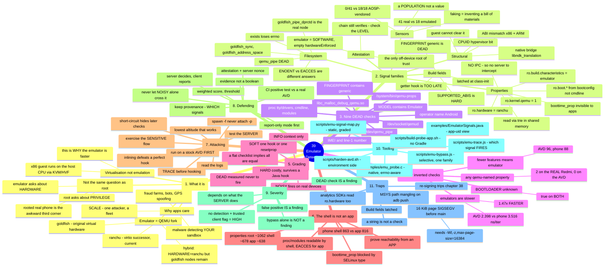
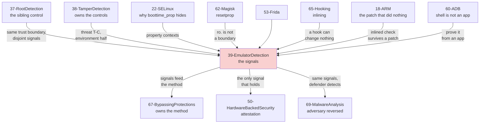

# 39 — Emulator Detection: Mind Map

A single map of the whole chapter. Every leaf that carries a number was measured on a
**Redmi M2101K6P** (Android 11 / API 30, arm64) and a **Pixel_6_Pro_API_35** AVD
(Android 15 / API 35, x86_64).

---

## How to read this map

The map is organised as an argument, not a list, and it is worth following in order.

**Branches 1–2** are the mechanism: what an emulator is, and where each observable signal physically
comes from. Note the two facts that shape everything downstream — properties are read from a
read-only shared mapping with *no server in the path*, so hooking the reader is the only interception
point; and `Build` fields are latched at class-initialisation, so the obvious hook is too late.

**Branches 3–4** are the chapter's most useful contribution, and they exist because the material was
measured rather than copied. Nine of the most-published checks do not fire on a current emulator, and
four widely-repeated rules are not merely weak but *backwards* — they classify the real phone as an
emulator and the emulator as a phone.

**Branch 5** is the vocabulary that makes the rest usable. A flat checklist silently implies every
entry is worth the same. Grading is what turns forty signals into a ranked set you can reason about.

**Branch 6** is the methodology trap that catches almost everyone: `adb shell` is uid 2000 in a
different SELinux domain and can see strictly more than an app. Every "an app can read X" claim in
this chapter was produced by running an actual app.

**Branches 7–9** are the two perspectives the grading serves — attacking and defending — and then the
question that decides what any of it is worth: what does the server do when the check is absent?

**Branches 10–11** are the instruments and the ways they bite.

---

## The one-sentence version

Emulator detection is the accumulation of cheap, individually forgeable observations into a judgement
that is expensive to forge as a **set** — and the discipline's published checklists have rotted badly
enough that measuring them is the first thing you should do, not the last.

---

## Related chapters

The diagram shows the chapter's two hard boundaries, which are worth stating plainly because they are
easy to trip over.

**37 and 39 are siblings, not duplicates.** They share a trust boundary — the user is the adversary —
and almost no signals. Root detection reads `su`, Magisk artefacts and mount state; emulator
detection reads virtual hardware. The only overlap is the NOISY "this is not a retail image" family
(`test-keys`, `userdebug`), which belongs to neither.

**39 owns the signals; 67 owns the method.** This chapter bypasses signals only to prove they are
load-bearing. The escalation ladder, the altitude vocabulary and the question of what to do when an
app fights back all live in 67.

The arrows *into* 39 are the chapters that explain why a signal behaves as it does: 22 for the SELinux
property contexts that hide `boottime_prop` from apps, 62 for why `ro.` immutability is not a
security boundary, 60 for the shell-versus-app distinction, and 18 and 65 for the two independent
measurements of why a perfectly installed hook can change nothing at all.
