# 40 — Obfuscation

> After this chapter you will be able to look at any Android application, name every protection
> technique it uses, explain precisely what each one costs an attacker, and execute a repeatable
> methodology that strips those protections back until the application's real logic is readable
> again.

**Prerequisites:** [10-APK-Internals](../10-APK-Internals/README.md),
[12-DEX-Internals](../12-DEX-Internals/README.md), [13-ART](../13-ART/README.md),
[16-JNI](../16-JNI/README.md)
**Useful alongside:** [56-JADX](../56-JADX/README.md) for driving a decompiler — this chapter shows
the decompiled output it is discussing, so it reads without one.
[53-Frida](../53-Frida/README.md) for the runtime unpacking route; naming a protection and costing
it out is a static exercise, and [53's opening callout](../53-Frida/README.md) explains why
`frida-server` may not run on your image at all.
**Applies to:** All Android versions. Techniques described here are build-time and runtime
properties of applications, not of the OS, so they are largely version-independent. Where a
technique depends on a platform API level (`InMemoryDexClassLoader`, API 26+; `execmem`
restrictions; W^X enforcement) this is stated in a Version Matrix.

---

## Table of Contents

1. [Introduction](#1-introduction)
2. [High-Level Architecture](#2-high-level-architecture)
3. [Deep Internal Working](#3-deep-internal-working)
4. [Source Code Walkthrough (AOSP)](#4-source-code-walkthrough-aosp)
5. [Security Perspective](#5-security-perspective)
6. [Reverse Engineering Perspective](#6-reverse-engineering-perspective)
7. [Dynamic Analysis](#7-dynamic-analysis)
8. [Static Analysis](#8-static-analysis)
9. [Examples](#9-examples)
10. [Common Interview Questions](#10-common-interview-questions)
11. [Common Mistakes](#11-common-mistakes)
12. [Hands-on Labs](#12-hands-on-labs)
13. [Summary](#13-summary)
14. [References](#14-references)

---

## 1. Introduction

### The honest statement, first

Before a single technique is described, the most important sentence in this chapter:

> **⚠️ Warning**
> **Obfuscation raises the cost of understanding an application. It does not create a security
> boundary.** A security boundary is a place where a component with privilege refuses to do
> something on behalf of a component without privilege — the kernel refusing a syscall, `system_server`
> refusing a Binder transaction, the TEE refusing to release a key. Obfuscation is none of those
> things. It is a *presentation* of the same instructions. Anything the application can do on a
> device the attacker controls, the attacker can eventually do too, because the CPU must ultimately
> be given plaintext instructions and the decryption key must ultimately be present in the process.

This is not a rhetorical flourish. It has a precise mechanical cause, and you should be able to
state it to a developer in one breath:

**The application must run.** To run, its bytecode must be presented to the Android Runtime in a
form the runtime understands. To decrypt its strings, it must hold the key. To check a signature, it
must execute a comparison whose outcome an attacker can flip. Every protection an application
applies to itself is applied *by code that the attacker also controls*, on *hardware the attacker
owns*, in *a process the attacker can attach a debugger to*. There is no asymmetry available. The
defender and the attacker are running the same program on the same silicon; the only difference is
that the attacker started later.

What obfuscation genuinely buys is **time and skill cost**:

| Protection level | Typical cost to a competent analyst |
|---|---|
| No obfuscation | Minutes. `jadx-gui`, read the code. |
| Name obfuscation only (R8 default) | Hours. Names are gone, structure and strings remain. |
| Name + string encryption | Half a day. One Frida script recovers all strings, then it collapses to the previous row. |
| Name + strings + control-flow flattening | One to three days per interesting method. |
| Commercial packer + native anti-debug | Days to weeks for the first analyst; **hours for the second**, because the unpacking method generalises across every app protected by that product. |
| Logic moved into a hardened native library with virtualisation | Weeks, and it is still finite. |

Notice the fifth row. This is the property developers most consistently fail to understand: a packer
is a *product*, deployed identically across thousands of applications. The first person to defeat it
publishes a tool. From then on, every application using that packer costs an attacker one command.
Obfuscation applied uniformly by a vendor has a **shared fate**.

> **🧠 Mental Model**
> Think of obfuscation as a **combination lock on a glass door**. The lock is real, and picking it
> takes effort. But the door is glass, you are standing next to it holding a brick, and nobody is
> watching. The value of the lock is that a casual passer-by cannot open it *casually*. The value is
> not zero — most attacks are casual — but the lock will never survive a determined person with
> time.

### What problem existed before obfuscation?

Compiled Java, and therefore Android bytecode, retains an extraordinary amount of source
information. When `javac` compiles a class, the resulting `.class` file contains the fully qualified
class name, every field name, every method name, every parameter type, the generic signature, and —
if debug information is enabled, which it is by default — the original source file name and a table
mapping bytecode offsets to source line numbers. The DEX format inherits all of this.

The consequence is that decompiling an unobfuscated Android app produces something very close to the
original source. Variable names inside method bodies are lost unless the local variable table is
retained, but *everything else* — the class hierarchy, method names, field names, string literals —
is present verbatim.

So the problems that obfuscation was invented to address were, in historical order:

1. **Size.** Early Android devices had tiny storage and a hard 65,536-method limit per DEX file.
   Removing unused code and shortening names made apps fit. This is *shrinking*, and it is the
   original reason ProGuard existed on Android. See [41-ProGuard](../41-ProGuard/README.md).
2. **Intellectual property.** A competitor could decompile your app and read your algorithms.
3. **Tamper resistance and cheating.** Games in particular did not want players patching out
   in-app-purchase checks.
4. **Raising the cost of vulnerability discovery.** If an attacker cannot easily read your code,
   they cannot easily find the hardcoded API key in it.

Point 4 is the one that gets abused in security discussions. Obfuscation does not remove a hardcoded
API key. It hides it from a `strings` command. The key is still in the application, still extractable,
and still a finding.

> **🔍 Pentester's Note**
> "The secret is obfuscated" is never an acceptable remediation for a hardcoded secret. Write the
> finding as: *the credential is recoverable by any party in possession of the application binary;
> obfuscation delays but does not prevent recovery; the credential must be treated as public and the
> design changed accordingly.* Then demonstrate recovery, because a demonstration ends the argument
> in a way that an assertion does not.

### What would break if obfuscation did not exist?

Very little, from a security standpoint — which is the point. Applications that rely on obfuscation
for security are already broken; obfuscation is merely delaying the discovery. What *would* change:

- Cloning and repackaging of applications would become trivially cheap, and it is already cheap.
- Some categories of licensing and DRM enforcement would be immediately defeated rather than
  eventually defeated.
- App sizes would grow, because shrinking and obfuscation are performed by the same tool.

The honest framing used by mature security teams is that obfuscation is a **cost-imposition control**
in a defence-in-depth stack, sitting alongside server-side authorisation (the actual boundary),
attestation, and monitoring. Its job is to make automated, scaled attacks uneconomic. Its job is not
to stop a targeted analyst.

### Where this chapter sits

This chapter is the **landscape**: every technique, what it looks like, and how it is defeated. Two
sibling chapters cover the two specific tools that the overwhelming majority of Android applications
actually use:

- [41-ProGuard](../41-ProGuard/README.md) — the original shrinker/obfuscator, its rules language, and
  the mapping file.
- [42-R8](../42-R8/README.md) — Google's replacement, the default since Android Gradle Plugin 3.4,
  and the specific optimisations that make its output confusing to read.

Read this chapter for the concepts and the counter-techniques; read those two for the tooling detail.

---

## 2. High-Level Architecture

### Where obfuscation happens in the build

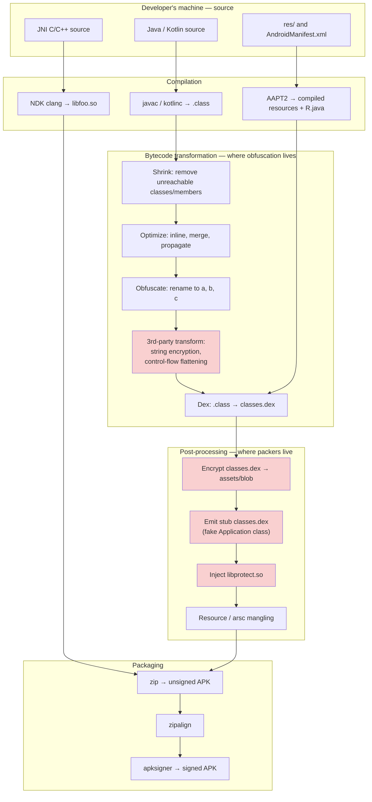

What you are looking at is the reason obfuscation is invisible in source code. The developer writes
ordinary Kotlin. The compiler produces ordinary `.class` files. Everything interesting happens in the
**transform** stage, after compilation and before or during dexing, and in the **post-processing**
stage, after a complete DEX file already exists.

That split matters enormously for you as an analyst, because it tells you *what the tool had access
to*:

- A tool operating in the **transform** stage sees typed bytecode with a full class hierarchy. It can
  safely rename, inline, merge classes, and rewrite control flow, because it understands the program.
  ProGuard, R8, DexGuard and the commercial bytecode obfuscators live here.
- A tool operating in the **post-processing** stage sees a finished DEX file as a *blob*. It usually
  does not understand the program at all. Its only options are to encrypt the whole thing and arrange
  for something to decrypt it at runtime. This is what a **packer** is, and it is why packers are
  simultaneously the most intimidating protection to encounter and the most mechanically defeatable —
  because the packer must hand the runtime a complete, valid, plaintext DEX file, and you can simply
  take it at that moment.

> **📖 Definition**
> **Packer.** A post-build tool that replaces an application's real DEX with an encrypted blob plus a
> small "stub" DEX. The stub contains a replacement `Application` class which, at process start,
> decrypts the real DEX and loads it into the running ART instance. The original code never touches
> disk in plaintext under the packer's design intent — but it must exist in *memory* in plaintext,
> which is the whole basis of unpacking.

### The attacker's decision tree

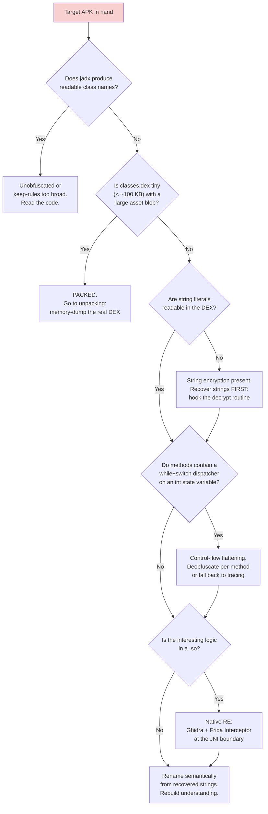

This tree is the entire chapter compressed to one picture, and it is worth internalising the
*ordering*. Notice that string recovery comes before control-flow work. That ordering is not
arbitrary and is justified in detail in [section 6](#6-reverse-engineering-perspective): strings are
the only remaining semantic anchors in an obfuscated program, so recovering them converts an
unreadable program into a merely difficult one, and it often makes the control-flow work unnecessary
because you can find the one method you actually care about directly.

### The runtime picture: what a packed app does at process start

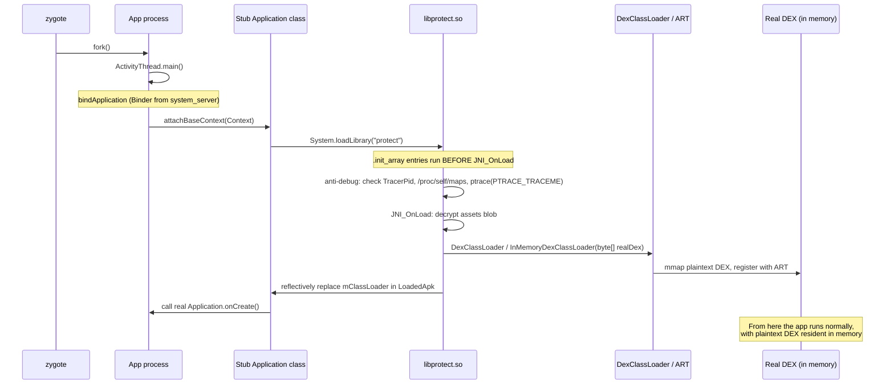

Read the last note again, because it is the whole game. **The plaintext DEX is resident in the
process's address space from `attachBaseContext` onwards.** Every unpacking technique in existence is
some variation of "be inside that process after that moment and copy the memory out". The packer's
counter-move is to detect that you are inside — which is why packers ship anti-debug and anti-Frida
code — but detection is a check, and a check is a branch, and a branch can be patched.

Note also *where* the anti-debug runs: in `.init_array`, an ELF section containing function pointers
that the dynamic linker invokes **before** `JNI_OnLoad` and before any Java code observes the library
being loaded. If you plan to hook `JNI_OnLoad` to catch the decryption, the anti-debug has already
run and already killed you. This single detail explains most "my Frida script never fired" confusion
against packed apps, and the counter is to spawn the process suspended (`frida -f`, which uses
`ptrace`-based early instrumentation) and hook `android_dlopen_ext` so you are attached *before* the
library is mapped.

### Layer map: what protects what

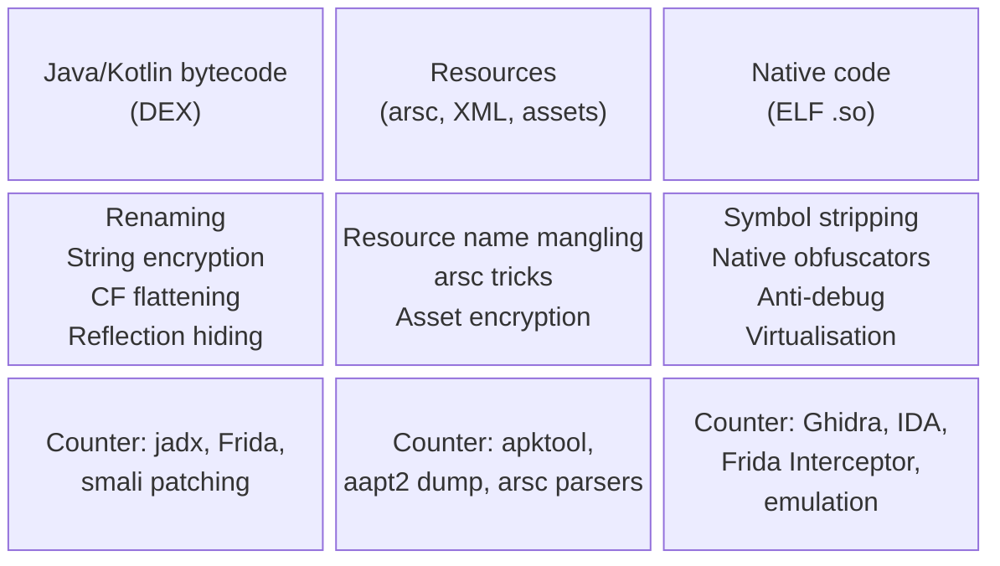

The three columns are three different skill sets and three different tool chains. An application that
is well protected in one column and weak in another is normal, and finding the weak column quickly is
the difference between a one-day and a one-week engagement. In practice the resources column is
almost always the weakest, because resource obfuscation breaks tooling that developers rely on, and
because `PackageManager` and the resource system impose hard format requirements that limit how much
can be mangled.

---

## 3. Deep Internal Working

This section is the taxonomy. Each technique is presented in the same shape:

1. **What it is** — a precise definition.
2. **Why it exists** — the threat the developer had in mind.
3. **Before/after code** — real source, and what the transform produces.
4. **How it appears** — in JADX, in Smali, and in Ghidra where relevant.
5. **The counter** — how you defeat it, with the reasoning, not just the command.

### 3.1 Identifier renaming

> **📖 Definition**
> **Identifier renaming** (also called *name mangling* or, loosely, "obfuscation") replaces
> developer-chosen names of classes, methods and fields with short, meaningless names — usually `a`,
> `b`, `c`, then `aa`, `ab`, and so on. It is a *semantics-preserving* rename: every reference to the
> old name is updated, so the program behaves identically.

**Why it exists.** Two reasons, and the first is not security. Short names make the DEX string pool
smaller, which makes the APK smaller. The security reason is that names carry the majority of a
program's human-readable meaning. `validateLicenseSignature` tells an analyst where to look;
`a.b(byte[])` does not.

**Before:**

```java
// app/src/main/java/com/example/pay/LicenseValidator.java
package com.example.pay;

public class LicenseValidator {
    private static final String PUBLIC_KEY = "MIIBIjANBgkq...";

    public boolean isLicenseValid(String licenseBlob, String signature) {
        byte[] decoded = Base64.decode(licenseBlob, Base64.DEFAULT);
        return verifySignature(decoded, signature);
    }

    private boolean verifySignature(byte[] data, String sig) { /* ... */ }
}
```

**After renaming (decompiled by JADX):**

```java
// jadx output
package p001b.p002a.p003c;

public class a {
    private static final String a = "MIIBIjANBgkq...";

    public boolean a(String str, String str2) {
        return a(Base64.decode(str, 0), str2);
    }

    private boolean a(byte[] bArr, String str) { /* ... */ }
}
```

Three things to notice, because each is a lever you will use later.

First, **the package name became `p001b.p002a.p003c`**. JADX did that, not the obfuscator. The
obfuscator produced packages literally named `b.a.c`, and JADX prefixes them because a Java package
segment cannot legally begin with a digit and because some obfuscators emit segment names that are
Java keywords. Recognising `pNNN` prefixes in JADX output is an instant tell that you are looking at
obfuscated code.

Second, **`isLicenseValid` and `verifySignature` both became `a`**. This is *overloading-based
renaming*: because the two methods have different parameter types, the JVM and ART can distinguish
`a(String, String)` from `a(byte[], String)` even though the names collide. Obfuscators do this
deliberately to maximise confusion. ProGuard calls it `-overloadaggressively`.

Third — and this is the important one — **the Base64 call survived completely intact.** The class
`android.util.Base64`, the method `decode`, and the constant `0` (which is `Base64.DEFAULT`) are all
still there in plain sight, and the string literal is still there in plain sight.

#### What information survives identifier renaming

This table is the single most useful artefact in this chapter. Everything in it is a foothold.

| Survives | Why it must survive | How you use it |
|---|---|---|
| **Android framework class and method names** | The framework is not in your APK. `android.util.Base64.decode` is resolved by name at runtime against the boot classpath. Renaming it would break resolution. | Every framework call is a semantic anchor. `Cipher.getInstance`, `HttpURLConnection.connect`, `SharedPreferences.edit` tell you what a method *does* even when it is called `a`. |
| **Third-party library names, if not shrunk in** | If a library is in the APK it *can* be renamed, but if the app uses reflection or the library has keep rules (most do, via consumer rules), the names remain. | OkHttp, Retrofit, Gson, Firebase class names frequently survive and immediately reveal architecture. |
| **String constants** | The program needs them. Unless separately encrypted, they are in the DEX string pool verbatim. | URLs, JSON keys, SQL, `SharedPreferences` key names, error messages, log tags. This is the richest source of meaning in an obfuscated app. |
| **Manifest-declared component names** | `PackageManager` launches components by the exact string in the manifest. If the manifest says `.ui.MainActivity`, a class with that name must exist. | Entry points. Always start here. See [32-Manifest](../32-Manifest/README.md). |
| **Resource names** | `R.id.login_button` compiles to an integer, but the *name* is stored in `resources.arsc` so that `getIdentifier()` and tooling work. Renaming requires a dedicated resource obfuscator. | Layout and view IDs give you UI semantics: `layout/activity_payment`, `id/pin_entry`. |
| **JNI native method names** | Static JNI linking resolves `Java_com_example_Crypto_sign` by *symbol name* built from the class and method name. If you rename the Java class, the symbol must be renamed to match — and obfuscators do exactly that, but the symbol still tells you the *post-obfuscation* fully qualified name, and it is exported and visible in the ELF symbol table. | Grep exported symbols in `.so` files. Even mangled, they map back to a specific Java class you can then find. |
| **Reflection target strings** | `Class.forName("com.foo.Bar")` uses a string. Obfuscators cannot see through arbitrary string construction, so either the string is kept correct (and readable) or the class is kept unrenamed. | A reflection string is a guaranteed-correct class name. |
| **Enum constant names, if `values()`/`valueOf()` used** | `valueOf(String)` matches against the constant's name at runtime. | Enum names often leak business meaning: `TransactionType.REFUND`. |
| **Serializable field names** | Java serialization writes field names into the stream; renaming breaks cross-version compatibility. Keep rules usually preserve them. | Data model shape. |
| **`Parcelable.CREATOR` field name** | The framework looks up a field literally named `CREATOR` by reflection. | Confirms a class is a data-transfer object. |
| **Annotations, if retained** | `RetentionPolicy.RUNTIME` annotations are read reflectively by name. Retrofit's `@GET("/v1/user")` is the canonical example. | Retrofit/Room/Gson annotations reconstruct the entire API surface even when everything else is renamed. |
| **`kotlin.Metadata` annotation** | The Kotlin reflection library reads it. It contains original names in a protobuf. **Usually stripped or rewritten under R8 — but not completely.** | See [42-R8](../42-R8/README.md), which measured 19 real APKs: 10 carried no metadata at all, one carried 1,393 *empty shells* (so a `grep` reports 1,393 false positives), and **none** yielded wholesale recovery. What does survive is **Kotlin property names**, structurally — R8 renames JVM members, and a property is not one, so the rewriter has no single new name to record. That is a member-level mapping with no mapping file, and it is worth checking every time. |
| **Method signatures and the class hierarchy** | Required for verification and dispatch. | `extends android.app.Activity` tells you what a class is regardless of its name. |
| **The `mapping.txt` file, if shipped** | It should never be in the APK, but it sometimes is. | Total, instant deobfuscation. Always check. |

> **🔍 Pentester's Note**
> Run this on every obfuscated app before doing anything clever:
> ```bash
> # host — unzip the APK first
> unzip -o target.apk -d target_ext >/dev/null
> find target_ext -iname '*mapping*' -o -iname '*.map' -o -iname '*proguard*' -o -iname '*seeds*'
> ```
> Finding a mapping file in an APK is a genuine, reportable finding (it discloses the original source
> structure) and it saves you a day. It happens more often than you would believe, usually because a
> developer added the mapping to an assets folder for a crash-reporting integration.

**The counter to renaming.** There is no "decryption" — the original names are gone. What you do
instead is **semantic renaming**: you rename symbols yourself, based on evidence, until the program
reads normally. JADX supports this directly (`Rename` in the GUI, persisted to a `.jobf` project
file), and it is the single highest-value manual activity in Android reverse engineering. The
evidence you rename from is exactly the survivors table above. Section 6 gives the full method.

### 3.2 String encryption

This is the technique that matters most, so it gets the most space.

> **📖 Definition**
> **String encryption** replaces every (or selected) string literal in the bytecode with an encrypted
> byte array or an encrypted string, plus a call to a decryption routine that reconstructs the
> original at runtime. The literal `"https://api.example.com/v1"` never appears in the DEX string
> pool; instead, ciphertext appears, and a method call turns it back into the URL just before use.

**Why it exists.** Because of the survivors table. After renaming, strings are the only readable
semantics left. Encrypting them is the single most effective thing a developer can do to make an app
hard to read, and it is why a `strings classes.dex` on a well-protected app returns garbage.

#### Variant A — XOR with a fixed key

The simplest and by far the most common in home-grown and low-tier commercial obfuscators.

**Before:**

```java
public class ApiClient {
    private static final String BASE_URL = "https://api.example.com/v1";
    public void fetch() {
        HttpURLConnection c = (HttpURLConnection) new URL(BASE_URL + "/user").openConnection();
    }
}
```

**After (conceptually — this is what the transform emits):**

```java
public class a {
    private static final byte[] a = {0x50, 0x60, 0x60, 0x40, 0x63, 0x2f, ...};

    private static String b(byte[] data) {
        char[] out = new char[data.length];
        for (int i = 0; i < data.length; i++) {
            out[i] = (char) (data[i] ^ 0x21);
        }
        return new String(out);
    }

    public void c() {
        HttpURLConnection c = (HttpURLConnection) new URL(b(a) + b(d)).openConnection();
    }
}
```

**In JADX** you see the byte array as a decimal or hex initialiser and a small static method with a
tight loop containing an `^` operator. **In Smali** the tell is unmistakable:

```smali
# smali/com/example/a.smali
.method private static b([B)Ljava/lang/String;
    .locals 5
    array-length v0, p0
    new-array v1, v0, [C
    const/4 v2, 0x0
    :goto_0
    if-ge v2, v0, :cond_0
    aget-byte v3, p0, v2
    xor-int/lit8 v3, v3, 0x21          # <-- the giveaway
    int-to-char v3, v3
    aput-char v3, v1, v2
    add-int/lit8 v2, v2, 0x1
    goto :goto_0
    :cond_0
    new-instance v4, Ljava/lang/String;
    invoke-direct {v4, v1}, Ljava/lang/String;-><init>([C)V
    return-object v4
.end method
```

> **🔬 Under the Hood**
> `xor-int/lit8` with a small literal, inside a loop over a byte array, returning a `String` — that
> is a string decryptor with essentially no false-positive rate. Grep your Smali for
> `xor-int/lit8` and look at every enclosing method that returns `Ljava/lang/String;`. Also look for
> `xor-int/2addr` (variable key) and `rem-int` (position-dependent keys).

#### Variant B — AES with the key in the same DEX

More sophisticated-looking, exactly as weak.

```java
public final class c {
    private static final byte[] k = {(byte)0x8f, 0x2a, ...};   // 16 bytes: the AES key
    private static final byte[] iv = {...};

    public static String a(String enc) {
        try {
            Cipher ci = Cipher.getInstance("AES/CBC/PKCS5Padding");
            ci.init(Cipher.DECRYPT_MODE, new SecretKeySpec(k, "AES"),
                    new IvParameterSpec(iv));
            return new String(ci.doFinal(Base64.decode(enc, 0)), "UTF-8");
        } catch (Exception e) { return null; }
    }
}
```

> **⚠️ Warning**
> This is *not* stronger than XOR in any meaningful sense. The threat model of string encryption is
> "an attacker holds the app". If the attacker holds the app, they hold the key, because the key must
> be in the app for the app to work. AES here buys you exactly one thing: you cannot recover the
> strings with a 20-line Python script that guesses a single-byte key. You recover them by *running
> the decryptor*, which costs the same effort regardless of the cipher. See
> [34-Cryptography](../34-Cryptography/README.md) for why "the key is in the binary" is a
> categorically different situation from a real key-management failure.

#### Variant C — per-class decrypt methods

The strongest common variant. Instead of one global decryptor, the transform emits a *different*
decryption method inside *every class*, each with a different key and often a slightly different
algorithm, and each taking different parameters (commonly an index into a per-class encrypted blob,
plus offsets).

```java
public class q {
    private static String[] s;                    // populated by a static initialiser
    static {
        s = new String[47];
        // giant static block: reads a long obfuscated literal, splits, decrypts into s[]
    }
    private static String a(int i, int j, int k) { /* per-class algorithm */ }

    public void run() {
        Log.d(a(3, 17, 2), a(9, 4, 11));
    }
}
```

This defeats the "find the decryptor and script it" approach *statically*, because there are 400
decryptors. It does not defeat it *dynamically*, because they are all still just methods you can
call. Which brings us to the universal counter.

#### THE UNIVERSAL COUNTER — hook or invoke the decryption routine at runtime

> **🧠 Mental Model**
> The decrypted string must exist in memory for the program to use it. Therefore there is always a
> moment, and always a specific function, at which plaintext exists. You do not need to break the
> cipher, understand the key schedule, or reimplement anything. You need to **be present at that
> moment and write down what you see.** This principle — *let the program do the work, then steal the
> result* — is the most transferable idea in the whole of reverse engineering. It applies to string
> encryption, to packers, to signature checks, to licence validation, and to native code.

There are two forms of the counter, and you should know when to use each.

**Form 1 — Passive hooking.** Attach to the running process, replace the decryption method's
implementation with a wrapper that calls the original, records `(arguments) → return value`, and
returns the original result. Then exercise the app and collect strings as they are used.

- *Advantage:* works even when you do not know how many decryptors exist, and gives you the call site
  via a stack trace, which is far more valuable than the string alone.
- *Disadvantage:* only recovers strings on code paths you actually reach. A string used only in an
  error handler you never trigger stays hidden.

**Form 2 — Active invocation (brute-force dumping).** Attach, find the decryption method, and call it
yourself for every possible input — every index from 0 to N, or every ciphertext constant you have
statically extracted from the DEX — and record every output.

- *Advantage:* recovers **all** strings, including unreached code paths. This is what you want.
- *Disadvantage:* requires you to know the decryptor's signature and the valid input domain, and it
  can throw for invalid inputs (which you catch and ignore).

In practice you use Form 1 to *discover* the decryptor and its signature, then Form 2 to *exhaust* it.

The full, commented script implementing both is at
[`scripts/frida-string-decryptor.js`](scripts/frida-string-decryptor.js). Here is the core idea,
reduced to its essentials so you understand what the script is doing:

```javascript
// Frida REPL — the essence of Form 1
Java.perform(function () {
    var C = Java.use("com.example.a.q");
    // overload("int","int","int") disambiguates when a class has several methods named 'a'
    C.a.overload("int", "int", "int").implementation = function (i, j, k) {
        var out = this.a(i, j, k);            // let the app decrypt normally
        console.log("[str] a(" + i + "," + j + "," + k + ") = " + out);
        return out;                            // return it unchanged — app behaves normally
    };
});
```

And Form 2:

```javascript
// Frida REPL — the essence of Form 2: exhaust the index space
Java.perform(function () {
    var C = Java.use("com.example.a.q");
    for (var i = 0; i < 512; i++) {
        try { console.log(i + " => " + C.a(i, 0, 0)); } catch (e) { /* out of range */ }
    }
});
```

> **🔍 Pentester's Note**
> When you dump strings, **always capture the call site**, not just the string. A list of 4,000
> decrypted strings is a haystack. A list of 4,000 strings each annotated with
> `com.example.b.c.d()` is a map. In Frida, get it with
> `Java.use("java.lang.Exception").$new().getStackTrace().toString()` inside the hook. The
> provided script does this behind a flag, because it is slow — enable it once you have narrowed
> down which class you care about.

#### Static recovery, when dynamic is impossible

Sometimes you cannot run the app (no matching device, hard anti-debug, malware you refuse to
execute). Then you have two static options:

1. **Reimplement the decryptor.** Read the Smali, port the algorithm to Python, extract the
   ciphertext arrays from the DEX, decrypt offline. Reliable for XOR, tedious for AES, impossible at
   scale for per-class variants.
2. **Emulate the decryptor.** Load the DEX into a JVM/Android emulation harness and *call the real
   method* without running the app. Tools in this space execute DEX bytecode outside a device.
   Conceptually this is Form 2 without a phone. This is the professional answer for per-class
   decryptors and for malware.

There is a third, underrated option: **run only the decryptor class in an app you control.** Extract
the obfuscator's runtime class from the target's DEX, drop it into a trivial harness app, and call it
in a loop. It is legal in a testing context, mechanically simple, and needs no emulation framework.

### 3.3 Control flow obfuscation

> **📖 Definition**
> **Control flow obfuscation** rewrites a method so that it computes the same result but its
> *control flow graph* (CFG — the graph whose nodes are straight-line blocks of code and whose edges
> are the possible jumps between them) no longer resembles the source structure. Decompilers
> reconstruct `if`/`while`/`for` by pattern-matching the CFG, so a deliberately ugly CFG produces
> deliberately ugly decompiled output — or none at all.

#### 3.3.1 Opaque predicates

> **📖 Definition**
> An **opaque predicate** is a boolean expression whose value is known to the obfuscator at build
> time but is difficult for an analyser to determine. `if (x * x >= 0)` is always true for integers
> in the absence of overflow reasoning; a decompiler that does not reason about arithmetic keeps both
> branches.

**Before:**

```java
public int computeFee(int amount) {
    return amount * 2 + 5;
}
```

**After:**

```java
public int a(int i) {
    int j = i;
    if ((j * j) >= 0) {                    // opaque: always true
        return (i * 2) + 5;
    }
    // dead branch, never executed, but the decompiler cannot prove it
    return b(i) ^ c(i, 7);
}
```

**How it appears.** JADX shows both branches. The dead branch typically calls methods that exist,
compile, and are never invoked, which wastes your time convincingly. The recognisable shapes are:

| Pattern | Always | Why the obfuscator likes it |
|---|---|---|
| `x * x >= 0` | true (barring overflow) | Requires arithmetic reasoning to disprove |
| `(x \| 1) != 0` | true | Bit-level reasoning |
| `x * (x + 1) % 2 == 0` | true | Product of consecutive integers is even |
| A static field set once in `<clinit>` and never written again | constant | Requires whole-program dataflow |
| `Math.abs(x) >= 0` | true except `Integer.MIN_VALUE` | Looks like a real check |
| A field read from a class the analyser must load | unknown statically | Defeats naive static evaluation |

**The counter.** Opaque predicates are the weakest control-flow technique because they are defeated by
*execution*. Set a breakpoint or a Frida hook and observe which branch runs; the other is dead. For
static work, tools that perform symbolic execution or simple constant folding remove most of them.
And in practice you can often just read past them: a human recognises `x*x >= 0` as always true
instantly, which is precisely the weakness — opaque predicates are aimed at *tools*, not people.

#### 3.3.2 Control-flow flattening — the important one

> **📖 Definition**
> **Control-flow flattening** destroys the nesting structure of a method. All the original basic
> blocks are placed side by side as cases of a single `switch` statement inside an infinite loop. A
> variable — the **state variable** or **dispatcher variable** — holds a number identifying which
> block runs next. Each block ends by assigning the next state number and jumping back to the top of
> the loop. The method's control flow graph becomes a flat star: dispatcher in the middle, every block
> hanging off it, no visible relationship between blocks.

This is the technique that makes people give up, so understand it thoroughly.

**Before:**

```java
public String classify(int score) {
    if (score < 0) {
        return "invalid";
    }
    String label;
    if (score < 50) {
        label = "fail";
    } else if (score < 80) {
        label = "pass";
    } else {
        label = "distinction";
    }
    return label.toUpperCase();
}
```

**After flattening:**

```java
public String a(int i) {
    String str = null;
    int state = 3;                       // entry state — NOT necessarily 0
    while (true) {
        switch (state) {
            case 0:
                str = "distinction";
                state = 6;
                break;
            case 1:
                if (i < 50) { state = 5; } else { state = 4; }
                break;
            case 2:
                return "invalid";
            case 3:
                if (i < 0) { state = 2; } else { state = 1; }
                break;
            case 4:
                if (i < 80) { state = 7; } else { state = 0; }
                break;
            case 5:
                str = "fail";
                state = 6;
                break;
            case 6:
                return str.toUpperCase();
            case 7:
                str = "pass";
                state = 6;
                break;
        }
    }
}
```

Read those two listings side by side. They are the same program. The second is *unreadable* not
because anything is hidden but because the **order** is gone. Your eye cannot follow `case 3 → case 1
→ case 5 → case 6` without writing it down, and a real flattened method has forty cases and a state
variable that is computed rather than assigned literally.

**How to recognise it in a decompiler.** These signs, in order of reliability:

| Sign | What it looks like |
|---|---|
| `while (true) { switch (v) { ... } }` | The canonical shape. In JADX, an infinite loop whose entire body is a switch. |
| A local `int` assigned in nearly every case | The state variable. |
| Cases that `break` out of the switch but not the loop | Every case falls back to the dispatcher. |
| Case labels that are large, non-sequential numbers | Real flatteners use randomised or hashed state values, e.g. `case 1837292841:`. |
| No `if` nesting anywhere despite obvious complexity | The `if`s became state assignments. |
| In Smali: one enormous `packed-switch` or `sparse-switch` with a `goto` back to the top | The Smali form is even more obvious than the Java form. |
| Method is huge but has almost no call depth | Everything was inlined into blocks first. |

**The CFG picture** — this is what your decompiler is failing to untangle:

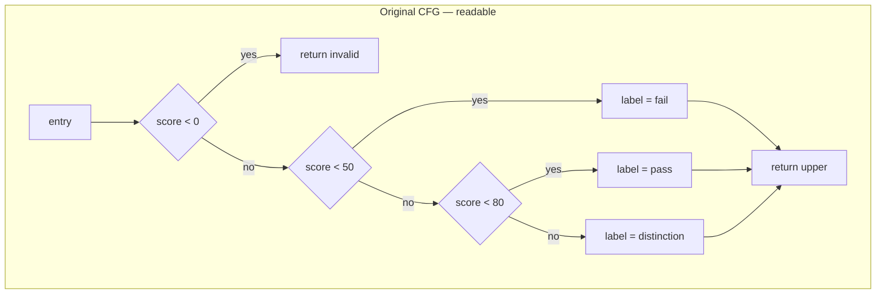

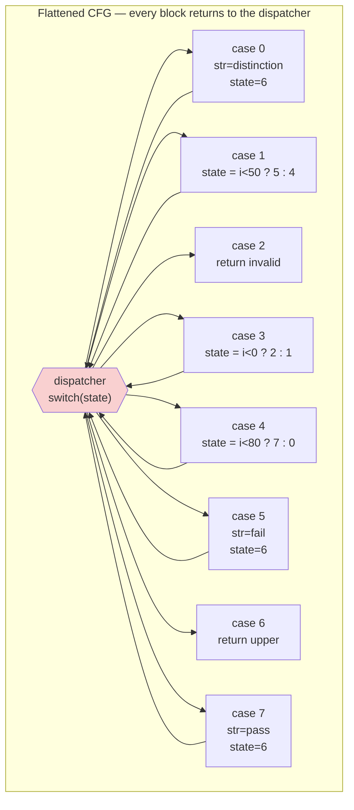

The second diagram is why decompilers produce garbage. A decompiler's structuring algorithm looks for
*dominance* relationships that correspond to `if` and `while`. In a flattened CFG, the dispatcher
dominates everything and nothing dominates anything else, so there is no structure to find. The
decompiler correctly emits the only thing it can: a `switch` in a loop.

**The counters, in increasing order of effort:**

1. **Reconstruct by hand.** Write down the state transitions as a table, draw the real graph, read it.
   For a 10-case method this takes ten minutes and is completely reliable. Do this before reaching for
   tools. The transition table for the example above is:

   | State | Does | Next |
   |---|---|---|
   | 3 (entry) | test `i < 0` | 2 if yes, 1 if no |
   | 2 | `return "invalid"` | — |
   | 1 | test `i < 50` | 5 if yes, 4 if no |
   | 5 | `str = "fail"` | 6 |
   | 4 | test `i < 80` | 7 if yes, 0 if no |
   | 7 | `str = "pass"` | 6 |
   | 0 | `str = "distinction"` | 6 |
   | 6 | `return str.toUpperCase()` | — |

   Sort by reachability from the entry and the original program falls out.

2. **Trace it.** Hook the method with Frida and log the state variable at each iteration — or, more
   simply, log the method's inputs and outputs and treat it as a black box. Very often you do not
   need to understand a flattened method at all; you need to know what it returns for a given input,
   and one hook answers that.

3. **Instrument every case.** Use a Frida `Java` hook plus `Interceptor` on the dexed method, or patch
   the Smali to log the state at the top of the loop, rebuild, and run. You get the exact execution
   path for a real input, which collapses the forty-case method to the eight cases that actually
   matter.

4. **Symbolic deflattening.** Tools that perform symbolic execution over the CFG can recover the
   original structure automatically. This is well-developed for native code (LLVM-based deobfuscators)
   and less mature for DEX. Know it exists; do not start here.

> **🔍 Pentester's Note**
> The correct first question about a flattened method is not "how do I deflatten this?" It is
> "**do I need to?**" You are usually looking for one specific behaviour — where the API key is built,
> whether root detection returns true. Hooking the method boundary answers that in five minutes.
> Deflattening is for when you need to *reimplement* the logic, e.g. to forge a licence token.

#### 3.3.3 Bogus control flow and junk code

> **📖 Definition**
> **Bogus control flow** inserts branches that are never taken, guarded by opaque predicates, whose
> bodies contain plausible-looking but never-executed code. **Junk code** (or *dead code insertion*)
> adds instructions that execute but have no effect on the result — computing values into variables
> that are never read, allocating objects that are discarded, calling methods with no side effects.

The purpose is volume. A 20-line method becomes 300 lines, and an analyst reading 300 lines to find
20 is slowed by more than the 15× ratio suggests, because they must *prove* each line irrelevant.

**Recognition:** unused locals, results assigned and never read, loops with no observable effect,
allocations that immediately go out of scope, arithmetic on values that never leave the method.
Modern decompilers with dataflow analysis (including JADX with deobfuscation options enabled) remove
much of it automatically, and R8's own optimizer would remove it too — which is why bogus code is
inserted *after* R8, not before.

**Counter:** enable your decompiler's dead-code elimination, then read what remains. For anything
subtle, dynamic tracing is again the answer: junk code by definition does not affect behaviour, so
behaviour-based analysis ignores it for free.

#### 3.3.4 Irreducible loops and decompiler-breaking CFGs

> **📖 Definition**
> A loop is **reducible** if it has a single entry point (a *header*) that dominates every node in the
> loop. Java source can only express reducible loops. Bytecode, however, can express **irreducible**
> loops — loops with two or more entry points, created by `goto` into the middle of a loop body.
> Because no Java source construct maps to them, a decompiler must either duplicate code, fall back to
> a `switch`-based emulation, or fail.

This is one of the few techniques that attacks the decompiler rather than the human. JADX will emit a
comment noting it could not structure the method, or produce output with `// Can't fix method` or a
raw-instruction fallback.

**Counter:** drop to Smali. Smali has no structuring problem; it is a linear listing with labels, and
labelled `goto`s are exactly as readable as any other jump. This is the general rule for every
anti-decompiler technique: **the decompiler is a convenience, the disassembler is the ground truth.**
When the decompiler fails, you have not lost information, you have lost formatting.

### 3.4 API hiding via reflection and dynamic resolution

> **📖 Definition**
> **Reflection** is the ability of a program to inspect and invoke classes and methods by *name at
> runtime*, rather than by a *reference resolved at compile time*. `Runtime.getRuntime().exec("su")`
> is a direct call; `Class.forName("java.lang.Runtime").getMethod("exec", String.class).invoke(...)`
> is the same call performed reflectively.

**Why obfuscators use it.** A direct call creates a *reference* in the DEX method table. Anyone can
list every class that calls `Cipher.getInstance` with a single query. A reflective call creates no
such reference — the target appears only as a string, and if that string is encrypted (§3.2), the
call is invisible to static cross-referencing entirely.

**Before:**

```java
TelephonyManager tm = (TelephonyManager) ctx.getSystemService(Context.TELEPHONY_SERVICE);
String imei = tm.getDeviceId();
```

**After:**

```java
Object tm = ctx.getSystemService(a(17));                   // a(17) decrypts to "phone"
Class<?> c = Class.forName(a(18));                         // "android.telephony.TelephonyManager"
Method m = c.getDeclaredMethod(a(19), new Class[0]);       // "getDeviceId"
String imei = (String) m.invoke(tm, new Object[0]);
```

**How it appears.** In JADX, a cluster of `Class.forName`, `getMethod`/`getDeclaredMethod`,
`setAccessible(true)` and `invoke` calls with no readable arguments. In Smali, look for
`Ljava/lang/reflect/Method;->invoke`.

> **🔍 Pentester's Note**
> Reflection is also how apps reach **hidden and greylisted framework APIs** that the SDK does not
> expose. Since Android 9 (API 28) the runtime enforces hidden-API restrictions and logs
> `Accessing hidden API` warnings to logcat. Watching logcat while an app starts is therefore a
> free way to discover reflective framework access, including access the developer would prefer you
> did not see. Filter with `adb logcat | grep -i "hidden api"`.

**The counter.** Hook the reflection API itself. This is one of the most productive hooks in Android
security work, because *all* reflective calls funnel through a handful of methods:

```javascript
// Frida REPL — log every reflective lookup and invocation in the process
Java.perform(function () {
    var Cls = Java.use("java.lang.Class");
    Cls.forName.overload("java.lang.String").implementation = function (n) {
        console.log("[forName] " + n);
        return this.forName(n);
    };
    var M = Java.use("java.lang.reflect.Method");
    M.invoke.implementation = function (obj, args) {
        console.log("[invoke] " + this.getDeclaringClass().getName() + "." + this.getName());
        return this.invoke(obj, args);
    };
});
```

Because reflection resolves by name, and names must be correct for the call to work, hooking
reflection converts hidden calls into a plaintext log. Reflection hides from *static* analysis and is
essentially transparent to *dynamic* analysis — a general property worth internalising.

### 3.5 Dynamic code loading

> **📖 Definition**
> **Dynamic code loading** is loading executable code that was not part of the DEX files ART opened at
> process start. On Android this means a `ClassLoader` — usually `DexClassLoader`,
> `PathClassLoader`, or (API 26+) `InMemoryDexClassLoader` — being handed a DEX or APK from the app's
> data directory, from `assets/`, or downloaded from a server.

**Why it exists.** Legitimately: plugin architectures, A/B feature delivery, hot-patching frameworks,
and dynamic feature modules. Illegitimately: keeping the real payload out of the shipped APK so that
static scanners (including Play's) never see it, and so that an analyst who decompiles the APK finds
nothing.

**The API surface:**

| Class | Since | Source of code | Notes |
|---|---|---|---|
| `dalvik.system.DexClassLoader` | API 1 | A path to a `.dex`, `.jar`, `.apk` or `.zip` on disk | Historically took an `optimizedDirectory`; that parameter is deprecated and ignored on modern versions. |
| `dalvik.system.PathClassLoader` | API 1 | A path; used by the framework itself for the app's own APK | Cannot write oat to a custom dir. |
| `dalvik.system.InMemoryDexClassLoader` | API 26 | A `ByteBuffer` (or array of them) — **never touches disk** | The packer's favourite. Nothing to `pull`. |
| `dalvik.system.BaseDexClassLoader` | — | Base of all of the above; holds `DexPathList pathList` | The field you reach for when hooking. |
| `java.lang.ClassLoader.defineClass` | — | Not usable for DEX on ART | Present but not the Android path. |

**Before/after is a little different here — this is not a transform, it is an architecture.** The
"before" is code compiled into your APK. The "after" is:

```java
// Real pattern seen in packed and in evasive apps
public class Loader {
    public static void boot(Context ctx) throws Exception {
        byte[] enc = readAsset(ctx, "config.dat");          // looks like data, is code
        byte[] dex = decrypt(enc, deriveKey(ctx));          // AES, key derived from package signature
        ByteBuffer bb = ByteBuffer.wrap(dex);
        ClassLoader cl = new InMemoryDexClassLoader(bb, ctx.getClassLoader());
        Class<?> real = cl.loadClass("com.example.real.Core");
        real.getMethod("start", Context.class).invoke(null, ctx);
    }
}
```

**How it appears.** In JADX: a class that reads from `assets/` (via `AssetManager.open`) or from the
network, passes bytes through a decrypt routine, and constructs a `ClassLoader`. In the APK on disk:
an `assets/` entry with a high-entropy body and a benign extension (`.dat`, `.png`, `.jpg`, `.mp3`,
`.properties`). **Check entropy, not extension.**

```bash
# host — find high-entropy assets that are not real media
cd target_ext
for f in $(find assets lib res -type f); do
  sz=$(stat -c%s "$f")
  # a compressed/encrypted blob barely shrinks when gzipped
  gz=$(gzip -c "$f" | wc -c)
  echo "$f size=$sz gz=$gz ratio=$(echo "scale=3;$gz/$sz" | bc)"
done | awk '$4 ~ /ratio=0\.9|ratio=1\./'
```

A ratio near 1.0 means the file is already incompressible, which means it is compressed, encrypted,
or media. Cross-check the magic bytes: if it is not a PNG/JPEG/MP4 and it does not compress, it is
encrypted data, and encrypted data of DEX-like size in `assets/` is a strong dynamic-loading signal.

**THE COUNTER — hook the ClassLoader constructors and dump the DEX.**

Every path into ART for new code goes through a small number of constructors and, one level down,
through `DexFile.openInMemoryDexFile`/`openDexFileNative`. Hook the constructors, capture the bytes
or the path, and write them to disk. The complete script is
[`scripts/frida-classloader-dump.js`](scripts/frida-classloader-dump.js); the essence:

```javascript
// Frida REPL — capture DEX handed to InMemoryDexClassLoader
Java.perform(function () {
    var IMDCL = Java.use("dalvik.system.InMemoryDexClassLoader");
    IMDCL.$init.overload("java.nio.ByteBuffer", "java.lang.ClassLoader")
        .implementation = function (bb, parent) {
            // Copy the buffer contents out before ART consumes them
            var arr = Java.array("byte", Java.use("java.nio.ByteBuffer")
                        .$new.call);  // see the full script for a correct extraction
            console.log("[InMemoryDexClassLoader] capacity=" + bb.capacity());
            dumpByteBuffer(bb, "/data/local/tmp/dumped_inmem.dex");
            return this.$init(bb, parent);
        };
});
```

> **⚠️ Warning**
> Hooking `InMemoryDexClassLoader.$init` only works if you are attached **before** it runs. In a
> packed app it runs inside `attachBaseContext`, which is one of the first things that happens in the
> process. Use `frida -f com.target.app --pause`, install your hooks, then `%resume`. Attaching to an
> already-running packed app is too late, and this is the single most common reason people conclude
> "the hook doesn't work".

### 3.6 Native code migration

> **📖 Definition**
> **Native code migration** is moving security-relevant logic out of Java/Kotlin into C or C++
> compiled to a shared object (`.so`) and called through JNI (Java Native Interface). The premise is
> that ARM machine code is harder to read than DEX bytecode.

The premise is true, and the conclusion people draw from it is wrong.

**Why it is harder:** DEX is a high-level, typed, register-based bytecode that retains class and
method structure, so decompilation to Java is close to lossless. Compiled ARM is a low-level,
untyped, register-allocated instruction stream from which types, locals and structure have been
erased by the optimizer. Ghidra and IDA reconstruct plausible C, but the reconstruction is lossy and
requires interpretation.

**Why it only raises cost:**

1. **The JNI boundary is a wall of plaintext.** Every native function that Java calls has a known
   signature, known argument types, and is invoked with arguments that are ordinary Java objects. One
   `Interceptor.attach` at the export gives you every input and output. You do not need to read the
   function to know what it does to your data.
2. **Native code must call the OS.** Crypto goes to BoringSSL or the app's bundled OpenSSL, networking
   goes to `libc` `socket`/`send`, files go to `open`/`read`. Hooking `libc` and `libssl` exports gives
   you the plaintext at the syscall boundary regardless of what the obfuscated code in between does.
3. **You control the process.** `frida-trace`, memory scanning, breakpoint debugging with LLDB, and
   dumping decrypted regions all still work.
4. **Symbol names often survive.** `JNI_OnLoad` must be exported. Statically-linked JNI methods must be
   exported under their `Java_pkg_Class_method` names. Even a stripped `.so` retains `.dynsym` for
   exported symbols, because the dynamic linker needs it.

```bash
# host — the first three commands you run on any .so
readelf --dyn-syms lib/arm64-v8a/libcore.so | grep -i ' Java_\| JNI_OnLoad'
readelf -d lib/arm64-v8a/libcore.so | grep NEEDED     # which libs it pulls in
strings -n 8 lib/arm64-v8a/libcore.so | sort -u | head -100
```

`NEEDED` entries are diagnostic on their own: a dependency on `liblog.so` means it logs, on
`libz.so` means it compresses or inflates something, on `libcrypto.so`/`libssl.so` means it does its
own TLS (which usually means certificate pinning implemented natively — see
[36-CertificatePinning](../36-CertificatePinning/README.md)).

> **🔍 Pentester's Note**
> When logic moves native, **your first move is not Ghidra.** It is
> `frida-trace -U -f com.target -j '*!*'` for the Java side and
> `frida-trace -U -f com.target -i 'Java_*'` for the JNI exports. Ten minutes of tracing tells you
> which native function matters. Then, and only then, open that one function in Ghidra. Analysts who
> open Ghidra first spend days reading code that turns out to be a JSON parser.

Native code is covered in depth in [15-Native-Code](../15-Native-Code/README.md),
[16-JNI](../16-JNI/README.md), [18-ARM](../18-ARM/README.md) and
[57-Ghidra](../57-Ghidra/README.md).

### 3.7 Packers and commercial protectors

This is where obfuscation stops being a compiler pass and becomes a product.

#### 3.7.1 How a packer works, mechanically

A packer performs four operations on a finished APK:

1. **Extract and encrypt the real `classes.dex`.** The ciphertext is stored somewhere the APK format
   tolerates: an `assets/` file, an extra `.so` in `lib/`, an appended blob past the end of the zip
   central directory, or a fake resource.
2. **Emit a replacement `classes.dex` — the *stub*.** The stub contains a handful of classes: an
   `Application` subclass, a loader, and whatever glue is needed. It is small — often 20–150 KB
   against a real app's several megabytes.
3. **Rewrite `AndroidManifest.xml`** so that `<application android:name>` points at the stub
   `Application` class, and stash the *original* `android:name` somewhere the stub can read it (very
   commonly a `<meta-data>` entry).
4. **Inject a native library** that performs the decryption, the anti-analysis checks, and the
   `ClassLoader` surgery.

The runtime sequence was drawn in §2. In prose, and this is the part you must be able to recite:

When Android starts an app process, `ActivityThread.handleBindApplication` instantiates the class
named by `<application android:name>`. Because the packer rewrote that to the stub, the *stub's*
`attachBaseContext(Context)` runs first — before `onCreate`, before any activity, before any of the
app's real code. Inside it, the stub calls `System.loadLibrary("...")`. The dynamic linker maps the
`.so`, and *before returning*, executes every function pointer in the library's `.init_array` section.
Those functions run the anti-debug checks. Then `JNI_OnLoad` runs, decrypts the real DEX, and creates
a `ClassLoader` over it. Finally the stub uses reflection to swap the newly created `ClassLoader` into
the framework's `LoadedApk` object (the field is `mClassLoader`) so that all subsequent class
resolution — including the resolution of the real `Application` class named in the meta-data — finds
the real code. The stub then instantiates the real `Application` and forwards every lifecycle
callback to it.

> **🔬 Under the Hood**
> `.init_array` is an ELF section holding an array of function pointers that the dynamic linker
> (`/apex/com.android.runtime/bin/linker64` on modern Android) calls during `dlopen`, after
> relocations are applied and before `dlopen` returns. In C you get an entry by writing
> `__attribute__((constructor)) static void x(void) { ... }`. This is why anti-debug in a packer beats
> hooks placed on `JNI_OnLoad`: by the time `JNI_OnLoad` is entered, `.init_array` has finished. To be
> earlier, you must hook `android_dlopen_ext` (the function `System.loadLibrary` ultimately calls) or
> use Frida's spawn-gating, which attaches before the first instruction of the process runs.

#### 3.7.2 How to recognise a packed APK

Use this checklist. Any two of these together is conclusive.

| Indicator | How to check | Why it happens |
|---|---|---|
| **Tiny `classes.dex`** relative to APK size | `unzip -l app.apk \| grep classes` — a 40 MB APK with a 90 KB `classes.dex` | The real DEX is elsewhere |
| **Very few classes, none of them app logic** | `jadx-gui` shows 10–40 classes and no UI, no models | You are looking at the stub |
| **Large high-entropy asset** | The gzip-ratio sweep from §3.5 | The encrypted real DEX |
| **`<application android:name>` points at a vendor package** | `apktool d` then read the manifest, or `aapt2 dump xmltree` | The stub Application |
| **A `<meta-data>` holding a class name** | Same | Where the real `Application` name was stashed |
| **Distinctively named `.so` in `lib/`** | `unzip -l app.apk \| grep '\.so'` | The protector's runtime |
| **`.so` present in `assets/` rather than `lib/`** | Same | Loaded manually with `System.load(path)` to avoid extraction |
| **`apktool` or `jadx` errors on a file that installs fine** | Run both | Deliberate format abuse (§3.8) |
| **Multiple DEX files where one is huge and encrypted-looking** | `unzip -l` | Some packers keep a real-looking `classes.dex` and encrypt `classesN.dex` |
| **Native library with almost no exported symbols but a big `.init_array`** | `readelf -S`, `readelf -x .init_array` | Everything is resolved at runtime |

```bash
# host — 30-second packing triage
APK=target.apk
echo "== dex sizes =="; unzip -l "$APK" | grep -E 'classes.*\.dex'
echo "== native libs =="; unzip -l "$APK" | grep -E '\.so$'
echo "== big assets =="; unzip -l "$APK" | awk '$1 > 500000 {print $1, $4}' | sort -rn | head
echo "== application class =="; aapt2 dump xmltree "$APK" --file AndroidManifest.xml \
    | grep -A2 -i 'E: application' | head -20
```

#### 3.7.3 The general unpacking methodology

The methodology has one idea and several implementations of it. **The idea: the real DEX must be
plaintext in memory before any of the app's real code can run. Therefore, be in the process and copy
it out.**

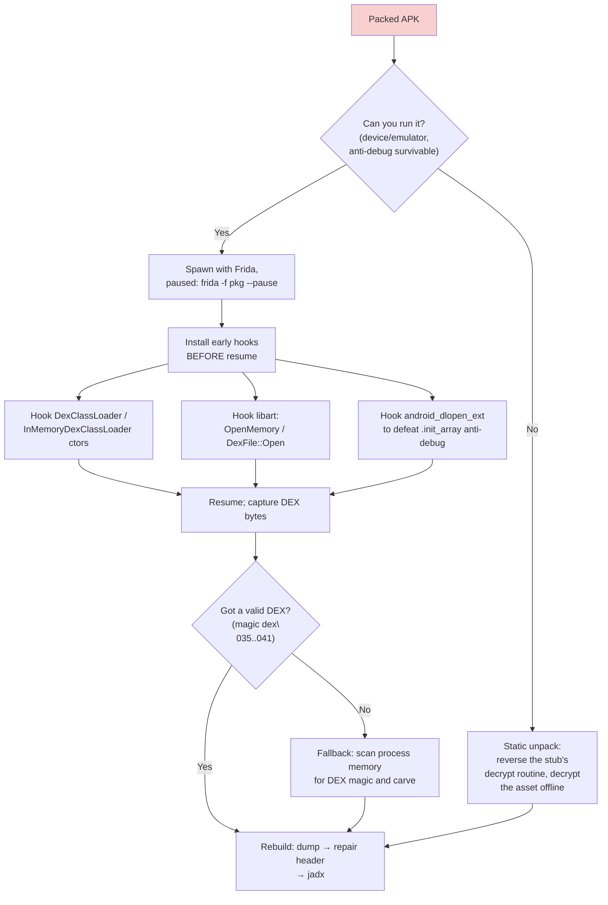

**Implementation 1 — hook the loader.** Covered in §3.5. Cleanest when it works, because you get an
intact DEX with a correct header.

**Implementation 2 — hook ART internals.** `DexClassLoader` is a thin Java wrapper. One level down,
every DEX enters ART through native code in `libart.so`. Historically the relevant entry points have
included `DexFile::Open`, `DexFile::OpenMemory`, `OpenAndReadMagic`, and the JNI-level
`DexFile_openInMemoryDexFile`. The exact symbol names and their C++ mangling vary substantially
across Android releases, so the practical technique is to enumerate `libart.so`'s exports and find
the ones that contain `DexFile` and `Open`:

```javascript
// Frida REPL — discover the DEX entry points on THIS device rather than guessing
Process.getModuleByName("libart.so").enumerateExports()
  .filter(function (e) { return /DexFile/.test(e.name) && /Open/.test(e.name); })
  .forEach(function (e) { console.log(e.address + "  " + e.name); });
```

> **⚠️ Warning**
> Do not hardcode `libart.so` symbol names from a blog post. ART's internal C++ symbols are not a
> stable ABI; they change between Android versions and even between security patch levels, and on
> release builds many are not exported at all. Always enumerate at runtime, as above, and fall back
> to memory scanning when nothing suitable is exported.

**Implementation 3 — memory scanning (the `frida-dexdump` approach).** This is the universal fallback
and it is worth understanding rather than just running.

A DEX file begins with an 8-byte magic: the ASCII characters `d`, `e`, `x`, a newline (`0x0A`), then
a three-digit version, then a NUL. So `dex\n035\0` is DEX version 035, `dex\n039\0` is version 039,
and modern builds emit up to `041`. Immediately after the magic comes a 4-byte Adler-32 checksum,
then a 20-byte SHA-1 signature, then a 4-byte `file_size`. That structure gives you both a **finder**
and a **validator**:

1. Enumerate the process's readable memory ranges (`Process.enumerateRanges('r--')` and `'rw-'`).
2. Scan each range for the byte pattern `64 65 78 0a` (`dex\n`).
3. At each hit, read the header. Check that the version bytes are ASCII digits, that `file_size` is
   sane (say, 0x70 < size < 512 MB), that `header_size` is 0x70, and that `endian_tag` is
   `0x12345678`.
4. Read `file_size` bytes from the hit and write them to a file.

```javascript
// Frida REPL — minimal DEX carver; the full version is scripts/frida-dexdump-lite.js
var MAGIC = [0x64, 0x65, 0x78, 0x0a];   // "dex\n"
Process.enumerateRanges('r--').forEach(function (r) {
    Memory.scanSync(r.base, r.size, '64 65 78 0a').forEach(function (m) {
        try {
            var hdr = m.address;
            var fileSize = hdr.add(32).readU32();          // header offset 0x20 = file_size
            var headerSize = hdr.add(36).readU32();        // 0x24 = header_size, must be 0x70
            var endian = hdr.add(40).readU32();            // 0x28 = endian_tag
            if (headerSize !== 0x70 || endian !== 0x12345678) return;
            if (fileSize < 0x70 || fileSize > 0x20000000) return;
            var bytes = hdr.readByteArray(fileSize);
            var f = new File("/data/local/tmp/dump_" + hdr + ".dex", "wb");
            f.write(bytes); f.close();
            console.log("dumped " + fileSize + " bytes from " + hdr);
        } catch (e) { /* unreadable page, skip */ }
    });
});
```

**When to run the scan matters more than the scan itself.** Run it too early and the DEX is not
loaded; run it too late and some packers wipe or re-protect the region. The reliable trigger is *after
the app's first Activity is visible*, because by then the real code has certainly been loaded and
executed. Some packers decrypt lazily, per class or per method, in which case a single dump gives you
a DEX whose method bodies are empty — see the "method-level" note below.

**Repairing a dump.** A carved DEX often fails `jadx` with a checksum or signature error, because the
in-memory copy has been modified by ART (for example, some fields are patched, or the region has been
partially rewritten by the JIT). Fixes, in order:

1. Recompute the Adler-32 checksum and the SHA-1 signature over the correct ranges, or simply tell
   your tools to ignore them (`jadx --no-verify-checksum`-style options, or `baksmali`'s tolerance).
2. If the map section is corrupt, `baksmali` often still parses what `jadx` rejects — go to Smali.
3. If method bodies are missing, you are facing **method-level protection** (bodies are decrypted
   on first invocation and re-encrypted after). The counter is to force every method to be invoked, or
   to hook the JIT/interpreter entry point and dump each method's code item as it is prepared. This is
   the hardest common case and it is where per-product tooling exists.

> **🧠 Mental Model**
> Unpacking is not code-breaking. It is **timing**. The whole skill is choosing the moment at which
> the data you want is in its most complete, least protected state, and being present at that moment
> with a way to write it down. Everything else — the specific hook, the specific tool — is detail.

#### 3.7.4 Commercial protector families, descriptively

What follows is a *field guide*, written from the point of view of what a tester **observes in an
APK**. It deliberately does not speculate about proprietary internals.

> **⚠️ Warning**
> Products change. Artefacts listed here are what has commonly been observed and are useful as
> *hypotheses*, not as identification certainties. Vendors rename libraries, change packaging, and
> ship different tiers to different customers. Confirm by behaviour, and never write a vendor's name
> into a report as fact unless you have a positive, defensible identification.

| Product family | Commonly observed artefacts | Type |
|---|---|---|
| **DexGuard** (Guardsquare) | Aggressive DEX-level obfuscation with string encryption, class encryption, reflection wrapping and asset encryption. Output generally remains one or more real DEX files rather than a stub-plus-blob, so `jadx` opens it but the contents are heavily transformed. Often paired with encrypted resources and a native runtime component. | Bytecode obfuscator with hardening (same vendor as ProGuard) |
| **Guardsquare / AppSweep ecosystem** | Commercial successor tooling to ProGuard; expect ProGuard-compatible configuration syntax in the build and DexGuard-style output artefacts. | Vendor ecosystem |
| **DexProtector** (Licel) | Encrypted payloads in `assets/`, native runtime library, class/string encryption; often a stub-plus-blob structure. Historically associated with distinctive asset filenames and a small entry DEX. | Packer + hardening |
| **Jiagu / 360 Reinforce** (Qihoo 360) | Very small stub `classes.dex`; native libraries with names in the `libjiagu` family in `lib/` or `assets/`; the real DEX arrives via a ClassLoader created in `attachBaseContext`. Extremely common on Chinese-market apps. | Packer |
| **Bangcle / SecNeo** | Stub `Application` class, encrypted blob in `assets/`, native libraries historically named around `libsecexe`, `libsecmain`, `libDexHelper`. Anti-debug in native constructors. | Packer |
| **Tencent Legu** | Small stub DEX, encrypted asset, native library historically in the `libshell`/`libshella` family; assets sometimes named with a version-like suffix. | Packer |
| **Ijiami** | Encrypted asset historically under a distinctive `assets/` name; native libraries in the `libexec`/`libexecmain` family; stub `Application`. | Packer |
| **Promon SHIELD** | Injected native runtime, extensive integrity and environment checks (root, debugger, hooking framework, emulator), typically integrated at build time rather than as a bolt-on repackage. Frequently seen in banking apps. | Runtime application self-protection (RASP) |
| **Appdome** | No-code post-build injection; observable as added native libraries and additional DEX/classes injected into an otherwise normal-looking app, plus a rewritten manifest. Highly configurable, so artefacts vary by the customer's selected features. | Post-build protection platform |
| **Arxan / Digital.ai App Protection** | Native-heavy hardening including code obfuscation and integrity checks in the `.so`, checksum/anti-tamper webs across native code. Often applied to the native layer of an app whose Java layer is only R8-obfuscated. | Native hardening + RASP |
| **Virbox / others in the same market** | Stub-plus-blob packing and native runtime, similar observable shape to the packers above. | Packer |

**How to use this table properly.** You are not trying to name the vendor. You are trying to answer
three questions: *(a)* is the real code present in the APK or delivered at runtime, *(b)* is there a
native runtime that will fight my instrumentation, and *(c)* has anyone published a general method for
this shape. The vendor name is only useful because it makes question *(c)* searchable.

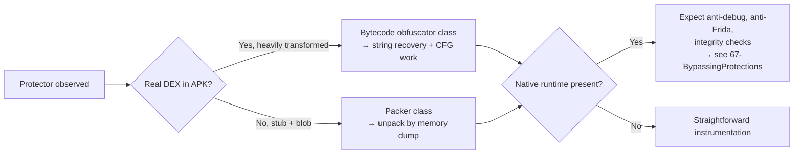

Chapters [37-RootDetection](../37-RootDetection/README.md),
[38-TamperDetection](../38-TamperDetection/README.md),
[39-EmulatorDetection](../39-EmulatorDetection/README.md) and
[67-BypassingProtections](../67-BypassingProtections/README.md) cover the runtime-defence half of
what these products do. This chapter covers the code-transformation half.

### 3.8 Anti-decompiler and anti-tool tricks

A separate category from obfuscation proper. These do not make the code harder to *understand*; they
make the *tools* fail, which is often more effective because most analysts stop when the tool errors.

The underlying opportunity is that **Android's own parsers are more permissive than third-party
tools' parsers**. `PackageManager`, `dexopt` and ART accept files that `apktool`, `jadx`, `dex2jar`
and `baksmali` reject, because the platform parsers were written for speed and backwards
compatibility while the analysis tools were written to a stricter reading of the specification.

| Trick | What it does | Effect on tools | Counter |
|---|---|---|---|
| **Illegal identifier names** | Class/method names containing characters legal in DEX but illegal in Java source or on the host filesystem — spaces, unicode, `<`, `>`, very long names, names differing only by case | `jadx` writes files that collide on a case-insensitive filesystem; `apktool` may fail to create files | `jadx --deobf` renames automatically; use a case-sensitive filesystem; work in Smali |
| **Huge `switch` / oversized methods** | Methods approaching the 64 KB code-unit limit, or `sparse-switch` tables with thousands of entries | Decompiler timeouts, out-of-memory | Increase heap (`jadx -J-Xmx8g`), raise per-method timeout, or go to Smali |
| **Annotation abuse** | Malformed or self-referential annotation structures; enormous annotation sets | Parser exceptions in tools that eagerly parse annotations | Strip annotations with a DEX rewriter, or use a tool that parses lazily |
| **Invalid-but-tolerated DEX header fields** | `header_size`, `map_off`, unused fields, or duplicate map entries set to values ART ignores but strict parsers validate | `dex2jar`/`baksmali` reject the file | Patch the header bytes by hand; ART's own tolerance tells you which fields are ignorable |
| **Overlapping / shared code items** | Two methods whose `code_item`s overlap in the file, or data referenced from multiple places | Tools that assume a clean layout mis-parse | `baksmali` handles more of this than `jadx`; failing that, dump at runtime instead |
| **Fake / extra DEX files** | `classes2.dex` that is not a DEX, or DEX files listed in the zip that ART never opens | Tools try to parse everything | Determine which DEX files ART actually opened by inspecting the loaded `DexPathList` at runtime |
| **Zip-level tricks** | Duplicate entry names, mismatched local vs central directory headers, wrong compression method flags, extra data after the central directory, huge `extra` fields | `unzip`/`apktool` see a different file from the one Android sees | Use `zipdetails`-style inspection; extract using a parser that follows the *central directory*, as Android does |
| **Manifest binary-XML abuse** | Extra unused string-pool entries, unusual chunk ordering, attributes ART's parser skips | `apktool` decode errors | `aapt2 dump xmltree` reads what the platform reads; compare against `apktool`'s view |
| **Missing / bogus `resources.arsc` structures** | Package IDs, type strings, or config chunks that AAPT2 rejects but the runtime tolerates | `apktool d` fails | `aapt2 dump resources`, or a purpose-written arsc parser |

> **🔍 Pentester's Note**
> When a tool fails on an APK that installs and runs, **that is a finding about the app, not a
> failure on your part** — it is deliberate anti-analysis, and it belongs in the report as an
> observation. It is also a signal about effort: an app that bothers to break `apktool` is an app
> whose developer expects to be analysed, which usually means the interesting logic is nearby.
>
> The universal escape hatch: install the app on a device and **dump the DEX from memory** (§3.7.3).
> Whatever tricks were played on the file format, ART has already normalised the in-memory form,
> because ART had to in order to run it.

**A worked example of the mindset.** Suppose `apktool d app.apk` fails with a resource error but
`adb install app.apk` succeeds. The platform parsed `resources.arsc` and `apktool` did not. Therefore
the difference is in *how* they parse, not in whether the file is valid for Android. You have three
moves: use `aapt2 dump resources app.apk` (which uses the platform's own parsing logic), pull the
parsed values at runtime with `Resources.getIdentifier` under Frida, or read the raw arsc with a
scriptable parser. All three take minutes. None requires you to fix `apktool`.

### 3.9 Resource, manifest, and `resources.arsc` obfuscation

Resources are the column that most testers forget, and they leak more than developers expect.

> **📖 Definition**
> **`resources.arsc`** is the compiled resource table in an APK. It maps 32-bit resource IDs (of the
> form `0xPPTTEEEE`: package, type, entry) to values, per configuration (language, density,
> orientation). It also contains a **string pool of resource names**, because `getIdentifier(name,
> type, pkg)` must be able to resolve `"login_button"` at runtime and because tools need it.

**What resource obfuscation does:**

| Technique | Mechanism | Observable effect |
|---|---|---|
| **Resource name mangling** | Rewrite the arsc name pool so `activity_payment` becomes `a`, and rewrite any `getIdentifier` call sites | `apktool` output has `res/layout/a.xml`; the semantic hints are gone |
| **Resource collapsing / merging** | Identical values deduplicated into one entry | Fewer resources than expected; unchanged behaviour |
| **String pool encryption** | Values stored encrypted, decrypted by a hooked `Resources` subclass | `aapt2 dump` shows ciphertext |
| **Asset encryption** | Files in `assets/` encrypted, decrypted by app code on read | High-entropy assets |
| **Manifest minimisation** | Removing attributes the platform defaults anyway | Less to read |
| **Fake resources** | Unused entries added to inflate the table | Noise |
| **arsc structural tricks** | Unusual chunk ordering or padding, valid to the platform, invalid to strict parsers | `apktool`/`aapt2` failures (§3.8) |

**What resource obfuscation cannot do**, and this is the useful half:

- The **manifest must remain readable to `PackageManager`**. Component names, permissions,
  `exported` flags, intent filters, `android:debuggable`, `usesCleartextTraffic`,
  `networkSecurityConfig`, `minSdkVersion` and `targetSdkVersion` are all in there in a form the
  platform parses. `aapt2 dump badging` and `aapt2 dump xmltree` therefore always work, and the manifest
  is always your entry-point map. See [32-Manifest](../32-Manifest/README.md).
- **Layout XML still references real framework classes and attributes.** A layout containing
  `android:inputType="textPassword"` tells you where the password field is, whatever the file is
  named.
- **Drawables and strings visible to the user are visible to you.** If the UI says "Enter your PIN",
  that string is somewhere retrievable — if not in the arsc then at runtime.

```bash
# host — resource-side recon that works regardless of name mangling
aapt2 dump badging target.apk | head -40
aapt2 dump xmltree target.apk --file AndroidManifest.xml > manifest.txt
aapt2 dump resources target.apk | grep -i -E 'password|token|api|secret|url|endpoint' | head -40

# find password/PIN input fields regardless of layout file names
apktool d -f -o out target.apk >/dev/null 2>&1
grep -rl 'textPassword\|numberPassword' out/res/layout/ 2>/dev/null
```

> **🔍 Pentester's Note**
> `res/xml/network_security_config.xml` is referenced from the manifest by resource ID, and the
> filename can be mangled — but the manifest tells you the ID, and `aapt2 dump xmltree` on the
> resolved file tells you whether cleartext is permitted and whether a debug trust anchor was left in.
> That single file frequently converts a "we can't intercept traffic" problem into a solved one. See
> [44-NetworkSecurityConfig](../44-NetworkSecurityConfig/README.md).

### 3.10 Version matrix — what changes across Android releases

| Capability | API 21–25 | API 26–27 | API 28–29 | API 30+ |
|---|---|---|---|---|
| `InMemoryDexClassLoader` | Not available | Available (26) | Available | Available |
| Hidden-API restrictions | None | None | Enforced with greylists (28) | Enforced, stricter lists |
| Writable-and-executable memory for JIT-style loading | Broadly permitted | Restricted | Restricted | W^X strongly enforced; `execmem` limited by SELinux |
| Executing DEX from an app-writable file | Permitted | Permitted | Discouraged | Blocked for files in writable locations on API 29+ for apps targeting 29+ (`dex file ... is writable` errors) |
| DEX container version seen in the wild | 035, 037 | 038 | 039 | 039–041 |
| `apksigner` scheme most likely present | v1/v2 | v2 | v2/v3 | v2/v3/v4 |

The row that changes analysis most is the writable-DEX restriction. From API 29 the runtime refuses
to open a DEX from a location the app can write to, which forced packers away from "write the
decrypted DEX to `/data/data/pkg/files` and load it" toward `InMemoryDexClassLoader`. For you, that
means **fewer dropped files to find on disk and more reliance on memory dumping.** If you are
analysing an older sample, always check the app's own data directory for dropped DEX/JAR/APK files
first, because it is free.

```bash
# device, root — look for dropped code in an app's data dir
adb shell "su -c 'find /data/data/com.target.app -type f \
    \( -name \"*.dex\" -o -name \"*.jar\" -o -name \"*.apk\" -o -name \"*.odex\" -o -name \"*.vdex\" \)'"
adb shell "su -c 'ls -la /data/user/0/com.target.app/code_cache 2>/dev/null'"
```

---

## 4. Source Code Walkthrough (AOSP)

Obfuscation is not implemented in AOSP — it is a build-tool concern. What *is* in AOSP, and what you
must understand to defeat packers, is **the code-loading path**: how a `ClassLoader` in Java ends up
with a DEX file mapped and registered inside ART. This section traces that path, because every hook
point you will ever use for unpacking lives on it.

### 4.1 The Java-side entry points

**`libcore/dalvik/src/main/java/dalvik/system/BaseDexClassLoader.java`**

`BaseDexClassLoader` is the parent of `PathClassLoader`, `DexClassLoader` and
`InMemoryDexClassLoader`. Its critical field is:

```java
// libcore/dalvik/src/main/java/dalvik/system/BaseDexClassLoader.java (illustrative excerpt)
private final DexPathList pathList;

public BaseDexClassLoader(String dexPath, File optimizedDirectory,
                          String librarySearchPath, ClassLoader parent) {
    super(parent);
    this.pathList = new DexPathList(this, dexPath, librarySearchPath, null);
    // ...
}

@Override
protected Class<?> findClass(String name) throws ClassNotFoundException {
    List<Throwable> suppressed = new ArrayList<Throwable>();
    Class c = pathList.findClass(name, suppressed);
    // ...
    return c;
}
```

Two consequences you will use directly:

1. **`pathList` is reachable by reflection**, and it holds a `DexPathList` whose `dexElements` array
   contains one `Element` per loaded DEX, each holding a `DexFile`. Enumerating that array at runtime
   tells you exactly which DEX files a process has loaded — including the ones a packer created. This
   is the basis of the enumeration part of the dumping script.
2. **`findClass` is the funnel** through which every application class resolution passes. Hooking it
   logs class names as they are first resolved, which is a cheap way to watch a packed app reveal its
   real class names in order.

**`libcore/dalvik/src/main/java/dalvik/system/InMemoryDexClassLoader.java`**

```java
// libcore/dalvik/src/main/java/dalvik/system/InMemoryDexClassLoader.java (illustrative excerpt)
public InMemoryDexClassLoader(ByteBuffer[] dexBuffers, ClassLoader parent) {
    super(dexBuffers, parent);
}
```

The constructor takes `ByteBuffer`s. Those buffers are the plaintext DEX. Hooking this constructor and
copying the buffer contents is the single most direct unpacking hook that exists, and it is why this
class is the first thing you hook on any suspected packer.

**`libcore/dalvik/src/main/java/dalvik/system/DexFile.java`**

`DexFile` is the Java-side handle to a DEX that ART has opened. Historically it exposed the native
methods that do the real work:

```java
// libcore/dalvik/src/main/java/dalvik/system/DexFile.java (illustrative excerpt)
private static native Object openDexFileNative(String sourceName, String outputName,
        int flags, ClassLoader loader, DexPathList.Element[] elements);

private static native Object openInMemoryDexFilesNative(ByteBuffer[] bufs,
        byte[][] arrays, int[] starts, int[] ends,
        ClassLoader loader, DexPathList.Element[] elements);
```

These are the Java/native boundary. Everything above them is Java you can hook with
`Java.use`; everything below is native you hook with `Interceptor`.

> **⚠️ Warning**
> `DexFile` has been progressively hidden and, in newer releases, restructured. Do not assume the
> exact method set above exists on the device in front of you. Verify at runtime:
> ```javascript
> // Frida REPL
> Java.perform(function () {
>   var DF = Java.use("dalvik.system.DexFile");
>   console.log(DF.class.getDeclaredMethods().map(function (m) { return m.toString(); }).join("\n"));
> });
> ```
> Verifying beats remembering. This habit is what separates scripts that work on one phone from
> scripts that work on every phone.

### 4.2 The native side

**`art/runtime/native/dalvik_system_DexFile.cc`**

This file implements the JNI functions behind `DexFile`'s native methods. Conceptually it:

1. Receives the buffers or the path.
2. Calls into the `OatFileManager` / `DexFileLoader` to open the DEX.
3. Verifies the header (magic, version, checksum, sizes).
4. Wraps the resulting `const DexFile*` in a Java `Object` (a long cookie or an array of them) that
   `DexFile` holds onto.

**`art/libdexfile/dex/dex_file_loader.cc`** and **`art/libdexfile/dex/dex_file.cc`**

These contain the header validation that determines whether your carved DEX will be accepted. The
constants you care about, all defined in `art/libdexfile/dex/dex_file.h`, are:

| Constant | Value | Meaning |
|---|---|---|
| `kDexMagic` | `"dex\n"` | First four bytes |
| `kDexMagicVersions` | `"035"`, `"037"`, `"038"`, `"039"`, `"040"`, `"041"` | Version strings that have existed |
| `kSHA1DigestSize` | 20 | Signature field size |
| `kDexEndianConstant` | `0x12345678` | `endian_tag`, at header offset 0x28 |
| `header_size` | `0x70` | Always, for standard DEX |

Those five facts are exactly what the memory carver in §3.7.3 validates against, and now you know
why: they are the same checks ART itself performs, so a region that passes them is a region ART would
accept as a DEX.

**`art/runtime/class_linker.cc`**

`ClassLinker::DefineClass` is where a class from a DEX becomes a live `mirror::Class` in the runtime.
It is the deepest point at which "this class now exists" is decidable. Instrumenting here is heavy but
catches classes defined by any mechanism whatsoever, including ones that never went through a Java
`ClassLoader` you can see.

### 4.3 The framework side — how a packer's stub gets control

**`frameworks/base/core/java/android/app/ActivityThread.java`**

The relevant method is `handleBindApplication`, which runs when `system_server` tells a freshly
forked process which application it is. In outline:

```java
// frameworks/base/core/java/android/app/ActivityThread.java (illustrative outline)
private void handleBindApplication(AppBindData data) {
    // ...
    final LoadedApk info = getPackageInfoNoCheck(data.appInfo, data.compatInfo);
    // ...
    Application app = data.info.makeApplication(data.restrictedBackupMode, null);
    // ...
    mInstrumentation.callApplicationOnCreate(app);
}
```

**`frameworks/base/core/java/android/app/LoadedApk.java`**

`LoadedApk.makeApplication` instantiates the class named by `ApplicationInfo.className` — the value of
`<application android:name>` — using the `LoadedApk`'s `mClassLoader`:

```java
// frameworks/base/core/java/android/app/LoadedApk.java (illustrative outline)
public Application makeApplication(boolean forceDefaultAppClass,
        Instrumentation instrumentation) {
    // ...
    java.lang.ClassLoader cl = getClassLoader();
    ContextImpl appContext = ContextImpl.createAppContext(mActivityThread, this);
    app = mActivityThread.mInstrumentation.newApplication(cl, appClass, appContext);
    // ...
}
```

`Application.attach(Context)` calls `attachBaseContext(Context)`. **This is the first application code
that runs in the process**, and it is exactly where a packer's stub does its work. The two fields a
packer typically reaches for by reflection are `LoadedApk.mClassLoader` (to substitute the loader that
knows about the real DEX) and `ContextImpl.mPackageInfo` (to reach the `LoadedApk` in the first place).

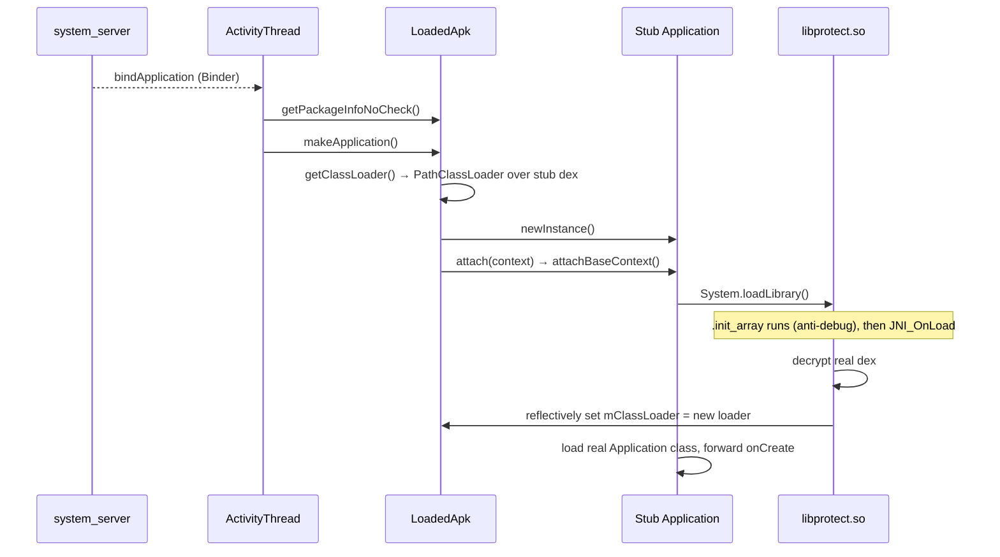

> **🔬 Under the Hood**
> This is why `Application.attachBaseContext` is such a valuable Frida hook in general, not only
> against packers. It is the earliest Java code in an app process that you can name in advance,
> because the framework calls it, so it is the correct place to install hooks that must be in place
> before the app does anything — certificate-pinning bypasses, root-detection bypasses, and DEX
> capture all belong there. See [53-Frida](../53-Frida/README.md) and
> [65-Hooking](../65-Hooking/README.md).

### 4.4 Interaction with the wider system

| Layer | Relevance to obfuscation and unpacking |
|---|---|
| **Linux kernel** | `mmap`/`mprotect` back every DEX mapping. `ptrace` backs debugging and is the classic anti-debug target (`PTRACE_TRACEME` self-attach so nobody else can). `/proc/self/maps` and `/proc/self/status` (`TracerPid`) are the classic detection reads. |
| **SELinux** | Restricts which processes may `execmem`/`execmod` and which files an app may execute from. This shaped the move to `InMemoryDexClassLoader`. See [22-SELinux](../22-SELinux/README.md). |
| **ART** | Owns DEX validation, class linking, JIT and AOT. Its tolerance defines which malformed DEX files "work". |
| **Binder** | Carries `bindApplication`, which is what causes the stub `Application` to be constructed. See [25-Binder](../25-Binder/README.md). |
| **`system_server`** | `PackageManagerService` parses the manifest at install time — so whatever the manifest says is authoritative, and it cannot be obfuscated away. |
| **Native / JNI** | Where the protector's runtime lives, and where the plaintext must eventually appear. |

---

## 5. Security Perspective

### 5.1 How attackers abuse obfuscation

Obfuscation is used by attackers at least as often as by defenders.

- **Malware evasion.** Packed and string-encrypted malware defeats signature-based scanners and
  slows manual triage. Dynamic code loading in particular allows a benign-looking APK to fetch its
  real payload after review, which is why store review processes and enterprise MDM scanners treat
  runtime DEX loading as high-risk in itself.
- **Repackaged apps.** An attacker takes a legitimate app, injects code, and re-obfuscates so the
  injected part looks like the rest. Users cannot tell; the signature differs, which is the actual
  detection (see [38-TamperDetection](../38-TamperDetection/README.md)).
- **Hiding data collection.** SDKs that harvest more than they disclose frequently reflect into
  hidden APIs and encrypt the endpoint URLs. This is a privacy finding, and hooking reflection plus
  dumping strings is exactly how you evidence it.
- **Delaying incident response.** In a live compromise, every hour spent unpacking is an hour the
  operator keeps access.

### 5.2 How developers misuse obfuscation

| Misuse | Why it is wrong | What to write in the report |
|---|---|---|
| Treating obfuscation as a control for hardcoded secrets | The secret is still extractable; obfuscation is a delay | The credential must be considered compromised; move the operation server-side or use per-user credentials |
| Believing name obfuscation hides business logic | Framework calls and strings carry most of the meaning | Demonstrate recovery of the logic in the report |
| Enabling obfuscation but keeping everything | Over-broad `-keep` rules leave real names in place | Show which classes are unobfuscated and why |
| Shipping the mapping file | Total disclosure | Report as information disclosure; check build servers and public artefact stores too |
| Leaving `-dontobfuscate` in a release config | No obfuscation at all despite `minifyEnabled true` | Show the readable names |
| Relying on client-side checks that obfuscation "protects" | The check runs on the attacker's device | The authorisation decision must move server-side |
| Obfuscating instead of fixing an insecure design | Cost, not a fix | Describe the design change |

### 5.3 OWASP MASVS / MASTG mapping

| Identifier | Relationship to this chapter |
|---|---|
| **MASVS-RESILIENCE** | The category that contains anti-tampering, anti-reversing and obfuscation requirements. Everything in this chapter maps here. |
| **MASVS-RESILIENCE-3** (impede comprehension) | The requirement that an app's code is obfuscated such that comprehension is impeded — this is the requirement obfuscation actually satisfies. |
| **MASVS-RESILIENCE-1/2** (integrity, anti-tampering) | Covered in [38-TamperDetection](../38-TamperDetection/README.md). |
| **MASVS-CODE** | Build settings and dependency hygiene, including debug flags left enabled. |
| **MASVS-STORAGE / MASVS-CRYPTO** | Where a "protected" secret ends up being a finding regardless of obfuscation. |
| **MASTG resilience tests** | The test procedures for assessing obfuscation quality. |

> **🔍 Pentester's Note**
> MASVS-RESILIENCE is explicitly a **defence-in-depth** category, and the MASVS documentation is
> clear that it should only be assessed when the threat model justifies it (apps handling high-value
> assets, DRM, payments). Reporting "the app is not obfuscated" as a standalone high-severity finding
> against a simple utility app is a rookie error. State the threat model first, then the gap.

### 5.4 The vulnerability classes that hide behind obfuscation

Obfuscation does not create vulnerabilities; it conceals them, and the concealment biases what gets
found. The classes most commonly discovered *after* deobfuscation are:

- **Hardcoded credentials and API keys** — cloud storage keys, third-party API secrets, signing keys,
  encryption keys, backend admin tokens. These are the most common thing found behind string
  encryption, because string encryption is often adopted specifically to hide them.
- **Weak or homegrown cryptography** — ECB mode, static IVs, keys derived from device identifiers,
  "encryption" that is a XOR. See [34-Cryptography](../34-Cryptography/README.md).
- **Client-side authorisation** — an `isPremium` boolean or a role check performed locally.
- **Debug and staging endpoints** — often the highest-value finding, because staging environments are
  less hardened and frequently share data with production.
- **Disabled certificate validation on a code path** — a custom `TrustManager` used only in some
  builds. See [35-SSL](../35-SSL/README.md).
- **Insecure IPC surfaces** — exported components discovered from the manifest, whose handlers are
  only understandable after deobfuscation. See [26-Intent](../26-Intent/README.md).

> **⚠️ Warning**
> Do not cite specific CVE identifiers for "obfuscation weaknesses". Obfuscation strength is not
> tracked as a CVE class; CVEs are assigned to specific software defects. If you need to reference
> prior work, reference the vendor's own documentation, the OWASP MASTG, or published conference
> research by name — never invent an identifier.

### 5.5 How pentesters test obfuscation quality

Assessing obfuscation is a distinct deliverable from breaking it. A defensible assessment answers:

| Question | Evidence to collect |
|---|---|
| Is minification enabled at all in the release build? | Class/method names in `jadx`; presence of `a`, `b`, `c` naming |
| What fraction of the app is renamed? | Count classes with names of length ≤ 2 versus total |
| Are strings protected? | `strings classes.dex` and manual review for URLs, keys, SQL |
| Are the *interesting* classes protected, or only the boring ones? | Locate the crypto, auth and payment code and check it specifically |
| Is the mapping file exposed anywhere? | APK contents, build artefacts, crash-reporting configuration, public CI logs |
| Do keep rules leak structure? | Which packages remain unrenamed and why |
| Is there a native or packing layer? | §3.7.2 checklist |
| How long did recovery actually take you? | This is the number the client cares about — report it honestly |

```bash
# host — quick obfuscation-coverage metric
jadx -d out target.apk >/dev/null 2>&1
total=$(find out/sources -name '*.java' | wc -l)
short=$(find out/sources -name '*.java' | awk -F/ '{print $NF}' | awk 'length($0)<=7' | wc -l)
echo "classes=$total short-named=$short  => $((100*short/total))% renamed (approx)"
```

That metric is crude — it counts filenames of the form `a.java` — but it is reproducible and it makes
a good chart in a report. Pair it with a qualitative statement about *which* code was left readable.

### 5.6 How malware analysts and forensic investigators approach it

Malware work differs from pentest work in one respect that changes everything: **you may not be able
to run the sample.** Executing unknown malware requires an isolated, instrumented environment, and
some samples detect that environment and behave benignly. Consequently malware analysts invest far
more in static unpacking — reversing the stub's decryption routine and decrypting the payload offline
— than pentesters do.

Forensically, the artefacts that matter are: dropped files in the app's data directory and
`code_cache`, the `oat`/`vdex` files ART generated (which are derived from the *real* DEX and
therefore survive as evidence), logcat entries from before the app suppressed logging, and network
captures. On a rooted or imaged device, `/data/misc/profiles/cur/0/<pkg>/primary.prof` records which
methods were actually executed, which is a compact answer to "what did this app really do".

---

## 6. Reverse Engineering Perspective

### 6.1 THE DEOBFUSCATION METHODOLOGY

This is the centre of the chapter. Everything before it was vocabulary; this is the process. It is
written as a repeatable procedure because that is what makes it teachable and what makes your results
consistent under time pressure.

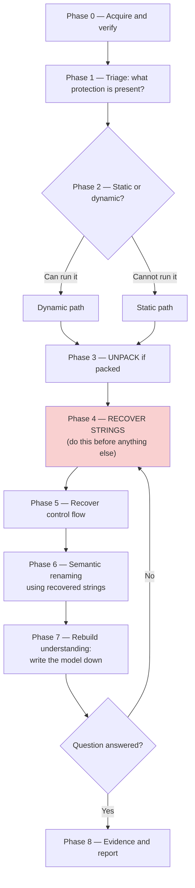

#### Phase 0 — Acquire and verify

Get the exact APK the user gets. Pull it from the device rather than trusting a file someone emailed
you, because you must be certain you are analysing the shipped artefact.

```bash
# host
adb shell pm path com.target.app          # may print several: base + splits
adb pull /data/app/~~xyz==/com.target.app-abc==/base.apk .
sha256sum base.apk                        # record this in your notes; it goes in the report
apksigner verify --print-certs base.apk   # who signed it, which schemes
```

If `pm path` prints multiple APKs, the app uses **split APKs** (App Bundle delivery). The code may be
distributed across them. Pull all of them. Analysing only `base.apk` and concluding "the feature isn't
there" is a classic and embarrassing mistake.

#### Phase 1 — Triage: what protection is present?

Answer these six questions before touching a decompiler seriously. Twenty minutes here saves days.

| # | Question | Command / check |
|---|---|---|
| 1 | Is it packed? | §3.7.2 checklist: DEX size, asset entropy, `<application android:name>` |
| 2 | Are names obfuscated? | `jadx` and look |
| 3 | Are strings encrypted? | `strings classes.dex \| grep -E 'https?://'` — no URLs at all is suspicious |
| 4 | Is there native code, and how much? | `unzip -l \| grep '\.so'`, then `readelf --dyn-syms` |
| 5 | Is control flow flattened? | Open two or three non-trivial methods and look for `while(true){switch}` |
| 6 | Is there anti-analysis? | Strings/symbols mentioning `ptrace`, `TracerPid`, `frida`, `xposed`, `su`, `magisk`; failure to run under Frida |

Record the answers in a table in your notes. That table determines everything downstream, and it is
also the first table in your report.

#### Phase 2 — Decide static or dynamic

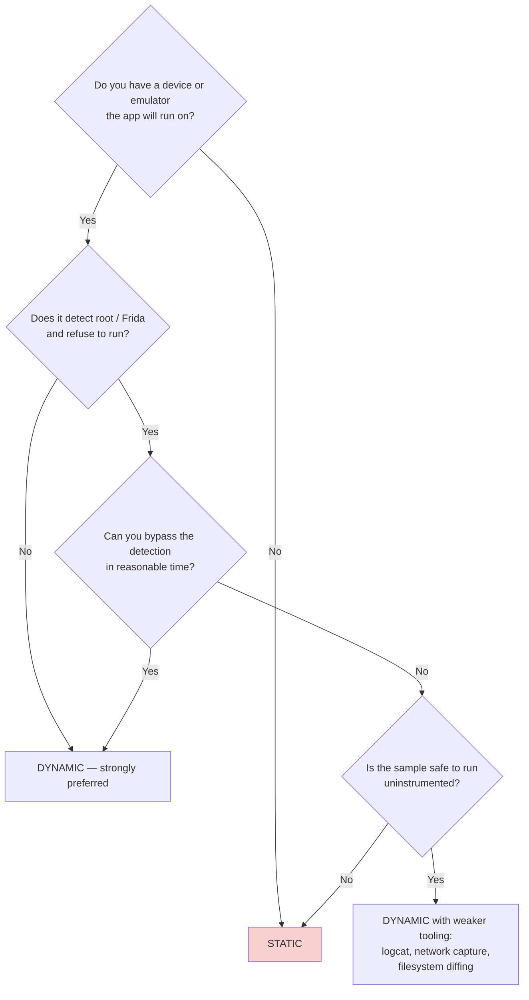

**Prefer dynamic, always, when it is available.** Every protection in this chapter is stronger against
static analysis than against dynamic analysis, because every protection must be undone at runtime by
the program itself. The one thing static analysis gives you that dynamic does not is **completeness**:
dynamic analysis only sees the code paths you trigger. The professional answer is to use dynamic
analysis to *understand* and static analysis to *be exhaustive*, in that order.

#### Phase 3 — Unpack, if packed

Do not attempt to read a stub. If Phase 1 said "packed", your entire Phase 3 is §3.7.3: spawn paused,
hook the loaders, resume, dump, and validate that what you dumped is a real DEX with the app's real
classes in it.

Success criterion: `jadx` opens your dumped DEX and you can see classes whose names correspond to the
manifest's component names. Until that is true, you have not unpacked.

#### Phase 4 — RECOVER STRINGS FIRST

> **🧠 Mental Model**
> After renaming, **strings are the only remaining semantics**. A method called `a` that contains the
> string `"/v2/payments/authorize"` is not called `a` any more — it is `authorizePayment`, and you
> now know it, and you can rename it, and everything that calls it is now also partly understood.
> Strings are the seeds from which the entire naming of the program regrows. That is why this phase
> comes before control-flow work and not after: **control flow tells you how, strings tell you
> what**, and "what" is what you are being paid to find out.

The procedure:

1. **Find the decryptor.** Statically: look for methods returning `String` that contain XOR loops or
   `Cipher` usage and are called from many places. Dynamically: hook `java.lang.String.<init>([C)`
   and `([B)` and look at the stack traces — every string-decryption routine ends by constructing a
   `String`, so this catches all of them regardless of algorithm.

   ```javascript
   // Frida REPL — universal decryptor finder: who is constructing Strings from bytes?
   Java.perform(function () {
       var S = Java.use("java.lang.String");
       var Ex = Java.use("java.lang.Exception");
       S.$init.overload("[B").implementation = function (b) {
           this.$init(b);
           var st = Ex.$new().getStackTrace();
           // frame 0 is String.<init>; frame 1 is the caller — the candidate decryptor
           if (st.length > 1) console.log("[cand] " + st[1].toString() + " => " + this.toString());
       };
   });
   ```

   Run that for ten seconds of app usage, sort the callers by frequency, and the top one or two are
   your decryptors. This works against every variant in §3.2 including per-class decryptors, because
   it hooks the *result*, not the algorithm.

2. **Exhaust it.** Once you know the signature, use Form 2 from §3.2 to enumerate the whole index or
   ciphertext space. Save to a file with the index so you can correlate back to call sites.

3. **Correlate back to the DEX.** For index-based decryptors, every call site in the Smali passes a
   literal index. So a `sed`/`python` pass over the Smali can substitute the recovered plaintext as a
   comment next to each call. This turns unreadable code into annotated code *at scale*, and it is
   the highest-leverage twenty lines of scripting in Android RE. `scripts/annotate-smali-strings.py`
   in this chapter does exactly that.

4. **Triage the strings.** Grep the dump for the categories that matter:

   ```bash
   # host — on your recovered strings file
   grep -Ei 'https?://|\.com|\.net|/api/|/v[0-9]+/' strings.txt | sort -u   # endpoints
   grep -Ei 'key|secret|token|password|passwd|pwd|auth|bearer' strings.txt  # credentials
   grep -Ei 'AES|RSA|HMAC|SHA|PBKDF|ECB|CBC|GCM' strings.txt                # crypto config
   grep -Ei 'su$|/system/bin|magisk|frida|xposed|emulator|goldfish|debug'   strings.txt
   grep -Ei 'select |insert |from |where ' strings.txt                      # SQL
   ```

#### Phase 5 — Recover control flow

Only now, and only for the methods that the strings told you matter.

For each such method:

1. Read it in Smali as well as Java. Smali never fails and never lies.
2. If flattened, build the state-transition table (§3.3.2) and redraw the graph.
3. If it is a black box you only need the behaviour of, hook the boundary and tabulate input/output.
   Ask yourself explicitly whether you need to *understand* it or only to *predict* it.
4. If it delegates to native code, move to `frida-trace` on the JNI export before opening Ghidra.

#### Phase 6 — Semantic renaming

Now rename everything, using the evidence. This is the phase people skip and it is the phase that
makes the difference between "I looked at it" and "I understand it".

| Evidence | Rename to |
|---|---|
| Method contains `"/v1/login"` | `postLogin` |
| Class extends `android.app.Activity` and appears in the manifest as `LoginActivity` | `LoginActivity` (from the manifest — free, authoritative) |
| Method calls `Cipher.getInstance("AES/GCM/NoPadding")` | `encryptGcm` / `decryptGcm` |
| Field assigned from `getSharedPreferences(...).getString("auth_token", null)` | `authToken` |
| Method returns `boolean` and checks `/system/bin/su` | `isRooted` |
| Class has `CREATOR` and `writeToParcel` | it is a DTO; name it from its field usage |
| Retrofit interface with `@POST("/v2/transfer")` | `TransferApi` |

In `jadx-gui`, `Ctrl+R`-style rename is persisted in a `.jobf` file next to the APK; commit that file
to your engagement notes so a colleague inherits your work. This is the closest thing to a
"deobfuscated build" you will get, and it compounds: renaming one class makes ten others partially
readable.

#### Phase 7 — Rebuild understanding, in writing

Write down, in prose, in your notes: what the app does, which classes implement it, where the trust
boundaries are, and what you have *not* looked at. If you cannot write it, you do not understand it,
and the act of writing reliably surfaces the gap you were about to miss.

#### The methodology as a checklist

```
[ ] Pulled the real APK from a device; hash recorded; splits accounted for
[ ] Signature scheme and signer recorded
[ ] Packed? (dex size / asset entropy / application name)
[ ] Names obfuscated? coverage estimated
[ ] Strings encrypted? decryptor identified
[ ] Native code inventoried; exported JNI symbols listed
[ ] Control flow flattened? which methods
[ ] Anti-analysis present? which kinds
[ ] Unpacked and dumped DEX validated in jadx
[ ] Strings exhaustively dumped and triaged
[ ] Smali annotated with recovered strings
[ ] Entry points from the manifest mapped to real classes
[ ] Crypto, auth and network layers identified and renamed
[ ] Written model of the app produced
[ ] Recovery effort (hours) recorded for the report
```

### 6.2 What each technique looks like in JADX

| Technique | JADX symptom |
|---|---|
| Renaming | `p001a.b.c`, classes named `a`–`zz`, many overloads named `a` |
| Renaming with `-repackageclasses` | Everything in one flat package, often the default package |
| String encryption | `byte[]` literals; small static `String`-returning helpers; no readable URLs |
| Opaque predicates | `if` conditions on arithmetic that is obviously always true |
| Flattening | `while (true) { switch (i) { ... } }` |
| Junk code | Locals assigned and never read; allocations discarded |
| Reflection hiding | Clusters of `Class.forName`/`getDeclaredMethod`/`invoke` |
| Dynamic loading | `DexClassLoader` / `InMemoryDexClassLoader` construction; `AssetManager.open` feeding a decrypt |
| Packing | Ten classes, one of them an `Application` subclass calling `System.loadLibrary` |
| R8 optimisation (not obfuscation) | Synthetic classes, `$$ExternalSyntheticLambda`, unboxed enums — see [42-R8](../42-R8/README.md) |
| Anti-decompiler | JADX comments about failing to decompile; `// Can't fix`, raw fallbacks |

### 6.3 Smali listings you should be able to read on sight

**A string decryptor call site:**

```smali
# The literal index is the key to correlating recovered strings back to code
const/16 v0, 0x2f
invoke-static {v0}, Lcom/example/q;->a(I)Ljava/lang/String;
move-result-object v1
```

**A flattened dispatcher:**

```smali
# smali — the flattening shape is unmistakable at bytecode level
    const/16 v0, 0x3            # state = 3
:goto_dispatch
    packed-switch v0, :pswitch_data_0
    goto :goto_dispatch
:pswitch_5
    const-string v2, "fail"
    const/16 v0, 0x6
    goto :goto_dispatch
:pswitch_6
    invoke-virtual {v2}, Ljava/lang/String;->toUpperCase()Ljava/lang/String;
    move-result-object v3
    return-object v3
    ...
:pswitch_data_0
    .packed-switch 0x0
        :pswitch_0
        :pswitch_1
        ...
    .end packed-switch
```

**Dynamic loading:**

```smali
new-instance v3, Ldalvik/system/InMemoryDexClassLoader;
invoke-virtual {v1}, Landroid/content/Context;->getClassLoader()Ljava/lang/ClassLoader;
move-result-object v4
invoke-direct {v3, v2, v4}, Ldalvik/system/InMemoryDexClassLoader;-><init>(Ljava/nio/ByteBuffer;Ljava/lang/ClassLoader;)V
```

**A reflective hidden-API call:**

```smali
const-string v0, "android.os.SystemProperties"
invoke-static {v0}, Ljava/lang/Class;->forName(Ljava/lang/String;)Ljava/lang/Class;
move-result-object v1
const-string v2, "get"
invoke-virtual {v1, v2, v3}, Ljava/lang/Class;->getMethod(Ljava/lang/String;[Ljava/lang/Class;)Ljava/lang/reflect/Method;
```

### 6.4 What obfuscated native code looks like in Ghidra

| Symptom in the decompiler | Cause | Response |
|---|---|---|
| Enormous function with a `while` loop around a `switch` on a local | Control-flow flattening applied at the LLVM level | Same treatment as DEX flattening: state table, or trace it |
| Long chains of arithmetic producing a constant | Constant obfuscation / MBA (mixed boolean-arithmetic) | Let the debugger compute it; read the register at runtime |
| Indirect calls through a table | Import/call obfuscation | Break on the indirect call and log the target |
| No imports from `libc`, but syscalls appear | Direct `svc` instructions to avoid import hooking | Hook at the syscall level (`Interceptor` on the `svc` address, or seccomp/strace) |
| Functions that read `/proc/self/status` | Anti-debug (`TracerPid`) | Patch the check or return a forged buffer |
| Strings decrypted into a stack buffer | Native string encryption | Break after the decrypt and read the buffer |
| Function that returns to a computed address | Obfuscated control transfer | Trace-based analysis |
| Very large `.init_array` | Early anti-analysis | Hook `android_dlopen_ext` and instrument before the library initialises |

The response column has a pattern: **run it and watch**. Native obfuscation is expensive to read and
cheap to observe, which is the same asymmetry as everywhere else in this chapter.

---

## 7. Dynamic Analysis

### 7.1 Getting attached early enough

Almost every dynamic technique in this chapter fails for the same reason: you attached too late.

```bash
# host — spawn the app paused, install hooks, then resume
frida -U -f com.target.app -l scripts/frida-string-decryptor.js --pause
# in the Frida REPL, after the script loads:
#   %resume
```

| Method | When your code runs | Use when |
|---|---|---|
| `frida -U com.target.app` (attach) | After the app is fully started | Exploring a running app; never for packers |
| `frida -U -f pkg --pause` (spawn-gated) | Before the first instruction of the process | Packers, `attachBaseContext` hooks, early anti-debug |
| `frida-gadget` embedded in the APK | At library load, controlled by you | No root available; requires repackaging |
| LSPosed / Xposed module | At `handleLoadPackage`, before app code | Persistent, survives restarts, needs a rooted device with LSPosed |
| `am set-debug-app -w pkg` + debugger | At process start, waiting for a JDWP debugger | Debuggable builds only |

> **⚠️ Warning**
> `--pause` (spawn gating) is not the same as `-f` alone. With `-f` and no pause, Frida spawns and
> resumes immediately, and a fast packer can beat your script. Always pause when the target is
> protected, and confirm your hooks installed before you type `%resume`.

### 7.2 The three scripts in this chapter

| Script | Purpose | Invocation |
|---|---|---|
| [`scripts/frida-string-decryptor.js`](scripts/frida-string-decryptor.js) | Find the string decryptor automatically, hook it, and optionally exhaust its input space | `frida -U -f pkg -l scripts/frida-string-decryptor.js --pause` |
| [`scripts/frida-dexdump-lite.js`](scripts/frida-dexdump-lite.js) | Scan process memory for DEX magic, validate headers, carve to disk | `frida -U -n pkg -l scripts/frida-dexdump-lite.js` (run after the UI appears) |
| [`scripts/frida-classloader-dump.js`](scripts/frida-classloader-dump.js) | Hook every ClassLoader entry point and dump DEX at the moment of loading | `frida -U -f pkg -l scripts/frida-classloader-dump.js --pause` |

Two supporting host-side tools:

| Script | Purpose |
|---|---|
| [`scripts/apk-obfuscation-triage.sh`](scripts/apk-obfuscation-triage.sh) | Runs the entire Phase 1 triage in one command and prints the table |
| [`scripts/annotate-smali-strings.py`](scripts/annotate-smali-strings.py) | Substitutes recovered strings into Smali as comments at their call sites |

### 7.3 Reconnaissance hooks worth knowing by heart

**Enumerate every loaded DEX (tells you instantly whether unpacking happened):**

```javascript
// Frida REPL — list DEX files known to every ClassLoader in the process
Java.perform(function () {
    Java.enumerateClassLoaders({
        onMatch: function (loader) {
            console.log("== " + loader.toString());
        },
        onComplete: function () {}
    });
});
```

`BaseDexClassLoader.toString()` prints its `DexPathList`, which prints the `dexElements`. On a packed
app, before unpacking you see one path (the base APK); afterwards you see additional entries, often
with no path at all for in-memory loads.

**Watch classes being resolved (see the real names appear):**

```javascript
// Frida REPL — log every application class as it is first resolved
Java.perform(function () {
    var BDCL = Java.use("dalvik.system.BaseDexClassLoader");
    BDCL.findClass.implementation = function (name) {
        var c = this.findClass(name);
        console.log("[findClass] " + name);
        return c;
    };
});
```

**Catch dynamic loading of any kind:**

```javascript
// Frida REPL — all four loading routes at once
Java.perform(function () {
    ["dalvik.system.DexClassLoader",
     "dalvik.system.PathClassLoader",
     "dalvik.system.InMemoryDexClassLoader"].forEach(function (n) {
        var C = Java.use(n);
        C.$init.overloads.forEach(function (ov) {
            ov.implementation = function () {
                console.log("[loader] " + n + "(" + Array.prototype.slice.call(arguments) + ")");
                return ov.apply(this, arguments);
            };
        });
    });
});
```

**Detect and neutralise the most common early anti-debug:**

```javascript
// Frida REPL — make ptrace(PTRACE_TRACEME) a no-op so self-attach anti-debug fails open
var ptrace = Module.findExportByName(null, "ptrace");
if (ptrace) {
    Interceptor.replace(ptrace, new NativeCallback(function (req, pid, addr, data) {
        console.log("[anti-debug] ptrace(" + req + ") neutralised");
        return 0;
    }, 'long', ['int', 'int', 'pointer', 'pointer']));
}
```

> **🔍 Pentester's Note**
> Neutralising `ptrace` blindly can break apps that legitimately use it. Log first, replace second.
> Also note that a determined protector calls `ptrace` via a raw `svc` instruction rather than the
> libc wrapper, precisely to dodge this hook — if your `Interceptor.replace` never fires but the app
> still detects you, that is what is happening, and you move to hooking at the syscall level or
> patching the `.so`. See [67-BypassingProtections](../67-BypassingProtections/README.md).

### 7.4 Objection

Objection wraps common Frida patterns and is faster for routine work.

```bash
# host
objection -g com.target.app explore

# inside objection
android hooking list classes                        # what classes exist right now
android hooking search classes crypt                # find crypto-ish class names
android hooking watch class com.example.a.q         # hook every method of a class
android hooking watch class_method com.example.a.q.a --dump-args --dump-return --dump-backtrace
memory list modules                                 # native libs loaded
memory dump all /tmp/memdump                        # bulk dump for offline DEX carving
```

`android hooking watch class <cls>` with `--dump-args --dump-return` on a suspected decryptor class is
often a one-line replacement for a custom script, and `memory dump all` followed by offline carving is
a legitimate alternative to in-process DEX scanning when the app is hostile to long-running scripts.

### 7.5 Logcat, and what obfuscated apps forget to remove

```bash
# host
adb logcat -c && adb logcat -v time | tee session.log
# in another terminal, exercise the app, then:
grep -iE 'token|key|secret|password|http|exception|hidden api' session.log
```

Two specifics worth calling out. First, **`Log` calls are only stripped if the developer configured
it** — `-assumenosideeffects` in ProGuard/R8 requires optimisation to be on (see
[41-ProGuard](../41-ProGuard/README.md)), and many apps that believe their logging is removed still
log. Second, **stack traces from obfuscated apps contain obfuscated names, which are still useful**:
they give you the exact class and method that threw, which you can then look up in JADX.

### 7.6 Network as an oracle

When code analysis is expensive, the network often answers the question directly.

```bash
# host — see what the app talks to without reading any of its code
mitmproxy --mode transparent
# or, on device, capture without a proxy:
adb shell "su -c 'tcpdump -i any -s0 -w /sdcard/cap.pcap'"
```

If the app pins certificates you will need to defeat pinning first
([36-CertificatePinning](../36-CertificatePinning/README.md)). But note the leverage: knowing the
endpoint and payload shape tells you what the obfuscated code *produces*, which is often the entire
question. Analysts frequently spend two days deobfuscating a request builder that a proxy would have
shown them in two minutes.

---

## 8. Static Analysis

### 8.1 The first ten commands

```bash
# host — run these in order on any APK
APK=target.apk

# 1. identity
sha256sum "$APK"
apksigner verify --print-certs "$APK"

# 2. structure
unzip -l "$APK" | head -50
unzip -l "$APK" | grep -E 'classes.*\.dex|\.so$|assets/'

# 3. manifest — always readable, always authoritative
aapt2 dump badging "$APK"
aapt2 dump xmltree "$APK" --file AndroidManifest.xml > manifest.txt

# 4. strings in the DEX — the fastest obfuscation test there is
unzip -p "$APK" classes.dex > classes.dex
strings -n 6 classes.dex | grep -E 'https?://' | sort -u | head -40

# 5. decompile
jadx -d out --show-bad-code "$APK"

# 6. smali, for when jadx fails
apktool d -f -o apktool_out "$APK"

# 7. native inventory
unzip -o "$APK" 'lib/*' -d libs >/dev/null
for so in $(find libs -name '*.so'); do
  echo "== $so"; readelf --dyn-syms "$so" | grep -E 'Java_|JNI_OnLoad' | head
done

# 8. anti-analysis indicators
grep -rEl 'ptrace|TracerPid|frida|xposed|magisk|/system/bin/su' apktool_out/smali* libs 2>/dev/null

# 9. dynamic loading indicators
grep -rn 'DexClassLoader\|InMemoryDexClassLoader\|System/load\|getDeclaredMethod' apktool_out/smali* | head -30

# 10. secrets sweep (expect false positives; validate everything)
grep -rEn 'AIza[0-9A-Za-z_-]{35}|AKIA[0-9A-Z]{16}|-----BEGIN [A-Z ]*PRIVATE KEY-----' out apktool_out | head
```

> **🔍 Pentester's Note**
> Command 4 is the most informative single line in the list. An app of any size with **zero readable
> URLs** in its DEX either has no network code (unlikely) or has string encryption (very likely). An
> app with hundreds of readable URLs has no string protection at all and everything below becomes
> easy. You can make the packed/unpacked and encrypted/unencrypted calls in under a minute.

### 8.2 Finding each technique statically

| Looking for | Grep / command |
|---|---|
| String decryptors | `grep -rn 'xor-int' apktool_out/smali*` then filter to methods returning `String` |
| AES-based decryptors | `grep -rn 'Ljavax/crypto/Cipher;->getInstance' apktool_out/smali*` |
| Reflection | `grep -rn 'Ljava/lang/reflect/Method;->invoke\|Ljava/lang/Class;->forName' apktool_out/smali*` |
| Dynamic loading | `grep -rn 'Ldalvik/system/.*ClassLoader;-><init>' apktool_out/smali*` |
| Native loading | `grep -rn 'System;->loadLibrary\|System;->load(' apktool_out/smali*` |
| Flattened methods | `grep -rc 'packed-switch' apktool_out/smali*` — outliers are candidates |
| Manifest entry points | `grep -E 'E: (activity\|service\|receiver\|provider)' manifest.txt -A5` |
| Exported components | `aapt2 dump xmltree` output; look for `android:exported=true` on components |
| Debuggable / backup flags | `aapt2 dump badging \| grep -i 'debuggable\|application-label'` |
| Mapping file left behind | `find . -iname '*mapping*' -o -iname '*.map'` |
| Kotlin metadata (see 42-R8) | `grep -rn 'Lkotlin/Metadata;' apktool_out/smali*` |

### 8.3 Reading the DEX header by hand

Knowing the header layout is what lets you validate a memory carve. The first 0x70 bytes:

| Offset | Size | Field | Notes |
|---|---|---|---|
| 0x00 | 8 | `magic` | `64 65 78 0A` then version then `00` |
| 0x08 | 4 | `checksum` | Adler-32 over everything after this field |
| 0x0C | 20 | `signature` | SHA-1 over everything after it |
| 0x20 | 4 | `file_size` | **The value the carver uses** |
| 0x24 | 4 | `header_size` | Always `0x70` |
| 0x28 | 4 | `endian_tag` | `0x12345678` |
| 0x2C | 4 | `link_size` | Usually 0 |
| 0x30 | 4 | `link_off` | Usually 0 |
| 0x34 | 4 | `map_off` | Offset of the map list |
| 0x38 | 4 | `string_ids_size` | Number of strings — a quick "is this app string-encrypted" proxy |
| 0x3C | 4 | `string_ids_off` | |
| 0x40 | 4 | `type_ids_size` | |
| 0x48 | 4 | `proto_ids_size` | |
| 0x50 | 4 | `field_ids_size` | |
| 0x58 | 4 | `method_ids_size` | The 65,536 limit applies here |
| 0x60 | 4 | `class_defs_size` | Number of classes — tiny values mean a stub |
| 0x68 | 4 | `data_size` | |

```bash
# host — read the interesting header fields without any tooling
xxd -l 8 classes.dex                                     # magic and version
python3 -c "
import struct,sys
d=open('classes.dex','rb').read(0x70)
print('version', d[4:7].decode())
print('file_size', struct.unpack_from('<I', d, 0x20)[0])
print('header_size', hex(struct.unpack_from('<I', d, 0x24)[0]))
print('endian', hex(struct.unpack_from('<I', d, 0x28)[0]))
print('strings', struct.unpack_from('<I', d, 0x38)[0])
print('methods', struct.unpack_from('<I', d, 0x58)[0])
print('classes', struct.unpack_from('<I', d, 0x60)[0])
"
```

`classes` under about 50 on a real application is a stub, full stop. That one number is the fastest
packing detector there is, and it is why the triage script computes it.

See [12-DEX-Internals](../12-DEX-Internals/README.md) for the complete format.

### 8.4 MobSF and automated tooling — and their limits

MobSF will tell you an app uses reflection, loads DEX dynamically, and contains native libraries.
That is useful triage. What it will not do is unpack, decrypt strings, or tell you whether a finding
matters.

> **⚠️ Warning**
> Automated tools report **capability**, not **behaviour**. "Uses `DexClassLoader`" is a fact about the
> code, not evidence of malice — a plugin framework does it legitimately. Every automated finding on
> an obfuscated app must be manually confirmed, and the confirmation is the work. A report that
> forwards MobSF output verbatim on a packed app is worthless, because MobSF only ever saw the stub.

---

## 9. Examples

### Example 1 (simple) — XOR string obfuscation and its recovery

The build-time transform, expressed as the source a developer would write by hand:

```java
// examples/Example1_XorStrings.java
package com.example.obf;

public final class Strings {
    private static final byte KEY = 0x5A;

    // Ciphertext for "https://api.example.com/v1/login"
    private static final byte[] S0 = {
        0x32, 0x2e, 0x2e, 0x3e, 0x39, 0x75, 0x75, 0x3b, 0x2a, 0x33,
        0x74, 0x3f, 0x38, 0x3b, 0x37, 0x2a, 0x36, 0x3f, 0x74, 0x39,
        0x35, 0x37, 0x75, 0x2c, 0x6b, 0x75, 0x36, 0x35, 0x39, 0x33, 0x34
    };

    public static String get(int id) {
        byte[] src = (id == 0) ? S0 : null;
        if (src == null) return null;
        byte[] out = new byte[src.length];
        for (int i = 0; i < src.length; i++) out[i] = (byte) (src[i] ^ KEY);
        return new String(out, java.nio.charset.StandardCharsets.UTF_8);
    }
}
```

Recovery, three ways, in increasing generality:

```python
# host — 1. offline, because we read the key from the Smali
data = [0x32,0x2e,0x2e,0x3e,0x39,0x75,0x75,0x3b,0x2a,0x33,0x74,0x3f,0x38,0x3b,
        0x37,0x2a,0x36,0x3f,0x74,0x39,0x35,0x37,0x75,0x2c,0x6b,0x75,0x36,0x35,0x39,0x33,0x34]
print(bytes(b ^ 0x5A for b in data).decode())
```

```python
# host — 2. offline, single-byte key unknown: brute force all 256 and score by printability
data = bytes([0x32,0x2e,0x2e,0x3e,0x39,0x75,0x75,0x3b])
for k in range(256):
    cand = bytes(b ^ k for b in data)
    if all(32 <= c < 127 for c in cand):
        print(hex(k), cand)
```

```javascript
// Frida REPL — 3. general: just call it. Works for any algorithm.
Java.perform(function () {
    var S = Java.use("com.example.obf.Strings");
    for (var i = 0; i < 64; i++) {
        try { var v = S.get(i); if (v) console.log(i + " => " + v); } catch (e) {}
    }
});
```

Method 3 is the one to internalise. It did not need the key, the algorithm, or the ciphertext.

### Example 2 (intermediate) — control-flow flattening, reconstructed

```java
// examples/Example2_Flattened.java
public class Fee {
    // Original:
    //   if (amount <= 0) throw new IllegalArgumentException();
    //   int fee = amount < 1000 ? 50 : amount / 20;
    //   if (isPremium) fee = fee / 2;
    //   return fee;
    public static int compute(int amount, boolean isPremium) {
        int fee = 0;
        int s = 7;
        while (true) {
            switch (s) {
                case 7: s = (amount <= 0) ? 2 : 5; break;
                case 2: throw new IllegalArgumentException();
                case 5: s = (amount < 1000) ? 1 : 4; break;
                case 1: fee = 50;            s = 3; break;
                case 4: fee = amount / 20;   s = 3; break;
                case 3: s = isPremium ? 6 : 8; break;
                case 6: fee = fee / 2;       s = 8; break;
                case 8: return fee;
            }
        }
    }
}
```

The reconstruction procedure, applied:

| State | Effect | Successors |
|---|---|---|
| 7 (entry) | test `amount <= 0` | 2 (true), 5 (false) |
| 2 | throw | — |
| 5 | test `amount < 1000` | 1 (true), 4 (false) |
| 1 | `fee = 50` | 3 |
| 4 | `fee = amount / 20` | 3 |
| 3 | test `isPremium` | 6 (true), 8 (false) |
| 6 | `fee /= 2` | 8 |
| 8 | return `fee` | — |

Reading the table as a graph gives back the original three-statement method exactly. Ten minutes with
a pen beats an hour with a tool for methods of this size, and the skill transfers to the forty-case
ones where you *will* need the tool.

### Example 3 (advanced) — a dynamic-loading stub, and dumping it

```java
// examples/Example3_DynamicLoader.java
package com.example.obf;

import android.content.Context;
import dalvik.system.InMemoryDexClassLoader;
import java.io.ByteArrayOutputStream;
import java.io.InputStream;
import java.nio.ByteBuffer;
import javax.crypto.Cipher;
import javax.crypto.spec.IvParameterSpec;
import javax.crypto.spec.SecretKeySpec;

public final class Bootstrap {

    private static final byte[] KEY = {
        (byte)0x8f,0x2a,0x11,0x00,0x5c,0x3d,(byte)0x9e,0x74,
        0x21,0x66,(byte)0xab,0x03,0x5f,(byte)0xc1,0x1d,0x42
    };
    private static final byte[] IV = new byte[16];

    /** Called from a stub Application.attachBaseContext(). */
    public static void boot(Context ctx) throws Exception {
        byte[] blob = readAsset(ctx, "cfg/payload.dat");
        byte[] dex  = decrypt(blob);
        ClassLoader cl = new InMemoryDexClassLoader(ByteBuffer.wrap(dex), ctx.getClassLoader());
        Class<?> core = cl.loadClass("com.example.real.Core");
        core.getMethod("start", Context.class).invoke(null, ctx);
    }

    private static byte[] decrypt(byte[] in) throws Exception {
        Cipher c = Cipher.getInstance("AES/CBC/PKCS5Padding");
        c.init(Cipher.DECRYPT_MODE, new SecretKeySpec(KEY, "AES"), new IvParameterSpec(IV));
        return c.doFinal(in);
    }

    private static byte[] readAsset(Context ctx, String name) throws Exception {
        InputStream is = ctx.getAssets().open(name);
        ByteArrayOutputStream bos = new ByteArrayOutputStream();
        byte[] buf = new byte[8192];
        int n;
        while ((n = is.read(buf)) > 0) bos.write(buf, 0, n);
        is.close();
        return bos.toByteArray();
    }
}
```

Two counters, and both should be in your reflexes:

```javascript
// Frida — counter A: hook the loader, take the plaintext DEX
Java.perform(function () {
    var IMDCL = Java.use("dalvik.system.InMemoryDexClassLoader");
    IMDCL.$init.overload('java.nio.ByteBuffer', 'java.lang.ClassLoader')
      .implementation = function (bb, p) {
        var n = bb.remaining();
        var bytes = Java.array('byte', new Array(n));   // see the full script for the fast path
        console.log("[dump] " + n + " bytes of DEX");
        return this.$init(bb, p);
    };
});
```

```javascript
// Frida — counter B: don't even hook. Just call decrypt() yourself.
Java.perform(function () {
    var B = Java.use("com.example.obf.Bootstrap");
    // decrypt is private; Frida can still reach it
    var out = B.decrypt(readBlobSomehow());
    console.log("decrypted " + out.length + " bytes");
});
```

Counter B is the general lesson repeated: **the app contains a working decryption function, so use
it.** You do not need the key.

### Example 4 (real application) — a packed banking app, end to end

The observed facts, as they would be recorded in an engagement notebook:

| Observation | Value |
|---|---|
| APK size | 38 MB |
| `classes.dex` size | 78 KB |
| `class_defs_size` | 23 |
| `<application android:name>` | `com.vendor.protect.StubApplication` |
| `<meta-data name="APP_NAME">` | `com.bank.app.BankApplication` |
| Assets | `assets/e.dat`, 9.2 MB, gzip ratio 0.998 |
| Native libs | `lib/arm64-v8a/libprotect.so` (2.1 MB), `libcrypto.so` |
| Behaviour under `frida -U -n` | process exits within 300 ms |
| Strings in `libprotect.so` | `/proc/self/status`, `TracerPid`, `frida`, `gum-js-loop`, `/system/bin/su` |

The plan that follows from those facts, in order:

1. The app is packed (78 KB DEX, 23 classes, big encrypted asset, stub `Application`, meta-data with
   the real name). Do not bother reading the stub beyond confirming the flow.
2. Attaching kills the process, so **spawn-gate**: `frida -U -f com.bank.app --pause`.
3. The anti-debug is native and runs in `.init_array`, so hook `android_dlopen_ext` and neutralise
   `ptrace` and the `TracerPid` read *before* `libprotect.so` initialises.
4. Hook all three `ClassLoader` constructors and `libart`'s `DexFile` open functions.
5. Resume. If a DEX is captured, validate it (`class_defs_size` should now be in the thousands and
   should include `com.bank.app.BankApplication`).
6. If nothing is captured, fall back to memory scanning after the login screen appears.
7. With the real DEX in `jadx`, run Phase 4: find the decryptor by hooking `String.<init>([B)`,
   exhaust it, annotate the Smali.
8. Only now look for the actual finding — which, in engagements of this shape, is usually in the
   thirty classes whose recovered strings mention `pin`, `token`, `keystore` or the payment endpoints.

The point of writing it out this way is that **steps 1–6 are identical for every packed app you will
ever see.** The engagement-specific work starts at step 7. This is the "shared fate" property from
§1 stated operationally.

### Example 5 (enterprise) — assessing obfuscation as a deliverable

An enterprise client rarely asks "can you break it". They ask "is our protection adequate". That is a
different deliverable, and this is its shape.

```markdown
## Finding: Obfuscation coverage is inconsistent with the stated threat model

**Severity:** Medium (defence-in-depth)
**MASVS:** MASVS-RESILIENCE

### Observation
Release build `com.client.app` v4.2.1 (sha256 ...) is minified with R8. Measured coverage:

| Package | Classes | Renamed | Notes |
|---|---|---|---|
| com.client.app.ui | 412 | 401 (97%) | Manifest-declared Activities retain real names, as required |
| com.client.app.net | 88 | 88 (100%) | |
| com.client.app.crypto | 14 | 0 (0%) | Retained by `-keep class com.client.app.crypto.** { *; }` |
| com.client.app.model | 156 | 0 (0%) | Retained by a Gson keep rule |

String literals are not protected: 1,204 unique strings recoverable with `strings`, including
17 URLs and 3 credential-shaped values (see Appendix B).

### Impact
The `crypto` package — the code most relevant to the stated threat model — is the *least* protected
code in the application, because a broad keep rule was added to fix a reflection failure. An analyst
reaches the key-derivation logic in under five minutes.

### Recommendation
1. Replace `-keep class com.client.app.crypto.** { *; }` with a rule that keeps only the
   reflectively-accessed entry point, e.g. `-keepclassmembers class com.client.app.crypto.KeyProvider {
   public static java.lang.Object get(java.lang.String); }`.
2. Replace the Gson keep rule with `@SerializedName` annotations on fields plus
   `-keepclassmembers,allowobfuscation class * { @com.google.gson.annotations.SerializedName <fields>; }`.
3. Adopt string protection for endpoint and credential constants, understanding that this raises cost
   and does not remove the underlying requirement to treat client-side values as public.
4. Confirm `mapping.txt` is retained as a build artefact with restricted access and is never packaged.

### Effort to recover (measured)
Name recovery of the crypto package: 5 minutes. Full understanding of key derivation: 90 minutes.
```

Note what makes that finding good: it is **measured**, it names the *specific rule* that caused the
gap, and it gives a *drop-in replacement rule*. See [41-ProGuard](../41-ProGuard/README.md) for the
rule syntax that makes recommendation 1 and 2 writable with confidence.

---

## 10. Common Interview Questions

### Beginner

**Q: What is obfuscation, and does it make an app secure?**
It is a set of build-time transformations that preserve behaviour while making the program harder for
a human or tool to understand — renaming symbols, encrypting strings, restructuring control flow. It
does not make an app secure, because it does not create a boundary: the app must be able to run, so
everything it needs is present on the attacker's device. It raises cost and delays understanding.

**Q: What is the difference between shrinking, optimisation and obfuscation?**
Shrinking removes unreachable code and resources. Optimisation rewrites the remaining code to be
faster or smaller (inlining, merging, constant propagation). Obfuscation renames identifiers. All
three are performed by the same tool on Android — ProGuard historically, R8 now — which is why people
conflate them.

**Q: If class names are `a`, `b`, `c`, how do you find anything?**
Through what survives: the manifest gives you entry points by their real names; framework calls
(`Cipher`, `HttpURLConnection`, `SharedPreferences`) tell you what code does; string literals tell you
what it is for; and resource names tell you about the UI.

**Q: What is a mapping file?**
The file the obfuscator writes recording `original.name -> obfuscated.name` for every renamed symbol.
It is used to de-obfuscate crash reports. It must never ship with the app.

### Intermediate

**Q: An app has no readable strings in `classes.dex`. What do you do?**
Conclude string encryption is present, then recover the strings dynamically rather than statically.
Hook `java.lang.String.<init>([B)` or `([C)`, capture the calling frame, identify the decryptor, then
call the decryptor in a loop over its input domain to exhaust every string. Only then start reading
code.

**Q: How do you tell a packed app from a heavily obfuscated one?**
Count classes in `classes.dex` (`class_defs_size` at header offset 0x60). A real app has thousands; a
stub has tens. Corroborate with a large high-entropy asset, an `<application android:name>` that does
not belong to the app's package, and a vendor `.so`.

**Q: Why does hooking `JNI_OnLoad` sometimes fail to catch a packer's anti-debug?**
Because `.init_array` constructors run during `dlopen`, before `JNI_OnLoad` is called. You must be
attached before the library is mapped — spawn-gate with Frida and hook `android_dlopen_ext`.

**Q: What is control-flow flattening and how do you recognise it?**
All basic blocks become cases of one `switch` inside `while (true)`, sequenced by a state variable.
You recognise it by that exact shape, by non-sequential case labels, and in Smali by a large
`packed-switch`/`sparse-switch` with a `goto` back to the dispatcher.

**Q: Why is `InMemoryDexClassLoader` significant for analysis?**
Because the DEX never touches the filesystem, so there is no dropped file to find. It also became the
dominant loading mechanism after API 29 restricted executing DEX from app-writable locations. The
counter is to hook the constructor or scan process memory.

### Senior

**Q: Argue both sides of "obfuscation is security theatre".**
*For:* it creates no boundary, provides no guarantee, and is often adopted as a substitute for fixing
a design flaw such as a client-side authorisation check. It cannot be measured, and a false sense of
protection is itself a risk. *Against:* security economics is real. Most attacks are opportunistic
and automated; raising per-app cost from minutes to days removes the majority of attackers, protects
against scaled credential harvesting and mass repackaging, and is a legitimate defence-in-depth
control that MASVS recognises for high-value apps. The correct position is that obfuscation is a
cost-imposition control that must never be counted as a mitigation for a specific vulnerability.

**Q: Design a string-protection scheme that resists the standard Frida dump. Then break it.**
A stronger scheme derives the key from something the analysis environment perturbs — the APK
signature, a native check of `/proc/self/maps`, or a server-provided value — and decrypts per-use into
a buffer that is immediately zeroed, with per-class algorithms and no single funnel. *Breaking it:*
you still hook the point of use rather than the point of decryption (the string must be passed to
`HttpURLConnection`, `Cipher`, or `Log` eventually), or you neutralise the environment check, or you
capture the server value. The general principle holds: protection that depends on the environment can
be given the environment it expects.

**Q: An app dumps a valid DEX from memory but the method bodies are empty. What is happening?**
Method-level (lazy) protection: `code_item`s are decrypted on first invocation and possibly
re-encrypted. Counters are to force invocation of every method, to hook the runtime's method-entry
path and capture each `code_item` as it is prepared, or to dump repeatedly and merge.

**Q: When is deobfuscation the wrong use of your time?**
Whenever the question can be answered at a boundary. If you need to know what a request contains,
proxy it. If you need to know whether a check passes, hook its return. Deobfuscation is required only
when you must *reimplement* or *audit exhaustively*.

### Staff Engineer

**Q: You own mobile security for a bank. Justify or reject a six-figure commercial protector.**
Frame it as risk reduction per unit cost against a stated threat model. Reject it if it is being
bought to compensate for client-side trust decisions — fix those first, because a protector applied
to a broken design buys a delay, not a fix. Justify it if the residual risk after server-side controls
is scaled, automated abuse (mass account takeover tooling, repackaged clones, automated fraud
scripts), where raising per-attacker cost measurably reduces incident volume. Require the vendor to
support your CI, to not break your crash reporting, and to have a defined response when their product
is publicly defeated — because it will be, and the shared-fate property means you inherit that.

**Q: How do you keep obfuscation from causing production crashes?**
Treat keep rules as code: reviewed, minimal, justified by a comment, and tested. Run the full
instrumentation suite against the *minified* build in CI, not the debug build. Preserve
`SourceFile`/`LineNumberTable` with `-renamesourcefileattribute` so crash reports remain retraceable.
Archive `mapping.txt` per release with access control. Monitor release-only crash classes such as
`ClassNotFoundException` and `NoSuchMethodException`, which are the signature of a missing keep rule.

**Q: How does obfuscation interact with app bundles, dynamic features and R8 full mode?**
Each dynamic feature module is processed with knowledge of the base module, and the mapping covers
the whole app; a mismatch between a base and a feature built at different times produces
`NoSuchMethodError` at runtime. Full mode applies more aggressive assumptions and requires more
explicit keep rules. See [42-R8](../42-R8/README.md).

### Principal Engineer

**Q: Where should the boundary be, if not in the client?**
On the server, expressed as authorisation decisions taken with data the client cannot forge, and in
hardware, expressed as keys the client cannot extract. Everything else in the client is
cost-imposition. A mature architecture states, per asset, which of the three protects it, and never
lists obfuscation for anything in the first two categories.

**Q: Design an anti-tamper strategy that is robust against the techniques in this chapter.**
It is not possible to make the client robust, so make the *system* robust: bind sessions to
attestation results verified server-side (Play Integrity or equivalent), keep secrets in
hardware-backed key storage with per-use authentication, make client-side checks *signals* that feed
a server-side risk engine rather than *decisions*, and design so that a fully compromised client
costs the attacker only their own account. Obfuscation's role is to slow the development of scaled
tooling, and it should be stated as such in the design document.

**Q: How do you measure whether obfuscation is working?**
Not by inspecting the binary. By measuring the ecosystem: time-to-first-public-crack for each
release, number of repackaged clones observed, volume of automated abuse attributable to
reverse-engineered clients, and the cost your own red team reports for recovering specific logic.
Those are the only numbers that mean anything.

---

## 11. Common Mistakes

### Developer mistakes

| Mistake | Consequence | Fix |
|---|---|---|
| `-keep class com.app.** { *; }` to fix one reflection crash | Nothing is obfuscated | Keep only the reflected member; see [41-ProGuard](../41-ProGuard/README.md) |
| Believing `minifyEnabled true` encrypts strings | Strings are fully readable | Understand that R8/ProGuard do not encrypt strings |
| Assuming `Log` calls are removed | Sensitive values in logcat | `-assumenosideeffects` requires optimisation enabled; verify in the release build |
| Shipping `mapping.txt` in the APK | Complete disclosure | Exclude from packaging; archive securely |
| Leaving `-dontobfuscate` in the release config | No renaming at all | Remove it; test the release build |
| Obfuscating instead of moving a check server-side | Delay, not protection | Move the decision |
| Not testing the minified build | Release-only crashes | Run instrumentation tests against the release variant in CI |
| Assuming a packer makes the app safe to embed secrets in | Secret is still recoverable | Treat client-side values as public |
| Forgetting consumer ProGuard rules from AARs | Third-party keeps silently disable obfuscation for whole packages | Inspect the merged configuration with `-printconfiguration` |

### Pentester mistakes

| Mistake | Consequence | Fix |
|---|---|---|
| Attaching Frida instead of spawn-gating on a packed app | Hooks never fire; you conclude the app is unhookable | `frida -f pkg --pause` |
| Reading the stub and reporting it as the app | Completely wrong findings | Check `class_defs_size` before reading anything |
| Deobfuscating before checking the network | Days wasted answering a question a proxy answers in minutes | Proxy first |
| Recovering strings without recording call sites | An unusable haystack | Capture stack traces |
| Reporting "app is obfuscated" as a finding with no threat model | Finding gets dismissed | State the threat model, measure coverage, show recovery effort |
| Only analysing `base.apk` when splits exist | Missing code | `pm path` and pull all |
| Assuming a tool failure is your fault | Missed anti-analysis finding | Tool failure on an installable APK is a finding |
| Trusting MobSF output on a packed app | Reporting on the stub | Manual confirmation always |
| Hardcoding `libart.so` symbol names from a blog | Script works on one device only | Enumerate exports at runtime |

### Reverse engineer mistakes

| Mistake | Consequence | Fix |
|---|---|---|
| Starting with Ghidra on a big `.so` | Days reading a JSON parser | `frida-trace` first to find the function that matters |
| Trying to deflatten every method | Enormous effort for no answer | Ask whether you need to understand it or only predict it |
| Ignoring Smali when JADX fails | Concluding code is unreadable | Smali is ground truth and always works |
| Not renaming as you go | Re-deriving the same understanding repeatedly | Rename in `jadx-gui`; commit the `.jobf` |
| Dumping a DEX and not validating the header | Hours debugging a corrupt file | Check `header_size`, `endian_tag`, `class_defs_size` |
| Assuming one dump captures everything | Missing lazily-loaded modules | Dump at several points in the app lifecycle |
| Neutralising `ptrace` before understanding its use | Breaking a legitimate code path | Log before replacing |
| Forgetting Kotlin metadata exists | Missing free original names | Check for `Lkotlin/Metadata;` — see [42-R8](../42-R8/README.md) |

---

## 12. Hands-on Labs

Full instructions are in [`labs/`](labs/). Each lab is self-contained and states its own setup.

| Lab | Focus | Difficulty |
|---|---|---|
| [Lab 01 — Obfuscation triage](labs/lab-01-obfuscation-triage.md) | Classify five APKs by protection level using only static triage | Beginner |
| [Lab 02 — Recover encrypted strings](labs/lab-02-string-recovery.md) | Find and exhaust a string decryptor with Frida; annotate the Smali | Intermediate |
| [Lab 03 — Deflatten by hand](labs/lab-03-deflatten.md) | Reconstruct three flattened methods into readable source | Intermediate |
| [Lab 04 — Unpack a packed app](labs/lab-04-unpack.md) | Build a packer, then defeat it by memory-dumping the DEX | Advanced |
| [Lab 05 — CTF: The Vault](labs/lab-05-ctf-the-vault.md) | Recover a flag from an app combining every technique in this chapter | CTF |

---

## 13. Summary

### Key points

- **Obfuscation raises cost; it does not create a boundary.** The application must run, so everything
  it needs is present on the attacker's device.
- The **survivors table** (§3.1) is the foundation of all manual deobfuscation: framework calls,
  strings, manifest entries, resource names, JNI symbols, reflection strings and annotations all
  persist through renaming.
- **String encryption is the highest-value protection and the most reliably defeated.** The universal
  counter is to hook or directly invoke the decryption routine at runtime, because the app must be
  able to decrypt its own strings.
- **Control-flow flattening** turns a method into `while(true){switch(state)}`. Recognise it by that
  shape; defeat it by building a state-transition table, or sidestep it by hooking the method's
  boundary.
- **Packers** replace the real DEX with an encrypted blob plus a stub `Application` and a native
  loader. Recognise them by a tiny `class_defs_size`, a big high-entropy asset, and a foreign
  `<application android:name>`. Defeat them by being in the process when the plaintext DEX is loaded.
- **Anti-debug in `.init_array` runs before `JNI_OnLoad`**, which is why you must spawn-gate rather
  than attach.
- **Native migration raises cost but changes nothing fundamental**, because the JNI boundary, `libc`
  and the crypto libraries are all plaintext choke points.
- **The methodology is: triage → choose static or dynamic → unpack → strings first → control flow →
  semantic renaming → written model.** Strings come before control flow because strings restore
  meaning and meaning tells you which control flow matters.
- Automated tools report capability; only manual confirmation reports behaviour.

### Mind map

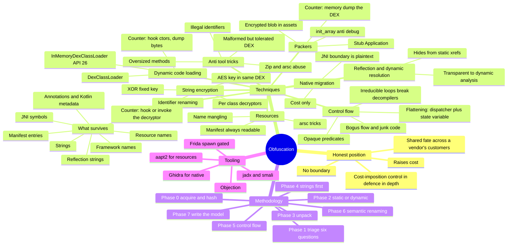

### Condensed cheat sheet

| Question | One-command answer |
|---|---|
| Is it packed? | `python3 -c "..."` reading `class_defs_size` at 0x60; under ~50 means stub |
| Are strings encrypted? | `strings classes.dex \| grep -c 'https\?://'` — zero is suspicious |
| Is it obfuscated at all? | `jadx -d out app.apk` and look at class names |
| Which native libs? | `unzip -l app.apk \| grep '\.so$'` |
| Which JNI exports? | `readelf --dyn-syms lib.so \| grep Java_` |
| Where are the entry points? | `aapt2 dump xmltree app.apk --file AndroidManifest.xml` |
| Is anti-debug present? | `grep -r 'ptrace\|TracerPid\|frida' apktool_out libs` |
| Attach or spawn? | Always spawn (`frida -f pkg --pause`) if any protection is suspected |
| How do I find the decryptor? | Hook `java.lang.String.$init([B)` and read frame 1 of the stack |
| How do I dump the DEX? | Hook the ClassLoader ctors; fall back to scanning for `dex\n` magic |
| Was a mapping file shipped? | `find . -iname '*mapping*'` inside the extracted APK |

### Quick revision prompts

- State the one-sentence reason obfuscation is not a security boundary.
- Name six kinds of information that survive identifier renaming.
- What is the universal counter to string encryption, and why does it work for any cipher?
- Draw the CFG of a flattened method and say why decompilers fail on it.
- Which header field tells you an APK is packed, and at what offset?
- Why does `.init_array` matter to a packer's anti-debug?
- What are the eight bytes at the start of a DEX file?
- Why does string recovery come before control-flow recovery in the methodology?
- Which class did API 26 add that removed the packer's need to drop a file to disk?
- Name three things about an app that obfuscation can never hide.

---

## 14. References

Full annotated list in [`references/README.md`](references/README.md).

### AOSP source

- `libcore/dalvik/src/main/java/dalvik/system/BaseDexClassLoader.java` — the `pathList` field and
  `findClass`, the funnel for all application class resolution.
- `libcore/dalvik/src/main/java/dalvik/system/InMemoryDexClassLoader.java` — the constructor that
  takes plaintext DEX in a `ByteBuffer`.
- `libcore/dalvik/src/main/java/dalvik/system/DexFile.java` — the Java/native boundary for DEX
  opening.
- `art/runtime/native/dalvik_system_DexFile.cc` — the JNI implementations behind it.
- `art/libdexfile/dex/dex_file.h` and `dex_file_loader.cc` — the DEX magic, version strings and
  header validation your memory carver must satisfy.
- `art/runtime/class_linker.cc` — `DefineClass`, the deepest "this class now exists" point.
- `frameworks/base/core/java/android/app/ActivityThread.java` — `handleBindApplication`.
- `frameworks/base/core/java/android/app/LoadedApk.java` — `makeApplication`, `mClassLoader`.

### Official documentation

- Android Developers — *Shrink, obfuscate, and optimize your app*.
- Android Developers — *Restrictions on non-SDK interfaces* (hidden API enforcement, API 28+).
- Android Developers — *Dalvik Executable format* (the DEX specification).
- Android Developers — *Application Signing* and `apksigner` documentation.
- Guardsquare — ProGuard manual (rules language reference).
- R8 documentation and the AGP release notes covering `android.enableR8.fullMode`.

### OWASP

- OWASP MASVS — MASVS-RESILIENCE category.
- OWASP MASTG — resilience testing chapters covering obfuscation assessment, anti-debugging, and
  reverse engineering methodology for Android.

### Tooling

- `jadx` — DEX decompiler with deobfuscation options.
- `apktool` / `baksmali` / `smali` — resource decoding and Smali round-tripping.
- `frida` and `frida-tools` — dynamic instrumentation.
- `frida-dexdump` — the memory-scanning DEX dumper whose approach §3.7.3 describes.
- `objection` — Frida-backed runtime exploration.
- Ghidra and the Android/ARM loaders for native analysis.
- `aapt2` — platform-accurate resource and manifest dumping.

### Related chapters

- [10-APK-Internals](../10-APK-Internals/README.md) · [12-DEX-Internals](../12-DEX-Internals/README.md)
  · [13-ART](../13-ART/README.md) · [16-JNI](../16-JNI/README.md)
- [37-RootDetection](../37-RootDetection/README.md) ·
  [38-TamperDetection](../38-TamperDetection/README.md) ·
  [39-EmulatorDetection](../39-EmulatorDetection/README.md)
- [41-ProGuard](../41-ProGuard/README.md) · [42-R8](../42-R8/README.md)
- [53-Frida](../53-Frida/README.md) · [56-JADX](../56-JADX/README.md) ·
  [57-Ghidra](../57-Ghidra/README.md) ·
  [67-BypassingProtections](../67-BypassingProtections/README.md) ·
  [68-ReverseEngineering](../68-ReverseEngineering/README.md) ·
  [69-MalwareAnalysis](../69-MalwareAnalysis/README.md)


