# 40 — Obfuscation · Mind Map

One picture of the whole chapter. Read it outward from the centre.

The centre is a single mechanical fact, and every branch is a consequence of it: **the application must
run.** To run, its bytecode must be presented to ART in a form ART understands; to decrypt its strings
it must hold the key; to check a signature it must execute a comparison. Every protection an
application applies to itself is applied by code the attacker also controls, on hardware the attacker
owns, in a process the attacker can attach to. There is no asymmetry available — the defender and the
attacker are running the same program on the same silicon, and the only difference is that the attacker
started later.

So obfuscation buys **time and skill cost**, not a boundary. The left half of the map is what
developers build; the right half is what it costs; the bottom is the repeatable process that converts
one into the other.

Each branch corresponds to a section of [the chapter README](README.md). Use it as a revision map
before an engagement or an interview.

```mermaid
mindmap
  root((Obfuscation))
    The honest position §1
      Raises cost never creates a boundary
      The app must run so everything it needs is present
      Cost table
        none minutes
        renaming hours
        plus strings half a day
        plus flattening days per method
        packer days first time HOURS second time
        native virtualisation weeks and still finite
      Shared fate
        a packer is a product
        first analyst publishes a method
        every customer then costs one command
        your protection level is set by the vendor's most-targeted customer
      Cost-imposition control in defence in depth
      Never a remediation for a hardcoded secret
    Where it happens §2
      Transform stage
        sees typed bytecode and the class hierarchy
        can rename inline merge rewrite
        ProGuard R8 DexGuard live here
      Post-processing stage
        sees a finished DEX as a blob
        can only encrypt and arrange for runtime decryption
        this is what a PACKER is
        and why packers are mechanically defeatable
      Three columns three toolchains
        DEX
        resources
        native
        find the weak column fast
    Techniques §3
      Identifier renaming §3.1
        a b c and p001x packages
        repackageclasses flattens the tree
        What SURVIVES
          framework class and method names
          ALL string constants
          manifest component names and permissions
          resource names in resources.arsc
          JNI symbol names in dynsym
          reflection target strings
          runtime-retained annotations
          kotlin.Metadata
          class hierarchy and signatures
          anything with a keep rule
        Keep rules that are too broad
          the classes that kept their names
          are the ones the developer cared about
          that is a coverage FINDING
      String encryption §3.2
        Why it matters most
          after renaming strings are the only semantics left
        Variants
          XOR fixed key
          AES with the key in the same DEX
          per class decryptors hundreds of them
          position dependent keys
        Recognise
          xor-int lit8 in a loop returning String
          byte array literals
          zero URLs in a networked app
        THE UNIVERSAL COUNTER
          the plaintext must exist for the app to use it
          so be present at that moment
          hook String.<init> byte array
          frame 1 of the stack is the decryptor
          works for ANY cipher because it hooks the RESULT
        Two forms
          passive harvest only paths you run
          active exhaust the whole index space
          discover with the first exhaust with the second
      Control flow §3.3
        Opaque predicates
        Flattening the important one
          dispatcher plus state variable
          while true switch state
          randomised non sequential states
          decompilers fail on DOMINANCE not competence
          Counters
            state transition table by hand ten minutes
            trace the dispatcher for big methods
            or DO NOT DEFLATTEN AT ALL
          The right first question
            do I need to UNDERSTAND it
            or only to PREDICT it
        Bogus flow and junk code
        Irreducible loops break decompilers
      Reflection and dynamic resolution §3.4
        hides from static cross references
        completely transparent to dynamic analysis
        the target strings survive renaming
      Dynamic code loading §3.5
        DexClassLoader
        InMemoryDexClassLoader API 26 never touches disk
        Counter hook the constructors dump the bytes
      Native migration §3.6
        cost only nothing fundamental
        the JNI boundary is plaintext by construction
        RegisterNatives removes the Java_ anchor
        frida-trace the boundary BEFORE opening Ghidra
      Packers §3.7
        Mechanically
          encrypt the real DEX into an asset
          emit a stub Application
          rewrite application android name
          stash the real name in meta-data
          inject a native runtime
        Recognise
          tiny classes.dex tiny class_defs_size
          large high entropy asset
          foreign application android name
          so in assets rather than lib
          few exports big init_array
        init_array runs BEFORE JNI_OnLoad
          hooking JNI_OnLoad is always too late
          hook android_dlopen_ext or spawn gate
        Unpacking is TIMING not code breaking
          hook the loader cleanest artefact
          hook ART internals fragile symbols are not ABI
          SCAN MEMORY universal fallback
          validate header_size 0x70 and endian 0x12345678
          repair adler32 and sha1 they are unkeyed
        Protector families observed artefacts only
          DexGuard DexProtector
          Jiagu Bangcle SecNeo Tencent Legu Ijiami
          Promon Appdome Arxan Digital.ai
          name the SHAPE not the vendor
      Anti tool tricks §3.8
        illegal identifiers
        oversized methods and switch tables
        malformed but ART tolerated DEX
        Android parsers are more permissive than ours
        counter go to Smali or dump from memory
      Resources §3.9
        name mangling and arsc tricks
        manifest is ALWAYS readable
        usually the weakest column
    Methodology §6.1
      Phase 0 acquire hash splits signer
      Phase 1 triage six questions
        packed
        renamed
        strings encrypted
        native code
        flattened
        anti analysis
      Phase 2 static or dynamic
        prefer dynamic always
        static gives completeness
        dynamic gives understanding
      Phase 3 UNPACK if packed
        do not read a stub
        criterion jadx sees manifest named components
      Phase 4 STRINGS FIRST
        strings tell you WHAT
        control flow only tells you HOW
        annotate the smali at scale
        triage endpoints credentials crypto anti-analysis
      Phase 5 control flow
        only for methods the strings flagged
      Phase 6 semantic renaming
        rename from evidence
        it compounds
        commit the jobf file
      Phase 7 write the model down
        including what you did NOT look at
        that section is where the missed finding lives
    Tooling §7 §8
      Frida spawn gated never attach
      jadx and baksmali smali never lies
      apktool and aapt2
      Ghidra for native
      Objection for routine work
      Chapter scripts
        frida-string-decryptor
        frida-classloader-dump
        frida-dexdump-lite
        apk-obfuscation-triage
        annotate-smali-strings
      Automated tools report CAPABILITY
      only manual confirmation reports BEHAVIOUR
    Reporting §5
      Obfuscation is not a remediation for a secret
      Demonstrate recovery and record the TIME
      Coverage findings from broad keep rules
      A shipped mapping file is total disclosure
      The real finding is what the recovered thing lets you do
```

---

## How to use this map

**Before an engagement.** Read the *Techniques* and *Methodology* branches. The first tells you what
you might meet; the second tells you the order in which to meet it. Twenty minutes here saves days.

**In the first ten minutes of a target.** Work the *Phase 1 triage* leaves as a checklist. Packed?
Renamed? Strings? Native? Flattened? Anti-analysis? Those six answers determine everything downstream
and are also the first table in your report.

**When you are stuck.** You are almost certainly out of order. Reading flattened Smali without having
recovered strings, or recovering strings without having unpacked, are the two ways an afternoon
disappears. Go back up the *Methodology* branch and find the phase you skipped.

**When advising a developer.** Read *The honest position* first, then *Reporting*. Price each control
with a measured number from your own engagement, credit honestly what it does buy — casual analysis and
automated bulk processing are real threats and obfuscation genuinely raises their cost — and then say
where the next unit of budget actually changes the outcome.

---

## Related maps

- [12-DEX-Internals](../12-DEX-Internals/README.md) — the header fields your memory carver validates
- [13-ART](../13-ART/README.md) — how DEX enters the runtime, and §3.17 on entry-point patching
- [41-ProGuard](../41-ProGuard/README.md) · [42-R8](../42-R8/README.md) — the tools most apps actually use
- [37-RootDetection](../37-RootDetection/README.md) · [38-TamperDetection](../38-TamperDetection/README.md)
  · [39-EmulatorDetection](../39-EmulatorDetection/README.md) — the runtime-defence half of what
  commercial protectors do
- [67-BypassingProtections](../67-BypassingProtections/README.md) — anti-debug and anti-Frida in depth
- [68-ReverseEngineering](../68-ReverseEngineering/README.md) — the general methodology this specialises
