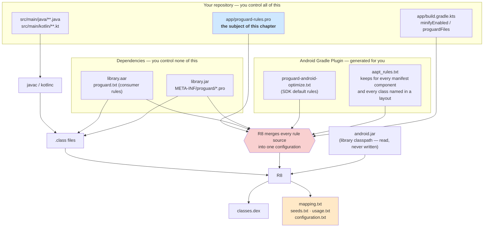
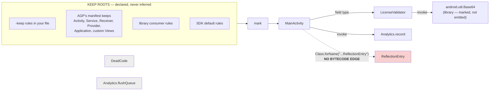
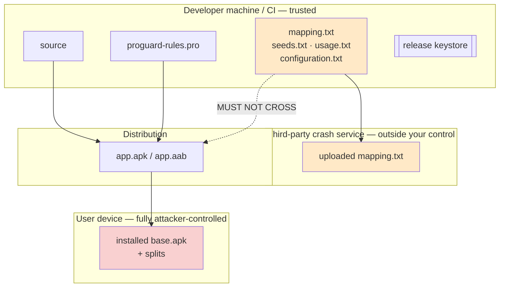
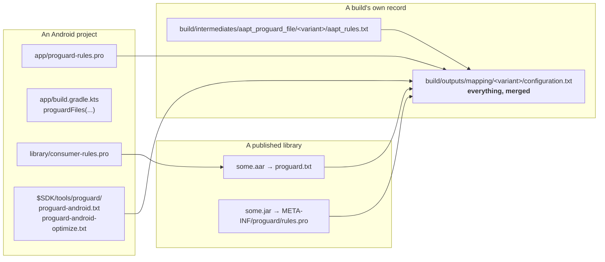
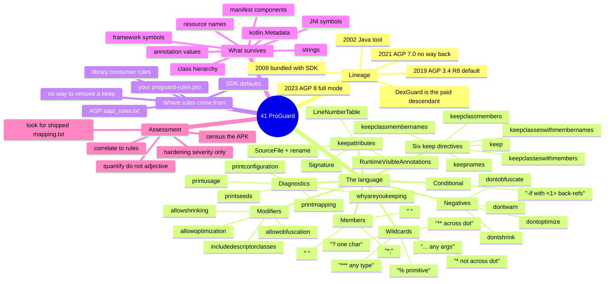

# 41 — ProGuard

> After this chapter you will be able to read any `proguard-rules.pro` file line by line and say
> exactly what it preserves, spot the over-broad `-keep` that quietly disables the whole control,
> predict from the rules what an analyst will see in the decompiled app — and go the other way,
> deriving the rules from the shipped APK when nobody will give you the file.

**Prerequisites:** [04-Java](../04-Java/README.md), [08-Build-System](../08-Build-System/README.md),
[10-APK-Internals](../10-APK-Internals/README.md), [12-DEX-Internals](../12-DEX-Internals/README.md),
[40-Obfuscation](../40-Obfuscation/README.md)
**Applies to:** All Android versions. Shrinking and obfuscation are **build-time** properties of an
application, not runtime properties of the OS, so almost nothing here is API-level dependent. What
*is* version dependent is the **toolchain**: which engine consumes your rules, and which semantics it
applies. That is a Gradle-plugin version matrix, not an Android one, and section 3.13 gives it.

---

## Table of Contents

1. [Introduction](#1-introduction)
2. [High-Level Architecture](#2-high-level-architecture)
3. [Deep Internal Working](#3-deep-internal-working)
4. [Source Code Walkthrough (AOSP)](#4-source-code-walkthrough-aosp)
5. [Security Perspective](#5-security-perspective)
6. [Reverse Engineering Perspective](#6-reverse-engineering-perspective)
7. [Dynamic Analysis](#7-dynamic-analysis)
8. [Static Analysis](#8-static-analysis)
9. [Examples](#9-examples)
10. [Common Interview Questions](#10-common-interview-questions)
11. [Common Mistakes](#11-common-mistakes)
12. [Hands-on Labs](#12-hands-on-labs)
13. [Summary](#13-summary)
14. [References](#14-references)

---

## 1. Introduction

### 1.1 The honest statement, first

Two sentences, before anything else, because everything in this chapter depends on both being
understood.

> **⚠️ Warning**
> **ProGuard is largely historical on Android.** Since **Android Gradle Plugin 3.4** (2019) the
> default code shrinker has been **R8**, and since AGP 7.0 the flag that let you switch back to
> ProGuard was removed entirely. If you set `minifyEnabled true` in a modern Android project, the
> tool that runs is R8. ProGuard is not part of the Android SDK, and nothing in a stock Gradle build
> invokes it.

> **⚠️ Warning**
> **Absent or weak obfuscation is not, by itself, a vulnerability.** It is a hardening control. It
> makes an attacker's work slower; it does not make anything safe, and its absence does not make
> anything unsafe. Reporting "the application is not obfuscated" as a standalone finding, without a
> threat model that justifies the control, is one of the most reliable ways to be dismissed by a
> development team. Section 5.6 says how to report it properly.

So why is there a chapter about a tool you will probably never run?

Because **the file is still called `proguard-rules.pro`, and the language inside it is still
ProGuard's.** Every Android project you will ever open has that file. Every library you depend on
ships rules in that language. Every R8 error message, every AGP configuration property, every Stack
Overflow answer, and R8's own source tree all use ProGuard's vocabulary — `-keep`,
`-keepclassmembers`, `-dontobfuscate`, `-keepattributes`. R8 was built as a drop-in replacement
precisely so that the millions of existing rules files would keep working.

There are three more reasons that are not merely historical:

1. **You will meet genuine ProGuard output.** Apps built before 2019 are still installed on devices
   and still submitted for assessment. So is a great deal of non-Android Java: server-side JARs,
   desktop applications, embedded Java, and Android libraries whose AARs were built years ago and
   shipped as binaries with their names already mangled.
2. **ProGuard is still actively developed and still sold.** Guardsquare maintains it, and
   **DexGuard** — Guardsquare's commercial Android product — is ProGuard's descendant and consumes
   the same rules language plus extensions. When you assess an app protected by DexGuard, you are
   reading ProGuard-family configuration.
3. **The rules language is where the security decisions live.** `minifyEnabled true` is one boolean.
   The rules file is where somebody decided, line by line, which parts of the application would keep
   their names. That is the artefact worth reading, and it is the artefact this chapter owns.

> **🧠 Mental Model**
> ProGuard is to R8 roughly what `make` is to a modern build system: superseded as an engine, but its
> *file format* became the interface everyone standardised on, so you still have to be fluent in it.
> Learning "ProGuard" today means learning **the keep language**.

### 1.2 What problem existed before this?

Before shrinking existed on Android, three separate pressures pushed in the same direction.

**Pressure one: the 65,536 method limit.** A single DEX file addresses methods with a 16-bit index,
so one `classes.dex` can reference at most 65,536 methods — the famous "64K limit", covered in
[12-DEX-Internals](../12-DEX-Internals/README.md). Before multidex existed (and even after, because
multidex was slow on pre-Lollipop devices), an app that pulled in a couple of large libraries simply
would not build. The fix was to **delete the code you were not using**, automatically. That is
*shrinking*, and it is the original reason ProGuard shipped with the Android SDK.

**Pressure two: size.** Early Android devices had tens of megabytes of application storage. Shorter
identifiers make the DEX string pool smaller; deleting unused classes makes it much smaller. Both
were measured in a currency that mattered.

**Pressure three: readability of the shipped artefact.** Compiled Java retains an extraordinary
amount of source-level information. A `.class` file — and therefore a DEX — records the fully
qualified class name, every field name, every method name, every parameter type, the generic
signature, and, by default, the original source filename and a line-number table. Decompiling an
unobfuscated Android app gives you something very close to the original source.

ProGuard addressed all three with one pass. That coupling is still visible in the tooling today, and
it is the source of a persistent confusion: **shrinking and obfuscation are the same switch**, so
turning off "obfuscation" for a debugging reason also turns off the dead-code removal you wanted.

> **📖 Definition**
> **Shrinking** (also *tree shaking*) removes classes, methods and fields that nothing reachable
> refers to. **Obfuscation** (also *minification*, *renaming*, *name mangling*) replaces the names of
> what remains with short meaningless ones. **Optimisation** rewrites the code itself — inlining
> methods, merging classes, removing dead branches. ProGuard performed all three, in that order, plus
> a fourth **preverification** step that has no meaning on Android.

### 1.3 What would break if this did not exist?

Take the three pressures in turn.

Without shrinking, large apps would not fit in one DEX and every project would carry multidex from
day one, with its startup cost. Every unused method of every dependency would ship. In practice this
is not hypothetical — an app that sets `minifyEnabled false` for its release build (and many do) has
exactly this shape, and you can see it: thousands of classes from libraries whose functionality the
app never touches.

Without renaming, nothing about the app's *security* would change. That is the part worth saying
plainly. The app would be easier to read, an analyst's first day would be shorter, and every finding
that exists would still exist. The class `com.bank.crypto.PinEncryptor` would be found in ten
seconds instead of an hour. It would still be found.

Without optimisation, apps would be slightly larger and slightly slower, and — a side effect, not a
goal — decompiled output would read much more like the original source, because the structure the
developer wrote would still be there.

### 1.4 What this is, precisely

> **📖 Definition**
> **ProGuard** is a Java class-file **shrinker, optimiser, obfuscator and preverifier**. It reads
> `.class` files (in directories, JARs, WARs, APKs), computes which entities are reachable from a set
> of declared entry points, deletes the rest, optimises the bytecode, renames what remains, and
> writes the result out. It is configured entirely by a text file of directives. It is free software
> (GPL), originally written by Eric Lafortune and now maintained by **Guardsquare**.

Three properties of that definition do most of the work later:

- **It is a whole-program tool.** It must see everything: your code, every library, and the platform
  classes as a *library* classpath it may reference but must not modify. If it cannot see a class, it
  cannot reason about it — which is what every `-dontwarn` and every "missing class" error is about.
- **It computes reachability from declared roots.** Nothing is kept because it looks important.
  Things are kept because a rule says so, or because something kept refers to them. The set of roots
  is exactly what your rules file declares, plus what the build system declares on your behalf.
- **It reasons about bytecode, not about strings.** `Class.forName("com.example.Thing")` is, to the
  shrinker, a call to a method with a string argument. The edge from the caller to `Thing` does not
  exist in the bytecode, so the tool cannot see it. This single fact causes the overwhelming majority
  of real-world rules, real-world crashes, and real-world over-broad keeps.

### 1.5 A timeline, because the dates explain the file you are looking at

| When | What happened | Why it matters when reading a rules file |
|---|---|---|
| 2002 | ProGuard first released for Java | Its vocabulary predates Android by six years — `-dontpreverify`, `-microedition`, `-injars` are all from this era |
| 2009 (Android 2.3 / SDK tools r8) | ProGuard bundled with the Android SDK; `proguard.cfg` generated in new projects | The reason nearly every Android rules file starts from a template rather than from zero |
| ~2014 | Gradle-based builds standardise on `proguard-rules.pro` and `getDefaultProguardFile(...)` | The filename you still use today |
| 2017 | R8 announced as a replacement, available behind a flag | |
| **2019 (AGP 3.4)** | **R8 becomes the default shrinker.** `minifyEnabled true` now means R8 | Rules files written before this were tuned against ProGuard's semantics |
| 2020 (AGP 4.x) | `android.enableR8=false` still available as an escape hatch | The last version where you could actually run ProGuard from a stock build |
| **2021 (AGP 7.0)** | The escape hatch is removed. ProGuard cannot be selected through AGP any more | An Android project that runs ProGuard today does so via a hand-written Gradle task or Guardsquare's own plugin |
| **AGP 8.0** | **R8 "full mode" becomes the default** (`android.enableR8.fullMode=true` is implied) | Several rules that worked for a decade changed meaning. Section 3.15 |

> **🔬 Under the Hood**
> The coincidence in row two is worth a moment: ProGuard entered the SDK in **tools release r8**, and
> the tool that eventually replaced it is called **R8**. They are unrelated. Google's R8 is named for
> being the successor to **D8**, the dexer, which is itself named for **DEX**.

### 1.6 Where this chapter sits

This chapter is deliberately narrow. It owns **the rules language and the ProGuard lineage**.

| Topic | Chapter that owns it |
|---|---|
| Obfuscation as a subject: string encryption, control-flow flattening, packers, native migration | [40-Obfuscation](../40-Obfuscation/README.md) |
| **R8 specifically**: shrinking and optimisation internals, `mapping.txt` format, full mode, modern behaviour | `42-R8` |
| Reading decompiled output, jadx flags, `--deobf`, applying a recovered mapping | [56-JADX](../56-JADX/README.md) |
| Where `minifyEnabled` lives, variants, signing, the build pipeline as a whole | [08-Build-System](../08-Build-System/README.md) |
| Identifying shaded and repackaged libraries | [17-Libraries](../17-Libraries/README.md) |
| DEX layout, the string pool, the 64K limit | [12-DEX-Internals](../12-DEX-Internals/README.md) |

> **⚠️ Warning**
> At the time this chapter was written, `42-R8` had not been started. Every reference to it is a
> forward reference by directory name and resolves when that chapter lands. Where a fact about R8 is
> needed *here* to keep this chapter honest — full-mode keep semantics, the fact that R8 rewrites
> `SourceFile` by default — it is stated here and measured here, rather than deferred to a file that
> does not exist.

### 1.7 What you will be able to do

- Read a `-keep` rule and state, without hesitating, whether it protects the class from **removal**,
  from **renaming**, from **both**, or from neither — and whether it does the same for the class's
  members.
- Explain the difference between `*`, `**` and `***` including the one documented special case that
  catches everybody.
- Look at a decompiled app and work backwards to the rules that produced it.
- Recognise the over-broad keep from the *output alone*, with no access to the source.
- Write the finding, at a severity you can defend, and write the developer's fix as a diff.

---

## 2. High-Level Architecture

### 2.1 Where the rules file enters the build



Read the diagram from the middle. The single most important structural fact about this system is the
diamond: **your rules file is one of five inputs to the configuration, and it is usually the
smallest one.** A typical Android app with a dozen dependencies feeds R8 several thousand lines of
rules, of which perhaps forty were written by the app's own developers. Everything else arrives from
the AAR files, from `proguard-android-optimize.txt`, and from AGP's manifest scan.

This has a direct consequence for assessment work, and it is the mistake to avoid: **auditing
`proguard-rules.pro` alone systematically under-reports what was kept.** The authoritative artefact
is `configuration.txt`, which R8 writes and which contains every merged rule with a comment naming
its origin. Section 8.4 shows how to get it.

The second thing to read from the diagram: `android.jar` goes in but never comes out. Platform
classes are a **library classpath**. The shrinker may look at them to resolve types and check
signatures; it may not rename them, must not include them in the output, and cannot remove them.
That is why every `android.*` and `java.*` symbol survives obfuscation intact, at every setting —
the point [40-Obfuscation §3.1](../40-Obfuscation/README.md) makes with its survivors table.

### 2.2 ProGuard's four phases, and R8's one

```mermaid
stateDiagram-v2
    direction LR
    [*] --> Read
    Read: Read inputs
    Read: injars + libraryjars, or under AGP,\nthe compiled classes plus android.jar

    Read --> Shrink
    Shrink: 1. SHRINK
    Shrink: mark everything reachable from the keep roots,\ndelete the rest
    Shrink: disabled by -dontshrink

    Shrink --> Optimise
    Optimise: 2. OPTIMISE
    Optimise: inline, merge classes, remove dead branches,\nmake methods static, remove unused arguments
    Optimise: disabled by -dontoptimize

    Optimise --> Obfuscate
    Obfuscate: 3. OBFUSCATE
    Obfuscate: assign short names to every class, field\nand method not protected by a keep rule
    Obfuscate: disabled by -dontobfuscate

    Obfuscate --> Preverify
    Preverify: 4. PREVERIFY
    Preverify: add StackMapTable attributes for the JVM verifier
    Preverify: MEANINGLESS ON ANDROID - DEX is verified differently

    Preverify --> [*]
```



Four phases, in that fixed order, each independently switchable. The order is not arbitrary:
optimisation is more effective after dead code is gone, and renaming must happen last so that the
optimiser is still working with meaningful signatures.

R8 collapses this. It performs shrinking, optimisation, renaming **and dexing** in one pass over a
single intermediate representation, which is why it is faster and why its optimiser can do things
ProGuard's could not (whole-program enum unboxing, class merging across the app and its libraries,
argument removal). From the outside the phases look the same and the same directives switch them off
— but you should not assume the *boundaries* are the same. A concrete example, measured in
[examples/keeplab](examples/keeplab/):

> **🔬 Under the Hood**
> The fixture's `Analytics.record()` is called exactly once. R8 did not merely rename it — it
> **inlined the whole method into `MainActivity.onCreate`** and deleted the class, recording the
> outcome in `mapping.txt` as `com.pentest.ch41.Analytics -> R8$$REMOVED$$CLASS$$0`. In the same
> build, `Transaction`'s three-argument constructor is listed with a
> `com.android.tools.r8.residualsignature` of `()V`: the optimiser proved the arguments were
> constant and removed all three. Neither of those is "obfuscation"; both make the decompiled output
> significantly harder to follow, and both are switched on by the same boolean.

### 2.3 The reachability model — what "keep" actually means



Everything the marker can reach is kept. Everything else is deleted. The two grey boxes —
`DeadCode` and `Analytics.flushQueue` — are unreachable and are removed; that is shrinking working
correctly.

The red box is the entire problem. `ReflectionEntry` is referenced only by the **string**
`"com.pentest.ch41.ReflectionEntry"` inside a `Class.forName` call. There is no invoke instruction,
no field of that type, no `new` — nothing in the bytecode connects `MainActivity` to it. That is the
classic model, it is exactly true of ProGuard, and it is the model every keep rule was written
against.

**Every keep rule in every real rules file exists to repair an edge like that one.** Reflection,
JNI, serialisation, dependency injection, resource-driven view inflation, `Parcelable.CREATOR`,
enum `valueOf` — all of them are runtime lookups by name, and all of them are invisible to a
bytecode reachability analysis. Understanding this converts "why is this rule here?" from a mystery
into a checklist.

> **🔬 Under the Hood — measured, and it contradicts the model above**
> **R8 8.6.2 does see some of these strings.** Deleting the `ReflectionEntry` keep from
> [`examples/02-tightened-rules.pro`](examples/02-tightened-rules.pro) and rebuilding does *not*
> produce a `ClassNotFoundException`. R8 resolves the constant string argument to `Class.forName`,
> replaces the whole call with a `const-class` instruction pointing at the class, keeps the class,
> renames it to `a.a`, and rewrites the reference to match:
>
> ```
> # host — dexdump -d, build B with the ReflectionEntry rule DELETED
> 005e: const-class v0, La/a;
> 0060: invoke-virtual {v0}, Ljava/lang/Class;.newInstance:()Ljava/lang/Object;
> ```
>
> The `Class.forName` call is gone from the bytecode entirely, and the app still works. R8 also kept
> the constructor, the field and `toString()`, because it modelled the `newInstance()` and the
> subsequent use.
>
> **Do not conclude that you no longer need reflection keeps.** The modelling is idiom-matching, not
> analysis, and it stops abruptly. Measured in the same session, in
> [`labs/ctf-vault`](labs/ctf-vault/): R8 resolved `Class.forName("…inner.Piece5")` the same way —
> and then removed `Piece5`'s `public static final String FIFTH` anyway, reducing the class to an
> empty `abstract` shell, because `getDeclaredField("FIFTH")` is *not* modelled. The build succeeds,
> emits no warning, and the app throws `NoSuchFieldException` on a path nobody tested.
>
> The safe rule, and the one this chapter teaches: **write the keep.** R8 may make it redundant; it
> will never make it wrong, and you cannot tell from the source which idioms are covered.

> **🧠 Mental Model**
> A keep rule is not an instruction to *protect* something. It is a declaration that **something
> outside the bytecode will look this up by name**. Read every rule that way and the good ones
> become obvious: they name the thing that is looked up, and nothing else. The bad ones name a
> package.

### 2.4 Trust boundaries, and where the interesting artefacts land



Three boundaries, and a leak at each one.

The dashed line is the one that gets crossed by accident. `mapping.txt` is a build output; it belongs
in `app/build/outputs/mapping/<variant>/` and nowhere else. It ends up inside APKs when somebody adds
it to `assets/` to satisfy a crash-reporting integration, or when a build script copies the whole
`build/` directory into the packaging step. If you find it inside an APK, that is a finding on its
own terms: the control the organisation paid for is present and completely defeated by a file they
shipped next to it. [56-JADX §3.10](../56-JADX/README.md) shows the one command that applies it.

The second leak is the crash service. `mapping.txt` is *supposed* to go there — that is how a
readable stack trace is produced. It means the file exists in a system whose access controls you do
not own. A compromised or over-permissive Crashlytics/Sentry/Bugsnag account is an indirect but
complete leak.

The third is the device, and it is not a leak so much as the premise of the whole subject: the APK
is on hardware the attacker owns, in a process they can attach to. Nothing in this chapter changes
that. See [40-Obfuscation §1](../40-Obfuscation/README.md), which states it exactly.

### 2.5 Where a rules file physically lives



The distinction between `proguardFiles` and `consumerProguardFiles` is worth fixing now, because it
is the single most common misunderstanding when reading a library's build file:

| Property | Applies to | Ships to consumers |
|---|---|---|
| `proguardFiles` | this module's own minification | no |
| `consumerProguardFiles` | nothing, at build time | **yes** — packaged into the AAR as `proguard.txt` and merged into every app that depends on it |
| `testProguardFiles` | the test APK only | no |

A library author who puts `-keep class com.mylib.** { *; }` in `consumerProguardFiles` has imposed
that rule on every application that ever depends on the library, and none of those applications'
developers will see it in their own rules file. This happens constantly, and section 8.4 is how you
find it.

---

## 3. Deep Internal Working

This is the reference section. It covers the rules language completely, because that is what this
chapter owns, and it states where ProGuard and R8 disagree rather than pretending they are one tool.

### 3.1 The four phases, precisely

#### Shrinking — *what*, *why*, *when*, *where*, *how*

**What.** Removal of classes, fields and methods that are not reachable from the keep roots.

**Why.** Originally the 64K method limit and APK size. Today, chiefly size and startup cost — but it
has a real security benefit that is easy to overstate and easy to forget: **code that is not in the
APK cannot be reached by anything.** An app that ships a debug-only `WebView` with JavaScript
enabled, or a leftover `ContentProvider`, or a test-mode activity, is shipping attack surface;
shrinking deletes whatever is genuinely unreferenced. It does not delete anything the manifest
declares, because AGP keeps every manifest component.

**When.** First, before optimisation and renaming.

**Where.** Between `javac`/`kotlinc` and dexing, on the `.class` files.

**How.** A worklist algorithm. The tool builds the set of **roots** — every entity matched by a
`-keep`-family rule that does not carry `allowshrinking` — then repeatedly marks everything a marked
entity refers to: superclasses, interfaces, field types, method signatures, exception types, targets
of every `invoke`, classes named in constant-pool entries. When the worklist empties, everything
unmarked is deleted. `-printusage` writes exactly what was removed.

The algorithm is sound with respect to bytecode and blind to everything else. It cannot see:

| Invisible edge | Typical carrier | Rule that repairs it |
|---|---|---|
| `Class.forName("a.b.C")` | string | `-keep class a.b.C { <init>(); }` — but see the callout in §2.3: R8 8.6.2 *does* resolve a constant argument here, so the omission may not bite until the string stops being constant |
| `getMethod("name")` / `getDeclaredField("x")` | string | `-keepclassmembers` naming the member. **Measured: not modelled by R8 8.6.2** — the member is removed and the failure is a runtime `NoSuchFieldException` |
| JNI `RegisterNatives` from C | string in native code | `-keep` on the class and method |
| Static JNI binding | ELF symbol name | `-keepclasseswithmembernames class * { native <methods>; }` |
| `Enum.valueOf(String)` | string | the standard enum member rule |
| Java serialisation | field names in the stream | `-keepclassmembers ... implements Serializable` |
| GSON without `@SerializedName` | field names on the wire | keep the fields, or annotate them |
| `android:name` in a layout XML | string in `resources.arsc` | AGP generates it from the AAPT scan |
| `Parcelable.CREATOR` | reflective field lookup by literal name | `-keepclassmembers class * implements Parcelable { public static final ...$Creator CREATOR; }` |
| A `ServiceLoader` provider file | text in `META-INF/services/` | keep the implementation class |

#### Optimisation

**What.** Semantics-preserving rewriting of the code: inlining short methods, making methods
`static` or `private` when possible, removing unused parameters, merging classes and interfaces,
propagating constants, removing dead branches, evaluating constant expressions, unboxing enums.

**Why.** Size and speed. It is not a security feature. Its *effect* on an analyst is real, though,
and larger than renaming's: a renamed method is still a method with the same shape, but an inlined
method has no shape at all — the code you are looking for is now scattered across its call sites.

**How, in R8.** R8 runs the optimiser over its own IR, whole-program. That is why it can unbox an
enum entirely (the fixture's `Transaction.Kind` disappears as a class) or remove a constructor's
arguments. ProGuard's optimiser is narrower and controlled by `-optimizations` filters and
`-optimizationpasses`; **R8 ignores both directives**, which is one of the more common sources of
"my rules file does nothing" confusion.

#### Obfuscation

**What.** Assignment of new, short names to every class, field and method that no rule protects.

**How the names are chosen.** By default, from the sequence `a, b, c, … z, a0, a1, …`, assigned
per-scope so that names are reused as aggressively as the JVM's overload and scoping rules allow.
Two methods in the same class may both be called `a` if their descriptors differ; this is legal
because the JVM and ART resolve methods by name **and** descriptor. `-obfuscationdictionary`,
`-classobfuscationdictionary` and `-packageobfuscationdictionary` let you supply your own word list
(Java keywords are a favourite, and they are legal in DEX because DEX does not reserve them — see
section 6.6).

**What it does not touch, ever.** String constants, resource names, the manifest, framework symbols,
native library contents, and anything a keep rule names. That list is the subject of section 6.2 and
is the most useful thing in this chapter.

#### Preverification

**What.** Adding `StackMapTable` attributes so the JVM's split verifier can check the class quickly.

**Why you can ignore it.** DEX is a different format with a different verifier. `dex2oat` and ART's
verifier do their own work. `-dontpreverify` in an Android rules file is a no-op, and its presence
is a reliable indicator that the file was copied from a Java desktop project or from a pre-2013
tutorial. Google's own `proguard-android.txt` used to contain it for exactly that reason.

### 3.2 Reading the file: lexical rules

Before the grammar, the boring mechanics — each of which has bitten somebody.

| Rule | Detail |
|---|---|
| Comments | `#` to end of line. There is **no** block comment and no `//` |
| Whitespace | Free-form. A directive and its class specification may span lines; the member block almost always does |
| Statement separator | None. A directive ends where the next `-` at the start of a token begins, or where its `}` closes |
| Case | Directives are case-sensitive and lower-case. `-Keep` is an error |
| Quoting | Names containing special characters may be `'single'` or `"double"` quoted. Rarely needed |
| Argument files | `@filename` or `-include filename` splices another rules file in at that point |
| System properties | `<java.home>`, `<user.home>`, `<user.dir>` are substituted in file paths. Not in class names |
| Unknown directive | **A hard error**, in both ProGuard and R8. If your build succeeds, every directive in the file is real |
| Duplicate rules | Legal and harmless. They are a strong signal that the file grew by accretion |
| Rule that matches nothing | Legal. ProGuard emits a *note*; R8 usually stays silent. This is why dead rules survive for years |

> **⚠️ Warning**
> Because there is no statement terminator, a typo in a class name does not produce a parse error —
> it produces a rule that silently matches nothing. `-keep class com.example.MainActivty` is
> perfectly valid configuration for a class that does not exist. Nothing will tell you. This is what
> `-printseeds` and `scripts/what-survived.py`'s rule-correlation section exist for.

### 3.3 The class specification grammar

Every keep-family directive takes a **class specification**, optionally followed by a
brace-delimited **member specification**. The full shape:

```
-keep[modifiers] [@annotation] [!]access... [class|interface|enum|@interface] classname
     [extends|implements classname]
[{
     [@annotation] [!]access... member-specification;
     ...
}]
```

Every part is optional except the class name. Worked through, piece by piece:

| Element | Example | Meaning |
|---|---|---|
| `@annotation` | `-keep @androidx.annotation.Keep class *` | Match only classes carrying that annotation. The annotation itself must be retained (`-keepattributes RuntimeVisibleAnnotations`) or this matches nothing |
| access modifiers | `-keep public class ...` | Match only classes with that modifier. Multiple may be combined; they are ANDed |
| `!` negation | `-keep !abstract class ...` | Match only classes **without** the modifier |
| `class` | `-keep class Foo` | Matches classes **and** interfaces and enums — `class` is the permissive keyword |
| `interface` | `-keep interface Foo` | Only interfaces |
| `enum` | `-keepclassmembers enum *` | Only enums |
| `@interface` | `-keep @interface Foo` | Only annotation types |
| class name | `com.example.Foo`, `com.example.**` | Fully qualified, dot-separated, with wildcards. Inner classes use `$`: `com.example.Outer$Inner` |
| `extends` / `implements` | `-keep public class * extends android.app.Activity` | Match only subtypes. **The two words are synonyms in this grammar** — `extends` matches interface implementation too. Matching is transitive: a class extending a subclass of `Activity` matches |

> **🔍 Pentester's Note**
> `extends` and `implements` being synonyms surprises people, and it matters when you are reading
> somebody's rules to predict coverage. `-keep class * implements java.io.Serializable` and
> `-keep class * extends java.io.Serializable` do the same thing. Neither is a syntax error.

Two further details that change what a rule matches:

- **The class name is matched against the fully qualified name**, with `.` as the package separator
  — not the JVM's `/`. In DEX and in `mapping.txt` you will see both forms; in a rules file it is
  always dots.
- **Inner classes are separate classes** with `$` in their name. `-keep class com.example.Outer`
  does **not** keep `com.example.Outer$Inner`. To keep both you need `com.example.Outer*` or an
  explicit second rule. This is a very common cause of "I kept the class and it still crashed".

### 3.4 Wildcards — the complete table

This table is the highest-value thing in the chapter. Everything else can be looked up; getting
these wrong silently changes what a rule covers.

| Token | Where it is legal | Matches | Crosses `.`? | Crosses the package separator in practice |
|---|---|---|---|---|
| `?` | class names, member names | exactly one character | no | no |
| `*` | class names, member names | any sequence of characters | **no** | no — `com.app.*` is one package |
| `**` | class names | any sequence of characters | **yes** | yes — `com.app.**` is that package and all below it |
| `***` | **type** positions only (return types, field types, argument types) | any type, including primitives and arrays of any dimension | n/a | n/a |
| `%` | type positions only | any **primitive** type (`boolean`…`double`), not `void`, not object types | n/a | n/a |
| `...` | argument lists only | any number of arguments of any type | n/a | n/a |
| `<init>` | member names | any constructor | | |
| `<clinit>` | member names | the static initialiser | | |
| `<fields>` | member specification | every field of the matched class | | |
| `<methods>` | member specification | every method of the matched class | | |
| `<1>`, `<2>`, … | class names, in `-if` rules | back-reference to the *n*-th wildcard in the `-if` condition | | |

> **⚠️ Warning — the documented special case that catches everybody**
> The class name **`*` on its own matches every class, irrespective of package.** The ProGuard manual
> states this explicitly, as a convenience and for backward compatibility. So:
>
> | Rule | What it matches |
> |---|---|
> | `-keep class *` | **every class in the program** |
> | `-keep class com.app.*` | classes directly in `com.app`, not in `com.app.ui` |
> | `-keep class com.app.**` | `com.app` and every package beneath it |
> | `-keep class *Activity` | classes in the **default package** whose name ends in `Activity` — almost certainly not what was meant |
>
> Row four is the trap. `*` does not cross `.`, so `*Activity` cannot match `com.app.MainActivity`.
> The rule matches nothing, and nothing tells you. The intended rule is `**Activity` or, far better,
> `* extends android.app.Activity`.

Two more distinctions worth internalising:

**`*` in a *type* position is not the same as `*` in a name position.** In
`-keepclassmembers class Foo { * get*(); }`, the leading `*` is a return type and matches any type;
the `get*` is a name pattern. In `-keep class *`, the `*` is a class name.

**`***` and `%` only exist because `*` in a type position cannot express "array of anything".**
`java.lang.String[]` is a type whose name contains `[`, and `*` will not match it. `***` will.

```proguard
# a rules file — the four type wildcards, contrasted
-keepclassmembers class com.example.Model {
    *   getName();          # any return type, method literally called getName
    *** get*();             # any return type INCLUDING arrays, any getter
    %   isEnabled();        # a primitive return type only
    void set*(***);         # any single-argument setter, argument of any type
    void configure(...);    # any argument list at all
}
```

### 3.5 The keep family — six directives, and the matrix that explains them

There are exactly six keep directives, and they are three concepts crossed with two scopes. Once you
see the matrix you never need to memorise the names.

|  | Keeps the **class** | Keeps only **members** | Keeps the class **if it has** the members |
|---|---|---|---|
| **from removal *and* renaming** | `-keep` | `-keepclassmembers` | `-keepclasseswithmembers` |
| **from renaming only** (may still be removed) | `-keepnames` | `-keepclassmembernames` | `-keepclasseswithmembernames` |

The bottom row is literally shorthand: `-keepnames` is defined as `-keep,allowshrinking`, and the
other two are the same substitution. That is the whole of it.

| Directive | Keeps class from removal | Keeps class name | Keeps matched members from removal | Keeps matched member names | Condition |
|---|---|---|---|---|---|
| `-keep` | ✅ | ✅ | ✅ | ✅ | class matches |
| `-keepclassmembers` | ❌ | ❌ | ✅ | ✅ | class matches |
| `-keepclasseswithmembers` | ✅ | ✅ | ✅ | ✅ | class matches **and has all named members** |
| `-keepnames` | ❌ | ✅ | ❌ | ❌ | class matches |
| `-keepclassmembernames` | ❌ | ❌ | ❌ | ✅ | class matches |
| `-keepclasseswithmembernames` | ❌ | ✅ | ❌ | ✅ | class matches **and has all named members** |

Worked examples of the distinction that matters most:

```proguard
# a rules file

# 1. The class survives, is not renamed, and so do its listed members.
#    Everything else in the class is fair game.
-keep class com.example.Api { public void login(java.lang.String, java.lang.String); }

# 2. The class is NOT protected. If nothing references it, it is deleted --
#    rule and all. If it survives on its own merits, login() keeps its name.
#    This is the right shape for "a library reflects over MY models".
-keepclassmembers class com.example.Api { public void login(java.lang.String, java.lang.String); }

# 3. Conditional. Applies only to classes that HAVE a native method.
#    Classes without one are untouched. This is the canonical JNI rule.
-keepclasseswithmembernames class * { native <methods>; }

# 4. Name-only. The class may still be shrunk away; if it survives, it is
#    called what it was called. Used when something logs or displays the name.
-keepnames class com.example.analytics.Event
```

> **🧠 Mental Model**
> Ask two questions of every keep rule and you have decoded it:
> **(a)** Does the directive name contain `names`? If yes, it cannot stop deletion — only renaming.
> **(b)** Does it contain `classmembers`? If yes, it does not protect the class at all.
> Everything else is the class specification.

#### Keep modifiers

Modifiers are appended to the directive with commas and no space: `-keep,allowobfuscation class …`.

| Modifier | Effect | When you actually see it |
|---|---|---|
| `allowshrinking` | The entity may still be removed if unreachable; only its name is protected | Inside the `-keepnames` family, by definition |
| `allowobfuscation` | The entity may still be renamed; only its presence is protected | With `-if`/`-keep` pairs and in library rules that need a class to exist but not to keep its name |
| `allowoptimization` | The entity may be inlined, merged, or reshaped; presence and name are protected | Rare. Used when a name must survive for logging but the code may be optimised |
| `allowaccessmodification` | Access modifiers on the entity may be widened | Almost never written by hand |
| `includedescriptorclasses` | Classes appearing in the *signatures* of kept members are also kept and unrenamed | Essential with JNI: a native method taking a `Foo` needs `Foo` to keep its name too, or the JNI signature will not match |
| `includecode` | The bytecode of matched methods is preserved unmodified | Rare; used for methods whose exact instruction sequence matters |

`includedescriptorclasses` deserves emphasis because omitting it produces a bug that looks
impossible:

```proguard
# a rules file — WRONG. The method name survives; its parameter type does not.
-keepclasseswithmembernames class * { native <methods>; }

# RIGHT. Any class named in a kept native method's signature keeps its name too,
# so the JNI descriptor the .so was compiled against still resolves.
-keepclasseswithmembernames,includedescriptorclasses class * { native <methods>; }
```

Under the first rule, `native int check(Blob b)` keeps the name `check` — but `Blob` is renamed to
`a`, so the JNI signature becomes `(La;)I` while the C side expects `(Lcom/app/Blob;)I`. The symbol
resolves and the call fails, or worse, silently binds to nothing. Google's own
`proguard-android.txt` uses the `includedescriptorclasses` form.

### 3.6 Member specifications

Inside the braces, each entry ends with `;`.

| Form | Matches |
|---|---|
| `*;` | **every** field and every method |
| `<fields>;` | every field |
| `<methods>;` | every method |
| `<init>();` | the no-argument constructor |
| `<init>(...);` | every constructor |
| `<init>(java.lang.String);` | the one-argument `String` constructor |
| `<clinit>();` | the static initialiser |
| `public *;` | every public member |
| `!private <fields>;` | every non-private field |
| `java.lang.String name;` | a field of that exact type and name |
| `void set*(***);` | any one-argument setter |
| `public static ** valueOf(java.lang.String);` | the enum factory |
| `@com.google.gson.annotations.SerializedName <fields>;` | every annotated field |

Two subtleties:

- **A member specification with no entries is not the same as no member specification.**
  `-keep class Foo` and `-keep class Foo { }` behave differently in some engines and versions; write
  what you mean. If you want the class only, omit the braces.
- **Default constructors.** Under ProGuard and under R8 *compat* mode, `-keep class Foo` keeps
  `Foo`'s default constructor implicitly. Under **R8 full mode** — the AGP 8 default — it does not.
  A class kept for `newInstance()` must say so: `-keep class Foo { <init>(); }`. This one change
  broke a very large number of rules files during the AGP 8 migration, and it is the reason
  [`examples/02-tightened-rules.pro`](examples/02-tightened-rules.pro) writes the constructor out
  explicitly.

### 3.7 Conditional keeps: `-if`

`-if` was added to ProGuard 6 and is supported by R8. It makes the *next* keep rule conditional on
another class specification matching, and it can back-reference the condition's wildcards.

```proguard
# a rules file
# "If a class in com.example.ui survives, keep its Presenter's constructor."
-if class com.example.ui.**
-keep class <1>Presenter {
    <init>(...);
}
```

`<1>` expands to whatever `**` matched. This is how libraries express "keep the generated companion
of anything of mine that you actually use" without keeping the whole package. Retrofit, Room and
Dagger consumer rules all use this shape.

| Property | Detail |
|---|---|
| Scope | `-if` applies to exactly one following keep rule |
| Back-references | `<1>`…`<n>` refer to wildcards in the `-if` condition, left to right |
| `-if` cannot | keep anything itself; it is a guard only |
| Common bug | Putting a blank line or a comment between `-if` and its keep. Comments are fine; another directive is not |

`-if` is the tool for narrowing a rule you were about to write as `com.app.**`. If you find yourself
about to write a package wildcard, ask whether the real requirement is conditional.

### 3.8 `-keepattributes` — the attribute reference

Class-file attributes are metadata attached to classes, fields and methods. Shrinkers discard all of
them by default; `-keepattributes` names those to retain. The argument is a comma- or
space-separated list of names, wildcards allowed, and **multiple `-keepattributes` lines accumulate**
(they do not overwrite each other).

| Attribute | What it carries | Keep it when | Cost of keeping it |
|---|---|---|---|
| `Signature` | Generic type information | Any reflection over generics: GSON `TypeToken`, Retrofit return types, Kotlin reified generics | Reveals the shape of your data model |
| `Exceptions` | The declared `throws` clause | Reflection over methods, some proxy generators | Negligible |
| `InnerClasses` | Inner/outer relationships | `Class.getSimpleName()`, anything walking nested types | Reveals nesting structure |
| `EnclosingMethod` | The method enclosing a local or anonymous class | As above | As above |
| `SourceFile` | The original `.java`/`.kt` filename | You want resolvable stack traces | **Publishes your source filenames** unless renamed — see below |
| `LineNumberTable` | Bytecode offset → source line | You want resolvable stack traces | Reveals code density and structure; harmless alone |
| `LocalVariableTable` | Original **local variable names** | Debug builds only | Decompiled output reads almost like source. Never in release |
| `LocalVariableTypeTable` | As above, with generics | Debug builds only | As above |
| `MethodParameters` | Original **parameter names** | Frameworks that bind by parameter name | Hands over the developer's vocabulary |
| `RuntimeVisibleAnnotations` | Class annotations readable at runtime | Retrofit `@GET`, Room `@Entity`, GSON `@SerializedName`, DI frameworks | **Annotation values often reconstruct the entire API surface** |
| `RuntimeVisibleParameterAnnotations` | Parameter annotations | Retrofit `@Path`, `@Query`, `@Body` | As above |
| `RuntimeVisibleTypeAnnotations` | Type-use annotations | Rare | Low |
| `RuntimeInvisible*` | The same, not readable at runtime | Almost never needed | Low |
| `AnnotationDefault` | Default values of annotation members | You define annotations with defaults | Low |
| `Deprecated`, `Synthetic` | Markers | Never needed in release | None |
| `*Annotation*` | **Wildcard** matching all six annotation attributes | The common shorthand in real rules files | Keeps the invisible ones too, unnecessarily |

#### The `SourceFile` pair, done properly

This is the single most misunderstood pair of directives in the language.

```proguard
# a rules file — the correct incantation for resolvable crash reports
-keepattributes SourceFile,LineNumberTable
-renamesourcefileattribute SourceFile
```

Line one keeps the two attributes a stack trace needs. Line two **overwrites every `SourceFile`
value with the single constant string `SourceFile`**, so the trace still has a file slot and line
numbers, but the original filenames do not ship. `mapping.txt` records the real names, and the crash
dashboard reverses the whole thing.

Without line two, every class in the DEX carries its original filename — and jadx will use those
filenames to *name the classes*, via `--use-source-name-as-class-name-alias`, recovering a large
part of what renaming removed. See [56-JADX §3.9](../56-JADX/README.md).

> **🔬 Under the Hood — measured, and it contradicts the usual advice**
> The paragraph above describes ProGuard's behaviour and is what almost every guide says. **R8 8.6.2
> does not behave that way.** In [examples/keeplab](examples/keeplab/), build C sets
> `-keepattributes *` and `-dontobfuscate` and contains **no** `-renamesourcefileattribute` — and the
> resulting DEX still carries the single constant `SourceFile` on all 12 classes. The *unminified*
> build A is the one that shipped seven real filenames (`MainActivity.java`, `LicenseValidator.java`,
> `Transaction.java`, `Analytics.java`, `DeadCode.java`, `ReflectionEntry.java`, `R.java`).
>
> The practical inversion: on a modern toolchain, **turning minification off leaks your source
> filenames; turning it on removes them even with the sloppiest rules file.** A 22 MB commercial app
> pulled off the test device shows the same thing — one constant `SourceFile` across all 18,447
> classes. Do not assert either behaviour from memory. Run
> `python3 -B scripts/what-survived.py <apk>` and read section 6 of its output.

### 3.9 The negative directives

| Directive | Turns off | Read it as |
|---|---|---|
| `-dontshrink` | Tree shaking | "ship every unused class, method and field" |
| `-dontoptimize` | The optimiser | "leave the code structure as the compiler emitted it" |
| `-dontobfuscate` | Renaming | "ship every original name" |
| `-dontpreverify` | Preverification | no-op on Android |
| `-dontwarn <spec>` | Missing-class warnings for the matched classes | "I accept that these references cannot be resolved" |
| `-dontnote <spec>` | Notes for the matched classes | "stop telling me about reflection here" |
| `-ignorewarnings` | Warnings becoming errors, globally | "build anyway" |
| `-dontusemixedcaseclassnames` | Mixed-case generated names | legacy, for case-insensitive filesystems |
| `-dontskipnonpubliclibraryclasses` | A legacy optimisation | the default since ProGuard 4.5 |

The three that matter:

**`-dontobfuscate` is almost always the wrong fix.** It is added to make crash reports readable, or
because "the app crashed after minification and this made it stop". The first has a correct answer
(`SourceFile` + `LineNumberTable` + `renamesourcefileattribute`, above). The second means a keep rule
is missing, and turning off renaming globally is the largest possible hammer for that nail.

**`-dontwarn **` is a real finding in a rules file**, at low severity but worth writing down. A
missing-class warning means R8 saw a reference to a class that is not on any classpath. At runtime
that same condition is `NoClassDefFoundError`, on whatever code path first touches it. Silencing all
of them globally converts a build-time error into a production crash. Scope each `-dontwarn` to the
package that warns, with a comment saying why.

**`-dontshrink` deserves its own callout** because it is the one whose cost is invisible in the
diff. Nothing about the app looks different. What changed is that every dead class is back —
including whatever a previous developer left behind.

### 3.10 Diagnostics — the directives that make rules writable

| Directive | Output | Use |
|---|---|---|
| `-printmapping <file>` | `mapping.txt` | The original→obfuscated name map. Required to de-obfuscate a stack trace |
| `-printseeds <file>` | `seeds.txt` | **Every entity your keep rules matched.** The single best artefact for auditing your own rules |
| `-printusage <file>` | `usage.txt` | Every entity shrinking removed |
| `-printconfiguration <file>` | `configuration.txt` | Every rule the build actually used, merged from every source, with origin comments |
| `-whyareyoukeeping <spec>` | stdout | The shortest chain of references that keeps a matched entity |
| `-verbose` | stdout | More detail during processing |

`-whyareyoukeeping` is the one people do not know exists, and it is the answer to "why is this class
still here?". Point it at the class, rebuild, and the tool prints the path from a keep root to the
entity. It is how you find that a class survives because a library's consumer rule keeps an
interface it implements.

```proguard
# a rules file — temporary, while narrowing
-whyareyoukeeping class com.example.internal.CryptoHelper
-printseeds build/seeds.txt
-printusage build/usage.txt
-printconfiguration build/configuration.txt
```

Under AGP you do not need `-printmapping`, `-printseeds`, `-printusage` or `-printconfiguration`:
the plugin sets all four and writes them to `app/build/outputs/mapping/<variant>/`. Outside AGP —
including [`examples/keeplab/build.sh`](examples/keeplab/build.sh) — R8's CLI equivalents are
`--pg-map-output` and `--pg-conf-output`.

### 3.11 The assumption directives

These are optimiser instructions, and they are the sharpest tools in the file.

```proguard
# a rules file — the classic, and the one that surprises people
-assumenosideeffects class android.util.Log {
    public static int v(...);
    public static int d(...);
    public static int i(...);
}
```

Read as: "calls to these methods may be deleted". The optimiser then removes the calls **and the
expressions that computed their arguments**, which is the point — it is how you strip verbose logging
from a release build without `if (BUILD_DEBUG)` everywhere.

> **⚠️ Warning**
> Three ways this goes wrong, all of them seen in the wild:
>
> 1. **It applies to the return value too.** A method assumed side-effect-free whose result is used
>    can be replaced with a constant. R8 does this far more aggressively than ProGuard did. If you
>    write `-assumenosideeffects` for a method that returns something meaningful, R8 may propagate a
>    default value through your code and delete the branch that mattered.
> 2. **`Log.w` and `Log.e` are usually excluded on purpose.** A rules file that includes them has
>    silently deleted its own error logging.
> 3. **The argument expressions go too.** `Log.d(TAG, expensiveDump())` deletes the call to
>    `expensiveDump()`. That is desirable — unless `expensiveDump()` had a side effect, in which case
>    you have just deleted live code.

`-assumevalues` is stronger still: it tells the optimiser a field or method always returns a given
value or lies in a given range. Used against a `BuildConfig.DEBUG`-style flag it collapses every
branch. Used carelessly it deletes a security check. Treat both directives as code, not
configuration.

### 3.12 What R8 does differently — the compatibility table

R8 accepts ProGuard's language and mostly means the same thing. "Mostly" is where the migration bugs
live.

| Directive / behaviour | ProGuard | R8 compat mode (`--pg-compat`, AGP ≤ 7 default) | R8 full mode (AGP 8 default) |
|---|---|---|---|
| `-keep class Foo` keeps default constructor | yes | yes | **no** — name it explicitly |
| `-keep` on a class implies keeping its members' *presence* for reflection | partially | partially | more restrictive |
| `-optimizations`, `-optimizationpasses` | honoured | **ignored** | **ignored** |
| `-dontpreverify` | meaningful for JVM targets | ignored | ignored |
| `-overloadaggressively` | implemented | **not implemented** | not implemented |
| `-assumenosideeffects` return values | conservative | applied | applied aggressively |
| `-keepattributes` on classes kept by a rule | as written | as written | as written |
| Enum unboxing, class merging, argument removal | limited | yes | yes, more |
| Missing classes | warning by default | warning | **error** unless `-dontwarn` |
| `-if` / back-references | ProGuard 6+ | yes | yes |
| `-repackageclasses` with no argument | moves to root package | yes | yes |
| Kotlin metadata rewriting | none | yes | yes |

> **🔍 Pentester's Note**
> The row that changes what you see in an app is the last block. R8's enum unboxing and class merging
> mean that **classes present in the source are not merely renamed but absent entirely**, with their
> code folded into callers. When you cannot find the class that must exist, consider that it does not
> exist any more. The fixture demonstrates it: `Transaction$Kind` is a three-constant enum in the
> source and is not a class at all in build B's DEX.

### 3.13 Version matrix

| AGP version | Default engine | Notes for reading a project |
|---|---|---|
| ≤ 3.3 | ProGuard | `useProguard true` is implicit; rules were tuned against ProGuard semantics |
| 3.4 – 3.6 | **R8** | `useProguard = true` reverts to ProGuard |
| 4.0 – 4.2 | R8 | `useProguard` removed; `android.enableR8=false` is the last escape hatch |
| 7.0 – 7.4 | R8 (compat mode) | No way back to ProGuard. `android.enableR8.fullMode=true` opts in to full mode |
| **8.0+** | **R8 full mode** | Full mode is the default. Set `android.enableR8.fullMode=false` to opt out |

A useful corollary when you are handed an APK and asked how it was built: the presence of
`-dontpreverify` or `-optimizationpasses` in a leaked rules file tells you the file predates R8 by
years, even if the app was built last week.

### 3.14 Where the rules actually come from — and why your file is not the whole story

Five sources, merged by R8 in this order (later rules do not override earlier ones; keep rules are
**additive**, and there is no "unkeep"):

1. **`proguard-android.txt` or `proguard-android-optimize.txt`**, selected by
   `getDefaultProguardFile(...)` in the build file. These live in the SDK under
   `$ANDROID_HOME/tools/proguard/`. The `-optimize` variant is the one you want; the plain one
   contains `-dontoptimize`.
2. **AGP's generated AAPT rules**, at
   `app/build/intermediates/aapt_proguard_file/<variant>/aapt_rules.txt`. Generated by scanning the
   merged manifest and the layout XML: every `<activity>`, `<service>`, `<receiver>`, `<provider>`,
   `<application>`, every custom `View` named in a layout, and every class named in an
   `android:name` attribute gets a keep.
3. **Every dependency's consumer rules**, from `proguard.txt` inside each AAR and
   `META-INF/proguard/*.pro` inside each JAR.
4. **Your `proguardFiles`**, i.e. `app/proguard-rules.pro`.
5. **R8's own built-in assumptions**, which are not expressed as text.

> **⚠️ Warning**
> There is **no way to remove a keep rule** that a dependency imposes on you. Keep rules only add.
> If a library ships `-keep class com.thelib.** { *; }` in its consumer rules, that rule is in your
> build and you cannot delete it from your own file. The only remedies are to remove the dependency,
> to repackage the AAR, or to ask the maintainer. This is why `configuration.txt` matters: it is the
> only place the imposition is visible.

That is also the honest answer to "why does this app have so many unrenamed classes?" Most of the
time, nobody decided that. A dependency did.

### 3.15 The `@Keep` annotation, and why it is not a rules-file feature

`androidx.annotation.Keep` (and the older `android.support.annotation.Keep`) marks a class or member
as "do not remove, do not rename". It works because **AGP's default rules file contains a rule that
keeps annotated entities** — it is ordinary configuration, not a compiler feature:

```proguard
# effectively what the default rules do
-keep @androidx.annotation.Keep class * { *; }
-keepclassmembers class * {
    @androidx.annotation.Keep *;
}
```

Two consequences worth knowing:

- `@Keep` on a class keeps **all** its members in most AGP default configurations. It is a blunt
  instrument applied at a fine granularity, which is a reasonable trade.
- If the annotation is stripped (because `RuntimeVisibleAnnotations` was not retained, or because
  the annotation itself was shrunk away), the rule matches nothing and `@Keep` silently stops
  working. The AndroidX annotations have `CLASS` retention, which is enough for the shrinker to see
  them at build time but means they are not present at runtime.

### 3.16 How the new names are chosen, and the directives that change them

Renaming is not random, and knowing the scheme is directly useful when you are reading output.

**The default dictionary** is the sequence `a`, `b`, `c` … `z`, then `a0`, `a1`, and onwards. Names
are assigned **per scope** and reused as aggressively as the JVM's resolution rules allow:

- Two methods in the same class may both be called `a` if their **descriptors** differ, because the
  JVM and ART resolve a method by name *and* descriptor. This is why `a(String, String)` and
  `a(byte[], String)` coexist, and why you must never assume two identically named methods are
  related.
- A class and a package may both be called `a`. That is legal in DEX and is what forces jadx to emit
  `p001a` and `C0000a` — see [56-JADX §3.9](../56-JADX/README.md).
- **Packages are renamed too.** `com.example.pay.LicenseValidator` becomes `a.a` or similar, which is
  why filtering an analysis by the original package name systematically hides the renamed classes.
  Both of this chapter's scripts warn about it because it is so easy to get backwards.

| Directive | Effect | Why you would care |
|---|---|---|
| `-obfuscationdictionary <file>` | Supplies the word list for **member** names | Attackers-of-your-app get slightly more confused; so do your own tools. Java keywords are a popular choice because DEX has no reserved words |
| `-classobfuscationdictionary <file>` | Word list for **class** names | As above |
| `-packageobfuscationdictionary <file>` | Word list for **package** names | As above |
| `-useuniqueclassmembernames` | One name per member *signature* across the whole program | Makes stack traces and `grep` more tractable at a small size cost. Occasionally required by frameworks that cache by name |
| `-overloadaggressively` | Deliberately reuse names across differing descriptors | Maximises confusion. **R8 does not implement it.** Known to break reflection and some serialisation libraries |
| `-repackageclasses [<pkg>]` | Move every renamed class into a single package | The most genuinely effective anti-reading directive in the language, because the package structure often survives renaming and is a large part of what an analyst reads first |
| `-flattenpackagehierarchy [<pkg>]` | Collapse the hierarchy to one level under `<pkg>` | Weaker sibling of the above |

> **🔍 Pentester's Note**
> `-repackageclasses` is worth recognising because of what its *absence* tells you. If an obfuscated
> app still has a package structure that mirrors its architecture — `a.b.c.d` with the same shape as
> `com.app.ui.login` — then nobody enabled it, and you can use the shape itself as a map: package
> sizes, depth and the fan-out between them survive renaming completely. When every class sits in one
> flat package, that signal is gone and you have lost a real foothold.
>
> A dictionary of Java keywords produces classes literally called `do`, `if` and `int`. `javac` could
> never emit them; DEX accepts them; jadx renames them and says so in a comment. Seeing them is an
> immediate signal that somebody configured obfuscation deliberately rather than accepting defaults,
> which tells you something about the threat model before you read a line of code.

### 3.17 String and resource adaptation

Three directives operate on things that are *not* code, and all three are sharper than they look.

| Directive | What it does |
|---|---|
| `-adaptclassstrings [<filter>]` | Rewrites **string literals** that look like class names, when the class they name is renamed |
| `-adaptresourcefilenames <filter>` | Renames resource **files** to follow the classes they correspond to |
| `-adaptresourcefilecontents <filter>` | Rewrites class names found **inside** resource file contents |

`-adaptclassstrings` sounds like the answer to every reflection problem, and it is not:

```proguard
# a rules file — scoped, which is the only safe form
-adaptclassstrings com.example.plugins.**
```

Unscoped, it rewrites *any* string that happens to match a renamed class's name. A configuration
value, a log message, a JSON key or a server-supplied identifier that coincidentally looks like a
class name is silently corrupted. It is also useless for the common case: a name assembled at
runtime, or read from a resource, is not a literal and cannot be adapted.

`-adaptresourcefilecontents` is more dangerous still, because it edits files whose format it does not
understand. Pointed at `**.xml` in a project with a Spring-style configuration it does the right
thing; pointed at everything it will rewrite text inside an asset that merely contains a
dot-separated token.

None of the three is common in Android projects. Recognising them matters mainly because their
presence tells you the rules file was written by someone porting a Java-server configuration.

### 3.18 File mechanics: inclusion, ordering, and what "merged" means

| Mechanism | Syntax | Note |
|---|---|---|
| Include another rules file | `-include <file>` or `@<file>` | Splices the file in **at that point**. The included file's own `-include` works too |
| Resolve relative paths | `-basedirectory <dir>` | Affects subsequent relative paths in the same file |
| System property substitution | `<java.home>`, `<user.home>`, `<user.dir>` | Substituted in **file paths only**, never in class names |
| Quoting | `'name'` or `"name"` | For names containing characters the parser would otherwise split on. Rarely needed |

**Ordering does not matter, and this is the single most important structural property of the
language.** Keep rules are purely **additive**: each rule contributes entities to the root set and to
the "do not shrink / obfuscate / optimise" sets, and nothing subtracts. Two consequences:

- A narrow rule after a broad one does **not** override it. If a library keeps
  `com.thelib.** { *; }`, adding `-keep,allowobfuscation class com.thelib.Foo` later does not make
  `Foo` renameable.
- **There is no "unkeep" directive**, in ProGuard or in R8. The only ways to remove an imposed keep
  are to remove the dependency, repackage its AAR, shade the library into your own namespace, or get
  the maintainer to change it.

This is also why "we audited our rules file" is an incomplete statement. The build merged four other
sources into it, and `configuration.txt` is the only place the result is visible.

### 3.19 Writing a rules file from zero — the procedure

Most rules files are bad because of how they were created, not because of what is in them. The
procedure below is what the remediation advice in section 5.6 actually means, spelled out.

**Step 1 — start empty.** Not from the last project's file. Not from a blog post. An empty
`proguard-rules.pro` plus `getDefaultProguardFile("proguard-android-optimize.txt")` plus whatever AGP
and your dependencies contribute is a complete, valid configuration. It will probably even work.

**Step 2 — build, install, and exercise everything.** Every screen, every flow, every error path,
every deep link, every push-notification handler, every `onSaveInstanceState`/restore cycle,
serialisation round-trips across an app restart. This is the expensive step and there is no
substitute for it: the failures are runtime failures on untested paths, which is exactly where they
will otherwise surface in production.

**Step 3 — classify each failure.** The mapping is short and it covers almost everything:

| Failure | Cause | Narrowest fix |
|---|---|---|
| `ClassNotFoundException` | reflective class load | `-keep class X { <init>(); }` |
| `NoSuchMethodException` / `NoSuchFieldException` | reflective member access | `-keepclassmembers class X { <the member>; }` |
| `IllegalArgumentException: No enum constant` | `Enum.valueOf` | the standard enum member rule, scoped |
| `UnsatisfiedLinkError` | statically bound JNI | `-keepclasseswithmembernames,includedescriptorclasses` on that class |
| `LinkedTreeMap` where a model was expected | `Signature` dropped | `-keepattributes Signature` |
| JSON keys became `a`, `b`, `c` | model fields renamed | annotate the fields, then keep the *annotated* fields |
| `InflateException` on a custom `View` | layout-driven construction | **nothing** — AGP generates this. If it is failing, your build setup is wrong |
| `BadParcelableException` | `CREATOR` lookup | the standard `Parcelable` member rule |
| `NoClassDefFoundError` | an incomplete dependency | not a keep-rule problem. Fix the dependency |

**Step 4 — write the narrowest rule, with the comment.** The comment format is the discipline:

```proguard
# Delete this and: the CSV export screen crashes with ClassNotFoundException.
# Needed because: ExporterRegistry loads exporters by name from a config string.
-keep class com.acme.app.export.CsvExporter { <init>(); }
```

**Step 5 — review the file back.** For every rule, ask: *what breaks if I delete this?* If you cannot
answer, delete it and find out. This is the step that is always skipped, and skipping it is why rules
files only ever grow.

**Step 6 — verify with the diagnostics, not with a feeling.**

```proguard
# a rules file — temporarily, while narrowing
-printseeds build/seeds.txt
-printusage build/usage.txt
-whyareyoukeeping class com.acme.app.internal.CryptoHelper
```

Then check that `seeds.txt` shrank, that `usage.txt` grew, and that anything you expected to be
removed actually was.

**Step 7 — gate it.** A rules file that was narrowed once and never checked again will be widened
during the next incident. Two checks, one on each side:

```bash
# CI — the configuration side
python3 -B scripts/proguard-rules-audit.py app/proguard-rules.pro --fail-on HIGH

# CI — the artefact side, which is the one that catches a dependency widening its rules
python3 -B scripts/what-survived.py app/build/outputs/apk/release/app-release.apk \
        --package com.acme.app --json > metrics.json
```

Track the renamed percentage from the second over time. A drop means somebody widened something —
possibly not somebody on your team.

### 3.20 Interaction with the wider system

Where does any of this touch the platform?

- **The Linux kernel and ART:** not at all, directly. Shrinking and renaming happen on the build
  host. What reaches the device is an ordinary DEX file that ART verifies and compiles exactly as it
  would any other. See [11-Android-Runtime](../11-Android-Runtime/README.md) and
  [13-ART](../13-ART/README.md).
- **The class loader:** indirectly and importantly. Every runtime name lookup — `Class.forName`,
  `getMethod`, `ClassLoader.loadClass`, JNI's `FindClass`, `Parcelable` creator lookup, the
  `LayoutInflater`'s reflective `View` construction — resolves a **string** against the loaded DEX.
  Rename the target and the string no longer matches. Every keep rule exists to keep one of these
  strings valid.
- **Binder and `system_server`:** only through the manifest. `PackageManager` starts components by
  the exact class-name string recorded at install time, which is why AGP keeps them. If a component
  were renamed, `ActivityManagerService` would fail to instantiate it and the app would crash on
  launch with `ClassNotFoundException` inside `Instrumentation.newActivity`. See
  [25-Binder](../25-Binder/README.md) and [30-Activities](../30-Activities/README.md).
- **Native code:** through JNI symbol names, which are derived from the *post-rename* Java class and
  method names for statically bound methods. See [16-JNI](../16-JNI/README.md), and section 6.7
  below for what that hands an analyst.

---

## 4. Source Code Walkthrough (AOSP)

### 4.1 A necessary disclaimer about this section

ProGuard is **not in AOSP**. It is third-party GPL software that was, for about a decade, *shipped
alongside* the SDK. R8 is not in AOSP either — it lives in its own Google source repository and is
delivered as a JAR inside `build-tools`. So a section that walks "the AOSP source" for this chapter
has to be honest about what it can actually walk, and it is three things:

1. **AOSP's own use of the rules language**, which is real, current, and readable in the platform
   build system.
2. **R8's parser and shrinker**, which is the code that actually reads your `proguard-rules.pro`.
   Class names are cited; **line numbers are not**, because they change every release.
3. **AGP's task**, which is what assembles the configuration and hands it to R8.

Where a path or class name is quoted below, it is quoted because it is stable. Where it is a
description, it is described because the exact identifier moves.

### 4.2 AOSP does use ProGuard rules — in the platform build

The platform build (Soong/Blueprint, see [08-Build-System §3.1](../08-Build-System/README.md)) has
first-class support for shrinking Java modules, and it is configured with the same language.

```
build/make/core/proguard.flags
build/make/core/proguard_basic_keeps.flags
```

`proguard_basic_keeps.flags` is the platform's equivalent of `proguard-android.txt`: the minimal
rules that keep any Android application working — components, native methods, enum accessors,
`Parcelable.CREATOR`, and the attributes needed for the framework's own reflection. Reading it is a
good exercise, because it is the shortest defensible rules file you will find, written by people
whose code has to survive on every device.

The Soong side is expressed in `Android.bp`:

```
// an Android.bp module — the shape of the optimize block
android_app {
    name: "SomePlatformApp",
    optimize: {
        enabled: true,
        shrink: true,
        optimize: false,
        obfuscate: false,
        proguard_flags_files: ["proguard.flags"],
    },
}
```

Two things to take from that block.

First, **the platform separates the four phases explicitly**, where Gradle gives you one boolean.
`shrink: true, obfuscate: false` is a very common platform configuration: the platform wants dead
code removed (for size and for the 64K limit) but has no interest in hiding names from anybody,
because the source is public.

Second — and this is a measurement, not an assertion — **that is exactly what you see on a real
device.** `GoogleFeedback.apk`, pulled from `/system/system_ext/priv-app/` on the test device
(`i9000S`, Android 13 / API 33), contains **315 classes of which 311 carry original names**:
`com.google.android.feedback.BugReportService`, `com.google.android.common.http.GoogleHttpClient`,
`com.google.common.collect.ImmutableList`. It was shrunk — the four "renamed-looking" classes are
Guava internals — but it was never obfuscated. That is the platform's choice showing up in an
artefact you can inspect yourself:

```bash
# host — pull a system app and count what kept its name
adb shell pm path com.google.android.feedback
adb pull /system/system_ext/priv-app/GoogleFeedback/GoogleFeedback.apk .
python3 -B scripts/what-survived.py GoogleFeedback.apk
```

The handling of the `optimize` property lives in Soong's Java support, under `build/soong/java/`.
The mechanism it implements is the one described in section 3.14: collect flags files, add the
platform defaults, invoke R8.

### 4.3 R8's parser — how a line of text becomes a keep root

R8's source tree is at `https://r8.googlesource.com/r8`, and the code that concerns this chapter is
in one package:

```
src/main/java/com/android/tools/r8/shaking/
```

The pipeline, by responsibility. Class names are given because they are searchable and have been
stable for years; treat them as a map, not as a contract.

| Stage | Class | What it does |
|---|---|---|
| Lex and parse | `ProguardConfigurationParser` | Reads the text. One method per directive family; unknown directives raise a parse error, which is why a typo'd *directive* fails the build and a typo'd *class name* does not |
| Model a rule | `ProguardKeepRule`, `ProguardKeepRuleType` | The six keep directives become one type plus an enum, with the modifiers as flags. This is the matrix in section 3.5, in code |
| Model the class spec | `ProguardClassSpecification` | Annotation, access flags, class-type keyword, name pattern, `extends`/`implements` target |
| Model the members | `ProguardMemberRule` | One per entry inside the braces |
| Compile the wildcards | the `ProguardWildcard` / name-matcher types | `*`, `**`, `***`, `%`, `...` become matchers. The `*`-matches-everything special case from section 3.4 lives here |
| Build the roots | `RootSetUtils` (historically `RootSetBuilder`) | Applies every rule to every class and member, producing the **root set**: `noShrinking`, `noObfuscation`, `noOptimization` sets, plus the `-if` dependent rules |
| Mark reachability | `Enqueuer` | The worklist from section 3.1. Starts from the root set, walks every reference, produces the live set |
| Delete | `TreePruner` | Removes everything not live |
| Rename | `ClassNameMinifier`, `MethodNameMinifier`, `FieldNameMinifier`, coordinated by the minifier entry point | Assigns new names to everything not in `noObfuscation` |
| Emit the map | the ProGuard-map writer (`ProguardMapMinifier` and friends) | Produces `mapping.txt` |

The one-sentence version, which is worth being able to say out loud:

> **A keep rule is compiled into a matcher; the matcher is applied to every class and member to build
> three sets — "do not shrink", "do not obfuscate", "do not optimise"; the enqueuer walks the
> bytecode graph from the "do not shrink" set; the pruner deletes what the enqueuer did not reach;
> and the minifier renames everything outside "do not obfuscate".**

That sentence explains every behaviour in this chapter, including the ones that feel surprising:

- `-keepnames` puts a class in `noObfuscation` but **not** in `noShrinking`, so it is renamed-proof
  and deletion-prone.
- `-keepclassmembers` puts *members* in the sets but not the class, so the class is deleted if
  nothing reaches it — and the rule then has no effect at all, silently.
- A rule matching nothing produces empty additions to all three sets and no diagnostic.

### 4.4 Trace one: `-keep class com.pentest.ch41.ReflectionEntry { <init>(); }` end to end

Follow the fixture's reflection rule through the pipeline.

**Step 1 — parse.** `ProguardConfigurationParser` sees `-keep`, constructs a `ProguardKeepRule` of
type `KEEP` with no modifiers. It parses the class specification into a
`ProguardClassSpecification` whose class-name matcher is the literal string
`com.pentest.ch41.ReflectionEntry` (no wildcards, so an exact match). It then parses the brace block
into one `ProguardMemberRule` naming `<init>` with an empty argument list.

**Step 2 — root set.** `RootSetUtils` applies the rule against every class in the program. Exactly
one matches. Because the rule is `-keep` with no `allowshrinking` and no `allowobfuscation`, the
class is added to **both** `noShrinking` and `noObfuscation`. The member rule matches the
no-argument constructor, which is added to the same two sets.

**Step 3 — enqueue.** The `Enqueuer` seeds its worklist with the root set. `ReflectionEntry` is live.
Marking it live marks its superclass (`java.lang.Object`, a library class — marked, not emitted), its
field `label` (a `String`), and the constructor's code, which marks `String` and the constant
`"reflection-entry-ok"` in the string pool.

**Step 4 — prune.** `TreePruner` keeps `ReflectionEntry`. Note what it does **not** keep:
`toString()` is not named by the member rule, and nothing in the program invokes it by bytecode — but
it *is* an override of a live method on `Object`, so virtual-method reachability keeps it. This is
the kind of second-order effect that makes `-whyareyoukeeping` valuable.

**Step 5 — minify.** `ClassNameMinifier` skips the class because it is in `noObfuscation`. The field
`label` is **not** in `noObfuscation`, so it is renamed. You can read this straight out of the
build's own `mapping.txt`:

```
# from examples/keeplab, build B — mapping.txt, verbatim
com.pentest.ch41.ReflectionEntry -> com.pentest.ch41.ReflectionEntry:
    java.lang.String label -> a
    1:3:void <init>():22:22 -> <init>
    4:8:void <init>():28:28 -> <init>
    1:3:java.lang.String toString():33:33 -> toString
```

Three facts in five lines: the class kept its name (left side equals right side), the *field* did
not (`label -> a`), and the constructor and `toString` kept theirs. That is the rule doing exactly
what it says and nothing more — which is what a good rule looks like.

**Step 6 — what happens if you delete the rule.** Under ProGuard's model, the class is in no set, the
enqueuer never reaches it, `TreePruner` deletes it, and `Class.forName` throws
`ClassNotFoundException`. That is the answer every guide gives, and it is the answer you should give
in an interview about ProGuard.

**Measured on R8 8.6.2, it is not what happens** — and reproducing this yourself is the single most
instructive ninety seconds in the chapter. Delete the rule, rebuild:

```
# mapping.txt, build B with the ReflectionEntry rule deleted
com.pentest.ch41.ReflectionEntry -> a.a:
```

```
# dexdump -d, class La/a; — the class survived intact
  Class descriptor  : 'La/a;'
  Instance fields   -   name : 'a'         type : 'Ljava/lang/String;'
  Direct methods    -   name : '<init>'    type : '()V'
  Virtual methods   -   name : 'toString'  type : '()Ljava/lang/String;'
```

```
# dexdump -d, MainActivity.onCreate — the forName call is GONE
005e: const-class v0, La/a;
0060: invoke-virtual {v0}, Ljava/lang/Class;.newInstance:()Ljava/lang/Object;
```

R8 recognised the constant-string `Class.forName` idiom, resolved it at build time, and replaced the
call with a `const-class` instruction. The class is now reachable through an ordinary bytecode edge
that **R8 itself created**, the string that named it is no longer in the DEX, and the app works.

Two conclusions, and the second is the one that matters:

1. R8 models a set of reflection idioms that ProGuard did not, so some rules in older rules files
   are redundant on a modern toolchain.
2. **You still write the rule.** The modelling is idiom matching, and it stops at the edge of the
   idiom, silently. In [`labs/ctf-vault`](labs/ctf-vault/) the same `Class.forName` resolution
   happens *and* the target's `public static final String FIFTH` is removed anyway — reducing the
   class to an empty `abstract` shell — because `getDeclaredField(String)` is not modelled. The
   build emits no warning. A rule you did not need costs nothing; a rule you needed and did not
   write costs a production crash on an untested path.

### 4.5 Trace two: how AGP assembles the configuration

On the Gradle side the work is done by the R8 task in the Android Gradle Plugin —
`com.android.build.gradle.internal.tasks.R8Task`. Its inputs are the five sources from section 3.14,
and it is an ordinary Gradle task, which means you can interrogate it without reading any of its
source:

```bash
# host — every task that will run for a release build, and why
./gradlew :app:assembleRelease --dry-run
./gradlew :app:assembleRelease -Dorg.gradle.debug=false --info | grep -i r8

# host — the authoritative record of every rule R8 was given, merged,
# with a comment naming the origin of each block
./gradlew :app:assembleRelease
less app/build/outputs/mapping/release/configuration.txt

# host — what your rules actually matched, and what was removed
less app/build/outputs/mapping/release/seeds.txt
less app/build/outputs/mapping/release/usage.txt

# host — the manifest-derived keeps AGP generated for you
less app/build/intermediates/aapt_proguard_file/release/aapt_rules.txt
```

`configuration.txt` is the file to read. Its structure is a concatenation, each section preceded by
a comment naming where the rules came from — your file, a default file, or a specific dependency's
AAR. That comment is the evidence that a keep was imposed by a library rather than chosen by the
team, and it is the difference between a finding that lands and one that is argued away.

R8's own CLI emits the same artefact with `--pg-conf-output`, which is what
[`examples/keeplab/build.sh`](examples/keeplab/build.sh) uses:

```bash
# host — R8 lives inside build-tools/<ver>/lib/d8.jar; there is no separate r8.jar
java -cp "$ANDROID_HOME/build-tools/35.0.1/lib/d8.jar" com.android.tools.r8.R8 --version
```

### 4.6 ProGuard's own source, for when you meet the real thing

Guardsquare's repository is `https://github.com/Guardsquare/proguard`. The package layout has moved
between major versions (the code was split into `base/`, `core/` and other modules), so treat the
following as a map of *responsibilities* rather than a set of paths:

| Responsibility | Where to look |
|---|---|
| Parsing the configuration | `proguard.ConfigurationParser`, producing a `proguard.Configuration` |
| The rule model | `proguard.KeepClassSpecification`, `proguard.ClassSpecification`, `proguard.MemberSpecification` |
| Shrinking | the `proguard.shrink` package — a usage marker walks the class pool from the seeds, then a shrinker removes the unmarked |
| Optimising | the `proguard.optimize` package, driven by the `-optimizations` filter |
| Obfuscating | the `proguard.obfuscate` package — separate name factories for classes and members, plus the mapping printer |
| Class-file model | the `proguard.classfile` package, a full JVM class-file reader/writer with a visitor API |

The visitor architecture is worth knowing about even if you never read the code, because it explains
a real behavioural difference: ProGuard makes several passes over a class pool with independent
visitors, while R8 lowers everything into one IR and makes one pass. That is why ProGuard's phases
are cleanly separable and R8's are not, and why `-optimizations` — a filter over ProGuard's
individual optimisation visitors — has no meaning in R8.

---

## 5. Security Perspective

### 5.1 How attackers use the rules file

An attacker does not usually *have* your rules file. They have the APK, and they reconstruct the
rules from it. That reconstruction is worth understanding because it tells you what your file
discloses.

| Observation in the APK | What it tells an attacker about your rules |
|---|---|
| Whole packages unrenamed while others are mangled | An over-broad `-keep` names those packages. They were chosen deliberately, so they are probably important |
| Original `.java` filenames in `SourceFile` | `-keepattributes SourceFile` without `-renamesourcefileattribute`, or minification off entirely |
| Every class unrenamed but dead code clearly removed | `-dontobfuscate` with shrinking left on |
| A `mapping.txt` full of `X -> X` identity lines | Same as above, and now you have proof |
| Model classes unrenamed, everything else mangled | A `implements Serializable` or annotation-driven keep |
| One class unrenamed that has native methods | The standard JNI rule. Also: that class matters |
| `kotlin.Metadata` present | A Kotlin build with default settings |
| Retrofit interfaces with intact `@GET("/v1/...")` values | `-keepattributes RuntimeVisibleAnnotations` — the whole API surface is now readable |

The last row is the one that produces the most value for the least work, and it is worth stating as
a rule of thumb: **in a typical obfuscated Android app, the network API is not obfuscated.** The
annotations that describe it must survive for the runtime to read them, so the paths, the query
parameter names and the request body types are all present in plain text, attached to classes called
`a` and `b`. See section 6.4.

If an attacker *does* get the rules file — from a public repository, a leaked source archive, or a
`.pro` accidentally packaged into the APK — the value is structural. A rules file is a map of which
parts of the application talk to the outside world by name: what is reflected over, what is
serialised, what is bound to native code, what is a component. That is an architecture diagram
written by the developers.

### 5.2 How developers misuse it

Ranked by how often it appears, worst first.

**1. `-keep class com.myapp.** { *; }`.** The canonical defect. It is added during a release-week
panic when something crashes after minification, it fixes the crash, and it stays forever. It
disables renaming, shrinking **and** optimisation for the entire application. The team believes they
have minification; they have a slower build that produces the same bytes.

This is worth spelling out because the second-order effect is the one nobody expects: the rule does
not merely leave names in place, **it leaves dead code in place**. In the fixture, build C ships
`DeadCode` and its constant `staging-token-do-not-ship`; build B does not ship the class at all.
That is a real leak that the "obfuscation is just cosmetic" framing completely misses.

**2. `-dontobfuscate` for readable crash reports.** The correct answer is the `SourceFile` pair from
section 3.8, plus uploading `mapping.txt` to the crash service. The wrong answer takes about ten
seconds to write and is very hard to remove later, because by then nobody remembers why it is there.

**3. Copy-pasting a rules file from the last project.** Detectable from the inside by the presence of
`-dontpreverify`, `-optimizationpasses 5`, `-dontusemixedcaseclassnames`, and keeps for libraries the
project does not use. The harm is not the dead rules; it is that nobody can tell which rules are load
bearing, so nobody ever narrows any of them.

**4. `-dontwarn **`.** Silences the diagnostics that tell you a dependency is incomplete.

**5. Believing the rules file protects a secret.** It does not, at any setting. See 5.5.

**6. Committing `mapping.txt`.** Or packaging it. Or attaching it to a public GitHub release. See
2.4.

**7. Library authors shipping `-keep class com.thelib.** { *; }` in consumer rules.** This imposes
the defect on every downstream app, invisibly. It is disturbingly common in SDKs that use reflection
internally and never worked out which parts needed keeping.

### 5.3 Spotting the over-broad keep — from the rules, and from the output

**From the rules**, mechanically:

```bash
# host — the ten-second version
grep -nE '^\s*-keep[a-z]* .*\*\*.*\{\s*\*\s*;\s*\}' app/proguard-rules.pro
grep -nE '^\s*-(dontobfuscate|dontshrink|dontoptimize|ignorewarnings)' app/proguard-rules.pro
grep -nE '^\s*-dontwarn\s+\*\*?\s*$' app/proguard-rules.pro

# host — the version that explains itself
python3 -B scripts/proguard-rules-audit.py app/proguard-rules.pro

# host — the version that is actually authoritative
python3 -B scripts/proguard-rules-audit.py \
        app/build/outputs/mapping/release/configuration.txt
```

Run against [`examples/01-overbroad-rules.pro`](examples/01-overbroad-rules.pro), the auditor
reports **3 CRITICAL, 1 HIGH, 2 MEDIUM**. Run against
[`examples/02-tightened-rules.pro`](examples/02-tightened-rules.pro) — the same application, the same
functionality — it reports **0 CRITICAL, 0 HIGH, 1 MEDIUM**. Same app, same features, one file
rewritten.

**From the output**, with no source access at all. This is the skill that matters on an assessment,
and there are five signals:

| Signal | How to check | What it means |
|---|---|---|
| Package structure intact, names intact | `python3 -B scripts/what-survived.py app.apk --package com.the.app` | Either minification is off or a package keep is in force |
| Names intact **but dead code obviously removed** | Compare against the vendor's own public SDK class list, or look for a library present but stripped to a handful of classes | `-dontobfuscate` with shrinking on |
| A *subset* of packages intact while the rest is `a.b.c` | The package table in `what-survived.py`'s section 2 | A targeted over-broad keep. Read which packages — that is where the developers thought the risk was |
| Original filenames in `SourceFile` | `what-survived.py` section 6 | Minification off, or ProGuard without `-renamesourcefileattribute` |
| A `mapping.txt` full of identity lines | If you find the file at all | Renaming was disabled |

> **🔬 Under the Hood — the identity-mapping tell**
> Build C of the fixture writes a `mapping.txt` whose every line reads
> `com.pentest.ch41.Analytics -> com.pentest.ch41.Analytics:`. A mapping file that maps names to
> themselves is a mapping file for a build that renamed nothing. If you are ever handed a
> `mapping.txt` and asked whether the app is obfuscated, that is the first thing to look at, and it
> takes one `awk` invocation:
> ```bash
> # host — what fraction of the mapping is identity?
> awk -F' -> ' '/^[^ ].*:$/ {t++; if ($1 == substr($2,1,length($2)-1)) i++} END {printf "%d/%d identity (%.0f%%)\n", i, t, 100*i/t}' mapping.txt
> ```

### 5.4 `mapping.txt` exposure

The complete list of places it leaks, in the order they are worth checking:

1. **Inside the APK.** `unzip -l app.apk | grep -iE 'mapping|seeds|usage|proguard'`. Rare but
   devastating, and it happens because someone added it to `assets/` for a crash SDK.
2. **Committed to the repository.** `git log --all -- '**/mapping.txt'` — and check history, because
   the usual "fix" is a delete commit that leaves the blob reachable.
3. **Attached to a public release.** GitHub release assets, an S3 bucket of build outputs, a CI
   artefact retention policy that is public by default.
4. **On the crash-reporting service.** Not a leak in itself; a leak the moment that account is
   over-permissive or compromised.
5. **In an internal artefact repository** that turns out to be world-readable.

The severity is not "critical" by reflex. It is *proportional to what the obfuscation was
protecting*. For an app whose threat model genuinely includes reverse engineering — payments, DRM,
games with in-app purchases, anti-fraud logic — it is a serious finding, because a purchased control
is fully defeated. For a CRUD app that turned on `minifyEnabled` because the template did, it is
informational. Say which one you are looking at.

### 5.5 What this does not protect, stated so a developer cannot misread it

> **⚠️ Warning**
> **Renaming does not touch string constants.** Not at any setting, not with any rule, not in
> ProGuard and not in R8. A hardcoded API key is in the DEX string pool in plain text after
> `minifyEnabled true` exactly as it was before. `strings classes.dex | grep -i key` finds it in
> both builds. Encrypting strings is a *different technique*, implemented by a *different tool*, and
> it is covered in [40-Obfuscation §3.2](../40-Obfuscation/README.md).

The fixture demonstrates this in the least ambiguous possible way: `LicenseValidator.PUBLIC_KEY` is
present verbatim in all three builds, and so is `Analytics.EVENT_ENDPOINT`. Build B renamed the
class, renamed the field, deleted a third of the program — and the strings are untouched, because
the program needs them.

The full list of things that survive at every setting is in section 6.2. The one-line version for a
remediation conversation:

> Obfuscation is a delay, not a boundary. If a secret must not be recoverable by someone holding the
> APK, it must not be *in* the APK. Move it behind an authenticated server call, or scope it so that
> possession is not sufficient.

### 5.6 Honest severity — how to actually report this

This section is the reason the chapter exists in a pentesting repository, so it is stated as a
procedure.

**Rule 1: obfuscation gaps are hardening findings, not vulnerabilities.** They belong in a hardening
section, with a severity of Low or Informational in the absence of a threat model that elevates them.
They do not have an exploit, because there is nothing to exploit — there is only work that becomes
faster.

**Rule 2: state the threat model before the gap.** MASVS-RESILIENCE is explicitly a defence-in-depth
category and its own documentation says it applies to apps whose threat model includes a hostile
user. If the app does not have such a threat model, saying "the app is not obfuscated" is noise.
Write instead: *"The application's threat model does not appear to include client-side reverse
engineering; obfuscation is therefore not assessed as a required control. It is noted as absent for
completeness."*

**Rule 3: never accept obfuscation as a remediation for a real defect.** If you report a hardcoded
credential and the response is "we will obfuscate it", the correct reply is a demonstration: extract
it from the obfuscated build in front of them. A demonstration ends an argument that an assertion
prolongs.

**Rule 4: an over-broad keep is a better finding than "no obfuscation at all".** It is more specific,
it is evidence that the team *intended* the control, and it has a precise, cheap fix. Write it as:

> **Finding — the code-shrinking configuration disables the control it enables**
> `app/proguard-rules.pro` line 12 contains `-keep class com.example.** { *; }`. Because `**`
> crosses package separators and `{ *; }` matches every member, this rule places the entire
> application in R8's "do not shrink, do not rename, do not optimise" set. `minifyEnabled true` is
> therefore in force while producing, for the application's own code, output equivalent to a
> non-minified build.
> **Evidence:** *n* of *m* classes under `com.example` retain original names in the shipped APK
> (`scripts/what-survived.py` output attached). The class `com.example.debug.StagingConfig`, which
> is unreachable from any entry point, is present in the release APK together with the constant
> `staging-token-…`.
> **Impact:** hardening only. No user data is exposed by this configuration in itself. The
> observable consequences are (a) reverse-engineering cost is not raised as intended, and (b) unused
> code — including the staging constant above — ships to production.
> **Severity: Low.** Raise to Medium only if the retained dead code contains credentials or
> non-public endpoints.
> **Remediation:** replace the package keep with rules scoped to the entities that are genuinely
> resolved by name at runtime. Verify with `-printseeds` that the seed set shrinks accordingly, and
> with `-whyareyoukeeping` for any class you expected to be removed and was not.

**Rule 5: quantify, do not adjective.** "Poorly obfuscated" is not a finding. "52% of classes retain
original names; the `com.the.app` package is 90% unrenamed while every dependency is fully mangled"
is a finding, and it points straight at the rule that caused it.

### 5.7 OWASP MASVS / MASTG mapping

| Identifier | Relationship to this chapter |
|---|---|
| **MASVS-RESILIENCE** | The category containing anti-reversing and obfuscation requirements. Everything here maps under it |
| **MASVS-RESILIENCE-3** (impede comprehension) | The requirement that shrinking and renaming actually address. An over-broad keep is a *partial failure* of this control, not of any other |
| **MASVS-CODE** | Build configuration hygiene: dead code shipped, debug attributes retained, `-ignorewarnings` masking a broken dependency |
| **MASVS-STORAGE / MASVS-CRYPTO** | Where "we obfuscated the key" gets correctly rejected. The key is a storage/crypto finding regardless of naming |
| **MASTG resilience tests** | The procedures for assessing obfuscation. Refer to them by name rather than by number; the identifiers have been renumbered between MASTG versions |

> **🔍 Pentester's Note**
> Keep the mapping honest in both directions. An app with perfect obfuscation still fails
> MASVS-STORAGE if it writes a token to `SharedPreferences`, and an app with no obfuscation at all
> passes every category except RESILIENCE. Do not let a resilience gap contaminate the severity of
> the real findings, and do not let strong obfuscation soften them either.

### 5.8 How pentesters test it

A repeatable five-step procedure that produces numbers rather than adjectives:

```bash
# host — 1. is minification on at all?
python3 -B scripts/what-survived.py target.apk

# host — 2. scope to the app's own package (and read the note about renamed
#           classes having MOVED out of that package)
aapt2 dump packagename target.apk
python3 -B scripts/what-survived.py target.apk --package com.the.app

# host — 3. is a build artefact shipped?
unzip -l target.apk | grep -iE 'mapping|seeds|usage|configuration|\.pro$'

# host — 4. what survived that renaming never touches?
#           (section 7 of the report: strings, resources, JNI symbols)

# host — 5. if you have the source, audit the rules AND the merged config
python3 -B scripts/proguard-rules-audit.py app/proguard-rules.pro
python3 -B scripts/proguard-rules-audit.py app/build/outputs/mapping/release/configuration.txt
```

Then write down three numbers: percentage of the app's own classes renamed, number of classes kept
with no rule you can point at, and whether a mapping file shipped. Those three drive the finding.

### 5.9 Library consumer rules — the patterns worth recognising

Most of an application's keeps arrive from its dependencies, so a reviewer should be able to
recognise the common shapes and know which are defensible. These are patterns, not quotations from
any specific library.

| Shape | What it is doing | Verdict |
|---|---|---|
| `-keep class com.thelib.** { *; }` | "we use reflection somewhere and nobody worked out where" | **Indefensible.** Imposed on every consumer, permanently, and no consumer can remove it |
| `-keep public class com.thelib.api.** { public *; }` | Keeping the public API surface a consumer might reflect over | Defensible if the library genuinely has a reflective plugin API; over-broad otherwise |
| `-if class com.thelib.Feature` / `-keep class com.thelib.FeatureImpl` | "keep the implementation only if the consumer actually uses the feature" | **The right shape.** This is what `-if` is for |
| `-keepclassmembers class * { @com.thelib.Inject <fields>; }` | Annotation-driven DI or serialisation | Correct and narrow. Costs only the annotated members |
| `-keepnames class com.thelib.**` | The library logs or displays its own class names | Cheap: names only, still shrinkable. Usually fine |
| `-dontwarn com.thelib.optional.**` | An optional integration that may not be on the classpath | Correct, and it is what a scoped `-dontwarn` should look like |
| `-keepattributes Signature, *Annotation*` at library scope | The library reflects over generics or annotations | **Global, not scoped.** `-keepattributes` has no class scope, so a library forces the attribute on your whole build. Common and usually unavoidable |
| `-keep class **$$ModuleAdapter`, `**_Factory`, `**_Impl` | Generated companion classes located by name | Correct in principle; check that the pattern is anchored to the library's own namespace and not to `**` |

Two structural facts that make this section worth writing down:

- **`-keepattributes` is not scopable.** A single dependency that needs `Signature` retains it for
  your entire application, including your own model classes. You cannot narrow it. This is the most
  common reason a well-configured app still discloses its generic type structure.
- **You inherit `-dontwarn` too.** A library that ships `-dontwarn **` has silenced *your* build's
  missing-class diagnostics. Worth grepping `configuration.txt` for specifically.

```bash
# host — every consumer rule in your build, grouped by origin
awk '/^# The proguard configuration file for the following section is/ {src=$0} /^-keep/ {print src" | "$0}' \
    app/build/outputs/mapping/release/configuration.txt | sort -u | head -60

# host — the ones that impose a package-wide keep on you
grep -B0 -E '^-keep[a-z]* .*\*\*.*\{\s*\*\s*;\s*\}' \
    app/build/outputs/mapping/release/configuration.txt
```

### 5.10 How malware uses it, and how forensics deals with it

Malware families use ProGuard and R8 for the same reason legitimate apps do, and for one extra
reason: **name mangling defeats naive signature matching.** A detection rule keyed on
`com.evil.sms.SmsStealer` is defeated by a rebuild. Rules keyed on *strings*, *resource names*,
*certificate hashes*, *JNI symbols* and *behavioural sequences* are not, which is precisely because
those are the things renaming does not touch — the survivors table again, read from the defender's
side.

For a forensic analyst the practical consequences are:

- **Cross-sample class-name correlation is worthless** across rebuilds; string and resource
  correlation is not.
- **`mapping.txt` is sometimes recoverable** from a threat actor's own infrastructure or from an
  accidentally-published build, and when it is, it identifies the developer's own module names —
  which is attribution-grade information.
- **Rules-file artefacts are fingerprints.** An unusual `-obfuscationdictionary`, a distinctive set
  of `-dontwarn` lines, or an idiosyncratic keep for a specific SDK can tie samples together even
  when every class name has changed. Guardsquare's commercial products leave distinctive shapes; so
  do the free tools.

---

## 6. Reverse Engineering Perspective

[56-JADX](../56-JADX/README.md) owns reading decompiled output; this section owns **reasoning
backwards from that output to the rules that produced it**, which is a different skill and the one
this chapter is responsible for.

### 6.1 Reading the fixture's own output, with the rules in hand

The fixture is small enough to read completely, and every listing below is real output from
[`examples/keeplab/build.sh`](examples/keeplab/build.sh), not an illustration.

Start with what `Transaction` became under the tightened rules. In source it is a class with an
enum, three fields, two methods and a nested annotation. In the DEX:

```
# host — dexdump -d classes.dex, from build B, verbatim
  Class descriptor  : 'La/a;'
  Access flags      : 0x0011 (PUBLIC FINAL)
  Superclass        : 'Ljava/lang/Object;'
  Interfaces        -
    #0              : 'Ljava/io/Serializable;'
  Instance fields   -
    #0              : name : 'amountMinor'   type : 'J'
    #1              : name : 'currency'      type : 'Ljava/lang/String;'
  Direct methods    -
    #0              : name : '<init>'        type : '()V'
  Virtual methods   -
    #0              : name : 'a'             type : '()Ljava/lang/String;'
```

Six observations, and each one is a rule (or the absence of one) made visible:

1. **The class is `a.a`.** It kept nothing — no rule named it. Note that it also *moved*: the
   package `com.pentest.ch41` became `a`. This is why scoping an analysis by the original package
   name systematically undercounts renaming.
2. **`Serializable` is still in the interface list.** Framework and JDK types are library classes;
   they cannot be renamed. Their presence in an interface list is one of the strongest structural
   signals available to an analyst.
3. **`amountMinor` and `currency` kept their names**, while everything else in the class did not.
   That is `-keepclassmembers class com.pentest.ch41.Transaction { … }` from
   [`examples/02-tightened-rules.pro`](examples/02-tightened-rules.pro), and it is visible from the
   outside: **a class with generated names whose fields are meaningfully named is a class somebody
   wrote a member keep for.** Ask why. Usually: serialisation, JSON, or reflection.
4. **The `kind` field is gone entirely.** So is `Transaction$Kind`. R8 unboxed the enum.
5. **The constructor takes no arguments** — `<init>()V` — despite the source declaring
   `Transaction(Kind, long, String)`. The optimiser proved the arguments were constant at the single
   call site and removed them.
6. **`describe()` became `a()`.**

Now the body of `a()`:

```
# host — dexdump -d, build B, the renamed describe() method
0000: new-instance v0, Ljava/lang/StringBuilder;
0002: invoke-direct {v0}, Ljava/lang/StringBuilder;.<init>:()V
0005: const-string v1, "PURCHASE"
0007: invoke-virtual {v0, v1}, Ljava/lang/StringBuilder;.append:(Ljava/lang/String;)…
000a: const-string v1, ":"
000c: invoke-virtual {v0, v1}, …
000f: iget-wide v1, v3, La/a;.amountMinor:J
0011: invoke-virtual {v0, v1, v2}, Ljava/lang/StringBuilder;.append:(J)…
0014: iget-object v1, v3, La/a;.currency:Ljava/lang/String;
0016: invoke-virtual {v0, v1}, …
0019: invoke-virtual {v0}, Ljava/lang/StringBuilder;.toString:()Ljava/lang/String;
001c: move-result-object v0
001d: return-object v0
```

The source called `kind.name()`. The DEX contains the **literal string `"PURCHASE"`**. The enum was
unboxed, the constant propagated, and the call to `name()` evaluated at build time. An analyst
reading this method learns the business vocabulary of the app from a class called `a.a` — and the
`amountMinor`/`currency`/`"GBP"` triple next to it makes the domain unmistakable.

> **🧠 Mental Model**
> Renaming removes *labels*. It does not remove *shapes*, and it does not remove *values*. A
> `StringBuilder` fed a constant, a colon, a `long` and a `String`, on a `Serializable` class with a
> field called `currency`, is a payment record no matter what the class is called.

### 6.2 The survivors table — what renaming never touches

[40-Obfuscation §3.1](../40-Obfuscation/README.md) tabulates this from the obfuscation side. Here it
is from the **rules** side: for each survivor, *why the rules language cannot remove it*, and what
you do with it.

| Survivor | Why no rule can remove it | Foothold |
|---|---|---|
| **Framework and JDK symbols** | They are on the library classpath, not in the program. Renaming them would break resolution against the boot classpath | Every `Cipher.getInstance`, `HttpURLConnection`, `SharedPreferences.edit` is a semantic anchor |
| **String constants** | The program needs their exact bytes. There is no directive that touches the string pool | URLs, JSON keys, SQL, log tags, error messages. The richest source of meaning in an obfuscated app |
| **Manifest component names** | `PackageManager` starts them by string. AGP generates a keep for every one | Entry points. Always start here |
| **Resource names** | They live in `resources.arsc`, which R8 does not process. Resource *shrinking* removes unused entries; it does not rename the ones that stay | `layout/activity_payment`, `id/pin_entry`. Measured on the fixture: all 7 names identical in all three builds |
| **JNI symbols in `.so` files** | The shrinker does not open ELF files | `Java_com_x_y_LicenseMgr_checkSignature` names a post-rename Java class that matters enough to have native code |
| **`kotlin.Metadata`** | Retained by default so `kotlin-reflect` works; R8 rewrites it to track renames rather than deleting it | Structure, and sometimes original names. Owned by `42-R8` |
| **Runtime-visible annotation values** | The runtime reads them. Removing them breaks Retrofit, Room, GSON, DI | Retrofit's `@GET("/v1/accounts")` reconstructs the API surface |
| **Enum constant names** *(when kept)* | `valueOf(String)` matches them. The standard enum rule keeps the accessors | Business vocabulary: `REFUND`, `CHARGEBACK` |
| **Serializable field names** *(when kept)* | Written into the serialised stream | Data model shape |
| **Class hierarchy and descriptors** | Required for verification and dispatch | `extends Activity`, `implements Serializable` |
| **`Parcelable.CREATOR`** | Looked up reflectively by that literal name | Confirms a data-transfer object |
| **A shipped `mapping.txt`** | It should not be there at all | Total, instant de-obfuscation |

### 6.3 Recognising each rule from the output

This is the inverse problem, and it is a short list because there are only six keep directives.

| What you see | Rule that most likely produced it |
|---|---|
| One class unrenamed, its members renamed | `-keep class X` (no member block) |
| One class unrenamed, all members unrenamed | `-keep class X { *; }` |
| A whole package unrenamed, dead code present | `-keep class pkg.** { *; }` |
| Class renamed, a few members not | `-keepclassmembers` |
| Class unrenamed, class body **empty** | `-keepclasseswithmembernames` whose trigger member was later shrunk — see 6.4 |
| Everything unrenamed, dead code removed | `-dontobfuscate` |
| Everything unrenamed, dead code present | minification off entirely |
| Only classes with native methods unrenamed | the standard JNI rule |
| Only `Activity`/`Service`/`Receiver` subclasses unrenamed | AGP's generated manifest keeps, and nothing else. **This is the well-configured case** |
| Model classes unrenamed with `Signature` intact | GSON/Retrofit keeps plus `-keepattributes Signature` |

That ninth row is worth internalising as the reference point. An application whose *only* unrenamed
classes are its manifest components, its native-bound classes and its reflection targets is an
application whose rules file somebody actually maintained. It is rarer than it should be.

### 6.4 A measured subtlety: a name kept for a reason that no longer exists

In build B, `com.pentest.ch41.LicenseValidator` keeps its original name. Its class body, in the
same DEX, is **empty**: no fields, no methods.

```
# host — dexdump -d, build B
  Class descriptor  : 'Lcom/pentest/ch41/LicenseValidator;'
  Access flags      : 0x0001 (PUBLIC)
  Superclass        : 'Ljava/lang/Object;'
  Static fields     -
  Instance fields   -
  Direct methods    -
  Virtual methods   -
```

What happened, and it is a genuine insight into how the phases compose:

- At **root-set** time the class has a `native` method, so
  `-keepclasseswithmembernames,includedescriptorclasses class * { native <methods>; }` matches and
  puts the class name into `noObfuscation`.
- The directive is a **`names`** directive, so it carries `allowshrinking`. It does not protect the
  native method from removal.
- **Shrinking** then removes `nativeCheck` (nothing calls it), and the optimiser inlines
  `isLicenseValid` and `verifySignature` into `MainActivity.onCreate`.
- What is left is an empty class that is still instantiated by `new-instance`, still called
  `LicenseValidator`, and kept unrenamed by a condition that is no longer true of the output.

Verified by deleting exactly that one rule and rebuilding: `LicenseValidator -> a.a`, and the empty
shell is renamed like everything else. Nothing else in the rules file changed.

> **🔍 Pentester's Note**
> Two lessons. For the **developer**: keep conditions are evaluated on the *input* program, so a rule
> can preserve a name whose justification the build then removes. For the **analyst**: an unrenamed
> class with an empty or near-empty body is a strong tell that a wildcard `-keepclasseswithmembernames`
> rule is in play, and it is a *distraction* — the code you want is now inside the caller. Do not
> spend an hour on a class that no longer contains anything.

### 6.5 The same class as Smali, annotated

`dexdump` shows you the raw structure; Smali is what you will actually read and patch. This is
`apktool d` output for the same class, verbatim, from the tightened build:

```smali
# smali/a/a.smali — apktool d on examples/keeplab build B
.class public final La/a;
.super Ljava/lang/Object;
.source "SourceFile"

# interfaces
.implements Ljava/io/Serializable;


# instance fields
.field private final amountMinor:J

.field private final currency:Ljava/lang/String;


# direct methods
.method public constructor <init>()V
    .locals 2

    .line 1
    invoke-direct {p0}, Ljava/lang/Object;-><init>()V

    const-wide/16 v0, 0x1387

    iput-wide v0, p0, La/a;->amountMinor:J

    const-string v0, "GBP"

    iput-object v0, p0, La/a;->currency:Ljava/lang/String;

    return-void
.end method


# virtual methods
.method public final a()Ljava/lang/String;
    .locals 3

    new-instance v0, Ljava/lang/StringBuilder;

    invoke-direct {v0}, Ljava/lang/StringBuilder;-><init>()V

    const-string v1, "PURCHASE"

    invoke-virtual {v0, v1}, Ljava/lang/StringBuilder;->append(Ljava/lang/String;)Ljava/lang/StringBuilder;

    const-string v1, ":"

    invoke-virtual {v0, v1}, Ljava/lang/StringBuilder;->append(Ljava/lang/String;)Ljava/lang/StringBuilder;

    iget-wide v1, p0, La/a;->amountMinor:J

    invoke-virtual {v0, v1, v2}, Ljava/lang/StringBuilder;->append(J)Ljava/lang/StringBuilder;

    iget-object v1, p0, La/a;->currency:Ljava/lang/String;

    invoke-virtual {v0, v1}, Ljava/lang/StringBuilder;->append(Ljava/lang/String;)Ljava/lang/StringBuilder;

    invoke-virtual {v0}, Ljava/lang/StringBuilder;->toString()Ljava/lang/String;

    move-result-object v0

    return-object v0
.end method
```

Seven things to read out of that listing, in the order you should notice them:

1. **`.source "SourceFile"`.** Not `Transaction.java`. That is either `-renamesourcefileattribute`
   or R8's own default (section 3.8) — either way, no filename leaked. Compare with build A, where
   this line reads `.source "Transaction.java"` and hands you the class's real name for free.
2. **`.implements Ljava/io/Serializable;`.** A library interface, unrenameable. It tells you this is
   a serialisable value type before you read a single instruction.
3. **`amountMinor` and `currency` kept their names** while the class did not. That is a
   `-keepclassmembers` rule made visible, and it is a *lead*: something reads those fields by name.
   Here it is Java serialisation; in a real app it is usually JSON.
4. **The constructor takes no arguments** and immediately stores `0x1387` (4999) and `"GBP"`. The
   source declares `Transaction(Kind, long, String)`. The optimiser proved the arguments constant at
   the single call site and removed them, folding the values into the body.
5. **`const-string v1, "PURCHASE"`** where the source called `kind.name()`. The enum was unboxed and
   the name resolved at build time. There is no `Transaction$Kind` class anywhere in this DEX.
6. **`.method public final a()`** — `describe()` renamed, and marked `final` by the optimiser because
   nothing overrides it.
7. **Every framework call is intact**: `StringBuilder`, `append`, `toString`. The four `append` calls
   with types `String`, `String`, `J`, `String` tell you the shape of the output string without any
   names at all.

> **🧠 Mental Model**
> That is the whole chapter in fifty lines of Smali. Renaming removed the labels. It did not remove
> the **shape** (a `Serializable` value type with a currency and a minor-unit amount), the **values**
> (`4999`, `"GBP"`, `"PURCHASE"`), or the **framework vocabulary**. An analyst who reads only the
> class name learns nothing; an analyst who reads the listing learns that this is a payment record
> for £49.99.

### 6.6 What obfuscated identifiers look like in tools

| Tool | Rendering | Why |
|---|---|---|
| `dexdump` | `La/a;`, method `a` | The raw descriptor, exactly as stored |
| `baksmali` / `apktool` | `.class public final La/a;` in `smali/a/a.smali` | Same, laid out as files |
| **jadx** | `package p001a; public class C0000a` | jadx must emit compilable Java. A package segment may not begin with a digit and a class may not share a name with its package, so jadx prefixes `p` and `C`. **A `pNNN` package in jadx output is a reliable tell that you are reading renamed code** — see [56-JADX §3.9](../56-JADX/README.md) |
| Frida | `a.a` | The runtime name, which is the DEX name with dots |
| A stack trace | `at a.a.a(SourceFile:1)` | Which is why `mapping.txt` exists |

One more, occasionally: obfuscators may emit identifiers that are **Java keywords** or non-ASCII.
DEX has no reserved words, so `Lcom/app/int;` and a class named with an emoji are both legal and both
occur. `javac` could never produce them; jadx renames them via `--rename-flags` and says so in a
comment. If you see a class called `do` or `if`, you are looking at an obfuscator that turned on
aggressive dictionaries, which is a deliberate anti-tooling choice.

### 6.7 JNI symbols — a real example

From the enterprise app pulled off the test device (22.8 MB, 18,447 classes, 25 bundled `.so` files),
`scripts/what-survived.py` reported these exported symbols. The vendor name is redacted here because
this repository may be published; the shape is exact:

```
Java_com_<vendor>_barcode_ImageScanner_scanImage
Java_com_<vendor>_barcode_ImageScanner_getResult
Java_com_<vendor>_barcode_LicenseMgr_checkLocalSignature
Java_com_<vendor>_barcode_LicenseMgr_prepareEncryptedCloudRequestData
```

Every one of those is a Java class and method name, in the clear, in an app where 52.5% of classes
were renamed. The mechanism is section 3.20: statically bound JNI methods are resolved by a symbol
built from the class and method name, so the `.so` must contain the *post-rename* names, and nothing
in the toolchain rewrites ELF symbol tables.

The analytic value is immediate. `LicenseMgr_checkLocalSignature` tells you (a) there is a licence
check, (b) it is implemented natively, (c) the Java-side class is called exactly that, so you can
find it in the DEX in one grep, and (d) `prepareEncryptedCloudRequestData` next to it tells you the
check has an online component. That is a design summary obtained from `strings` on a `.so`.

The counter, for a developer who cares: use `RegisterNatives` in `JNI_OnLoad` instead of static
binding. Then the mapping between symbol and Java method is a runtime data structure rather than a
name, and the ELF exports say nothing. See [16-JNI](../16-JNI/README.md).

### 6.8 A worked recognition drill

You are handed an APK with no source. In five commands, decide how it was configured.

```bash
# host — 1. the census
python3 -B scripts/what-survived.py target.apk

# host — 2. the app's own package (read the "classes moved out of scope" note)
python3 -B scripts/what-survived.py target.apk --package "$(aapt2 dump packagename target.apk)"

# host — 3. did any build artefact ship?
unzip -l target.apk | grep -iE 'mapping|seeds|usage|configuration|\.pro$'

# host — 4. are the network annotations intact?
jadx -d out --no-res target.apk 2>/dev/null
grep -rhoE '@(GET|POST|PUT|DELETE|PATCH)\("[^"]+"\)' out | sort -u | head -40

# host — 5. what do the native libraries name?
unzip -p target.apk 'lib/arm64-v8a/*.so' | strings -a | grep -E '^Java_' | sort -u
```

Interpretation:

- Step 1 says 0% renamed → minification off, or a global keep. Step 3 and the `SourceFile` section
  distinguish them: original filenames present means D8, absent means R8 ran and a rule disabled
  renaming.
- Step 2 shows a package that is 90% unrenamed while every dependency is mangled → a package-scoped
  `-keep`. That package is where the developers thought the value was.
- Step 4 output at all → `-keepattributes RuntimeVisibleAnnotations` is in force and you have the
  API surface.
- Step 5 output at all → static JNI binding, and each symbol is a post-rename class name to grep for.

---

## 7. Dynamic Analysis

Obfuscation is a build-time property, so there is nothing to hook *in the shrinker*. What dynamic
analysis buys you here is **ground truth about names**: the runtime knows every class's real
(post-rename) name, it knows the class hierarchy, and it will happily tell you.

> **⚠️ Warning — what was and was not run**
> The device attached while this chapter was written is the **`i9000S`, Android 13 / API 33**, and it
> is **not rooted and has no frida-server**. Every ADB-based command in this section was executed on
> it. The Frida script in 7.2 was **written and syntax-checked but not executed on a device**,
> because there is no Frida on this hardware. That is stated rather than hidden; the repository's
> other device (a rooted Redmi `M2101K6P`, Android 11) is where it would run. Where a claim in this
> section is a measurement, it says so.

### 7.1 The problem Frida solves for an obfuscated app

Your hooks are written against names. The app's names are `a.a.b`. Three approaches, in increasing
order of robustness:

1. **Hook the framework, not the app.** `javax.crypto.Cipher`, `java.net.URL`,
   `android.content.SharedPreferences$Editor`, `android.util.Base64` — none of these can be renamed,
   so a hook on them works on every app regardless of obfuscation. This is almost always the right
   first move, and it is the technique [40-Obfuscation §7.3](../40-Obfuscation/README.md) develops.
2. **Find the app's class by *shape*.** Enumerate loaded classes, filter by superclass, interface
   set, field types, method count and descriptors. A payment model is "a `Serializable` class with a
   `long` field and a `String` field" whatever it is called.
3. **Recover the names.** If a `mapping.txt` is available, apply it and go back to writing ordinary
   hooks.

### 7.2 A script for approach 2

[`scripts/frida-keep-census.js`](scripts/frida-keep-census.js) enumerates every loaded class at
runtime and reports which ones kept human-looking names, which packages they are in, and — the part
that is hard to get statically — which of them are **actually loaded**, as opposed to merely present
in the DEX.

```bash
# host — spawn paused, install the census, resume
frida -U -f com.the.app -l scripts/frida-keep-census.js
# in the REPL:
#   %resume
#   rpc.exports.census()                       // the name census
#   rpc.exports.shape({superclass: "java.io.Serializable"})
#   rpc.exports.shape({methodCount: 2, hasNative: true})
```

Why bother, when `what-survived.py` reads the same names out of the DEX statically? Three reasons,
and they are the reasons dynamic analysis exists:

- **Dynamically loaded DEX is invisible statically.** An app that loads code from `assets/`, from a
  downloaded payload, or via `InMemoryDexClassLoader` has classes that are in no `classes*.dex`.
  See [40-Obfuscation §3.5](../40-Obfuscation/README.md).
- **The loaded set is much smaller than the shipped set**, and it tells you which of 18,000 classes
  the app actually touches on the path you exercised.
- **Shape queries are the practical substitute for names.** Once you have the runtime class name,
  every other Frida technique applies unchanged.

### 7.3 The smallest useful script: hook what cannot be renamed

Before reaching for shape searches, exhaust approach 1. This script hooks only framework classes —
none of which any rules file can rename — and it will therefore work identically against an
unobfuscated app, a fully obfuscated app, and an app protected by a commercial packer.

```javascript
// frida -U -f com.the.app -l anchors.js     (then %resume)
//
// Hooks only classes that live on the boot classpath. No rules file can rename
// android.util.Base64 or javax.crypto.Cipher, so obfuscation is irrelevant to
// every line below. Each hook prints the OBFUSCATED caller, which is how you
// get from "something decrypts here" to "class a.b.c line 4".
'use strict';

Java.perform(function () {

    function caller() {
        // The stack trace names post-rename classes -- which is exactly what you
        // want, because it is what you will grep for in the DEX.
        return Java.use('android.util.Log')
            .getStackTraceString(Java.use('java.lang.Exception').$new())
            .split('\n').slice(2, 6).join('\n');
    }

    // 1. Base64 -- the most common carrier for keys, tokens and blobs
    var B64 = Java.use('android.util.Base64');
    B64.decode.overload('java.lang.String', 'int').implementation = function (s, f) {
        console.log('[Base64.decode] ' + s + '\n' + caller());
        return this.decode(s, f);
    };

    // 2. Cipher -- what algorithm, and with what key
    var Cipher = Java.use('javax.crypto.Cipher');
    Cipher.getInstance.overload('java.lang.String').implementation = function (t) {
        console.log('[Cipher.getInstance] ' + t + '\n' + caller());
        return this.getInstance(t);
    };

    // 3. SharedPreferences -- the key NAMES are strings, so they survive renaming
    var Editor = Java.use('android.app.SharedPreferencesImpl$EditorImpl');
    Editor.putString.implementation = function (k, v) {
        console.log('[prefs.putString] ' + k + ' = ' + v);
        return this.putString(k, v);
    };

    // 4. Reflection -- every call here is a name your keep rules had to protect,
    //    and every one is a lead back to a rule in the app's proguard-rules.pro
    var Cls = Java.use('java.lang.Class');
    Cls.forName.overload('java.lang.String').implementation = function (n) {
        console.log('[Class.forName] ' + n);
        return this.forName(n);
    };
    Cls.getDeclaredField.implementation = function (n) {
        console.log('[getDeclaredField] ' + this.getName() + '.' + n);
        return this.getDeclaredField(n);
    };

    console.log('[ch41] framework anchors installed');
});
```

Hook 4 is the one that belongs to this chapter specifically. **Every reflective lookup the app makes
at runtime is a name that somebody had to write a keep rule for.** Logging them gives you, in one
run, an empirical list of the app's reflection surface — which is the same information `seeds.txt`
would give you if you had the build.

Note the measured caveat from section 2.3: R8 8.6.2 rewrites *some* constant-string `Class.forName`
calls into `const-class` at build time, so those never reach this hook. The absence of a call here
does not prove the app does not load that class; it proves the call was not made through
`Class.forName` at runtime.

### 7.4 What you can do with no root and no Frida — measured on the `i9000S`

This is not a consolation prize. Most of what this chapter needs is available over plain ADB.

```bash
# adb shell — which device is this, before trusting any version-gated claim
adb devices -l && adb shell getprop ro.product.model && adb shell getprop ro.build.version.sdk
#   i9000S
#   33

# host — locate and pull any installed app's APK; no root required
adb shell pm path com.google.android.feedback
adb pull /system/system_ext/priv-app/GoogleFeedback/GoogleFeedback.apk .

# host — every split, not just base.apk (a class missing from base is often in a split)
for p in $(adb shell pm path com.the.app | tr -d '\r' | sed 's/^package://'); do adb pull "$p" .; done

# adb shell — the runtime's own view of a class name, from a stack trace
adb logcat -c && adb logcat -v time | grep -E 'AndroidRuntime|ClassNotFoundException|NoSuchMethodError'
```

That last one is the most useful and the least used. **A crash log is a free partial mapping.** An
obfuscated app that throws prints `at a.a.b(SourceFile:1)`, but a `ClassNotFoundException` prints
the *string* that failed to resolve — which is the original, unobfuscated name the developer wrote
in their `Class.forName`. Provoking reflection failures is a legitimate way to enumerate reflection
targets without any instrumentation at all.

### 7.5 De-obfuscating a stack trace

If you have a `mapping.txt` — as a developer always does, and as an analyst sometimes does — the
SDK ships the tool:

```bash
# host — the R8 retrace tool, shipped in build-tools/<ver>/lib/r8.jar or d8.jar
java -cp "$ANDROID_HOME/build-tools/35.0.1/lib/d8.jar" \
     com.android.tools.r8.retrace.Retrace mapping.txt stacktrace.txt

# host — the older ProGuard equivalent, if you are working with real ProGuard output
java -jar proguard/lib/retrace.jar mapping.txt stacktrace.txt
```

Retrace reverses the mapping, including the inline frames that R8 records — which is why a retraced
trace can be *longer* than the raw one: a single obfuscated frame expands into the chain of inlined
methods that produced it. That expansion is recorded in `mapping.txt` as the multi-line
`n:m:method:line -> name` form you saw in section 4.4.

### 7.6 Objection

```bash
# host
objection -g com.the.app explore

# inside objection — the class list is the runtime's, so it is post-rename
android hooking list classes
android hooking search classes Serializable
android hooking list class_methods a.a
```

`android hooking search classes` is the cheap version of the shape query: it substring-matches class
names, so it finds the survivors (the ones with real names) instantly and tells you nothing about
the rest. Use it to locate the entry points, then switch to shape queries for everything else.

### 7.7 Cross-checking a claim three ways

The repository's standing discipline applies here too: a name is a claim, and a claim gets checked.

```bash
# host — 1. what the DEX says
python3 -B scripts/what-survived.py app.apk | head -30

# host — 2. what jadx says (it renames further; see 56-JADX section 3.9)
jadx -d out app.apk && ls out/sources/

# host — 3. what the runtime says
frida -U -n com.the.app -e 'Java.perform(() => Java.enumerateLoadedClassesSync().slice(0,20).forEach(c => console.log(c)))'
```

If (1) and (3) disagree, the app is loading code that is not in the APK, and that is a much more
interesting finding than anything about naming.

---

## 8. Static Analysis

### 8.1 The first ten commands

```bash
# host — run these in order against any app you have been given

# 1. identity, and whether this is one APK or a split set
aapt2 dump packagename target.apk
unzip -l target.apk | grep -cE 'classes[0-9]*\.dex'

# 2. is minification on at all, and how much of it worked?
python3 -B scripts/what-survived.py target.apk

# 3. did a build artefact ship inside the APK? (the single highest-value check)
unzip -l target.apk | grep -iE 'mapping\.txt|seeds\.txt|usage\.txt|configuration\.txt|\.pro$|proguard'

# 4. are original source filenames present? (section 6 of the report above)

# 5. what does the manifest keep, whether anyone wrote a rule or not?
aapt2 dump xmltree target.apk --file AndroidManifest.xml | grep -E 'activity|service|receiver|provider'

# 6. the strings that renaming never touched
unzip -p target.apk classes.dex | strings -a | grep -E '^https?://' | sort -u | head -50

# 7. resource names, which no setting affects
aapt2 dump resources target.apk | grep -oE '(layout|id|string)/[a-z_]+' | sort -u | head -50

# 8. JNI symbols — post-rename Java names, in the clear
unzip -p target.apk 'lib/*/*.so' | strings -a | grep -E '^Java_' | sort -u

# 9. is it Kotlin? (changes what metadata survives)
unzip -p target.apk classes.dex | strings -a | grep -c 'kotlin/Metadata'

# 10. and only now, decompile
jadx -d out target.apk
```

### 8.2 Finding rules files — everywhere they hide

```bash
# host — in a source repository
find . -name '*.pro' -o -name 'proguard*.txt' -o -name 'proguard*.cfg' | sort
grep -rn 'proguardFiles\|consumerProguardFiles\|minifyEnabled\|isMinifyEnabled' --include='*.gradle' --include='*.gradle.kts' .

# host — the rules a DEPENDENCY imposes on you, which never appear in your file
find ~/.gradle/caches/modules-2 -name '*.aar' | while read -r a; do
    if unzip -l "$a" 2>/dev/null | grep -q 'proguard.txt'; then
        echo "=== $a"; unzip -p "$a" proguard.txt
    fi
done

# host — the same for JARs
find ~/.gradle/caches/modules-2 -name '*.jar' | while read -r j; do
    unzip -l "$j" 2>/dev/null | grep -q 'META-INF/proguard/' && { echo "=== $j"; unzip -p "$j" 'META-INF/proguard/*'; }
done

# host — inside a shipped APK, where they should never be
unzip -l target.apk | grep -iE '\.pro$|proguard|mapping'

# host — in git history, where deleted secrets live on
git log --all --oneline -- '**/proguard-rules.pro' '**/mapping.txt'
git log --all -p -- '**/mapping.txt' | head -50
```

### 8.3 The grep catalogue

Patterns that identify a rules-file problem without reading the whole file.

| What you are looking for | Command |
|---|---|
| The canonical defect | `grep -nE '\-keep[a-z]* .*\*\*.*\{\s*\*\s*;\s*\}' rules.pro` |
| Any package-crossing keep | `grep -nE '\-keep[a-z]*.*\*\*' rules.pro` |
| Global switches off | `grep -nE '^\s*-(dontshrink\|dontobfuscate\|dontoptimize\|ignorewarnings)' rules.pro` |
| Blanket warning suppression | `grep -nE '^\s*-dontwarn\s+\*\*?\s*$' rules.pro` |
| Attributes kept wholesale | `grep -nE '^\s*-keepattributes\s+\*' rules.pro` |
| `SourceFile` kept without a rename | `grep -q 'SourceFile' rules.pro && ! grep -q 'renamesourcefileattribute' rules.pro && echo LEAK` |
| Debug attributes in a release file | `grep -nE 'LocalVariable(Type)?Table\|MethodParameters' rules.pro` |
| Copy-paste from a Java desktop template | `grep -nE '\-(dontpreverify\|microedition\|optimizationpasses\|dontusemixedcaseclassnames)' rules.pro` |
| Optimiser assumptions | `grep -nE '\-assume(nosideeffects\|values)' -A5 rules.pro` |
| Rules that touch the platform's own namespaces | `grep -nE '\-keep.*\b(android\|androidx\|java\|javax\|kotlin)\.' rules.pro` |

All of those are what [`scripts/proguard-rules-audit.py`](scripts/proguard-rules-audit.py) does,
with explanations attached and a severity you can defend. The greps are for when you are on someone
else's machine.

### 8.4 Getting the *real* configuration out of a Gradle build

The single most valuable static-analysis action in this chapter, and it takes one command.

```bash
# host — build once, then read the merged configuration
./gradlew :app:assembleRelease

# every rule, from every source, with origin comments
less app/build/outputs/mapping/release/configuration.txt

# what the rules matched
less app/build/outputs/mapping/release/seeds.txt

# what shrinking removed
less app/build/outputs/mapping/release/usage.txt

# the keeps AGP generated from the manifest and layouts
less app/build/intermediates/aapt_proguard_file/release/aapt_rules.txt
```

Then audit the merged file rather than the hand-written one:

```bash
# host — this is the audit that is actually representative
python3 -B scripts/proguard-rules-audit.py \
    app/build/outputs/mapping/release/configuration.txt --min-severity MEDIUM
```

Expect the merged file to be one to two orders of magnitude larger than
`app/proguard-rules.pro`. Expect to find at least one dependency that keeps its whole namespace.
That gap — between the forty lines the team wrote and the four thousand the build used — is the
point of this section.

### 8.5 Reading `seeds.txt`

`seeds.txt` lists every class and member that a keep rule matched, one per line, in a stable format:

```
com.example.MainActivity
com.example.MainActivity: void onCreate(android.os.Bundle)
com.example.model.User: java.lang.String emailAddress
```

Two uses:

**Auditing your own rules.** Sort it, count it, and look at the total. A well-scoped Android app's
seed set is dominated by manifest components and a handful of model classes. If `wc -l seeds.txt` is
close to the number of classes in the app, a rule is matching everything.

```bash
# host — how much of the app is seeded, as a fraction
seeds=$(grep -c ':' app/build/outputs/mapping/release/seeds.txt)
total=$(grep -c '^' app/build/outputs/mapping/release/usage.txt)
echo "seeded members: $seeds"
# and the package distribution of the seeds, which is where the surprise usually is
cut -d: -f1 app/build/outputs/mapping/release/seeds.txt | sed 's/\.[A-Z][A-Za-z0-9_$]*$//' | sort | uniq -c | sort -rn | head -20
```

**As an analyst, if you ever obtain one.** `seeds.txt` is a *list of everything the developers
believed was accessed by name at runtime*. That is a map of the app's reflection, serialisation and
native boundaries — arguably more useful than `mapping.txt`, because it is a statement of intent
rather than a mechanical record.

### 8.6 Static analysis of the APK, in one script

```bash
# host — the whole of sections 8.1 and 8.3, with explanations
python3 -B scripts/what-survived.py target.apk --rules recovered-rules.pro --max-list 60

# host — machine-readable, for a pipeline or a diff between app versions
python3 -B scripts/what-survived.py v1.apk --json > v1.json
python3 -B scripts/what-survived.py v2.apk --json > v2.json
python3 -B -c "
import json
a=json.load(open('v1.json')); b=json.load(open('v2.json'))
print('newly unrenamed:', sorted(set(b['not_renamed'])-set(a['not_renamed']))[:20])
print('newly renamed  :', sorted(set(a['not_renamed'])-set(b['not_renamed']))[:20])
"
```

Diffing two versions of the same app is the best available signal that somebody changed the rules
file, and it is a change that is otherwise invisible from the outside. A package that was mangled in
v1 and is readable in v2 means a keep was widened — usually during an incident.

### 8.7 A complete worked pass on a real APK

Everything above, run end to end against a real file. The target here is `GoogleFeedback.apk`, pulled
from `/system/system_ext/priv-app/` on the test device (`i9000S`, Android 13 / API 33). It is a
Google system app, unmodified, and the observation it produces is a property of AOSP's build
configuration rather than a finding about anybody's product.

```bash
# host — 1. get it. No root required; system APKs are world-readable.
adb devices -l && adb shell getprop ro.product.model && adb shell getprop ro.build.version.sdk
#   i9000S
#   33
adb shell pm path com.google.android.feedback
#   package:/system/system_ext/priv-app/GoogleFeedback/GoogleFeedback.apk
adb pull /system/system_ext/priv-app/GoogleFeedback/GoogleFeedback.apk .
```

> **⚠️ Warning — a Git Bash trap that costs half an hour**
> Under MSYS, `adb pull` rewrites a device path beginning with `/` into a Windows path and fails with
> `failed to stat remote object 'C:/Program Files/Git/system/...'`. Prefix the command with
> `MSYS_NO_PATHCONV=1`, and give the *local* destination as a Windows-style path. This is not an adb
> bug and it is not documented anywhere obvious.

```bash
# host — 2. the census
python3 -B scripts/what-survived.py GoogleFeedback.apk --max-list 15
```

```
classes        : 315 total

1. NAME CENSUS
machine-generated-looking names :    4  (1.3%)
original-looking names          :  311  (98.7%)

2. PACKAGES IN SCOPE
  com.google.common.collect                        renamed=3    kept=190
  com.google.android.feedback                      renamed=1    kept=32
  com.google.common.base                           renamed=0    kept=23
  com.google.common.util.concurrent                renamed=0    kept=17
  com.google.android.common.http                   renamed=0    kept=10
```

**Read it.** 98.7% of classes carry original names. Nothing was obfuscated. But the Guava subset
present — 190 classes of `com.google.common.collect` and a handful of `base`, `primitives` and `io`
— is a fraction of the full library, which is what shrinking looks like from the outside.

So the configuration is **`shrink: true, obfuscate: false`**, and that is exactly the shape the
platform build offers in an `Android.bp` `optimize` block (section 4.2). It is also the correct
decision: AOSP's source is public, so hiding names buys nothing and costs debuggability.

```bash
# host — 3. confirm nothing shipped that should not have
unzip -l GoogleFeedback.apk | grep -iE 'mapping\.txt|seeds\.txt|usage\.txt|configuration\.txt|\.pro$'
#   (no output — checked and absent)

# host — 4. the four classes the heuristic called "renamed"
python3 -B scripts/what-survived.py GoogleFeedback.apk --json \
  | python3 -B -c "import json,sys; print(json.load(sys.stdin)['renamed'])"
```

**Task for the reader, and the point of including this app:** three of those four are Guava internals
whose *authors* gave them short names. The census heuristic — simple name of three characters or
fewer — counted them as machine-generated. **The tool is wrong about them, its own documentation says
it can be, and 1.3% is therefore an over-estimate of a number that is really zero.**

That is the discipline this section exists to teach. A percentage from a heuristic is a starting
point, not a measurement. Read the list, disagree with the tool where it deserves it, and report the
number you can defend rather than the number the tool printed.

```bash
# host — 5. the calibration point: run the same pass on a third-party app
adb shell pm list packages -3
MSYS_NO_PATHCONV=1 adb pull "$(adb shell pm path <pkg> | tr -d '\r' | sed 's/^package://')" ./target.apk
python3 -B scripts/what-survived.py target.apk --max-list 10
```

On the commercial application measured for this chapter, the same five steps returned 18,447 classes
across two DEX files, 52.5% renamed, `kotlin.Metadata` present, one constant `SourceFile` across
every class, no build artefacts in the archive, and 25 native libraries exporting four Java class
names in the clear. Two apps, the same five commands, two completely different configurations — and
in neither case did anything need to be decompiled to establish it.

---

## 9. Examples

Five, graded. Every number below was produced on the machine this chapter was written on — Windows
11, Android SDK build-tools 35.0.1, **R8 8.6.2-dev**, JDK 24, device `i9000S` (Android 13 / API 33,
not rooted, no Frida).

### Example 1 (simple) — one rule, one class, and what it costs

The smallest useful demonstration: keep one class, and read the mapping.

```proguard
# a rules file — examples/02-tightened-rules.pro, rule 2
-keep class com.pentest.ch41.ReflectionEntry {
    <init>();
}
```

```
# build/outputs mapping.txt — the result, verbatim
com.pentest.ch41.ReflectionEntry -> com.pentest.ch41.ReflectionEntry:
    java.lang.String label -> a
    1:3:void <init>():22:22 -> <init>
    1:3:java.lang.String toString():33:33 -> toString
```

The class name is unchanged (left equals right). The *field* is not — `label -> a` — because the
rule named the constructor, not the fields. That is the entire semantics of a member specification
in three lines: **what you name is protected, what you do not name is not.**

Delete the rule and rebuild. Under ProGuard the class would be **deleted** and
`Class.forName("com.pentest.ch41.ReflectionEntry")` would throw `ClassNotFoundException`, because
nothing in the bytecode references it. **Under R8 8.6.2 it is renamed to `a.a` and survives**,
because R8 resolves the constant-string `forName` idiom and rewrites the call to `const-class`.
Both facts matter, and section 4.4 step 6 shows the dexdump for each.

### Example 2 (intermediate) — the same app, three ways

The chapter's central measurement. [`examples/keeplab/build.sh`](examples/keeplab/build.sh) builds
one application three times: with no rules (D8), with tightened rules (R8), and with over-broad
rules (R8).

```
$ OUTDIR=/tmp/ch41 ./examples/keeplab/build.sh

a-norules      dex=   7384 B  apk=  12757 B  classes= 12  own-pkg= 12  named-members=  50
b-tightened    dex=   2920 B  apk=  12757 B  classes=  4  own-pkg=  3  named-members=  10
c-overbroad    dex=   7180 B  apk=  12757 B  classes= 12  own-pkg= 12  named-members=  49
```

Read the rows against each other:

- **B removed two thirds of the DEX.** 12 classes became 4; 50 named members became 10.
- **C, which has `minifyEnabled` on, is within 3% of A, which does not.** Twelve classes, all
  original names, 49 named members. The build ran R8, took the same time, and produced a shipping
  artefact equivalent to not running it at all for the application's own code.
- **The APK sizes are identical.** All three, 12,757 bytes. That is `apksigner` padding the APK
  Signing Block so the ZIP central directory starts on a 4096-byte boundary. It is the reason
  `ls -l *.apk` is the wrong way to check whether minification did anything, and it is a trap worth
  knowing because it is silent.

The class listing:

```
[a-norules]                          [b-tightened]                  [c-overbroad]
  com.pentest.ch41.Analytics           a.a                            com.pentest.ch41.Analytics
  com.pentest.ch41.DeadCode            com.pentest.ch41.LicenseValidator   com.pentest.ch41.DeadCode
  com.pentest.ch41.LicenseValidator    com.pentest.ch41.MainActivity  com.pentest.ch41.LicenseValidator
  com.pentest.ch41.MainActivity        com.pentest.ch41.ReflectionEntry    com.pentest.ch41.MainActivity
  com.pentest.ch41.R                                                  com.pentest.ch41.R
  com.pentest.ch41.R$id                                               com.pentest.ch41.R$id
  com.pentest.ch41.R$layout                                           com.pentest.ch41.R$layout
  com.pentest.ch41.R$string                                           com.pentest.ch41.R$string
  com.pentest.ch41.ReflectionEntry                                    com.pentest.ch41.ReflectionEntry
  com.pentest.ch41.Transaction                                        com.pentest.ch41.Transaction
  com.pentest.ch41.Transaction$Kind                                   com.pentest.ch41.Transaction$Kind
  com.pentest.ch41.Transaction$WireName                               com.pentest.ch41.Transaction$WireName
```

And the row that turns this from a naming exercise into a security one:

```
--- is the string 'staging-token-do-not-ship' still in the DEX? ---
  a-norules:   YES  (DeadCode was kept)
  b-tightened: no   (DeadCode was shrunk away)
  c-overbroad: YES  (DeadCode was kept)
```

`DeadCode` is referenced by nothing. Tightened rules delete it and its constant. The over-broad
`-keep class com.pentest.ch41.** { *; }` puts both back. **An over-broad keep does not merely leave
names in place; it leaves dead code and its constants in the shipped APK.** That is the version of
this finding that a development team will act on.

> **🔬 Under the Hood — the surprise in build B**
> `com.pentest.ch41.LicenseValidator` keeps its original name in build B, which looks wrong for a
> file whose whole point is narrow rules. It is kept by the standard JNI rule
> `-keepclasseswithmembernames,includedescriptorclasses class * { native <methods>; }`, because the
> class declares `native int nativeCheck(byte[])`.
>
> The class body in the built DEX is **empty** — no fields, no methods. The `names` family carries
> `allowshrinking`, so the native method itself was removed (nothing calls it) and the two real
> methods were inlined into `MainActivity.onCreate`. The name survives; the justification did not.
>
> Verified by deleting that single rule and rebuilding: `LicenseValidator -> a.a`. Nothing else
> changed. This is [`labs/lab-02`](labs/lab-02-build-the-diff.md), step 7.

### Example 3 (advanced) — reading a rules file you did not write

You are given this file and asked what the application will look like. Answer it without building.

```proguard
# a rules file — a real shape, reconstructed
-keepattributes *Annotation*, Signature, Exceptions
-keepattributes SourceFile, LineNumberTable

-keep class com.acme.api.model.** { *; }
-keep interface com.acme.api.** { *; }
-keepclassmembers class * {
    @com.google.gson.annotations.SerializedName <fields>;
}
-keepclasseswithmembernames class * { native <methods>; }
-keep class * extends android.app.Activity
-dontwarn okhttp3.**
-dontwarn retrofit2.**
```

Line by line, what an analyst will see:

| Rule | Consequence in the APK |
|---|---|
| `-keepattributes *Annotation*, Signature` | Every Retrofit `@GET("/v1/…")`, every GSON `@SerializedName("email")`, every generic type. **The entire API surface is readable.** |
| `-keepattributes SourceFile, LineNumberTable` **with no `-renamesourcefileattribute`** | Under ProGuard: original `.java` filenames ship, and jadx will name classes from them. Under R8 8.6.2: measured to be overwritten anyway. Check, do not assume — section 3.8 |
| `-keep class com.acme.api.model.** { *; }` | The whole data model, unrenamed, with every field. This is the app's domain vocabulary handed over |
| `-keep interface com.acme.api.** { *; }` | Every service interface. Combined with the annotations, this is the API documentation |
| `@SerializedName <fields>` member keep | Correct and narrow. This one is fine |
| the JNI rule | Any class with a native method keeps its name. See 6.4 for the trap |
| `-keep class * extends android.app.Activity` | Redundant — AGP already keeps every manifest-declared component — and *broader* than the generated rule, because it also keeps activities that are not in the manifest |
| `-dontwarn okhttp3.**`, `-dontwarn retrofit2.**` | Scoped, commented by their own names, and defensible. This is what `-dontwarn` should look like |

Prediction, before touching a tool: the app will have a fully readable API layer and data model, a
handful of named native-bound classes, named activities, and everything else mangled. That is
exactly the "model classes unrenamed with `Signature` intact" row in section 6.3, and it is the most
common shape in production Android.

The finding to write is *not* "the app is insufficiently obfuscated". It is: **the two `-keep`
rules covering `com.acme.api.**` disclose the complete client-side API contract, and they are
broader than the requirement** — GSON needs the annotated fields (which the third rule already
covers) and Retrofit needs the interfaces' annotations (which `-keepattributes` already covers).
Neither needs `{ *; }` on a package.

### Example 4 (real application) — two real APKs off the test device

**A platform system app.** `GoogleFeedback.apk`, pulled from `/system/system_ext/priv-app/` on the
`i9000S`:

```
classes        : 315 total
machine-generated-looking names :    4  (1.3%)
original-looking names          :  311  (98.7%)

com.google.common.collect                            renamed=3    kept=190
com.google.android.feedback                          renamed=1    kept=32
com.google.common.base                               renamed=0    kept=23
```

Not obfuscated. Shrunk, almost certainly — the Guava subset present is a fraction of the library —
but every name intact. That is the platform build's `obfuscate: false` from section 4.2 showing up
in a file you can inspect. It is also the correct decision: AOSP's source is public, so hiding names
from an analyst buys nothing.

**A commercial enterprise app**, 22.8 MB, pulled from `/data/app/` on the same device. Not named
here, because this repository may be published; the numbers are exact.

```
dex files      : classes.dex, classes2.dex
classes        : 18447 total
machine-generated-looking names : 9693  (52.5%)
original-looking names          : 8754  (47.5%)

com.google.firebase.crashlytics.buildtools.reloc.com.google.common.collect  renamed=1019 kept=147
com.<app>.<module>                                                          renamed=531  kept=61
com.google.android.gms.internal.measurement                                 renamed=181  kept=249
io.reactivex.internal.operators.flowable                                    renamed=261  kept=143

40 package(s) have entirely short segments (a, a0, b, b0...)
kotlin.Metadata annotation present : YES
SourceFile: one constant value across 18447 classes
bundled native libraries: 25
```

Six things a reviewer should take from that block:

1. **52.5% is a normal number.** It is not a finding. Roughly half of a modern app is library code
   whose consumer rules keep large parts of it.
2. **The app's own module is 90% renamed** (531 vs 61). That is the configuration working.
3. **`SourceFile` is one constant across all 18,447 classes.** No filename leakage.
4. **No `mapping.txt`, `seeds.txt` or `.pro` in the archive.** Checked; clean.
5. **`kotlin.Metadata` is present**, as it is in essentially every Kotlin app. Owned by `42-R8`.
6. **The native libraries name four Java classes in the clear**, including
   `..._LicenseMgr_checkLocalSignature`. Section 6.7.

There is a seventh, and it is the one worth writing down: **the string sweep found 42,451 strings of
20+ characters with no spaces, and 68 distinct URLs, in an app that is half renamed.** Renaming did
not touch a single one of them. If a secret is in that app, it is in plain text.

### Example 5 (enterprise) — the deliverable

How this appears in a report for an organisation that has a resilience requirement.

---

#### Finding: code-shrinking configuration does not achieve its stated objective

**Category:** Hardening — MASVS-RESILIENCE
**Severity:** Low
**Status:** Confirmed by inspection of the shipped release artefact

**Observation.**
`app/build.gradle.kts` sets `isMinifyEnabled = true` for the `release` build type, and the
engineering standard cites client-side reverse-engineering resistance as a control objective.
`app/proguard-rules.pro` line 12 contains:

```proguard
-keep class com.acme.** { *; }
```

Because `**` crosses package separators and `{ *; }` matches every member, this rule places every
class in the application's own namespace into R8's do-not-shrink, do-not-rename and do-not-optimise
sets.

**Evidence.**

| Measurement | Value | Method |
|---|---|---|
| Classes under `com.acme` in the release APK | *m* | `scripts/what-survived.py` |
| …retaining original names | *m* (100%) | same |
| Classes explained by a keep rule the team wrote | *m* | rule correlation, same tool |
| Unreachable classes present in the release APK | *k* | `usage.txt` compared against a build with the rule removed |
| Non-public hostnames recoverable from the DEX string pool | *j* | `strings classes.dex` |

A control build with the rule replaced by scoped keeps (attached) produced a functionally identical
application with *n*% of `com.acme` classes renamed and *k* unreachable classes removed.

**Impact.**
Hardening only. No user data is exposed *by this configuration*. Two observable consequences:

1. The reverse-engineering cost the control was purchased to impose is not imposed.
2. Unreachable code ships to production, including *k* classes that the tightened build removes.
   Where that code contains non-public endpoints or environment constants, it is an information
   disclosure in its own right and should be assessed separately.

**Explicitly not claimed.** This is not a vulnerability, it does not increase the severity of any
other finding in this report, and remediating it does not mitigate any finding in this report.

**Remediation.**

1. Delete the package-scoped rule.
2. Rebuild and exercise the application; record each `ClassNotFoundException`,
   `NoSuchMethodException`, `IllegalArgumentException` from `Enum.valueOf`, and JSON
   deserialisation failure.
3. Add the narrowest rule that resolves each, naming the class or the member. Add a comment on each
   rule saying what breaks if it is deleted.
4. Verify with `-printseeds`: the seed set should shrink by roughly the size of the namespace.
5. Add a CI check so the rule cannot come back:
   ```bash
   # CI — fail the build on an over-broad keep
   python3 -B scripts/proguard-rules-audit.py app/proguard-rules.pro --fail-on HIGH
   ```

**Effort to remediate (measured on the reference fixture).** Rewriting an over-broad rules file for
a five-class application took under an hour, including finding the three genuine reflection
requirements by running it. For a real application, budget one engineer-day plus a full regression
pass, because the failures are runtime failures on untested paths.

---

## 10. Common Interview Questions

### Beginner

**Q. What does `minifyEnabled true` actually do?**
It runs R8 instead of D8. R8 shrinks (removes unreachable code), optimises, renames identifiers, and
dexes, in one pass, controlled by the merged set of ProGuard-language rules. `minifyEnabled false`
runs D8, which only translates class files to DEX.

**Q. Is ProGuard still used on Android?**
Not in a stock build. R8 has been the default since AGP 3.4 and the option to select ProGuard was
removed in AGP 7.0. The *rules language* is still ProGuard's, the file is still called
`proguard-rules.pro`, and ProGuard itself is still maintained by Guardsquare for other Java targets
and as the basis of DexGuard.

**Q. What is `mapping.txt`?**
The record of every original-name-to-obfuscated-name assignment the build made. It is what turns an
obfuscated stack trace back into a readable one. It is a build artefact; it must never ship inside
the APK and never be committed.

**Q. Does obfuscation protect an API key in my code?**
No. Renaming does not touch string constants at any setting. The key is in the DEX string pool in
plain text either way.

**Q. Why did my app crash only after enabling minification?**
Something is resolved by name at runtime — reflection, JNI, serialisation, an enum `valueOf`, a
class named in a layout — and the shrinker cannot see that edge in the bytecode, so it renamed or
removed the target. The fix is a keep rule naming that specific thing.

### Intermediate

**Q. Explain the difference between `-keep`, `-keepnames` and `-keepclassmembers`.**
`-keep` protects the class from both removal and renaming, plus whatever members the member
specification names. `-keepnames` is `-keep,allowshrinking`: the class may still be removed if
unreachable, but if it survives it keeps its name. `-keepclassmembers` does not protect the class at
all — only the named members, and only if the class survives on its own merits.

**Q. What is the difference between `*` and `**`?**
`*` matches any sequence of characters *except* the package separator; `**` includes it. So
`com.app.*` is one package and `com.app.**` is that package and everything beneath it. The
exception, which is documented: the class name `*` on its own matches every class regardless of
package.

**Q. Why does `-keep class com.app.** { *; }` matter?**
It disables renaming, shrinking **and** optimisation for the whole application namespace. The build
runs the shrinker and produces, for the app's own code, output equivalent to not running it — plus
every dead class and constant that shrinking would have removed.

**Q. What does `-keepattributes Signature` do and why would you need it?**
It retains generic type information in the class file. Anything that reflects over generics needs it
— GSON's `TypeToken` is the standard example. Without it, `List<User>` becomes a raw `List` at
runtime and GSON deserialises into `LinkedTreeMap`.

**Q. Your app's crash reports are unreadable. What is the correct fix?**
`-keepattributes SourceFile,LineNumberTable` plus `-renamesourcefileattribute SourceFile`, and
upload `mapping.txt` to the crash service. Not `-dontobfuscate`.

**Q. What is `consumerProguardFiles`?**
A library property. The named rules are packaged into the AAR as `proguard.txt` and merged into
every application that depends on the library. Consumers cannot remove them.

### Senior

**Q. An app you are assessing has `minifyEnabled true` and every class name is original. Give three
possible causes and how you would distinguish them.**
(1) `-dontobfuscate`. (2) An over-broad `-keep` covering the app's namespace. (3) The build is
actually not minified and the build file you were shown is not the one that produced the artefact.
Distinguish by: whether dead code was removed (present ⇒ not minified or `-dontshrink`); whether
*some* packages are mangled and others not (⇒ scoped keep, not a global switch); and whether a
`mapping.txt`, if available, is all identity mappings.

**Q. Why can R8 delete a class that ProGuard would keep, given the same rules?**
R8 full mode narrows several implicit keeps — most visibly, `-keep class Foo` no longer implies
keeping `Foo`'s default constructor. R8 also performs whole-program optimisations ProGuard did not:
enum unboxing, class merging, constructor argument removal. A class may be absent because it was
merged into another rather than because a rule failed.

**Q. What is `includedescriptorclasses` for?**
It extends a keep to the classes appearing in the *signatures* of the kept members. Its canonical
use is the JNI rule: keeping a native method's name is useless if its parameter type is renamed,
because the JNI descriptor the `.so` was built against no longer matches.

**Q. How would you audit what rules a build actually used?**
Read `app/build/outputs/mapping/<variant>/configuration.txt`, which R8 writes and which is the
merged set from every source, with origin comments. Your own `proguard-rules.pro` is typically a
small fraction of it.

**Q. Describe a case where a keep rule preserves a name for a reason that no longer applies.**
`-keepclasseswithmembernames class * { native <methods>; }` matches on the input program. If
shrinking later removes the native method — because nothing calls it — the class name is still in
`noObfuscation` and survives, with an empty body. Measured in this chapter's fixture; deleting the
rule renames the class.

### Staff Engineer

**Q. Design a CI gate for rules-file quality that will not be gamed.**
Three checks, none of which is "the file did not change". (1) Fail on any keep whose class pattern
contains `**` combined with a `{ *; }` member block, with an allowlist of explicitly reviewed
exceptions carrying an owner and an expiry. (2) Track the *size of the seed set* over time from
`seeds.txt`; a jump is a rule that widened. (3) Track the renamed-class percentage of the app's own
namespace in the shipped artefact, from the APK, not from the rules — because the rules are not the
whole configuration. The third is the one that catches a dependency widening its consumer rules,
which no check on your own file can see.

**Q. A dependency ships `-keep class com.thelib.** { *; }` in its consumer rules. What are your
options?**
There is no "unkeep"; rules are purely additive. The options are: remove the dependency; fork or
repackage the AAR with corrected rules; shade the library into your own namespace at build time
(which changes what the rule matches); or raise it with the maintainer. Document it, because from
inside your project the imposition is invisible.

**Q. How do you decide whether obfuscation is a control your product needs at all?**
By asking what an attacker gains from understanding the client. If every security decision is made
server-side and the client holds no secret, comprehension buys an attacker very little and the
control is not worth its cost in debuggability. If the client enforces licensing, holds a device-bound
secret, implements anti-fraud heuristics, or is a game with client-side economy, the calculus
changes. Write the answer down, because it is the difference between a rules file somebody maintains
and one nobody dares touch.

**Q. What is the relationship between resource shrinking and code shrinking?**
`shrinkResources` requires `minifyEnabled`, because the resource shrinker uses R8's reachability
result to decide which resources are referenced. It removes unused resources; it does **not** rename
the ones that remain. Resource *names* survive every setting, which is why layout and id names are a
reliable foothold.

### Principal Engineer

**Q. Argue the case that obfuscation should not be in your product's threat model, and then argue
the opposite.**
Against: the client runs on hardware the attacker owns; every protection the app applies is applied
by code the attacker controls; the only durable boundary is server-side authorisation. Effort spent
on obfuscation is effort not spent on that boundary, and the debuggability cost is paid by every
engineer on every incident forever.
For: security is economics, not absolutes. Most attacks are opportunistic and automated. Raising the
cost of the first analysis from minutes to days removes the entire long tail of mass repackaging,
credential scraping and cloned apps, and buys detection time against the rest. The correct position
is that it is a *cost-imposition control in a defence-in-depth stack*, deployed only where the threat
model has a hostile user, and never as a substitute for a boundary.

**Q. R8's optimiser makes decompiled output much harder to read than renaming does. Should
"optimisation" therefore be treated as a security control?**
No, and treating it as one causes harm. Its behaviour is not specified, not stable across toolchain
versions, and not something you can reason about or test. A control you cannot describe, cannot
verify and cannot version is not a control; it is a side effect you are hoping continues. The correct
framing is that optimisation is a size and performance feature whose incidental effect on analysis
cost is a bonus you must never depend on — and that dependence is precisely what a team is doing when
it refuses to upgrade AGP because "the new version's output is easier to read".

**Q. You inherit a 900-line `proguard-rules.pro` that nobody understands and that is not
attributable to any requirement. Plan the remediation.**
Do not rewrite it. (1) Instrument first: turn on `-printseeds` and `-printusage` and record the
baseline, and add the APK-side renamed-percentage metric so you can detect regressions from
*anywhere*, including dependencies. (2) Classify every rule mechanically — generated-by-AGP,
imposed-by-dependency, framework namespace, app namespace — and delete nothing yet. (3) Delete only
rules that the correlation shows matched **nothing**, since those are provably inert. (4) For the
remainder, narrow one rule per release, behind a full regression pass, starting with the broadest.
(5) Require, going forward, that every new rule carries a comment naming what breaks without it —
and enforce that in review, because the comment is the only durable artefact. The plan's success
criterion is not "the file is shorter"; it is "every remaining rule has an owner and a reason".

---

## 11. Common Mistakes

### Developer mistakes

| Mistake | Why it happens | What to do instead |
|---|---|---|
| `-keep class com.myapp.** { *; }` | A release-week crash needed fixing in ten minutes | Find the specific class; keep it by name. Then delete the wildcard and rerun the regression pass |
| `-dontobfuscate` for readable crash reports | It works, immediately | `-keepattributes SourceFile,LineNumberTable` + `-renamesourcefileattribute SourceFile` + upload `mapping.txt` |
| Copying last project's rules file | It is what the template did | Start from empty. Add rules as failures appear. You will end with a tenth as many |
| `-dontwarn **` | The build was noisy | Scope each `-dontwarn` to the package that warns, with a comment |
| Assuming `-keep class Foo` keeps the constructor | It did, before R8 full mode | Write `-keep class Foo { <init>(); }` |
| Keeping `Outer` and expecting `Outer$Inner` | They look like one thing in source | They are two classes. `-keep class com.app.Outer*` or a second rule |
| `-keep class *Activity` | It looks like it matches `com.app.MainActivity` | `*` does not cross `.`. Use `* extends android.app.Activity`, or `**Activity` |
| Treating obfuscation as protection for a secret | It is intuitive and wrong | The secret must not be in the APK |
| Committing or packaging `mapping.txt` | A crash SDK integration asked for it | Keep it in build outputs; upload it, do not ship it |
| Shipping `-keep ...{ *; }` in `consumerProguardFiles` | The library uses reflection and nobody narrowed it | Narrow it. You are imposing it on every consumer, permanently |
| `-assumenosideeffects` on a method whose return value is used | The Log example is everywhere and looks safe to generalise | Restrict it to `void`-ish logging calls, and never to anything returning a value you branch on |
| Disabling minification to debug, and forgetting | The bug got fixed | Make the release configuration a reviewed file; add a CI check that `isMinifyEnabled` is true for release |

### Pentester mistakes

| Mistake | Correction |
|---|---|
| Reporting "the app is not obfuscated" as a standalone medium/high finding | It is a hardening observation. State the threat model, then the gap, at a severity you can defend. Section 5.6 |
| Accepting "we will obfuscate it" as remediation for a hardcoded secret | Demonstrate recovery from the obfuscated build. The demonstration ends the argument |
| Auditing `proguard-rules.pro` and calling it the configuration | It is typically a small fraction. Read `configuration.txt` |
| Scoping the census to the app's package and reporting "0% renamed" | Renaming rewrites the **package** too. The renamed classes moved to `a`, `b`, `a.a`. Both scripts in this chapter warn about this because it is easy to get backwards |
| Comparing APK file sizes to decide whether minification worked | Signing-block padding makes small APKs identical. Compare `classes.dex` |
| Assuming an unrenamed class is important | It may be an empty shell kept by a wildcard `keepclasseswithmembernames`. Section 6.4 |
| Reporting a shipped `mapping.txt` at a fixed severity | The severity is proportional to what the obfuscation was protecting |
| Trusting a `mapping.txt` from a different app version | R8's name assignment is not stable across builds. Spot-check three classes before believing it |
| Ignoring the strings because "it is obfuscated" | Renaming never touches strings. That is where the URLs, keys and SQL are |
| Not looking for `.so` exports | Statically bound JNI symbols carry post-rename class names in the clear |

### Reverse engineer mistakes

| Mistake | Correction |
|---|---|
| Reading `pNNN` packages in jadx as the obfuscator's output | jadx added the prefix; the real package is `a.b.c`. See [56-JADX §3.9](../56-JADX/README.md) |
| Assuming `--deobf` recovers names | It makes names unique and valid. It recovers nothing |
| Hunting for a class that "must exist" | It may have been merged, inlined or unboxed out of existence. Look at the caller |
| Renaming by guesswork | Rename from evidence: framework calls, strings, resource ids, annotations, JNI symbols. Then persist the renames |
| Starting with the code | Start with the manifest, the resources and the strings. They are unobfuscated by construction |
| Assuming two methods named `a` are related | Overload-based renaming deliberately reuses names across different descriptors |
| Treating a name-kept member as insignificant | A kept member on a renamed class is a `-keepclassmembers` rule made visible — something reads it by name. That is a lead |

---

## 12. Hands-on Labs

Four labs, increasing in difficulty, the last a CTF. Every one runs offline with only the Android
SDK and a JDK; none of them requires a device, root, or Frida.

| Lab | Objective | Needs |
|---|---|---|
| [lab-01 — Read a rules file](labs/lab-01-read-a-rules-file.md) | Decode every directive in two real-shaped rules files by hand, then check yourself with the auditor. Build the mental matrix from section 3.5 | Nothing but a text editor |
| [lab-02 — Build the diff](labs/lab-02-build-the-diff.md) | Build the same app three times — no rules, tightened rules, over-broad rules — and measure exactly what survived each time. The chapter's central exercise | Android SDK build-tools, JDK |
| [lab-03 — Audit an app you did not build](labs/lab-03-audit-an-unknown-app.md) | Take an APK with no source, decide how it was configured, reconstruct the rules that produced it, and write the finding at a defensible severity | Android SDK, any APK |
| [lab-04 — CTF: the rule that lied](labs/lab-04-ctf-the-rule-that-lied.md) | A build whose rules file and shipped artefact disagree. Find the rule that is not doing what it appears to, and recover the flag | Android SDK, JDK |

---

## 13. Summary

### Key points

- **ProGuard is largely historical on Android.** R8 has been the default since AGP 3.4 and ProGuard
  cannot be selected through AGP since 7.0. The *rules language* is what survived, and it is what
  this chapter is about.
- **A keep rule is a declaration that something outside the bytecode looks this up by name.** Read
  every rule that way and the good ones become obvious.
- **There are six keep directives**, which are three concepts (class / members / conditional) crossed
  with two strengths (presence+name / name only). `-keepnames` *is* `-keep,allowshrinking`.
- **`*` does not cross the package separator; `**` does; `***` is a type wildcard.** The bare class
  name `*` matches everything, by documented special case.
- **`-keep class com.app.** { *; }` disables shrinking, renaming and optimisation for the whole
  namespace** — and therefore ships dead code and its constants, not just names.
- **Your rules file is not the configuration.** AGP's manifest keeps, the SDK defaults and every
  dependency's consumer rules are merged in. `configuration.txt` is the authoritative record.
- **Renaming never touches strings, resource names, framework symbols, manifest component names, or
  JNI symbols in `.so` files.** Those are the footholds.
- **`mapping.txt` is a build artefact.** Inside an APK it is a finding in its own right.
- **Absent or weak obfuscation is a hardening finding**, reported proportionately, never as a
  substitute for a real defect and never as a remediation for one.
- **An over-broad keep is a better finding than "no obfuscation"** — more specific, evidence of
  intent, and cheap to fix.

### Mind map



### Condensed cheat sheet

| Question | Answer |
|---|---|
| Which engine runs my rules? | R8, since AGP 3.4. Full mode since AGP 8 |
| Class kept from deletion **and** renaming? | `-keep` |
| Class kept from renaming only? | `-keepnames` (= `-keep,allowshrinking`) |
| Members kept but not the class? | `-keepclassmembers` |
| Only classes that *have* these members? | `-keepclasseswithmembers[names]` |
| One package? | `com.app.*` |
| Package and everything below? | `com.app.**` |
| Every class? | `*` (documented special case) |
| Any type, including arrays? | `***` |
| Any argument list? | `(...)` |
| Every member? | `{ *; }` |
| Readable crash traces? | `-keepattributes SourceFile,LineNumberTable` + `-renamesourcefileattribute SourceFile` |
| Generic reflection (GSON)? | `-keepattributes Signature` |
| Retrofit/Room/GSON annotations? | `-keepattributes RuntimeVisibleAnnotations,RuntimeVisibleParameterAnnotations` |
| Native methods? | `-keepclasseswithmembernames,includedescriptorclasses class * { native <methods>; }` |
| Why is this class still here? | `-whyareyoukeeping <spec>` |
| What did my rules match? | `seeds.txt` |
| What did the build actually use? | `configuration.txt` |
| Is minification really on? | `python3 -B scripts/what-survived.py app.apk` |
| Is a rule over-broad? | `python3 -B scripts/proguard-rules-audit.py rules.pro` |

### Quick revision prompts

- Say the six keep directives and what each protects, without looking.
- What is `-keepnames` shorthand for?
- Which of `*`, `**`, `***` crosses a package separator, and which is a type wildcard?
- Why does `-keep class *Activity` match nothing useful?
- Name five things renaming never touches.
- What is in `seeds.txt`, and how is it different from `mapping.txt`?
- Which two directives together make a stack trace resolvable without leaking filenames?
- Why can a `-keepclassmembers` rule end up having no effect at all?
- Why does an over-broad keep leave *dead code* in the APK, not just names?
- What changed about `-keep class Foo` in R8 full mode?
- Where does AGP put the keeps it generates from the manifest?
- How do you find the rules a dependency imposed on your build?
- What does an APK-embedded `mapping.txt` cost the developer, in one command?
- Why is comparing APK file sizes the wrong way to check whether minification worked?

---

## 14. References

Full annotations, with a related-chapters table, are in
[`references/README.md`](references/README.md). The essentials:

### Official documentation

- **ProGuard manual — usage and configuration.** Guardsquare's own reference for every directive and
  the complete class-specification grammar, including the `*`-matches-everything special case.
  `https://www.guardsquare.com/manual/configuration/usage`
- **ProGuard manual — examples.** The canonical rules for reflection, serialisation, native methods,
  enums and `Parcelable`. Most real Android rules files are descended from these.
  `https://www.guardsquare.com/manual/configuration/examples`
- **Android Developers — Shrink, obfuscate, and optimize your app.** The AGP-side documentation:
  `minifyEnabled`, `proguardFiles`, `consumerProguardFiles`, `shrinkResources`, and where the
  outputs land. `https://developer.android.com/build/shrink-code`
- **Android Developers — Retrace / deobfuscate a stack trace.**
  `https://developer.android.com/studio/build/shrink-code#decode-stack-trace`
- **R8 full mode and the AGP 8 migration notes**, in the AGP release documentation — the
  authoritative statement of what changed about implicit keeps.

### Source

- **R8** — `https://r8.googlesource.com/r8`. The parser and shrinker live in
  `src/main/java/com/android/tools/r8/shaking/`. This is the code that reads your rules file.
- **ProGuard** — `https://github.com/Guardsquare/proguard`. Configuration parser, shrinker,
  optimiser and obfuscator packages.
- **AOSP** — `build/make/core/proguard.flags` and `build/make/core/proguard_basic_keeps.flags`: the
  platform's own rules, and the shortest defensible rules file you will find. Soong's `optimize`
  block for Java modules is handled under `build/soong/java/`.

### OWASP

- **MASVS-RESILIENCE**, and **MASVS-RESILIENCE-3** in particular (impede comprehension) — the
  requirement that shrinking and renaming address. Refer to MASTG procedures by name; the numeric
  identifiers have been renumbered between MASTG versions.
- **MASVS-CODE** — build-configuration hygiene, which is where shipped dead code and retained debug
  attributes belong.

### Tooling

- `dexdump`, `aapt2`, `apksigner`, `zipalign` — Android SDK build-tools.
- **R8 and D8 both live in `build-tools/<version>/lib/d8.jar`.** There is no separate `r8.jar` in the
  SDK, and there is no ProGuard binary in the SDK at all.
- `com.android.tools.r8.retrace.Retrace` — de-obfuscates a stack trace with a mapping file.
- [`scripts/proguard-rules-audit.py`](scripts/proguard-rules-audit.py) — rules auditor.
- [`scripts/what-survived.py`](scripts/what-survived.py) — APK/DEX survivor census and rule
  correlation.
- [`scripts/frida-keep-census.js`](scripts/frida-keep-census.js) — runtime census and shape search.

### Related chapters

- [04-Java](../04-Java/README.md) · [08-Build-System](../08-Build-System/README.md) ·
  [10-APK-Internals](../10-APK-Internals/README.md) ·
  [12-DEX-Internals](../12-DEX-Internals/README.md) · [16-JNI](../16-JNI/README.md) ·
  [17-Libraries](../17-Libraries/README.md)
- [32-Manifest](../32-Manifest/README.md) · [38-TamperDetection](../38-TamperDetection/README.md) ·
  [40-Obfuscation](../40-Obfuscation/README.md) · `42-R8`
- [52-StaticAnalysis](../52-StaticAnalysis/README.md) · [53-Frida](../53-Frida/README.md) ·
  [56-JADX](../56-JADX/README.md) · [71-OWASP-Mobile](../71-OWASP-Mobile/README.md)


