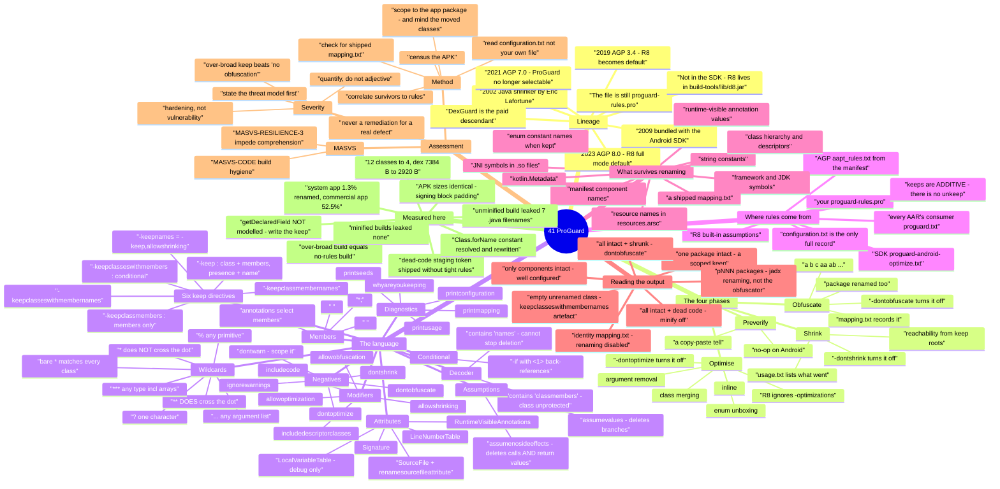
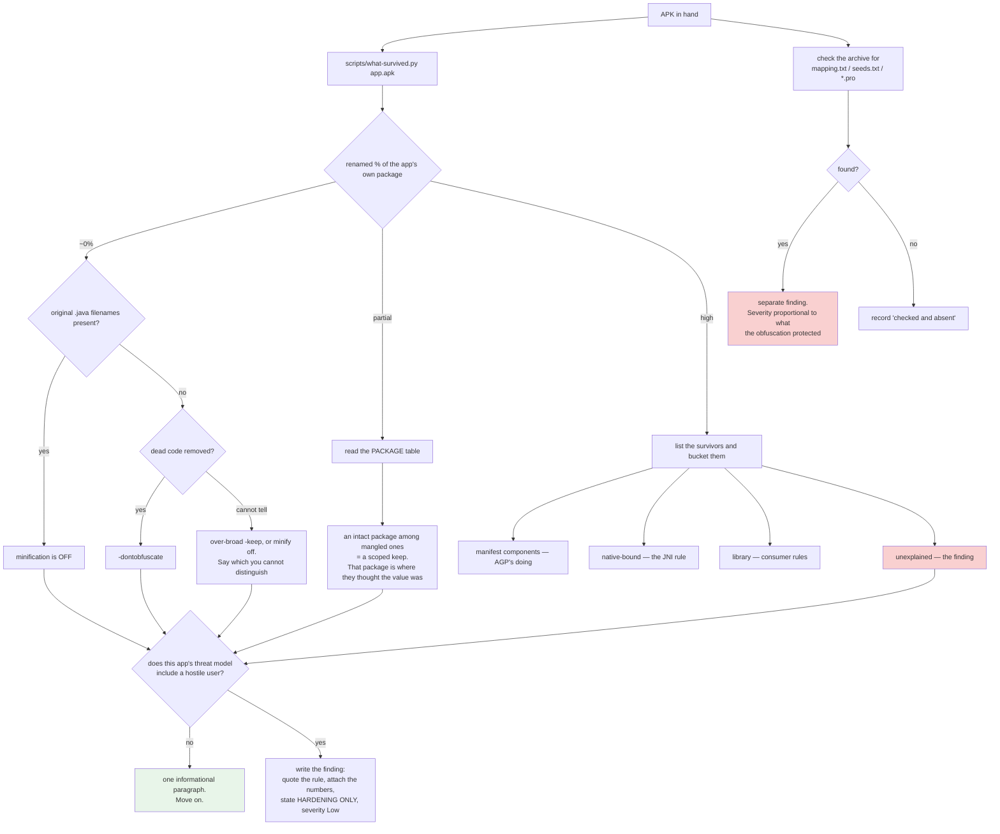
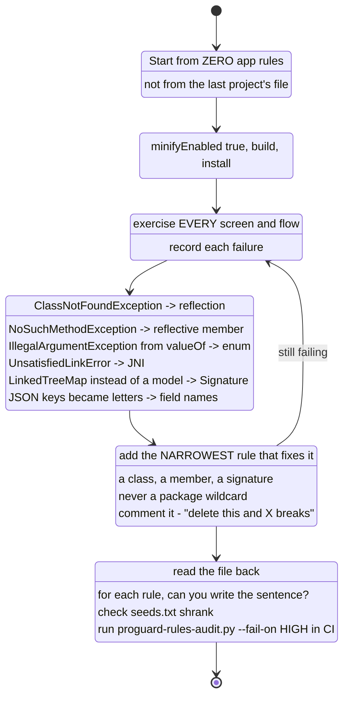

# 41 — ProGuard — mind map

One map of the whole chapter. Read it outward from the centre: the **lineage** explains why the
language looks the way it does, the **language** is what you actually read and write, the
**pipeline** explains what each rule does mechanically, the **survivors** are what no rule can
remove, and **assessment** is what you do with all of it.

---

## The same material as a decision path

When you are handed an APK and asked "is this obfuscated, and does it matter?", this is the order.

The two red boxes are the only places a real finding comes from. Everything else on this diagram is
description, and description at high severity is what gets a report dismissed.

---

## The rules-writing loop

The developer-side counterpart, which is what you recommend in remediation.

Step "Review" is the one that gets skipped, and skipping it is why rules files only ever grow.
