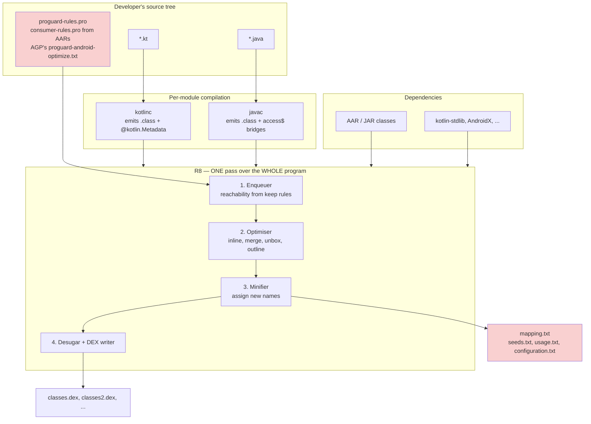
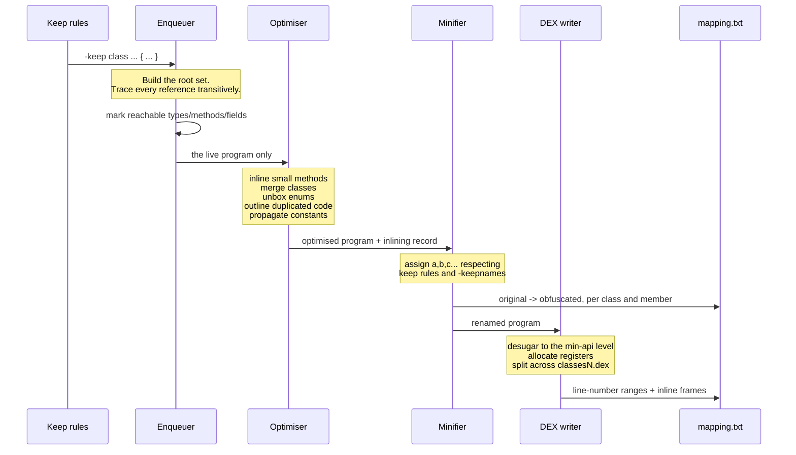
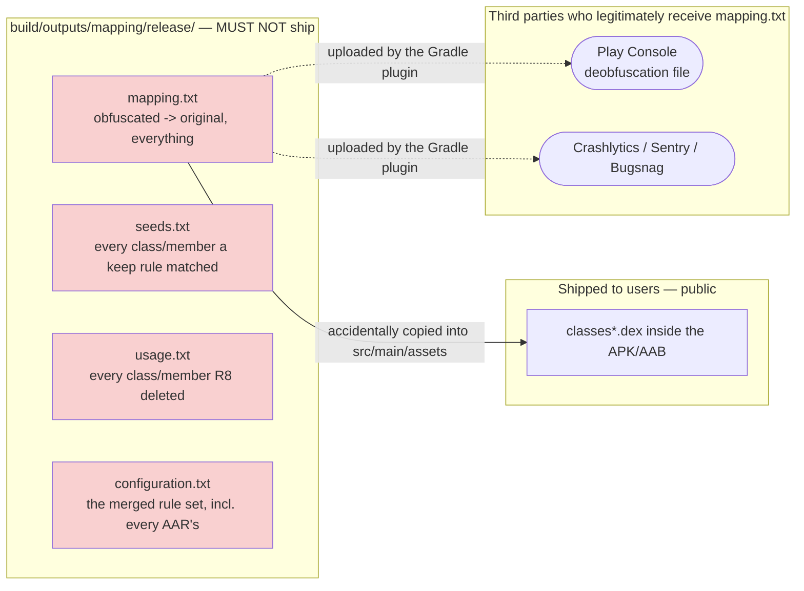

# 42 — R8

> After this chapter you can read an R8-built release APK the way its author reads the source: you will know which identifiers R8 renamed, which classes it invented, which methods it dissolved into their callers, how to read a `mapping.txt` by hand and with tooling, how to recover original Kotlin names from an annotation R8 forgot to finish rewriting, and how to say — with a straight face and a measurement behind you — how serious any of it actually is.

**Prerequisites:** [12-DEX-Internals](../12-DEX-Internals/README.md) for the DEX container and access flags, [05-Kotlin](../05-Kotlin/README.md) for what kotlinc emits before R8 touches it, [40-Obfuscation](../40-Obfuscation/README.md) for obfuscation as a subject, [08-Build-System](../08-Build-System/README.md) for where in the Gradle build this runs.

**Useful alongside:** [56-JADX](../56-JADX/README.md) for reading decompiled output — every listing in this chapter is reproduced here, and `mapping.txt`, `baksmali` and the DEX itself are read directly rather than through a decompiler, so JADX is convenience rather than a gate.

**Applies to:** Android Gradle Plugin 3.4 and later (R8 became the default shrinker in AGP 3.4.0, and the only one from AGP 7.0 when ProGuard support was removed from the Android build). Measurements in this chapter were made with **R8 8.6.2-dev**, shipped inside `build-tools/35.0.1/lib/d8.jar`, targeting `--min-api 33`. DEX and mapping behaviour is API-independent; where a claim depends on the R8 version, the version is stated.

---

> **⚠️ What was measured, and on what**
>
> This chapter distinguishes throughout between what was **measured on this machine** and what is **documented from source**. The distinction is not decoration — several widely repeated claims about R8 did not survive measurement, and they are corrected in [§5.6](#56-a-measured-correction-to-the-kotlinmetadata-folklore).
>
> | Thing | Detail |
> |---|---|
> | R8 | 8.6.2-dev, build hash `abaab469b5ebd4dd2bb91ba0ed6f45277faae4ca`, from `build-tools/35.0.1/lib/d8.jar` |
> | Kotlin | 2.0.21 (`kotlin-compiler-embeddable`), `-jvm-target 1.8` |
> | JDK | OpenJDK 21.0.4 for compilation and running (R8 8.6.x cannot read class files above Java 21) |
> | Device | **`i9000S`, Android 13, API 33** — `adb devices -l && adb shell getprop ro.product.model && adb shell getprop ro.build.version.sdk` |
> | Device caveat | This device is **not rooted and has no `frida-server`**. Every Frida listing in [§7](#7-dynamic-analysis) is therefore marked as *documented* rather than *observed*, except the three checks that were run over plain `adb` with no root at all. |
> | Corpus | 19 real APKs pulled from this device and from earlier chapters' collections, **316,000+ classes total**, all analysed with the chapter's own scripts. Commercial applications are anonymised. |
>
> Nothing in this chapter is a hand-written illustration of what R8 "would" produce. Every `mapping.txt` excerpt, every synthetic class name and every recovered identifier came out of a build performed by [`examples/build-r8-demo.sh`](examples/build-r8-demo.sh), and you can reproduce all of it with one command.

---

## Table of Contents

1. [Introduction](#1-introduction)
2. [High-Level Architecture](#2-high-level-architecture)
3. [Deep Internal Working](#3-deep-internal-working)
4. [Source Code Walkthrough (AOSP)](#4-source-code-walkthrough-aosp)
5. [Security Perspective](#5-security-perspective)
6. [Reverse Engineering Perspective](#6-reverse-engineering-perspective)
7. [Dynamic Analysis](#7-dynamic-analysis)
8. [Static Analysis](#8-static-analysis)
9. [Examples](#9-examples)
10. [Common Interview Questions](#10-common-interview-questions)
11. [Common Mistakes](#11-common-mistakes)
12. [Hands-on Labs](#12-hands-on-labs)
13. [Summary](#13-summary)
14. [References](#14-references)

**Supporting files:** [`cheatsheet.md`](cheatsheet.md) · [`mindmap.md`](mindmap.md) · [`faq.md`](faq.md) · [`labs/`](labs/) · [`examples/`](examples/) · [`scripts/`](scripts/) · [`references/README.md`](references/README.md)

---

## 1. Introduction

### The problem that existed before R8

Imagine you have written a book. You want to post it to a friend, but the postage is charged by weight, and — separately — you would prefer that anyone who intercepts the parcel finds it tedious to read. Three different jobs suggest themselves. You could tear out the chapters nobody will read, which makes the parcel lighter. You could rewrite long-winded paragraphs into short ones that say the same thing, which also makes it lighter and, incidentally, faster to read aloud. And you could replace every character's name with a single letter, which does nothing for the weight but makes the plot much harder to follow.

Those three jobs are **shrinking**, **optimisation** and **obfuscation**. They are genuinely different operations with different motives, and confusing them is the single most common misunderstanding in this area. Shrinking and optimisation exist because Android applications ship as a download over a mobile network onto a device with finite storage, and because every method in a DEX file costs space in a table that historically could hold only 65,536 entries. Obfuscation exists because the code you ship is code you no longer control.

> **📖 Definition — shrinking (tree shaking)**
> Removing classes, methods and fields that nothing reachable from an entry point can ever use. The program's behaviour is unchanged; there is simply less of it. Also called *dead code elimination*.

> **📖 Definition — optimisation**
> Rewriting code that *is* reachable into a form that is smaller or faster: replacing a call with the callee's body (*inlining*), collapsing two classes into one (*merging*), replacing a constant-valued method call with the constant (*constant propagation*), turning an enum into an integer (*enum unboxing*).

> **📖 Definition — obfuscation**
> Replacing meaningful identifiers with meaningless ones — `LicenceVault` becomes `a`, `verifyLicence` becomes `q`. Behaviour and size are essentially unchanged. Only comprehension is affected. Chapter [40-Obfuscation](../40-Obfuscation/README.md) owns this as a subject; this chapter owns the specific tool.

For most of Android's history these jobs were done by **ProGuard**, a general-purpose Java tool that predates Android entirely, and by **`dx`**, Google's Java-bytecode-to-DEX converter. The pipeline was: `javac` produced `.class` files, ProGuard shrank and obfuscated those `.class` files, and `dx` converted the result to DEX. Three separate programs, two intermediate formats, and — importantly — ProGuard made all its decisions without knowing anything about DEX.

That last point is the whole reason R8 exists. ProGuard optimises for the JVM. It has no idea that DEX has a 64K method-reference limit per file, that DEX has no `invokedynamic` instruction before API 26, that DEX's register-based instruction set makes some Java idioms expensive and others free, or that the app has a `minSdkVersion` which determines which language features must be rewritten. A tool that knows all of that can make better decisions.

### What would break if R8 did not exist

Take away R8 and three things happen, in increasing order of severity.

Applications get **larger** — noticeably. The `kotlin-stdlib` library alone is around 1.7 MB of class files; almost none of it is used by any given app. Shrinking is what makes it acceptable to depend on large libraries at all. In the measured build in [§9](#9-examples), the input to R8 was a 17.5 KB application jar plus the whole Kotlin standard library, and the output DEX was **5,324 bytes**. Effectively all of the standard library was deleted.

Applications built for older devices **stop compiling**, because desugaring disappears. Lambdas, default and static interface methods, `try`-with-resources and much of `java.time` do not exist on older Android runtimes. Something must rewrite them into constructs that do, and in the modern toolchain that something is D8/R8.

And applications ship with **every identifier the developer chose** — every class name, every method name, every field name. Not a catastrophe on its own, as this chapter will argue at length, but it is free intelligence for anyone reading the app, and the industry decided long ago that it would rather not hand it over.

### What R8 precisely is

> **📖 Definition — R8**
> R8 is Google's whole-program optimiser and DEX compiler for Android. In a single pass over the entire program it performs shrinking, optimisation, identifier obfuscation, desugaring and DEX generation, replacing the historical ProGuard-then-`dx` pipeline. It became the default shrinker in **Android Gradle Plugin 3.4.0**, and from **AGP 7.0** the option to use ProGuard instead was removed. It reads the same `-keep` rules language as ProGuard, which is why the migration was mostly invisible to developers.

The name is a joke: `dx` was the original DEX tool, `D8` its replacement, and `R8` is D8 plus whole-program *reduction*. `D8` and `R8` are the same codebase — in the Android SDK there is not even a separate jar. Both live inside `build-tools/<version>/lib/d8.jar`, and you select which one you want by choosing a main class:

```bash
# host — R8 is inside d8.jar; there is no r8.jar in the Android SDK
$ cd "$ANDROID_HOME/build-tools/35.0.1/lib"
$ java -cp d8.jar com.android.tools.r8.R8 --version
R8 8.6.2-dev (build abaab469b5ebd4dd2bb91ba0ed6f45277faae4ca from go/r8bot (luci-r8-custom-ci-archive-0-77gl))
$ java -cp d8.jar com.android.tools.r8.D8 --version
D8 8.6.2-dev (build abaab469b5ebd4dd2bb91ba0ed6f45277faae4ca ...)
```

That is a measured, reproducible fact and it matters operationally: you already have R8 on any machine with the Android SDK, whether or not you have Gradle, and you can run it on a jar in one command. Every measurement in this chapter was made that way, deliberately, because an AGP build hides the flags this chapter is about.

### Why a reverse engineer should care about the difference from ProGuard

A reverse engineer meets R8's output, not R8. The practical question is: *what does R8-processed code look like, and how is that different from ProGuard-processed code?*

The differences that matter are not about renaming — both tools rename, and a renamed identifier is a renamed identifier. They are about **structure**:

| R8 does this | ProGuard did not | What you see as a result |
|---|---|---|
| Desugars lambdas into classes | `dx` did this separately, differently | `$$ExternalSyntheticLambda0` classes, an R8-specific naming scheme |
| Inlines aggressively across class boundaries | Inlined, but conservatively and within the JVM model | Methods that exist in the source have no runtime existence; a single obfuscated frame retraces to five real ones |
| Merges classes horizontally and vertically | Had class merging, used less aggressively by default | Classes in the source that are not classes in the APK |
| Unboxes enums into `int` | No such optimisation | `LicenceTier$EnumUnboxingSharedUtility`, enum constants gone entirely |
| Generates synthetic bridges with a documented naming scheme | Left `javac`'s `access$000` alone | `$r8$lambda$`, `$$Nest$`, `$$InternalSyntheticLambda$…` |
| Emits a mapping file with **inline frames and synthetic markers** | Emitted a flat mapping file | A `mapping.txt` that is a structural description of the optimiser's decisions, not just a rename table |

That last row is the one people miss, and it is the reason this chapter treats `mapping.txt` as its centrepiece rather than as an appendix. An R8 mapping file is not a dictionary. It is a **record of what the optimiser did to the program**, and it discloses far more than the names.

> **🧠 Mental Model**
> ProGuard was a *renamer that also deleted things*. R8 is a *compiler that also renames*. If you keep expecting a renamer, R8's output will keep surprising you: you will look for a method that the mapping file says exists, and it will not be there, because R8 dissolved it into three call sites. The mapping file is telling you the truth; your model of what a "method" is has not caught up.

### Where this chapter sits among its neighbours

This chapter is one of a group and it deliberately does not restage its neighbours.

- **[40-Obfuscation](../40-Obfuscation/README.md)** owns obfuscation as a subject: the full taxonomy, string encryption, control-flow flattening, packers, and the deobfuscation methodology. It names this chapter as the place to learn what R8 specifically does, and it cites this chapter for `kotlin.Metadata`. Read 40 for the landscape.
- **Chapter 41 — ProGuard** owns the ProGuard lineage and the `-keep` **rules language**: the syntax of keep rules, wildcards, `-keepclassmembers` versus `-keep`, `-assumenosideeffects`, and how to write and audit a rules file. This chapter uses keep rules but does not teach them. *(Chapter 41 is being written in parallel and has no README on disk at the time of writing, so it is referenced here by name rather than by link.)*
- **[56-JADX](../56-JADX/README.md)** owns reading decompiled output, including **loading a `mapping.txt` into jadx** (`-Prename-mappings.format=PROGUARD_FILE`) and the `kotlin-metadata` plugin. This chapter owns the *file format* and what it discloses; 56 owns what your decompiler does with it.
- **[05-Kotlin](../05-Kotlin/README.md)** owns Kotlin decompilation artefacts and the structure of the `@Metadata` annotation, including the `d1`/`d2` split and a `grep` that dumps `d2` strings. This chapter owns **what R8 does to that annotation** — strip it, rewrite it, or leave it — and ships a decoder that reads the `d1` protobuf properly.
- **[12-DEX-Internals](../12-DEX-Internals/README.md)** owns `ACC_SYNTHETIC`, `source_file_idx` and the DEX container. This chapter owns the *naming schemes* R8 uses for the synthetic classes that flag sets.

> **🔍 Pentester's Note**
> The single most valuable sentence in this chapter, if you read nothing else: **the absence of obfuscation is not a finding, but a leaked `mapping.txt` very nearly is.** One is a missing hardening control on a control that was never a security boundary. The other is the vendor handing you a complete, authoritative, machine-readable de-obfuscation key for their shipped binary — and, as [§5.3](#53-the-mappingtxt-disclosure-and-why-it-is-different-in-kind) shows, disclosing the shape of their codebase even before you use it to rename anything. Report them differently.

---

## 2. High-Level Architecture

### 2.1 Where R8 sits in the build



The diagram is worth reading carefully because two things in it routinely surprise people.

First, **R8 sees everything at once**. Its input is not your module; it is your module *plus every dependency's class files*, flattened into one program. This is what "whole-program optimisation" means, and it is why R8 can delete 99% of `kotlin-stdlib` — it can prove nothing reaches it. It is also why an R8 build is slow and why incremental builds disable it.

Second, the two boxes shaded as attacker-relevant are the **rules** and the **outputs other than DEX**. The rules are shaded because they are the only thing standing between R8 and deleting your app's entry points; a wrong rule is how apps break in release and only in release. The secondary outputs are shaded because `mapping.txt` is a de-obfuscation key, and `seeds.txt`, `usage.txt` and `configuration.txt` disclose almost as much. Every one of those files is written into `build/outputs/mapping/release/`, and every one of them has at some point been shipped by somebody.

### 2.2 The four phases inside R8



The ordering here explains almost every confusing thing about R8's output.

The **Enqueuer** runs first and decides what survives. It starts from the *root set* — everything matched by a `-keep` rule, plus everything the Android framework must be able to reach by name, such as the `Activity` subclasses named in the manifest — and follows references transitively. Anything it never reaches is deleted before the optimiser ever sees it. This is why a missing keep rule produces `ClassNotFoundException` at runtime rather than a compile error: from R8's point of view the class was simply unreachable, which is not an error.

The **Optimiser** then rewrites the survivors, and it is the phase that makes R8's output structurally different from the source. Crucially, it records what it did, because otherwise stack traces would be unretraceable.

The **Minifier** assigns the new names. It runs *after* optimisation, which means the names in `mapping.txt` describe the post-optimisation program. A method that was inlined out of existence has no name to assign — it appears in the mapping only as an **inline frame** inside its caller.

The **DEX writer** runs last and does desugaring and register allocation. It also assigns the line numbers you see in a release stack trace, which are not source line numbers at all but positions in a synthetic line-number table that the mapping file translates back.

> **🔬 Under the Hood**
> The line numbers in an R8 release stack trace are frequently *fabricated*. R8 emits a compact, monotonically increasing line-number table whose only purpose is to be a lookup key into `mapping.txt`. In the measured build, the whole of `main` — every inlined callee included — occupies obfuscated lines 1 to 16, while the original source spans lines 19 to 141. A frame that says `SourceFile:12` is not telling you about line 12 of anything. It is telling you *which entry in the mapping table to consult*, and without the mapping it is close to meaningless. This is also why two builds of the same app produce different line numbers for the same crash.

### 2.3 What comes out, and who is allowed to see it



The dotted arrows are the intended flows and the solid arrow is the incident. `mapping.txt` legitimately leaves the build machine — Play Console wants it so it can symbolicate ANRs and crashes, and every crash-reporting SDK wants it for the same reason. Those uploads are normal and correct.

What is not correct is the solid arrow: the file ending up inside the APK. It happens for prosaic reasons — someone adds `build/outputs/mapping/release/mapping.txt` to a packaging script, or a CI job copies the whole `build/outputs` directory into a location that is later zipped into the app, or a "debug tools" flavour deliberately bundles it and the flavour ships by accident. [§8.2](#82-finding-a-mapping-file-in-a-shipped-artefact) is the hunt for it, and [§5.3](#53-the-mappingtxt-disclosure-and-why-it-is-different-in-kind) is why it matters more than it looks.

The three files besides `mapping.txt` deserve their own mention because nobody looks for them. `seeds.txt` lists every class and member that a keep rule matched — which is a precise map of the app's reflective surface, its entry points, and everything the developers thought was too dangerous to touch. `usage.txt` lists everything R8 deleted, which tells you what features exist in the codebase but not in this build. `configuration.txt` is the fully merged rule set including the consumer rules of every AAR, which is an inventory of third-party SDKs even if their classes were repackaged beyond recognition.

### 2.4 The compatibility-mode split

```mermaid
stateDiagram-v2
    [*] --> Choose
    Choose --> Compat: --pg-compat (AGP default before 8.0 for many projects)
    Choose --> Full: default for the r8 CLI; android.enableR8.fullMode=true
    Compat --> C1: -keep implies keep-everything<br/>about the matched class
    Compat --> C2: default constructors kept<br/>more often
    Compat --> C3: annotations kept more readily
    Full --> F1: -keep does NOT imply<br/>keeping the class's members' names
    Full --> F2: assumes no reflection<br/>unless a rule says otherwise
    Full --> F3: more aggressive class merging,<br/>enum unboxing, devirtualisation
    F1 --> Break: apps break in release only
    C3 --> Bigger: larger APK, more names survive
```



> **📖 Definition — R8 full mode**
> R8's default and more aggressive interpretation of the keep-rules language, in which a `-keep` rule is read as narrowly as its wording allows rather than as generously as ProGuard read it. Enabled by default in the standalone `r8` CLI, and in AGP by `android.enableR8.fullMode=true` — which became the **default from AGP 8.0**. *Compatibility mode* (`--pg-compat`) is the opposite: it reproduces ProGuard's more generous behaviour so that rule files written for ProGuard keep working.

The reverse-engineering consequence of this switch is direct: **full-mode output contains fewer surviving names and more structural rewriting**. [§3.9](#39-full-mode-and-what-it-actually-changes) works through the differences with a measured example, including one that surprised me and which is the basis of the chapter's central correction.

---

## 3. Deep Internal Working

This is the longest section. It covers, in order: how the Enqueuer decides what lives, each optimisation you will meet in the output, the complete `mapping.txt` grammar, the synthetic-name vocabulary, and full mode.

### 3.1 The Enqueuer: what/why/when/where/how of shrinking

**What.** The Enqueuer computes the set of classes, methods and fields that are *reachable*, and everything else is deleted.

**Why.** Because a modern app's dependency graph contains one to two orders of magnitude more code than it uses, and because the DEX format's per-file limit of 65,536 method references is a real ceiling that shrinking is the primary defence against.

**When.** First, before any optimisation. Nothing downstream ever sees the dead code.

**Where.** Over the whole program: your classes, your dependencies' classes, and the Kotlin/Java standard libraries you bundle. Not the Android framework, which is supplied with `--lib` and is *never* an input — it is present on the device, so R8 must not include it, must not rename it, and must not delete it.

**How.** It is a worklist algorithm. Seed the worklist with the root set; pop an item; mark it live; push everything it references. Repeat to a fixed point.

The root set is where the security-relevant subtlety lives, because it is assembled from four sources and developers usually know about only one:

| Source of roots | Who writes it | Typical content |
|---|---|---|
| `proguard-rules.pro` | The app developer | `-keep` rules for reflection, JNI, serialisation |
| `consumer-rules.pro` inside each AAR | Every library author | Rules the library needs to survive; merged silently |
| AGP's generated rules | The Android Gradle Plugin | Manifest components, `View` subclasses used in XML layouts, `@Keep`-annotated members |
| The default file | `proguard-android-optimize.txt` in the SDK | Broad rules: native methods, `Parcelable.CREATOR`, enums' `values`/`valueOf`, annotations |

> **⚠️ Warning**
> `configuration.txt` in `build/outputs/mapping/release/` is the *merged* result of all four. This is the only place a developer can see what their build is actually keeping. It is also, therefore, an excellent file for a reviewer to ask for — and a bad file to publish, since it enumerates every SDK in the app. Auditing this merged file, rather than the hand-written rules file, is the correct way to satisfy the hardening item *"`minifyEnabled true` with rules reviewed"* from [40-Obfuscation](../40-Obfuscation/README.md). Reviewing only `proguard-rules.pro` reviews perhaps a fifth of the rules in effect.

Chapter 41 — ProGuard owns the syntax of these rules. What matters here is the *effect* of a rule on R8's three phases, because a rule does not simply say "keep this":

| Rule form | Shrinking | Optimisation | Renaming |
|---|---|---|---|
| `-keep class X { *; }` | X and all members survive | Members are not inlined away | Nothing in X is renamed |
| `-keep,allowobfuscation class X { *; }` | X and all members survive | Not inlined away | **Names ARE changed** |
| `-keep,allowshrinking class X` | May still be deleted if unused | — | Not renamed if it survives |
| `-keepnames class X` | X may be deleted if unused | — | Not renamed if it survives |
| `-keepclassmembers class X { ... }` | Members survive **only if X survives** | — | Members not renamed |
| `-if` / `-keepclasseswithmembers` | Conditional roots | — | — |

The `-keep,allowobfuscation` form is the one to internalise, because it is extremely common in library consumer rules — it means "this class must exist and keep all its members, because I look them up reflectively by *annotation* or by *structure*, but I do not care what it is called". It is also the exact configuration under which R8 rewrites `kotlin.Metadata`, which is the subject of [§3.10](#310-kotlinmetadata-the-annotation-r8-does-not-always-finish-rewriting).

### 3.2 Inlining, and why it makes methods vanish

Inlining replaces a call with the body of the callee. R8 does it aggressively because on DEX it is close to free: DEX is register-based, so there is no stack manipulation to fix up, and removing a method removes a `method_id` from a table with a hard limit.

Here is the measured effect. The source has a small private method:

```kotlin
// examples/LicenceVault.kt — the original
private fun tierWeight(tier: LicenceTier): Int = when (tier) {
    LicenceTier.FREE -> 0
    LicenceTier.PRO -> 10
    LicenceTier.ENTERPRISE -> 100
}

fun computeActivationCode(record: LicenceRecord): Int {
    val salt = mixSubscriberSalt(record.subscriberId)
    val weight = tierWeight(record.tier)
    return (salt xor hardwareId.hashCode()) + weight
}
```

After a full-mode R8 build, `tierWeight` does not exist, `computeActivationCode` does not exist, and `LicenceVault` does not exist. All three were dissolved into `VaultEntryPoint.main`. The mapping file records this exactly — these three lines are consecutive in [`examples/mapping-fullmode.txt`](examples/mapping-fullmode.txt):

```
    130:146:int com.pentest.ch42.vault.LicenceVault.tierWeight(com.pentest.ch42.vault.LicenceTier):56:56 -> main
    130:146:int com.pentest.ch42.vault.LicenceVault.computeActivationCode(com.pentest.ch42.vault.LicenceRecord):70 -> main
    130:146:void main(java.lang.String[]):119 -> main
```

Read that as a stack, innermost first. Obfuscated lines 130 to 146 of the method now called `main` are, in reality, source line 56 of `tierWeight`, called from source line 70 of `computeActivationCode`, called from source line 119 of `main`. **Three source frames, one runtime method.** That is why retracing is not a dictionary lookup, and why hand-retracing an R8 trace is unreliable.

> **🔍 Pentester's Note**
> Inlining is the reason "I hooked the method and nothing happened" is such a common Frida complaint on release builds. If `verifyLicence()` was small and private, there is no `verifyLicence` at runtime to hook — its body is now three copies scattered inside its callers. The mapping file tells you where the copies went; without it, you find them by searching for the *constants* and *string literals* the method used, which survive inlining because they are data, not names. [§7.3](#73-hooking-what-r8-left-behind) covers the technique.

### 3.3 Class merging

R8 merges classes in two directions.

**Vertical merging** collapses a class into its only subclass (or a superclass with a single implementor) when the intermediate type is not needed. An interface with exactly one implementation is the classic case: after merging, the interface is gone and every reference points at the implementation.

**Horizontal merging** collapses *sibling* classes with compatible shapes into one class, distinguishing the original behaviours with an added integer field or an extra constructor parameter. This is why you sometimes decompile a class that appears to do three unrelated things, switching on an `int` field that is never obviously set — you are looking at three source classes that R8 fused.

In the measured build, the entire `LicenceVault` class was merged away into `VaultEntryPoint`, and the mapping records the casualties explicitly:

```
com.pentest.ch42.vault.LicenceVault$Diagnostics -> R8$$REMOVED$$CLASS$$0:
com.pentest.ch42.vault.LicenceVaultKt -> R8$$REMOVED$$CLASS$$1:
```

> **📖 Definition — `R8$$REMOVED$$CLASS$$n`**
> A placeholder R8 writes into `mapping.txt` for a class that existed in the input and does **not exist in the output at all**. It is not a renamed class; there is no such type in the DEX. Its purpose is to keep the class's members available for retracing, because those members were inlined into surviving classes and a stack trace may still need to name them. If you search an APK for `R8$$REMOVED$$CLASS$$0` you will find nothing, and that is correct.

> **⚠️ Warning**
> A very common triage error is to count classes in `mapping.txt` and report it as the app's class count. Those two numbers are not the same and the difference can be large. The mapping file lists classes in the *input*, including ones R8 deleted. In the measured build the mapping lists 12 classes; the DEX contains 9, three of which R8 invented. Use `scripts/mapping-reader.py <file> stats`, which separates the categories, rather than `grep -c ' -> '`.

### 3.4 Enum unboxing

Kotlin and Java enums are full classes: a subclass of `java.lang.Enum`, a static instance per constant, a `values()` array, a `valueOf()` method. For an enum used only for internal branching, that is a great deal of machinery to represent what is really an integer. R8 removes it, replacing each constant with an `int` and rewriting every use.

The measured build shows the artefact this leaves:

```
com.pentest.ch42.vault.LicenceTier$EnumUnboxingSharedUtility -> a.b:
# {"id":"sourceFile","fileName":"R8$$SyntheticClass"}
# {"id":"com.android.tools.r8.synthesized"}
    0:0:void a.LicenceTier$EnumUnboxingSharedUtility.<clinit>() -> <clinit>
      # {"id":"com.android.tools.r8.synthesized"}
    0:6:int a.LicenceTier$EnumUnboxingSharedUtility.ordinal(int):0:0 -> a
      # {"id":"com.android.tools.r8.synthesized"}
```

Three things to notice, because each is a general lesson.

The class name ends in `$EnumUnboxingSharedUtility` — an R8-invented name, following R8's convention of appending a descriptive suffix to the *original* type it derives from. That suffix is a gift: it tells you an enum called `LicenceTier` existed even though the enum itself is gone.

The `sourceFile` is `R8$$SyntheticClass`, not a real file. Any class whose recorded source file is `R8$$SyntheticClass` was created by R8 and corresponds to nothing the developer wrote.

The `com.android.tools.r8.synthesized` marker appears as a JSON comment attached to the class and to each member. This is part of mapping format version 2.x and is machine-readable — `scripts/mapping-reader.py stats` counts them, which gives you an immediate measure of how much of the binary is compiler-generated.

> **🔬 Under the Hood**
> Enum unboxing is why `enum.name` and `enum.values()` sometimes still work and sometimes throw in a release build. R8 will not unbox an enum whose `name()`, `ordinal()` or `values()` is reachable in a way it cannot rewrite — for example through reflection or `Enum.valueOf(Class, String)`. So a codebase with one reflective enum lookup keeps *that* enum boxed and unboxes the rest, and a developer sees inconsistent behaviour with no obvious cause. It is also why the enum-name strings frequently survive obfuscation, which [40-Obfuscation §3.1](../40-Obfuscation/README.md) lists in its "what survives renaming" table.

### 3.5 Outlining

Where inlining moves a small method into its callers, **outlining** does the reverse: R8 finds identical instruction sequences repeated across many methods and extracts them into a single new synthetic method. It is a pure size optimisation, and it is very common in large apps that use a library with a repetitive calling convention.

The artefact is a synthetic class, typically named after the package it serves, containing methods that take an implausible number of parameters and do something that reads as a fragment rather than an operation — because it *is* a fragment. If you decompile a method that begins by calling `a.b.c(this, x, y, 3, null, null)` and returns immediately, and `c` turns out to contain a chunk of unrelated-looking logic, you are reading an outline.

> **🧠 Mental Model**
> Inlining and outlining look contradictory but they optimise the same quantity from opposite ends. Inlining removes a `method_id` and a call. Outlining removes many duplicated instruction sequences at the cost of one `method_id`. R8 does both in the same pass, on different code, and the net effect is that **the method boundaries in the APK have almost no relationship to the method boundaries in the source.** Stop expecting them to correspond and the output becomes much easier to read.

### 3.6 The minifier's naming scheme

Once the program is optimised, the minifier assigns names. Its rules:

- Names are assigned from a short alphabet, shortest first: `a`, `b`, … `z`, `a0`, `a1`, …, or `aa`, `ab`, … depending on version and configuration.
- Names are assigned **per scope**. Two classes in different packages can both be `a`; two methods in the same class can both be `a` if their parameter types differ (DEX permits overloading on signature, and R8 exploits it aggressively). This is why an obfuscated class can have six methods all called `a`.
- Packages are renamed too unless `-keeppackagenames` says otherwise, and with `-repackageclasses` everything is moved into a single package.
- The assignment is a graph-colouring problem over the inheritance hierarchy: a method that overrides another must get the same name as the one it overrides, which is why some names appear "stuck" across a hierarchy.

> **⚠️ Warning — the single most important operational fact about R8 names**
> **R8's name assignment is not stable across builds.** Adding one unused class to the app can shift the entire alphabet, so `a.b.c` in version 4.2 and `a.b.c` in version 4.3 are almost certainly different classes. Chapter [56-JADX §8.7](../56-JADX/README.md) makes the same point for diffing. The consequences: a `mapping.txt` from one version applied to another produces confident, wrong answers; a Frida script that hooks `a.b.c` breaks on the next release; and diffing two versions of an obfuscated app on names alone is pure noise. Use `-applymapping` (the developer's tool for keeping names stable) or match on structure and constants instead.

### 3.7 The `mapping.txt` format, completely

This is the centrepiece. The format is line-oriented, ASCII, and easy to read once you know that **indentation is syntax**.

#### 3.7.1 The header

```
# compiler: R8
# compiler_version: 8.6.2-dev
# min_api: 33
# compiler_hash: abaab469b5ebd4dd2bb91ba0ed6f45277faae4ca
# common_typos_disable
# {"id":"com.android.tools.r8.mapping","version":"2.2"}
# pg_map_id: 6627817
# pg_map_hash: SHA-256 66278173357afa3906c831220aa08c81e3ab920d09df0d6eb3a05b1fdf398185
```

Every line is a comment, so old tools ignore it, but the content is valuable to a reverse engineer:

| Header | Meaning | Why you care |
|---|---|---|
| `compiler` | `R8` or `ProGuard` | Tells you which toolchain's artefacts to expect |
| `compiler_version` | Exact R8 version | Synthetic naming schemes changed between versions; this dates the build |
| `min_api` | The `minSdkVersion` R8 compiled for | Tells you how much desugaring happened |
| `compiler_hash` | R8 build hash | Precise toolchain identification |
| `mapping.version` | Mapping format version | 2.0+ has synthetic markers and residual signatures |
| `pg_map_id` | Short id of this mapping | The APK can embed a matching id — see below |
| `pg_map_hash` | SHA-256 of the mapping content | Lets you prove a leaked mapping matches a specific build |

> **🔍 Pentester's Note**
> `pg_map_id` is how you *prove* a leaked mapping file belongs to a shipped APK, which turns "I found a file" into "I found the de-obfuscation key for this exact release". R8 can embed the same id in the DEX as a marker, and the AGP-produced APK usually carries it. Recovering it from the APK is done with R8's own `ExtractMarker`:
> ```bash
> # host — read the R8/D8 markers embedded in a shipped DEX
> java -cp "$ANDROID_HOME/build-tools/35.0.1/lib/d8.jar" \
>      com.android.tools.r8.ExtractMarker app.apk
> ```
> If the marker's `pg-map-id` equals the mapping file's `pg_map_id`, the match is not circumstantial. `scripts/mapping-reader.py <map> stats` prints the mapping side of that comparison.

#### 3.7.2 Class lines

A class line is at **column zero** and ends with a colon:

```
com.pentest.ch42.vault.LicenceRecord -> a.a:
```

Read as *original* `->` *obfuscated*. The direction trips everyone up at first: the file is written left-to-right from the developer's point of view, but you read it right-to-left, because you start with `a.a` and want the original.

A class line may be followed by JSON comments that apply to it:

```
com.pentest.ch42.vault.LicenceRecord -> a.a:
# {"id":"sourceFile","fileName":"LicenceVault.kt"}
```

`sourceFile` is the original file name, and it is present even when the DEX's own `source_file_idx` has been flattened to the constant `"SourceFile"` — which is exactly what [12-DEX-Internals §3.13](../12-DEX-Internals/README.md) describes. That is a small but real disclosure: the mapping file restores file names that the APK deliberately erased.

#### 3.7.3 Field lines

Indented, no parentheses:

```
    java.lang.String subscriberId -> a
    com.pentest.ch42.vault.LicenceTier tier -> b
      # {"id":"com.android.tools.r8.residualsignature","signature":"I"}
    long expiryEpochDay -> c
```

Grammar: `<type> <originalName> -> <obfuscatedName>`.

The `residualsignature` comment on the middle field is a mapping-2.2 feature and it is genuinely important. It says: the field's declared type in the *original* program was `LicenceTier`, but in the *shipped* program its type is `I` — a plain `int`. That is the enum unboxing from [§3.4](#34-enum-unboxing) recorded at the field level. Without reading residual signatures you would look for a field of type `LicenceTier` in the DEX and not find one.

#### 3.7.4 Method lines — the full grammar

This is the part worth memorising:

```
    [<obfStart>:<obfEnd>:]<returnType> [<inlineOwnerClass>.]<methodName>(<argTypes>)[:<srcStart>[:<srcEnd>]] -> <obfName>
```

Worked through the simplest case first:

```
    0:61:java.lang.String toString():0:0 -> toString
```

Obfuscated lines 0–61 of the method named `toString` correspond to the original method `java.lang.String toString()`, whose source lines are recorded as 0 (unknown). Nothing was renamed here because `toString` overrides a framework method.

A renamed method with real line numbers:

```
    0:23:int com.pentest.ch42.vault.LicenceVault.mixSubscriberSalt(java.lang.String):47:47 -> b
    24:36:int com.pentest.ch42.vault.LicenceVault.mixSubscriberSalt(java.lang.String):50:50 -> b
```

The original method `mixSubscriberSalt` is called `b` in the APK. Obfuscated lines 0–23 are source line 47; obfuscated lines 24–36 are source line 50. Two entries for one method, because the optimiser produced two non-contiguous regions.

**The line-number arithmetic.** Given `obfStart:obfEnd:…:srcStart:srcEnd` and an observed line `L`:

- If `srcStart == srcEnd`, the original line is `srcStart` — the whole obfuscated range collapses onto a single source line.
- Otherwise the original line is `srcStart + (L - obfStart)`.
- If only one trailing number is present (`:srcStart` with no `:srcEnd`), the original line is exactly `srcStart`. This form marks a **caller** frame in an inline chain.
- `0` means unknown, and a retracer should print no line number rather than `:0`.

**Inline chains.** This is the part hand-retracing gets wrong. Consecutive member lines that share the same `<obfStart>:<obfEnd>` **and** the same `-> <obfName>` are one inline chain, listed **innermost first**. The innermost frame carries two trailing line numbers; each caller carries one:

```
    348:353:int com.pentest.ch42.vault.LicenceVault.access$mixSubscriberSalt(com.pentest.ch42.vault.LicenceVault,java.lang.String):31:31 -> main
    348:353:int com.pentest.ch42.vault.LicenceVault$Diagnostics.hardwareFingerprint():107 -> main
    348:353:void main(java.lang.String[]):123 -> main
```

One obfuscated frame at `main:350` expands to three real frames. Verified against R8's own `retrace`:

```
# host
$ java -cp .../d8.jar com.android.tools.r8.retrace.Retrace mapping.txt trace.txt
	at com.pentest.ch42.vault.LicenceVault.access$mixSubscriberSalt(LicenceVault.java:31)
	at com.pentest.ch42.vault.LicenceVault$Diagnostics.hardwareFingerprint(LicenceVault.kt:107)
	at com.pentest.ch42.vault.VaultEntryPoint.main(LicenceVault.kt:123)
```

**The qualified-name form.** When a method line's name is qualified with a class — `com.pentest.ch42.vault.LicenceVault.tierWeight(...)` inside the entry for `VaultEntryPoint` — that method came from a *different* class and was inlined in. The qualifier names its true owner. Frames without a qualifier belong to the class whose block they are in.

**Source files in inline chains.** The file name for an inlined frame comes from the *owner's* class entry, not from the class it was inlined into; when the owner has no entry (because it was merged away entirely) R8 synthesises `<SimpleName>.java`. That rule is why the retrace above says `LicenceVault.java` for two frames and `LicenceVault.kt` for the third, from a codebase with no Java in it at all. [`scripts/mapping-reader.py`](scripts/mapping-reader.py) implements it, and its output is byte-identical to R8's `retrace` on both test traces.

> **🔬 Under the Hood**
> The `# {"id":"com.android.tools.r8.residualsignature","signature":"..."}` comments answer a question the classic format could not: *what is this member's signature in the shipped program?* After enum unboxing, class merging and argument removal, a method's original descriptor and its residual descriptor differ. A tool that resolves a member by its original descriptor — many do — will fail to find it. If you write anything that matches mapping entries against DEX members, honour the residual signature or you will silently mismatch overloads.

#### 3.7.5 A complete annotated block

```
com.pentest.ch42.vault.LicenceRecord -> a.a:                                  # class: LicenceRecord is a.a
# {"id":"sourceFile","fileName":"LicenceVault.kt"}                            # original file name
    java.lang.String subscriberId -> a                                        # field: subscriberId is a
    com.pentest.ch42.vault.LicenceTier tier -> b                              # field: tier is b
      # {"id":"com.android.tools.r8.residualsignature","signature":"I"}       # ...but its TYPE is now int
    long expiryEpochDay -> c                                                  # field: expiryEpochDay is c
    1:3:void <init>(java.lang.String,...,long):19:19 -> <init>                # ctor, obf lines 1-3 = src 19
      # {"id":"com.android.tools.r8.residualsignature","signature":"()V"}     # ...ctor now takes NO arguments
    4:7:void <init>(java.lang.String,...,long):20:20 -> <init>                # obf lines 4-7 = src 20
    4:39:boolean equals(java.lang.Object):0:0 -> equals                       # equals kept its name
    0:24:int hashCode():0:0 -> hashCode
    0:61:java.lang.String toString():0:0 -> toString
```

The constructor's residual signature `()V` is worth a pause: R8 determined that all three constructor arguments were either constant or unused after inlining, and removed them. The shipped constructor takes nothing. A Frida script hooking `$init` with three arguments will not match.

### 3.8 Synthetic members: the complete naming vocabulary

[12-DEX-Internals §3.23](../12-DEX-Internals/README.md) establishes that `ACC_SYNTHETIC` marks anything the compiler generated. [56-JADX §6.1](../56-JADX/README.md) attributes several specific names to R8 or `d8`. Neither defines the naming *schemes*, and that gap is what this section fills — because the names are systematic, and once you can parse them they tell you what the original code looked like.

| Name pattern | Generated by | What it was in the source | What it hands you |
|---|---|---|---|
| `Foo$$ExternalSyntheticLambda0` | D8/R8 desugaring | A lambda or method reference in class `Foo` passed to a functional interface | **`Foo` is the original enclosing class name.** The digit is a counter within `Foo` |
| `Foo$$InternalSyntheticLambda$<n>$<64-hex>$<m>` | D8/R8 desugaring | A lambda whose capture shape needed a stable content-addressed identity | The hex is a **content hash**, so it is stable across builds of identical code — a rare stable anchor |
| `$r8$lambda$<hash>` | R8 | The *method* holding a desugared lambda's body | Pairs with the lambda class above |
| `Foo$$Nest$mBar` / `$$Nest$fBar` | Nest-based access desugaring | A JDK 11 nestmate access to private member `Bar` of `Foo`, rewritten for older runtimes | **Both the owner `Foo` and the member `Bar` names, verbatim** |
| `access$000`, `access$100` | `javac` (not R8) | An inner class reading a private member of its outer class | Nothing by itself; the number is a counter |
| `access$<originalName>` | kotlinc | Same, but Kotlin keeps the real name | **The original private member name** |
| `Foo$EnumUnboxingSharedUtility` | R8 | An enum named `Foo` that R8 replaced with `int` | **The original enum type name** |
| `Foo$$SyntheticClass` / `sourceFile: R8$$SyntheticClass` | R8 | Nothing — R8 invented it | Marks the class as compiler-generated |
| `R8$$REMOVED$$CLASS$$<n>` | R8, in `mapping.txt` only | A class deleted from the output entirely | Confirms the class existed in the input |
| `Foo$WhenMappings` | kotlinc | The `int[]` lookup table for a `when` over an enum | The enum was switched on in `Foo` |
| `Foo$Companion`, `Foo$DefaultImpls` | kotlinc | Kotlin companion object / interface default methods | See [05-Kotlin](../05-Kotlin/README.md) |
| `foo$default(...)` | kotlinc | The bridge implementing default parameter values | See [05-Kotlin](../05-Kotlin/README.md) |
| `Foo$lambda$0`, `Foo$bar$lambda$2` | kotlinc | The body of a Kotlin lambda, lifted to a method | **The enclosing function name `bar`** |

Every entry in the "what it hands you" column is a name that survived obfuscation, and several of them are the *original developer-chosen* name sitting in plain sight in a fully obfuscated app. This is the practical payoff of learning the vocabulary.

Measured from the chapter's own build, all four of these appeared:

```
com.pentest.ch42.vault.LicenceVault$$ExternalSyntheticLambda0 -> a.c:
com.pentest.ch42.vault.LicenceVault$$ExternalSyntheticLambda1 -> a.d:
    kotlin.jvm.functions.Function2 com.pentest.ch42.vault.LicenceVault$$InternalSyntheticLambda$1$1b5c58694e2ad21a64a0e1586651874577a7fec664bc478afa19ff3d47a646a4$1.f$0 -> a
    0:8:int com.pentest.ch42.vault.LicenceVault.sortedBySubscriber$lambda$1(kotlin.jvm.functions.Function2,java.lang.Object,java.lang.Object):88:88 -> compare
```

The last line is the richest. In a build where the class is called `a.d`, the mapping tells you the original class was `LicenceVault`, the original method was `sortedBySubscriber`, and the lambda was the second one (`$lambda$1`) inside it. All three names are the developer's.

> **⚠️ Warning — synthetic names are toolchain-version-dependent**
> The exact spelling of these names changes between D8/R8 versions. `$$Lambda$Foo$0` (older desugaring) became `Foo$$ExternalSyntheticLambda0`; `$$InternalSyntheticLambda` hashes changed length and composition. [12-DEX-Internals](../12-DEX-Internals/README.md) already flags toolchain identification as a dating tool, and this is the same lever: **the synthetic naming scheme dates the build**. It also means any tool, script or regular expression that matches these names must be version-tolerant, and that a diff between two versions of an app built with different AGP versions will show thousands of purely cosmetic differences. Read the `compiler_version` header, or run `ExtractMarker` on the APK, before you trust a name-shape heuristic.

> **🧠 Mental Model**
> Treat every `$$` in a class name as a sign saying *"a compiler wrote this, and it left the original name to the left of the marker."* `LicenceVault$$ExternalSyntheticLambda0` is not an obfuscated name that happens to be long — it is a **generated** name built by concatenating a real name with a scheme suffix. That is why heavily obfuscated apps still leak: R8 renames the parts it considers identifiers, but a synthetic name it constructed earlier in the pipeline can carry an original name through as a *string*.

### 3.9 Full mode, and what it actually changes

Full mode is R8's default when invoked directly, and AGP's default from 8.0. The differences from compatibility mode:

| Behaviour | Compat mode (`--pg-compat`) | Full mode |
|---|---|---|
| `-keep class X` | Also keeps X's default constructor and treats X as reflectively instantiated | Keeps only what the rule literally says |
| Members of a kept class | Names often preserved as a side effect | Renamed unless the rule keeps them |
| Assumed reflection | Assumes reflection may be used broadly | Assumes none unless a rule says otherwise |
| Class merging, enum unboxing, devirtualisation | Applied conservatively | Applied aggressively |
| Annotations | Retained more readily | Removed unless kept and used |
| Typical result | Bigger APK, more surviving structure | Smaller APK, more rewriting, **more apps broken by missing rules** |

The measured size difference on the chapter's toy program, same source, same rules, only the mode changed:

| Build | `classes.dex` bytes | Classes in DEX | `mapping.txt` lines |
|---|---|---|---|
| Full mode | **5,324** | 9 | 206 |
| Compat mode | **13,956** | 21 | 490 |

Compat mode produced an output **2.6 times larger** with **more than twice the classes**. On a toy program that ratio is exaggerated, but the direction is real and it is the reason full mode became the default.

> **🔍 Pentester's Note**
> The practical tell for full mode, from the outside, is *structural aggression relative to name aggression*. Both modes rename. Full mode additionally leaves you with unboxed enums, merged classes and a much higher ratio of synthetic classes to authored ones. If you decompile an app where names are obfuscated but the class structure still mirrors a normal MVVM codebase, you are probably looking at compat mode or a rules file full of over-broad `-keep` directives — and over-broad keep rules are themselves a reportable weakness, because they usually mean whole packages were exempted from obfuscation to make something work.

### 3.10 `kotlin.Metadata`: the annotation R8 does not always finish rewriting

[40-Obfuscation §3.1](../40-Obfuscation/README.md) lists `kotlin.Metadata` in its "what survives identifier renaming" table with this claim, and points here:

> `| **kotlin.Metadata annotation** | The Kotlin reflection library reads it. It contains original names in a protobuf. Frequently *not* stripped. | See 42-R8 §Kotlin metadata — this can hand you back original names wholesale. |`

[05-Kotlin §8.3](../05-Kotlin/README.md) owns the annotation's structure — that `d1` holds a protobuf and `d2` holds a string table, and that grepping `d2` alone yields names. This section owns the question those chapters defer: **what does R8 actually do to it?** The answer was measured, and it is more interesting and less generous than the folklore.

#### 3.10.1 What the annotation is, mechanically

`@kotlin.Metadata` is a runtime-visible annotation kotlinc attaches to every class it compiles. It exists because the JVM class file format cannot express Kotlin's type system — nullability, `val` versus `var`, default parameters, properties as distinct from fields, `suspend` functions. Kotlin reflection reads this annotation to reconstruct the declaration.

Its elements:

| Element | Type | Content |
|---|---|---|
| `k` | `int` | Kind: 1 = class, 2 = file facade, 3 = synthetic class, 4 = multi-file facade, 5 = multi-file part |
| `mv` | `int[]` | Metadata version |
| `d1` | `String[]` | The **protobuf payload**, encoded to survive the class file's UTF-8 constraints |
| `d2` | `String[]` | The **string table** the protobuf indexes into — plaintext names |
| `xs` | `String` | Extra string: the facade class name, for multi-file kinds |
| `xi` | `int` | Extra flags |
| `pn` | `String` | Package name, when it differs |

The `d1` encoding is the part people give up on, and it is the reason this chapter ships a decoder. Two encodings exist, and the first code unit of `d1[0]` tells you which:

| First code unit of `d1[0]` | Mode | How to decode |
|---|---|---|
| `U+0000` (`UTF8_MODE_MARKER`) | Modern default (`bytesToStrings`) | Drop the marker, then take the low byte of every code unit. Each payload byte was stored as one code unit in the range 0–255 |
| `U+FFFF` (`(char) -1`) | Legacy 8-to-7 mode (`encode8to7`) | Drop the marker, add `0x7F` to every byte modulo `0x7F`, then unpack seven bits per byte into eight (`decode7to8`) |
| Anything else | Legacy 8-to-7, unmarked | As above, without dropping a marker |

Once decoded, the bytes are a length-delimited `JvmProtoBuf.StringTableTypes` followed by a `ProtoBuf.Class` — exactly what `JvmProtoBufUtil.readClassDataFrom` reads. [`scripts/kotlin-metadata-recover.py`](scripts/kotlin-metadata-recover.py) implements both encodings, the protobuf, and the name resolver, in pure Python with no dependencies.

#### 3.10.2 What R8 does to it — three distinct states, all measured

Four builds of the same source, differing only in rules and mode:

| Build | Rules | `@Metadata`-carrying classes | State |
|---|---|---|---|
| full mode | keep entry point only | **0** | **Stripped** |
| compat mode | keep entry point, `-keepattributes *Annotation*` | **0** | **Stripped** |
| full mode | `-keep class kotlin.Metadata { *; }` + `-keep,allowobfuscation class app.**` | **14** | **Rewritten** |
| compat mode | same | **14** | **Rewritten** |

Two findings here, and both contradict things that are widely said.

**Finding 1: `-keepattributes *Annotation*` does not preserve `kotlin.Metadata`.** That directive is in AGP's shipped `proguard-android-optimize.txt`, and it is routinely cited as the reason metadata survives. It does not, on its own, do anything of the sort — because the *annotation class* `kotlin.Metadata` is itself unreachable code, so R8 shrinks it away, and an annotation whose type does not exist cannot be retained. Keeping the attribute is necessary but not sufficient; something must also keep the type.

**Finding 2: when metadata IS kept, R8 rewrites it.** This is the important one. R8 contains a Kotlin metadata rewriter, and when `kotlin.Metadata` is kept it updates the payload to describe the *renamed* program. Recovering names from such a build yields the obfuscated names:

```
com.pentest.ch42.vault.a                       -> com.pentest.ch42.vault.a   [k=1 class]
      fun    a [jvm a()Ljava/lang/String;]
      fun    b [jvm b()Lcom/pentest/ch42/vault/b;]
```

The class calls itself `a`. The functions call themselves `a` and `b`. Nothing was recovered.

#### 3.10.3 The part R8's rewriter does *not* finish — and this is the recovery path

Read the same class's *property* lines from the same build:

```
com.pentest.ch42.vault.a  ->  com.pentest.ch42.vault.a
      val    subscriberId    [field aLjava/lang/String;; getter g()Ljava/lang/String;]
      val    tier            [field bLcom/pentest/ch42/vault/b;; getter h()Lcom/pentest/ch42/vault/b;]
      val    expiryEpochDay  [field cJ; getter f()J]
com.pentest.ch42.vault.h  ->  com.pentest.ch42.vault.h
      val    hardwareId      [field aLjava/lang/String;]
      val    issuedRecords   [field bLjava/util/List;]
      val    auditTrail      [field cLjava/util/List;]
com.pentest.ch42.vault.e  ->  com.pentest.ch42.vault.e
      val    VAULT_FORMAT_VERSION  [field VAULT_FORMAT_VERSIONI]
      val    PEPPER               [field PEPPERLjava/lang/String;]
```

**The Kotlin property names are the originals.** `subscriberId`, `tier`, `expiryEpochDay`, `hardwareId`, `issuedRecords`, `auditTrail`, `VAULT_FORMAT_VERSION`, `PEPPER` — every one is the developer's identifier, sitting in a build where the class is `a`, the fields are `a`/`b`/`c` and the getters are `f`/`g`/`h`.

And because the metadata records the JVM field and getter alongside the Kotlin name, what you recover is not a list of names but **a member-level mapping table**:

| Kotlin property | JVM field | JVM getter |
|---|---|---|
| `subscriberId` | `a` | `g()` |
| `tier` | `b` | `h()` |
| `expiryEpochDay` | `c` | `f()` |

That is a fragment of `mapping.txt`, reconstructed from the APK alone, with no mapping file involved.

> **🔬 Under the Hood — why properties survive when functions do not**
> This is not a bug so much as a consequence of what R8 can know. R8 renames *JVM members*. A Kotlin function corresponds one-to-one with a JVM method, so when R8 renames the method it can set the metadata's function name to the new name and stay consistent. A Kotlin **property is not a JVM member at all** — it is a Kotlin-level construct backed by up to three JVM members (a field, a getter, a setter), each renamed independently. There is no single new name to write into `Property.name`, so R8 rewrites the JVM signature extensions and leaves the Kotlin-level name alone. The same reasoning explains why `Function.name` is rewritten but the property's `field`/`getter`/`setter` sub-signatures are updated to the *renamed* members: R8 updates what it has a mapping for, and a Kotlin property name is not something it has a mapping for.

> **🔍 Pentester's Note**
> The operational rule this gives you: **on a Kotlin app where `@Metadata` survives, run the extractor with `--members` and read the `val` lines, even if the class and function names come back obfuscated.** The `--rewrite-check` verdict will say `rewritten`, which is easy to read as "nothing here". It is not. Class names rewritten and property names intact is the normal case, and property names are frequently the most informative identifiers in the app — `authToken`, `isPremiumUser`, `pinRetryCount`, `deviceFingerprint`.

#### 3.10.4 A fourth state nobody expects: the empty shell

One app in the measured corpus produced a state not in the table above: **1,393 classes carrying a `@kotlin.Metadata` annotation with no elements at all.** No `k`, no `d1`, no `d2` — the annotation is present as a bare marker.

```
Landroidx/lifecycle/DefaultLifecycleObserver;  keys=[]  k=None  d1len=0  d2len=0
Lcom/phonepe/intent/sdk/api/ShowPhonePeCallback; keys=[]  k=None  d1len=0  d2len=0
```

This matters because of how people test for the leak. Both [40-Obfuscation §8.2](../40-Obfuscation/README.md) and common practice suggest `grep -rn 'Lkotlin/Metadata;'` over `smali/` as the detection. On this app that grep hits 1,393 times and **every hit is a false positive**. The type descriptor is in the string table; the payload is gone.

The extractor reports this as its own verdict rather than lumping it in with "no metadata":

```
$ python3 -B scripts/kotlin-metadata-recover.py app.apk --rewrite-check
verdict  : payload-stripped
detail   : 1393 classes carry an @kotlin.Metadata annotation whose elements are ALL
           absent -- no k, no d1, no d2. The annotation is a marker only. Grepping
           for 'Lkotlin/Metadata;' would have called this a leak; it is not one.
```

> **⚠️ Warning**
> A string in the DEX string table proves a *reference* exists somewhere, not that any class carries the annotation with data. This generalises well beyond metadata: `grep` over `strings` or over baksmali output answers "does this token appear", which is a much weaker question than the one you meant to ask. Parse the structure.

### 3.11 Desugaring, and the artefacts it leaves

Desugaring is the fourth job in R8's single pass, and it is the one most often forgotten because it is not a size or secrecy operation — it is a compatibility one.

> **📖 Definition — desugaring**
> Rewriting a language or library feature that the target runtime does not support into constructs it does. The name is a pun on *syntactic sugar*: the feature is "sweetened" syntax over something more primitive, and desugaring reverses the sweetening.

What gets rewritten depends entirely on `--min-api`:

| Feature | Desugared below | Artefact you will see |
|---|---|---|
| Lambdas and method references | API 26 (no `invoke-custom` before it), and usually above it too | `$$ExternalSyntheticLambda<n>` classes |
| Default and static interface methods | API 24 | A companion class holding the implementations; calls rewritten to static invocations |
| `try`-with-resources | API 19 | Explicit `close()` in a generated `finally`, plus suppressed-exception plumbing |
| Nestmate private access (JDK 11) | Always, for DEX | `$$Nest$mFoo` / `$$Nest$fFoo` bridges |
| `java.time`, `java.util.stream`, `java.util.Optional` | API 26, via *library* desugaring | Repackaged types under `j$.` — for example `j$.time.LocalDate` |
| Newer JDK static methods (`Objects.requireNonNullElse`, `List.of`) | Varies | `$$ExternalSyntheticBackport<n>` |
| API-level-guarded calls | — | `$$ExternalSyntheticApiModelOutline<n>` |

> **🔍 Pentester's Note**
> The `j$.` prefix is a strong and under-used signal. Seeing `j$.time.Instant` or `j$.util.stream.Stream` in a decompiled app tells you the build enabled **core library desugaring**, which in turn tells you the app supports a fairly low `minSdkVersion` — useful when you are deciding which platform-version-dependent attacks are worth trying. It also means the `java.time` classes you are looking at are *bundled in the APK*, not the platform's, so their behaviour is pinned to the desugaring library version rather than to the device.

Two consequences that catch people out. First, **desugaring runs even when shrinking and obfuscation are off**, because it is D8's job and D8 always runs — which is why an unobfuscated debug build still contains `$$ExternalSyntheticLambda` classes. Their presence is therefore *not* evidence of R8. Only the `~R8` marker is.

Second, `--min-api` is recorded in both the R8 marker and the `mapping.txt` header, so you can read the app's compatibility target out of the binary without parsing the manifest — and cross-check it against the manifest's declared `minSdkVersion`. A mismatch is worth noticing.

### 3.12 `-applymapping` and deliberate name stability

[§3.6](#36-the-minifiers-naming-scheme) established that R8's name assignment is unstable across builds. Developers who need stability — usually so that crash-report grouping survives a release, or so that a native library can keep calling a Java method by name — use `-applymapping`.

```proguard
# Reuse the previous release's name assignment wherever the program is unchanged.
-applymapping ../release-4.2/mapping.txt
```

On the CLI it is `--pg-map <file>`. R8 reads the old mapping, reuses those names for constructs that still exist, and allocates fresh names only for what is new.

This matters to an analyst for two opposite reasons.

**It makes diffing work.** If a vendor uses `-applymapping`, then `a.b.c` in version 4.2 and `a.b.c` in version 4.3 really are the same class, and a name-based diff between releases becomes meaningful rather than noise. Test for it before assuming otherwise: pick twenty distinctive obfuscated class names from an old version and check whether they exist, with the same shape, in the new one. If most do, name-based diffing is on the table.

**It makes a single leaked mapping far more valuable.** Normally a `mapping.txt` is version-specific. Under `-applymapping`, one leaked file deobfuscates a whole *family* of releases, because the name assignment was deliberately frozen across them. When you report a mapping-file leak, checking for `-applymapping` is what tells you whether the blast radius is one build or two years of builds.

> **⚠️ Warning**
> Do not infer `-applymapping` from a handful of matching names. Small programs and stable code regions can coincidentally receive the same names twice, particularly for classes early in the allocation order. Confirm across a large sample, and prefer distinctive names deep in the alphabet (`a.q4`, not `a.a`).

### 3.13 Resource shrinking, and where it stops

Resource shrinking is a separate operation, enabled by `shrinkResources true`, and it is worth a paragraph here only to draw the boundary — [10-APK-Internals](../10-APK-Internals/README.md) owns the APK container and `resources.arsc`.

R8 participates via `--android-resources <input> <output>`, because deciding which resources are unused requires knowing which code survived. The interaction is what matters:

- Resource shrinking **requires** code shrinking. `shrinkResources true` without `minifyEnabled true` is rejected, because the resource analysis is driven by the surviving code's references.
- Resources referenced only through `Resources.getIdentifier("name", ...)` are invisible to it, exactly as reflectively-referenced classes are invisible to the Enqueuer. The mitigation is a `keep.xml` under `res/raw/`, which is the resource world's equivalent of a keep rule.
- Shrunk resources are typically **replaced with a tiny placeholder rather than removed**, so the resource id remains valid. A decompiled app with many suspiciously identical tiny drawables has had its resources shrunk, not tampered with.

> **🔍 Pentester's Note**
> Resource *shrinking* is not resource *obfuscation*. Resource names survive R8 entirely — `R.string.api_base_url` is still called `api_base_url` in `resources.arsc`, and string resources are a routine place to find endpoints and keys. Tools that rename resources exist, but they are not R8. This is one of the clearest cases of the [§5.8](#58-what-r8-does-not-protect-ever) principle: R8 renames Java and Kotlin identifiers, and nothing else.

### 3.14 Version matrix

Behaviour that depends on a version — of AGP, of R8, or of the Android platform. Where a row says "measured", it was verified on this machine; the rest is documented.

| Behaviour | Versions | Notes |
|---|---|---|
| R8 available as an opt-in | AGP 3.3 | `android.enableR8=true` |
| **R8 becomes the default shrinker** | **AGP 3.4** | ProGuard still selectable |
| `android.enableR8=false` removed | AGP 4.x | ProGuard path deprecated |
| **ProGuard support removed from the Android build** | **AGP 7.0** | R8 is the only shrinker |
| Full mode opt-in | AGP 4.x–7.x | `android.enableR8.fullMode=true` |
| **Full mode becomes the default** | **AGP 8.0** | Narrower `-keep` reading; runtime-only breakage |
| Full mode is the CLI default | All R8 versions | `--pg-compat` opts out — **measured** |
| Mapping format 2.x (synthetic markers, inline metadata) | R8 2.x onward | `# {"id":"com.android.tools.r8.mapping","version":"..."}` |
| `residualsignature` records | Mapping 2.2 | **Measured** on R8 8.6.2 |
| `$$ExternalSyntheticLambda` naming | Newer D8/R8 | Older toolchains emitted `$$Lambda$Foo$0` |
| R8 cannot read class files above Java 21 | R8 8.6.x | **Measured**: `Unsupported class file major version 68` on JDK 24 |
| `invoke-custom` available in DEX | API 26 | Below it, lambdas must be desugared |
| Default/static interface methods native | API 24 | Below it, desugared |
| Core library desugaring (`java.time` etc.) | Any `minSdk`, opt-in | Produces `j$.`-prefixed types |
| `kotlin.Metadata` stripped by default | **Measured on R8 8.6.2, both modes** | Requires a rule keeping the annotation *type* to survive |
| `kotlin.Metadata` rewritten when kept | **Measured on R8 8.6.2, both modes** | Class and function names rewritten; **property names not** |

> **⚠️ Warning**
> Do not carry the R8-8.6.2 metadata rows forward to other versions without re-measuring. The mechanism behind the property-name survival ([§3.10.3](#3103-the-part-r8s-rewriter-does-not-finish--and-this-is-the-recovery-path)) is structural and unlikely to change, but "unlikely" is not "verified". `scripts/kotlin-metadata-recover.py --rewrite-check` re-measures it in one command; run it rather than quoting this table.

### 3.14a How R8 breaks applications, mechanically

"It worked in debug and crashed in release" is the single most common R8 experience, and understanding the mechanism turns it from folklore into diagnosis. Debug builds do not run R8 at all, so every failure below is R8 acting correctly on incomplete information.

| Failure | Mechanism | Symptom | Fix |
|---|---|---|---|
| Reflective class lookup | The Enqueuer never saw a reference, so the class was deleted | `ClassNotFoundException` naming a class that is in your source | `-keep class com.app.Foo` |
| Reflective member lookup | Class survived; member renamed or removed | `NoSuchMethodException`, `NoSuchFieldException` | `-keepclassmembers` |
| JSON serialisation | Field names are the wire contract; renaming changes the JSON | Objects deserialise with all fields null, silently | `-keep,allowobfuscation` plus the library's own consumer rules, or explicit `@SerializedName` |
| JNI | Native symbol must match the shipped class and method name | `UnsatisfiedLinkError` | `-keepclasseswithmembernames class * { native <methods>; }` (in the SDK default file) |
| `Parcelable` | The framework reads the `CREATOR` field by name | `BadParcelableException` | Kept by the SDK default rules; breaks if those are not applied |
| Enum `valueOf` | Enum unboxed, or `values()` removed | `IllegalArgumentException`, or unboxing changes behaviour | Kept by the SDK default rules |
| Layout inflation | `View` subclass named in XML, constructed by name | `InflateException` | AGP generates these rules from the resources |
| Service loader / DI | Implementation named in a metadata file the Enqueuer does not parse | Runtime "no implementation found" | Library consumer rules, or explicit keeps |
| Full-mode migration | `-keep` no longer implies keeping the default constructor | `InstantiationException` on a class that previously worked | Add the constructor to the rule explicitly |

> **🔍 Pentester's Note**
> Read this table backwards and it becomes a reconnaissance tool. Every entry describes a place where the developer was **forced to write a keep rule**, and every keep rule is an obfuscation exemption. So the classes that kept their names in a renamed app are disproportionately the reflective entry points, the serialisation models, the JNI bindings and the DI graph — which is to say, the app's boundaries with the outside world. The exemptions advertise exactly what you wanted to find, and the surrounding renaming makes them *easier* to spot, not harder.

> **⚠️ Warning**
> The diagnostic order matters, because the tempting first move makes things worse. Do **not** start by adding `-keep class com.app.** { *; }` to see whether the crash goes away — it will, and you will have disabled obfuscation and optimisation for the entire application while learning nothing. Start with `usage.txt`, which lists precisely what R8 removed, and add the narrowest rule that covers the specific construct.

### 3.15 The secondary outputs, in detail

[§2.3](#23-what-comes-out-and-who-is-allowed-to-see-it) named the four files R8 writes into `build/outputs/mapping/<variant>/`. Each deserves specifics, because three of them are routinely overlooked in both directions — developers do not protect them, and testers do not look for them.

| File | Format | Discloses |
|---|---|---|
| `mapping.txt` | The grammar in [§3.7](#37-the-mappingtxt-format-completely) | Every rename, the inlining record, removed classes, original file names, synthetic markers |
| `seeds.txt` | One fully-qualified class or member per line | **Everything a keep rule matched** — the app's complete reflective surface and entry points |
| `usage.txt` | Class and member names, grouped by class | **Everything R8 deleted** — features present in the codebase but not this build |
| `configuration.txt` | Proguard rules syntax | The **merged** rule set: the app's rules plus every AAR's consumer rules plus AGP's generated rules |

`seeds.txt` is the one worth arguing about in a report. A keep rule exists because something is reached by name at runtime, so the seeds file is a precise, curated list of the application's dynamic boundaries: its reflective entry points, its serialisation contracts, its JNI surface, its plugin registries. It is, in effect, the answer to "where does untrusted input reach code that was too dangerous to optimise" — written by the developers themselves.

`configuration.txt` is the sleeper. Because it merges consumer rules from every dependency, it enumerates the app's third-party SDKs **by name**, complete with the class patterns each one needs kept. That survives even aggressive repackaging: an SDK whose classes were flattened into `p001a.b.c` is still named in the rules that protected it.

> **🔍 Pentester's Note**
> When you find one of these four in a shipped artefact or on a public endpoint, check for the other three before filing — they are written to the same directory by the same task, so the accident that exposed one usually exposed all of them. And in a *source* review, ask for `configuration.txt` rather than `proguard-rules.pro`: the hand-written file is a small fraction of the rules actually in force, and the over-broad rule that disabled obfuscation is as likely to have come from a dependency as from the app.

---

## 4. Source Code Walkthrough (AOSP)

R8 is not in the AOSP platform tree. It is a separate Google project (`r8.googlesource.com/r8`, mirrored on GitHub as `google/r8`) that ships as a build tool, and the binary you use arrives inside the Android SDK's `build-tools/<version>/lib/d8.jar`. That is an important distinction from most chapters here: there is no `frameworks/base` path to cite, and inventing one would be a fabrication.

What *is* in AOSP, and what R8's behaviour is defined against, is the DEX format and the runtime that loads it. Those are the paths worth tracing.

### 4.1 The DEX structures R8 writes

R8's output is constrained by structures documented in AOSP's own DEX specification and implemented in ART:

| AOSP path | What it defines | R8's relationship to it |
|---|---|---|
| `art/libdexfile/dex/dex_file.h` | `Header`, `ClassDef`, `MethodId`, `FieldId`, `ProtoId`, `StringId` | These are the tables R8 fills; the 64K `method_ids` ceiling is why shrinking matters |
| `art/libdexfile/dex/dex_file_structs.h` | The on-disk struct layouts | The `class_def_item` field order used in this chapter's parsers |
| `art/libdexfile/dex/modifiers.h` | `kAccSynthetic` and every other access flag | The `ACC_SYNTHETIC` bit R8 sets on everything it generates |
| `art/libdexfile/dex/dex_file_verifier.cc` | Structural validation at load time | The constraints R8's writer must satisfy or the app will not install |
| `art/runtime/dex/dex_file_annotations.cc` | Reading annotations at runtime | How `@kotlin.Metadata` is actually retrieved by Kotlin reflection |
| `libcore/ojluni/src/main/java/java/lang/Class.java` | `getAnnotation`, `getDeclaredAnnotations` | The public API Kotlin reflection calls |

The path from "Kotlin reflection wants the original name" down to the bytes is worth tracing once, because it explains why the annotation is readable statically at all:

1. Kotlin code calls something like `MyClass::class.declaredMemberProperties`.
2. `kotlin-reflect` calls `Class.getAnnotation(Metadata.class)` on the JVM/ART class object.
3. `libcore`'s `Class.getAnnotation` delegates into ART's annotation machinery, implemented in `art/runtime/dex/dex_file_annotations.cc`.
4. That code walks the class's `annotations_directory_item` in the DEX, finds the `annotation_set_item` for class-level annotations, and decodes each `annotation_item`.
5. Each `annotation_item` is a visibility byte followed by an `encoded_annotation`: a type index and a list of name/value pairs in DEX's `encoded_value` format.
6. The `d1` value is an `encoded_value` of type `VALUE_ARRAY` containing `VALUE_STRING` entries, whose indices point into `string_ids`, whose data is MUTF-8.

Every step of that walk is static structure in the file. Nothing is computed at runtime, nothing is encrypted, and the same walk is what [`scripts/kotlin-metadata-recover.py`](scripts/kotlin-metadata-recover.py) performs offline. That is the whole reason the recovery path exists: **the annotation must be readable by reflection at runtime, therefore it must be readable by you statically.**

> **⚠️ Warning — MUTF-8 is not UTF-8, and it matters here specifically**
> DEX strings are Modified UTF-8: the code point U+0000 is encoded as the two bytes `C0 80`, and a raw `00` byte is the string terminator. Kotlin's default `d1` encoding stores arbitrary bytes `0x00`–`0xFF` as individual UTF-16 code units, and the payload begins with a `U+0000` marker. A decoder that reads DEX strings with a standard UTF-8 library will mangle exactly the bytes that carry the protobuf. The extractor decodes to *code units* rather than to a Python `str` for this reason, and it is why naive attempts to decode `d1` usually fail on the first class.

### 4.2 R8's own source, and the parts worth reading

Because the algorithms are not in AOSP, the authoritative source is R8's repository and the Kotlin compiler's. Both are open. The files that define behaviour this chapter depends on:

| Project / path | Defines |
|---|---|
| `google/r8` — `src/main/java/com/android/tools/r8/R8.java` | The compiler entry point and phase ordering |
| `google/r8` — `.../shaking/Enqueuer.java` | The reachability worklist described in [§3.1](#31-the-enqueuer-whatwhywhenwherehow-of-shrinking) |
| `google/r8` — `.../naming/` | The minifier and the `mapping.txt` writer |
| `google/r8` — `.../retrace/` | `Retrace`, the reference implementation of the format |
| `google/r8` — `.../kotlin/` | The Kotlin metadata rewriter whose incompleteness [§3.10.3](#3103-the-part-r8s-rewriter-does-not-finish--and-this-is-the-recovery-path) measures |
| `JetBrains/kotlin` — `.../metadata/jvm/deserialization/BitEncoding.java` | `decodeBytes`, `decode7to8`, `addModuloByte` |
| `JetBrains/kotlin` — `.../metadata/jvm/deserialization/utfEncoding.kt` | `UTF8_MODE_MARKER`, `bytesToStrings`, `stringsToBytes` |
| `JetBrains/kotlin` — `.../metadata/jvm/deserialization/JvmNameResolverBase.kt` | `getString`, `PREDEFINED_STRINGS`, the three record operations |
| `JetBrains/kotlin` — `core/metadata/src/metadata.proto` | `Class.fq_name = 3`, `Function.name = 2`, `Property.name = 2` |
| `JetBrains/kotlin` — `core/metadata.jvm/src/jvm_metadata.proto` | `StringTableTypes`, `JvmMethodSignature`, extensions 100/101 |

The chapter's extractor is a **port of those algorithms, not a guess at them**. The name resolver's three operations are a good example of why porting matters rather than reverse-engineering by inspection. A record in the string table may carry a `predefined_index` into a fixed 44-entry list of common Kotlin types, or an inline `string`, or neither — in which case the string comes from `d2` at the same index. Then a substring operation may apply, then a character replacement, then one of two class-id normalisations (`$` becomes `.`; or strip the leading `L` and trailing `;` and then replace `$`). Miss any of those and names come back subtly wrong — `Lcom/foo/Bar$Baz;` instead of `com.foo.Bar.Baz` — in a way that looks like success.

### 4.3 Verifying the port rather than trusting it

Two independent checks were run, because a decoder that is *almost* right is worse than none.

**Check 1 — decode a class whose original names are known independently.** The `kotlin.Metadata` annotation class is itself a Kotlin class carrying its own metadata. Decoding it should reproduce the property names from Kotlin's published source, where the JVM getters are deliberately abbreviated:

```
kotlin.Metadata  ->  kotlin.Metadata   [k=1 class]
      val    bytecodeVersion   [getter bv()[I]
      val    data1             [getter d1()[Ljava/lang/String;]
      val    data2             [getter d2()[Ljava/lang/String;]
      val    extraInt          [getter xi()I]
      val    extraString       [getter xs()Ljava/lang/String;]
      val    kind              [getter k()I]
      val    metadataVersion   [getter mv()[I]
      val    packageName       [getter pn()Ljava/lang/String;]
      module kotlin-stdlib
```

The Kotlin-level property is `data1`; the JVM getter is `d1()`. That is a correct decode of a known ground truth, and it doubles as the cleanest possible illustration of the Kotlin-name-versus-JVM-name distinction.

**Check 2 — run it over a large real corpus and require zero failures.** Across **19 APKs and 316,000+ classes**, the final version of the extractor decoded every `@kotlin.Metadata` it found with **zero decode failures**. Getting there found three genuine bugs, each of which is a fact about the format worth stating:

| Symptom | Cause | Format fact |
|---|---|---|
| 1,620 failures on one app | `k=3` payload parsed as a `Class` | For synthetic classes the `d1` payload is a bare `ProtoBuf.Function`, not a `Class` |
| 25 failures across several apps | `k=4` payload parsed as a protobuf | For multi-file facades, `d1` is **not** BitEncoding'd at all — it is a plain array of the parts' JVM names |
| A whole app reported as "no metadata" | Annotation present with zero elements | The empty-shell state from [§3.10.4](#3104-a-fourth-state-nobody-expects-the-empty-shell) |

The `k=4` case is the nicest of the three, because the "bug" turned out to be a disclosure: multi-file facade part names are stored as plaintext JVM names and are frequently original even in obfuscated builds.

### 4.4 Verifying the retracer against R8 itself

The same discipline was applied to [`scripts/mapping-reader.py`](scripts/mapping-reader.py). Rather than assert that it implements the format correctly, its output was diffed against R8's own `Retrace` on two traces — one real crash from a running R8-built program, one synthetic trace chosen to exercise inline chains, line arithmetic and renamed exception types:

```bash
# host — ground truth vs. the pure-Python implementation
$ java -cp .../d8.jar com.android.tools.r8.retrace.Retrace mapping.txt trace.txt > gt.txt
$ python3 -B scripts/mapping-reader.py mapping.txt retrace trace.txt > mine.txt
$ diff gt.txt mine.txt && echo IDENTICAL
IDENTICAL
```

Both traces came back byte-identical, including a 13-frame expansion in which four obfuscated frames became twelve real ones. The one difference found during development — and fixed — was the source-file rule from [§3.7.4](#374-method-lines--the-full-grammar): the file name belongs to the inline frame's *owner*, with a `<SimpleName>.java` fallback when the owner was merged away. That rule is not documented anywhere I could find; it was derived by diffing against `retrace` and is stated here because it is what makes a hand-rolled retracer agree with the reference implementation.

---

## 5. Security Perspective

### 5.1 The honest position on obfuscation, stated first

Before anything else in this section, the position this chapter argues:

> **⚠️ R8 is a hardening control, not a security boundary.**
> Obfuscation does not prevent any attack. It raises the *time cost* of understanding the application for an attacker who already has the binary — and an attacker always has the binary, because it was installed on their device. Every secret in an R8-built APK is recoverable given enough hours. What R8 buys is hours, not impossibility.

Two consequences follow, and they are the reason this section exists.

**Consequence 1: "the app is not obfuscated" is not a vulnerability.** It is a missing hardening control. Reported as a high-severity finding it damages the report's credibility, because a competent developer will correctly observe that adding `minifyEnabled true` fixes nothing that was actually broken. Report it, but report it as what it is: a MASVS-RESILIENCE control that is absent, whose absence matters only in proportion to what the app is protecting.

**Consequence 2: some findings in this area *are* real.** A leaked `mapping.txt` is one. A hardcoded key that obfuscation was assumed to protect is another. The skill is telling them apart, and [§5.7](#57-severity-a-rubric-you-can-defend) gives a rubric.

### 5.2 MASVS and MASTG mapping

R8 sits under the resilience group of the OWASP Mobile Application Security Verification Standard.

| Identifier | Control | How R8 relates |
|---|---|---|
| **MASVS-RESILIENCE-3** | The app implements anti-tampering and obfuscation appropriate to its threat model | `minifyEnabled true` with reviewed rules is the baseline Android implementation |
| **MASVS-RESILIENCE-4** | The app implements measures that impede comprehension | Identifier renaming, inlining, class merging |
| **MASVS-CODE-4** | The app is built in release mode with settings appropriate for a release build | `minifyEnabled`, `debuggable false`, no debug symbols, no mapping file shipped |
| **MASTG-TEST-0219 / the resilience test group** | Testing whether the app is obfuscated and to what degree | The measurement procedures in [§8](#8-static-analysis) |

> **📖 Definition — MASVS-RESILIENCE**
> The group of MASVS controls concerned with making an application resistant to *analysis and modification by someone who controls the device*. Unlike the other MASVS groups, its controls are explicitly about raising cost rather than preventing an outcome — which is precisely why severity assessment here is different from, say, a broken TLS check.

The MASVS framing helps with the severity argument, because the standard itself treats resilience as a graduated, threat-model-dependent set of controls rather than a pass/fail. An app that displays a train timetable and an app that authorises payments are held to different resilience expectations, and saying so in a report is not a hedge — it is the standard's own position.

### 5.3 The `mapping.txt` disclosure, and why it is different in kind

This is the finding worth writing up properly.

**What it is.** The build's `mapping.txt` reaching anyone outside the build system: inside the APK, on a public artefact server, in a source repository, in a CI job's published artefacts, or in a symbol-upload endpoint that permits reads.

**Why it is different from "no obfuscation".** An unobfuscated app tells you the names its developers chose. A leaked mapping file tells you that *plus*:

- **Every class R8 deleted**, via `R8$$REMOVED$$CLASS$$n` entries — features that exist in the codebase but not this build.
- **The original file names**, restoring what the DEX's flattened `source_file_idx` erased.
- **The complete inlining record** — which methods dissolved into which, i.e. the call graph of the parts the optimiser touched.
- **Which members are compiler-generated**, via the `com.android.tools.r8.synthesized` markers, letting you filter to authored code in one pass.
- **The internal package structure**, including packages whose classes were repackaged into a single flat namespace in the APK.
- **A cryptographic link to the exact build**, via `pg_map_id` and `pg_map_hash`.

That is a structural description of the codebase, not a rename table, and it is available before you deobfuscate a single stack trace. `scripts/mapping-reader.py <file> stats` prints all of it:

```
# host
$ python3 -B scripts/mapping-reader.py mapping.txt stats
classes total                 : 12
  renamed                     : 8
  recorded but REMOVED by R8  : 3
  synthetic (any kind)        : 4
    $$ExternalSyntheticLambda : 2
members total                 : 156
  marked r8.synthesized       : 4
  inline frames (foreign owner): 78
```

**Why it undoes the obfuscation entirely.** With the mapping file, the obfuscation is not weakened, it is *reversed*: every renamed identifier goes back to its original, authoritative name. There is no partial recovery and no guessing. [56-JADX §3.10](../56-JADX/README.md) covers loading it into jadx, which turns the entire decompiled tree back into readable source in one command.

**How it gets out.** Four routes, in rough order of how often they are seen:

| Route | Mechanism | How to check |
|---|---|---|
| Packaged into the APK | A build script copies `build/outputs/` into assets, or a "diagnostics" flavour bundles it deliberately | Search the APK — [§8.2](#82-finding-a-mapping-file-in-a-shipped-artefact) |
| Published CI artefact | The job archives `build/outputs/**` and the artefact URL is unauthenticated | Check the project's CI configuration and artefact retention |
| Committed to the repository | Added to unblock a colleague's crash triage, never removed | `git log --all -- '**/mapping.txt'` |
| Readable symbol endpoint | A crash-reporting integration whose symbol upload API also permits download | Test the endpoint's authorisation on reads, not just writes |

**Severity.** Higher than "obfuscation absent", and here is the argument for why, phrased for a report: *the vendor chose to apply an obfuscation control, and then shipped the key to it.* The control's presence establishes that the vendor's own threat model considered code comprehension a risk worth mitigating; the leak defeats that mitigation completely and at zero attacker cost. It is not equivalent to never having obfuscated, because the leak also discloses the structural information listed above, which an unobfuscated app does not contain. Whether it reaches "medium" or higher depends entirely on what the recovered code protects — see [§5.7](#57-severity-a-rubric-you-can-defend).

> **🔍 Pentester's Note**
> Do not stop at `mapping.txt`. The same directory produces `seeds.txt`, `usage.txt` and `configuration.txt`, and the same accidents ship them. `configuration.txt` is the sleeper: it is the fully merged rule set including every AAR's consumer rules, so it enumerates the app's third-party SDKs by name even when their classes were repackaged into `p001a.b.c`. If you are writing up a mapping-file leak, check for its three siblings before you file.

### 5.4 How developers get this wrong

| Mistake | What they believe | What is true |
|---|---|---|
| `minifyEnabled true` treated as a security feature | "The app is obfuscated, so the key is safe" | Renaming does not touch string constants, resources or native code. The key is in the string table |
| `-keep class com.app.** { *; }` to fix a crash | "I need to keep my classes" | This exempts the entire application from obfuscation *and* optimisation. It is the most common way an app ends up unobfuscated while its build config claims otherwise |
| Assuming `-keepattributes *Annotation*` keeps `kotlin.Metadata` | "Annotations are kept" | Measured false in [§3.10.2](#3102-what-r8-does-to-it--three-distinct-states-all-measured): the annotation *type* is shrunk away, so the attribute has nothing to retain |
| Shipping the mapping file | "It is just a build artefact" | It is the de-obfuscation key. See [§5.3](#53-the-mappingtxt-disclosure-and-why-it-is-different-in-kind) |
| Leaving `SourceFile` and line numbers on | "Needed for crash reports" | The crash reporter needs the *mapping*, not the attributes. `-renamesourcefileattribute SourceFile` costs nothing and removes a hint |
| Disabling R8 to fix a release-only bug | "R8 broke my app" | R8 exposed a missing keep rule for a reflective access. Disabling it ships an unhardened, larger app and leaves the reflection bug latent |
| Trusting full mode's defaults without testing | "Full mode is the default now" | Full mode's narrower reading of `-keep` breaks apps that relied on compat behaviour, and the failure is runtime-only |

The `-keep class com.app.** { *; }` row deserves emphasis because it is the one that most often makes obfuscation *look* applied while it is not. An app can have `minifyEnabled true`, a `mapping.txt` in its build outputs, and every one of its own classes untouched. The measurement that catches it is in [§8.4](#84-measuring-how-much-of-the-app-is-actually-obfuscated) — count how many of the app's own classes have short names, not whether shrinking ran.

### 5.5 How attackers and malware use R8

**Attackers** use R8's own artefacts against the app. The mapping file is the obvious case. Less obvious: `@kotlin.Metadata` recovery ([§3.10](#310-kotlinmetadata-the-annotation-r8-does-not-always-finish-rewriting)), synthetic-name parsing ([§3.8](#38-synthetic-members-the-complete-naming-vocabulary)), and the fact that R8 leaves string constants entirely alone, so the *data* an obfuscated method operates on is still readable and is usually enough to identify the method.

**Malware authors** use R8 as a cheap first layer, and the tells are distinctive. Malware built with a stock AGP release configuration looks exactly like a legitimate app to a name-shape heuristic — which is the point. What separates them is usually not the obfuscation but what sits beside it: a `libnative-lib.so` doing the real work, a packer stub ([40-Obfuscation §3.7](../40-Obfuscation/README.md)), or dynamic loading of an encrypted DEX from assets. R8 alone is a poor malware obfuscator precisely because it is so standard; it produces no unusual artefacts for a detector to key on, but it also does not defeat anyone.

**A specific pattern worth recognising:** R8's `-applymapping` lets a developer *reuse* a previous build's name assignment so names stay stable across releases. Malware families sometimes do the opposite deliberately — rebuild with a different seed each time so that every sample has different names, defeating signature rules keyed on class names. If you are triaging a family and the class names differ in every sample while the structure and constants are identical, you are looking at rename churn, not new code. Match on structure, string constants and native library hashes instead.

**Forensic analysts** care about the R8 markers. `ExtractMarker` on a DEX reports the compiler, its version, the `min-api` and often a `pg-map-id`. That dates the build, identifies the toolchain, and — where a `pg-map-id` is present — can link a sample to a specific mapping file if one is ever recovered. It is one of the few strong, non-forgeable-by-accident provenance signals in an APK.

### 5.6 A measured correction to the `kotlin.Metadata` folklore

[40-Obfuscation](../40-Obfuscation/README.md) says `kotlin.Metadata` is "frequently *not* stripped" and that it "can hand you back original names wholesale". That claim is repeated widely, and [56-JADX §3.13](../56-JADX/README.md) states a stronger version of it: *"The `@Metadata` annotation is a de-obfuscation oracle that R8 does not remove by default."*

**Measured across 19 real APKs and 316,000+ classes, that is too strong.** The corpus:

| Metadata state | APKs | Notes |
|---|---|---|
| No `@kotlin.Metadata` at all | **10** | Includes every one of the largest, most heavily obfuscated apps in the corpus |
| Annotation present, payload empty | **1** | 1,393 empty shells — a `grep` would report this as a leak |
| Metadata present and decodable | **8** | But mostly on classes that were never renamed |
| **Wholesale recovery of an app's own renamed classes** | **0** | Not one app in the corpus |

Two refinements rather than a flat contradiction:

**Refinement 1: R8's default behaviour strips it.** In the controlled build, full mode and compat mode *both* removed the annotation entirely with ordinary rules. It survives only when something explicitly keeps `kotlin.Metadata` — which does happen, because several popular libraries' consumer rules do exactly that — and even then R8 rewrites it.

**Refinement 2: where metadata does survive on renamed classes, the recovery is real but narrow.** In the app with the most surviving metadata, of 5,315 classes with obfuscated names, 132 still carried metadata, yielding **87 property-name and 24 function-name recoveries**. Genuine, useful, and nothing like "wholesale". A representative recovery, from a stdlib class renamed by the app's own build:

```
kotlin.text.l          -> kotlin.text.StringsKt
      ?()  -> toIntOrNull()
      ?()  -> toLongOrNull()
kotlin.collections.c0  -> kotlin.collections.UCollectionsKt
      ?()  -> toUByteArray()
```

**The recommended correction**, offered to chapters 40 and 56 rather than asserted unilaterally: change *"frequently not stripped … hand you back original names wholesale"* to *"stripped by default on modern R8, but preserved whenever a library's consumer rules keep `kotlin.Metadata`; when preserved on a renamed class R8 rewrites class and function names but frequently leaves Kotlin **property** names intact, which yields a member-level mapping table."* The recovery path 40 promises is real; it is a scalpel, not a shovel.

> **🧠 Mental Model**
> The general lesson is worth more than the specific correction. A claim of the form "tool X does not remove Y by default" ages badly, because defaults change and because "by default" hides a configuration space. The durable version of the claim is mechanistic: *R8 can only rewrite metadata for constructs it has a rename mapping for, and a Kotlin property is not a JVM member, so it has no mapping for it.* That statement will still be true when the defaults have changed again.

### 5.7 Severity: a rubric you can defend

| Finding | Default severity | What moves it up | What moves it down |
|---|---|---|---|
| `minifyEnabled false` in a release build | **Informational / Low** | The app is a payment, health, DRM or authentication product; the app has anti-tamper controls that are now trivially mapped | The app handles no sensitive logic; all secrets are server-side |
| Over-broad keep rules leaving the app effectively unobfuscated | **Low** | As above, plus: the config claims obfuscation, so the control was believed to be present | — |
| `kotlin.Metadata` yielding property names on renamed classes | **Informational / Low** | The recovered names describe security logic (`pinRetryCount`, `isRooted`, `licenceKey`) | Recovered names are all third-party library internals |
| Debug/`SourceFile` attributes retained | **Informational** | Combined with retained line numbers and a leaked mapping | — |
| **`mapping.txt` shipped inside the APK** | **Medium** | The recovered code contains a hardcoded secret, a bypassable licence check, or the app's anti-tamper logic | The app is otherwise open source; nothing recovered is sensitive |
| **`mapping.txt` on a public endpoint** | **Medium** | As above, plus `seeds.txt`/`configuration.txt` also exposed, or the endpoint serves every historical release | — |
| A secret recovered *because* obfuscation was the only control on it | **Report the secret, not the obfuscation** | — | — |

That last row is the one that most improves a report. If obfuscation was the only thing standing between an attacker and an API key, the finding is "hardcoded API key with no server-side control", severity driven by what the key does. The obfuscation weakness is context, not the finding. Writing it the other way round — "insufficient obfuscation, high" — invites the developer to argue about obfuscation instead of rotating the key.

> **⚠️ Warning — the false positive to expect from automated tooling**
> Scanners flag "application is not obfuscated" by sampling class-name lengths, and they produce false positives in both directions. A Flutter or React Native app has a tiny Java layer that may be entirely framework classes with real names, while all the actual logic is in a `.so` or a JavaScript bundle — the scanner sees "not obfuscated" and is measuring nothing relevant. Conversely, an app whose dependencies are obfuscated but whose own code is exempted by `-keep class com.app.**` scores as *well* obfuscated on a whole-APK average. [§8.4](#84-measuring-how-much-of-the-app-is-actually-obfuscated) measures the application's own package specifically, which is the number that means something.

### 5.8 What R8 does *not* protect, ever

A short list, because it is the fastest route to a realistic threat model:

- **String constants.** Untouched. Every URL, key, format string, SQL statement and error message is in the DEX string table in plaintext. String encryption is a different control and belongs to [40-Obfuscation §3.2](../40-Obfuscation/README.md).
- **Resources and the manifest.** Component names must match the manifest, so every `Activity`, `Service`, `Receiver` and `Provider` keeps its real name unless the manifest is rewritten too.
- **Native code.** `.so` files pass through untouched; JNI symbol names must match `Java_com_app_Foo_bar` exactly, which discloses the Java package, class and method name of every native entry point.
- **The framework surface.** Every call into Android is an unrenamed, fully qualified framework name, which is why control-flow reconstruction works even at maximum renaming.
- **Behaviour.** The app still does what it does, observably, which is why dynamic analysis is largely indifferent to obfuscation.
- **Anything an attacker can reach by running the app.** Obfuscation is a static-analysis tax. It is not a runtime control, and [67-BypassingProtections](../67-BypassingProtections/README.md) is where that gets exploited.

### 5.9 Bug bounty patterns

R8 itself is not a bounty target — it is a build tool, and "the app is obfuscated poorly" is not a payable finding on any programme worth submitting to. What *is* payable is the class of issue R8's artefacts enable, and the distinction is worth learning because it is the difference between a triaged report and a closed-as-informative one.

| Pattern | Why it pays | What to include |
|---|---|---|
| **Mapping file on an unauthenticated endpoint** | A per-release build artefact publicly downloadable from the vendor's own infrastructure. This is a process/access-control failure, which programmes do accept | The URL, the `pg_map_id`, proof it matches a shipped release via `ExtractMarker`, and the `stats` output showing the structural disclosure |
| **Build artefacts in a public repository or CI** | Same, and often the whole `build/outputs/mapping/` directory | Whether `seeds.txt` / `configuration.txt` were also exposed |
| **A secret recovered from the app** | The secret is the finding; obfuscation is context | What the credential reaches, and whether it is server-side revocable |
| **A client-side authorisation decision** found by reading deobfuscated code | The finding is the missing server-side check | The request that bypasses it, not the reading technique |
| **Debuggable release build** | Distinct from obfuscation and independently accepted by most programmes | `dumpsys package` flags output |

The framing that gets these triaged rather than closed: **report the consequence, not the technique.** A report that opens "the application does not implement sufficient obfuscation" invites a policy argument. One that opens "this URL serves the de-obfuscation key for release 4.2.1, and here is the `pg_map_id` proving it" is a factual claim about the vendor's infrastructure that has a clear owner and a clear fix.

> **⚠️ Warning**
> Do not submit "app is not obfuscated" to a bounty programme. Essentially every programme's exclusion list contains some form of "lack of obfuscation / missing hardening", and submitting it costs you signal on the platform. It belongs in a paid assessment report as an informational item, where the client is buying completeness, not in a bounty queue.

### 5.10 How a forensic analyst uses R8's traces

R8 leaves provenance in the binary, and unlike most such signals it is not easy to fake accidentally.

**Toolchain identification and dating.** `ExtractMarker` recovers the compiler, its exact version, the compilation mode and the `min-api` from the DEX itself. That dates a sample to a range of AGP releases and, combined with the synthetic naming scheme, narrows it further. For a malware sample with a stripped or forged manifest, this is one of the few independent statements you can make about how it was built.

**Toolchain inconsistency as a tamper signal.** A `~D8` marker with no `~R8` marker on an app whose class names are all single letters is contradictory: something renamed the identifiers, and it was not R8. That points at a repackaging tool or a third-party obfuscator applied after the build, and it is worth pursuing. Similarly, DEX structural anomalies — unsorted `string_ids`, an unusual `header_size` — indicate the file was not produced by `d8` at all, which [12-DEX-Internals §8.4](../12-DEX-Internals/README.md) covers in detail.

**Sample clustering across a family.** Malware families that rebuild per sample defeat name-based signatures, because R8 reassigns names on every build. Three things survive that churn and cluster reliably:

- `$$InternalSyntheticLambda` **content hashes**, which are derived from the lambda's content rather than from the name allocation.
- String and numeric constants, which R8 never touches.
- Native library hashes and JNI symbol names, which encode the Java package and class.

**Linking a sample to a build.** If a `pg-map-id` is present in the marker and a mapping file is ever recovered — from an incident, a leak, or a cooperating vendor — the `pg_map_id` header links them cryptographically rather than circumstantially. That turns "this looks like their build" into a defensible statement.

> **🔬 Under the Hood**
> The markers are written by R8 into the DEX as specially-formatted strings beginning with `~D8{` and `~R8{`, carrying a small JSON object. They are ordinary DEX strings, so they can be stripped by a post-processing tool — their **absence** proves nothing. Their **presence**, and particularly their internal consistency with the rest of the file, is the signal. Treat a marker as evidence that something was built a certain way, never as evidence that it was not.

---

## 6. Reverse Engineering Perspective

### 6.1 Recognising an R8 build in ten seconds

Ordered by cost, cheapest first:

```bash
# host — 1. Ask the DEX what compiled it. This is definitive when present.
java -cp "$ANDROID_HOME/build-tools/35.0.1/lib/d8.jar" \
     com.android.tools.r8.ExtractMarker target.apk
# -> ~D8{"backend":"dex","compilation-mode":"release","min-api":24,"version":"8.2.42"}
#    ~R8{"backend":"dex","compilation-mode":"release","min-api":24,"pg-map-id":"a1b2c3d","version":"8.2.42"}
```

The `~R8` marker names the tool, the version, the compilation mode, the `min-api` and — critically — the `pg-map-id`. A `~D8` marker with no `~R8` marker means the app was dexed but **not** shrunk or obfuscated, which answers the "is it minified" question outright.

```bash
# host — 2. Synthetic class names. Present in essentially every R8/D8 build.
unzip -p target.apk classes.dex | strings -a | grep -c 'ExternalSyntheticLambda'

# host — 3. Class-name shape. Needs baksmali or a DEX parser; see §8.4.
```

| Signal | Means |
|---|---|
| `~R8{...}` marker | R8 ran. Version and `min-api` are exact |
| `~D8{...}` marker only | D8 ran, R8 did not: no shrinking, no renaming |
| `$$ExternalSyntheticLambda` present | D8 or R8 desugaring ran |
| `$r8$lambda$`, `$$InternalSyntheticLambda` | R8 specifically |
| `EnumUnboxingSharedUtility` | R8 with optimisation on — strongly suggests full mode |
| Every class reports `source_file_idx` = `"SourceFile"` | Shrinking applied and source file attribute flattened |
| Classes named `a`, `b`, `c` in packages `a`, `b` | Renaming applied |
| `Lkotlin/Metadata;` in the string table | Kotlin, *and* something kept the annotation type — check the payload, [§3.10.4](#3104-a-fourth-state-nobody-expects-the-empty-shell) |

### 6.2 What R8 output looks like in JADX

[56-JADX](../56-JADX/README.md) owns reading decompiled output and its comment vocabulary. What belongs here is the mapping from *R8 decision* to *jadx symptom*:

| R8 did this | jadx shows you | How to be sure |
|---|---|---|
| Renamed a class | `public class a` in package `a` | Trivial |
| Inlined a method | A long method with repeated similar blocks; the callee is absent | The mapping file's inline frames; or the same constants appearing three times |
| Merged classes horizontally | One class doing several unrelated jobs, switching on an `int` field | The field is set only in constructors, each from a different call site |
| Merged vertically | An interface you can find references to but no declaration of | jadx reports the implementing class directly |
| Unboxed an enum | `int` parameters where an enum type is expected; a `…$EnumUnboxingSharedUtility` class | The utility class name carries the original enum name |
| Outlined code | A synthetic method with many parameters, called from many unrelated places | Its body is a fragment, not an operation |
| Desugared a lambda | `class Foo$$ExternalSyntheticLambda0 implements Comparator` | The name itself |
| Removed null checks | Kotlin code with no `Intrinsics.checkNotNullParameter` | [56-JADX §6.8](../56-JADX/README.md) measured 3 occurrences in 1.8M lines of a release build |
| Rewrote `@Metadata` | jadx's `kotlin-metadata` plugin renames classes to `a` | Cross-check with `--members`; property names may still be real |

### 6.3 A Smali reading of an R8 synthetic lambda

The Kotlin source that produced this is [`examples/LicenceVault.kt`](examples/LicenceVault.kt):

```kotlin
fun sortedBySubscriber(): List<LicenceRecord> {
    val copy = ArrayList(issuedRecords)
    java.util.Collections.sort(copy) { a, b -> a.subscriberId.compareTo(b.subscriberId) }
    return copy
}
```

DEX has no `invokedynamic` below API 26, and even above it D8/R8 usually desugars rather than emit a call site. The lambda therefore becomes a real class. In Smali, the desugared class looks like this — note that the *class* is renamed to `a/d` but everything about its shape is fixed by the interface it implements:

```smali
# a/d.smali  — was LicenceVault$$ExternalSyntheticLambda1
.class final synthetic La/d;
.super Ljava/lang/Object;
.implements Ljava/util/Comparator;

# The captured value. R8 named the field 'a'; the mapping file says it was 'f$0'.
.field public final synthetic a:Lkotlin/jvm/functions/Function2;

.method public synthetic constructor <init>(Lkotlin/jvm/functions/Function2;)V
    .registers 2
    invoke-direct {p0}, Ljava/lang/Object;-><init>()V
    iput-object p1, p0, La/d;->a:Lkotlin/jvm/functions/Function2;
    return-void
.end method

.method public final compare(Ljava/lang/Object;Ljava/lang/Object;)I
    .registers 4
    iget-object v0, p0, La/d;->a:Lkotlin/jvm/functions/Function2;
    invoke-interface {v0, p1, p2}, Lkotlin/jvm/functions/Function2;->invoke(
        Ljava/lang/Object;Ljava/lang/Object;)Ljava/lang/Object;
    move-result-object p1
    check-cast p1, Ljava/lang/Number;
    invoke-virtual {p1}, Ljava/lang/Number;->intValue()I
    move-result p1
    return p1
.end method
```

Four things to read off this listing, each generalisable:

1. **`.class final synthetic`** — the `ACC_SYNTHETIC` flag from [12-DEX-Internals §3.23](../12-DEX-Internals/README.md). Filtering on it separates authored code from generated code in one pass.
2. **It implements a framework interface with its real name** (`java/util/Comparator`). Renaming cannot touch it, so the *purpose* of this class is disclosed even though its name is not.
3. **The single field is the lambda's capture.** One field means one captured value. Counting the fields of a desugared lambda tells you how many variables the original closure captured.
4. **`compare` delegates immediately to `Function2.invoke`.** That is the Kotlin-lambda-through-a-Java-SAM shape. The actual comparison logic is elsewhere, in a method the mapping file calls `sortedBySubscriber$lambda$0` — which names the original enclosing function.

The corresponding mapping entry, verbatim from the measured build, recovers all of it:

```
com.pentest.ch42.vault.LicenceVault$$ExternalSyntheticLambda1 -> a.d:
    kotlin.jvm.functions.Function2 com.pentest.ch42.vault.LicenceVault$$InternalSyntheticLambda$1$1b5c586...$1.f$0 -> a
    9:12:java.lang.String com.pentest.ch42.vault.LicenceRecord.getSubscriberId():20:20 -> compare
    9:12:int com.pentest.ch42.vault.LicenceVault.sortedBySubscriber$lambda$0(...):88 -> compare
    9:12:int com.pentest.ch42.vault.LicenceVault.sortedBySubscriber$lambda$1(...):88 -> compare
```

`a.d.compare` at obfuscated line 10 is, in truth, `LicenceRecord.getSubscriberId()` at source line 20, inlined into `sortedBySubscriber$lambda$0`, inlined into `sortedBySubscriber$lambda$1`. One method in the APK; three in the source; every original name present.

### 6.4 What obfuscation does to this, and what it cannot

Applying the [40-Obfuscation](../40-Obfuscation/README.md) framing to R8's own output specifically:

| Layer | Survives R8 alone | Survives R8 + a commercial obfuscator |
|---|---|---|
| Class/method/field names | No (renamed) | No |
| Framework and JDK call targets | **Yes** | Yes — they must resolve |
| String constants | **Yes** | No (string encryption) |
| Synthetic-name original fragments | **Yes** | Usually yes — added before the obfuscator runs |
| `kotlin.Metadata` property names | Sometimes ([§3.10.3](#3103-the-part-r8s-rewriter-does-not-finish--and-this-is-the-recovery-path)) | Usually stripped explicitly |
| Control flow | **Yes** (rewritten but readable) | No (flattening) |
| Manifest component names | **Yes** | Yes |
| JNI symbol names | **Yes** | Yes unless registered dynamically |

The column that matters is the middle one. **R8 alone leaves the two most useful things intact: strings and the framework call graph.** That is why a competent analyst is barely slowed by R8-only obfuscation, and why the honest severity in [§5.7](#57-severity-a-rubric-you-can-defend) is low. It is also why real anti-analysis products layer string encryption and control-flow obfuscation on top rather than relying on R8.

### 6.5 Reading an unboxed enum in Smali

Enum unboxing ([§3.4](#34-enum-unboxing)) produces some of the most confusing decompiler output R8 generates, because a type simply stops existing and is replaced by bare integers. Recognising it saves a great deal of time.

**Before** — what the source had:

```kotlin
enum class LicenceTier { FREE, PRO, ENTERPRISE }

private fun tierWeight(tier: LicenceTier): Int = when (tier) {
    LicenceTier.FREE -> 0
    LicenceTier.PRO -> 10
    LicenceTier.ENTERPRISE -> 100
}
```

**After** — what survives. There is no enum class, no `values()`, no static instances. `tierWeight` was inlined, and what remains at its call site is a `packed-switch` on an `int`:

```smali
# Inside the method the mapping calls 'main'. The enum is now an int.
    # v0 holds what WAS a LicenceTier reference and is now an ordinal
    packed-switch v0, :switch_data_0

    :pswitch_0
    const/16 v1, 0x64          # 100 -> was LicenceTier.ENTERPRISE
    goto :merge

    :pswitch_1
    const/16 v1, 0xa           # 10  -> was LicenceTier.PRO
    goto :merge

    :pswitch_2
    const/4 v1, 0x0            # 0   -> was LicenceTier.FREE

    :merge
    # ...

    :switch_data_0
    .packed-switch 0x0
        :pswitch_2
        :pswitch_1
        :pswitch_0
    .end packed-switch
```

Four things to read off it:

1. **A `packed-switch` starting at `0x0` over a small dense range** is the signature of an unboxed enum or a `when` over one. The switch keys are ordinals, in declaration order.
2. **The ordinals are declaration order**, so `0` is the first constant declared. If you can recover the enum's name — from `mapping.txt`, from a `$EnumUnboxingSharedUtility` class, or from `kotlin.Metadata` — you can recover the constant names by position.
3. **The enum name strings may still be present** elsewhere in the DEX, because `name()` and `toString()` on enums are commonly reachable and R8 will not unbox an enum whose name is needed. Search the string table for plausible constant names before assuming they are gone.
4. **A `$EnumUnboxingSharedUtility` class in the mapping names the original enum type.** In the measured build, `LicenceTier$EnumUnboxingSharedUtility` disclosed the type name in a build where the enum itself no longer existed.

> **⚠️ Warning**
> Do not confuse an unboxed enum with a horizontally merged class. Both produce switching on an integer. The distinguishing feature: an unboxed enum switches on a value that *flows in as a parameter or field*, while a merged class switches on a field set in the constructor and never afterwards. Trace where the integer comes from before deciding which you are looking at.

### 6.6 Reading a horizontally merged class

Horizontal merging ([§3.3](#33-class-merging)) is the optimisation most likely to make you write something wrong in a report, because the merged class looks intentional.

The shape to recognise:

```smali
.class final La/k;
.super Ljava/lang/Object;
.implements Ljava/lang/Runnable;

# The discriminator. Set once, in the constructor, never assigned again.
.field final synthetic a:I
.field final synthetic b:Ljava/lang/Object;

.method constructor <init>(ILjava/lang/Object;)V
    .registers 3
    invoke-direct {p0}, Ljava/lang/Object;-><init>()V
    iput p1, p0, La/k;->a:I
    iput-object p2, p0, La/k;->b:Ljava/lang/Object;
    return-void
.end method

.method public final run()V
    .registers 3
    iget v0, p0, La/k;->a:I
    packed-switch v0, :switch_data_0
    # ... unrelated bodies per case ...
.end method
```

The tells, in order of reliability:

| Tell | Why it indicates merging |
|---|---|
| `synthetic` discriminator field of type `I`, final, set only in the constructor | R8 added it to distinguish the fused classes |
| The switch cases do **genuinely unrelated** things | They came from different source classes |
| Construction sites each pass a different constant for the discriminator | Each site corresponds to one original class |
| A generic `Object` field holding wildly different types per case | The merged classes had differently-typed fields, unified |

The analysis move is to **treat each switch case as a separate class**. Find the construction sites, note which constant each passes, and read only the matching case. Reading the class as a whole produces a description of something no developer ever wrote — and that is exactly the "the app implements a custom multi-purpose handler" sentence that makes a report wrong.

> **🧠 Mental Model**
> After merging, a *class* in the APK is closer to a **union of source classes** than to any one of them, and after inlining a *method* is closer to a **region of a call tree** than to any one function. Once you stop expecting one-to-one correspondence between APK constructs and source constructs, R8's output becomes ordinary rather than baffling — and the mapping file, which describes exactly these many-to-one relationships, becomes readable as documentation rather than as a lookup table.

### 6.7 A worked triage: from `a.b.c` to a hypothesis in ten minutes

Putting §6 together on a class you know nothing about, with no mapping file.

**Step 1 — is it authored code at all?** Check `ACC_SYNTHETIC` (`0x1000`) and the name against the [§3.8](#38-synthetic-members-the-complete-naming-vocabulary) schemes. If either says compiler-generated, stop; you are reading toolchain output.

**Step 2 — what does it implement or extend?** Framework and library supertypes are never renamed. A class implementing `java.util.Comparator` compares things; one extending `androidx.work.Worker` runs background jobs; one implementing `javax.net.ssl.X509TrustManager` is a certificate-validation decision and deserves your full attention.

**Step 3 — what does it call?** Every call into the framework, the JDK or an unobfuscated library is a fully qualified name. The set of call targets is a strong fingerprint of purpose, and it survives everything R8 does.

**Step 4 — what constants does it hold?** Strings and numbers are untouched. A class holding `"HmacSHA256"`, `"AES/GCM/NoPadding"` and a 12-byte array is doing authenticated encryption whatever it is called.

**Step 5 — is a name recoverable?** Run the metadata extractor and read the `val` lines ([§8.5](#85-finding-the-recoverable-kotlin-names)). Check whether any synthetic class name embeds this class's original name. Check the manifest and JNI symbols.

**Step 6 — write the hypothesis down and label it.** "`a.b.c` appears to be a token store: it implements `Serializable`, calls `SharedPreferences.Editor.putString`, and holds the constant `"auth_token"`." That is a defensible statement with its evidence attached, and it is what a report needs — as opposed to a recovered name, which you may never get and do not actually require.

---

## 7. Dynamic Analysis

> **⚠️ Device honesty statement**
> The device attached while writing this chapter is an **`i9000S`, Android 13, API 33, and it is neither rooted nor running `frida-server`** — confirmed with `adb devices -l && adb shell getprop ro.product.model && adb shell getprop ro.build.version.sdk`. Everything in [§7.1](#71-what-you-can-do-with-no-root-at-all) and [§7.2](#72-getting-a-real-obfuscated-stack-trace) was **executed**. Everything in [§7.3](#73-hooking-what-r8-left-behind) and [§7.4](#74-a-frida-script-for-reading-kotlinmetadata-at-runtime) is **documented from the API contracts and not observed on this device**, and is labelled as such rather than presented as measured output.

R8 is a build-time tool, so "dynamic analysis of R8" really means: *using runtime behaviour to defeat the comprehension barrier R8 erected.* That reframing is the useful one, because obfuscation is almost entirely a static-analysis problem — a running app must resolve real classes, execute real logic and produce real values regardless of what anything is named.

### 7.1 What you can do with no root at all

Three checks that answer real questions on a stock device, all run here:

```bash
# host — 1. Identify the build's toolchain from the installed APK.
adb shell pm path com.example.target
adb pull /data/app/~~<hash>/com.example.target-<hash>/base.apk ./target.apk
java -cp "$ANDROID_HOME/build-tools/35.0.1/lib/d8.jar" \
     com.android.tools.r8.ExtractMarker target.apk
```

Pulling a third-party `base.apk` needs no root: the file is world-readable by design, because the runtime must map it in every app's process. This is the single most useful unrooted capability for this chapter's purposes, and it is how the 19-APK corpus was assembled.

```bash
# host — 2. Is this build debuggable? (Answers "release configuration" directly.)
adb shell dumpsys package com.example.target | grep -i "flags=\|pkgFlags="
```

```bash
# host — 3. Catch a real obfuscated stack trace from the running app, then retrace it.
adb logcat -c
# ... drive the app until it crashes ...
adb logcat -d -b crash > crash.txt
python3 -B scripts/mapping-reader.py mapping.txt retrace crash.txt
```

That third one is the workflow that matters if you have obtained a mapping file, and `mapping-reader.py` accepts a pipe, so `adb logcat -d | python3 -B scripts/mapping-reader.py mapping.txt retrace` works directly.

### 7.2 Getting a real obfuscated stack trace

For the labs you need a stack trace you produced yourself from a build whose mapping you have. [`examples/build-r8-demo.sh`](examples/build-r8-demo.sh) does this and it was run to produce the following, which is genuine output and not an illustration:

```
# The R8-processed program, run and crashed:
Exception in thread "main" java.lang.IllegalStateException: vault detonated
	at com.pentest.ch42.vault.VaultEntryPoint.main(SourceFile:16)
```

One frame. Retraced with R8's own tool, and independently with this chapter's:

```
Exception in thread "main" java.lang.IllegalStateException: vault detonated
	at com.pentest.ch42.vault.LicenceVaultKt.detonate(LicenceVault.kt)
	at com.pentest.ch42.vault.VaultEntryPoint.main(LicenceVault.kt)
```

Two frames. The inlined `detonate` reappeared. **A single-frame release trace is not evidence of a shallow call stack** — it is evidence of inlining, and any conclusion drawn from frame counts in an R8 trace without retracing is unfounded.

### 7.3 Hooking what R8 left behind

*Documented, not observed on this device — the attached `i9000S` has no root and no `frida-server`.*

The recurring problem is that the method you want to hook does not exist. Three strategies, in increasing order of effort:

**Strategy A — hook the caller, not the callee.** If `verifyLicence()` was inlined into `onCreate()`, hook `onCreate` and read the state it computes. The mapping file's inline frames tell you exactly which method absorbed which.

**Strategy B — find the method by its constants.** Inlining moves code but does not change the constants it uses. If the method compared against `"ENTERPRISE"` or used the multiplier `31`, those are still in the DEX, and the method containing them is where the logic went. This is the technique that works with no mapping file at all.

**Strategy C — hook by structure.** Enumerate loaded classes and match on implemented interfaces, superclasses, field types and method signatures rather than names. Names change every build; structure does not.

```javascript
// Frida REPL:  frida -U -f com.example.target -l find-by-shape.js
// Purpose: locate an obfuscated class by SHAPE, because its NAME changes every build.
// DOCUMENTED, not executed: the device used for this chapter has no frida-server.
Java.perform(function () {
    // Example: find every class implementing java.util.Comparator that R8
    // generated (they are the desugared lambdas).
    Java.enumerateLoadedClasses({
        onMatch: function (name) {
            if (name.indexOf('$$ExternalSyntheticLambda') === -1 &&
                name.indexOf('$$InternalSyntheticLambda') === -1) {
                // Also consider fully renamed ones: check the shape instead.
                try {
                    var k = Java.use(name);
                    var ifaces = k.class.getInterfaces();
                    var isComparator = false;
                    for (var i = 0; i < ifaces.length; i++) {
                        if (ifaces[i].getName() === 'java.util.Comparator') {
                            isComparator = true;
                        }
                    }
                    if (!isComparator) { return; }
                } catch (e) { return; }
            }
            console.log('[lambda-ish] ' + name);
            try {
                var cls = Java.use(name);
                if (cls.compare) {
                    cls.compare.overload('java.lang.Object', 'java.lang.Object')
                       .implementation = function (a, b) {
                        var r = this.compare(a, b);
                        console.log('  compare(' + a + ', ' + b + ') = ' + r);
                        return r;
                    };
                }
            } catch (e) { /* not hookable; ignore */ }
        },
        onComplete: function () { console.log('[*] scan complete'); }
    });
});
```

> **🔍 Pentester's Note**
> The reason structure-based hooking is worth the effort on R8 builds specifically is [§3.6](#36-the-minifiers-naming-scheme): **R8's names are not stable across builds.** A script that hooks `a.b.c` is a script that works once, against one APK, and silently hooks the wrong class against the next release — silently, because `a.b.c` will still exist and still be hookable. That failure mode is much worse than an error.

### 7.4 A Frida script for reading `kotlin.Metadata` at runtime

*Documented, not observed on this device.*

[05-Kotlin §7.5](../05-Kotlin/README.md) already ships a runtime `@Metadata` dumper that prints `d2`. What is added here is the *decode*, so that the property names from [§3.10.3](#3103-the-part-r8s-rewriter-does-not-finish--and-this-is-the-recovery-path) are recovered rather than just the raw string table — and the reason to do it at runtime at all, which is that it reaches classes loaded from encrypted DEX or downloaded modules that static analysis of the base APK never sees.

```javascript
// Frida REPL:  frida -U -f com.example.target -l dump-metadata-d1.js
// Purpose: dump raw @kotlin.Metadata d1/d2 from LOADED classes, including any
//          loaded dynamically, and write them out for offline decoding by
//          scripts/kotlin-metadata-recover.py.
// DOCUMENTED, not executed: no frida-server on the chapter's device.
Java.perform(function () {
    var Metadata = Java.use('kotlin.Metadata');   // throws if R8 stripped it
    var out = [];
    Java.enumerateLoadedClasses({
        onMatch: function (name) {
            try {
                var cls = Java.use(name);
                var ann = cls.class.getAnnotation(Metadata.class);
                if (ann === null) { return; }
                // d1 code units are 0..255; JSON-encode them as numbers so the
                // payload survives the trip out of the process intact.
                var d1 = ann.d1(), enc = [];
                for (var i = 0; i < d1.length; i++) {
                    var s = d1[i], units = [];
                    for (var j = 0; j < s.length; j++) {
                        units.push(s.charCodeAt(j));
                    }
                    enc.push(units);
                }
                out.push({ cls: name, k: ann.k(), d1: enc, d2: ann.d2() });
                console.log('[meta] ' + name + '  k=' + ann.k());
            } catch (e) { /* not a Kotlin class, or not loadable */ }
        },
        onComplete: function () {
            console.log('[*] ' + out.length + ' classes carry @Metadata');
            // send() the JSON to the host and decode offline.
            send({ type: 'kotlin-metadata', classes: out });
        }
    });
});
```

Two notes on why this is written the way it is. The `d1` strings are dumped as **arrays of code-unit numbers**, not as strings, because the payload contains code units in the range 0–255 that do not survive a naive string round-trip through Frida's message channel — the same hazard the offline extractor handles by decoding to code units. And `Java.use('kotlin.Metadata')` **throwing is itself the answer** to "did R8 strip the metadata": if the annotation class is not present, it was shrunk away, which is the default behaviour measured in [§3.10.2](#3102-what-r8-does-to-it--three-distinct-states-all-measured).

### 7.5 Objection, and why it is largely unaffected

```bash
# host — Objection needs no names you do not already have.
objection -g com.example.target explore
# then, inside the REPL:
android hooking list classes
android hooking search classes Licence
android heap search instances java.lang.String
```

Objection's class listing and heap search work on an R8 build exactly as on any other, because they operate on the runtime's own class table. `android hooking search classes Licence` will find nothing in a renamed build — but `android heap search instances` still finds live objects, and printing their fields discloses the data regardless of what the fields are called. This is the practical demonstration of [§5.1](#51-the-honest-position-on-obfuscation-stated-first): obfuscation taxes reading, not running.

### 7.6 Recovering a call graph that inlining destroyed

*Documented, not observed on this device.*

The most damaging thing R8 does to static analysis is not renaming — it is inlining, which deletes the call edges you were going to navigate by. Dynamic tracing rebuilds them, because the *executed* instructions are still there wherever they ended up.

```javascript
// Frida REPL:  frida -U -f com.example.target -l trace-class.js
// Purpose: trace every method of one obfuscated class, with arguments and
//          return values, to recover what inlining and renaming hid.
// DOCUMENTED, not executed: no frida-server on this chapter's device.
Java.perform(function () {
    var TARGET = 'a.b.c';                 // from your triage, not guessed
    var cls = Java.use(TARGET);
    var methods = cls.class.getDeclaredMethods();

    methods.forEach(function (m) {
        var name = m.getName();
        var overloads = cls[name].overloads;
        overloads.forEach(function (ov) {
            ov.implementation = function () {
                var args = [];
                for (var i = 0; i < arguments.length; i++) {
                    args.push(String(arguments[i]));
                }
                var ret = ov.apply(this, arguments);
                console.log('[' + TARGET + '.' + name + '] (' +
                            args.join(', ') + ') -> ' + ret);
                return ret;
            };
        });
    });
    console.log('[*] hooked ' + methods.length + ' methods on ' + TARGET);
});
```

Two points about using this on R8 output specifically. A single obfuscated method may correspond to several source methods fused by inlining, so one trace line can represent what was a multi-step operation — the argument and return values are still trustworthy, but do not infer that the source had one function. And because R8 exploits overloading aggressively ([§3.6](#36-the-minifiers-naming-scheme)), a class can have six methods called `a` distinguished only by signature; iterating `overloads` rather than hooking by name is what stops you silently hooking one of the six.

### 7.7 Using a leaked mapping file at runtime

If you have a `mapping.txt`, the highest-leverage dynamic use is not retracing crashes — it is generating a Frida script with real names in it.

```bash
# host — turn a mapping file into a name-annotated hook list
python3 -B scripts/mapping-reader.py mapping.txt reverse Licence \
  | sed -E 's/^(\S+)\.(\S+)  ->  (\S+)\.(\S+)$/\/\/ \1.\2\nJava.use("\3").\4/'
```

Then verify the pairing before you trust a single generated line:

```bash
# host — does this mapping actually belong to this APK?
java -cp "$D8" com.android.tools.r8.ExtractMarker target.apk | grep -o 'pg-map-id":"[^"]*'
python3 -B scripts/mapping-reader.py mapping.txt stats | grep pg_map_id
```

> **⚠️ Warning**
> A mismatched mapping does not fail loudly. `a.b.c` exists in both files and resolves to *something* in each, so you get a fully-formed, plausible, wrong hook list — and a Frida script that attaches successfully to the wrong class. This is the single easiest way to waste a day and then publish a false finding. Check `pg_map_id` first; if either side is absent, treat every name as unverified and say so in the report.

### 7.8 What dynamic analysis will not fix

Being honest about the limits, since [§5.1](#51-the-honest-position-on-obfuscation-stated-first) claims obfuscation barely impedes an analyst:

- **Inlined code you never execute** stays invisible. Tracing shows you the paths you triggered, not the ones you did not. A licence check that fires only on an expired licence needs an expired licence.
- **Names are still gone.** Dynamic analysis tells you what a method *does*, not what it was *called*. You end up naming things yourself, which is fine but is not recovery.
- **R8-inlined code has no hookable boundary.** If `verifyLicence` was dissolved into three call sites, there is no single point to intercept; you hook the three callers and reason about which one matters.
- **The device may not cooperate.** The device used for this chapter is unrooted with no `frida-server`, which is why §7.3, §7.4, §7.6 and §7.7 are labelled documented rather than measured. That constraint is common in real engagements too, and [§7.1](#71-what-you-can-do-with-no-root-at-all) is deliberately the section that works anyway.

---

## 8. Static Analysis

### 8.1 The triage sequence

Run in this order; each step is cheap and narrows the next.

```bash
# host — 0. Work on a copy, and record what you have.
sha256sum target.apk

# host — 1. Which compiler, which version, is there a map id?
java -cp "$ANDROID_HOME/build-tools/35.0.1/lib/d8.jar" \
     com.android.tools.r8.ExtractMarker target.apk

# host — 2. Is a mapping file (or a sibling) shipped inside the APK?
unzip -l target.apk | grep -Ei 'mapping|seeds|usage|configuration|\.map$|proguard'

# host — 3. Is there Kotlin metadata, and does it have a payload?
python3 -B scripts/kotlin-metadata-recover.py target.apk --rewrite-check

# host — 4. How much of the app's OWN code is actually renamed?  (§8.4)
# host — 5. If a mapping file was found, what does it disclose before use?
python3 -B scripts/mapping-reader.py mapping.txt stats
```

### 8.2 Finding a mapping file in a shipped artefact

[40-Obfuscation §3.1](../40-Obfuscation/README.md) gives the `find` recipe for an extracted tree. The complementary approach is to search the archive without extracting, which is faster and catches files in unusual locations:

```bash
# host — names first
unzip -l target.apk | grep -Ei 'mapping|proguard|seeds\.txt|usage\.txt|configuration\.txt|\.map$'

# host — then by CONTENT, because the file is often renamed to hide it
for f in $(unzip -Z1 target.apk); do
    if unzip -p target.apk "$f" 2>/dev/null | head -c 4096 | grep -qE '^# compiler: (R8|ProGuard)|^# pg_map_id:'; then
        echo "MAPPING FILE CONTENT IN: $f"
    fi
done
```

The content search is the one that finds real incidents, because the file rarely ships as `assets/mapping.txt`. The `# compiler:` and `# pg_map_id:` headers are distinctive, mandatory in modern R8 output, and survive renaming the file to `assets/config.dat`.

Also check the places outside the APK, since the APK is only one of four routes from [§5.3](#53-the-mappingtxt-disclosure-and-why-it-is-different-in-kind):

```bash
# host — an AAB carries more build metadata than an APK
unzip -l app.aab | grep -Ei 'mapping|BUNDLE-METADATA'
# R8 mappings live at BUNDLE-METADATA/com.android.tools.build.obfuscation/proguard.map
```

> **🔍 Pentester's Note**
> `BUNDLE-METADATA/com.android.tools.build.obfuscation/proguard.map` inside an `.aab` is **not** a finding — that is where the mapping is *supposed* to live in an App Bundle, so Play can symbolicate. It never reaches the device. If you are handed an `.aab` for testing and report the mapping inside it as a leak, you are reporting the format working as designed. The finding is a mapping inside the *installed APK*, or on a public URL.

### 8.3 Reading `mapping.txt` by hand

You will not always have tooling. The minimum you need to read the file cold:

1. **Column zero is a class, indented is a member.** Class lines end in `:`.
2. **Read right-to-left.** `com.app.LicenceVault -> a.b:` means the class you see as `a.b` was `LicenceVault`.
3. **Parentheses distinguish methods from fields.**
4. **Numbers before the return type are obfuscated line ranges; numbers after the parentheses are source lines.**
5. **Repeated identical line ranges with the same target name are an inline chain, innermost first.**
6. **A qualified method name inside another class's block means that method was inlined in from elsewhere.**
7. **`R8$$REMOVED$$CLASS$$n` means the class is not in the APK at all.**

To answer "what is `a.b.c`?" by hand:

```bash
# host — find the class
grep -n ' -> a\.b\.c:$' mapping.txt
# host — then read its block: from that line to the next column-zero line
awk '/ -> a\.b\.c:$/{f=1} f{print} f && /^[^ #]/ && !/ -> a\.b\.c:$/{if(++n>1)exit}' mapping.txt
```

To answer the reverse — "where did `verifyLicence` go?":

```bash
# host
grep -n 'verifyLicence' mapping.txt
# or, with structure:
python3 -B scripts/mapping-reader.py mapping.txt reverse verifyLicence
```

### 8.4 Measuring how much of the app is actually obfuscated

This is the measurement that separates "the build has `minifyEnabled true`" from "the app is obfuscated", and it is the one that catches the `-keep class com.app.** { *; }` failure from [§5.4](#54-how-developers-get-this-wrong).

The rule: **measure the application's own package, not the whole APK.** A whole-APK average is dominated by dependencies, which are obfuscated by the app's build regardless of what the app exempts.

```bash
# host — class-name length distribution for the app's own package only
python3 -B - <<'PY'
import zipfile, sys, re
apk, pkg = "target.apk", "com/example/app"
import importlib.util
spec = importlib.util.spec_from_file_location("kmr", "scripts/kotlin-metadata-recover.py")
kmr = importlib.util.module_from_spec(spec); spec.loader.exec_module(kmr)
short = total = 0
for dex in kmr.load_dexes(apk):
    for cd in dex.class_defs():
        d = dex.type_name(cd["class_idx"])
        if not d.startswith("L" + pkg):
            continue
        simple = d[1:-1].rsplit("/", 1)[-1].split("$")[0]
        total += 1
        if len(simple) <= 3:
            short += 1
print("classes in %s : %d" % (pkg, total))
print("with short names  : %d (%.1f%%)" % (short, 100.0*short/total if total else 0))
PY
```

Interpretation, calibrated against the corpus:

| Short-name proportion in the app's own package | Reading |
|---|---|
| Above 80% | Obfuscation applied and effective |
| 20%–80% | Partial: some packages exempted by keep rules. Worth identifying which, and why |
| Below 20% with `~R8` marker present | Shrinking ran, renaming was effectively disabled by over-broad keep rules. **This is the finding** |
| Below 20% with no `~R8` marker | `minifyEnabled false`. Informational |

> **⚠️ Warning**
> The `<= 3` threshold is a heuristic, not a definition, and it misfires on codebases with genuinely short class names and on apps using `-obfuscationdictionary` to rename into plausible-looking words. Two cross-checks make it robust: an obfuscated build has a *bimodal* name-length distribution with a large spike at 1–2 characters, and it has many duplicate simple names across packages. A real codebase has neither. Never report the percentage alone; report it alongside the `ExtractMarker` output.

### 8.5 Finding the recoverable Kotlin names

```bash
# host — the verdict first: is there anything here at all?
python3 -B scripts/kotlin-metadata-recover.py target.apk --rewrite-check

# host — if the verdict is 'intact', class names are recoverable:
python3 -B scripts/kotlin-metadata-recover.py target.apk --members | less

# host — if the verdict is 'rewritten', the class names are NOT recoverable
#        but the property names usually are.  Read only those:
python3 -B scripts/kotlin-metadata-recover.py target.apk --json \
  | python3 -c "
import json,sys,re
d=json.load(sys.stdin)
for c in d['classes']:
    simple=c['renamed_name'].rsplit('.',1)[-1].split('\$')[0]
    if len(simple)>3: continue          # class not renamed; nothing recovered
    for p in c.get('properties') or []:
        g=(p.get('getter') or p.get('field') or '')
        jn=re.match(r'[^(\[L;]*', g).group()
        if len(p['name'])>3 and jn and len(jn)<=3:
            print('%-22s %s.%s -> %s' % (c['renamed_name'], c['renamed_name'], jn, p['name']))
"
```

That last invocation is the one that produced the 87 property recoveries in [§5.6](#56-a-measured-correction-to-the-kotlinmetadata-folklore), and it is the practical form of the recovery path [40-Obfuscation](../40-Obfuscation/README.md) promises.

### 8.6 Finding it in the build, not the binary

If you have the source tree — a code review rather than a black-box test — the checks are different and much stronger:

```bash
# host — is minification on for release, and for ALL release-like build types?
grep -rn "minifyEnabled\|isMinifyEnabled" --include="build.gradle*" .

# host — is full mode on?
grep -rn "enableR8.fullMode" gradle.properties

# host — the over-broad keep rules that silently disable obfuscation
grep -rn -- "-keep" --include="*.pro" . | grep -E '\*\*\s*\{\s*\*;\s*\}'

# host — is the mapping file being copied anywhere it should not be?
grep -rn "mapping.txt" --include="*.gradle*" --include="*.yml" --include="*.yaml" .

# host — is it committed?
git log --all --oneline -- '**/mapping.txt' '**/proguard.map'
```

The single highest-value artefact in a source review is not `proguard-rules.pro` — it is `build/outputs/mapping/release/configuration.txt`, the merged rule set from [§3.1](#31-the-enqueuer-whatwhywhenwherehow-of-shrinking). Ask for it, or build the release variant and read it. Reviewing the hand-written rules file alone reviews a small fraction of the rules actually in force, and the over-broad rule that disabled obfuscation is as likely to have come from an AAR's consumer rules as from the app's own file.

### 8.7 The four false positives to expect

| Reported | Why it is usually wrong |
|---|---|
| "`Lkotlin/Metadata;` found, names leak" | The payload may be empty ([§3.10.4](#3104-a-fourth-state-nobody-expects-the-empty-shell)) or rewritten. Decode before reporting |
| "`mapping.txt` found in the bundle" | In an `.aab`, `BUNDLE-METADATA/.../proguard.map` is correct and never ships to devices |
| "Not obfuscated" on a Flutter / React Native / Unity app | The Java layer is a thin shim; the logic is in a `.so` or an asset bundle. The measurement is not measuring the app |
| "Obfuscated" from a whole-APK name average | Dependencies dominate the average. Measure the app's own package ([§8.4](#84-measuring-how-much-of-the-app-is-actually-obfuscated)) |

### 8.8 Where R8's fingerprints appear, surface by surface

A systematic sweep, because each surface answers a different question and people habitually check only the DEX.

#### In `AndroidManifest.xml`

Component classes **cannot** be renamed unless the manifest is rewritten in step, and AGP does not do that. So the manifest is a guaranteed list of un-obfuscated class names, and it is where you start reading any renamed app.

```bash
# host — every component the framework must be able to instantiate by name
unzip -p target.apk AndroidManifest.xml | strings -a \
  | grep -oE '[a-zA-Z][a-zA-Z0-9_.]*\.[A-Z][A-Za-z0-9_]*' | sort -u | head -40
```

The comparison is the useful part: if the manifest names `com.example.app.ui.LoginActivity` while every other class in that package is a single letter, obfuscation is working and the manifest is simply the exception it must be. If the manifest names are the *only* long names, you have found the app's whole entry-point surface in one command.

#### In resources and `resources.arsc`

R8 does not touch resource names ([§3.13](#313-resource-shrinking-and-where-it-stops)).

```bash
# host — resource names survive obfuscation entirely
unzip -p target.apk resources.arsc | strings -a | grep -iE 'url|endpoint|api|key|token|secret' | head -20
```

`R.string.api_base_url` is still called `api_base_url`. This is one of the highest-yield greps against an otherwise well-obfuscated app, and it is completely unaffected by anything in this chapter.

#### In native libraries

JNI symbols encode the Java package, class and method name, so every native entry point discloses the Java-side name it binds to — even when that class is renamed in the DEX.

```bash
# host
unzip -o target.apk 'lib/*/*.so' -d ./libs >/dev/null
strings -a libs/lib/*/*.so | grep -E '^Java_[A-Za-z0-9_]+' | sort -u
```

> **⚠️ Warning**
> A renamed class with a native method creates a contradiction that R8 resolves in the developer's favour: the JNI symbol must match the *shipped* class name, so either the class is kept (and its name survives in the DEX), or the developer used `RegisterNatives` to bind dynamically (and no `Java_` symbol exists). Finding no `Java_` symbols in a library that clearly has JNI entry points means dynamic registration, which is covered in [16-JNI](../16-JNI/README.md) — not that the app has no native interface.

#### In Smali

```bash
# host
apktool d -o out-apktool target.apk >/dev/null

# Synthetic constructs, by name scheme
grep -rlE 'ExternalSyntheticLambda|InternalSyntheticLambda|\$r8\$lambda\$|\$\$Nest\$' out-apktool/smali* | wc -l

# The ACC_SYNTHETIC flag, which is authoritative rather than heuristic
grep -rc '^\.class.* synthetic ' out-apktool/smali* | head

# Source file attribute: flattened by shrinking
grep -rhoE '^\.source ".*"' out-apktool/smali* | sort | uniq -c | sort -rn | head
```

That last one is a good single-command obfuscation check. If `.source "SourceFile"` accounts for essentially every class, the source-file attribute was flattened, which means shrinking ran. If you see real file names such as `.source "LoginPresenter.kt"`, the build did **not** set `-renamesourcefileattribute`, and those file names are free class-name hints — the case [56-JADX §3.9](../56-JADX/README.md) exploits with `--use-source-name-as-class-name-alias`.

#### In Gradle files and `gradle.properties`

Covered in [§8.6](#86-finding-it-in-the-build-not-the-binary); the four questions that matter are whether `minifyEnabled` is on for every release-like build type, whether full mode is enabled, whether any keep rule uses `** { *; }`, and whether anything copies `mapping.txt` anywhere.

#### In the network security config

R8 has no effect on `res/xml/network_security_config.xml` — it is a resource, and resources are not renamed. It is listed here only to close the loop: if you are checking for R8's influence on TLS behaviour, there is none. [44-NetworkSecurityConfig](../44-NetworkSecurityConfig/README.md) owns that surface, and nothing in this chapter changes how it is read.

#### Summary table

| Surface | R8 renames it? | What it discloses |
|---|---|---|
| DEX class/method/field names | **Yes** | Nothing directly |
| DEX string table | No | URLs, keys, formats, error messages |
| Synthetic class names | Constructed, not renamed | Original enclosing class and function names |
| `AndroidManifest.xml` | **No** | Every component class name |
| `resources.arsc` / resource names | **No** | Config keys, endpoints, feature names |
| `.source` attribute | Flattened, if configured | Original file names when not flattened |
| JNI `Java_*` symbols | **No** | Package, class and method of native entry points |
| Native `.so` contents | **No** | Everything in it |
| `network_security_config.xml` | **No** | Trust configuration |
| `mapping.txt`, if present | — | **Everything** |

---

## 9. Examples

Five graded examples. All of them are real: every listing was produced by [`examples/build-r8-demo.sh`](examples/build-r8-demo.sh) or by the chapter's scripts against real APKs.

### Example 1 (simple) — run R8 by hand on one class and read the mapping

The point of this example is that R8 is not a Gradle feature. It is a program you can run in one command, and doing so once removes most of the mystery.

```kotlin
// Tiny.kt
package demo
class Greeter(private val who: String) {
    private fun decorate(s: String): String = ">> $s <<"
    fun greet(): String = decorate("hello, " + who)
}
object Main {
    @JvmStatic fun main(args: Array<String>) = println(Greeter("world").greet())
}
```

```bash
# host — compile, then shrink+obfuscate, keeping only the entry point
SDK="$ANDROID_HOME"; D8="$SDK/build-tools/35.0.1/lib/d8.jar"
cat > keep.pro <<'EOF'
-keep class demo.Main { public static void main(java.lang.String[]); }
-dontwarn kotlin.**
EOF
java -cp "$D8" com.android.tools.r8.R8 \
    --release --min-api 33 --lib "$SDK/platforms/android-35/android.jar" \
    --pg-conf keep.pro --pg-map-output mapping.txt --output out/ \
    Tiny.jar kotlin-stdlib.jar
```

The resulting mapping shows all three operations at once:

```
demo.Greeter -> a.a:
# {"id":"sourceFile","fileName":"Tiny.kt"}
    java.lang.String who -> a
    java.lang.String decorate(java.lang.String) -> a
    java.lang.String greet() -> b
demo.Main -> demo.Main:
```

`Greeter` became `a.a` (renaming). Its field `who` and its method `decorate` are **both** called `a` — legal because one is a field and one is a method, and evidence of how aggressively the minifier reuses names. `demo.Main` maps to itself because the keep rule forbade renaming it.

### Example 2 (intermediate) — the same program, full mode vs compat mode

Same source, same rules, one flag different. This is [`examples/rules-baseline.pro`](examples/rules-baseline.pro) applied to [`examples/LicenceVault.kt`](examples/LicenceVault.kt):

```bash
# host
java -cp "$D8" com.android.tools.r8.R8            --release --min-api 33 ... # full mode
java -cp "$D8" com.android.tools.r8.R8 --pg-compat --release --min-api 33 ... # compat mode
```

| | Full mode | Compat mode |
|---|---|---|
| `classes.dex` | **5,324 bytes** | **13,956 bytes** |
| Classes in the DEX | 9 | 21 |
| `mapping.txt` lines | 206 | 490 |
| `@kotlin.Metadata` sites | 0 | 0 |

Full mode produced an output 2.6 times smaller with fewer than half the classes. Inspecting the DEX shows where the difference went — in full mode, the entire `LicenceVault` class was merged into `VaultEntryPoint` and every method inlined into `main`:

```
# host — full mode
$ dexdump -f out/full/classes.dex | grep 'Class descriptor'
  Class descriptor  : 'La/a;'          # LicenceRecord
  Class descriptor  : 'La/b;'          # LicenceTier$EnumUnboxingSharedUtility
  Class descriptor  : 'La/c;'          # $$ExternalSyntheticLambda0
  Class descriptor  : 'La/d;'          # $$ExternalSyntheticLambda1
  Class descriptor  : 'La/e;'          # VerificationOutcome$Granted
  Class descriptor  : 'Lb/a;'
  Class descriptor  : 'Lc/a;'
  Class descriptor  : 'Lc/b;'
  Class descriptor  : 'Lcom/pentest/ch42/vault/VaultEntryPoint;'
```

Nine classes, of which **four are synthetic** and one is the kept entry point. A source file with eleven declared types produced four real ones. That ratio — more compiler-generated classes than authored ones — is normal in full-mode output and is the thing to internalise before reading a real app.

### Example 3 (advanced) — retracing an inlined stack trace, by hand and by tool

A genuine crash from the R8-built program:

```
Exception in thread "main" java.lang.IllegalStateException: vault detonated
	at com.pentest.ch42.vault.VaultEntryPoint.main(SourceFile:16)
```

**By hand.** Find the block for the class, then the entries for `main` whose obfuscated range covers 16:

```bash
# host
$ grep -n 'VaultEntryPoint ->' -A 200 mapping.txt | grep -E '^\s*16:16:'
    16:16:java.lang.Void com.pentest.ch42.vault.LicenceVaultKt.detonate(com.pentest.ch42.vault.LicenceVault):0:0 -> main
    16:16:void main(java.lang.String[]):0 -> main
```

Two entries, same range, same target name: an inline chain. The first has two trailing numbers (`:0:0`) so it is the innermost frame; the second has one (`:0`) so it is the caller. Both source lines are 0, meaning unknown. Therefore:

```
	at com.pentest.ch42.vault.LicenceVaultKt.detonate(LicenceVault.kt)
	at com.pentest.ch42.vault.VaultEntryPoint.main(LicenceVault.kt)
```

**By tool.** Both R8's `retrace` and this chapter's script produce exactly that, and they were diffed to confirm:

```bash
# host
$ java -cp "$D8" com.android.tools.r8.retrace.Retrace mapping.txt crash.txt > gt.txt
$ python3 -B scripts/mapping-reader.py mapping.txt retrace crash.txt > mine.txt
$ diff gt.txt mine.txt && echo IDENTICAL
IDENTICAL
```

A harder trace, exercising the line arithmetic, run against the full-mode mapping. Four obfuscated frames in:

```
	at com.pentest.ch42.vault.VaultEntryPoint.main(SourceFile:140)
	at com.pentest.ch42.vault.VaultEntryPoint.main(SourceFile:305)
	at com.pentest.ch42.vault.VaultEntryPoint.main(SourceFile:349)
	at a.d.compare(SourceFile:10)
```

Twelve real frames out:

```
	at com.pentest.ch42.vault.LicenceVault.tierWeight(LicenceVault.java:56)
	at com.pentest.ch42.vault.LicenceVault.computeActivationCode(LicenceVault.java:70)
	at com.pentest.ch42.vault.VaultEntryPoint.main(LicenceVault.kt:119)
	at com.pentest.ch42.vault.LicenceRecord.getTier(LicenceVault.kt:21)
	at com.pentest.ch42.vault.LicenceVault.activeTierNames(LicenceVault.java:97)
	at com.pentest.ch42.vault.VaultEntryPoint.main(LicenceVault.kt:122)
	at com.pentest.ch42.vault.LicenceVault.access$mixSubscriberSalt(LicenceVault.java:31)
	at com.pentest.ch42.vault.LicenceVault$Diagnostics.hardwareFingerprint(LicenceVault.kt:107)
	at com.pentest.ch42.vault.VaultEntryPoint.main(LicenceVault.kt:123)
	at com.pentest.ch42.vault.LicenceRecord.getSubscriberId(R8$$SyntheticClass:20)
	at com.pentest.ch42.vault.LicenceVault.sortedBySubscriber$lambda$0(R8$$SyntheticClass:88)
	at com.pentest.ch42.vault.LicenceVault.sortedBySubscriber$lambda$1(R8$$SyntheticClass:88)
```

**A 3× frame expansion.** Note also that the retraced trace names `LicenceVault`, `LicenceVault$Diagnostics` and `LicenceVaultKt` — all three of which are `R8$$REMOVED$$CLASS$$n` in the mapping and do not exist in the APK at all.

### Example 4 (real application) — recovering names from a commercial APK

An enterprise application pulled from the test device, anonymised here as **Enterprise app A** (22 MB, 18,447 classes across its DEX files). Reported as measured, with the app's identity withheld.

```bash
# host
$ python3 -B scripts/kotlin-metadata-recover.py enterprise-a.apk --rewrite-check
classes  : 908 with @kotlin.Metadata
decoded  : 883
verdict  : intact
```

908 classes of 18,447 carry metadata. Of the app's 5,315 classes with obfuscated names, 132 still carry it, and those yielded **87 property-name and 24 function-name recoveries**. Representative output, showing the JVM name paired with the recovered Kotlin name:

```
kotlin.text.d                       (metadata says: kotlin/text/d)
      a      -> value
kotlin.text.l                       (metadata says: kotlin.text.StringsKt)
      ?()    -> toByteOrNull()
      ?()    -> toIntOrNull()
      ?()    -> toLongOrNull()
kotlin.collections.c0               (metadata says: kotlin.collections.UCollectionsKt)
      ?()    -> toUByteArray()
      ?()    -> toUIntArray()
kotlin.coroutines.jvm.internal.a$a  (metadata says: kotlin/coroutines/jvm/internal/a.a)
      a      -> getModuleMethod
      b      -> getDescriptorMethod
      c      -> nameMethod
```

**The honest reading of this result**, and it is the reason the corpus was worth running:

- The recovery is **real**. `kotlin.text.l` really is `StringsKt`, and `a`/`b`/`c` really are `getModuleMethod`/`getDescriptorMethod`/`nameMethod`.
- The recovery is **concentrated in library code**, not the application's own business logic. Every example above is `kotlin-stdlib` or coroutines internals, renamed by *this app's* R8 run.
- It is therefore **useful for orientation, not for understanding the app**. Knowing that `kotlin.text.l` is `StringsKt` lets you dismiss a large body of code as library noise and concentrate on what remains — which is genuinely valuable during triage, and is not what "hand you back original names wholesale" describes.

For contrast, from a different app in the corpus, a recovery that *is* about application code:

```
com.google.android.gms.internal.location.zzd -> com.google.android.gms.libs.identity.ClientIdentity.Companion
com.google.android.gms.internal.location.zze -> com.google.android.gms.libs.identity.ClientIdentity
```

A class Google's own build renamed to `zzd` is identified as `ClientIdentity` by metadata that Google's build did not finish rewriting. That is the technique working exactly as advertised.

### Example 5 (enterprise) — a report-ready assessment of an R8 build

This is the deliverable shape. [40-Obfuscation](../40-Obfuscation/README.md) Example 5 already provides a template for "obfuscation coverage is inconsistent with the stated threat model"; what follows is the R8-specific instrument panel that fills it in.

**Method.** All five checks are commands from [§8.1](#81-the-triage-sequence), run against the release APK.

```
TARGET     : com.client.app  (anonymised), release build, sha256 <recorded>
TOOLCHAIN  : ~R8{"backend":"dex","compilation-mode":"release","min-api":24,
                 "version":"8.2.x","pg-map-id":"<present>"}
MINIFIED   : yes  (R8 marker present, not merely D8)
OWN PACKAGE: 5,315 classes, 4,982 with names <= 3 chars  => 93.7% renamed
METADATA   : 908 classes carry @kotlin.Metadata; verdict "intact";
             132 on renamed classes; 87 property + 24 function names recovered
MAPPING    : not present in the APK (name and content search, §8.2)
SIBLINGS   : seeds.txt / usage.txt / configuration.txt not present
SOURCEFILE : flattened to "SourceFile" across all classes
```

**Findings, with the severities argued in [§5.7](#57-severity-a-rubric-you-can-defend):**

| # | Finding | Severity | Rationale |
|---|---|---|---|
| 1 | Kotlin metadata discloses original property and function names on 132 renamed classes | **Low** | Recovery is real but confined to library internals; no application secret is disclosed. MASVS-RESILIENCE-4 |
| 2 | `pg-map-id` embedded in the DEX | **Informational** | Not a weakness. Recorded because it lets any future mapping-file disclosure be linked to this exact build |
| 3 | Obfuscation coverage is high and consistent | **No finding** | 93.7% of the app's own classes renamed; no evidence of blanket `-keep` |

**Recommendations, as code rather than prose:**

```proguard
# 1. Close the Kotlin metadata channel. Only add this if the app does not use
#    kotlin-reflect or any library that reads @Metadata at runtime -- test first,
#    because Moshi, kotlinx.serialization and Retrofit's Kotlin support may need it.
-checkdiscard class kotlin.Metadata

# 2. Remove the residual source-file hint.
-renamesourcefileattribute SourceFile
-keepattributes SourceFile,LineNumberTable   # keep for retracing; the NAME is now constant

# 3. Prove the mapping file cannot ship. Fail the build if it is ever packaged.
```

```kotlin
// app/build.gradle.kts — make shipping the mapping file a build failure, not a review item
androidComponents.onVariants { variant ->
    if (variant.buildType == "release") {
        tasks.named("package${variant.name.replaceFirstChar { it.uppercase() }}") {
            doLast {
                val apk = outputs.files.asFileTree.matching { include("**/*.apk") }.singleFile
                java.util.zip.ZipFile(apk).use { zip ->
                    val bad = zip.entries().asSequence().filter { e ->
                        zip.getInputStream(e).bufferedReader().use { it.readLine() }
                            ?.startsWith("# compiler: ") == true
                    }.map { it.name }.toList()
                    check(bad.isEmpty()) { "Mapping-file content shipped in APK: $bad" }
                }
            }
        }
    }
}
```

The third recommendation is the one that actually prevents recurrence, and it is written to detect the file **by content** rather than by name — because, as [§8.2](#82-finding-a-mapping-file-in-a-shipped-artefact) notes, the incident version is rarely called `mapping.txt`.

---

## 10. Common Interview Questions

### Beginner

**Q. What is R8 and what does it do?**
Google's whole-program optimiser and DEX compiler for Android. In one pass it shrinks (removes unreachable code), optimises (inlines, merges, unboxes), obfuscates (renames identifiers), desugars (rewrites modern language features for older runtimes) and writes DEX. It replaced the ProGuard-then-`dx` pipeline and became the default in AGP 3.4.

**Q. What is the difference between shrinking, optimisation and obfuscation?**
Shrinking deletes code nothing can reach — the program does less because there is less of it. Optimisation rewrites code that *is* reachable into a smaller or faster form — same behaviour, different shape. Obfuscation renames identifiers — same behaviour, same shape, less comprehensible. Only the third is a hardening measure, and it is a weak one.

**Q. What is `mapping.txt`?**
The file R8 writes recording, for every class, method and field, the original name and the name it was given, plus line-number ranges and a record of what was inlined into what. It is what turns an obfuscated crash report back into a readable stack trace, and it is the complete key to undoing the obfuscation.

**Q. Is R8 a security feature?**
No. It is a hardening control. It raises the time cost of understanding the app for someone who already has the binary, and it does not prevent any attack. Anything an app can do, an attacker can observe it doing.

### Intermediate

**Q. Why did my app work in debug and crash in release?**
Almost always a missing keep rule for something accessed reflectively — by Gson/Moshi/Jackson, by a JNI lookup, by `Class.forName`, by a layout inflater, or by a service loader. R8 could not see the reference, decided the code was unreachable, and deleted or renamed it. `usage.txt` lists what was removed; `configuration.txt` shows the rules that were in force. Disabling R8 hides the bug rather than fixing it.

**Q. What is R8 full mode and what breaks in it?**
The default and more aggressive interpretation of keep rules, in which `-keep` is read as narrowly as written rather than as generously as ProGuard read it — so a `-keep` on a class no longer implicitly preserves its default constructor or its members' names. It also assumes no reflection unless a rule says otherwise and applies class merging, enum unboxing and devirtualisation more aggressively. What breaks is code that relied on the implicit generosity, and it breaks only at runtime.

**Q. What is `$$ExternalSyntheticLambda`?**
A class D8 or R8 generated to hold a desugared lambda or method reference, because DEX has no `invokedynamic` on older API levels and the toolchain prefers a concrete class regardless. The name is built from the *original enclosing class name* plus the scheme suffix and a counter, which means it discloses a real class name even in a fully renamed build.

**Q. Can you get the original names back without `mapping.txt`?**
Partially, and by several routes. Synthetic class names embed original enclosing class and function names. Framework and JDK call targets are never renamed. String constants are untouched. Manifest component names must match. JNI symbols encode the Java package and class. And on Kotlin apps `@kotlin.Metadata`, where it survives, can yield original property and function names — see [§3.10](#310-kotlinmetadata-the-annotation-r8-does-not-always-finish-rewriting) for exactly how far that goes.

### Senior

**Q. Why is retracing an R8 stack trace not a simple dictionary lookup?**
Because R8 inlines across method and class boundaries, so one runtime frame can correspond to several source frames. The mapping file encodes this as consecutive entries sharing an obfuscated line range, innermost first, with the leaf carrying two trailing line numbers and each caller carrying one. A naive lookup returns the outermost frame and silently discards the rest — which is exactly the part naming the method that actually failed.

**Q. An app ships `mapping.txt` in its assets. How do you rate it, and why?**
Higher than "not obfuscated", and the argument is that the vendor applied a control and then shipped its key. Beyond the renaming, the file discloses deleted classes, original file names, the inlining record, which members are compiler-generated, the internal package structure, and a hash linking it to the exact build. Final severity is driven by what the recovered code protects: if it reveals a hardcoded secret or a bypassable licence check, report *that* as the finding and the mapping leak as the enabler.

**Q. Two builds of the same app have different obfuscated names. Why, and what follows?**
R8 assigns names by a global allocation over the whole optimised program, so any change anywhere can shift the assignment. It follows that a mapping file is version-specific, that name-based Frida hooks break on every release — silently, because the old name usually still exists on something else — and that diffing two versions on names is noise. Match on structure, constants and framework call targets, or have the developer use `-applymapping`.

**Q. How would you prove a recovered `mapping.txt` belongs to a particular APK?**
Compare the mapping's `pg_map_id` header with the `pg-map-id` in the R8 marker embedded in the APK's DEX, readable with `com.android.tools.r8.ExtractMarker`. If they match, the link is established rather than assumed. The mapping's `pg_map_hash` additionally lets you show the file has not been altered since the build.

### Staff Engineer

**Q. Design a build-time control that makes shipping the mapping file impossible rather than unlikely.**
Detect by content, not by name, because the incident version is usually renamed. Add a release-variant task that opens the packaged APK and fails if any entry begins with `# compiler: R8` or contains `# pg_map_id:`. Wire it as a dependency of the assemble task so it cannot be skipped, run the same check in CI against the artifact that will actually be published, and extend it to `seeds.txt`, `usage.txt` and `configuration.txt` signatures. [§9](#9-examples) Example 5 contains a working implementation. The control that matters is the one on the published artefact, not the one on the build output.

**Q. How do keep rules interact with obfuscation coverage, and how would you audit them?**
A `-keep` rule without `allowobfuscation` exempts everything it matches from renaming, so a single `-keep class com.app.** { *; }` can leave an app with `minifyEnabled true` entirely unobfuscated. Auditing the hand-written rules file is insufficient because rules also arrive from every AAR's consumer rules, from AGP's generated rules and from the SDK's default file. Audit `build/outputs/mapping/release/configuration.txt`, the merged set, and verify the outcome empirically by measuring the renamed proportion of the app's own package rather than trusting the configuration.

**Q. When is investing in obfuscation beyond R8 justified?**
When the threat model includes an attacker whose goal is comprehension of client-side logic and where that logic cannot be moved server-side — licensing and DRM, anti-fraud heuristics, game anti-cheat, and client-side detection logic whose value depends on not being enumerable. In those cases the layers that matter are the ones R8 does not provide: string encryption and control-flow obfuscation, because [§6.4](#64-what-obfuscation-does-to-this-and-what-it-cannot) shows R8 leaves strings and the framework call graph intact and those are what an analyst actually navigates by. If the logic *can* move server-side, that is strictly better than any obfuscation.

### Principal Engineer

**Q. Argue both sides: should a security team require obfuscation?**
For: it is nearly free, it is a recognised MASVS-RESILIENCE control, it meaningfully raises the cost of casual analysis and of automated mass-scanning, and its byproducts — shrinking and optimisation — are independently valuable. Against: it can create false assurance, causing teams to leave secrets client-side that should never have been there; it complicates incident debugging; and it does not resist a determined analyst at all. The resolution is to require it while explicitly denying it any role in the threat model: mandate `minifyEnabled true` with reviewed rules as a build-hygiene control, and separately assert that no security property may depend on code being hard to read. The failure mode to design against is not "obfuscation was absent"; it is "obfuscation was counted on".

**Q. R8 gets more aggressive each release. What is the long-term consequence for reverse engineering Android?**
Static analysis of the Java layer degrades steadily as the correspondence between source structure and shipped structure weakens — inlining, merging and outlining mean method boundaries in the APK increasingly describe the optimiser's decisions rather than anyone's design. The techniques that hold up are those keyed to things that cannot be optimised away: framework call targets, string and numeric constants, manifest and JNI names, and observed runtime behaviour. The strategic consequence is that dynamic analysis becomes relatively more valuable over time, and that tooling should key on structure and data rather than on names. The counter-consequence, and the reason this chapter is worth writing, is that each new optimisation brings a new *naming scheme* for what it generates — and those schemes leak original names, so aggressiveness and disclosure have grown together rather than in opposition.

**Q. A team says R8 broke their app and they have disabled it. Walk them back.**
First, reframe: R8 did not break the app, it exposed a reflective dependency the compiler cannot see, and that dependency is still there — now shipped unhardened and unshrunk, with a latent failure that will resurface the moment anything else prunes that code path. Second, diagnose rather than guess: `usage.txt` lists exactly what R8 removed, `seeds.txt` what the rules kept, and the failure's exception type identifies the category from the table in [§3.14a](#314a-how-r8-breaks-applications-mechanically) — `ClassNotFoundException` means a class was shrunk, `NoSuchMethodException` means a member was renamed, and silently-null fields mean a serialisation contract was broken. Third, fix narrowly: add the smallest rule that covers the construct, preferring `-keep,allowobfuscation` wherever only existence matters, and add `-checkdiscard` assertions so an incorrect assumption fails the build rather than a user's device. Finally, prevent recurrence: test the release variant in CI, not just debug, because every one of these failures is invisible until R8 runs.

**Q. What would you change about how the industry treats `mapping.txt`?**
Treat it as a credential rather than a build artefact. It has all the properties of one: it is generated per release, it grants a capability to whoever holds it, its value is entirely in its secrecy, and it is routinely uploaded to third parties. That framing brings the right controls with it — restricted storage, access logging, retention limits, rotation-by-rebuild, and inclusion in the artefact inventory that gets reviewed. Almost every mapping-file incident traces to the file being classified as "build output", a category whose default handling is "archive everything and publish it".

---

## 11. Common Mistakes

### 11.1 Developer mistakes

| Mistake | Consequence | Fix |
|---|---|---|
| `-keep class com.app.** { *; }` to silence a crash | The whole app is exempted from renaming *and* optimisation while the config claims otherwise | Keep only the reflected members. Use `-keep,allowobfuscation` where only existence matters |
| Disabling `minifyEnabled` to fix a release bug | Ships a larger, unhardened app and leaves the real bug — a missing rule — latent | Read `usage.txt` to find what was removed, and add the specific rule |
| Assuming `-keepattributes *Annotation*` preserves `kotlin.Metadata` | Belief that metadata is retained when it is not, or vice versa | Measure the APK ([§8.5](#85-finding-the-recoverable-kotlin-names)). The annotation *type* must also be kept |
| Shipping or committing `mapping.txt` | Complete reversal of the obfuscation | Content-based build check ([§9](#9-examples) Example 5); treat the file as a credential |
| Leaving real `SourceFile` values | Free class-name hints even after renaming | `-renamesourcefileattribute SourceFile` |
| Never reading `configuration.txt` | Unaware of rules injected by dependencies | Review the merged file, not the hand-written one |
| Trusting full mode without testing every reflective path | Runtime-only failures on release builds | Test the release variant, not just debug; add `-checkdiscard` assertions |
| Believing renaming protects a hardcoded key | The key is in the string table, untouched | Move it server-side. Obfuscation is not a control on secrets |

### 11.2 Pentester mistakes

| Mistake | Why it is wrong | Do instead |
|---|---|---|
| Reporting "app is not obfuscated" as medium or high | It is a missing hardening control on something that was never a security boundary; it damages report credibility | Report as informational/low, with severity driven by what it exposes ([§5.7](#57-severity-a-rubric-you-can-defend)) |
| Reporting `proguard.map` inside an `.aab` as a leak | That is where it belongs; it never reaches a device | Report only a mapping inside an installed APK or on a public endpoint |
| `grep 'Lkotlin/Metadata;'` and calling it a leak | The payload may be empty or rewritten. One corpus app had 1,393 empty shells | Decode it ([§3.10.4](#3104-a-fourth-state-nobody-expects-the-empty-shell)) |
| Judging obfuscation by a whole-APK name average | Dependencies dominate; an exempted app package hides in the average | Measure the app's own package ([§8.4](#84-measuring-how-much-of-the-app-is-actually-obfuscated)) |
| Concluding "shallow call stack" from a one-frame release trace | R8 inlining collapses frames | Retrace before drawing any structural conclusion |
| Reusing a mapping file across app versions | Names are not stable across builds; you get confident wrong answers | Verify with `pg_map_id` against the APK's R8 marker |
| Reporting the obfuscation weakness instead of the secret it exposed | Invites an argument about obfuscation instead of a rotation | Report the secret; cite obfuscation as context |
| Assuming an unobfuscated Java layer means an unobfuscated app | Flutter/RN/Unity apps keep logic elsewhere | Check for `.so` and asset bundles before concluding anything |

### 11.3 Reverse engineer mistakes

| Mistake | Why it is wrong | Do instead |
|---|---|---|
| Treating synthetic members as authored code | `$$ExternalSyntheticLambda`, `access$000`, `$$Nest$` are compiler output; reading them as design wastes hours | Filter on `ACC_SYNTHETIC` and on the naming schemes in [§3.8](#38-synthetic-members-the-complete-naming-vocabulary) |
| Ignoring the original names inside synthetic names | `LicenceVault$$ExternalSyntheticLambda0` names a real class | Parse the scheme; the original name is left of the marker |
| Expecting source methods to exist at runtime | Inlining dissolves them | Locate by constants and strings, or use the mapping's inline frames |
| Hooking by obfuscated name | Names change every build, and the old name usually still exists on something else — so it fails silently | Hook by structure: interfaces, superclasses, signatures |
| Diffing two versions on names | R8 name assignment is unstable across builds; the diff is noise | Diff structure, constants and native library hashes |
| Counting `mapping.txt` classes as the app's class count | The file lists input classes including deleted ones | `mapping-reader.py stats` separates the categories |
| Assuming `mapping.txt` grammar is a flat dictionary | Inline chains, residual signatures and removed classes are all in there | Read [§3.7](#37-the-mappingtxt-format-completely) |
| Trusting release-build line numbers | They are positions in a synthetic table, not source lines | Retrace, or ignore them |
| Assuming a name-shape heuristic is version-independent | Synthetic naming schemes changed between D8/R8 versions | Read `compiler_version`, or run `ExtractMarker` |

---

## 12. Hands-on Labs

Four labs of increasing difficulty. The last is a CTF. All lab material is in [`labs/`](labs/); each lab states what it needs and none requires root.

| Lab | Title | Focus | Root needed |
|---|---|---|---|
| [01](labs/lab-01-build-and-read-mapping.md) | Build it yourself and read the mapping | Run R8 by hand; read every construct in `mapping.txt`; retrace by hand and by tool | No |
| [02](labs/lab-02-synthetic-safari.md) | Synthetic safari | Identify and name every compiler-generated construct in a real APK; date the toolchain | No |
| [03](labs/lab-03-metadata-recovery.md) | Recover original names from `kotlin.Metadata` | Build a renamed app, then recover its names from the annotation; measure strip vs rewrite vs leak | No |
| [04](labs/lab-04-ctf-the-leaked-key.md) | **CTF — The Leaked Key** | Full triage of a build that leaks in three independent ways; recover a flag | No |

Lab 03 is the one this chapter exists for: it has you produce a renamed build and then recover the original names from an annotation R8 left behind, which is the recovery path [40-Obfuscation](../40-Obfuscation/README.md) promises and never demonstrates.

### 12.1 What each lab establishes

| Lab | Objective | Success looks like |
|---|---|---|
| **01** | Run R8 by hand; read every `mapping.txt` construct; retrace by hand and confirm against `retrace` | You can open any mapping file cold, identify an inline chain, compute an original line number, and explain `R8$$REMOVED$$CLASS$$n` |
| **02** | Census the compiler-generated constructs in a real APK; date the toolchain; measure obfuscation coverage defensibly | You can discard the majority of an APK as toolchain output in under an hour, and produce a coverage number you can defend against challenge |
| **03** | Build the same source four ways and measure what R8 does to `kotlin.Metadata`; recover names you obfuscated yourself | You can name the four metadata states, explain mechanically why property names survive, and write a severity-appropriate finding |
| **04 (CTF)** | Recover three flag segments by three different techniques, then write the engagement finding | You produce the flag *and* a severity-ranked finding list that does not report "the app is obfuscated" as a weakness |

### 12.2 Building the lab material

Both build scripts refuse to write inside this repository, because `.dex`, `.jar` and `.class` files must never be committed. Point them somewhere else:

```bash
# host — labs 01 to 03
$ export JAVA21="/c/Program Files/Android/Android Studio/jbr/bin/java.exe"
$ cd 42-R8/examples && ./build-r8-demo.sh /tmp/r8-demo

# host — lab 04's challenge binary
$ ./build-ctf.sh /tmp/ch42-ctf
```

Neither script needs a device, a rooted phone, Gradle, or an internet connection. They need the Android SDK build-tools, a JDK 21 or lower, and the Kotlin compiler jars that any machine which has opened an Android project already has in its Gradle cache.

> **⚠️ The one environment failure to expect**
> `Unsupported class file major version NN`, reported by R8 as *"Compilation failed with an internal error"*. It is not an R8 bug and not a problem with your source: R8 8.6.x cannot read class files newer than Java 21, and your default JDK is newer. Set `JAVA21` to Android Studio's bundled JDK, as above. Both scripts search for a suitable JDK automatically and print which one they chose.

---

## 13. Summary

### Key points

- **R8 is a compiler that also renames**, not a renamer that also deletes. Expecting ProGuard's behaviour is the source of most confusion about its output.
- It does **shrinking, optimisation, obfuscation, desugaring and DEX generation in one pass**, over the whole program, and has been the AGP default since 3.4.
- It lives inside **`build-tools/<v>/lib/d8.jar`**; you can run it in one command with no Gradle.
- **`mapping.txt` is not a dictionary.** It records inline chains, residual signatures, synthetic markers, removed classes and original file names — a structural description of the optimiser's decisions.
- **Indentation is syntax** in that file, and **consecutive entries sharing an obfuscated line range are an inline chain, innermost first**. This is what hand-retracing gets wrong.
- **Synthetic names are systematic and they leak original names.** `Foo$$ExternalSyntheticLambda0`, `Foo$EnumUnboxingSharedUtility`, `Foo$$Nest$mBar`, `bar$lambda$0` all embed developer-chosen identifiers.
- **Synthetic naming schemes change between toolchain versions**, which both dates a build and invalidates version-blind heuristics and diffs.
- **Full mode** reads keep rules narrowly and optimises aggressively. Measured here: 2.6× smaller output than compat mode from identical input.
- **R8 name assignment is not stable across builds.** Mapping files, Frida hooks and diffs keyed on names are all version-specific.
- **`kotlin.Metadata`, measured:** stripped by default in both modes; rewritten when kept; and when rewritten, **Kotlin property names survive** while class and function names do not — yielding a member-level mapping table for free.
- A **`grep` for `Lkotlin/Metadata;` is not a test.** One corpus app carried 1,393 annotations with empty payloads.
- **Obfuscation absent is not a finding. A leaked `mapping.txt` nearly is** — because the vendor applied a control and shipped its key, and because the file discloses structure beyond the names.
- **R8 never touches strings, resources, manifest names, JNI symbols or the framework call graph** — which is why an analyst is barely slowed by R8-only obfuscation.

### Mind map

```mermaid
mindmap
  root((R8))
    What it is
      d8.jar, not a separate tool
      Default since AGP 3.4
      One pass, whole program
      Replaced ProGuard plus dx
    Four phases
      Enqueuer
        Root set from 4 rule sources
        configuration.txt is the merged truth
      Optimiser
        Inlining
        Class merging
        Enum unboxing
        Outlining
      Minifier
        Names unstable across builds
        Overloading exploited
      DEX writer
        Desugaring
        Synthetic line numbers
    mapping.txt
      Header: compiler, version, pg_map_id
      Class lines at column zero
      Indentation is syntax
      Inline chains innermost first
      residualsignature
      R8$$REMOVED$$CLASS$$n
      Leaking it undoes everything
    Synthetics
      $$ExternalSyntheticLambda
      $$InternalSyntheticLambda
      $r8$lambda$
      $$Nest$m and $$Nest$f
      EnumUnboxingSharedUtility
      access$ bridges
      Names leak originals
      Schemes change per version
    kotlin.Metadata
      Stripped by default
      Rewritten when kept
      Property names survive
      Empty-shell state exists
      d1 protobuf, d2 string table
    Severity
      Absence is not a finding
      Leaked mapping nearly is
      Report the secret, not the obfuscation
      MASVS-RESILIENCE
    Never protected
      Strings
      Resources and manifest
      JNI symbols
      Framework call graph
      Behaviour
```

### Condensed cheat-sheet

| Task | Command |
|---|---|
| R8 version | `java -cp $SDK/build-tools/*/lib/d8.jar com.android.tools.r8.R8 --version` |
| Identify an APK's compiler | `java -cp .../d8.jar com.android.tools.r8.ExtractMarker app.apk` |
| Run R8 by hand | `java -cp .../d8.jar com.android.tools.r8.R8 --release --min-api 33 --lib android.jar --pg-conf r.pro --pg-map-output map.txt --output out/ in.jar` |
| Full mode vs compat | full mode is the CLI default; `--pg-compat` opts into compatibility |
| Retrace (official) | `java -cp .../d8.jar com.android.tools.r8.retrace.Retrace map.txt trace.txt` |
| Retrace (no tooling) | `python3 -B scripts/mapping-reader.py map.txt retrace trace.txt` |
| What a mapping discloses | `python3 -B scripts/mapping-reader.py map.txt stats` |
| Obfuscated name to original | `python3 -B scripts/mapping-reader.py map.txt lookup a.b.c` |
| Original to obfuscated | `python3 -B scripts/mapping-reader.py map.txt reverse verifyLicence` |
| Kotlin metadata verdict | `python3 -B scripts/kotlin-metadata-recover.py app.apk --rewrite-check` |
| Recover Kotlin names | `python3 -B scripts/kotlin-metadata-recover.py app.apk --members` |
| Find a shipped mapping | `unzip -l app.apk \| grep -Ei 'mapping\|seeds\|usage\|configuration'` then search by content |
| Reproduce every measurement | `examples/build-r8-demo.sh /tmp/r8-demo` |

### Quick revision

- Where does R8 live in the SDK? — Inside `build-tools/<version>/lib/d8.jar`; there is no `r8.jar`.
- Which AGP version made R8 the default? — 3.4.
- What are R8's four phases, in order? — Enqueuer, optimiser, minifier, DEX writer.
- In `mapping.txt`, which direction do you read a class line? — Right to left: original `->` obfuscated.
- How do you spot an inline chain? — Consecutive entries with the same obfuscated line range and target name; innermost first.
- How do you tell the innermost frame from a caller? — The innermost has two trailing line numbers; callers have one.
- If `srcStart == srcEnd`, what is the original line? — `srcStart`, for the whole obfuscated range.
- What does `R8$$REMOVED$$CLASS$$0` mean? — The class is not in the APK at all.
- What does a `residualsignature` comment tell you? — The member's signature in the shipped program, after unboxing and argument removal.
- What original name does `Foo$$ExternalSyntheticLambda0` disclose? — `Foo`, the enclosing class.
- What does `Foo$EnumUnboxingSharedUtility` disclose? — That an enum named `Foo` existed and was replaced by `int`.
- Which R8 mode is the CLI default? — Full mode; `--pg-compat` opts out.
- What does R8 do to `kotlin.Metadata` by default? — Strips it, in both modes.
- What survives when R8 rewrites the metadata? — Kotlin **property** names, with their renamed JVM field and getter alongside.
- Why do property names survive when function names do not? — A Kotlin property is not a JVM member, so R8 has no rename mapping to apply to it.
- Is `grep 'Lkotlin/Metadata;'` a valid test? — No; the payload may be empty or rewritten.
- Are R8 names stable across builds? — No, and that invalidates cross-version mappings, name-based hooks and name-based diffs.
- How do you prove a mapping belongs to an APK? — Match its `pg_map_id` against the APK's R8 marker via `ExtractMarker`.
- Is "app is not obfuscated" a vulnerability? — No, a missing hardening control.
- What is R8 guaranteed never to protect? — Strings, resources, manifest names, JNI symbols, the framework call graph, behaviour.

---

## 14. References

Full annotated list, with a related-chapters table, in [`references/README.md`](references/README.md).

### Primary sources

- **R8 source repository** — `r8.googlesource.com/r8`, mirrored at `github.com/google/r8`. The authoritative implementation of shrinking, the mapping-file writer and `Retrace`. Apache 2.0.
- **Android developer documentation, "Shrink, obfuscate, and optimize your app"** — `developer.android.com/build/shrink-code`. The `minifyEnabled` / `isMinifyEnabled` surface, `android.enableR8.fullMode`, and the location of `mapping.txt`.
- **Android Gradle Plugin release notes** — `developer.android.com/build/releases/gradle-plugin`. Where R8 became the default (3.4) and where ProGuard support was removed (7.0).
- **Kotlin compiler source** — `github.com/JetBrains/kotlin`, `core/metadata/` and `core/metadata.jvm/`. `BitEncoding.java`, `utfEncoding.kt`, `JvmNameResolverBase.kt`, `metadata.proto`, `jvm_metadata.proto`. The algorithms this chapter's extractor ports.
- **Dalvik Executable format** — `source.android.com/docs/core/runtime/dex-format`. `annotations_directory_item`, `annotation_set_item`, `encoded_annotation`, `encoded_value`, MUTF-8.

### AOSP paths cited

- `art/libdexfile/dex/dex_file.h`, `dex_file_structs.h` — DEX table layouts.
- `art/libdexfile/dex/modifiers.h` — `kAccSynthetic`.
- `art/libdexfile/dex/dex_file_verifier.cc` — load-time structural validation.
- `art/runtime/dex/dex_file_annotations.cc` — runtime annotation retrieval.
- `libcore/ojluni/src/main/java/java/lang/Class.java` — `getAnnotation`.

### Standards

- **OWASP MASVS v2** — MASVS-RESILIENCE-3 and -4 (anti-tampering and impeding comprehension), MASVS-CODE-4 (release build settings).
- **OWASP MASTG** — the resilience testing group, covering how to determine whether and how far an app is obfuscated.

### Related chapters

| Chapter | Relationship |
|---|---|
| [40-Obfuscation](../40-Obfuscation/README.md) | Owns obfuscation as a subject, the technique taxonomy and string encryption. Cites this chapter for `kotlin.Metadata` and for R8's synthetic artefacts |
| [41-ProGuard](../41-ProGuard/README.md) | Owns the ProGuard lineage and the `-keep` rules language. This chapter uses keep rules; it does not teach them |
| [56-JADX](../56-JADX/README.md) | Owns reading decompiled output, loading `mapping.txt` into jadx, and the `kotlin-metadata` plugin |
| [05-Kotlin](../05-Kotlin/README.md) | Owns Kotlin compilation artefacts and the `@Metadata` annotation's structure. This chapter owns what R8 does to it |
| [12-DEX-Internals](../12-DEX-Internals/README.md) | Owns the DEX container, `ACC_SYNTHETIC` and `source_file_idx` |
| [10-APK-Internals](../10-APK-Internals/README.md) | Owns the APK container searched in [§8.2](#82-finding-a-mapping-file-in-a-shipped-artefact) |
| [08-Build-System](../08-Build-System/README.md) | Owns Gradle and where R8 is invoked |
| [52-StaticAnalysis](../52-StaticAnalysis/README.md) | Owns static-analysis methodology; this chapter supplies the R8-specific instruments |
| [53-Frida](../53-Frida/README.md) | Owns Frida; [§7](#7-dynamic-analysis) applies it to inlined and renamed code |
| [67-BypassingProtections](../67-BypassingProtections/README.md) | Owns defeating runtime protections, of which obfuscation is the static-analysis counterpart |
| [71-OWASP-Mobile](../71-OWASP-Mobile/README.md) | Owns the MASVS mapping used in [§5.2](#52-masvs-and-mastg-mapping) |
