# 43 — WebView — Mind Map

The whole chapter as one map. Prose in [README.md](README.md), dense tables in
[cheatsheet.md](cheatsheet.md).

```mermaid
mindmap
  root((43 WebView))

    1 What it is
      A complete Chromium browser embedded as a View
      Runs INSIDE the app process
        app UID
        app permissions
        app SELinux domain
        next to the app private files
      Not a browser tab
        no address bar
        no shared cookies with Chrome
        obeys the APP settings and callbacks
      A browser is the cafe, a WebView is the hallway

    2 Version story
      WebView is a Mainline module
        APK updated through Play
        independent of the OS
      Measured on the test device
        Android 11, API 30
        WebView 150.0.7871.181
        factory copy was 92.0.4515.131
        58 major versions apart
      Consequences
        CVE triage uses the PROVIDER version
        behaviour moves under you
        record BOTH numbers in every finding
      dumpsys webviewupdate

    3 Settings
      Defaults depend on targetSdkVersion
        AwSettings reads it at construction
        so a probe can sweep the whole table
      MEASURE, do not recite
      Flips at targetSdk 16
        allowFileAccessFromFileURLs
        allowUniversalAccessFromFileURLs
      Flips at targetSdk 21
        mixedContentMode 0 to 1
      Flips at targetSdk 30
        allowFileAccess true to false
      NEVER flips
        allowContentAccess stays true 14 to 35
        the dangerous one nobody writes
      javaScriptEnabled
        false by default
        a PRECONDITION not a finding

    4 The bridge
      addJavascriptInterface object name
      JavascriptInterface annotation
        required from API 17
        closed getClass to Runtime exec
        closed NOTHING else
      The risk is the bridge not the annotation
      Properties
        runs in the APP process
        injected into EVERY frame of every document
        including third party iframes
        arrives on a Chromium background thread
        only primitives and String cross
        so real bridges pass JSON strings
      Origin agnostic
        a remote https page can call it
      Modern replacement
        WebViewCompat addWebMessageListener
        origin allow list enforced by Chromium

    5 Trust
      Chromium has its OWN network stack
        own cert verifier
        own cookie jar
        own cache
      Therefore
        TrustManager hooks never fire
        OkHttp CertificatePinner does not transfer
        objection sslpinning disable is inert
        35-SSL tracer is SILENT on a page load
      onReceivedSslError
        called when validation FAILED
        handler proceed loads it anyway
        handler cancel refuses
        base implementation CANCELS
        not overriding it is the fix
      No XML can express this
        44 governs WHOM to trust
        this governs what happens when NOBODY did
      Measured
        correct NSC plus self signed cert
        page loaded, bridge ran, token left
      Control
        forceCancel true, run twice
        Chromium caches the decision PER HOST

    6 Reaching the app from a page
      content scheme
        resolves as the HOST APP
        even an unexported provider answers
        needs a file origin, measured
        remote page gets status 0
      file scheme
        file relaxations, same origin rule
        location origin is just file for every local file
      A bridge method
        needs no origin at all
        the widest path

    7 Processes
      App process
        untrusted_app, uid 10317
        the bridge runs HERE
        the network stack lives HERE
      Renderer
        isolatedProcess, the platform flagship
        uid in the 99000 range
        SELinux isolated_app
        PPID is webview_zygote not the app
        externalService charges it to your app
        contains an engine memory bug
        does NOTHING about your own bridge
      webview_zygote
        abstract socket with a RANDOM uuid
        deliberate hardening

    8 Remote debugging
      setWebContentsDebuggingEnabled
      Opens at webview_devtools_remote_PID
        NOT at package_devtools_remote
        at chrome_devtools_remote is Chrome
      Abstract namespace socket
        no filesystem path
        no permissions, no owner, no mode
        only SELinux stands in the way
      Gives
        full DevTools protocol
        DOM read, script execution
        and therefore EVERY bridge method
        from adb shell, uid 2000, no root

    9 Where chains terminate
      BROWSABLE deep link into loadUrl
      26-Intent owns resolution
      30-Activities owns the deputy
      43 owns what happens after the URL lands
      Navigation gates
        shouldOverrideUrlLoading top level only
        shouldInterceptRequest every resource
        ["contains() allow lists are bypassable"]
        Intent parseUri escalates to Intents

    10 Honest severity
      javaScriptEnabled true is INFO
      20 static debugging call sites, 0 live sockets
      46 SSL overrides, 3 proceed, 0 unconditional
      a branch means UNRESOLVED, go and read it
      no findings can mean you audited a stub
      an old provider is device posture not an app bug

    11 Tooling
      Static
        scripts/webview-audit.py
        computes DEFAULTS not just calls
        backtracks to the const argument
        classifies onReceivedSslError bodies
        enumerates JavascriptInterface from annotations
        run 44 nsc-audit ALONGSIDE, always
      Runtime
        scripts/trace-webview.js
        reads back EFFECTIVE settings
        enumerates bridges by reflection
        catches OEM injected bridges
        proves proceed versus cancel
      Measurement
        examples/webview-probe
        mutates ApplicationInfo targetSdkVersion
        one install, seventeen rows

    12 Traps
      Java use fails across the provider ClassLoader
      Java retain is mandatory across JNI frames
      WebSettings is abstract, hook the concrete class too
      const registers are hoisted and reused
      Chromium caches the SSL proceed per host
      a proxy CA in the SYSTEM store proves nothing
      MIUI injects MiWebViewDetector into every WebView
```

---

## How to read this map

**Branches 1–2** are orientation: what a WebView is, and the version fact that qualifies every other
statement in the chapter.

**Branches 3–6** are the four capability surfaces, in the order a tester meets them: settings, the
bridge, trust, and what a page can reach. Branch 3's "never flips" leaf and branch 5's
"no XML can express this" leaf are the two facts this chapter exists to establish.

**Branches 7–8** are the process and IPC picture — the renderer sandbox that works, and the DevTools
socket that undoes it when it is left on.

**Branches 9–10** are how the chapter connects to the rest of the repository and how to write the
finding without inflating it.

**Branches 11–12** are the tools and the ways they lie to you.

If you remember one path through the map, make it:

> settings → the one that never flips → `allowContentAccess`
> and
> trust → `onReceivedSslError` → no XML can express this
