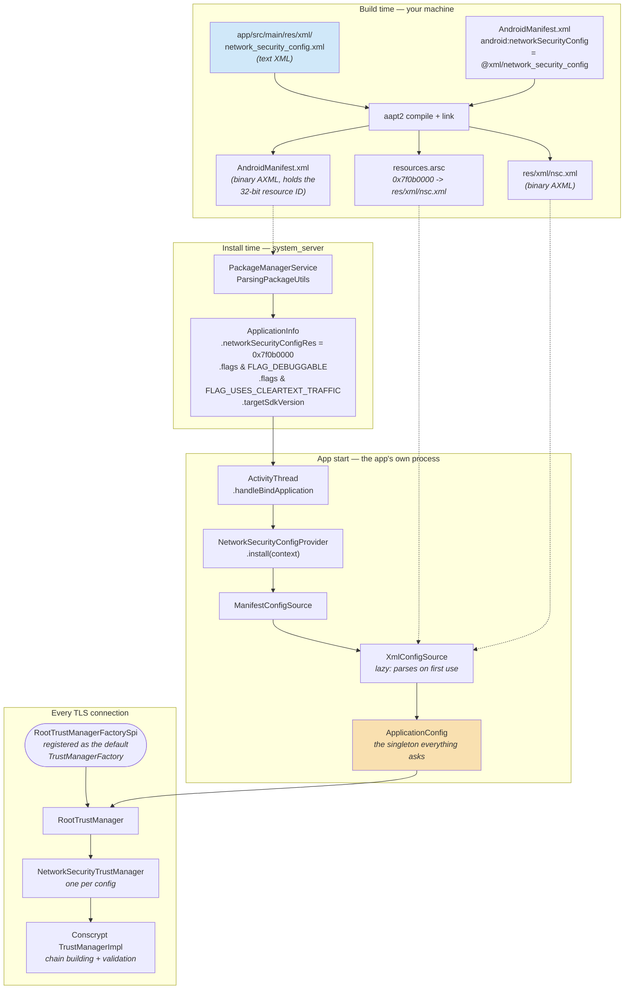
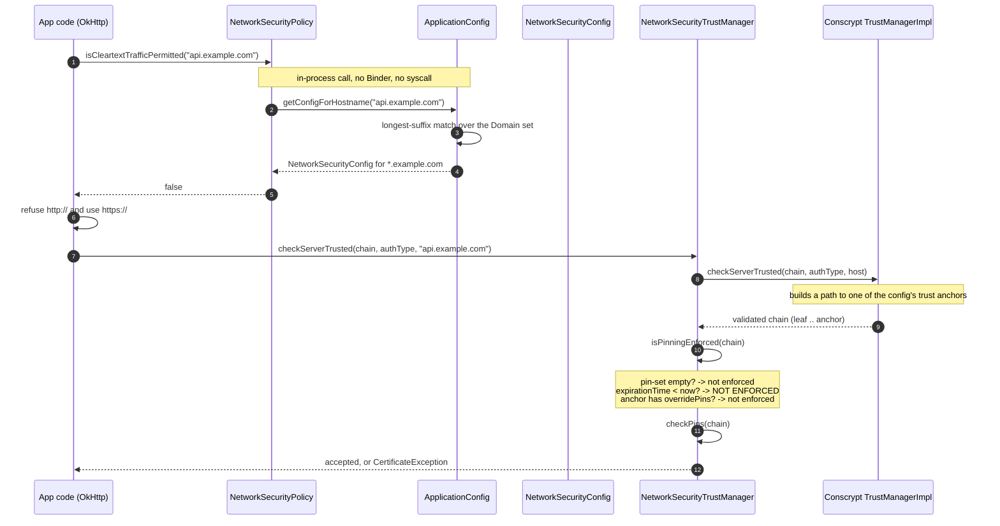
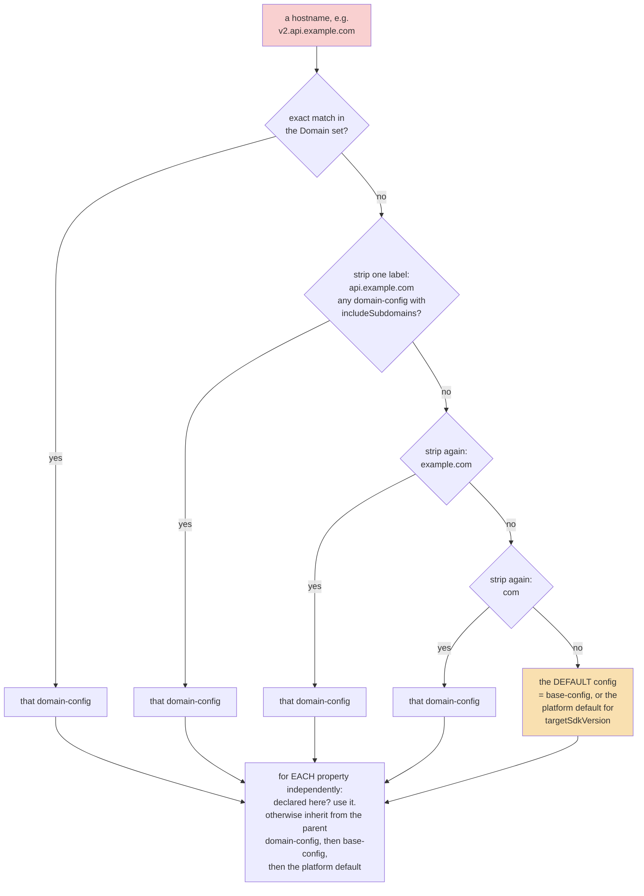
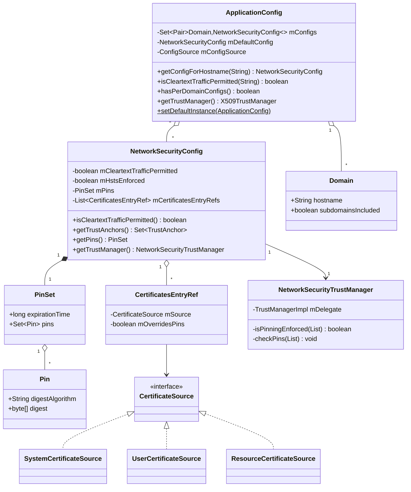
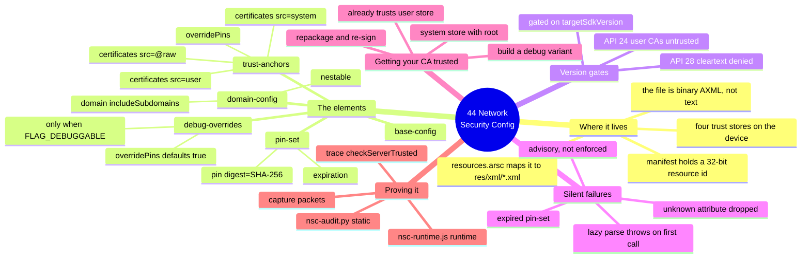

# 44 — Network Security Config

> After this chapter you can find the XML file that decides whether an app trusts your proxy,
> resolve it out of an APK by hand, read every trust decision it makes, predict what the platform
> will do with it, prove that prediction on a device, and write the finding — or explain, with
> evidence, why the thing your scanner flagged is not one.

**Prerequisites:** [10-APK-Internals](../10-APK-Internals/README.md) (binary XML and the APK
container), [32-Manifest](../32-Manifest/README.md) (`android:networkSecurityConfig` is a manifest
attribute), [34-Cryptography](../34-Cryptography/README.md) (what a public key and a digest are),
[23-Permissions](../23-Permissions/README.md) (how `targetSdkVersion` gates behaviour). Helpful but
not required: [35-SSL](../35-SSL/README.md) (TLS and trust anchors as a concept) and
[36-CertificatePinning](../36-CertificatePinning/README.md) (defeating a pin at runtime).

**Applies to:** API 24 (Android 7.0) onward, which is when the mechanism was introduced. Everything
measured here was measured on **Android 11 / API 30** (Redmi `M2101K6P`, MIUI 12.5, rooted,
frida-server 16.1.6). Where a claim is version-dependent it carries a Version Matrix; where it was
measured rather than read, it says so.

---

## Table of Contents

1. [Introduction](#1-introduction)
2. [High-Level Architecture](#2-high-level-architecture)
3. [Deep Internal Working](#3-deep-internal-working)
4. [Source Code Walkthrough (AOSP)](#4-source-code-walkthrough-aosp)
5. [Security Perspective](#5-security-perspective)
6. [Reverse Engineering Perspective](#6-reverse-engineering-perspective)
7. [Dynamic Analysis](#7-dynamic-analysis)
8. [Static Analysis](#8-static-analysis)
9. [Examples](#9-examples)
10. [Common Interview Questions](#10-common-interview-questions)
11. [Common Mistakes](#11-common-mistakes)
12. [Hands-on Labs](#12-hands-on-labs)
13. [Summary](#13-summary)
14. [References](#14-references)

---

## 1. Introduction

### 1.1 The problem, before any Android in it

Imagine you are posting a sealed letter, and you want to be certain it reaches one specific person.
You do not know that person's handwriting. What you have instead is a list of notaries whose seals
you recognise, and a rule: *if the envelope carries a seal from someone on my list, and that notary
vouches for the recipient's name, I will trust it.*

The whole system rests on the list. Not on the seal, not on the envelope, not on the recipient — on
**who is allowed to be on the list**. If somebody can add one name to it, they can put themselves in
the middle of every letter you will ever send, read it, copy it, change it, reseal it, and pass it
on. You will notice nothing, because everything you check still checks out.

That list is a **trust store**, and this chapter is about the file that decides what is on it.

> **📖 Definition — trust anchor**
> A certificate that you accept *because you decided to*, not because something else vouched for it.
> It is the end of the chain of reasoning. A "root CA certificate" in a browser or a phone is a trust
> anchor. Everything else in a TLS handshake is an argument that terminates in one.

> **📖 Definition — certificate authority (CA)**
> An organisation whose business is signing other people's certificates, so that anyone who trusts
> the CA transitively trusts what it signed. There are a few hundred of them in a phone's default
> list, run by companies and governments in dozens of countries. Every one of them can issue a
> certificate for any hostname.

### 1.2 What Android had before, and why it was not enough

Until Android 7.0 (API 24), an app's trust list was **the device's list**, full stop. Two
consequences followed, and both were bad.

**Consequence one: the device owner could add to it.** Android has always let a user install a
certificate authority — Settings, Security, Install from storage, pick a file. That capability
exists for real reasons: corporate networks, captive portals, development. But it meant that any app
on the device inherited whatever the user had been persuaded to install. A single social-engineering
prompt — *"install this profile to use our free wifi"* — put an attacker's CA in front of every
banking app on the phone. There was no way for an app to say "not for me".

**Consequence two: an app that wanted a different policy had to write code.** If you wanted to trust
only your own certificate authority, or to pin a specific key, or to permit plaintext HTTP for one
legacy endpoint, you implemented `X509TrustManager` yourself. Implementing `X509TrustManager`
correctly is genuinely hard — it involves path building, revocation, name constraints, and basic
constraints — and the overwhelmingly common outcome was this:

```java
// The single most-copied dangerous snippet in Android's history.
// It appears in tens of thousands of apps. Do not write it.
new X509TrustManager() {
    public void checkServerTrusted(X509Certificate[] chain, String authType) { }
    public void checkClientTrusted(X509Certificate[] chain, String authType) { }
    public X509Certificate[] getAcceptedIssuers() { return new X509Certificate[0]; }
}
```

An empty `checkServerTrusted` accepts every certificate ever issued, including one you generated
thirty seconds ago in a coffee shop. Google eventually began rejecting Play Store submissions
containing recognisable variants of it, which tells you how widespread it was.

So the platform's problem was: developers need to express network trust policy, and asking them to
express it in code produces catastrophically wrong code. The answer was to move the policy out of
code and into a **declarative file the platform interprets**.

### 1.3 What the Network Security Config is

It is a small XML file, usually forty lines or fewer, that lives in an app's resources at
`res/xml/something.xml`. The manifest points at it:

```xml
<!-- app/src/main/AndroidManifest.xml -->
<application
    android:networkSecurityConfig="@xml/network_security_config"
    ... >
```

And the file says things like this:

```xml
<!-- app/src/main/res/xml/network_security_config.xml -->
<network-security-config>
    <base-config cleartextTrafficPermitted="false">
        <trust-anchors>
            <certificates src="system" />
        </trust-anchors>
    </base-config>
    <domain-config>
        <domain includeSubdomains="true">api.example.com</domain>
        <pin-set expiration="2027-06-30">
            <pin digest="SHA-256">AAAAAAAAAAAAAAAAAAAAAAAAAAAAAAAAAAAAAAAAAAA=</pin>
            <pin digest="SHA-256">BBBBBBBBBBBBBBBBBBBBBBBBBBBBBBBBBBBBBBBBBBA=</pin>
        </pin-set>
    </domain-config>
</network-security-config>
```

Read in English: *no plaintext HTTP anywhere; trust the system certificate authorities and nothing
else; and for `api.example.com` and everything under it, additionally require that the server's
public key be one of these two, until the thirtieth of June 2027.*

That is the entire idea. Four things are expressible:

| Question | Element |
|---|---|
| May this app use plaintext HTTP? | `cleartextTrafficPermitted` |
| Whose certificates does it trust? | `<trust-anchors>` / `<certificates>` |
| Must a specific key be present? | `<pin-set>` / `<pin>` |
| Does any of the above change in a debug build? | `<debug-overrides>` |

Multiply by "globally, or for these hostnames", and you have the whole schema.

### 1.4 Why a pentester cares more than anyone

Because this file decides whether **your work is possible**.

The normal way to look inside an app's HTTPS traffic is to put a proxy in the middle — Burp Suite,
mitmproxy, ZAP — generate a certificate authority of your own, install it on the phone, and let the
proxy issue certificates for whatever host the app asks for. The app validates the certificate,
finds it chains to your CA, finds your CA in the trust store, and proceeds happily while you read
everything.

That workflow depends entirely on your CA being in the app's trust store. And **since API 24, a
user-installed CA is not in it by default**. So the first question on every mobile engagement is not
"what does the app do" but "why can't I see anything", and the answer is in this file, or in the
absence of this file.

There is a second reason, and it is the one that produces findings rather than access. Because this
file is small, boring, and written once, it is almost never reviewed again. Configurations rot:

- A `<debug-overrides>` block written for a developer's laptop that shipped to production — usually
  harmless, occasionally catastrophic, and this chapter will teach you to tell which.
- A `cleartextTrafficPermitted="true"` added at 6pm to make one endpoint work, never narrowed.
- A `<pin-set expiration="2021-07-1">` that stopped protecting anything years ago and that nobody
  noticed, **because nothing broke when it lapsed**.

That last one is real, current, and sitting on the test device used to write this chapter. It is
measured in §5.5.

### 1.5 What would break if this did not exist

Take it away and three things happen at once.

1. **Every app on the phone shares the device's trust list, with no opt-out.** One CA installed by
   the user — or by an enterprise mobility management profile, or by a convincing prompt — sits in
   front of everything.
2. **Pinning becomes code again.** Every app that wants it writes its own trust manager, most get it
   wrong, and the ones that get it right cannot be audited without reversing them.
3. **There is nothing to read.** A tester's first pass over an APK currently produces a policy
   statement in forty lines. Without it, the policy is spread across whatever HTTP stacks the app
   happens to use, and half of them are native.

The mechanism exists because centralising a decision that everyone gets wrong, in a place the
platform enforces and a human can read, is better than the alternative — even though, as this
chapter will show at length, the centralised version has failure modes of its own that are quieter
and harder to spot.

### 1.6 Where this chapter's boundaries are

Three chapters cover network security and they divide like this:

| Chapter | Owns |
|---|---|
| **35 — SSL/TLS** | The handshake. What a certificate is, how a chain validates, what a trust anchor means as a concept, what hostname verification does. |
| **36 — Certificate Pinning** | Pinning's *runtime* behaviour, and defeating it: Frida hooks, `objection`, patching, `TrustKit`, OkHttp's `CertificatePinner`. |
| **44 — this chapter** | **The declarative XML, and what the platform does with it.** A `<pin-set>` as a *declaration* is here. Bypassing the pin it declares is 36's. |

If a sentence is about the bytes on the wire, it belongs in 35. If it is about hooking something to
make a check return true, it belongs in 36. If it is about a file in `res/xml/` and the object graph
the platform builds from it, it is here.

[32-Manifest](../32-Manifest/README.md) owns the manifest audit. This chapter reads exactly four
manifest attributes and only because they change what the config *means*.
[10-APK-Internals](../10-APK-Internals/README.md) owns Android binary XML at the byte level, and
this chapter's tooling imports its parser rather than shipping a second one.

---

## 2. High-Level Architecture

### 2.1 From a manifest attribute to a TLS decision



**What you are looking at.** The file is written once, at the top left, as ordinary text. `aapt2`
compiles it into Android binary XML and gives it a numeric identity in `resources.arsc`; the
manifest keeps only that number. At install, `PackageManagerService` copies the number into
`ApplicationInfo` along with three other facts that will change how it is interpreted. At app start,
inside the app's own process, `NetworkSecurityConfigProvider.install()` builds an `ApplicationConfig`
and registers a `TrustManagerFactory` that produces trust managers derived from it. From then on,
every TLS connection made through the platform's stack consults that one object.

Three things in that picture matter more than the rest and are easy to miss:

- **The parse is lazy.** `XmlConfigSource` does not read the XML at `install()`. It reads it the
  first time something asks for a configuration. A malformed config therefore does not stop the app
  launching — it throws on the app's first network call, which is a much harder failure to
  attribute.
- **The parse happens in the app's process, not in `system_server`.** Nothing privileged reads this
  file. It is the app deciding about itself.
- **`ApplicationConfig` is a singleton with a public setter.** `ApplicationConfig.setDefaultInstance()`
  is a public static method. An app — or you, with Frida — can replace the whole policy at runtime.

### 2.2 Answering one question: "may I connect to this host, and whom do I trust for it?"



**What you are looking at.** Two independent questions, answered by the same object. The cleartext
question is a pure lookup and costs nothing; libraries ask it before they open a socket. The trust
question runs during a handshake: the platform's own trust manager delegates the hard cryptography to
Conscrypt, gets back a *validated chain*, and only then applies the pins.

Look closely at step 11 (`isPinningEnforced`). **Three separate conditions each make pinning silently
not happen**, and none of them produces a log line, an exception, or any observable difference from
the outside. An empty pin set. An expiration in the past. A trust anchor marked `overridePins`. This
is the single most important diagram in the chapter and §3.6 takes it apart.

### 2.3 Which configuration applies to which host



**What you are looking at.** Matching is by hostname suffix, one label at a time, most specific
first. There are no wildcards and no regular expressions; `includeSubdomains="true"` is the only way
to match anything below a name. A `<domain-config>` that matches supplies whatever it declares, and
**inherits every property it does not declare** — separately, one property at a time.

That last clause is the source of more misreadings than anything else in this file. A
`<domain-config>` that declares only a `<pin-set>` still inherits its cleartext verdict from
`<base-config>`. If `<base-config>` permits cleartext, so does that host, no matter how carefully
pinned it looks.

> **🧠 Mental Model**
> Think of it as CSS. `<base-config>` is the rule on `body`; each `<domain-config>` is a more
> specific selector; each property cascades on its own. Writing `color` on a child does not reset its
> inherited `font-size`. Exactly the same trap, with the same consequences for anyone reading only
> the innermost rule.

### 2.4 The object graph, at runtime



**What you are looking at.** Every element in the XML becomes one of these. `<base-config>` becomes
`mDefaultConfig`; each `<domain>` becomes a `Domain` paired with its `<domain-config>`'s
`NetworkSecurityConfig`; each `<certificates src="...">` becomes a `CertificatesEntryRef` wrapping a
`CertificateSource`; each `<pin>` becomes a `Pin` inside a `PinSet`.

The field names are not decoration — **they are what you read at runtime**, and the ones you most
want have no public getter. `mConfigs` and `mCertificatesEntryRefs` are private, which is why
[`scripts/nsc-runtime.js`](scripts/nsc-runtime.js) reads them by reflection. Verified on API 30:
`NetworkSecurityConfig` exposes no `hasPins()`, and `ApplicationConfig` exposes no accessor for its
per-domain table at all.

### 2.5 Where the file physically lives, at each stage

```
your project                          the built APK                       the device
------------                          -------------                       ----------
app/src/main/                         base.apk                            /data/app/~~<rand>/
  AndroidManifest.xml     --aapt2-->    AndroidManifest.xml  (AXML)          <pkg>-<rand>/base.apk
  res/xml/                              resources.arsc                          (the same zip,
    network_security_config.xml         res/xml/network_security_config.xml      read-only)
      (text XML)                          (AXML)
                                        classes.dex ...
app/src/debug/                                                            trust stores consulted:
  res/xml/                            the manifest holds ONLY               /system/etc/security/cacerts   (src="system")
    network_security_config.xml       0x7f0b0000. The name                  /data/misc/user/0/cacerts-added (src="user")
      (merged over the main one         "network_security_config"
       for the debug variant only)       survives only in
                                         resources.arsc.
```

**What you are looking at.** Four distinct places the same policy exists, in four different forms.
The consequence for a tester: `grep` for the string `network_security_config` in the APK finds it in
`resources.arsc`, not in the manifest, because the manifest stores the number. And `grep` for
`cleartextTrafficPermitted` in the *manifest* finds nothing at all, because it is not a manifest
attribute — it is an attribute in a different compiled XML file that the manifest merely points at.

That is why §8 opens with a warning about `grep`, and why this chapter ships a resolver.

---

## 3. Deep Internal Working

### 3.1 What the platform builds, and when

**When.** `ActivityThread.handleBindApplication()` runs in the app's process before any of the app's
own code, including `Application.onCreate()`. Among many other things it calls
`NetworkSecurityConfigProvider.install(context)`. That method does two things:

1. Creates a `ManifestConfigSource` wrapping the `ApplicationInfo`, and hands it to a new
   `ApplicationConfig`, which becomes the process-wide default instance.
2. Inserts a JCA `Provider` at position 1 whose `TrustManagerFactory.PKIX` implementation is
   `RootTrustManagerFactorySpi` — so that from that moment, `TrustManagerFactory.getInstance("PKIX")`
   anywhere in the process returns a trust manager derived from the config.

That second step is the reason this works at all for libraries that never heard of the mechanism.
OkHttp, `HttpsURLConnection`, Retrofit and anything else that asks the JCA for the default trust
manager gets the config's one, without a line of integration code.

**What.** `ManifestConfigSource` looks at `ApplicationInfo.networkSecurityConfigRes`:

| `networkSecurityConfigRes` | What is built |
|---|---|
| `0` (no `android:networkSecurityConfig`) | A default configuration derived from `targetSdkVersion` and `FLAG_USES_CLEARTEXT_TRAFFIC` alone. No per-domain configs at all — the private `mConfigs` field is left **null**, which is measurable. |
| non-zero | An `XmlConfigSource` bound to that resource id. Nothing is parsed yet. |

> **🔬 Under the Hood — measured, API 30**
> Attaching to the file-explorer app (`com.vendor.fileexplorer`, no config declared) and reading the
> private fields:
> ```
> networkSecurityConfigRes      : 0x0   (no config declared - platform defaults apply)
> mConfigs is null: this app has NO <domain-config> at all.
> default configuration:
>     cleartextTrafficPermitted : false
>     trust anchor sources      : SystemCertificateSource
>     pin-set                   : 0 pin(s)
> ```
> Compare with the professional-network app, which *does* declare a config: `networkSecurityConfigRes : 0x7f0d0001`, and
> `mConfigs` is an empty set rather than null, because the file declares no `<domain-config>`.
> Null and empty mean different things here, and a script that does not distinguish them crashes on
> the first app with no config. This one did, which is why the shipped script handles it.

**Lazily.** `XmlConfigSource` holds the resource id and does nothing until `getPerDomainConfigs()` or
`getDefaultConfig()` is called, which happens on the first `getConfigForHostname()`. This is why a
broken config does not stop an app launching.

### 3.2 The complete element set

Seven elements. That is all there is.

```
<network-security-config>            the root; carries no attributes
├── <base-config>                    policy for everything not matched below      (0 or 1)
│   ├── <trust-anchors>                                                            (0 or 1)
│   │   └── <certificates src=… overridePins=…/>                                   (1..n)
│   └── <pin-set expiration=…>                                                     (0 or 1)
│       └── <pin digest="SHA-256">base64</pin>                                     (1..n)
├── <domain-config>                  policy for named hosts; NESTABLE             (0..n)
│   ├── <domain includeSubdomains=…>hostname</domain>                              (1..n)
│   ├── <trust-anchors> …                                                          (0 or 1)
│   ├── <pin-set> …                                                                (0 or 1)
│   └── <domain-config> …            nested, inherits from its parent              (0..n)
└── <debug-overrides>                applied ONLY when FLAG_DEBUGGABLE is set     (0 or 1)
    └── <trust-anchors>
        └── <certificates src=… overridePins=…/>
```

#### Attribute reference

| Element | Attribute | Type | Default | Meaning |
|---|---|---|---|---|
| `<base-config>` | `cleartextTrafficPermitted` | boolean | see §3.4 | Whether plaintext HTTP is allowed for hosts no `<domain-config>` matches |
| `<base-config>` | `hstsEnforced` | boolean | `false` | Treat all connections to matched hosts as HSTS-pinned. Undocumented in the developer guide; the field and getter exist. Rarely used and only honoured by some stacks — see §3.9 |
| `<domain-config>` | `cleartextTrafficPermitted` | boolean | **inherited** | As above, for the matched hosts |
| `<domain-config>` | `hstsEnforced` | boolean | **inherited** | As above |
| `<domain>` | `includeSubdomains` | boolean | `false` | Match any host ending in `.` + this name, as well as the name itself |
| `<certificates>` | `src` | `system` \| `user` \| resource ref | *required* | Where the trust anchors come from |
| `<certificates>` | `overridePins` | boolean | `false` outside `<debug-overrides>`, **`true` inside it** | A chain terminating in one of these anchors bypasses the `<pin-set>` |
| `<pin-set>` | `expiration` | `yyyy-MM-dd` | none (never expires) | After this date, **pins are not enforced at all** |
| `<pin>` | `digest` | `SHA-256` | *required* | The only algorithm accepted. Anything else is a parse error |

> **⚠️ Warning — the default of `overridePins` flips**
> Outside `<debug-overrides>` it is `false`. Inside `<debug-overrides>` the platform builds the
> anchors with `overridePins = true` whether or not you write it. That is deliberate: the whole
> purpose of the block is to let a developer proxy their own build, and a live pin set would defeat
> it. It also means a debuggable build with a `<debug-overrides>` block has **no effective pinning**,
> which is the mechanism behind the CRITICAL in §5.6.

#### `<certificates src="…">` in full

| `src` value | Resolves to | Notes |
|---|---|---|
| `system` | `/system/etc/security/cacerts` via `SystemCertificateSource` | The ~140 CAs shipped with the OS. On a **rooted test device this directory is frequently not the platform's** — see §7.6 |
| `user` | `/data/misc/user/<userId>/cacerts-added` via `UserCertificateSource` | What Settings installs. **Not trusted by default since API 24.** This is the one you want as a tester |
| `@raw/name` | A DER or PEM blob in `res/raw/` via `ResourceCertificateSource` | A private CA bundled with the app. Multiple certificates in one PEM file are all used |

There is no `src="none"`. To trust nothing, write `<trust-anchors/>` with no children — which makes
every TLS connection to the matched hosts fail, and is almost always a mistake rather than a policy.

### 3.3 Inheritance, precisely

The rule, and it is worth memorising because most misreadings come from getting it wrong:

> Each property is resolved **independently**. For a given `<domain-config>`, look for the property
> on that element; if absent, on its enclosing `<domain-config>`, repeatedly; if still absent, on
> `<base-config>`; if still absent, on the platform default for the app's `targetSdkVersion`.

| Property | Inherited? | Notes |
|---|---|---|
| `cleartextTrafficPermitted` | yes | Independently of everything else |
| `hstsEnforced` | yes | Independently |
| `<trust-anchors>` | yes | **Replaced wholesale, never merged.** Declaring one `<certificates>` child discards the entire inherited set |
| `<pin-set>` | yes | Replaced wholesale |

The "replaced wholesale" clause is the second trap. A developer who writes:

```xml
<domain-config>
    <domain includeSubdomains="true">api.example.com</domain>
    <trust-anchors>
        <certificates src="@raw/our_ca" />
    </trust-anchors>
</domain-config>
```

has made `api.example.com` trust **only** their private CA. That may be exactly what they wanted, and
it is excellent practice when it is. But if they were trying to *add* their CA to the system set, the
app now cannot reach that host through any public certificate — an outage they will discover
immediately, and fix by adding `<certificates src="system"/>`, which is how the two lines end up
together in almost every real config.

> **🔍 Pentester's Note**
> When you see `<certificates src="system"/>` next to something else, ask which order the developer
> arrived at. If the private CA came first and `system` was added to fix breakage, the private CA is
> probably not doing what they think it is doing — everything the system CAs vouch for is accepted
> too, and the private anchor adds nothing except a second way in.

### 3.4 Version matrix — the two changes that matter

| API | Android | Change | Consequence for you |
|---|---|---|---|
| ≤ 23 | ≤ 6.0 | No Network Security Config. Trust = the device store, including user-added CAs | Install your CA in the user store; everything works. The mechanism does not exist |
| **24** | **7.0** | Mechanism introduced. **User-added CAs are no longer trusted by default** | Your proxy CA stops working against apps that target 24+. This is the change that created the modern mobile-testing workflow |
| 25–27 | 7.1–8.1 | No behaviour change | |
| **28** | **9.0** | **Cleartext HTTP denied by default** for apps targeting 28+ | `usesCleartextTraffic` effectively defaults to `false`. Apps that need HTTP must say so |
| 29–33 | 10–13 | No change to this subsystem's semantics | |
| 34+ | 14+ | No change to this subsystem's semantics. `aapt2` gained a compact resource-entry encoding that some resource parsers do not read — affects tooling, not behaviour | Cross-check resource resolution with `aapt2 dump resources` if a resolver returns nothing |

**Both changes are gated on `targetSdkVersion`, not on the device's API level.** That is the single
most useful fact in this table. An app targeting API 23 running on Android 14 still gets the old
defaults, because the default configuration is selected from `ApplicationInfo.targetSdkVersion`.

> **🔬 Under the Hood — how the default is chosen**
> `NetworkSecurityConfig.getDefaultBuilder(ApplicationInfo)` is a public static method on API 30
> (confirmed by reflection on the device). It reads `targetSdkVersion` and
> `FLAG_USES_CLEARTEXT_TRAFFIC`, and returns a builder pre-populated with the system certificate
> source and the appropriate cleartext verdict. Everything else layers on top of that builder.

**Verified on the API 30 device**, rather than asserted:

| App | targetSdk | Config? | Effective default cleartext | Effective anchors |
|---|---|---|---|---|
| The file-explorer app | 29 | none | `false` | `SystemCertificateSource` |
| MHL FridaOne | 34 | none | `false` (and `debuggable=true`) | system only |
| The professional-network app | 29 | `<debug-overrides>` only | `false` | `SystemCertificateSource` |
| MIUI Calculator | 29 | yes | `false` | `SystemCertificateSource` |
| The file-manager app | 30 | yes | **`true`** (declared) | system by default, **+user** for 7 named hosts |

Not one of these apps trusts the user store by default, at any target level from 29 to 34, which is
the API 24 change doing its job. The one that trusts it does so because the config says to.

### 3.5 `cleartextTrafficPermitted` — what is actually enforced, and what is not

This is a **policy that cooperating libraries consult**, not a firewall. Nothing intercepts packets.

| Stack | Consults the policy? | How |
|---|---|---|
| `HttpURLConnection` / `HttpsURLConnection` (libcore) | yes | Throws `java.net.UnknownServiceException: CLEARTEXT communication to <host> not permitted by network security policy` |
| OkHttp 3.13+ / Retrofit | yes | `Platform.isCleartextTrafficPermitted(host)` → `NetworkSecurityPolicy` |
| Volley (uses `HttpURLConnection`) | yes | Transitively |
| WebView / Chromium | yes | Its own copy of the policy via JNI; blocks the load |
| Cronet | yes, when built against the platform | A Cronet bundled with its own network stack may not |
| `android.media.MediaPlayer`, ExoPlayer | mostly | ExoPlayer's default data source uses `HttpURLConnection` or OkHttp |
| **A raw `java.net.Socket`** | **no** | Nothing checks. Write HTTP by hand and it goes out |
| **Native code using BoringSSL/curl directly** | **no** | Nothing checks |
| **Flutter's `dart:io` HttpClient** | **no** | It has its own stack and its own trust store |

> **⚠️ Warning**
> `cleartextTrafficPermitted="false"` is **not** evidence that an app sends no plaintext. It is
> evidence that the app's *cooperating* HTTP libraries will refuse to. Confirm with a capture, every
> time. Chapter 32 makes the same point about `android:usesCleartextTraffic` and it is worth making
> twice.

The two forms of the query behave differently and this catches people out:

```java
// Returns the DEFAULT config's verdict - what base-config (or the platform default) says.
NetworkSecurityPolicy.getInstance().isCleartextTrafficPermitted();

// Resolves the hostname through the per-domain table first.
NetworkSecurityPolicy.getInstance().isCleartextTrafficPermitted("metrics.example.com");
```

A library that does not know the hostname yet calls the first form. So an app can be *denied*
cleartext by the no-argument call and *permitted* it for a specific host, and which one a given
library asks decides whether the request goes out. Measured on the device: MIUI Calculator returns
`false` for the no-argument form while `sandbox.api.collect.data.intl.miui.com` returns `true`.

### 3.6 `<pin-set>` — the declaration, and its three silent failure modes

> **📖 Definition — certificate pinning**
> Requiring that a server's certificate chain contain a specific public key, over and above the
> normal requirement that it chain to a trusted CA. It narrows trust from "any of ~140 CAs" to "this
> key". Chapter 36 covers pinning at runtime and how to defeat it; here we are only concerned with
> what the XML declares.

A `<pin>` value is **the base64 of SHA-256 over the DER-encoded SubjectPublicKeyInfo** — the public
key together with its algorithm identifier — and *not* a hash of the certificate. Hashing the
certificate would break on every renewal even when the key is unchanged; hashing the SPKI survives
renewal. This is RFC 7469's definition and OkHttp, TrustKit and the platform all use it.

```bash
# host - compute a pin from a certificate
openssl x509 -in intermediate.pem -pubkey -noout \
  | openssl pkey -pubin -outform der \
  | openssl dgst -sha256 -binary \
  | openssl enc -base64
```

Now the important part. `NetworkSecurityTrustManager.checkServerTrusted()` obtains a validated chain
from Conscrypt and then calls a private `isPinningEnforced(List)` before `checkPins(List)`. **Pinning
does not happen at all if any of these is true:**

| Condition | Where it comes from | Observable? |
|---|---|---|
| The pin set is empty | No `<pin-set>` for this host, or an inherited empty one | No |
| `expirationTime` is in the past | `<pin-set expiration="…">` | **No.** Nothing logs, nothing fails |
| A trust anchor in the validated chain is marked `overridePins` | `<certificates overridePins="true"/>`, or **any** anchor inside `<debug-overrides>` in a debuggable build | No |

The middle row is the one this chapter insists on. **An expired pin-set fails open, silently, and
permanently.**

> **🧠 Mental Model**
> The expiration is a dead man's switch installed backwards. It exists so that an app cannot brick
> itself against a certificate rotation nobody anticipated — a genuinely good reason, because the
> alternative failure mode is an installed base that cannot reach your API and cannot be fixed from
> the server. The price is that on the chosen date your strongest transport control switches itself
> off and sends no notification to anyone.

Everything about how this fails is designed to be invisible:

- The app keeps working. Ordinary CA validation still runs; only the extra constraint is dropped.
- There is no log line at any level.
- `dumpsys` does not report it.
- Static analysis tools mostly report "the app implements certificate pinning", because a `<pin-set>`
  is present.
- A developer reading the file sees fifteen pins and concludes the host is pinned.

And it is not hypothetical. §5.5 measures it in two of the largest apps on the test phone.

`PinSet.EMPTY_PINSET` uses `Long.MAX_VALUE` as its `expirationTime`, which is how "no expiration"
and "expired" are represented in the same `long`. Reading `9223372036854775807` at runtime means *no
expiry declared*; any smaller number is a real date in milliseconds since the epoch.

> **🔬 Under the Hood — the date parse, measured**
> The social-media app's config declares `expiration="2021-07-1"` — note the un-padded day. `SimpleDateFormat`
> with pattern `yyyy-MM-dd` is lenient by default, so it parses. At runtime the field read
> `1625077800000`, which is `2021-06-30T18:30:00Z` — midnight on 1 July 2021 **in the device's
> timezone (IST, UTC+5:30)**, not in UTC. The expiry is therefore evaluated in local time, and a
> pin-set expires at slightly different instants on phones in different timezones. It has never
> mattered, but it tells you exactly which parser is running.

### 3.7 `<debug-overrides>` — the most misunderstood element in Android security testing

**The rule, stated once, precisely:**

> The contents of `<debug-overrides>` are applied **if and only if** the running application's
> `ApplicationInfo.flags` has `FLAG_DEBUGGABLE` set — that is, when the effective merged manifest
> declared `android:debuggable="true"`. Otherwise the block is parsed and discarded, and the platform
> builds no trust anchors from it.

Consequences, in order of how often they are got wrong:

1. **In a normal release build, `<debug-overrides>` does nothing.** A release APK containing
   `<debug-overrides><trust-anchors><certificates src="user"/></trust-anchors></debug-overrides>`
   does **not** trust user CAs. Reporting that it does is wrong, and a client's Android engineers
   will know it is wrong.
2. **It is additive to, not a replacement for, the rest of the config.** In a debuggable build the
   app gets its `<base-config>` anchors *and* the debug ones.
3. **`overridePins` defaults to `true` inside it.** So a debuggable build with this block has no
   effective pinning, whatever the `<pin-set>` says.
4. **`android:debuggable` is a merged-manifest property.** The Gradle debug build type sets it; so
   does `debuggable true` on any build type; so does repackaging with `apktool` and editing the
   manifest. All three make the block live.

> **🔬 Under the Hood — measured, and this is the whole argument**
> The professional-network app's release APK (`com.vendor.professionalnet`, targetSdk 29) declares
> `android:networkSecurityConfig`, and the resource it points at contains **nothing but** a
> `<debug-overrides>` block trusting `system` and `user`:
> ```xml
> <network-security-config>
>   <debug-overrides>
>     <trust-anchors>
>       <certificates src="system" />
>       <certificates src="user" />
>     </trust-anchors>
>   </debug-overrides>
> </network-security-config>
> ```
> A grep-driven report writes this up as "the application trusts user-installed certificates".
> Attaching to the running app and dumping the platform's own `ApplicationConfig` gives:
> ```
> PKG com.vendor.professionalnet  targetSdk=29  debuggable=false  nscRes=0x7f0d0001
>   mConfigs = empty (no per-domain configs)
>   <DEFAULT / base-config>
>      cleartext=false  hsts=false  anchors=[SystemCertificateSource]  pins=0
> ```
> The user store is not there. The block was discarded. The finding does not exist.

**When it *is* a finding.** When `android:debuggable="true"` in the build you were handed. Then the
correct write-up is:

- **Root cause:** the release build is debuggable. That is a finding on its own — `run-as` works, the
  process is attachable by JDWP, and backup and profiling restrictions relax.
- **Impact:** because a `<debug-overrides>` block is present, the app additionally trusts every
  user-installed CA and **ignores its own `<pin-set>`**, so its TLS can be terminated by anyone who
  can install a certificate, with no root and no repackaging.

That is a real, high-severity chain, and it reads completely differently from "the config mentions
user certificates".

### 3.8 The trust stores on disk

| Store | Path | Written by | Format |
|---|---|---|---|
| System | `/system/etc/security/cacerts/` | The OS image | One PEM per file, named `<subject_hash>.<n>`, with a human-readable dump appended after the PEM block |
| User | `/data/misc/user/<userId>/cacerts-added/` | Settings, `DevicePolicyManager` | Same format |
| User, removed | `/data/misc/user/<userId>/cacerts-removed/` | Settings | Tombstones for system CAs the user disabled |

The filename is the OpenSSL subject hash — `openssl x509 -subject_hash_old -in cert.pem -noout` —
which is why a Burp CA installed on any device is nearly always `9a5ba575.0`.

`DirectoryCertificateSource` reads these directories lazily and caches; `TrustedCertificateStoreAdapter`
bridges them to Conscrypt.

> **🔍 Pentester's Note — measured on the test device, and it matters**
> ```
> $ adb shell "su -c 'mount | grep cacerts'"
> APatch on /system/etc/security/cacerts type tmpfs (rw,seclabel,relatime,…)
> /dev/block/dm-10 on /system/etc/security/cacerts/d41b5e2a.0 type f2fs (…)
> …
> $ adb shell "grep -l -a PortSwigger /system/etc/security/cacerts/*"
> /system/etc/security/cacerts/9a5ba575.0
> ```
> The root solution has bind-mounted a tmpfs over the system CA directory and copied the Burp CA into
> it. Counted from inside an app: `SystemCertificateSource : 139 certificates`,
> `UserCertificateSource : 1 certificate` — and the Burp CA is in **both**.
>
> This is the standard "move your CA to the system store" workflow, and it works. It also means that
> on this device you **cannot** demonstrate the API 24 change by installing a CA in the user store
> and observing that an app ignores it — the same CA is already trusted through the system path. Any
> claim about default trust made on a rooted phone must first account for what root did to the store.
> Check the mount table before you check anything else.

### 3.9 `hstsEnforced` — the attribute nobody documents

`isHstsEnforced()` exists on `NetworkSecurityConfig` (verified by reflection on API 30) and the
attribute parses. It marks matched hosts as HSTS-preloaded, meaning a stack that honours it should
refuse to downgrade to HTTP for them. It is absent from the developer guide's schema documentation
and, in practice, the platform's Java HTTP stacks ignore it; WebView's Chromium has its own HSTS
state that this does not feed. Every configuration measured for this chapter had `hstsEnforced=false`.

Treat it as: worth reporting as an observation if you see it set, not worth relying on. If a config
sets it, ask the developer what they expected it to do — the answer is usually "the same thing as
`cleartextTrafficPermitted=false`", which it is not.

### 3.10 What happens when the config is wrong

`XmlConfigSource` parses on first use and raises a `ParserException` for anything it does not
understand. Because the parse is lazy and happens on the app's own thread, the failure surfaces as a
`RuntimeException` on the **first network call**, not at launch.

| Mistake | What the platform does |
|---|---|
| Unknown element, e.g. `<domain-cfg>` | Parse error |
| Unknown attribute, e.g. `cleartextTrafficPermited` (typo) | **Silently ignored.** The value is inherited instead, and the developer believes they set a policy |
| `<pin digest="SHA-1">` | Parse error — `Pin.isSupportedDigestAlgorithm` accepts SHA-256 only |
| `expiration="30/06/2027"` | Parse error |
| `<domain-config>` with no `<domain>` | Parse error |
| `<trust-anchors/>` with no `<certificates>` | Valid, and catastrophic: nothing validates, every TLS connection to matched hosts fails |

> **⚠️ Warning — an asymmetry worth memorising**
> An unknown **element** is a hard error; an unknown **attribute** is silently dropped. So
> `<base-config cleartextTrafficPermited="false">` — one missing `t` — compiles, installs, runs, and
> permits cleartext, because the attribute the platform reads was never set and the value inherited
> from the platform default. This is exactly the kind of defect that survives code review, and
> [`scripts/nsc-audit.py`](scripts/nsc-audit.py) checks for it (finding `NSC-021`).

> **🔬 Under the Hood — honesty about what was measured**
> The element-versus-attribute asymmetry above is read from the parser's structure, **not measured on
> the device for this chapter**. Building an app with a deliberately broken config and observing the
> exception is [`labs/lab-03-prove-it-on-the-device.md`](labs/lab-03-prove-it-on-the-device.md),
> which is where you should confirm it before quoting it in a report.

### 3.11 Interaction with the rest of the platform

| Component | Interaction |
|---|---|
| **ART** | None specific. The config is ordinary Java objects on the app's heap |
| **Binder** | None at runtime. `ApplicationInfo` arrives over Binder at process start, carrying the resource id; after that everything is in-process |
| **`system_server`** | Parses the *manifest* at install and stores `networkSecurityConfigRes`. It never reads the config XML |
| **Linux kernel** | Not involved. There is no syscall, no netfilter rule, nothing in `/proc`. The policy is entirely userspace and entirely advisory |
| **SELinux** | Governs whether the app may *read* the cacerts directories, not what it trusts |
| **Conscrypt** | Does the actual chain validation. `NetworkSecurityTrustManager` wraps `TrustManagerImpl` and applies pins to the chain Conscrypt returns |
| **WebView** | A separate implementation reading the same policy through JNI. Cleartext blocking works; the pin-set does **not** apply to WebView's own network requests in the general case — see §5.9 |

> **⚠️ Warning**
> "The policy is entirely userspace and entirely advisory" is the sentence to remember. There is no
> kernel enforcement. An app that wants to ignore all of this simply does not ask.

### 3.12 Resolving the reference by hand

This is the step every tool hides and the one that breaks when the tool is wrong. It is worth doing
once with your own fingers so that when `aapt2` and `apktool` disagree you know which of them to
believe.

A resource ID is three fields packed into 32 bits:

```
      0x7f       0b        0000
      │          │         └── entry index within the type
      │          └──────────── type id (xml, layout, string, raw, …)
      └─────────────────────── package id (0x7f = the app's own; 0x01 = android)
```

`resources.arsc` is a chunked binary file using the same `ResChunk_header` grammar as AXML —
`{ uint16 type; uint16 headerSize; uint32 size; }` — documented in
`frameworks/base/libs/androidfw/include/androidfw/ResourceTypes.h` and in
[10-APK-Internals §6.3](../10-APK-Internals/README.md).

| Chunk | Type | Contains |
|---|---|---|
| `RES_TABLE_TYPE` | `0x0002` | The root. `headerSize` 12, then a `packageCount` |
| `RES_STRING_POOL_TYPE` | `0x0001` | The **global value string pool** — every string any resource evaluates to, including file paths |
| `RES_TABLE_PACKAGE_TYPE` | `0x0200` | `headerSize` 288: `id` at +8, a 128-char UTF-16 name at +12, `typeStrings` offset at +268, `keyStrings` offset at +276 |
| `RES_TABLE_TYPE_SPEC_TYPE` | `0x0202` | Per-entry configuration flags. Not needed for this |
| `RES_TABLE_TYPE_TYPE` | `0x0201` | One per **configuration qualifier**. `id` at +8, `flags` at +9, `entryCount` at +12, `entriesStart` at +16, then a `ResTable_config` |

The walk, for `0x7f0b0000`:

1. Find the `RES_TABLE_PACKAGE_TYPE` chunk whose `id` is `0x7f`.
2. Inside it, collect every `RES_TABLE_TYPE_TYPE` chunk whose `id` is `0x0b`. There will be several —
   one for the default configuration, one for `-v21`, one for each locale that overrides it.
3. In each, the entry-offset array begins at `chunkStart + headerSize`. Index it at `0x0000`.
   - Normally: `entryCount` × `uint32`, and `0xFFFFFFFF` means "no entry in this configuration".
   - With `flags & 0x01` (`FLAG_SPARSE`, API 26+): an array of `{ uint16 idx; uint16 offset/4 }`.
   - With `flags & 0x02` (`FLAG_OFFSET16`): `uint16` offsets, `0xFFFF` meaning absent, value × 4.
4. The entry sits at `chunkStart + entriesStart + offset` and is a `ResTable_entry`:
   `{ uint16 size; uint16 flags; uint32 key; }`. `flags & 0x0001` means it is a bag rather than a
   value; a config reference should never be one.
5. Immediately after it, at `entry + size`, sits a `Res_value`:
   `{ uint16 size; uint8 res0; uint8 dataType; uint32 data; }`.
6. If `dataType` is `0x03` (`TYPE_STRING`), `data` indexes the **global** value string pool from
   step 1, and the string there is the archive path.

Live, from the the professional-network app APK on the test device:

```
arsc 48384 bytes
 root  0x2 headerSize=12 size=48384
 chunk 0x1   (global value string pool) at 0x0000000c, size 14896
 chunk 0x200 (package)                  at 0x00003a3c, size 33476
   pkg id 0x7f  typeStrings=288  keyStrings=548
   TYPE id 0x0d flags=0 entryCount=2 entriesStart=92 headerSize=84 at 0x0000bc84
     offset[1] = 0x10
     entry size=8 flags=0x0
     Res_value size=8 res0=0 dataType=3 (TYPE_STRING) data=0x4b
       -> global string pool[0x4b] = "res/xml/network_security_config.xml"
```

> **⚠️ Warning — the off-by-one that produces a confident wrong answer**
> `Res_value.dataType` is at byte **3** of the structure, not byte 2. Byte 2 is `res0`, a reserved
> field that is almost always zero. A parser that reads byte 2 gets `TYPE_NULL` for every resource in
> every APK and concludes "this resource does not name a file". The first draft of
> [`scripts/nsc-audit.py`](scripts/nsc-audit.py) did exactly that, on every one of the six APKs it was
> tested against, and the error is invisible because the wrong answer is plausible.

Two things this walk exposes that a one-line tool invocation does not:

- **A resource can have several values.** If step 2 finds three `RES_TABLE_TYPE_TYPE` chunks with
  entries at your index, the app has three different configs and which one applies depends on the
  device's qualifiers. `nsc-audit.py` reports all of them and says so.
- **The name in `@xml/network_security_config` is not in the manifest.** It is reconstructed from the
  package's *key* string pool. The archive path is a separate string in the *value* pool. They need
  not resemble each other, and in the social-media app's APK they do not.

### 3.13 Inheritance, worked all the way through

The rules in §3.3 are short. Applying them is where mistakes happen, so here is one document resolved
completely.

```xml
<network-security-config>
    <base-config cleartextTrafficPermitted="false">
        <trust-anchors>
            <certificates src="system" />
        </trust-anchors>
    </base-config>

    <domain-config cleartextTrafficPermitted="true">          <!-- A -->
        <domain includeSubdomains="true">cdn.example.com</domain>

        <domain-config>                                       <!-- B, nested in A -->
            <domain includeSubdomains="false">img.cdn.example.com</domain>
            <pin-set expiration="2029-01-01">
                <pin digest="SHA-256">AAAA…</pin>
            </pin-set>
        </domain-config>
    </domain-config>

    <domain-config>                                           <!-- C -->
        <domain includeSubdomains="true">api.example.com</domain>
        <trust-anchors>
            <certificates src="@raw/private_ca" />
        </trust-anchors>
    </domain-config>
</network-security-config>
```

Resolved, for an app targeting API 33:

| Host | Matched by | `cleartextTrafficPermitted` | Trust anchors | Pin-set |
|---|---|---|---|---|
| `www.example.com` | nothing → default | `false` (base) | `system` (base) | none |
| `cdn.example.com` | A | **`true`** (A) | `system` (base) | none |
| `assets.cdn.example.com` | A, via `includeSubdomains` | **`true`** (A) | `system` (base) | none |
| `img.cdn.example.com` | **B**, exact | **`true`** — **inherited from A** | `system` (base) | 1 pin, live |
| `x.img.cdn.example.com` | **A**, not B — B is exact-only | **`true`** (A) | `system` (base) | **none** |
| `api.example.com` | C | `false` (base) | **`@raw/private_ca` only** | none |
| `v2.api.example.com` | C, via `includeSubdomains` | `false` (base) | `@raw/private_ca` only | none |
| `10.0.0.7` | nothing → default | `false` (base) | `system` | none |

Four things in that table are worth saying out loud.

**Row 4 is the trap.** `img.cdn.example.com` is carefully pinned and permits plaintext HTTP, because
B declares a `<pin-set>` and nothing else, and inheritance walks to A before it reaches
`<base-config>`. A reviewer reading B in isolation concludes the opposite.

**Row 5 is the second trap.** `x.img.cdn.example.com` does *not* match B, because B's `<domain>` has
`includeSubdomains="false"`. It falls back to A — so it is permitted cleartext **and it is not
pinned**. One subdomain deeper and the strongest control in the document evaporates.

**Row 6 shows the strong form.** C replaces the anchors entirely, so `api.example.com` validates
against the bundled private CA and no public CA at all. That is the configuration a proxy CA cannot
defeat without patching the APK.

**Row 8 is the reminder** that matching is on the hostname string. A literal IP address matches only
a `<domain>` that is that literal address; nothing here resolves DNS.

> **🔍 Pentester's Note — how to test rows 4 and 5**
> Do not reason about them, enumerate them. Give
> [`scripts/nsc-runtime.js`](scripts/nsc-runtime.js) a hostname list that includes, for every
> `<domain>` in the config: the name itself, one label deeper, and two labels deeper. The platform's
> own matcher answers, and the gaps appear immediately.

---

## 4. Source Code Walkthrough (AOSP)

All paths below are relative to the AOSP tree root and are stable across releases. Line numbers are
deliberately not given — they move, and this repository does not invent them.

### 4.1 The directory

```
frameworks/base/core/java/android/security/net/config/
    ApplicationConfig.java              the singleton; hostname -> config
    CertificateSource.java              interface: a place certificates come from
    CertificatesEntryRef.java           one <certificates> element: a source + overridePins
    ConfigNetworkSecurityPolicy.java    the NetworkSecurityPolicy backed by an ApplicationConfig
    ConfigSource.java                   interface: where configs come from
    DirectoryCertificateSource.java     a directory of PEM files, lazily read and cached
    Domain.java                         hostname + subdomainsIncluded, with equals/hashCode
    KeyStoreCertificateSource.java      a KeyStore as a source
    ManifestConfigSource.java           builds from ApplicationInfo; picks XML or defaults
    NetworkSecurityConfig.java          one resolved policy: cleartext, anchors, pins
    NetworkSecurityConfigProvider.java  install(): the JCA Provider registration
    NetworkSecurityTrustManager.java    wraps Conscrypt; applies the pins
    Pin.java                            digestAlgorithm + digest, with the supported-algorithm list
    PinSet.java                         expirationTime + Set<Pin>, and EMPTY_PINSET
    ResourceCertificateSource.java      src="@raw/…"
    RootTrustManager.java               the X509TrustManager apps actually get
    RootTrustManagerFactorySpi.java     the TrustManagerFactory SPI registered by the provider
    SystemCertificateSource.java        /system/etc/security/cacerts
    TrustAnchor.java                    a certificate + whether it overrides pins
    TrustedCertificateStoreAdapter.java bridges the config to Conscrypt's store interface
    UserCertificateSource.java          /data/misc/user/<id>/cacerts-added
    XmlConfigSource.java                THE PARSER. Everything in section 3 is decided here

frameworks/base/core/java/android/security/
    NetworkSecurityPolicy.java          the public API libraries call
```

That list is worth reading top to bottom once. Every element in the XML has a class named after it,
and the class names are what you will see in a Frida session and in a stack trace.

### 4.2 The public entry point

`frameworks/base/core/java/android/security/NetworkSecurityPolicy.java` is the API every HTTP
library uses:

```java
// frameworks/base/core/java/android/security/NetworkSecurityPolicy.java
public class NetworkSecurityPolicy {
    public static NetworkSecurityPolicy getInstance() { ... }
    public boolean isCleartextTrafficPermitted() { ... }
    public boolean isCleartextTrafficPermitted(String hostname) { ... }
    ...
}
```

The base class is a simple holder for the manifest boolean. `ConfigNetworkSecurityPolicy` overrides
it and delegates to an `ApplicationConfig`. The swap happens in
`NetworkSecurityConfigProvider.install()`, and it is why the manifest attribute is dead once a config
exists.

**Confirmed on the device:** attaching to an app and reading
`NetworkSecurityPolicy.getInstance().$className` returns
`android.security.NetworkSecurityPolicy` in some processes and
`android.security.net.config.ConfigNetworkSecurityPolicy` in others depending on when you look — the
former before `install()` completes. If you attach at spawn and see the base class, you are early.

### 4.3 Registration: how libraries get the right trust manager without knowing

`NetworkSecurityConfigProvider.install(Context)`:

1. Builds `new ApplicationConfig(new ManifestConfigSource(context))` and calls
   `ApplicationConfig.setDefaultInstance(...)`.
2. Calls `NetworkSecurityPolicy.setInstance(new ConfigNetworkSecurityPolicy(config))`.
3. Constructs a `java.security.Provider` whose only service is
   `TrustManagerFactory.PKIX -> RootTrustManagerFactorySpi`, and calls `Security.insertProviderAt(p, 1)`.

Step 3 is the clever part. `TrustManagerFactory.getInstance("PKIX")` — which is what
`TrustManagerFactory.getDefaultAlgorithm()` returns on Android, and therefore what OkHttp and
`HttpsURLConnection` ask for — now returns a factory that produces a `RootTrustManager` bound to the
app's config. No library changed a line.

> **🔬 Under the Hood — the consequence for testers**
> This is why `TrustManagerFactory.getInstance(TrustManagerFactory.getDefaultAlgorithm()).init(null)`
> inside a running app returns a trust manager whose `getAcceptedIssuers()` reflects **the app's
> config**, not the device's store. Measured on the test device: MIUI Calculator returned 139
> accepted issuers, matching `SystemCertificateSource`'s count exactly. It is the cheapest one-line
> probe of an app's effective trust set, and it is in
> [`labs/lab-03-prove-it-on-the-device.md`](labs/lab-03-prove-it-on-the-device.md).

### 4.4 Hostname resolution

`ApplicationConfig.getConfigForHostname(String hostname)` walks the hostname suffix by suffix. The
essential shape:

```java
// frameworks/base/core/java/android/security/net/config/ApplicationConfig.java  (illustrative)
public NetworkSecurityConfig getConfigForHostname(String hostname) {
    ensureInitialized();
    if (hostname.isEmpty() || mConfigs == null) return mDefaultConfig;
    if (hostname.charAt(0) == '.') throw new IllegalArgumentException(...);
    // exact match first, then progressively shorter suffixes against
    // domains that declared subdomainsIncluded
    ...
    return bestMatch != null ? bestMatch : mDefaultConfig;
}
```

Two structural points a tester should take from this:

- **`mConfigs == null` short-circuits to the default.** That is the no-`<domain-config>` case, and it
  is why the private field reads null rather than empty for an app with no config at all.
- **The matcher is exact-then-suffix.** There is no wildcard syntax, no leading dot, and no port. A
  `<domain>` of `*.example.com` is not a wildcard — it is a hostname whose first label is the
  character `*`, and it will never match anything.

`Domain` implements `equals`/`hashCode` over `(hostname, subdomainsIncluded)`, which is why the same
hostname declared with and without `includeSubdomains` produces two distinct entries.

### 4.5 The trust manager, and where pins are applied

`NetworkSecurityTrustManager.checkServerTrusted(X509Certificate[] chain, String authType, String host)`
does, in order:

1. Delegate to `TrustManagerImpl` (Conscrypt) to build and validate a chain against
   `mNetworkSecurityConfig`'s trust anchors. This is the expensive, correct, cryptographic part, and
   it is not this chapter's code.
2. Take the **validated chain** Conscrypt returned — which ends at a trust anchor.
3. Call the private `isPinningEnforced(List<X509Certificate>)`.
4. If enforced, call the private `checkPins(List<X509Certificate>)`.

`isPinningEnforced` is where §3.6's three conditions live:

```java
// frameworks/base/core/java/android/security/net/config/NetworkSecurityTrustManager.java
// (illustrative - the real method also consults the config's anchors)
private boolean isPinningEnforced(List<X509Certificate> chain) {
    PinSet pinSet = mNetworkSecurityConfig.getPins();
    if (pinSet.pins.isEmpty()) return false;
    if (pinSet.expirationTime <= System.currentTimeMillis()) return false;
    // an anchor in the chain marked overridePins also disables enforcement
    ...
}
```

`checkPins` then hashes each certificate's `SubjectPublicKeyInfo` with each algorithm present in the
set, and throws `CertificateException` if none matches. **Any one certificate in the chain matching
any one pin is sufficient** — that is what makes pinning an intermediate work.

> **🔍 Pentester's Note**
> Step 1 happening before steps 3 and 4 is why a pin failure and a CA failure are distinguishable
> from the outside: a chain that does not validate at all fails inside Conscrypt with a
> `CertPathValidatorException` nested in the `CertificateException`; a chain that validates but does
> not match a pin fails with a message naming the pins. Chapter 36 uses the difference.

### 4.6 The manifest attribute's whole journey

Chapter 32 §4.7 traces `android:usesCleartextTraffic` end to end and this chapter continues it. The
combined path, with the file at each step:

1. **Manifest**, `<application android:networkSecurityConfig="@xml/nsc">` — stored as a
   `TYPE_REFERENCE` `Res_value`, a 32-bit number.
   (`frameworks/base/core/java/android/content/pm/parsing/ParsingPackageUtils.java`)
2. **Install**, the number lands in `ApplicationInfo.networkSecurityConfigRes`.
   (`frameworks/base/core/java/android/content/pm/ApplicationInfo.java`)
3. **App start**, `ActivityThread.handleBindApplication` calls
   `NetworkSecurityPolicy.getInstance().setCleartextTrafficPermitted(...)` from the manifest boolean,
   **and then** `NetworkSecurityConfigProvider.install(context)`.
   (`frameworks/base/core/java/android/app/ActivityThread.java`)
4. **First network call**, `XmlConfigSource` opens the resource with
   `context.getResources().getXml(resourceId)` and parses it.
5. **Every call after that**, the parsed `ApplicationConfig` answers.

Step 3's ordering is the mechanism behind the "config overrides the manifest" rule, and it is
directly measurable:

> **🔬 Under the Hood — measured, and it contradicts a common shortcut**
> The marketplace app's declares `android:usesCleartextTraffic="true"` in its manifest. Inside the
> running process:
> ```
> PKG com.vendor.marketplace  targetSdk=30  FLAG_USES_CLEARTEXT_TRAFFIC=true
>   <DEFAULT / base-config>
>      cleartext=false   anchors=[SystemCertificateSource]   pins=0
> ```
> The `ApplicationInfo` flag is set — so a tool that reads the manifest reports "cleartext
> permitted" — and the effective policy is `false`, because the config's `<base-config>` says so.
> **Any manifest-only cleartext check produces a false positive on this app**, and the inverse false
> negative is equally easy to construct.

### 4.7 What `dumpsys` does and does not tell you

A natural instinct is to ask `PackageManagerService`. Measured on API 30, it does not help:

```bash
# device shell
$ dumpsys package com.vendor.socialmedia | grep -E 'flags=|targetSdk'
    versionCode=... minSdk=9 targetSdk=30
    flags=[ HAS_CODE ALLOW_CLEAR_USER_DATA ]
    pkgFlags=[ HAS_CODE ALLOW_CLEAR_USER_DATA ]

$ dumpsys package packages | grep -c CLEARTEXT
0
```

`FLAG_USES_CLEARTEXT_TRAFFIC` is **never printed** by `dumpsys package` on this release — not for any
of the 49 third-party packages on the device — and `networkSecurityConfigRes` is not printed either.
`dumpsys` is the authority for many things (chapter 32 relies on it for component export state); for
this subsystem it is silent. The authority here is the app's own process, which is what
[`scripts/nsc-runtime.js`](scripts/nsc-runtime.js) reads.

---

## 5. Security Perspective

### 5.1 How attackers abuse it

An attacker does not edit the victim's config — it is inside a signed APK. They exploit what it
permits.

| Primitive | Precondition | What it gives |
|---|---|---|
| **User-store CA injection** | The config trusts `src="user"` outside `<debug-overrides>`, or the app targets < 24 | Full TLS interception with no root and no repackaging. A CA is installed through Settings, an MDM profile, or a "install this for company wifi" prompt |
| **Cleartext harvesting** | `cleartextTrafficPermitted="true"` and a real HTTP endpoint | Read and rewrite requests from any position on the path: hostile access point, compromised router, a VPN app the user installed |
| **Cleartext response injection** | Same | The response is attacker-controlled. A remote-config JSON that sets `"require_update": true` and a URL, or an ad SDK's payload, becomes code execution surface |
| **Expired-pin exploitation** | `<pin-set expiration="…">` in the past, plus any CA the app trusts | Pinning is off. If the app also trusts the user store — or you can reach the system store — the "pinned" endpoint decrypts |
| **Debuggable release** | `android:debuggable="true"` and a `<debug-overrides>` block | User CAs trusted **and** pins overridden, in one step |
| **Repackaging** | You can modify and re-sign the APK, and the app is not distributed through a channel that checks | Insert your own config. This is the fallback that always works and is covered in §7.4 |
| **Resource overlay (RRO)** | System-level access on the device | Replace `res/xml/*` after install without touching the APK. Rare, powerful, and a good reason to trust the runtime dump over the file |

The first row is the one that matters commercially. Everything else needs either a network position
or code-modification rights; a config that trusts the user store gives an attacker interception with
nothing but a persuasive prompt.

### 5.2 How developers misuse it

Six patterns, in descending order of how often this chapter has seen them.

**1. The debug relaxation that shipped.** Written in `app/src/main/res/xml/` instead of
`app/src/debug/res/xml/`, so it is in every build. Sometimes as `<debug-overrides>` (harmless in a
release build — §3.7), sometimes as a bare `<certificates src="user"/>` in `<base-config>` (not
harmless at all).

**2. The global cleartext permit that fixed one endpoint.** The exception was
`CLEARTEXT communication to legacy.example.com not permitted by network security policy`, the search
result said add `cleartextTrafficPermitted="true"`, and nobody ever narrowed it to a
`<domain-config>`.

**3. Trusting a private CA *instead of* the system CAs, then adding the system CAs back.** §3.3. The
private anchor ends up decorative.

**4. Pinning the leaf certificate.** A ninety-day leaf, pinned, with no expiration, is a scheduled
outage. Teams that do this once remove pinning permanently.

**5. One pin, no backup.** RFC 7469 §4.3 exists because of exactly this. The emergency key rotation
that cannot be rolled out is the reason pinning has a bad reputation.

**6. Setting an expiration and never looking again.** The subject of §5.5.

### 5.3 A vulnerability, end to end

Every vulnerability in this repository gets: vulnerable code, why developers write it, static and
dynamic detection, exploitation, the fix as code, and honest severity.

**Vulnerable configuration**

```xml
<!-- res/xml/network_security_config.xml - as shipped -->
<network-security-config>
    <base-config cleartextTrafficPermitted="false">
        <trust-anchors>
            <certificates src="system" />
            <certificates src="user" />
        </trust-anchors>
    </base-config>
</network-security-config>
```

**Why a developer writes it.** They needed to see their own traffic in Burp during development,
added the `user` line, it worked, and the file was never revisited. There is no build-time warning,
no lint check in the default Android Studio profile, and no runtime symptom.

**Static detection.**

```bash
# host
python3 -B scripts/nsc-audit.py base.apk
# -> [HIGH] NSC-004  <certificates src="user"/> outside <debug-overrides>
```

**Dynamic detection.** Attach and read the platform's own anchors — the point being that this is
proof rather than inference:

```bash
# host
frida -U -p $(adb shell pidof com.example.app) -l scripts/nsc-runtime.js
```

```
  <DEFAULT / base-config>
      cleartextTrafficPermitted : false
      trust anchor sources      : SystemCertificateSource, UserCertificateSource
```

**Exploitation.** Install a CA in the **user** store only, proxy, and read the traffic. No root, no
repackaging, no Frida. On a clean device this is three minutes of work.

**The fix, as code.**

```xml
<network-security-config>
    <base-config cleartextTrafficPermitted="false">
        <trust-anchors>
            <certificates src="system" />
        </trust-anchors>
    </base-config>
    <!-- moved here: applies only when the build is debuggable -->
    <debug-overrides>
        <trust-anchors>
            <certificates src="user" />
            <certificates src="system" />
        </trust-anchors>
    </debug-overrides>
</network-security-config>
```

**Honest severity.** **HIGH** when the app carries authentication material or personal data and the
attack is demonstrated with a capture. **MEDIUM** when it is scoped by `<domain-config>` to hosts
that carry only telemetry. Not CRITICAL: it still requires getting a CA onto the device, which
requires either physical access, an MDM relationship, or successfully socially engineering the user
through a Settings flow that Android has deliberately made scary.

### 5.4 Measured: a release app that trusts the user store, scoped

**The file-manager app** (`com.vendor.filemanager`, targetSdk 30) on the test device.

Static, from the APK:

```xml
<network-security-config>
  <base-config cleartextTrafficPermitted="true" />
  <domain-config>
    <domain includeSubdomains="true">i.snssdk.com</domain>
    <domain includeSubdomains="true">is.snssdk.com</domain>
    <domain includeSubdomains="true">pangolin.snssdk.com</domain>
    <domain includeSubdomains="true">extlog.snssdk.com</domain>
    <domain includeSubdomains="true">sf3-ttcdn-tos.pstatp.com</domain>
    <domain includeSubdomains="true">bds.snssdk.com</domain>
    <domain includeSubdomains="true">dig.bdurl.net</domain>
    <trust-anchors>
      <certificates src="user" />
      <!-- the shipped binary XML carries this text node verbatim, in Chinese:
           "trust certificates the user installed themselves" -->
      <certificates src="system" />
    </trust-anchors>
  </domain-config>
</network-security-config>
```

Runtime, from inside the process:

```
PKG com.vendor.filemanager  targetSdk=30  debuggable=false  FLAG_CLEARTEXT=true
  i.snssdk.com   (+ all subdomains)
      cleartextTrafficPermitted : true
      trust anchor sources      : UserCertificateSource, SystemCertificateSource
      pin-set                   : 0 pin(s)
  … six more identical …
  <DEFAULT / base-config>
      cleartextTrafficPermitted : true
      trust anchor sources      : SystemCertificateSource
```

Three things worth extracting from this.

**First, the config is documented in the APK.** The developer left a comment — written with `//`,
which is not an XML comment, so it survived compilation as a CDATA text node inside
`<trust-anchors>`. It says, in Chinese, "trust certificates the user installed themselves". The
intent is not in doubt.

**Second, the inheritance.** The `<domain-config>` declares no `cleartextTrafficPermitted`, so those
seven hosts inherit `true` from `<base-config>`. A reader who checks only the `<domain-config>`
concludes the analytics endpoints are HTTPS-only. They are not.

**Third, the severity is not what a scanner would say.** The user-store trust is scoped to seven
advertising and analytics hosts belonging to a ByteDance SDK — not to the app's own traffic. The
correct finding is *"the bundled advertising SDK's traffic can be intercepted by anyone able to
install a CA, and the same SDK's endpoints additionally permit plaintext"*, with the capture
attached. Writing it up as "the application trusts user certificates" is technically true, materially
misleading, and invites the developer to point out that their own API is unaffected.

The global `cleartextTrafficPermitted="true"` in `<base-config>` is the larger finding in this app,
and it is a separate one.

### 5.5 Measured: two expired pin-sets, in two of the largest apps on the phone

This is the defect this chapter exists to publicise.

> **Read the names in this section as placeholders.** Both applications are commercial products
> that were installed on the test device, and both are pseudonymised: the packages, the brand
> names, the hostnames and the pin value below are substituted, consistently, and the same
> pseudonyms are used in every other chapter. **Every number is real** — fifteen pins, ten pins,
> the two expiration dates, the days-expired figures, the trust-anchor sources and the
> targetSdk values are exactly what was measured. The counts are the finding; the identities are
> not this repository's to publish. [72-RealWorldFindings §4](../72-RealWorldFindings/references/README.md)
> holds the pseudonym table.

**The social-media app** (`com.vendor.socialmedia`, targetSdk 30, release build, `debuggable=false`):

```xml
<pin-set expiration="2021-07-1">
  <pin digest="SHA-256">AAAAAAAAAAAAAAAAAAAAAAAAAAAAAAAAAAAAAAAAAAA=</pin>
  … 14 more …
</pin-set>
```

covering `socialvendor.example`, `socialphotos.example`, `socialcdn.example`, `socialsbx.example`, messaging-adjacent properties,
three `.onion` addresses, `socialvr.example`, `socialwork.example` and more — fifteen domains, all with
`includeSubdomains="true"`.

Runtime, read from the platform's own `PinSet`:

```
  socialvendor.example   (+ all subdomains)
      cleartextTrafficPermitted : false
      trust anchor sources      : SystemCertificateSource, UserCertificateSource
      pin-set                   : 15 pin(s)
      pin-set expiry            : 2021-06-30T18:30:00Z  *** EXPIRED 1869 days ago ***
```

**The marketplace app** (`com.vendor.marketplace`, targetSdk 30, release build):

```
  shopvendor.example.uk   (exact host only)
      cleartextTrafficPermitted : false
      trust anchor sources      : SystemCertificateSource
      pin-set                   : 10 pin(s)
      expiry: 1656613800000 = 2022-06-30T18:30:00Z  *** EXPIRED 1504 days ago ***
```

covering roughly forty regional storefront hostnames.

**What this means, precisely.** Neither app is pinned. The `<pin-set>` elements are present, the pins
are syntactically valid, static analysis tools report "certificate pinning implemented", and the
platform does not enforce a single one of them. Both apps validate certificates the ordinary way and
accept anything issued by any of the ~140 CAs in the store.

**And for the social-media app it compounds.** Its `<base-config>` trusts `src="user"`, and the
`<domain-config>` for `socialvendor.example` declares no `<trust-anchors>` of its own, so it inherits
system **and user**. Runtime confirms: `trust anchor sources : SystemCertificateSource,
UserCertificateSource`. So on this app: pinning is off, *and* a user-installed CA is trusted for the
pinned domains. A proxy CA in the user store should terminate the social-media app's TLS with no root and no
repackaging.

> **🔍 Pentester's Note — what was and was not proven here**
> The policy above is **measured**: it is what the platform built, read out of the running processes.
> Whether a capture actually decrypts is **not** measured in this chapter, because the test device's
> system CA store has been contaminated by the root solution (§3.8) and a successful interception
> there would not distinguish "trusts the user store" from "the CA is also in the system store".
> Proving the interception cleanly requires an unmodified device with the CA in the user store only,
> and that is [`labs/lab-03`](labs/lab-03-prove-it-on-the-device.md). Say which of the two you did.

**How to report an expired pin-set.** Not as "pinning is not implemented" — it is, and the developer
will say so. As:

> The application declares certificate pinning for *N* domains with an expiration of *DATE*. That
> date passed *D* days ago. `NetworkSecurityTrustManager` checks the expiration before applying the
> pins and does not enforce them once it has passed, without logging or failing. The declared pinning
> has therefore provided no protection since *DATE*, and the application's behaviour is
> indistinguishable from having no `<pin-set>` at all.

Attach the runtime dump. It is the difference between an assertion and a measurement.

### 5.6 Measured: a `<debug-overrides>` that is not a finding

Covered in full in §3.7. Restated here because it belongs in the security section: **The professional-network app's
release APK contains a `<debug-overrides>` block trusting `system` and `user` and nothing else**, and
the platform discards it because `FLAG_DEBUGGABLE` is not set. Reporting it as "trusts user
certificates" is wrong.

The general rule for a report:

| What you have | What you write |
|---|---|
| `<certificates src="user"/>` in `<base-config>` or a `<domain-config>`, release build | A finding. HIGH or MEDIUM by scope and data |
| `<certificates src="user"/>` inside `<debug-overrides>`, `android:debuggable` false | **Not a finding.** An informational note, at most |
| `<certificates src="user"/>` inside `<debug-overrides>`, `android:debuggable` **true** | A finding, but the root cause is the debuggable flag. Pins are also overridden |
| No config at all, targetSdk ≥ 24 | Not a finding. The defaults are the safe ones |

### 5.7 Real-world vulnerability classes

This repository does not invent CVE identifiers. What follows are **classes** of issue, each of which
has produced real advisories and bounty payouts, described so you can recognise one rather than cite
one you have not read.

| Class | Shape | Where it bites |
|---|---|---|
| **Shipped debug relaxation** | A permissive trust configuration intended for development reaches production, in `<base-config>` rather than `<debug-overrides>` | Any app; historically common in banking and fintech apps built by agencies |
| **Cleartext analytics** | A third-party SDK's endpoint permitted over HTTP by a `<domain-config>` the app author did not write and does not know about | The SDK vendor's traffic, carrying device identifiers and sometimes user identifiers |
| **Expired pin-set** | §5.5 | Apps that adopted pinning early and stopped maintaining it |
| **Pin bypass via `overridePins`** | `overridePins="true"` on the system store, defeating a pin set that looks watertight | Enterprise apps that also need to work behind a TLS-inspecting proxy |
| **Config that never loads** | A malformed config that throws on first use; the app catches broadly, falls back to a default `SSLContext`, and ends up with *no* policy | Apps with a hand-rolled network layer and an over-broad `catch (Exception)` |
| **Split-APK divergence** | The config in `base.apk` differs from a feature module's expectations | Apps using dynamic feature delivery |

For bug bounty programmes specifically: an expired pin-set on its own is usually **out of scope or
informational**, because the programme's threat model does not include an attacker who controls a
CA. It becomes in-scope the moment you chain it — expired pins *plus* user-store trust, or expired
pins *plus* a demonstrated MDM path. Read the programme's rules before you spend a day on it.

### 5.8 OWASP MASVS and MASTG mapping

| Identifier | Requirement | What this chapter contributes |
|---|---|---|
| **MASVS-NETWORK-1** | Secure network traffic: TLS everywhere, no cleartext | `cleartextTrafficPermitted` in every scope; `android:usesCleartextTraffic` and which wins; the enforcement gaps in §3.5 |
| **MASVS-NETWORK-2** | Endpoint identity verification: the app verifies the server | Trust anchors; `<pin-set>` as a declaration and its silent failure modes |
| **MASTG-TEST-0021** (and its successors) | Testing the network security configuration | §8 is the static procedure; §7 is the dynamic one |
| MASTG "Testing endpoint identity verification" | | §5.5, and chapter 36 for the runtime bypass |

[71-OWASP-Mobile](../71-OWASP-Mobile/README.md) lists *"`<debug-overrides>` or user trust anchors in
a release build"* as a NETWORK-1 finding. **That row needs the qualification in §3.7 and §5.6**: user
trust anchors in a release build is a finding; `<debug-overrides>` in a non-debuggable release build
is not. Use the table in §5.6 to decide.

### 5.9 WebView, and why it is a partial exception

Yes, the config applies to WebView — for cleartext. `WebView` and the Chromium stack behind it read
`NetworkSecurityPolicy` through JNI and refuse to load an `http://` URL when the policy denies it,
including subresources.

The trust story is more complicated and the honest summary is:

- **Certificate errors** in a WebView surface as `WebViewClient.onReceivedSslError(...)`. If the app
  overrides that method and calls `handler.proceed()`, **every certificate error is accepted**, and
  nothing in the network security config prevents it. That is a bigger hole than anything this
  chapter's file can express, and it belongs to [43-WebView](../43-WebView/README.md).
- **Pinning** declared in a `<pin-set>` does not reliably apply to WebView's own requests, because
  Chromium's network stack does its own chain validation. Do not assume a pinned domain is pinned
  inside a WebView; test it.

So: for a WebView, read this file for the cleartext verdict, and then go and look for
`onReceivedSslError` in the DEX. Chapter 45's OAuth flows are the usual place this matters, because
the authorisation leg runs in a browser or a WebView and the token leg does not.

### 5.10 How pentesters test it

The procedure, in the order that wastes least time:

1. **Read the config before you touch the device.** `python3 -B scripts/nsc-audit.py base.apk`.
   Thirty seconds, and it tells you whether the next step will work.
2. **Try the cheap interception first.** CA in the user store, proxy configured, launch the app. If
   traffic appears, the app trusts the user store — write it up and carry on testing the app.
3. **If nothing appears, distinguish the three reasons.** No config trusts the user store (normal);
   a `<pin-set>` is live (chapter 36); or the app is not using the platform stack at all (§3.5).
   `scripts/nsc-runtime.js` with tracing enabled answers this in one run: if the trust manager never
   logs during a successful HTTPS request, the app is validating somewhere else entirely.
4. **Escalate deliberately.** System-store CA (root, §7.6), or repackage with your own config (§7.4).
   Record which one you used — it changes what your finding means.
5. **Capture, then report.** A cleartext finding without a capture is a configuration observation.

> **🔍 Pentester's Note**
> Step 3 is the one people skip, and it is the one that saves a day. Three very different problems
> produce the identical symptom "Burp shows nothing", and the fixes are unrelated.

### 5.11 How malware abuses it

Malware writes its own config, and what it writes is informative:

- **`cleartextTrafficPermitted="true"` scoped to a bare IP address.** Command-and-control over plain
  HTTP to a hardcoded address, with no DNS to seize and no certificate to obtain.
- **`<certificates src="@raw/…">` as the only anchor for the C2 domain.** A private CA bundled in the
  APK, so the operator can rotate infrastructure freely and no public CA can be compelled to
  interfere. This is *good* engineering in service of a bad end, and it is a strong indicator: a
  legitimate app bundling a private CA usually has an enterprise story you can find; malware does not.
- **A `<domain-config>` naming domains the app has no business talking to.** The config is a
  declaration of intent that survives obfuscation, because it is a resource rather than code.

> **🧠 Mental Model**
> For a malware analyst, this file is a **network manifest**. Class names can be obfuscated and
> strings encrypted, but a `<domain>` element is plain text in a resource, and it lists infrastructure
> the sample intends to reach before you have run a single instruction.

### 5.12 How forensic analysts use it

Given a device image or a pulled APK, the config supports two kinds of question.

**"What could this app have talked to in the clear?"** Extract the config, list every scope where
cleartext is permitted, and intersect with whatever network telemetry exists. This narrows a pcap
review enormously.

**"Was this build tampered with?"** A repackaged APK with an injected permissive config is the
commonest tampering a tester or an attacker performs. Compare the config against a known-good copy
of the same version from the store, and compare the signing certificate. A config that differs while
the version code matches is conclusive. [10-APK-Internals](../10-APK-Internals/README.md) covers
signature verification; the config is one of the highest-signal single files to diff.

### 5.13 Bug bounty patterns

What actually pays, and what does not, based on how programmes are usually scoped.

| Pattern | Typical outcome | Why |
|---|---|---|
| `<certificates src="user"/>` in `<base-config>` of a release build, **with a capture of session material** | Accepted, often HIGH | It is a demonstrable interception path requiring no root and no repackaging |
| The same, with no capture and no named data | Informational | You have reported a configuration value, not an impact |
| Expired `<pin-set>`, on its own | **Usually informational or out of scope** | Most threat models exclude an attacker who controls a CA. Pinning is defence in depth and its absence is not a vulnerability by itself |
| Expired `<pin-set>` **chained** with user-store trust, or with a demonstrated MDM/enrolment path | Accepted | Now it is a complete attack, not a missing control |
| `cleartextTrafficPermitted="true"` with plaintext auth material captured | Accepted, often HIGH | The impact is the data, and you have it |
| `cleartextTrafficPermitted="true"` globally with no plaintext endpoint actually in use | Low or informational | Nothing travels over it |
| `<debug-overrides>` in a non-debuggable release build | **Rejected**, and it damages your reputation with that programme | §3.7 |
| "The app does not implement certificate pinning" | Rejected | It is a hardening recommendation with a real availability cost, not a finding |
| `android:debuggable="true"` in a store build, plus a `<debug-overrides>` block | Accepted, often CRITICAL | Rare, and when it happens the whole transport story collapses at once |

Two habits that raise acceptance rates more than anything technical:

**Report the chain, not the link.** A programme's triager sees "user certificates trusted" fifty
times a month, mostly from `<debug-overrides>` false positives, and has learnt to skim. A report that
opens with *"a certificate authority installed through the standard Settings flow decrypts the
`/v1/session` request, which carries the bearer token, in the current release build"* is a different
document.

**Include the runtime dump.** [`scripts/nsc-runtime.js`](scripts/nsc-runtime.js)'s output is short,
comes from the platform rather than from you, and closes the "our config is fine, your tool
misread it" response before it is written.

### 5.14 Reading the config as an indicator, not just a vulnerability

Even when the config is faultless it tells you things nothing else in the APK will.

| What you see | What it tells you |
|---|---|
| Fifteen `<domain>` entries you have never heard of | The app's real backend estate, in plain text, surviving every obfuscator |
| A `.onion` address in a `<domain-config>` | The app has a Tor-reachable deployment. The social-media app's config carries three |
| `<certificates src="@raw/…">` for one host | A private PKI. Extract the certificate and read its issuer — it names an organisation |
| A bare TLD with `includeSubdomains` | An inverted policy. Work out what falls outside it (§9.4) |
| A `<domain-config>` for a domain the app's own developers do not own | A bundled third-party SDK. Identify it; the app team often does not know it is there |
| An `expiration` date | When somebody last thought about this file, and when they stopped |

That last row is a genuinely useful dating technique. A pin-set expiring in 2021 tells you the
transport security review happened around 2019 or 2020 and has not happened since, which is a
reasonable prior for the rest of the app.

---

## 6. Reverse Engineering Perspective

### 6.1 What it looks like in the APK, on disk

```
base.apk
├── AndroidManifest.xml          <- AXML. Holds 0x7f0b0000, NOT the filename
├── resources.arsc               <- maps 0x7f0b0000 -> "res/xml/nsc.xml"
├── res/
│   └── xml/
│       └── nsc.xml              <- AXML. The actual policy
└── classes.dex …
```

Three files, three formats, and the string `network_security_config` appears in exactly one of them
(`resources.arsc`). A `grep` over the APK for `cleartextTrafficPermitted` finds nothing, because
attribute *names* in AXML are string-pool entries in the file that uses them — so it is in
`res/xml/nsc.xml`, in UTF-8, and only findable if you know to look there.

### 6.2 In JADX

JADX decompiles resources as well as code. Under **Resources → res → xml** you get the decoded
configuration as text. Under **Resources → AndroidManifest.xml** the attribute appears resolved:

```xml
<application
    android:networkSecurityConfig="@xml/network_security_config"
    android:usesCleartextTraffic="true"
    ... >
```

JADX resolves the reference for you, which is convenient and is also where a subtle problem enters:
you are now reading JADX's resolution rather than the platform's. They agree almost always. When they
do not, the disagreement is the finding, and you need a second reading to see it. That is what
[10-APK-Internals' `parse_axml.py`](../10-APK-Internals/examples/parse_axml.py) is for.

### 6.3 In `apktool` output

```bash
# host
apktool d -f base.apk -o work/
cat work/res/xml/network_security_config.xml
grep -o 'networkSecurityConfig="[^"]*"' work/AndroidManifest.xml
```

`apktool` writes the config back out as text XML with the original element and attribute names. This
is the most convenient form and it is also a *third* implementation's opinion. For a config you are
about to base a finding on, read it at least twice with different tools.

### 6.4 In `aapt2`

`aapt2` shares `libandroidfw` with the platform, which makes it the closest host-side approximation
of what the device will parse:

```bash
# host - resolve the reference
aapt2 dump resources base.apk | grep -A2 'xml/network_security_config'
#     resource 0x7f140000 xml/network_security_config
#       () (file) res/xml/network_security_config.xml type=XML

# host - decode the config itself
aapt2 dump xmltree base.apk --file res/xml/network_security_config.xml
```

### 6.5 The raw bytes

The config is an ordinary AXML document: `RES_XML_TYPE` header, a string pool, then
start-element/attribute/end-element chunks. Chapter 10 §6.3 documents the layout. What is worth
knowing here is what the string pool contains, because it is the fastest possible triage:

```bash
# host - is there a pin-set, without decoding anything?
unzip -p base.apk res/xml/network_security_config.xml | strings | head -30
```

```
network-security-config
base-config
cleartextTrafficPermitted
trust-anchors
certificates
src
system
user
domain-config
domain
includeSubdomains
pin-set
expiration
pin
digest
SHA-256
socialvendor.example
…
```

Element names, attribute names, `src` values, hostnames and pin values are all plain strings in the
pool. **You can read the shape of a policy out of `strings` output in five seconds**, and this works
on a config whose reference you have not resolved yet.

### 6.6 In Smali, and what obfuscation does

The config itself is not code and cannot be obfuscated — element and attribute names are fixed by the
platform's parser, and hostnames must be literal to match. ProGuard and R8 do not touch it. That is
the single most useful property of this file for a reverse engineer: **in an app where everything
else is renamed, encrypted and packed, `res/xml/*.xml` is plain text listing real hostnames.**

What you *will* see in Smali is code asking the policy:

```smali
# an app checking the cleartext policy itself, e.g. before falling back to http://
invoke-static {}, Landroid/security/NetworkSecurityPolicy;->getInstance()Landroid/security/NetworkSecurityPolicy;
move-result-object v0
const-string v1, "legacy.example.com"
invoke-virtual {v0, v1}, Landroid/security/NetworkSecurityPolicy;->isCleartextTrafficPermitted(Ljava/lang/String;)Z
move-result v0
if-eqz v0, :cond_use_https
```

and, far more interesting, code *replacing* the policy:

```smali
# an app installing its own ApplicationConfig - rare, and always worth reading
invoke-static {p0}, Landroid/security/net/config/ApplicationConfig;->setDefaultInstance(Landroid/security/net/config/ApplicationConfig;)V
```

```bash
# host - find both patterns
grep -rn "NetworkSecurityPolicy" work/smali*/ | head
grep -rn "net/config/ApplicationConfig" work/smali*/ | head
grep -rn "X509TrustManager\|SSLContext;->init\|HostnameVerifier" work/smali*/ | head
```

The third grep is the important one. An app that installs its own `X509TrustManager` or its own
`SSLContext` has stepped outside this whole mechanism, and the config you just read describes a
policy nothing consults. That is not a hypothetical — it is the reason step 3 of §5.10 exists.

### 6.7 Recognising the patterns at a glance

| What you see | What it means |
|---|---|
| `<debug-overrides>` and nothing else | Almost certainly inert. Check `android:debuggable` before writing anything |
| `<certificates src="user"/>` inside `<base-config>` | A real finding. Check the scope |
| `<pin-set>` with an `expiration` | **Compute the date immediately.** This is a two-second check with a high hit rate |
| `<domain>` values that are bare TLDs (`com`, `net`) with `includeSubdomains` | An inverted policy — see the streaming app in §9.4. Work out what falls outside the list |
| `cleartextTrafficPermitted="true"` on `<base-config>` with `false` on several `<domain-config>`s | Same |
| `<certificates src="@raw/…"/>` | A bundled private CA. Extract it and read the subject |
| A config with a single `<domain>` you do not recognise | Look it up. It is usually an SDK, and often one the app's own developers did not choose |

### 6.8 A complete config, byte by byte

The professional-network app's shipping config is 512 bytes and contains five elements, which makes it small enough to
read end to end. Doing that once removes the mystery from every other config you will meet.

```bash
# host
unzip -p com.vendor.professionalnet.apk res/xml/network_security_config.xml | xxd | head
python3 -B ../10-APK-Internals/examples/parse_axml.py --extract com.vendor.professionalnet.apk \
        --entry res/xml/network_security_config.xml --chunks --strings
```

**The document header and the chunk map:**

```
00000000  03 00 08 00 00 02 00 00  01 00 1c 00 9c 00 00 00
          └─┬─┘ └─┬─┘ └────┬────┘  └─┬─┘ └─┬─┘ └────┬────┘
       RES_XML  hdr=8   size=512   POOL  hdr=28  size=156
```

```
  0x00000008  RES_STRING_POOL_TYPE             headerSize=28    size=156
  0x000000a4  RES_XML_RESOURCE_MAP_TYPE        headerSize=8     size=8
  0x000000ac  RES_XML_START_ELEMENT_TYPE       headerSize=16    size=36
  0x000000d0  RES_XML_START_ELEMENT_TYPE       headerSize=16    size=36
  0x000000f4  RES_XML_START_ELEMENT_TYPE       headerSize=16    size=36
  0x00000118  RES_XML_START_ELEMENT_TYPE       headerSize=16    size=56
  0x00000150  RES_XML_END_ELEMENT_TYPE         headerSize=16    size=24
  0x00000168  RES_XML_START_ELEMENT_TYPE       headerSize=16    size=56
  0x000001a0  RES_XML_END_ELEMENT_TYPE         headerSize=16    size=24
  0x000001b8  RES_XML_END_ELEMENT_TYPE         headerSize=16    size=24
  0x000001d0  RES_XML_END_ELEMENT_TYPE         headerSize=16    size=24
  0x000001e8  RES_XML_END_ELEMENT_TYPE         headerSize=16    size=24
```

Twelve chunks. Five starts, five ends — and note there is no namespace chunk at all, because a
network security config declares no `xmlns`.

**The string pool.** Seven strings, UTF-8, sorted alphabetically by `aapt2`:

```
00000038  4a 00 00 00 5a 00 00 00  0c 0c 63 65 72 74 69 66   J...Z.....certif
00000048  69 63 61 74 65 73 00 0f  0f 64 65 62 75 67 2d 6f   icates...debug-o
00000058  76 65 72 72 69 64 65 73  00 17 17 6e 65 74 77 6f   verrides...netwo
00000068  72 6b 2d 73 65 63 75 72  69 74 79 2d 63 6f 6e 66   rk-security-conf
00000078  69 67 00 03 03 73 72 63  00 06 06 73 79 73 74 65   ig...src...syste
00000088  6d 00 0d 0d 74 72 75 73  74 2d 61 6e 63 68 6f 72   m...trust-anchor
00000098  73 00 04 04 75 73 65 72  00 00 00 00 80 01 08 00   s...user........
```

```
  [ 0] 'certificates'      [ 4] 'system'
  [ 1] 'debug-overrides'   [ 5] 'trust-anchors'
  [ 2] 'network-security-config'   [ 6] 'user'
  [ 3] 'src'
```

Each UTF-8 string carries **two** lengths, not one — `0c 0c` before `certificates` is the character
count then the byte count. They are independent fields and nothing forces them to agree, which is the
easiest way to build a pool that two tools read differently. `parse_axml.py` flags the mismatch as an
ALERT; there is none here.

**This is the five-second triage in §6.5 made concrete.** Everything you need to characterise this
config — that it declares `debug-overrides` and `trust-anchors` and `certificates` with `src` values
of `system` and `user`, and that it declares no `base-config`, no `domain-config`, no `pin-set` — is
readable straight out of `strings` output, before decoding a single chunk.

**One element, decoded by hand.** The `<certificates src="system"/>` at `0x118`:

```
00000118  02 01 10 00 38 00 00 00  05 00 00 00 ff ff ff ff
          └─┬─┘ └─┬─┘ └────┬────┘  └────┬────┘ └────┬────┘
      START_ELEM hdr=16  size=56    lineNumber=5   comment=-1

00000128  ff ff ff ff 00 00 00 00  14 00 14 00 01 00 00 00
          └────┬────┘ └────┬────┘  └─┬─┘ └─┬─┘ └─┬─┘ └─┬─┘
              ns=-1     name=0     attr  attr  attr   id
                    ('certificates') Start Size  Count Index
                                     =20   =20    =1    =0

00000138  00 00 00 00 ff ff ff ff  03 00 00 00 04 00 00 00
          └─┬─┘ └─┬─┘ └────┬────┘  └────┬────┘ └────┬────┘
         class style   attr ns=-1   attr name=3  rawValue=4
         Index Index                   ('src')     ('system')

00000148  08 00 00 03 04 00 00 00
          └─┬─┘ ─┬ ─┬ └────┬────┘
          size=8 │  │    data=4  -> string pool[4] = 'system'
              res0=0 dataType=0x03 TYPE_STRING
```

Four things to take away from those thirty-two bytes.

**The attribute list is addressed by the declared stride.** `attributeStart` (20) is measured from the
end of the chunk header, and `attributeSize` (20) is the distance between records. Both are fields in
the file, not constants. A parser that assumes 20 and a parser that honours the declaration read the
same bytes here and different bytes as soon as `attributeSize` is not 20 — which is the primitive
[10-APK-Internals lab 04](../10-APK-Internals/labs/lab-04-ctf-the-lying-manifest.md) is built on.

**`rawValue` and `Res_value.data` are separate fields** and here they happen to hold the same index,
4. They need not. The platform reads the typed value; a tool that renders `rawValue` for readability
would be showing you something the platform never consulted. `parse_axml.py` prints both and flags
any disagreement, which is why it is the parser this chapter's tooling imports.

**`lineNumber` survives compilation.** `05 00 00 00` is line 5 of the developer's original text file.
On a config assembled by a build script or a manifest merger, the line numbers tell you how the
document was laid out before it was compiled — occasionally enough to tell a hand-written config from
a generated one.

**There is no attribute for `overridePins` here**, and `attributeCount` is 1. Inside
`<debug-overrides>`, the platform will nonetheless build these anchors with `overridePins = true`
(§3.2). **The most consequential property of this element is not in the file.**

### 6.9 What obfuscation, minification and shrinking do to it

Nothing, and that is worth stating precisely because it makes this file unusually valuable.

| Tool | Effect on the config |
|---|---|
| **ProGuard / R8** | None. It processes DEX, not resources |
| **Resource shrinking** (`isShrinkResources`) | The config is reachable from the manifest, so it is kept. Its *name* can be obfuscated to `res/xml/a.xml` by the resource obfuscator, but its contents are untouched |
| **String encryption** (commercial packers) | None. Element and attribute names are fixed by the platform's parser and hostnames must be literal to match, so neither can be encrypted |
| **DEX packers / VMProtect-style wrappers** | None to the config, though the app may install its own trust manager and stop consulting it — which is the thing to check |
| **App Bundle / split APKs** | The config can be in any split. Read them all |

So in an app where every class is named `a.b.c` and every string is decrypted at runtime,
`res/xml/*.xml` is **plain text listing real production hostnames**. For a malware analyst that is
often the single most informative artefact in the sample, obtained without executing anything.

The one thing that *can* change is the resource **name**:

```bash
# host - the name is obfuscated, the content is not
unzip -l base.apk | grep 'res/xml'
#   res/xml/a.xml
#   res/xml/b.xml
python3 -B scripts/nsc-audit.py base.apk        # resolves the ID, so the name does not matter
```

which is exactly why the workflow in §8.1 resolves the reference rather than guessing at filenames.

---

## 7. Dynamic Analysis

### 7.1 The one-command answer

```bash
# host
frida -U -f com.example.app -l scripts/nsc-runtime.js
# or, against something already running:
frida -U -p $(adb shell pidof com.example.app) -l scripts/nsc-runtime.js
```

The script is documented in its own header. It prints the manifest facts, both certificate store
counts, every per-domain configuration the platform built, the default configuration, and the answer
for a set of hostnames you choose by editing `CONFIG.hosts` at the top of the file.

> **⚠️ Warning — a trap that wastes twenty minutes**
> The frida CLI's `-P/--parameters` flag does **not** reach a plain agent script. Measured on
> frida-tools 16.1.6: `typeof parameters` is `"undefined"` under `frida -l script.js`, so anything
> documented as "pass hosts with `-P`" silently does nothing. Edit `CONFIG` in the file, or drive the
> script over `rpc.exports`.

Real output, from the test device, against an app with no config at all:

```
=== app ==========================================================
  package                       : com.vendor.fileexplorer
  targetSdkVersion              : 29
  FLAG_DEBUGGABLE               : false   <-- decides whether <debug-overrides> applies AT ALL
  FLAG_USES_CLEARTEXT_TRAFFIC   : false   <-- the manifest boolean; a config OVERRIDES it
  networkSecurityConfigRes      : 0x0   (no config declared - platform defaults apply)

=== certificate stores, as they are RIGHT NOW ====================
  SystemCertificateSource : 139 certificate(s)   (/system/etc/security/cacerts)
  UserCertificateSource : 1 certificate(s)   (/data/misc/user/0/cacerts-added)

=== per-domain configurations the platform built =================
  mConfigs is null: this app has NO <domain-config> at all.

=== default configuration  <-- every host no domain-config matches =
  <base-config> or platform default
      cleartextTrafficPermitted : false
      trust anchor sources      : SystemCertificateSource
      trust anchors resolved    : 139 certificate(s)
      pin-set                   : 0 pin(s)
```

### 7.2 Proving the trust manager is on the code path

Set `CONFIG.trace = true` and the script hooks
`NetworkSecurityTrustManager.checkServerTrusted(chain, authType, host)`:

```
[trust] checkServerTrusted host=api.example.com authType=ECDHE_RSA leaf=CN=api.example.com
[trust]   -> accepted, chain length 3
```

**Silence during a successful HTTPS request is the finding.** It means the app validated the
certificate somewhere the config does not reach: its own trust manager, a bundled BoringSSL, Flutter,
or a Cronet build with its own store. At that point stop reading XML and go and find the code.

### 7.3 Getting your CA trusted — the practical recipe

Four routes, in the order you should try them.

#### Route 1 — the app already trusts the user store

Check first; it costs nothing.

```bash
# host - export Burp's CA (Proxy > Options > Import/Export CA certificate > DER)
openssl x509 -inform DER -in burp.der -out burp.pem
openssl x509 -inform PEM -subject_hash_old -in burp.pem -noout
#   9a5ba575
cp burp.pem 9a5ba575.0
```

Then install it through Settings (**Settings → Security → Encryption & credentials → Install a
certificate → CA certificate**). Android shows a deliberately alarming warning; that is the point.

```bash
# host - configure the proxy and check
adb shell settings put global http_proxy 192.168.1.50:8080
adb shell settings get global http_proxy
```

Launch the app. If traffic appears, you are done, **and you have a finding** — a release app that
trusts the user store is §5.3.

Remember to put the proxy back afterwards:

```bash
# host
adb shell settings put global http_proxy :0
```

#### Route 2 — you control the build (the correct answer for your own app)

This is the recipe [45-OAuth](../45-OAuth/README.md) needs for its token leg, and the one
[`labs/lab-02`](labs/lab-02-make-an-app-trust-your-ca.md) builds end to end.

```xml
<!-- app/src/debug/res/xml/network_security_config.xml
     NOTE THE PATH: src/debug/, not src/main/. The manifest merger uses this file
     for the debug variant only, so it is impossible for it to reach production. -->
<network-security-config>
    <base-config cleartextTrafficPermitted="true">
        <trust-anchors>
            <certificates src="system" />
            <certificates src="user" />
        </trust-anchors>
    </base-config>
</network-security-config>
```

```xml
<!-- app/src/main/AndroidManifest.xml -->
<application android:networkSecurityConfig="@xml/network_security_config" ... >
```

```kotlin
// app/build.gradle.kts
android {
    buildTypes {
        debug {
            isDebuggable = true          // makes <debug-overrides> live, if you use that form
        }
    }
}
```

Two equivalent forms and they are worth telling apart:

| Form | Where it lives | Live when |
|---|---|---|
| A `<base-config>` trusting `user`, in `src/debug/res/xml/` | Debug variant only, by source-set merging | Always, in the debug build |
| A `<debug-overrides>` block, in `src/main/res/xml/` | Every variant | Only when `FLAG_DEBUGGABLE` is set |

The first cannot reach production at all. The second can reach production and does nothing there.
Both are defensible; pick one and know which you picked.

#### Route 3 — repackage an app you do not control

No root needed. Full walkthrough in
[10-APK-Internals lab 02](../10-APK-Internals/labs/lab-02-unpack-modify-rebuild-resign.md); the
config-specific part:

```bash
# host
apktool d -f target.apk -o work/

# create or replace the config
mkdir -p work/res/xml
cat > work/res/xml/network_security_config.xml <<'XML'
<?xml version="1.0" encoding="utf-8"?>
<network-security-config>
    <base-config cleartextTrafficPermitted="true">
        <trust-anchors>
            <certificates src="system" />
            <certificates src="user" />
        </trust-anchors>
    </base-config>
</network-security-config>
XML

# point the manifest at it, if it does not already
#   <application android:networkSecurityConfig="@xml/network_security_config" ... >

apktool b work/ -o repacked.apk
zipalign -p -f 4 repacked.apk aligned.apk
apksigner sign --ks test.keystore --out final.apk aligned.apk

# verify BEFORE you install - this is the step people skip
aapt2 dump xmltree final.apk --file res/xml/network_security_config.xml
```

> **⚠️ Warning**
> Re-signing changes the signing certificate, which breaks anything keyed to it: Google Sign-In,
> SafetyNet/Play Integrity, any server-side signature check, and app-links verification. If the app
> stops working after repackaging, that is usually why, and it is not a finding.

> **🔍 Pentester's Note — this device**
> The test device refuses `adb install` with `INSTALL_FAILED_USER_RESTRICTED` regardless of settings,
> because of MIUI's "Install via USB" policy. `adb push` followed by
> `adb shell "su -c 'pm install -r /data/local/tmp/app.apk'"` works — root is not subject to the
> gate. `30-Activities/examples/build.sh` implements the fallback; copy it rather than re-deriving it.

#### Route 4 — put your CA in the system store (root)

This defeats every configuration that trusts `src="system"`, which is nearly all of them. It is also
the route that most changes the device, so do it last and record that you did it.

```bash
# device, as root - the classic form. Modern Android needs a Magisk/APatch module
#   because /system is not writable and, from Android 14, the store moved into
#   an APEX-backed mount. Use a module rather than remounting.
su -c 'mount -o rw,remount /system'
su -c 'cp /data/local/tmp/9a5ba575.0 /system/etc/security/cacerts/'
su -c 'chmod 644 /system/etc/security/cacerts/9a5ba575.0'
su -c 'chown root:root /system/etc/security/cacerts/9a5ba575.0'
```

[62-Magisk lab 02](../62-Magisk/labs/lab-02-write-a-module.md) writes the module properly, which is
what you should do.

> **⚠️ Warning — and this is the methodology point of the whole section**
> Once you have done this, **your device's system store is no longer the platform's**, and every
> subsequent claim about default trust is contaminated. On the device used for this chapter:
> ```
> $ adb shell "su -c 'mount | grep cacerts'"
> APatch on /system/etc/security/cacerts type tmpfs (rw,seclabel,relatime,…)
> ```
> and the Burp CA is present in *both* stores. That is why §5.5 says the the social-media app interception was
> not proven here: on this device a successful capture would not distinguish "the app trusts the
> user store" from "the CA is in the system store too". Keep an unmodified device, or a fresh
> emulator, for the measurements that need one.

### 7.4 With `objection`

```bash
# host
objection -g com.example.app explore
```

```
android sslpinning disable
```

`objection`'s pinning bypass patches a set of known checks — including the platform's
`NetworkSecurityTrustManager` — and is the fastest way to find out whether pinning was what stopped
you. It is a *diagnostic*, not a finding: it tells you what was in the way. Chapter 36 covers what it
actually patches.

### 7.5 With `adb` alone

```bash
# host - which stores exist and what is in them
adb shell "ls /system/etc/security/cacerts | wc -l"
adb shell "su -c 'ls -la /data/misc/user/0/cacerts-added/'"
adb shell "su -c 'mount | grep cacerts'"

# host - which apps declare a config at all, without pulling every APK
for p in $(adb shell pm list packages -3 | sed 's/package://' | tr -d '\r'); do
  path=$(adb shell pm path "$p" | head -1 | sed 's/package://' | tr -d '\r')
  echo "$p $path"
done
```

Note what is *not* here: there is no `adb` command that prints an app's effective network security
policy. `dumpsys package` does not carry it (§4.7). This is unusual — most of the manifest is
inspectable through `dumpsys` — and it is why the Frida route is the primary one.

### 7.6 In Logcat

The one signal worth watching for:

```bash
# host
adb logcat | grep -iE "CLEARTEXT|NetworkSecurityConfig|network security policy|X509|CertPath"
```

A blocked cleartext request produces, from the app:

```
java.net.UnknownServiceException: CLEARTEXT communication to legacy.example.com
    not permitted by network security policy
```

A pin failure produces a `CertificateException` naming the pins. **An expired pin-set produces
nothing at all** — that absence is exactly the problem.

### 7.7 With Burp Suite / mitmproxy

Nothing config-specific beyond routes 1 to 4 above, but two practical notes:

- **Set the proxy per-device, not per-wifi**, using `adb shell settings put global http_proxy host:port`.
  Some apps ignore the wifi proxy and honour the global one, and vice versa.
- **Watch for apps that ignore the proxy entirely.** An app using its own socket layer will not use
  the system proxy at all. If `nsc-runtime.js` with tracing shows the trust manager never firing and
  Burp shows nothing, that is the same finding twice.

### 7.8 With MobSF

MobSF extracts and displays the config and flags `cleartextTrafficPermitted`, user trust anchors and
`<debug-overrides>`. It is a good first pass and it produces exactly the two false positives this
chapter is about: it flags `<debug-overrides>` in a non-debuggable release build, and it reports a
`<pin-set>` as "certificate pinning implemented" without checking the expiration.

Use it, then check both by hand. Being able to say *"MobSF flagged this and here is why it does not
apply"* is worth more to a client than the finding would have been.

### 7.9 Dead ends, and how to recognise each one quickly

The symptom is almost always the same — *the proxy shows nothing* — and the causes are unrelated.
This table is the fastest route from symptom to cause, and it is worth working through in order
rather than guessing.

| Check | Command | If it says… | Then |
|---|---|---|---|
| 1. Is the proxy reachable at all? | `adb shell am start -a android.intent.action.VIEW -d https://example.com` | The browser fails too | The problem is the proxy or the network, not the app |
| 2. Is a proxy configured for this app? | `adb shell settings get global http_proxy` | `:0` | Set it. Some apps honour the global setting and ignore the wifi one |
| 3. Does the app declare a config? | `python3 -B scripts/nsc-audit.py base.apk` | `networkSecurityConfig (absent)` | Defaults apply; your user CA was never going to work above targetSdk 24 |
| 4. Does it trust the user store? | same | `trust anchors : system` | Repackage, or use the system store |
| 5. Is a pin-set live? | same | `pin-set : N pins, expiration=…` in the future | Chapter 36 |
| 6. Does the platform trust manager fire? | `nsc-runtime.js` with `CONFIG.trace = true` | Nothing during a successful request | The app is not using the platform stack — go to 7 |
| 7. Which stack is it? | `ls work/lib/*/ \| grep -iE 'ssl\|crypto\|flutter\|cronet'` and `grep -rn X509TrustManager work/smali*/` | A hit | That is your subject now, not this file |
| 8. Is it even HTTP? | `tcpdump` / a transparent proxy | Non-HTTP on 443, or another port entirely | gRPC, MQTT, a custom protocol, or QUIC |

> **🔍 Pentester's Note**
> Step 6 is the highest-value single check in this list and the one most often skipped. It costs one
> command and it separates "the config is stopping me" from "the config is irrelevant to this app",
> which are the two halves of the problem space and have nothing in common.

### 7.10 Watching a trust store change under a running app

`NetworkSecurityConfig.handleTrustStorageUpdate()` and `ApplicationConfig.handleTrustStorageUpdate()`
exist so the platform can react to a certificate being installed or removed while apps are running.
Hooking them shows you whether an app picks up your CA without a restart:

```javascript
// frida - watch the platform react to a CA being installed or removed
Java.perform(function () {
    var AC = Java.use('android.security.net.config.ApplicationConfig');
    AC.handleTrustStorageUpdate.implementation = function () {
        console.log('[store] ApplicationConfig.handleTrustStorageUpdate()');
        var r = this.handleTrustStorageUpdate();
        var c = this.getConfigForHostname('example.com');
        console.log('[store]   anchors now: ' + c.getTrustAnchors().size());
        return r;
    };
});
```

Install a CA through Settings while this is attached. If the count changes, the app is now trusting
it without being restarted — which occasionally saves you a relaunch, and more importantly tells you
the app is using the platform's cached store rather than one of its own.

---

## 8. Static Analysis

### 8.1 The three-step procedure, and why `grep` is not step one

```bash
# host - WRONG. This finds nothing on most APKs and you conclude the wrong thing.
unzip -p base.apk AndroidManifest.xml | strings | grep cleartext
```

The manifest holds a 32-bit number. The policy is in a different file whose name is in a third file.
Any procedure that starts with `grep` over the manifest is broken.

```bash
# host - RIGHT, and it is three steps
# 1. read the manifest attribute (a resource id)
python3 -B ../10-APK-Internals/examples/parse_axml.py --extract base.apk \
  | grep -iE 'networkSecurityConfig|usesCleartextTraffic|debuggable|targetSdk'
#     android:targetSdkVersion=30   (TYPE_INT_DEC, data=0x0000001e)
#     android:networkSecurityConfig=@0x7f0b0000   (TYPE_REFERENCE, data=0x7f0b0000)

# 2. resolve the id to a path
aapt2 dump resources base.apk | grep -A2 '0x7f0b0000'
#     resource 0x7f0b0000 xml/alt_network_security_config
#       () (file) res/xml/alt_network_security_config.xml type=XML

# 3. decode that entry
python3 -B ../10-APK-Internals/examples/parse_axml.py --extract base.apk \
        --entry res/xml/alt_network_security_config.xml
```

Or all three at once, with this chapter's tool, which resolves the id itself through a minimal
`resources.arsc` reader and needs no Android SDK:

```bash
# host
python3 -B scripts/nsc-audit.py base.apk --xml
```

> **🔍 Pentester's Note**
> `nsc-audit.py` imports chapter 10's `parse_axml.py` rather than shipping a second AXML parser. That
> is deliberate: the whole argument about tool divergence depends on there being **one** parser in
> this repository whose behaviour you understand. Run it with `python3 -B` — the import writes a
> `__pycache__` next to the imported file otherwise, and this repository has been polluted that way
> twice.

### 8.2 `nsc-audit.py`, against real APKs

Five apps pulled from the test device. This is the tool's output, not a mock-up — every targetSdk,
resource path and verdict below is what `nsc-audit.py` printed. The package names are the
[pseudonyms](../72-RealWorldFindings/references/README.md) used throughout this repository.

```bash
# host
adb shell pm path com.vendor.socialmedia
adb pull /data/app/~~…/com.vendor.socialmedia-…/base.apk com.vendor.socialmedia.apk
python3 -B scripts/nsc-audit.py com.vendor.socialmedia.apk
```

| App | targetSdk | Resolved to | Highest finding |
|---|---|---|---|
| `com.vendor.socialmedia` | 30 | `res/xml/alt_network_security_config.xml` | **HIGH** — user anchors in `<base-config>`; pin-set expired 1869 days |
| `com.vendor.marketplace` | 30 | `res/xml/network_security_config.xml` | **HIGH** — pin-set expired 1504 days; manifest/config cleartext disagreement |
| `com.vendor.streaming` | 30 | `res/xml/network_security_config.xml` | **HIGH** — global cleartext permit, inverted per-TLD denial |
| `com.vendor.filemanager` | 30 | `res/xml/network_security_config.xml` | **HIGH** — global cleartext; user anchors on 7 SDK domains |
| `com.vendor.professionalnet` | 29 | `res/xml/network_security_config.xml` | **INFO** — `<debug-overrides>` only, and inert |
| `com.vendor.fileexplorer` | 29 | *(no config)* | **INFO** — defaults are the safe ones |

The last two rows are the point. Two apps produce nothing worth reporting, and the tool says so in
words, with the reasoning, rather than emitting a finding to look productive.

### 8.3 Reading it from app source

If you have the project rather than the APK:

```bash
# host
find . -path '*/res/xml/*.xml' -exec grep -l 'network-security-config' {} +
grep -rn 'networkSecurityConfig' app/src/*/AndroidManifest.xml
grep -rn 'usesCleartextTraffic' app/src/*/AndroidManifest.xml

# the source sets matter enormously - a relaxation in src/debug/ is fine,
# the same file in src/main/ is not
ls app/src/*/res/xml/
```

```bash
# host - and check the build types, because debuggable makes <debug-overrides> live
grep -n 'debuggable' app/build.gradle app/build.gradle.kts
```

[08-Build-System](../08-Build-System/README.md) covers manifest merging and source-set precedence,
which is the mechanism that makes `src/debug/` safe.

### 8.4 What to grep for once you have the decoded XML

```bash
# host - on apktool output
CFG=work/res/xml/network_security_config.xml

grep -n 'cleartextTrafficPermitted="true"'          "$CFG"
grep -n 'src="user"'                                "$CFG"
grep -n 'overridePins="true"'                       "$CFG"
grep -n 'expiration='                               "$CFG"
grep -n 'debug-overrides'                           "$CFG"
grep -n 'src="@raw'                                 "$CFG"
grep -c '<pin '                                     "$CFG"
```

And the one that is not a grep: **take every `expiration` value and compare it to today.** That is a
five-second check with a hit rate this chapter measured at two out of five large apps.

### 8.5 Finding the code that ignores all of it

A config is only worth reading if the app's networking goes through the platform. Check:

```bash
# host - on jadx or apktool output
grep -rn "X509TrustManager"          work/smali*/ | head
grep -rn "SSLContext;->init"         work/smali*/ | head
grep -rn "HostnameVerifier"          work/smali*/ | head
grep -rn "CertificatePinner"         work/smali*/ | head   # OkHttp's own pinning
grep -rn "TrustKit"                  work/smali*/ | head
grep -rn "onReceivedSslError"        work/smali*/ | head   # WebView, chapter 43

# native stacks that bypass the whole subsystem
ls work/lib/*/                       | grep -iE 'ssl|crypto|flutter|cronet'
```

A hit on the first three usually means the app installs its own trust logic and the config is
decorative for those connections. A hit on `CertificatePinner` or `TrustKit` means the app pins in
code and an empty `<pin-set>` is not evidence of anything.

### 8.6 In CI

```bash
# host - fail a build on anything HIGH or above
python3 -B scripts/nsc-audit.py app/build/outputs/apk/release/app-release.apk --fail-on HIGH
```

The check that earns its keep is the expiration one: it turns "our pins silently stopped working
three years ago" into a build failure ninety days before it happens.

### 8.7 A ten-minute triage, start to finish

Everything above, in the order you would actually run it on the first morning of an engagement.

```bash
# host - 1. get the APK, all splits
adb shell pm path com.example.app
adb pull /data/app/~~…/base.apk

# host - 2. the four manifest facts and the config, in one command
python3 -B scripts/nsc-audit.py base.apk --xml

# host - 3. sanity-check the resolution against a second implementation
aapt2 dump resources base.apk | grep -A2 'xml/'

# host - 4. what does the app do that this file cannot see?
apktool d -f base.apk -o work/ >/dev/null
grep -rn "X509TrustManager\|SSLContext;->init\|HostnameVerifier" work/smali*/ | head
grep -rn "CertificatePinner\|TrustKit\|onReceivedSslError"       work/smali*/ | head
ls work/lib/*/ | grep -iE 'ssl|crypto|flutter|cronet'

# host - 5. every hostname the config names, for step 7
grep -oE '<domain[^>]*>[^<]+' work/res/xml/*.xml | sed 's/.*>//' | sort -u

# host - 6. the device's own state, before you conclude anything about trust
adb shell "su -c 'mount | grep cacerts'"
adb shell "ls /system/etc/security/cacerts | wc -l"
adb shell "su -c 'ls /data/misc/user/0/cacerts-added/'"

# host - 7. what the platform actually built (edit CONFIG.hosts with step 5's output first)
frida -U -p $(adb shell pidof com.example.app | tr -d '\r') -l scripts/nsc-runtime.js
```

Seven commands. At the end of them you know whether interception is possible, by which route, what
the app's declared policy is, whether the app honours it, and what your device has done to the
question. Everything after that is testing the application rather than fighting the transport.

> **🧠 Mental Model**
> Steps 2 and 7 are the same question asked of two different authorities: the file, and the platform.
> Steps 4 and 6 exist to tell you when neither authority is answering the question you think you
> asked. The value is not in any one of them; it is in noticing when they disagree.

---

## 9. Examples

Five graded configurations. Every one is either a real config measured for this chapter or a
minimal construction that makes one mechanism visible.

### 9.1 Simple — the smallest useful config

```xml
<!-- res/xml/network_security_config.xml -->
<?xml version="1.0" encoding="utf-8"?>
<network-security-config>
    <base-config cleartextTrafficPermitted="false">
        <trust-anchors>
            <certificates src="system" />
        </trust-anchors>
    </base-config>
</network-security-config>
```

Says exactly what the platform already does at targetSdk ≥ 28, and is worth four lines anyway: it
survives someone lowering `targetSdkVersion` to work around an unrelated behaviour change, which is
the single most common way an app silently regains permission to send plaintext.

### 9.2 Intermediate — scoping cleartext honestly

```xml
<?xml version="1.0" encoding="utf-8"?>
<network-security-config>
    <base-config cleartextTrafficPermitted="false">
        <trust-anchors>
            <certificates src="system" />
        </trust-anchors>
    </base-config>

    <!-- The legacy endpoint that forced the developer's hand. Scoped, dated,
         and documented, which turns an accident into an accepted risk. -->
    <domain-config cleartextTrafficPermitted="true">
        <domain includeSubdomains="false">legacy-reports.example.com</domain>
    </domain-config>

    <!-- Loopback and the emulator's host. Cleartext here costs nothing because
         these addresses are not on any network path. -->
    <domain-config cleartextTrafficPermitted="true">
        <domain includeSubdomains="false">localhost</domain>
        <domain includeSubdomains="false">127.0.0.1</domain>
        <domain includeSubdomains="false">10.0.2.2</domain>
    </domain-config>
</network-security-config>
```

The finding to write against the first `<domain-config>` is not "cleartext is permitted". It is what
travels over `legacy-reports.example.com`, with the capture attached.

### 9.3 Advanced — pinning a private PKI, with the anchors right

```xml
<?xml version="1.0" encoding="utf-8"?>
<network-security-config>
    <base-config cleartextTrafficPermitted="false">
        <trust-anchors>
            <certificates src="system" />
        </trust-anchors>
    </base-config>

    <domain-config>
        <domain includeSubdomains="true">api.example.com</domain>

        <!-- This REPLACES the inherited anchors. api.example.com will validate
             against our own root and NOTHING else - not against any public CA.
             That is the strongest form of this control and it is why the
             <pin-set> below is belt and braces rather than the main event. -->
        <trust-anchors>
            <certificates src="@raw/example_root_ca" />
        </trust-anchors>

        <pin-set expiration="2027-06-30">
            <pin digest="SHA-256">AAAAAAAAAAAAAAAAAAAAAAAAAAAAAAAAAAAAAAAAAAA=</pin>
            <pin digest="SHA-256">BBBBBBBBBBBBBBBBBBBBBBBBBBBBBBBBBBBBBBBBBBA=</pin>
        </pin-set>
    </domain-config>
</network-security-config>
```

> **🔍 Pentester's Note**
> `<certificates src="@raw/…">` replacing the system anchors is the strongest configuration in this
> whole chapter, and it is also the one a proxy CA cannot defeat by any means short of patching the
> APK. If you meet it, stop trying to intercept and go and read the code — chapters 36 and 53.
>
> The pin values above are placeholders. `nsc-audit.py` extracts the bundled certificate, computes
> its real SPKI pin, and tells you whether the declared pins match it — which catches the common
> mistake of pinning a certificate that is not in the chain at all.

### 9.4 Real application — the streaming app's inverted policy, measured

Pulled from the device, decoded, and reproduced exactly:

```xml
<network-security-config>
    <base-config cleartextTrafficPermitted="true">
        <trust-anchors>
            <certificates src="system" />
        </trust-anchors>
    </base-config>
    <domain-config cleartextTrafficPermitted="false">
        <domain includeSubdomains="true">com</domain>
        <domain includeSubdomains="true">net</domain>
        <domain includeSubdomains="true">gov</domain>
        <domain includeSubdomains="true">edu</domain>
        <domain includeSubdomains="true">org</domain>
        <domain includeSubdomains="true">mil</domain>
    </domain-config>
</network-security-config>
```

Read it carefully, because it is the inverse of every example in the developer guide. Cleartext is
permitted **by default**, and then denied for six top-level domains with `includeSubdomains="true"`
— which, since matching is by hostname suffix, covers essentially the whole public internet an app
of this kind talks to.

**What is left permitted** is what the deny list does not cover: bare IP addresses, `localhost`, and
any hostname under a TLD not in the list — `.io`, `.tv`, `.co.uk`'s `uk`, internal names with no dot
at all. For a video client that discovers local devices and talks to set-top boxes on the LAN, that
is very plausibly the intent: HTTPS to the internet, HTTP to the living room.

**How to test it.** Do not report "global cleartext permitted" and stop. Enumerate the gap: pick a
host under a TLD absent from the list and a literal IP address, and check what the app does with
them. `nsc-audit.py` emits finding `NSC-003` for exactly this shape and tells you to do so.

### 9.5 Enterprise — the shapes you meet in a large organisation

```xml
<?xml version="1.0" encoding="utf-8"?>
<network-security-config>

    <!-- Public internet: system CAs, no cleartext. Unremarkable, and correct. -->
    <base-config cleartextTrafficPermitted="false">
        <trust-anchors>
            <certificates src="system" />
        </trust-anchors>
    </base-config>

    <!-- The corporate intranet, reached over the VPN. Certificates are issued by
         the company's own CA, which no public root vouches for, so it must be
         bundled. Note that system anchors are deliberately NOT included: an
         intranet hostname signed by a public CA would be an incident. -->
    <domain-config>
        <domain includeSubdomains="true">internal.example-corp.com</domain>
        <trust-anchors>
            <certificates src="@raw/corp_root_ca" />
        </trust-anchors>
    </domain-config>

    <!-- The customer-facing API, pinned. Nested domain-config: it inherits the
         anchors and cleartext verdict from its parent and adds only the pins.
         This is what nesting is for. -->
    <domain-config>
        <domain includeSubdomains="true">example-corp.com</domain>
        <domain-config>
            <domain includeSubdomains="true">api.example-corp.com</domain>
            <pin-set expiration="2027-03-31">
                <pin digest="SHA-256">AAAAAAAAAAAAAAAAAAAAAAAAAAAAAAAAAAAAAAAAAAA=</pin>
                <pin digest="SHA-256">BBBBBBBBBBBBBBBBBBBBBBBBBBBBBBBBBBBBBBBBBBA=</pin>
            </pin-set>
        </domain-config>
    </domain-config>

    <!-- The TLS-inspecting proxy the security team runs. This is a real
         requirement in many enterprises and it is why overridePins exists.
         It is ALSO the single most dangerous element in this file: any chain
         terminating in the corporate CA bypasses the pin-set above. -->
    <domain-config>
        <domain includeSubdomains="true">api.example-corp.com</domain>
        <trust-anchors>
            <certificates src="system" />
            <certificates src="@raw/corp_inspection_ca" overridePins="true" />
        </trust-anchors>
    </domain-config>

    <debug-overrides>
        <trust-anchors>
            <certificates src="user" />
            <certificates src="system" />
        </trust-anchors>
    </debug-overrides>
</network-security-config>
```

Four things a tester should take from this file.

1. **The nested `<domain-config>` is the intended use of nesting**: state the anchors once for the
   organisation's domain, add pins for one host inside it.
2. **`api.example-corp.com` appears in two `<domain-config>` blocks.** One of them wins, and which one
   is not something you should predict from reading the file — the platform keys its table on
   `Domain`. `nsc-audit.py` raises `NSC-027` and tells you to ask the device. This is a real defect
   pattern in large configs assembled by more than one team.
3. **`overridePins="true"` on the inspection CA defeats the pin-set**, deliberately and completely.
   The pins protect against a compromised public CA; they do not protect against the company's own
   proxy. Whether that is acceptable is a policy question, not a technical one, and the report should
   say so rather than flagging it as a bug.
4. **The private CA for the intranet omits `src="system"`**, which is the strong form from §9.3 and is
   correct here for the stated reason.

Both fully annotated example files ship in [`examples/`](examples/README.md): a permissive
configuration with eight defects and its hardened counterpart.

---

## 10. Common Interview Questions

### 10.1 Beginner

**Q. What is the Network Security Config and where does it live?**
An XML resource, usually at `res/xml/network_security_config.xml`, referenced from the manifest with
`android:networkSecurityConfig`. It declares, for the whole app or per domain, whether plaintext HTTP
is permitted, which certificate authorities are trusted, and which public keys must be present.

**Q. Why doesn't my Burp certificate work any more?**
Because since API 24 the default trust store does not include user-installed CAs. An app targeting 24
or later trusts only the system store unless its config says otherwise. Install the CA in the system
store (root), repackage the app with a config that trusts the user store, or build a debug variant if
it is your own app.

**Q. What does `cleartextTrafficPermitted="false"` actually stop?**
It makes the platform's cooperating HTTP libraries refuse plaintext connections —
`HttpURLConnection` throws `UnknownServiceException`, OkHttp refuses, WebView will not load an
`http://` URL. It stops nothing at the socket layer. An app writing HTTP by hand on a raw socket is
unaffected.

**Q. An app has no `android:networkSecurityConfig`. Is that a finding?**
No. It gets the platform default for its `targetSdkVersion`: system CAs only, cleartext denied at 28
and above, no pinning. That is a good default. "No network security config found" is not a finding
and writing it as one damages the rest of the report.

### 10.2 Intermediate

**Q. Walk me through inheritance.**
Each property resolves independently: look on the `<domain-config>`; then on each enclosing
`<domain-config>`; then on `<base-config>`; then the platform default. `<trust-anchors>` and
`<pin-set>` are *replaced*, not merged — declaring one `<certificates>` child discards the whole
inherited set. The classic misreading is a `<domain-config>` that declares only a `<pin-set>` and is
assumed to deny cleartext; it inherits whatever `<base-config>` said.

**Q. The manifest says `usesCleartextTraffic="true"` and the config says
`cleartextTrafficPermitted="false"`. Which wins?**
The config. `ActivityThread.handleBindApplication` sets the policy from the manifest boolean and then
`NetworkSecurityConfigProvider.install()` replaces the whole `NetworkSecurityPolicy` with one backed
by the parsed config. Measured on the marketplace app's: `FLAG_USES_CLEARTEXT_TRAFFIC` is set in
`ApplicationInfo` and the effective verdict is `false`.

**Q. What does `<debug-overrides>` do in a release build?**
Nothing. It is applied only when `ApplicationInfo.flags` has `FLAG_DEBUGGABLE`. In a release build
the platform parses the block and builds no trust anchors from it. This is the most over-reported
item in mobile testing.

**Q. How do you compute a pin value?**
Base64 of SHA-256 over the DER `SubjectPublicKeyInfo` — the public key plus its algorithm identifier
— not over the certificate. Hashing the certificate would break on renewal even when the key is
unchanged.

### 10.3 Senior

**Q. A `<pin-set>` has `expiration="2021-07-01"`. What is the app's behaviour today?**
Unpinned. `NetworkSecurityTrustManager.isPinningEnforced()` compares `expirationTime` against the
current time before applying the pins, and returns false once it has passed. No log, no exception,
no observable change — the app validates chains the ordinary way and accepts anything from any
trusted CA. Static tools still report "pinning implemented".

**Q. Name three separate reasons pinning silently does not happen.**
An empty pin set; an expiration in the past; a trust anchor in the validated chain marked
`overridePins`, which includes every anchor inside `<debug-overrides>` in a debuggable build.

**Q. How would you prove, on a device, what policy an app is actually running?**
Attach with Frida, read `ApplicationConfig.getDefaultInstance()`, and dump its private `mConfigs` and
`mDefaultConfig`, plus each `NetworkSecurityConfig`'s `mCertificatesEntryRefs`. That gives the
per-domain table, the effective cleartext verdict, the ordered certificate sources with their
`overridePins` flags, and the `PinSet` with its real expiry. `dumpsys package` does not carry any of
it — measured on API 30, `FLAG_USES_CLEARTEXT_TRAFFIC` is never printed for any package.

**Q. An app's config looks perfect and your proxy still sees nothing. Enumerate the possibilities.**
The config denies your CA; a pin-set is live; the app uses its own `X509TrustManager` or `SSLContext`;
the app has a bundled network stack (Flutter, Cronet with its own store, native BoringSSL) that never
consults the policy; the app ignores the system proxy; or the traffic is not HTTP at all. Trace
`NetworkSecurityTrustManager.checkServerTrusted` — if it never fires during a successful request, it
is one of the middle three.

### 10.4 Staff Engineer

**Q. Argue both sides of `<pin-set expiration>`.**
For: it bounds the blast radius of a forgotten pin. Without one, an emergency key rotation that
outpaces app updates leaves the installed base unable to reach the endpoint, with no server-side fix.
That failure mode has killed pinning programmes. Against: it converts a security control into one
with a silent, dateless-to-the-user switch-off, and the discipline required to renew it before the
date is exactly the discipline the organisation demonstrably lacks, or it would not have needed the
safety valve. The defensible position is an expiration slightly beyond the certificate rotation
window plus a calendar entry and a CI check; the common position is a date set once and never
revisited, which is the worst of both.

**Q. How would you design a lint rule for this?**
Fail on `src="user"` outside `<debug-overrides>` in a release variant. Fail on
`cleartextTrafficPermitted="true"` on `<base-config>`. Fail on an `expiration` within ninety days of
the build date, and on one already past. Warn on a `<pin-set>` with fewer than two pins. Warn on an
attribute name not in the schema, since unknown attributes are silently dropped. Crucially, evaluate
per *variant*, because the same file means different things in `debug` and `release` — a rule that
ignores the build type produces false positives on `<debug-overrides>` and loses the team's trust
immediately.

**Q. Where does this mechanism's design leak?**
Three places. First, it is advisory: nothing below the Java HTTP libraries enforces it, so a bundled
native stack silently opts out and the config still reads as policy. Second, failure is lazy and
silent — a malformed config throws on the first network call rather than at build or install, and an
expired pin-set does not fail at all. Third, the unit of policy is the hostname string, so anything
reached by IP address, by a name resolved outside the app, or through a proxy the app configures
itself, falls outside every `<domain-config>` in the file.

### 10.5 Principal Engineer

**Q. Was moving trust policy from code into a declarative resource the right call?**
Yes, and the evidence is that the failure modes changed character. The pre-24 world's failure mode
was an empty `checkServerTrusted`, which accepts every certificate ever issued and appeared in tens
of thousands of apps. The post-24 world's failure modes are a stale expiration and a debug block in
the wrong source set — both far less severe, both far more auditable, and both detectable by a
forty-line script over the APK. Declarative policy trades expressiveness for reviewability, and for a
decision this consequential that is the right trade. The cost is real: the schema cannot express
"pin only when not behind the corporate proxy", so organisations that need that reach for
`overridePins` and end up with something weaker than they intended.

**Q. If you were revising the schema, what would you change?**
Make the expiry loud. An expired pin-set should log at `WARN` on every connection it did not enforce,
and `dumpsys package` should print the effective config — the absence of any platform-side visibility
is what makes §5.5's finding possible. Make unknown attributes an error, since the current
asymmetry (unknown element fatal, unknown attribute silently dropped) means a typo produces a policy
nobody wrote. And give the schema a version attribute, so a config can opt into stricter semantics
without waiting for a `targetSdkVersion` bump.

**Q. How would you get an organisation with two hundred apps to a good baseline?**
Not by auditing two hundred configs. By making the default correct: a shared Gradle convention plugin
that supplies a hardened `src/main/res/xml/` config and a permissive `src/debug/` one, so that the
right thing is what you get by doing nothing. Then a CI gate — this chapter's `--fail-on HIGH` is a
starting point — and a single dashboard of every pin-set expiry across the estate, because that is
the one defect that arrives on a date rather than in a commit.

---

## 11. Common Mistakes

### 11.1 Developer mistakes

| Mistake | Why it happens | Consequence |
|---|---|---|
| Debug relaxation in `src/main/` instead of `src/debug/` | The source-set mechanism is not obvious and the file works either way locally | Release build trusts the user store |
| Global `cleartextTrafficPermitted="true"` to fix one endpoint | It is the first search result and it works instantly | Every host in the app may be reached over HTTP |
| Declaring `<trust-anchors>` with only a private CA, then adding `system` back when it breaks | Not knowing that anchors are replaced, not merged | The private anchor becomes decorative |
| Pinning the leaf certificate | Not distinguishing leaf, intermediate and root | A scheduled outage at every renewal |
| One pin, no backup | Not having read RFC 7469 §4.3 | An emergency rotation bricks the installed base |
| Setting an `expiration` and never revisiting it | Nothing breaks when it passes | Pinning silently stops. §5.5 |
| Misspelling an attribute | Unknown attributes are silently dropped | The policy the developer wrote was never applied |
| Assuming the config protects a WebView's certificate handling | It protects cleartext, not `onReceivedSslError` | A `handler.proceed()` accepts every certificate error |

### 11.2 Pentester mistakes

| Mistake | Why it is wrong | Do this instead |
|---|---|---|
| **Reporting `<debug-overrides>` in a non-debuggable release build** | The platform discards the block. §3.7 | Check `android:debuggable` first. If false, it is a note at most |
| Reporting "no network security config found" | The defaults are correct at targetSdk ≥ 24 | Report the defaults you computed, as context, not as a finding |
| Reporting "pinning implemented" from the presence of a `<pin-set>` | It may have expired years ago | Compute the date. Every time |
| `grep`ping the manifest for `cleartext` | The policy is not in the manifest | Resolve the resource id. §8.1 |
| Concluding "the app does not pin" from an empty `<pin-set>` | OkHttp's `CertificatePinner` and TrustKit are invisible here | Grep the DEX. §8.5 |
| Testing default trust on a rooted device with a CA in the system store | The store is contaminated. §3.8 | Keep a clean device or emulator for that measurement, and say which you used |
| Reporting scoped analytics cleartext with the same severity as a global permit | It is a different finding with a different impact | Name the host, attach the capture, rate it on the data |
| Not recording which interception route you used | "Traffic was intercepted" means four different things | Say: user store / system store / repackaged / Frida |
| Giving up when Burp shows nothing | Three unrelated causes produce that symptom | Trace the trust manager. §7.2 |

### 11.3 Reverse engineer mistakes

| Mistake | Why it is wrong |
|---|---|
| Reading `@xml/network_security_config` from a manifest dump and assuming that is the filename | It is a symbolic name reconstructed from `resources.arsc`. The APK entry may be called something else entirely — the social-media app's is `alt_network_security_config.xml` |
| Trusting a single decoder | `apktool`, `aapt2`, JADX and MobSF read AXML with different code. Where they disagree, the disagreement is the finding |
| Assuming a `<domain>` value is a wildcard pattern | It is a literal hostname. `*.example.com` matches nothing |
| Not checking `resources.arsc` for multiple configurations of the same resource id | A resource can have different values per qualifier. `nsc-audit.py` reports when it does |
| Assuming the config is what the app uses | `ApplicationConfig.setDefaultInstance()` is public. An app can replace the whole policy at runtime. Grep for it |
| Ignoring split APKs | The config can live in any split. Read them all |
| Missing text nodes | A developer's `//` comment inside the XML becomes a CDATA node and survives compilation. The file-manager app's config carries one, and it states the developer's intent in plain language |

### 11.4 Four mistakes worked through

The tables above are for scanning. These four are the ones that cost real time, so they get the full
treatment: what it looks like, why it happens, and what the correct handling is.

#### Mistake 1 — reporting an inert `<debug-overrides>` block

**What you have.**

```xml
<network-security-config>
    <debug-overrides>
        <trust-anchors>
            <certificates src="system" />
            <certificates src="user" />
        </trust-anchors>
    </debug-overrides>
</network-security-config>
```

**What gets written.** *"The application's network security configuration trusts user-installed
certificate authorities, allowing an attacker who can install a certificate to intercept all
traffic."*

**Why it is wrong.** The block applies only when `ApplicationInfo.flags` carries `FLAG_DEBUGGABLE`.
This is a release build, so the platform parses it and builds nothing from it. Measured on the professional-network app's
shipping APK in §3.7: the running app's only anchor source is `SystemCertificateSource`.

**What it costs you.** The client's Android engineers know this. One finding like it re-frames the
whole report as "generated by a tool, not read by a person", and the genuine findings underneath it
get the same discount.

**The correct handling.** Check `android:debuggable` first — it is one line of output from
`nsc-audit.py`. If it is false, this is at most a one-line note in an observations section:

> The configuration contains a `<debug-overrides>` block trusting the user certificate store. It is
> not applied in this build because the application is not debuggable, and it is therefore not a
> finding. It is recorded here because it would become live in any build shipped with
> `android:debuggable="true"`.

#### Mistake 2 — reading a `<domain-config>` in isolation

**What you have.**

```xml
<base-config cleartextTrafficPermitted="true">
    <trust-anchors><certificates src="system"/></trust-anchors>
</base-config>

<domain-config>
    <domain includeSubdomains="true">api.example.com</domain>
    <pin-set expiration="2029-01-01">
        <pin digest="SHA-256">…</pin>
        <pin digest="SHA-256">…</pin>
    </pin-set>
</domain-config>
```

**What gets written.** *"The API endpoint is pinned and uses HTTPS."*

**Why it is wrong.** The `<domain-config>` declares a `<pin-set>` and nothing else. Inheritance is
per property, so `cleartextTrafficPermitted` comes from `<base-config>` and is **`true`**. The
pinned host permits plaintext HTTP. If the app ever constructs an `http://` URL for that host — and
apps do, from a server-supplied configuration blob, from an old constant, from a redirect — the
carefully pinned endpoint is served in the clear and the pins never come into it, because there is no
TLS to pin.

**The correct handling.** Build the effective-policy table for **every** scope before reading any
single element. `nsc-audit.py` prints it, and §3.13 works one through by hand. Then test the pinned
host over `http://` explicitly.

#### Mistake 3 — proving trust on a contaminated device

**What you have.** A rooted phone with a Magisk or APatch module that puts your Burp CA into the
system store, and an app whose config trusts `src="user"`.

**What gets written.** *"A certificate authority installed through the device's user certificate
store was trusted by the application, and all traffic was intercepted."*

**Why it is wrong.** It may well be true, and you have not demonstrated it. Measured on this
chapter's device:

```
$ adb shell "su -c 'mount | grep cacerts'"
APatch on /system/etc/security/cacerts type tmpfs (rw,seclabel,relatime,…)
$ adb shell "grep -l -a PortSwigger /system/etc/security/cacerts/*"
/system/etc/security/cacerts/9a5ba575.0
```

The same certificate is in both stores. An app that trusts **only** the system store would have
produced an identical result. Your evidence does not distinguish the two hypotheses, and the
difference between them is the entire finding: one is a misconfiguration in the app, the other is a
property of your test rig.

**The correct handling.** Two options, and take both if you can.

1. **Read the sources rather than the certificates.** `nsc-runtime.js` prints
   `trust anchor sources : SystemCertificateSource, UserCertificateSource` — the source *classes* the
   platform will consult, which is unaffected by what is in either directory. That is the
   contamination-proof measurement, and it is why the script prints sources and not only counts.
2. **Reproduce on a clean device or emulator** with the CA in the user store only.

And in either case, put a sentence in the methodology section describing the certificate-store state
of the device you used. A reviewer cannot evaluate a trust finding without it.

#### Mistake 4 — concluding "the app does not pin" from an empty `<pin-set>`

**What you have.** A config with no `<pin-set>` anywhere.

**What gets written.** *"The application does not implement certificate pinning. It is recommended
that certificate pinning be implemented for all API endpoints."*

**Why it is wrong, twice.**

First, the config is one of at least four places pinning can live, and it is the *least* common in
modern apps:

| Where | How to find it |
|---|---|
| `<pin-set>` in the config | This chapter |
| OkHttp `CertificatePinner` | `grep -rn "CertificatePinner" work/smali*/` |
| TrustKit | `grep -rn "TrustKit" work/smali*/`, plus a `TSKConfiguration` in the manifest `<meta-data>` |
| A hand-written `X509TrustManager` comparing a hash | `grep -rn "X509TrustManager" work/smali*/` |
| Native, inside a bundled BoringSSL or a Flutter build | `ls work/lib/*/`, then chapter 57 |

Second, the recommendation is not free and the report should say so. Pinning has a real availability
cost — §3.6 and §5.2 — and a recommendation that does not mention backup pins, expiry policy and the
rotation process is a recommendation the team will implement badly or, more likely, ignore.

**The correct handling.** Say what you checked and what you found:

> No pinning is declared in the network security configuration. The DEX was additionally searched for
> `CertificatePinner`, `TrustKit` and custom `X509TrustManager` implementations, and none were found;
> the platform trust manager was observed handling the TLS handshake at runtime. The application
> therefore relies on the device's certificate authority store alone for endpoint identity.

Then make the recommendation, with its cost, in the recommendations section rather than as a finding.

### 11.5 The report sentences that get disputed, and their replacements

| Disputed | Not disputed |
|---|---|
| "The app trusts user-installed certificates." | "In the release build (`versionCode` N), `<base-config>` declares `<certificates src="user"/>`. The running application's `ApplicationConfig` reports anchor sources `SystemCertificateSource, UserCertificateSource`. A CA installed through Settings decrypted the request to `/v1/session`, capture attached." |
| "Certificate pinning is not enforced." | "The `<pin-set>` covering N domains declares `expiration="DATE"`, which passed D days before testing. `NetworkSecurityTrustManager.isPinningEnforced()` checks the expiration before applying the pins and does not enforce them once it has passed, without logging. The runtime dump reports `pin-set expiry: DATE *** EXPIRED D days ago ***`." |
| "Cleartext traffic is permitted." | "`<domain-config cleartextTrafficPermitted="true">` covers `HOST`. Requests to `http://HOST/PATH` were observed carrying FIELD, capture attached. Hosts outside that `<domain-config>` are correctly denied." |
| "Traffic was intercepted." | "Traffic was intercepted using a CA installed in the **user** store only, on an unmodified device, with no repackaging of the application." |

The pattern is the same in every row: name the element, name the mechanism, name the data, and say
what you did to get it. Two of the four are things a static tool can give you; the other two are why
the report needs a person.

---

## 12. Hands-on Labs

Four labs, increasing in difficulty, ending with a CTF. Each has an objective, setup, steps, hints
and success criteria.

| Lab | Objective | Needs |
|---|---|---|
| [Lab 01 — Extract and read a real app's config](labs/lab-01-extract-a-real-config.md) | Pull an APK off a device, resolve `@xml/…` by hand through `resources.arsc`, decode the AXML with chapter 10's parser, and audit it | A device or any APK; Python 3 |
| [Lab 02 — Make an app you built trust your proxy CA](labs/lab-02-make-an-app-trust-your-ca.md) | Build an app, watch it refuse your proxy, then make it accept it two different ways, and prove which one is live in which variant | Android SDK; Burp or mitmproxy |
| [Lab 03 — Prove it on the device](labs/lab-03-prove-it-on-the-device.md) | Measure, rather than assert: that `<debug-overrides>` is inert; that the config beats the manifest; that an expired pin-set is not enforced; that the system store on your rooted phone is not the platform's | A rooted device with frida-server |
| [Lab 04 — CTF: the config that lies](labs/lab-04-ctf-the-config-that-lies.md) | An APK whose config says one thing, whose manifest says another, and whose runtime does a third. Find the flag | Everything above |

---

## 13. Summary

### 13.1 Key points

- The Network Security Config is a **declarative XML resource** that replaces hand-written
  `X509TrustManager` code with a policy the platform interprets. It exists because the hand-written
  version was catastrophically wrong at scale.
- The manifest holds a **32-bit resource id**, not a filename. Reading the policy takes three steps:
  read the id, resolve it through `resources.arsc`, decode the binary XML it names.
- **API 24** stopped trusting user-installed CAs by default. **API 28** stopped permitting cleartext
  by default. Both are gated on `targetSdkVersion`, not on the device's version.
- Seven elements: `<network-security-config>`, `<base-config>`, `<domain-config>`, `<domain>`,
  `<trust-anchors>`, `<certificates>`, `<pin-set>`/`<pin>`, plus `<debug-overrides>`.
- **Inheritance is per property.** `<trust-anchors>` and `<pin-set>` are replaced wholesale, never
  merged. A `<domain-config>` declaring only a `<pin-set>` still inherits its cleartext verdict.
- **`<debug-overrides>` applies only when `FLAG_DEBUGGABLE` is set.** In a release build it is inert,
  and reporting it as a vulnerability is the commonest error in mobile testing. `overridePins`
  defaults to `true` inside it, so when it *is* live it disables pinning too.
- **An expired `<pin-set>` silently stops pinning.** No log, no exception, nothing breaks. Two of the
  five large apps measured for this chapter ship expired pin-sets, one of them by five years.
- The policy is **advisory**. Raw sockets, bundled native stacks and Flutter's `dart:io` ignore it.
  `cleartextTrafficPermitted="false"` is not proof of anything without a capture.
- The **config beats the manifest**: `android:usesCleartextTraffic` is dead once a config exists.
- `dumpsys` does **not** report any of this on API 30. The authority is the running app, read with
  Frida.
- On a rooted test device, **`/system/etc/security/cacerts` is probably not the platform's**. Check
  the mount table before making any claim about default trust.

### 13.2 The chapter as a map



### 13.3 Condensed cheat-sheet

| Question | Where the answer is |
|---|---|
| Does the app declare a config? | `android:networkSecurityConfig` in the manifest; `networkSecurityConfigRes` at runtime |
| Which file? | Resolve the id through `resources.arsc`; the filename is not in the manifest |
| Cleartext allowed? | `cleartextTrafficPermitted`, per scope, inherited; config beats manifest |
| Whose CAs? | `<certificates src="…">`, replaced not merged |
| Pinned? | `<pin-set>` — **and check `expiration` against today** |
| Is `<debug-overrides>` live? | Only if `android:debuggable="true"` |
| What did the platform actually build? | `scripts/nsc-runtime.js` |
| Why doesn't my CA work? | The app targets ≥ 24 and its config does not trust `src="user"` |
| Is "no config" a finding? | No, at targetSdk ≥ 24 |
| Does this stop raw sockets? | No. Nothing does |

### 13.4 Quick revision

- The manifest stores a number, not a filename.
- API 24: user CAs out. API 28: cleartext out. Both by `targetSdkVersion`.
- Inheritance is per property; anchors and pins are replaced wholesale.
- `<debug-overrides>` needs `FLAG_DEBUGGABLE`, and sets `overridePins` to true.
- Three ways pinning silently does not happen: empty set, past expiration, `overridePins`.
- An expired pin-set logs nothing and breaks nothing.
- The config overrides `android:usesCleartextTraffic`.
- The policy is advisory; raw sockets and bundled stacks ignore it.
- `dumpsys` does not report it. Frida does.
- A rooted phone's system store is not the platform's system store.

---

## 14. References

Annotated, grouped, and ending with the related-chapters table.
Full version with commentary: [`references/README.md`](references/README.md).

### 14.1 AOSP source

| Path | What is in it |
|---|---|
| `frameworks/base/core/java/android/security/net/config/` | The whole subsystem. Twenty-one files; every element in the XML has a class named after it |
| `frameworks/base/core/java/android/security/net/config/XmlConfigSource.java` | The parser. Every rule in §3 is decided here |
| `frameworks/base/core/java/android/security/net/config/NetworkSecurityTrustManager.java` | `isPinningEnforced` and `checkPins` — §3.6's three silent failures |
| `frameworks/base/core/java/android/security/net/config/ApplicationConfig.java` | Hostname matching and the per-domain table |
| `frameworks/base/core/java/android/security/net/config/NetworkSecurityConfigProvider.java` | `install()`: the JCA provider registration that makes every library use it |
| `frameworks/base/core/java/android/security/NetworkSecurityPolicy.java` | The public API libraries call |
| `frameworks/base/core/java/android/app/ActivityThread.java` | `handleBindApplication` — where the manifest boolean is set and then overridden |
| `frameworks/base/libs/androidfw/include/androidfw/ResourceTypes.h` | The AXML and `resources.arsc` structures the tooling parses |

### 14.2 Official documentation

- **Android Developers — Network security configuration**:
  `https://developer.android.com/privacy-and-security/security-config` — the schema reference. Read
  it, then read §3.7 of this chapter, because the guide does not make the `<debug-overrides>` /
  `FLAG_DEBUGGABLE` dependency as explicit as it needs to be.
- **Android Developers — Security with HTTPS and SSL**:
  `https://developer.android.com/privacy-and-security/security-ssl`
- **Android 7.0 behaviour changes** — the API 24 trust-store change.
- **Android 9 behaviour changes** — the API 28 cleartext change.

### 14.3 Standards

- **RFC 7469** — *Public Key Pinning Extension for HTTP*. The definition of an SPKI pin and, in §4.3,
  the backup-pin requirement.
- **RFC 5280** — *X.509 PKI Certificate and CRL Profile*. What a certificate and a trust anchor are.
- **RFC 6797** — *HTTP Strict Transport Security*. Context for `hstsEnforced`.

### 14.4 OWASP

- **MASVS-NETWORK-1** — secure network traffic.
- **MASVS-NETWORK-2** — endpoint identity verification.
- **MASTG** — "Testing the Network Security Configuration" and "Testing Endpoint Identify
  Verification" under the Android network-communication chapter.

### 14.5 Related chapters

| Chapter | Relationship |
|---|---|
| [10-APK-Internals](../10-APK-Internals/README.md) | Owns binary XML at the byte level. This chapter's tooling **imports** its [`parse_axml.py`](../10-APK-Internals/examples/parse_axml.py) rather than reimplementing it |
| [32-Manifest](../32-Manifest/README.md) | Owns the manifest audit and `android:networkSecurityConfig` as an attribute. §4.7 there traces `usesCleartextTraffic`; §4.6 here continues it |
| 35-SSL | TLS, the handshake, and trust anchors as a concept. This chapter owns the declarative file; 35 owns what the file's decisions mean cryptographically |
| 36-CertificatePinning | Pinning at runtime and how to defeat it. `<pin-set>` as a *declaration* is here; bypassing the pin is 36's |
| [43-WebView](../43-WebView/README.md) | Cleartext policy applies to WebView; certificate-error handling does not. §5.9 |
| [45-OAuth](../45-OAuth/README.md) | Depends on §7.3 for the recipe that makes the token leg visible |
| [71-OWASP-Mobile](../71-OWASP-Mobile/README.md) | Lists `<debug-overrides>` or user trust anchors in a release build as a NETWORK-1 finding. §3.7 and §5.6 supply the qualification that row needs |
| [08-Build-System](../08-Build-System/README.md) | Source sets and manifest merging — why `src/debug/res/xml/` is the safe place for a relaxation |
| [62-Magisk](../62-Magisk/README.md) | Moving a CA into the system store properly, with a module |
| [53-Frida](../53-Frida/README.md) | The instrumentation `nsc-runtime.js` is built on |
| [34-Cryptography](../34-Cryptography/README.md) | What a public key, a digest and a signature are |
| [37-RootDetection](../37-RootDetection/README.md) | Apps that notice your system-store CA and refuse to run |
