# 44 — Network Security Config — Mind Map

One map of the whole chapter. Each leaf points at the section that explains it.

```mermaid
mindmap
  root((44<br/>Network Security<br/>Config))
    1 Why it exists
      before API 24
        trust store was the DEVICE's
        one user CA fronted every app
        no way for an app to opt out
      policy in code went wrong
        empty checkServerTrusted
        tens of thousands of apps
        Play began rejecting it
      declarative beats imperative
        reviewable in forty lines
        platform interprets it
        cost: cannot express everything
    2 Where it lives
      build time
        app/src/main/res/xml/*.xml text
        aapt2 compile and link
      in the APK
        AndroidManifest.xml holds a 32-bit ID
        resources.arsc maps ID to path
        res/xml/*.xml is binary AXML
        the FILENAME is not in the manifest
      on the device
        /system/etc/security/cacerts
        /data/misc/user/0/cacerts-added
        /data/misc/user/0/cacerts-removed
      source sets
        src/main cannot be undone
        src/debug is the safe place
    3 The schema
      network-security-config
      base-config
        cleartextTrafficPermitted
        hstsEnforced undocumented
      domain-config
        domain includeSubdomains
        nestable
        no wildcards no regex
      trust-anchors
        certificates src=system
        certificates src=user
        certificates src=@raw
        overridePins
        REPLACED never merged
      pin-set
        expiration yyyy-MM-dd
        pin digest=SHA-256
        base64 of SHA-256 DER SPKI
      debug-overrides
        only when FLAG_DEBUGGABLE
        overridePins defaults TRUE
    4 Inheritance
      per property independently
      this element
      enclosing domain-config
      base-config
      platform default by targetSdk
      trap: pin-set only, cleartext inherited
      trap: anchors replaced wholesale
    5 Version gates
      API 24 user CAs untrusted
      API 28 cleartext denied
      gated on targetSdkVersion
        not the device version
        an app targeting 23 keeps the old defaults
      API 34 aapt2 compact entries
        tooling only, no behaviour change
    6 Runtime
      ActivityThread.handleBindApplication
        sets policy from manifest boolean
        then NetworkSecurityConfigProvider.install
        config OVERRIDES the manifest
      JCA provider inserted at position 1
        TrustManagerFactory PKIX
        every library gets it free
      XmlConfigSource parses LAZILY
        throws on first network call
        not at launch
      ApplicationConfig singleton
        mConfigs null when no config
        setDefaultInstance is PUBLIC
      NetworkSecurityTrustManager
        Conscrypt validates the chain
        then isPinningEnforced
        then checkPins
    7 Silent failures
      pin-set expired
        no log no exception
        nothing breaks
        two of five large apps measured
      unknown ATTRIBUTE dropped silently
      unknown ELEMENT is a parse error
      trust-anchors empty
        nothing validates at all
      advisory not enforced
        raw sockets
        bundled BoringSSL
        Flutter dart:io
        Cronet with its own store
    8 Measured on API 30
      the social-media app
        base-config trusts user
        pin-set expiration 2021-07-1
        expired 1869 days
      the marketplace app
        manifest says cleartext true
        config says false, CONFIG WINS
        pin-set expired 1504 days
      the streaming app
        cleartext true globally
        denied per TLD com net gov edu org mil
        inverted policy
      the file-manager app
        cleartext true globally
        user CAs on 7 SDK domains
        Chinese comment survived as CDATA
      the professional-network app
        debug-overrides only
        DISCARDED at runtime
        not a finding
      the file-explorer app
        no config, safe defaults
      dumpsys reports NONE of it
    9 Getting your CA trusted
      already trusts user store
        try first, costs nothing
      build a debug variant
        src/debug config, or debuggable+debug-overrides
      repackage and re-sign
        breaks Play Integrity and app links
      system store with root
        Magisk or APatch module
        CONTAMINATES default-trust measurement
      Frida bypass
        chapter 36
    10 Reporting
      not a finding
        debug-overrides in a non-debuggable build
        no config at targetSdk >= 24
        pin-set present therefore pinned
      is a finding
        src=user outside debug-overrides
        global cleartext with a capture
        expired pin-set with the date and day count
        overridePins outside debug-overrides
      always
        say which interception route you used
        attach the capture
        rate on the data, not the flag
    11 Tooling
      scripts/nsc-audit.py
        resolves the resource ID itself
        imports chapter 10 parse_axml
        29 findings with next steps
      scripts/nsc-runtime.js
        reads the platform's own objects
        private fields by reflection
        traces checkServerTrusted
      aapt2 dump resources / xmltree
      apktool, jadx, MobSF
        all disagree sometimes
        the disagreement is the finding
    12 Boundaries
      35-SSL owns the handshake
      36-CertificatePinning owns the bypass
      32-Manifest owns the manifest audit
      10-APK-Internals owns AXML bytes
      43-WebView owns onReceivedSslError
      44 owns the XML and what the platform does with it
```

---

## How to use this map

Read it once top to bottom before the chapter, and again after. The branches map to sections:

| Branch | Section |
|---|---|
| Why it exists | [§1](README.md#1-introduction) |
| Where it lives | [§2.5](README.md#2-high-level-architecture), [§6.1](README.md#6-reverse-engineering-perspective) |
| The schema | [§3.2](README.md#3-deep-internal-working) |
| Inheritance | [§3.3](README.md#3-deep-internal-working) |
| Version gates | [§3.4](README.md#3-deep-internal-working) |
| Runtime | [§3.1](README.md#3-deep-internal-working), [§4](README.md#4-source-code-walkthrough-aosp) |
| Silent failures | [§3.6](README.md#3-deep-internal-working), [§3.10](README.md#3-deep-internal-working) |
| Measured | [§5.4](README.md#5-security-perspective), [§5.5](README.md#5-security-perspective), [§5.6](README.md#5-security-perspective) |
| Getting your CA trusted | [§7.3](README.md#7-dynamic-analysis) |
| Reporting | [§5.6](README.md#5-security-perspective), [§11.2](README.md#11-common-mistakes) |
| Tooling | [`scripts/`](scripts/), [§8](README.md#8-static-analysis) |
| Boundaries | [§1.6](README.md#1-introduction) |
