# 45 — OAuth 2.0 and OpenID Connect on Android — Mind Map

The whole chapter in one diagram. Use it as a recall aid: cover the branches and try to reconstruct
each one before revealing it. Full detail in [README.md](README.md).

```mermaid
mindmap
  root((OAuth 2.0 and OIDC<br/>on Android))
    Why it exists
      Password anti pattern
        Unlimited access
        Unrevocable
        Undetectable
        No MFA possible
      Delegated limited revocable access
      Valet key analogy
      OAuth is authorization not authentication
      OIDC adds authentication
    Roles
      Resource owner the human
      Client the Android app
        Public client cannot keep a secret
        Confidential client server side only
      Authorization server issues tokens
      Resource server the API
      AS and RS are often different systems
    The core fact
      An app cannot hold a secret
        strings xml BuildConfig native so
        Obfuscated equals published
      Consequences
        No client credentials grant
        No ROPC
        PKCE becomes mandatory
        client_id is an identifier not a credential
        Redirect URI is the trust anchor
        Real secrets live in a backend
    Endpoints
      authorize front channel browser
      token back channel direct HTTPS
      userinfo OIDC claims
      jwks_uri signing keys
      revoke RFC 7009
      introspect RFC 7662
      par RFC 9126
      well known openid configuration
    Grant types
      Authorization code plus PKCE
        The only correct mobile grant
        RFC 8252 mandates it
      Authorization code without PKCE
        Code interception is fatal
      Implicit dead
        Token in the URL fragment
        History logs Referer
        No refresh token
      ROPC dead
        App holds the IdP password
        Breaks MFA and federation
        Implies an embedded secret
      Client credentials
        Machine to machine only
      Device grant RFC 8628
        TVs and consoles
        Polling and user_code
      Refresh token
        Rotation
        Reuse detection
        Scope must not widen
    PKCE
      code_verifier
        43 to 128 chars
        Unreserved URL charset
        SecureRandom only
        One per authorization request
        Never leaves the app
      code_challenge
        S256 equals base64url SHA256 ASCII verifier
        NO_WRAP and NO_PADDING
        Hash the base64url string not the raw entropy
      S256 versus plain
        plain challenge equals the verifier
        plain enables downgrade
        Server accepting plain is the flaw
      What it stops
        Authorization code interception
      What it does not stop
        Token theft from storage
        Malicious app reading tokens after exchange
        Phishing in a WebView
        Compromised authorization server
      THE FINDING IS SERVER ENFORCEMENT
        Client sending it proves nothing
        Variant A correct verifier control
        Variant B verifier omitted must fail
        Variant C verifier wrong must fail
        Variant D code reuse must fail
        Variant E plain downgrade must fail
        Every variant needs a fresh code
    User agent choice
      Custom Tab correct
        Browser process browser UID
        App sandbox enforces isolation
        Shares the browser cookie jar so SSO works
        Shows the origin so phishing is detectable
        Keeps toolbar colour and prewarming
      WebView is itself a finding
        evaluateJavascript reads the password field
        shouldInterceptRequest reads every body
        CookieManager reads the IdP session
        No address bar
        Isolated cookie jar breaks SSO
        RFC 8252 section 8 12
      ACTION_VIEW to the browser
        Secure but poor UX
    Redirect URI
      Custom scheme
        No uniqueness in Android
        IntentFilter matchData has no ownership concept
        Any app can claim it
        Disambiguation dialog or none at all
      App Link verified
        assetlinks json over HTTPS
        autoVerify declared is not verified
        pm get app links shows the real state
        Platform enforced exclusivity
      Loopback
        Desktop pattern
        Any local app can bind the port
      Server side matching
        Exact match required
        Wildcards and prefix matching are findings
        Must be checked on authorize and on token
    Front channel controls
      state
        Unguessable per request
        Echoed in the redirect URL
        Stops CSRF and token injection
        Not integrity protected
        Must be compared on return
      nonce
        OIDC only
        Echoed inside the signed id_token
        Stops ID token replay
        Cannot be forged
      PAR RFC 9126
        Parameters posted on the back channel
        Browser sees only client_id and request_uri
      Issuer identification RFC 9207
        Mitigates mix up attacks
    OpenID Connect
      openid scope is the switch
      id_token
        Identity for the client
        aud equals my client_id
        Never send to a resource server
      access_token
        Authority for the API
        aud equals the resource server
      Validation algorithm
        Three segments
        alg from my own allow list
        JWKS key by kid over TLS
        Signature
        iss exact match
        aud contains my client_id
        exp with small skew
        iat and nbf sane
        nonce comparison
        acr amr auth_time policy
        Key the user on sub not email
      The classic backend flaw
        Signature verified but aud unchecked
        Attacker registers their own client
        Genuinely signed token replayed
        Complete account takeover
      Scopes
        openid profile email offline_access
        Vendor defined scopes
        Over scoping widens blast radius
        Consent fatigue
        Prove a scope is unused by stripping it
    Attacks
      Scheme hijacking
        Competing intent filter
        Code stolen from the redirect
        Inert if PKCE is enforced
      redirect_uri manipulation
        Open redirect on the registered host
        Path traversal and subdomain tricks
      state omission and fixation
        Victim holds the attacker tokens
      Token leakage on Android
        Logcat
        Backups
        Clipboard
        Exported components
        Screenshots and recents
      Mix up attacks
        Multiple identity providers
      Sign in with X backend confusion
        Unverified signature
        Unchecked audience
        Email based account linking
      Refresh token theft
        No rotation means permanent access
    Testing workflow
      Proxy the app for the token leg
      Proxy the browser for the authorize leg
      Trust the CA via network security config
      Frida trace the whole flow
      Hook AppAuth TokenRequest for the verifier
      Replay the token exchange variants
      Build a competing scheme app
      Fetch the discovery document
      Post flow storage logout and scope tests
    Reverse engineering
      Manifest first schemes and autoVerify
      Protocol parameter names survive obfuscation
      code_challenge_method is the anchor
      AppAuth package names in JADX
      Smali const string patterns
      Check native and cross platform bundles
      A correct flow does not exclude a second bad one
    Hardening
      PAR
      DPoP RFC 9449 Keystore bound key
      mTLS bound tokens RFC 8705
      Short access tokens
      Rotating refresh with reuse detection
      Server side revocation on logout
      Step up with acr_values and max_age
      Least privilege scopes
      Backend for frontend holds the refresh token
    The discipline
      Name the enforcement point for every control
      Client side controls are hints
      Report the enforcement point not the hint
      Severity is a property of the combination
```

---

## How to use this map

Three passes.

**First pass — recognition.** Read every branch once. You are not memorising; you are building the
index so that when a term appears in a real engagement you know which branch it belongs to.

**Second pass — reconstruction.** Cover the map. Name the seven grant types and say why each is or
is not appropriate for a mobile app. Name the five PKCE test variants and their expected responses.
Recite the `id_token` validation algorithm in order. If any of these stalls, the corresponding
section of the README is where to go.

**Third pass — application.** Take any real app on your test device and walk the *Testing workflow*
branch top to bottom against it. The map's value is that it turns "test the OAuth" into a finite
checklist you can finish.

The two branches that carry the most weight in a real report are **PKCE → THE FINDING IS SERVER
ENFORCEMENT** and **The discipline → Name the enforcement point for every control**. Everything else
supports those two.
