# 46 — Tokens · Mind Map

One map of the whole chapter. Read it top-down for the concepts, or jump to the branch that
matches the question in front of you.

Full text: [README.md](README.md) · Dense reference: [cheatsheet.md](cheatsheet.md)

```mermaid
mindmap
  root((46<br/>TOKENS))
    1 · WHAT A TOKEN IS
      A cached authorisation decision
        the expensive check happened once, in the past
        therefore it can go stale
        therefore it must expire
      Bearer: possession is sufficient
        the bytes ARE the authorisation
        a copy works from another continent
        THE AMPLIFIER for every storage/transport finding
      Analogy: the cloakroom ticket
        opaque = a numbered ticket, meaningless alone
        structured = a ticket that describes the coat, stamped
        the stamp proves authenticity, not secrecy
        once stamped, the cloakroom cannot change its mind
      Three kinds
        access_token
          aud = the resource server
          minutes
          sent on every request
        refresh_token
          aud = the authorization server
          days to months
          THE CROWN JEWEL
        id_token
          aud = the CLIENT
          always a signed JWT
          NEVER send it to an API
    2 · OPAQUE vs STRUCTURED
      Count the dots first
        2 dots = JWS/JWT
        4 dots = JWE, encrypted, nothing to read
        else = opaque
      Opaque
        a database lookup key
        no offline forgery is possible at all
        revocation is IMMEDIATE
        costs a round trip per request
        test: replay · entropy · introspection · rate limit
      Structured
        a signed document
        verified locally, cached public key
        works when the AS is down
        revocation is HARD
        the payload is readable by the holder
        test: everything in branch 4
      Hybrid
        short JWT access + opaque refresh
        gets most of both
        evidence of a team that thought about it
    3 · JWT INTERNALS
      base64url NOT base64
        '+' becomes '-'
        '/' becomes '_'
        '=' padding stripped
        a '+' in a segment is a forgery fingerprint
      Signing input
        header_b64 + "." + payload_b64
        the SEPARATOR is signed
        never re-serialise a token you will verify
      Header
        alg
          ATTACKER-CONTROLLED
          the source of 3 failure classes
        kid
          ATTACKER-CONTROLLED lookup key
          file path · SQL · URL
        typ
          ["JWT · at+jwt (RFC 9068) · dpop+jwt"]
        crit
          reject if you implement none of it
        jku x5u jwk x5c
          the token names its own key
          IGNORE ALL FOUR (RFC 8725 3.8)
      Payload
        ENCODED, NOT ENCRYPTED
          one command, no key, every claim
          signature = authentic, not secret
          do not put PII or secrets in it
          free recon for a tester
        iss sub aud exp nbf iat jti
        account key = (iss, sub)
          never sub alone
          never email
        cnf = the sender-constraining claim
      Signature
        HS* symmetric
          verify implies mint
          a mobile client cannot hold the key
        RS PS ES EdDSA asymmetric
          only the issuer mints
        ES256 in JOSE is raw r||s, NOT DER
        none = zero bytes, trailing dot
    4 · FAILURE CLASSES
      5.1 alg none accepted
        rewrite header, empty third segment
        KEEP THE TRAILING DOT
        try NoNe NONE nOnE
        usually a library default, not app code
      5.2 HS/RS confusion
        re-sign HS256 with the PUBLIC key bytes
        the key is PUBLISHED at the JWKS
        no key stolen, no crypto broken
        fix: allow-list AND typed key maps
      5.3 kid injection
        ../../../../dev/null = empty key
        SQL injection returning your key
        jku/x5u = key injection PLUS SSRF
        fix: a dict lookup, nothing else
      5.4 weak HMAC secret
        the whole equation is IN the token
        offline · no rate limit · no lockout · no logging
        measured 269,937 candidates/s in pure Python
        hashcat -m 16500 is 10,000x that
        an HMAC key is not a password
      5.5 missing or unenforced exp
        "check exp if present" is bypassed by deleting it
        replaying an old token needs NO forgery
      5.6 iss and aud never compared
        aud unchecked = "Sign in with X" takeover
        register your own client, sign in as yourself
        prefix/contains matching is not a check
      5.7 pure bearer semantics
        not a finding alone
        an amplifier: write it that way
      5.8 the token as an authorisation oracle
        role/scope trusted instead of re-derived
        two tests: can you forge it, and does it matter
        consistency window: demoted 11 min ago, valid 4 more
      HALF INVOLVE NO FORGERY
        gauntlet A6 and A7 are genuinely signed
    5 · ON ANDROID
      Storage, four options
        memory only
          smallest surface · CORRECT design · not a finding
        SharedPreferences plain
          sandbox + FBE is a REAL control
          Informational on its own
        EncryptedSharedPreferences
          Keystore master key · Tink · SIV keys, GCM values
          stops anyone with a COPY of the file
          stops NOTHING in-process
        AccountManager
          sharing, not protection
          who else declares the account type?
      Leak paths
        logcat · crash reporters · analytics
        Auto Backup: cloud-backup AND device-transfer
        SQLite WAL keeps deleted rows
        .bak preference files
        dumpsys records extras in cleartext
        exported components · WebView localStorage
      AOSP
        android.util.Base64
          URL_SAFE differs in TWO table entries
          decoder accepts both alphabets
          need URL_SAFE|NO_WRAP|NO_PADDING
        AccountManagerService
          accounts_ce.db / accounts_de.db
          authenticator owns the account type
          everyone else needs a grant
        SharedPreferencesImpl
          apply is async, commit blocks
          writeToFile keeps a .bak
    6 · LIFECYCLE
      exp = the theft window
        no exp = a permanent credential = Critical
        privileged tokens should be SHORTEST
        generous clock skew extends every token silently
      Refresh
        rotation bounds the window
        REUSE DETECTION is the value
          presented twice = a copy exists
          revoke the whole family
          loud, bounded, self-limiting
        test: RT1, RT1 again, then RT2
      Revocation
        hard BY DESIGN for a JWT
        short lifetimes
        jti denylist
        per-user not-valid-before
        opaque + introspection
      Logout
        usually clears local state and nothing else
        the screen changed; the session did not end
        3 requests + 1 button press finds it
    7 · SENDER CONSTRAINING
      DPoP RFC 9449
        cnf.jkt = RFC 7638 thumbprint
        proof claims jti htm htu iat ath
        key in the Keystore, non-exportable
        traps
          thumbprint JSON: required members, sorted, no spaces
          ES256 needs raw r||s not DER
          BigInteger width normalisation
          htu excludes query and fragment
      mTLS RFC 8705
        cnf x5t#S256
        transport layer, needs PKI
      THE TEST
        strip the proof, send Bearer
        200 means the binding is optional means absent
      Neither stops in-process code execution
    8 · HONEST SEVERITY
      Your own token from your own account is NOT a finding
      It becomes one when
        over-scoped
        long-lived
        replayable after logout
        accepted without verification
        readable by another app
      and you have evidence for the ONE you claim
      Calibration
        hooked your own Cipher = Informational
        hardcoded secret from the APK = Critical
        survives logout = High
      The question
        what did I learn that I did not already have?
      The second question
        could the attacker in my threat model do this?
    9 · METHOD
      classify the token
      BASELINE: unmodified token returns 200
      run the gauntlet, one forgery per request
      read the codes
        200 = the finding
        403 = ACCEPTED then authz failed — chase it
        401 = that variant only
      lifetime · scope · revocation · logout
      find it at rest, record the ACCESS LEVEL
      watch the app handle it
      write against the five conditions
    10 · TOOLS HERE
      scripts/jwt-analyse.py
        every claim, a verdict, every failure class
        NEVER transmits — socket guard, --self-test
      scripts/jwt-weak-secret.py
        offline cracking + secret grading
      scripts/token-storage-sweep.sh
        prints its ACCESS LEVEL first
      scripts/token-hooks.js
        six surfaces, redacted, fingerprint correlation
      examples/01 and 02
        broken and correct verifier — read the DIFF
      examples/03 and 04
        broken and hardened Android token store
      examples/05
        DPoP interceptor
      labs/gauntlet
        issuer + 8 forgeries + expected matrix
      labs/ctf
        four paths, four layers
    11 · BOUNDARIES
      45-OAuth owns the FLOW
        grants · PKCE · redirects · scheme hijacking
      34-Cryptography owns the PRIMITIVES
      49-KeyStore owns KEY STORAGE
        extraction versus use
      33-Storage owns AT-REST mechanics
      35-SSL owns TRANSPORT
      46 owns WHAT THE TOKEN IS
        and everything you do with one
```

---

## The four questions this map answers

**"What am I holding?"** → branch 2. Count the dots.

**"Can I forge it?"** → branch 4. Eight classes, and half of them need no forgery.

**"Where did it come from and where does it live?"** → branch 5 for Android,
[45-OAuth](../45-OAuth/README.md) for the flow that produced it.

**"Is any of this a finding?"** → branch 8, and the answer is usually *not yet*.

---

Back to [the chapter](README.md) · [cheat sheet](cheatsheet.md) · [FAQ](faq.md) ·
[references](references/README.md)
