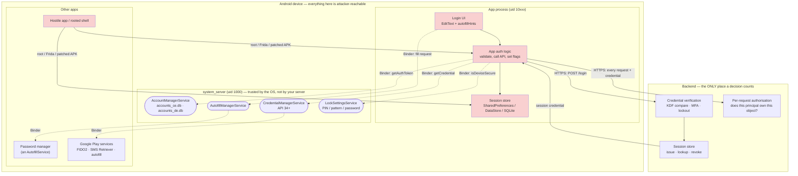
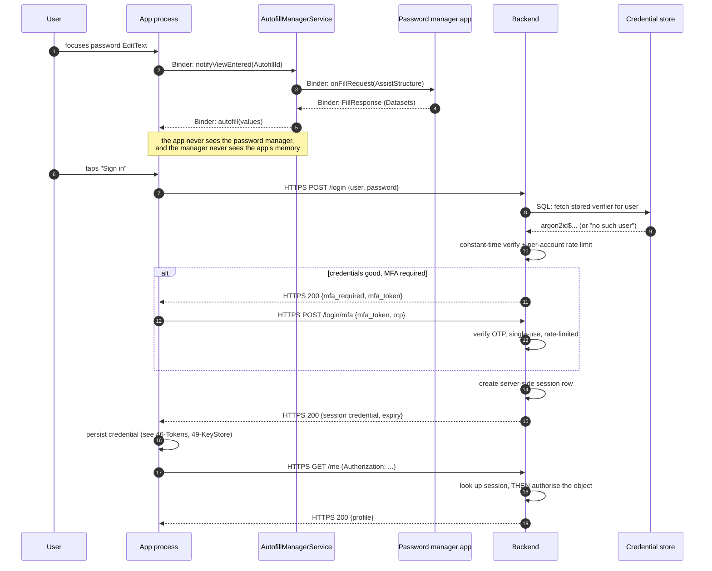
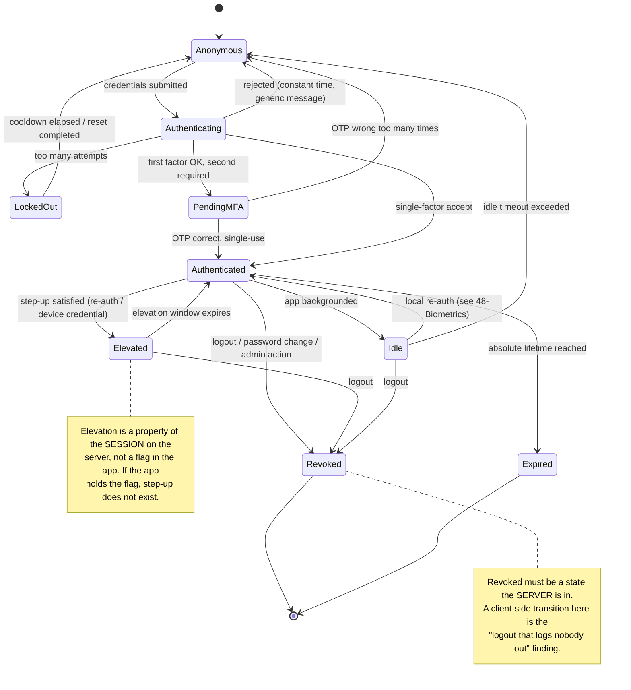
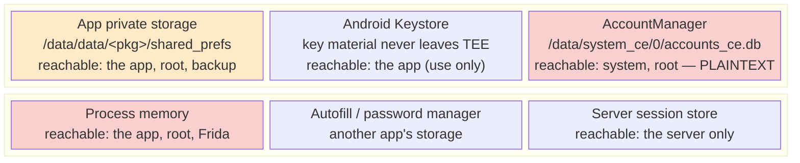
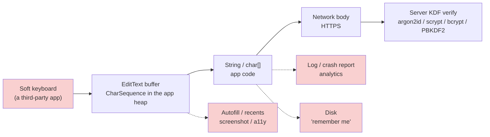
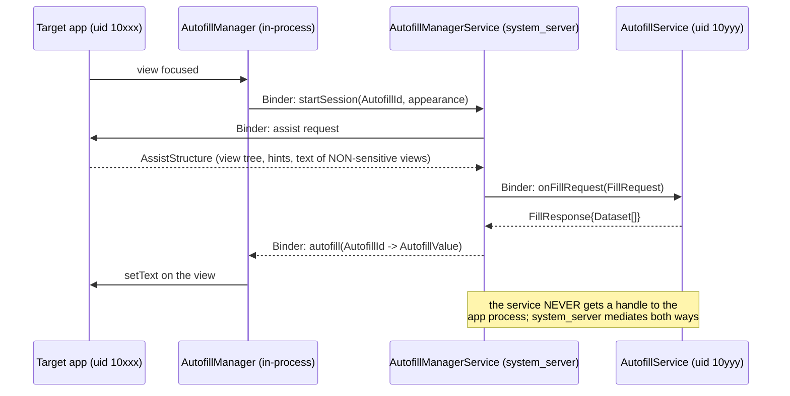
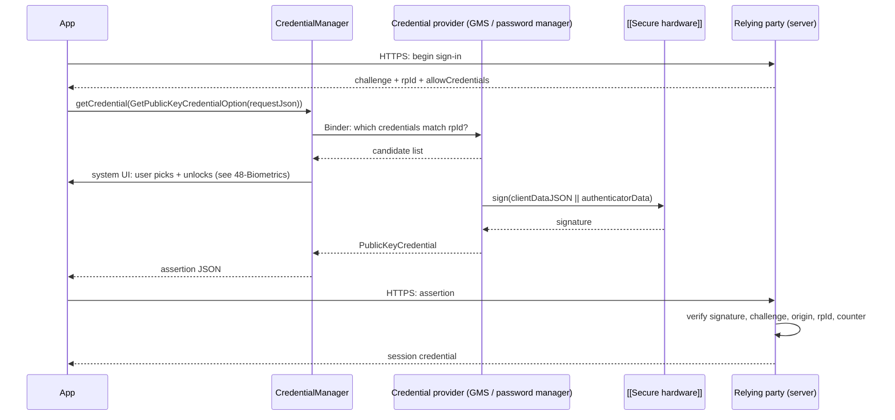
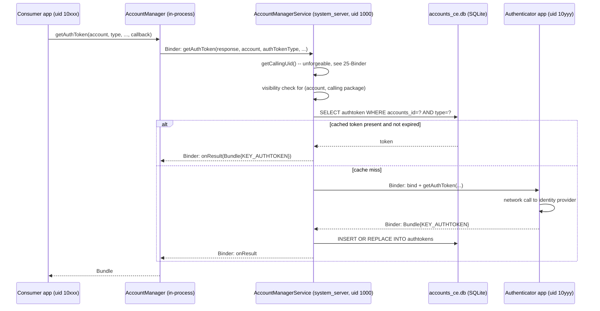
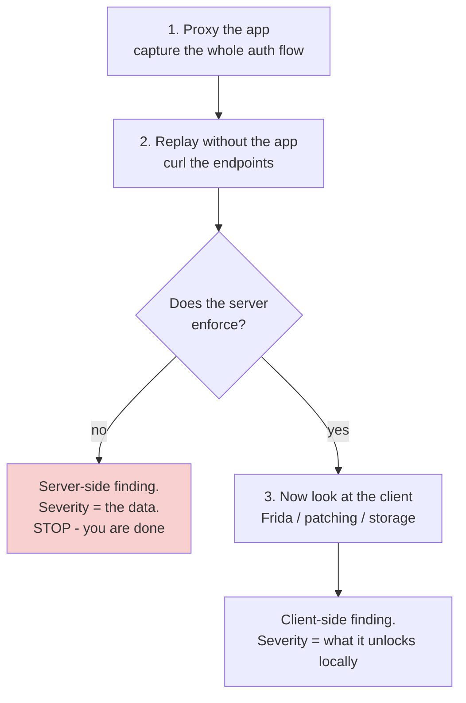
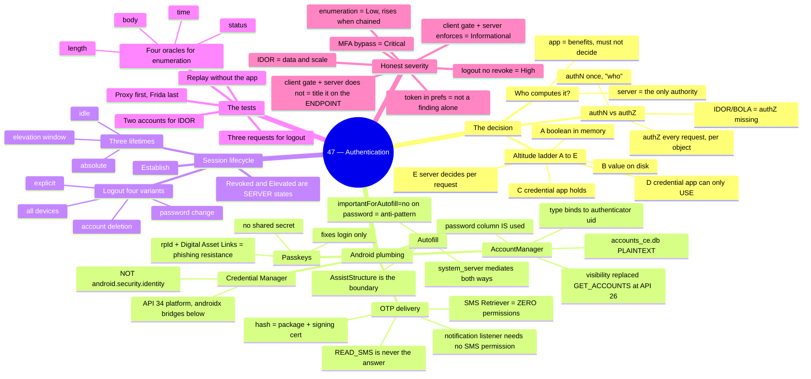

# 47 — Authentication

> After this chapter you will be able to take any Android application, find every place
> it decides *"this is the right person"*, and say which of those decisions is made by a
> server that cannot be lied to and which is made by a boolean on the phone. You will
> build a deliberately broken authentication server and a hardened one, prove that an
> account can be enumerated from a 40-millisecond timing difference, demonstrate that a
> "logout" button can leave a working session behind, read 114 real bearer tokens out of
> the platform account database in plaintext, and prove — by compiling an app that
> provably sets it — that the most widely published way of checking for `FLAG_SECURE` in
> an APK cannot possibly work.

**Prerequisites:** [20-Security-Architecture](../20-Security-Architecture/README.md),
[21-App-Sandbox](../21-App-Sandbox/README.md),
[33-Storage](../33-Storage/README.md),
[34-Cryptography](../34-Cryptography/README.md),
[35-SSL](../35-SSL/README.md),
[45-OAuth](../45-OAuth/README.md),
[46-Tokens](../46-Tokens/README.md)
**Related:** [48-Biometrics](../48-Biometrics/README.md),
[49-KeyStore](../49-KeyStore/README.md),
[36-CertificatePinning](../36-CertificatePinning/README.md),
[71-OWASP-Mobile](../71-OWASP-Mobile/README.md)
**Applies to:** API 1–36. `AccountManager` since API 5, autofill since API 26,
`createAppSpecificSmsToken` since API 26, account *visibility* since API 26, FIDO2 through
Google Play services since roughly 2019, `androidx.credentials` since 2023 and the
platform `CredentialManager` since API 34. The version matrix is [§3.14](#314-version-matrix).

---

## Table of Contents

1. [Introduction](#1-introduction)
2. [High-Level Architecture](#2-high-level-architecture)
3. [Deep Internal Working](#3-deep-internal-working)
4. [Source Code Walkthrough (AOSP)](#4-source-code-walkthrough-aosp)
5. [Security Perspective](#5-security-perspective)
6. [Reverse Engineering Perspective](#6-reverse-engineering-perspective)
7. [Dynamic Analysis](#7-dynamic-analysis)
8. [Static Analysis](#8-static-analysis)
9. [Examples](#9-examples)
10. [Common Interview Questions](#10-common-interview-questions)
11. [Common Mistakes](#11-common-mistakes)
12. [Hands-on Labs](#12-hands-on-labs)
13. [Summary](#13-summary)
14. [References](#14-references)

---

## 1. Introduction

### 1.1 The problem, before there was any technology in it

A woman walks into a bank in 1890 and says she is Mrs Alderton and would like to withdraw
forty pounds.

The clerk has a problem that has nothing to do with money. Before he can decide whether
she *may* take the forty pounds, he has to decide whether she *is* Mrs Alderton. Those are
two completely different questions and the bank will get into two completely different
kinds of trouble if it confuses them.

The first question — *who is this?* — is **authentication**.
The second — *what is this person allowed to do?* — is **authorisation**.

The clerk solves the first question with the tools of 1890. He recognises her face. Or she
produces a passbook that only Mrs Alderton would have. Or she signs her name and he
compares the signature to a card in a drawer. Each of these is a **factor**: a piece of
evidence that is supposed to be hard for anybody who is not Mrs Alderton to produce.

Notice three things about the clerk's situation, because all three survive intact into
Android, and every failure in this chapter is one of them going wrong.

**The clerk decides.** Mrs Alderton does not get to decide that she is Mrs Alderton. If
the bank ever built a system where the customer's own assertion was accepted, the bank
would be robbed within the hour. Hold onto this sentence: **the party that benefits from
the answer must never be the party that computes it.** An Android app is the party that
benefits. The server is the clerk.

**The decision is expensive and is therefore cached.** The clerk is not going to
re-recognise her face between every banknote. He recognises her once and then treats the
rest of the conversation as being with Mrs Alderton. That cache is a **session**. The
moment you create a cache you have created a set of new questions: how long does it last,
who else can pick it up, what invalidates it, and what happens if the underlying fact
changes after it was cached.

**The evidence has a cost of forgery, not an impossibility of forgery.** A signature can
be practised. A face can be resembled. The bank does not achieve certainty; it achieves an
attacker cost it is willing to accept for the value at risk. This is why "is this app's
authentication secure?" is not a well-formed question, and why every finding in this
chapter has to be argued in terms of what it costs an attacker and what it gains them.

### 1.2 What breaks if authentication does not exist

Delete it and look at the wreckage. This is not an academic exercise: each row tells you
what the mechanism is *for*, which is what tells you what a broken one costs.

| Remove | What breaks |
|---|---|
| Authentication entirely | Every account is every other account. There is no such thing as "your" data. |
| The *server* side of it, keeping only the client's | The app decides who you are. Anyone who can edit one byte in the app's memory or one row in its database becomes anyone. This is the single most common serious finding in mobile assessments. |
| Session establishment | The password travels on every request. See [46-Tokens §1.1](../46-Tokens/README.md) — this is the problem tokens were invented to solve. |
| Session *expiry* | A session captured once works forever. There is no such thing as "the window has closed". |
| Logout | A shared or resold device carries the previous owner's identity. A stolen credential can never be taken back. |
| Rate limiting | Every password in the world can be tried. A four-digit OTP falls in under ten thousand requests, and often far fewer. |
| Account enumeration resistance | An attacker learns which of a leaked email list has accounts before spending a single guess. It converts a broad attack into a targeted one. |
| Multi-factor | One leaked password from an unrelated breach is a full account takeover, because people reuse passwords and always will. |
| Device binding | A credential copied off one phone works from a datacentre on another continent. |
| Step-up | The session that was good enough to read your balance is good enough to empty it. |

> **🧠 Mental Model — the hotel key card**
> A hotel is the closest physical analogue to a mobile authentication system, and almost
> every concept in this chapter has a counterpart there.
>
> You check in at reception. You show a **passport** — a strong, slow, expensive-to-verify
> credential you cannot replace. Reception verifies it once and hands you a **key card** —
> a weak, fast, cheap credential you can be issued a new one of in thirty seconds. That
> exchange is **session establishment**, and the passport is the *authentication factor*
> while the card is the *session credential*.
>
> The card expires at your checkout date: **session lifetime**. Reception can cancel it
> from the front desk: **server-side revocation**. Handing it back at checkout does not
> actually cancel it unless reception does something — dropping it in the box is
> **client-side logout**, and if the system is badly built the card still opens your room
> that evening. Some doors — the safe, the executive lounge — want the card *and*
> something else: **step-up authentication**.
>
> And here is the part that matters most. The lock on your door does not know who you are.
> It knows the card is valid for this room until Friday. If you clone the card, the lock
> is satisfied. **A session credential is a bearer instrument**, exactly as
> [46-Tokens](../46-Tokens/README.md) describes, and the entire discipline of protecting
> it follows from that one fact.

### 1.3 Authentication versus authorisation, and why the distinction pays your bills

These two words are confused constantly, including in security reports, and the confusion
is expensive because the *fixes* are in different places.

> **📖 Definition — authentication**
> Establishing **which principal** is making a request. It answers "who". It is performed
> once per session, produces a session credential, and its failures look like: logging in
> as someone else, bypassing the login screen, resetting someone else's password.

> **📖 Definition — authorisation**
> Deciding **whether that principal may perform this specific operation on this specific
> object**. It answers "may they". It is performed on *every* request, produces an allow
> or a deny, and its failures look like: reading another user's invoice by changing an id
> in a URL, calling an admin endpoint from a normal account.

The mobile-specific reason this matters: an app that authenticates perfectly can still be
catastrophically broken, because the server authenticated the session and then trusted a
client-supplied object identifier without checking it belongs to that session.

> **📖 Definition — IDOR / BOLA**
> **Insecure Direct Object Reference**, also called **Broken Object Level Authorization**.
> The server returns or modifies an object because the request named it, without checking
> that the authenticated principal owns it. `GET /api/v1/invoice/10412` returns invoice
> 10412 to whoever asks. It is the most common serious *backend* finding reached through a
> mobile client, and [79-Glossary](../79-Glossary/README.md) points here for it.

Both live in this chapter because on mobile you find them with the same equipment — a
proxy, one account, and patience — and because the report has to distinguish them or the
developer will fix the wrong layer. Section [5.9](#59-idor--bola--the-authorisation-half)
is the authorisation half; everything before it is authentication.

### 1.4 Why Android makes authentication harder than the web

A web application's login form runs on a page the server just sent. The server can change
it at will, the user cannot easily modify it, and the code that runs is the code that was
served five seconds ago.

An Android app is the opposite of all three.

- **The code is on the attacker's machine.** It was installed weeks ago, it can be
  decompiled ([56-JADX](../56-JADX/README.md)), patched
  ([67-BypassingProtections](../67-BypassingProtections/README.md)) and hooked at runtime
  ([53-Frida](../53-Frida/README.md)). Any check written in it is a suggestion.
- **The user is frequently the adversary.** The threat model for a banking app includes
  the account holder trying to defraud the bank, and the threat model for a paid app
  includes the user unlocking the paid features. "The app checks X" is not a control
  against the person holding the phone.
- **The credential must persist.** A user logged out on every cold start uninstalls the
  app. So the session credential is written to disk, and the moment it is written down,
  [33-Storage](../33-Storage/README.md), [49-KeyStore](../49-KeyStore/README.md) and
  [46-Tokens](../46-Tokens/README.md) all intersect with this chapter.
- **Other software is on the device.** Keyboards see typing. Accessibility services see
  screens. Other apps may query the account database. Screenshots and the recents thumbnail
  capture what is displayed.
- **The platform brings its own authentication machinery**, and it is genuinely peculiar:
  a system-wide account database owned by `system_server`, an autofill service that is
  offered your password fields by design, and a credential manager that arrived only in
  API 34 and therefore is not there on most devices in circulation.

> **🔍 Pentester's Note — the one sentence that turns a mobile authentication review into a finding**
> The question is never "does the app check?" It is **"what happens when the app's check
> is removed?"**
>
> You do not need a clever exploit to answer it. Hook the method to return `true`, or
> patch the smali, or simply send the request the app would have sent after a successful
> login and see whether the server serves it. If the server serves it, the app's check was
> decoration and the severity is set by the data behind it. If the server refuses, the
> app's check was a user-experience feature and the finding is at most Informational.
>
> Everything else in this chapter is the machinery for asking that question precisely.

### 1.5 What this chapter owns, and what it does not

This chapter sits in the densest neighbourhood in the repository. Four adjacent chapters
own large pieces of the same territory, and drawing the lines badly would either duplicate
them or leave a hole. The boundaries below are deliberate.

| Chapter | Owns | This chapter owns instead |
|---|---|---|
| [45-OAuth](../45-OAuth/README.md) | The **delegation protocol**: grant types, PKCE, redirect URIs, scheme hijacking, Custom Tabs versus WebView, `state` and `nonce`. How a third party is persuaded to vouch for you. | The **first-party** decision: the app's own login, registration, reset, lockout, MFA and session — including everything that happens when there is no OAuth in the app at all. |
| [46-Tokens](../46-Tokens/README.md) | The **credential's format and storage**: JWT structure, the eight verification failure classes, opaque versus structured, DPoP, where a token lands on disk and what finding one is worth. | The **session** the credential represents: when it is created, how long it should live, what invalidates it, and whether logout actually does anything. |
| [48-Biometrics](../48-Biometrics/README.md) | The **biometric prompt and its crypto binding**: `BiometricPrompt`, `CryptoObject`, sensor classes, `setUserAuthenticationRequired`, and how a fingerprint check is bypassed. | *Where a local prompt belongs in the flow* — step-up, re-auth, and the fact that a local prompt is never an authentication factor to a server. Depth belongs to 48; this chapter links. |
| [49-KeyStore](../49-KeyStore/README.md) | **Key material**: hardware backing, extraction versus use, attestation. | The credential a key protects, and device binding as an *authentication design*, rather than as key management. |
| [36-CertificatePinning](../36-CertificatePinning/README.md) | **Transport trust**: which certificates the app accepts. | What is being carried over that transport, and what a captured login request means. |
| [34-Cryptography](../34-Cryptography/README.md) | **Primitives**: hashes, KDFs, AES, HMAC, randomness. | Where a password comes from *before* it reaches a KDF, and the fact that on mobile the client must not be the one applying it. |
| [71-OWASP-Mobile](../71-OWASP-Mobile/README.md) | The **MASVS taxonomy** and the report structure. | The MASVS-AUTH controls in depth, as testable procedures. |

Three specific hand-offs, stated so nothing is restaged:

**On JWTs.** [46-Tokens](../46-Tokens/README.md) owns them entirely. One point from there
is load-bearing here and is repeated only as a citation, never re-derived: **the JWT
failure classes differ in kind.** `alg:none`, HS/RS confusion and `kid` traversal are
failures of *signature verification* — the token is forged. An expired token or one with
the wrong `aud` carries a **genuine, valid signature**; signature verification was never
the failing step, claim validation was. 46's nine-token gauntlet measured exactly this and
its A6 and A7 cases are both correctly-signed tokens that a broken verifier accepted. When
you write up a session-lifetime finding, that distinction is what stops a developer
"fixing" it by changing signing algorithms.

**On biometrics.** [48-Biometrics](../48-Biometrics/README.md) owns the prompt, the sensor
classes and the `CryptoObject` binding. This chapter states only the flow-level rule —
that a local prompt returning `onAuthenticationSucceeded` is a fact about a phone, not a
fact the server has any reason to believe — and points at 48 for how the prompt is
actually attacked.

**On OAuth.** [45-OAuth](../45-OAuth/README.md) already has the interception, PKCE and
scheme-hijacking labs and a CTF covering audience confusion. None of them are repeated.
45's §5 notes that ROPC has no defined way to carry a second factor and that
implementations invent `otp` parameters; **that promise is discharged in
[5.6](#56-otp-and-multi-factor-where-the-flaws-actually-are)**, which is about the invented
mechanism rather than the OAuth grant.

---

## 2. High-Level Architecture

### 2.1 The whole picture, and where trust stops



Read this diagram as a map of *who is allowed to be believed*. Everything inside the
**Device** box is coloured or reachable by the red box: the login UI, the app's logic and
its session store all run in a process an attacker with root or Frida owns completely, and
the hostile actor has arrows straight into them. `system_server` is drawn as a separate
trust domain because it is — it runs as uid 1000, it is not the app, and its services are
reached over Binder ([25-Binder](../25-Binder/README.md)). But note carefully what that
buys you: `system_server` is trusted by *the operating system*, and it is not trusted by
*your server*, because a rooted device's `system_server` answers to the device's owner.

The only box with no red arrow into it is **Server**. Every arrow crossing that boundary
is HTTPS, and every one carries a credential. The three server boxes are separated on
purpose: credential verification happens once, session lookup happens per request, and
authorisation happens per request *per object*. Collapsing the third into the second is
exactly how IDOR happens.

The dotted Binder arrows are the Android-specific plumbing this chapter covers: autofill
being offered the password field, `AccountManager` handing out cached tokens,
`CredentialManager` brokering passkeys, and `LockSettingsService` being asked whether the
device even has a screen lock. Each of those is a place where something other than your
app touches your credentials.

### 2.2 The login sequence, with the transport on every arrow



Follow the arrows and notice which ones are Binder and which are HTTPS, because the
distinction is the whole security argument. Steps 2–5 are **entirely on-device**: the
autofill round trip happens between the app's window, `system_server` and a third-party
password manager, over Binder, and never leaves the phone. The app does not learn which
password manager filled the field, and the password manager does not get to read the app's
memory — `system_server` sits between them and passes only an `AssistStructure` describing
the view hierarchy in one direction and `Dataset` values in the other.

Steps 6 onward are HTTPS, and every one of them is a request the attacker will replay,
modify and repeat. Step 8 is the only place a password is ever compared; step 9's
`argon2id$…` is a **verifier**, not a password, and the difference belongs to
[34-Cryptography](../34-Cryptography/README.md). Note that step 10 folds the rate limit
into the same operation as the verify, and that the "no such user" branch must take the
same time as the success branch or you have built the account-enumeration oracle of
[§5.4](#54-account-enumeration).

The MFA block is drawn as an `alt` because it is conditional, and the conditionality is a
vulnerability surface all by itself: an app that receives `{mfa_required: true}` and
*decides in client code* whether to show the OTP screen has handed the attacker the second
factor, and [§5.6](#56-otp-and-multi-factor-where-the-flaws-actually-are) is about that
exact shape.

Step 15 is deliberately two operations. "Look up the session" is authentication. "Authorise
the object" is authorisation. An implementation that stops after the first is the most
common serious finding you will write.

### 2.3 The session lifecycle as a state machine



This machine is the specification you test an application against, and almost every
authentication finding is a missing edge or an edge implemented in the wrong process.

The two notes are the important part. `Elevated` and `Revoked` must both be states of a
row in the server's session store. If `Elevated` is a `boolean isStepUpDone` in the app,
then step-up authentication does not exist and its absence is invisible to a functional
tester, because the app behaves correctly right up until somebody hooks the field. If
`Revoked` is reached by the app deleting its local credential, then logout is a
user-interface animation.

`Idle` is worth separating from `Anonymous` because the two are conflated constantly. An
app that requires a fingerprint after five minutes in the background has implemented a
transition from `Idle` back to `Authenticated`. That transition is entirely local. The
session credential never stopped being valid, so an attacker who took it while the phone
was unlocked is unaffected by the fingerprint prompt. This is the single most common
misunderstanding about local re-authentication and it is why
[48-Biometrics](../48-Biometrics/README.md) insists on `CryptoObject` binding — without it,
the prompt gates the UI and nothing else.

`LockedOut` is a state of the *account* on the server, not of the app. An app that counts
failures locally and disables its own button has implemented a lockout that survives
exactly until `pm clear`.

### 2.4 Where the credential physically lives



Six places a credential can be at any instant, and the security properties are wildly
different. The app's own private storage (amber) is genuinely protected on a stock locked
device by the sandbox plus file-based encryption, and
[33-Storage §5.3](../33-Storage/README.md) is emphatic that "stores a token in
SharedPreferences" is not by itself a finding. Process memory and `AccountManager` are red
for different reasons: memory because anything with code execution in the process reads it
trivially, and `AccountManager` because — as [§3.4](#34-accountmanager--what-is-actually-on-disk)
demonstrates with a measurement on a real device — **it stores bearer tokens and passwords
in plaintext in a SQLite database**, protected by nothing but file permissions and SELinux.

The Keystore box is the interesting one, and its property is stated precisely in
[49-KeyStore](../49-KeyStore/README.md): the key cannot be *extracted*, but it can be
*used* by anything running as the app. Wrapping a session credential in a Keystore key
therefore defeats an attacker who can read files and does not defeat an attacker who can
run code.

Only the server box is out of reach, which is the argument the rest of the chapter makes
over and over: **the authoritative copy of the authentication decision must be the one the
attacker cannot reach.**

---

## 3. Deep Internal Working

### 3.1 The three questions every authentication design answers

Before any Android API, fix the vocabulary. Every authentication system, on any platform,
answers three questions, and confusing them is how designs go wrong.

| Question | Name | Where it must be answered | Typical Android mistake |
|---|---|---|---|
| What evidence does the principal present? | **Factors** | Server verifies; client only collects | Verifying the factor on the device |
| What does the system hand back? | **Session credential** | Server issues; client stores | Inventing a credential client-side |
| How does the system stop believing it? | **Lifecycle** | Server decides; client cooperates | Deleting the local copy and calling it logout |

> **📖 Definition — authentication factor**
> A category of evidence. The three traditional categories are **something you know** (a
> password, a PIN), **something you have** (a phone that receives an SMS, a hardware key,
> a private key in a TEE) and **something you are** (a fingerprint, a face). Two factors
> from the *same* category are not two-factor authentication — a password plus a security
> question is one factor twice.

> **⚠️ Warning — the category error that makes mobile MFA fake**
> On a phone, "something you have" and "something you know" frequently collapse into the
> **same device**. If the password manager, the OTP app and the banking app are all on the
> one handset, an attacker who compromises the handset has both factors. Multi-factor
> authentication on a single device raises the cost of *remote* attack substantially and
> the cost of *device-compromise* attack barely at all.
>
> This is not a reason to skip MFA. It is the reason your report must say which threat the
> MFA addresses, and why device binding ([§3.11](#311-device-binding)) is a different
> control rather than a stronger version of the same one.

### 3.2 Where an app can put its authentication decision — the five altitudes

An Android app can implement "the user is logged in" at five different altitudes, and the
altitude determines the severity of everything that follows. This vocabulary is borrowed
deliberately from
[20-Security-Architecture/labs/lab-03](../20-Security-Architecture/labs/lab-03-integrity-gate-bypass.md),
which uses altitudes for integrity gates; the same ladder applies to authentication gates.

| Altitude | Where the decision is | How it is defeated | Honest severity of a bypass |
|---|---|---|---|
| **A — a boolean in memory** | `if (isLoggedIn)` on a field | One Frida line, or one smali edit | The finding is *whatever is behind it*. Usually High if real data follows, Informational if the server re-checks |
| **B — a value on disk** | `prefs.getBoolean("logged_in", false)` | `pm clear` is enough to reset; a root shell edits it | As A, plus it survives reboots so it is easier to weaponise |
| **C — a credential the app holds** | A token in `SharedPreferences`, sent on each request | Extract the token; see [46-Tokens](../46-Tokens/README.md) | Depends on token scope and lifetime |
| **D — a credential the app can only *use*** | Keystore-wrapped, hardware-backed, possibly auth-bound | Cannot extract; must run code in the process | Meaningfully higher bar. See [49-KeyStore](../49-KeyStore/README.md) |
| **E — a decision the server makes per request** | Server verifies session and object ownership every time | Cannot be defeated on the device at all | Not bypassable client-side. This is the target state |

> **🧠 Mental Model — altitude is about *who is asking*, not how hard the code is**
> A common mistake is to think obfuscation moves an app up this ladder. It does not.
> Obfuscation ([40-Obfuscation](../40-Obfuscation/README.md)) makes altitude A harder to
> *find*; it leaves it at altitude A. The ladder measures **which process holds the
> authoritative answer**, and there are only two interesting rungs on it: the answer is on
> the phone (A–D) or the answer is on the server (E).
>
> The reason A–D are still worth distinguishing is that they set the *cost* of the bypass,
> and cost is what you report. A `pm clear` bypass and a "requires a TEE-resident key and
> code execution in the process" bypass are both bypasses of a client-side gate, and they
> are not the same finding.

### 3.3 Password handling — where a password comes from, before it reaches a KDF

[34-Cryptography](../34-Cryptography/README.md) owns key derivation functions and its
references table points here for *"where passwords come from, before they reach a KDF"*.
This is that section.

A password's journey on Android is short and has five hazards on it.



The solid path is the intended one, and only its last box performs any cryptography. The
dotted paths are where passwords actually leak. Reading them left to right:

**The keyboard is another application.** Everything typed into the `EditText` passes
through an input method the user chose, which may be a third-party app with network access.
The only mitigation the platform offers is `android:inputType="textPassword"`, which asks
the IME not to learn or personalise from the field — an `EditText` without it is asking a
third-party app to remember the password. It is a request, not an enforcement.

**The `EditText` buffer is visible to the screen.** That means screenshots, the recents
thumbnail, screen recording and accessibility services. `FLAG_SECURE` addresses screenshots
and recents; [§3.10](#310-flag_secure-and-what-it-does-not-do) covers exactly what it does
and, importantly, what it cannot do.

**`String` is the wrong type and this is not pedantry.** A Java `String` is immutable and
lives on the heap until a garbage collection cycle chooses to move or reclaim it; you
cannot erase it. A `char[]` can be filled with zeros the moment you are finished. The
platform agrees: `EditText.getText()` returns an `Editable` precisely so you *can* clear
it. In practice most apps call `.toString()` immediately and the point is lost. Note
honestly that this matters against a memory-dumping attacker who is already running code
in the process, so it is a defence-in-depth measure, not a primary control — and note that
[19-Memory](../19-Memory/README.md) measured that freed memory on Android is **not** zeroed
and that there is **no allocator quarantine**, which makes the residue longer-lived than
folklore assumes.

**Logging is the most common real leak.** A single `Log.d("login", "body=" + json)` in a
debug branch that shipped, or an analytics SDK capturing HTTP bodies, puts passwords in
logcat and in a vendor's cloud. [69-MalwareAnalysis](../69-MalwareAnalysis/README.md) and
[52-StaticAnalysis](../52-StaticAnalysis/README.md) both cover finding these.

**"Remember me" writes it down.** [§3.9](#39-remember-me-and-persistent-sessions) is the
whole treatment; the short version is that storing a *password* for "remember me" is never
correct, and storing a *long-lived session credential* is.

> **⚠️ Warning — do not hash the password on the client**
> Apps periodically compute `SHA-256(password)` in the app and send the digest, believing
> this protects the password. It does the opposite of what the developer intends, in three
> ways.
>
> The digest **becomes** the password: whatever the server compares against, an attacker
> who captures it can replay it, so the client-side hash has changed nothing about the
> wire risk and has removed the server's ability to choose a slow KDF.
>
> It **prevents the server from upgrading**. Password verifiers are meant to be
> re-derivable with better parameters over time; if the client fixes the algorithm, every
> installed app version pins it.
>
> And it **encourages skipping a server-side KDF entirely**, which turns a database leak
> into a password leak. If a client-side hash is genuinely required — some protocols do
> want it — the server must *still* apply a proper KDF to what it receives. See
> [34-Cryptography](../34-Cryptography/README.md) for the KDF choice itself.

The correct division of labour, stated once: **the client collects, TLS protects, the
server verifies.** The client performs no cryptography on the password at all.

### 3.4 `AccountManager` — what is actually on disk

> **📖 Definition — `AccountManager`**
> A platform service, reached over Binder, that holds a device-wide database of user
> accounts on behalf of *authenticator* apps, and hands cached authentication tokens to
> *consumer* apps. It is how "Add account" in Settings works, how one Google sign-in
> serves twenty apps, and how a sync adapter obtains credentials without a UI.

The architecture has three roles, and confusing them causes most of the misunderstanding
around this API.

| Role | What it is | Code shape |
|---|---|---|
| **Authenticator** | The app that *owns* an account type and can mint tokens for it. There is exactly one per account type on a device. | A `Service` exporting `AbstractAccountAuthenticator` via the `android.accounts.AccountAuthenticator` intent action |
| **Consumer** | Any app that asks for a token for an account it does not own | Calls `AccountManager.getAuthToken(...)` |
| **`AccountManagerService`** | The `system_server` component holding the database and enforcing who may see what | Binder service `account` |

> **🔬 Under the Hood — measured on a physical device, not recited**
> Device: Redmi `M2101K6P` (`sweetin`), **Android 11 / API 30**, arm64-v8a, MIUI
> V12.5.10.0, rooted with Magisk. Every figure below was read off that device.
>
> The two databases and their permissions:
>
> ```
> # adb shell "su -c 'ls -laZ /data/system_ce/0/accounts_ce.db /data/system_de/0/accounts_de.db'"
> -rw-rw---- 1 system system u:object_r:system_data_file:s0  413696  accounts_ce.db
> -rw-rw---- 1 system system u:object_r:system_data_file:s0   65536  accounts_de.db
>
> # adb shell ls -la /data/system_ce/0/accounts_ce.db          # as uid 2000 (shell)
> ls: /data/system_ce/0/accounts_ce.db: Permission denied
> ```
>
> Mode `0660 system:system`, SELinux label `system_data_file`. Neither an app nor the adb
> shell can read it; **root can**. That is the entire protection.
>
> The CE schema, read with SQLite after copying the file out as root:
>
> ```sql
> CREATE TABLE accounts ( _id INTEGER PRIMARY KEY AUTOINCREMENT, name TEXT NOT NULL,
>                         type TEXT NOT NULL, password TEXT, UNIQUE(name,type));
> CREATE TABLE authtokens ( _id INTEGER PRIMARY KEY AUTOINCREMENT, accounts_id INTEGER NOT NULL,
>                           type TEXT NOT NULL, authtoken TEXT, UNIQUE (accounts_id,type));
> CREATE TABLE extras ( _id INTEGER PRIMARY KEY AUTOINCREMENT, accounts_id INTEGER,
>                       key TEXT NOT NULL, value TEXT, UNIQUE(accounts_id,key));
> ```
>
> There is no encryption anywhere in that schema. `authtoken` is a `TEXT` column and it
> contains the token.
>
> On this device, right now: **4 accounts, 114 rows in `authtokens`, 376 rows in
> `extras`.** All 114 tokens were non-NULL, 153 to 957 characters long, mean 570. **105 of
> the 114 begin with `ya29`** — the Google OAuth 2.0 access-token prefix.

Four things measured in that database are worth more than any amount of documentation
reading, and two of them contradict things people commonly assume.

**The `password` column is not vestigial.** Common wisdom is that `setPassword` is legacy
and nobody uses it. On this device one of the four accounts — the `com.xiaomi` account —
has a **352-character value in `accounts.password`**. An authenticator wrote a credential
into a plaintext column on disk, in 2026, on a shipping consumer device. Whatever that
value is, it is not a token in the `authtokens` table, and it is readable by root.

**Not one of the 114 real production tokens was a JWT.** Zero matched the `ey…`
three-segment shape. [46-Tokens](../46-Tokens/README.md) opens its analysis method with
"count the dots first" for exactly this reason: the field is full of opaque tokens, and an
analyst who arrives with a JWT toolkit and no plan for opaque credentials has nothing to
do. The prefixes clustered hard — 105 `ya29`, then a scatter of one-offs — which is what a
single dominant identity provider looks like on a real handset.

**Token expiry is stored next to the token, in the same plaintext table.** 131 of the 376
`extras` rows have keys of the form `EXP:<package>:<cert-sha1>:oauth2:<scope>`, whose
values are Unix epoch seconds. Interpreting them at the time of the run: **7 in the future,
106 in the past.** The maximum remaining lifetime across every live token was **2,932
seconds** — under fifty minutes. Two conclusions follow. Google's `ya29` access tokens are
roughly one-hour credentials, measured rather than quoted. And the database **retains
expired tokens indefinitely** — 106 dead credentials were still sitting on disk. For a
forensic analyst that is an authentication *history*; for a defender it is unnecessary
retention.

**The token type string is a capability name, and it encodes the caller's identity.** The
`authtokens.type` column held 70 distinct values on this device, of the form:

```
com.android.chrome:38918a453d07199354f8b19af05ec6562ced5788:oauth2:https://www.googleapis.com/auth/chromesync
└──── package ────┘ └──────── signing certificate SHA-1 ────────┘ └───── scope ─────┘
```

The requesting package name **and its signing certificate hash** are baked into the key
under which the token is cached. That is how the Google authenticator scopes a cached token
to one specific build of one specific app: a repackaged Chrome with a different signing key
gets a different cache key, and therefore a cache miss, and therefore has to ask the
authenticator afresh. It is a neat piece of design and it is invisible from the API
surface.

#### Who can see which accounts

Before API 26, an app declared `GET_ACCOUNTS` and could list every account on the device.
That is gone. From API 26 the authenticator controls **visibility** per package.

| Constant | Value | Meaning |
|---|---|---|
| `VISIBILITY_UNDEFINED` | 0 | No explicit setting; falls back to the type-wide default |
| `VISIBILITY_VISIBLE` | 1 | Visible; the user was not asked |
| `VISIBILITY_USER_MANAGED_VISIBLE` | 2 | Visible; the user may revoke it |
| `VISIBILITY_NOT_VISIBLE` | 3 | Hidden |
| `VISIBILITY_USER_MANAGED_NOT_VISIBLE` | 4 | Hidden; the user may grant it |

Measured on the device: the `visibility` table in `accounts_de.db` had **17 rows, 12 with
value 2 and 5 with value 1** — every entry an explicit grant to a named package, and no
row anywhere granting blanket access. Meanwhile the legacy `grants` table had only **6
rows, all for `com.android.AccountManager.ACCOUNT_ACCESS_TOKEN_TYPE`**, which is the
special pseudo-token type used to grant *account access* rather than a real credential.

> **🔍 Pentester's Note — `GET_ACCOUNTS` in a modern manifest tells you about the developer, not the app**
> Seven of the seventeen real applications swept in [§8.6](#86-a-measured-sweep-of-17-real-apks)
> still request `android.permission.GET_ACCOUNTS`, and five still request the long-removed
> `AUTHENTICATE_ACCOUNTS`. On API 26+ neither grants visibility. Finding them tells you the
> manifest has accumulated a decade of copy-paste; it does not tell you the app can see
> anything. Report it, if at all, as hygiene — and check what the app can *actually* see by
> calling `getAccounts()` under a hook, which is what
> [`scripts/auth-hooks.js`](scripts/auth-hooks.js) does.

There is one more control, and it is the anti-hijack one. The `meta` table in
`accounts_de.db` contains rows of the form `auth_uid_for_type:com.google = 10185`. The
account type is bound to the **uid** of the authenticator that registered it. A second app
cannot claim the `com.google` account type and start answering token requests, because the
service binds the type to the incumbent's uid. Nine such bindings existed on the test
device.

### 3.5 The autofill framework — a third party is offered your password field

> **📖 Definition — autofill service**
> An app, chosen by the user in Settings, that `system_server` consults whenever a fillable
> view is focused in *any* application. It receives a description of the view hierarchy and
> may return credential values to be inserted. Introduced in API 26.

The trust story is genuinely subtle and it is worth being precise about, because the
casual reading ("another app can read my password fields") is both alarming and wrong in an
important way.



Three properties follow from that mediation, and each has a consequence for an assessment.

**The autofill service does not read the app's memory.** It receives an `AssistStructure`
built by `system_server` from the app's view hierarchy. It is a snapshot, and the app
controls what is in it via `importantForAutofill` and via marking fields sensitive. This is
why "a password manager can see my app" is not, by itself, a vulnerability.

**But the structure includes text, and apps forget that.** A view that already contains a
value — say, a masked account number rendered as a `TextView`, or a "logged in as
alice@example.invalid" label — contributes that text to the structure that a third-party
app receives. `android:importantForAutofill="noExcludeDescendants"` is how an app opts a
subtree out. Almost nothing does.

**The service is chosen by the user and could be malicious.** A malicious app that persuades
the user to select it as the autofill service is offered every fillable field on the device.
The user-facing consent for this is a single Settings toggle whose wording does not convey
that. This is a real malware pattern and it is one of the reasons
[69-MalwareAnalysis](../69-MalwareAnalysis/README.md) treats a declared `AutofillService`
as a high-signal capability.

> **🔬 Under the Hood — the autofill service on the test device**
> ```
> $ adb shell settings get secure autofill_service
> com.google.android.gms/.autofill.service.AutofillService
> $ adb shell dumpsys autofill | grep -E 'Service UID|Component'
>     Service UID: 10185
>       Component: ComponentInfo{com.google.android.gms/com.google.android.gms.autofill.service.AutofillService}
> ```
>
> Now compare that uid with the account authenticator measured in
> [§3.4](#34-accountmanager--what-is-actually-on-disk):
>
> ```
> auth_uid_for_type:com.google = 10185
> ```
>
> **They are the same uid.** On a stock Google device the autofill service that is offered
> every password field on the phone, and the `AccountManager` authenticator that owns the
> `com.google` account type and mints the 105 `ya29` tokens, are the same application
> running in the same sandbox. That is not a vulnerability — it is Google Play services
> being Google Play services — but it is a concentration of authentication authority in one
> uid that is worth stating out loud in a threat model, because a great deal of Android
> security reasoning implicitly assumes these are separate parties.

The app-side controls that matter for a review:

| Attribute / API | Effect | Where it goes wrong |
|---|---|---|
| `android:autofillHints="password"` | Tells the service what the field is | Missing on a real password field, so managers guess by heuristics and sometimes fill the wrong box |
| `android:importantForAutofill="no"` | Excludes this view | Applied to the *password* field "for security", which just breaks password managers and pushes users to weaker passwords |
| `...="noExcludeDescendants"` | Excludes a subtree | Rarely used where it should be — around views displaying account data |
| `AutofillManager.disableAutofillServices()` | An app that *is* a service disables itself | — |
| `setDataIsSensitive(false)` on a `ViewNode` | Marks data as safe to include in save requests | Set wrongly, the value is retained by the manager |

> **⚠️ Warning — "disable autofill on the password field" is an anti-pattern**
> It appears in hardening checklists and it is backwards. Disabling autofill on a password
> field does not stop a malicious autofill service seeing the *rest* of the screen, does not
> stop keyboards, and does stop legitimate password managers — which pushes users towards
> passwords they can type from memory. The measurable result is weaker credentials. If you
> see it in a codebase, the correct report is that the control is counter-productive.

### 3.6 Credential Manager and passkeys

> **📖 Definition — Credential Manager**
> A unified API for retrieving *any* kind of sign-in credential — a saved password, a
> passkey, or a federated identity token — through one call, with one system-drawn
> bottom-sheet UI. `androidx.credentials` is the Jetpack library; `android.credentials` is
> the platform service, added in **API 34**.

> **📖 Definition — passkey**
> A WebAuthn/FIDO2 credential: a public/private key pair where the private key lives in the
> device's secure hardware or in a synced credential provider, and the site holds only the
> public key. Signing in means signing a server-supplied challenge. **There is no shared
> secret**, so there is nothing to phish, nothing to reuse across sites, and nothing to
> steal from a breached database.

Passkeys are the most significant change to authentication in this chapter's scope, and the
reason is structural rather than cryptographic.



The security argument lives in two of those arrows.

**`rpId` binding is what kills phishing.** The credential provider will only offer
credentials whose `rpId` matches the origin it has verified for the calling app — on
Android, through **Digital Asset Links**, the same `assetlinks.json` mechanism App Links
use ([26-Intent](../26-Intent/README.md), [32-Manifest](../32-Manifest/README.md)). A
lookalike app cannot obtain an assertion for `bank.example`, because the provider checks
the caller's package name and signing certificate against the JSON that `bank.example`
publishes. Compare this with an OTP, which the user can be talked into typing into
anything.

**The private key never leaves the provider.** The app receives a signature over a
server-chosen challenge and nothing else. There is no bearer secret to extract from the
app's storage, which removes an entire family of findings — and, crucially for a report,
means "the app stores no credential" can be *true* rather than aspirational.

> **⚠️ Warning — a passkey authenticates the ceremony, not the session that follows**
> The output of a passkey ceremony is an assertion the server verifies once. What the
> server hands back is an ordinary session credential with all the ordinary problems:
> lifetime, revocation, storage, replay. **Passkeys fix login. They fix nothing after
> login.** An app with passkeys and a non-expiring bearer token in `SharedPreferences` is
> not a well-authenticated app, and this is a genuinely common finding shape now that
> passkey adoption is rising.

> **🔬 Under the Hood — Credential Manager availability, measured**
> On the API 30 test device:
>
> ```
> $ adb shell service list | grep -iE 'credential|autofill|account'
> 9   account: [android.accounts.IAccountManager]
> 17  android.security.identity: [android.security.identity.ICredentialStoreFactory]
> 26  autofill: [android.view.autofill.IAutoFillManager]
> ```
>
> **There is no `credentials` service.** The platform `CredentialManager` genuinely is not
> present below API 34, which is why `androidx.credentials` exists: it routes to Play
> services' FIDO2 implementation on older releases and to the platform service on 34+.
>
> Note the trap in that output. `android.security.identity` **is** present, and it is
> **not** Credential Manager — it is the Identity Credential API (mobile driving licences
> and similar), added in API 30, and the name collision has misled more than one analyst.
> Two APIs with "credential" in the name, unrelated purposes, one device.

### 3.7 OTP delivery on Android — three APIs, one of them wrong

An app that sends a one-time code by SMS has to read it back. Android offers three
mechanisms and the difference between them is a permission that gives an app your entire
message history.

| Mechanism | Permission needed | What the app sees | API |
|---|---|---|---|
| **SMS Retriever API** | **None** | Exactly one message, matched by an 11-character hash of the app's package and signing certificate | Play services `SmsRetriever` |
| **SMS User Consent API** | None | One message, after the user taps a dialog | Play services `SmsRetriever.startSmsUserConsent` |
| **`createAppSpecificSmsToken`** | **None** | Messages containing a platform-generated token | Platform, API 26+ |
| **`READ_SMS` / `RECEIVE_SMS`** | Runtime permission | **The user's entire SMS inbox, forever** | Platform, all versions |

The SMS Retriever hash deserves explanation because it is the mechanism that makes the
permissionless path work, and it is computed the same way a token type string is scoped in
[§3.4](#34-accountmanager--what-is-actually-on-disk) — from the package name plus the
signing certificate.

```
hash = base64( SHA-256( "<package name> <hex of signing certificate DER>" )[0:9] )[0:11]
```

The server appends that eleven-character string to the SMS. Play services matches inbound
messages against the hash for each registered app and delivers only the matching one, to
only that app. A repackaged clone has a different signing certificate, therefore a
different hash, therefore never receives the code.
[`scripts/sms-retriever-hash.py`](scripts/sms-retriever-hash.py) computes it from an APK so
you can verify an app's server is sending the right one — a mismatch is a real bug that
manifests as "OTP autofill never works", and developers frequently *fix* it by adding
`READ_SMS`.

> **🔍 Pentester's Note — `READ_SMS` on an app whose only SMS need is an OTP**
> Measured across the 17 real applications in [§8.6](#86-a-measured-sweep-of-17-real-apks):
> **12 of 17 contained SMS Retriever markers and 9 of 17 contained `READ_SMS` or
> `RECEIVE_SMS` markers in their DEX**, with 2 of 17 declaring full SMS access in the
> manifest. The overlap is the interesting part — apps ship the permissionless API *and*
> the permissioned one, typically because an SDK bundles one and the app's own code uses
> the other.
>
> This is a genuine privacy finding and it is easy to argue: the app has a demonstrated,
> working, permissionless path to the only message it needs, and reads the whole inbox
> anyway. Severity is Medium on its own and rises sharply if the app also has network
> permission and an analytics SDK, because SMS content then plausibly leaves the device.

### 3.8 Session establishment, lifetime and logout

This is the part of authentication that mobile testers most often skip, and it is where the
highest-severity findings live.

> **📖 Definition — session**
> Server-side state that records "this credential currently corresponds to this principal",
> created after successful authentication and destroyed on logout, expiry or revocation.
> **If there is no server-side state, there is no session** — there is only a credential
> that the server re-validates cryptographically, which is a different design with
> different revocation properties. [46-Tokens §3.10](../46-Tokens/README.md) covers why
> revoking a self-contained token is hard.

Three lifetimes, and an app needs all three:

| Lifetime | What it bounds | Typical value | What it protects against |
|---|---|---|---|
| **Idle timeout** | Time since last use | 15–30 min (finance), hours (consumer) | An unattended unlocked device |
| **Absolute lifetime** | Time since login, regardless of activity | 8–24 h (finance), 30–90 d (consumer) | A credential stolen and used slowly |
| **Elevation window** | Time since step-up | 2–15 min | A session being used for an operation it was not re-authorised for |

> **⚠️ Warning — "the token expires in an hour" is not a session lifetime**
> A one-hour access token backed by a ninety-day refresh token is a **ninety-day session**.
> The access token's expiry bounds how long a *stolen access token* works; it does nothing
> about the refresh token, which is the credential worth stealing. When you write up
> session lifetime, state the lifetime of the longest-lived credential in the chain. This is
> the single most common way a session-management finding gets argued away in a report
> review.

#### What logout must actually do

Logout is the most reliably broken thing in mobile authentication, because it looks like it
works. The user taps it, the app returns to the login screen, and every functional test
passes.

A correct logout does five things, and only the first is on the device:

1. **Client:** destroy every local copy of every credential — the access token, the refresh
   token, cookies in both `CookieManager` (WebView) and the HTTP client's jar, cached
   responses, and any in-memory holder.
2. **Server:** invalidate the session row so the access credential stops being accepted.
3. **Server:** revoke the refresh token *and its whole family* — see
   [46-Tokens §3.9](../46-Tokens/README.md) on rotation and reuse detection.
4. **Server:** if the app supports "log out of all devices", invalidate every session for
   the principal, not just this one.
5. **Client:** clear anything that would let the next user of the device infer the previous
   one — cached avatars, the account name pre-filled in the username field, notification
   history, and the recents thumbnail.

The test is three requests and takes two minutes, and it is written out step by step in
[`labs/lab-02-session-lifecycle-and-logout.md`](labs/lab-02-session-lifecycle-and-logout.md):

```
# host, with a proxy in place
1. capture a request that requires authentication; note the credential
2. log out in the app
3. replay request 1 verbatim
```

If step 3 succeeds, logout did not revoke, and the finding is usually High: a credential
captured at any point — from a log, a backup, a shared device, a proxy — remains valid after
the user has taken the only action the interface offers to stop it.

> **🔍 Pentester's Note — the four logout variants, and why you must test all four**
> Applications frequently implement one and not the others, and the report is much stronger
> when you enumerate them.
>
> | Variant | Test |
> |---|---|
> | Explicit logout | Tap logout, replay |
> | Password change | Change the password in another session, replay this one's credential |
> | Remote logout | "Sign out of all devices", replay |
> | Account deletion | Delete the account, replay — and then check whether the data is actually gone |
>
> The password-change case is the one that most often fails while explicit logout works,
> because it requires the *server* to enumerate sessions rather than the client to delete
> one. And the account-deletion case is the one
> [71-OWASP-Mobile](../71-OWASP-Mobile/cheatsheet.md) maps to MASVS-PRIVACY-4: an account
> that stops being reachable from the app while the data remains is a privacy finding, not
> an authentication one, and it belongs in a different section of your report.

### 3.9 "Remember me" and persistent sessions

Every consumer app needs the user to stay logged in. The question is what it writes down.

| Design | What is stored | Verdict |
|---|---|---|
| Store the password | The password, reversibly | **Never correct.** A password is a cross-site credential; storing it converts a device compromise into a credential compromise everywhere the user reused it |
| Store the password "encrypted" with a hardcoded key | The password, trivially recoverable | Worse than the above, because it looks like a control |
| Store a long-lived session credential | A token scoped to this app and revocable | **Correct.** Revocable, scoped, and worthless elsewhere |
| Store a refresh token, Keystore-wrapped | As above, plus file-read resistance | Correct and better. See [49-KeyStore](../49-KeyStore/README.md) |
| Store a refresh token bound to user authentication | As above, plus a local prompt to use it | Best available on-device. See [48-Biometrics](../48-Biometrics/README.md) |

The distinction that makes this easy to reason about: **a password is a credential the user
owns and reuses; a session credential is a credential your service owns and can destroy.**
Persistent login must only ever write down the second kind.

> **⚠️ Warning — "remember me" and *silent re-authentication* are different things**
> Silent re-auth means the app exchanges a stored long-lived credential for a fresh
> short-lived one without user interaction. That is normal and correct. What is not correct
> is silent re-auth that **cannot fail** — an implementation where the local credential's
> mere presence is treated as proof, and the server round trip is skipped when the network
> is unavailable. Offline-tolerant login is a common product requirement and the honest
> implementation is to permit *read-only, already-cached* content offline while requiring a
> successful server exchange before anything is sent or changed.

### 3.10 `FLAG_SECURE`, and what it does not do

> **📖 Definition — `FLAG_SECURE`**
> `WindowManager.LayoutParams.FLAG_SECURE` (value `0x2000`) marks a window's contents as
> secure: they are excluded from screenshots, from screen recording, from the recents
> thumbnail, and from being shown on non-secure external displays.

It is the standard recommendation for login screens, and it is worth being precise about
its limits before recommending it.

| Does prevent | Does not prevent |
|---|---|
| `adb shell screencap` of that window | A photograph of the screen |
| The user's screenshot gesture | An accessibility service reading the view tree |
| The recents/task-switcher thumbnail | A malicious IME seeing keystrokes |
| Screen recording, including by other apps | Anything at all once the process is compromised |
| Mirroring to a non-secure display | Overlay attacks (that is `filterTouchesWhenObscured`) |

> **🔬 Under the Hood — a measured correction to a very widely published check**
> Nearly every mobile checklist says: *decompile the APK and grep for `FLAG_SECURE`.*
>
> **That check cannot work, and here is the proof.** I compiled an `Activity` that provably
> sets the flag:
>
> ```java
> getWindow().setFlags(WindowManager.LayoutParams.FLAG_SECURE,
>                      WindowManager.LayoutParams.FLAG_SECURE);
> ```
>
> with `javac --release 8` against `android-35`'s `android.jar`, then `d8 --release`. Then I
> searched both artefacts for the identifier:
>
> ```
> b"FLAG_SECURE" present in SecureProbe.class : False
> b"FLAG_SECURE" present in classes.dex       : False
> b"setFlags"    present in classes.dex       : True
> b"8192"        present in classes.dex       : False
> ```
>
> The reason is elementary once seen: `FLAG_SECURE` is a `public static final int`, so javac
> performs constant folding and the *name* never reaches the class file. `dexdump` shows
> what actually survives:
>
> ```
> 0003: invoke-virtual {v1}, LSecureProbe;.getWindow:()Landroid/view/Window;
> 0006: move-result-object v2
> 0007: const/16 v0, #int 8192 // #2000
> 0009: invoke-virtual {v2, v0, v0}, Landroid/view/Window;.setFlags:(II)V
> ```
>
> A string grep for `FLAG_SECURE` therefore has a **true-positive rate of zero** for
> detecting the flag's use. An early revision of this chapter's own scanner reported
> "3 of 17 apps use `FLAG_SECURE`". All three were apps that mention the name for an
> unrelated reason — a resource, a log line, a reflective call. The scanner was corrected;
> the correction is documented in its header and in
> [§8.5](#85-two-false-positives-this-chapters-own-scanner-produced).
>
> **What to look for instead:** the bytecode `const/16 vX, #int 8192` feeding
> `Landroid/view/Window;.setFlags:(II)V`, or — far more reliably — measure it dynamically
> with the hook in [§7.4](#74-hooking-the-window-flags).

Two more things a review must check, because setting the flag once is not the same as
protecting the app:

**It is per window, not per app.** An app that sets it in the login `Activity` and not in
the "show my card number" `Activity` has protected the wrong screen. A `Dialog` gets its
own window and needs its own flag.

**It must be set before the window is drawn.** Setting it in `onResume` leaves a frame
during which the content is capturable, and the recents thumbnail is taken at the moment
the app is backgrounded, so an app that clears the flag on some code path loses recents
protection.

### 3.11 Device binding

> **📖 Definition — device binding**
> Making a session credential useless on any device other than the one it was issued to, by
> requiring proof of possession of a key that cannot leave that device.

The reason this is a separate control rather than a stronger session is stated most clearly
by contrast. A bearer token stolen from a phone works from anywhere. A *sender-constrained*
credential — one where each request is signed by a key resident in the device's secure
hardware — does not, because the thief has the token and not the key.

The ladder, weakest to strongest:

| Approach | What binds it | Defeated by |
|---|---|---|
| `ANDROID_ID` / `Settings.Secure` identifier sent as a header | Nothing — it is a string the app reads and can be told to read differently | One hook. It is not a control |
| A random UUID generated at install and stored in prefs | Nothing — copy the file | Copying app data |
| A software-only key pair in the app's storage | The file's secrecy | Root, backup, or code execution |
| A Keystore key, hardware-backed, per-install | The TEE | Code execution *in the app process* (the key can be *used*, not extracted) |
| The above plus **key attestation** verified server-side | The TEE, provably, to the server | Very little on the device; see [50-HardwareBackedSecurity](../50-HardwareBackedSecurity/README.md) |
| The above plus `setUserAuthenticationRequired` | The TEE and a user presence check | See [48-Biometrics](../48-Biometrics/README.md) |

> **⚠️ Warning — a device identifier in a header is not device binding, and calling it that in a report is a mistake in both directions**
> An `X-Device-Id` header is trivially spoofable, so it must not be relied on as a control.
> But it is also not *useless*: a server that records it can detect the same credential
> arriving with a different device id, which is a genuinely useful fraud signal. The correct
> report says the mechanism provides detection, not prevention, and that anything described
> as "device binding" must be a *signature over the request* by a key the device cannot
> export.
>
> Measured in [§8.6](#86-a-measured-sweep-of-17-real-apks): **15 of 17 real apps contained
> OS-identifier markers, 6 of 17 contained remote-attestation markers, and only 3 of 17
> contained key-attestation markers.** The weakest form of "device binding" is roughly five
> times more common in the field than the strong one.

The relationship to [46-Tokens](../46-Tokens/README.md) is worth stating so the two chapters
are not confused: 46 covers DPoP and mTLS as *token* mechanisms — how a credential is made
sender-constrained. This section covers the *authentication design* question of what the
key is bound to and what the server should conclude. The mechanisms in 46 are the
implementation of the top two rows above.

### 3.12 Rate limiting, lockout and enumeration resistance

These three are usually discussed separately and they are one design problem, because a
fix for one frequently creates the others.

| Control | Protects against | Creates the risk of |
|---|---|---|
| Per-account lockout after N failures | Password guessing against one account | **Denial of service**: anyone who knows a username can lock it, and lockout state is an enumeration oracle |
| Per-IP rate limiting | Broad guessing from one source | Nothing much, but it is trivially evaded by distributed sources and blocks shared NAT users |
| Exponential backoff per account, no hard lock | Guessing, without a permanent DoS | Slightly more complex to implement |
| CAPTCHA after N failures | Automated guessing | Accessibility problems; and on mobile it is often skipped for "app" clients, creating a bypass |
| Generic responses everywhere | Enumeration | Worse user experience, which product will push back on |

> **🔍 Pentester's Note — the mobile-specific bypass to always test**
> Many services apply their strictest anti-automation controls to the *web* login and a
> weaker set to the *mobile API*, on the theory that the mobile client is trusted. It is
> not. Take the login request the app sends, replay it from `curl` with the app's headers,
> and see whether the CAPTCHA, the rate limit and the lockout are all still there. A
> mobile API endpoint with no rate limiting, sitting behind a well-defended web login, is a
> common and high-value finding — and it is invisible to anyone testing only the website.
>
> Test it against your own account, with a small number of attempts, and report the absence
> of the control. **Do not run a guessing campaign**; see [§12](#12-hands-on-labs) on ethics.

### 3.13 Registration, password reset and the flows nobody tests

Login gets the attention. The other three flows in the credential lifecycle are usually
weaker, because they are used once and tested once.

**Registration** is where enumeration is most often free: "that email is already
registered" is a direct oracle. It is also where password policy is enforced, and where a
missing email-ownership check lets an attacker register an address they do not control and
sometimes pre-empt the real owner.

**Password reset** is a complete authentication mechanism wearing a different hat, and it
inherits every property of the delivery channel. The failure classes:

| Failure | Why it happens | Consequence |
|---|---|---|
| Reset token is predictable (timestamp, sequential, short) | It was built with `Random` rather than `SecureRandom` | Account takeover by guessing |
| Reset token does not expire | Nobody wrote the cleanup | An old email is a permanent key |
| Reset token is not single-use | The row is not deleted on use | Replay from a leaked mailbox or backup |
| Reset does not invalidate existing sessions | The server does not enumerate sessions | The attacker who caused the reset keeps their session |
| Reset link contains the token in a URL that the app opens in a WebView | Convenience | Referer leakage, history, [43-WebView](../43-WebView/README.md) |
| The reset *response* discloses whether the account exists | Helpful error messages | Enumeration |
| The OTP for reset is validated **client side** | The API returns the code so the app can compare | Total bypass — and this is not rare |

That last row is worth dwelling on because it is the most severe and the most Android-specific
in shape. An API that responds to "send me a reset code" with a body containing the code
exists so the app can validate the code offline and give instant feedback. It converts
password reset into "type any email address, read the response, take the account".
[71-OWASP-Mobile](../71-OWASP-Mobile/cheatsheet.md) lists exactly this as an AUTH-1 pattern —
*"OTP or password returned in an API response"* — and finding it is a single proxy capture.

**Account deletion** is the fourth flow, and its failure is that it succeeds locally.
[§3.8](#38-session-establishment-lifetime-and-logout) puts the test in the logout table; the
report classification is MASVS-PRIVACY-4 rather than AUTH.

### 3.14 Version matrix

| API | Version | What changed for authentication |
|---:|---|---|
| 5 | 2.0 | `AccountManager` introduced |
| 14 | 4.0 | `KeyChain` for client certificates |
| 21 | 5.0 | `KeyguardManager.isKeyguardSecure`; Smart Lock trust agents |
| 23 | 6.0 | Runtime permissions — `READ_SMS` becomes a prompt, not an install-time grant. `FingerprintManager`. `setUserAuthenticationRequired` on Keystore keys |
| 26 | 8.0 | **Autofill framework.** **Account visibility replaces `GET_ACCOUNTS`.** `createAppSpecificSmsToken`. `AUTHENTICATE_ACCOUNTS` and friends removed for third parties |
| 28 | 9.0 | `BiometricPrompt` (platform). `FingerprintManager` deprecated. Network TLS-by-default ([44-NetworkSecurityConfig](../44-NetworkSecurityConfig/README.md)) |
| 29 | 10.0 | `BiometricManager.canAuthenticate()`. Background activity-start restrictions affect re-auth prompts |
| 30 | 11.0 | Package visibility filtering affects authenticator discovery. One-time permissions. **Test device runs this** |
| 31 | 12.0 | `BiometricManager.Authenticators` classes; `setAllowedAuthenticators` |
| 33 | 13.0 | Notification permission changes what a logged-out app can show |
| **34** | **14.0** | **Platform `CredentialManager`.** Passkeys become a first-class platform concept |
| 35–36 | 15–16 | Continued Credential Manager expansion; provider APIs for third-party passkey stores |

> **⚠️ Warning — API 26 is the hinge, and old code hides it**
> Two of the changes in that row silently alter the meaning of code that still compiles.
> `GET_ACCOUNTS` stops granting anything, so an app that "worked" continues to declare a
> permission that does nothing. And the autofill framework starts offering every fillable
> field to a third-party service, which is a new data flow that no existing app opted into.
> When reviewing an app with a low `minSdkVersion`, check which behaviour it is actually
> getting — [32-Manifest](../32-Manifest/README.md) covers reading the effective values.

---

## 4. Source Code Walkthrough (AOSP)

Every path below is a real location in the AOSP tree. Following the repository's accuracy
rule, no line numbers are given — they move between releases — and where an identifier is
uncertain the class of code is described instead.

### 4.1 The account stack

| Path | What lives there |
|---|---|
| `frameworks/base/core/java/android/accounts/AccountManager.java` | The client-side facade. Every `getAuthToken`, `addAccountExplicitly`, `setPassword` call starts here and becomes a Binder transaction |
| `frameworks/base/core/java/android/accounts/IAccountManager.aidl` | The Binder interface. This file is the true API surface — read it to see what the service actually exposes |
| `frameworks/base/core/java/android/accounts/Account.java` | The `Account` value type, and the masking helper used when an account is written to a log or a dump |
| `frameworks/base/core/java/android/accounts/AbstractAccountAuthenticator.java` | The base class an authenticator app extends. Its abstract methods are the authenticator contract: `addAccount`, `getAuthToken`, `confirmCredentials`, `updateCredentials` |
| `frameworks/base/services/core/java/com/android/server/accounts/AccountManagerService.java` | The `system_server` implementation: the SQLite schema, the visibility checks, the caller-uid checks, and the `dumpsys account` output |
| `frameworks/base/services/core/java/com/android/server/accounts/AccountsDb.java` | The database layer — the CE/DE split, the table definitions measured in [§3.4](#34-accountmanager--what-is-actually-on-disk) |

The call flow for `getAuthToken`, traced end to end, is the most instructive path in the
stack because it crosses three processes:



Three details in that flow matter for security work.

**`getCallingUid()` is unforgeable.** [25-Binder](../25-Binder/README.md) demonstrated this
rather than asserting it: a probe wrote a chosen uid into `sender_euid` and sent the
transaction anyway, and claiming uid 0, uid 1000 and nothing at all all produced the same
rejection. The kernel overwrites the field. So the visibility check `AccountManagerService`
performs is a check against an identity the caller cannot lie about, which is why account
visibility is a real control and not a suggestion.

**The token type string is the cache key**, and as measured in
[§3.4](#34-accountmanager--what-is-actually-on-disk) the Google authenticator embeds the
caller's package and signing certificate into it. That scoping is the *authenticator's*
choice, implemented in `AbstractAccountAuthenticator.getAuthToken` in the authenticator app
— it is not something `AccountManagerService` does for you. An authenticator that uses a
plain scope string as the type shares one cached token across every consumer.

**The cache is the plaintext table.** The `INSERT OR REPLACE INTO authtokens` branch is
where the 114 rows measured on the test device came from. Nothing in that path encrypts.

### 4.2 The autofill stack

| Path | What lives there |
|---|---|
| `frameworks/base/core/java/android/view/autofill/AutofillManager.java` | The in-process client. `notifyViewEntered`, `notifyValueChanged`, and the session state machine |
| `frameworks/base/core/java/android/service/autofill/AutofillService.java` | The base class a password manager extends: `onFillRequest`, `onSaveRequest` |
| `frameworks/base/core/java/android/service/autofill/FillResponse.java`, `Dataset.java` | What a service is allowed to return |
| `frameworks/base/core/java/android/app/assist/AssistStructure.java` | The view-tree snapshot handed to the service — the data-flow boundary that matters |
| `frameworks/base/services/autofill/java/com/android/server/autofill/AutofillManagerService.java` | The `system_server` service; per-user service resolution, the `autofill_service` secure setting read in [§3.5](#35-the-autofill-framework--a-third-party-is-offered-your-password-field) |
| `frameworks/base/services/autofill/java/com/android/server/autofill/Session.java` | One fill session; where the structure is assembled and the response applied |

The security-relevant question — *what exactly does the third-party service receive?* — is
answered by `AssistStructure`, not by the autofill service API. Reading `AssistStructure`'s
`ViewNode` accessors tells you precisely what crosses the boundary: the view's class name,
id, autofill hints, autofill type, and the text where the node is not marked sensitive. An
app controlling its exposure is controlling what `ViewNode`s get built, through
`importantForAutofill` and through `setDataIsSensitive`.

### 4.3 Credential Manager (API 34+)

| Path | What lives there |
|---|---|
| `frameworks/base/core/java/android/credentials/CredentialManager.java` | The platform client API |
| `frameworks/base/core/java/android/credentials/GetCredentialRequest.java` | The request model — the option list that decides which providers are consulted |
| `frameworks/base/core/java/android/service/credentials/CredentialProviderService.java` | The base class a third-party credential provider extends |
| `frameworks/base/services/credentials/java/com/android/server/credentials/CredentialManagerService.java` | The `system_server` service |

Note the shape: it is the autofill architecture again — a `system_server` broker, a
provider service in another app, and a system-drawn UI the calling app cannot skin. The
design reason is the same, and it is the anti-phishing property: **the app requesting a
credential never draws the UI in which the user chooses it.** An app cannot make the picker
look like something else, and cannot see which provider was used.

On a pre-34 device this whole stack is absent, which the measurement in
[§3.6](#36-credential-manager-and-passkeys) confirmed. `androidx.credentials` bridges to
Google Play services instead, which is why an app can use the Jetpack API with a
`minSdkVersion` well below 34.

### 4.4 Lock settings — the device credential

| Path | What lives there |
|---|---|
| `frameworks/base/services/core/java/com/android/server/locksettings/LockSettingsService.java` | Owns the device PIN/pattern/password. Backs `KeyguardManager.isDeviceSecure()` |
| `frameworks/base/core/java/com/android/internal/widget/LockPatternUtils.java` | The internal client used by Settings and Keyguard |
| `frameworks/base/services/core/java/com/android/server/locksettings/SyntheticPasswordManager.java` | The synthetic-password design: the on-disk blobs, and the Gatekeeper/Weaver interaction |
| `frameworks/base/core/java/android/app/KeyguardManager.java` | The public API: `isDeviceSecure`, `createConfirmDeviceCredentialIntent` |

This chapter touches this stack at exactly one point: **an app can ask whether the device
has a screen lock, and can ask the system to prompt for it**. Both are local facts. The
depth belongs to [48-Biometrics](../48-Biometrics/README.md).

> **🔬 Under the Hood — the test device's posture, and an honest limit on what this chapter could measure**
> ```
> $ adb shell dumpsys lock_settings
> User 0
>   SP Handle: db7d9cba3308b20e
>   SID: 0
>   Quality: 0
>   CredentialType: None
> $ adb shell dumpsys trust
>  User "Owner" (id=0...): trusted=0, trustManaged=0, deviceLocked=0, strongAuthRequired=0x0
> ```
>
> **`CredentialType: None` and `SID: 0` — the test device has no screen lock set.**
>
> That is a first-class methodology fact and it bounds this chapter honestly. On this
> device `KeyguardManager.isDeviceSecure()` returns false, `createConfirmDeviceCredentialIntent`
> has nothing to prompt for, and a Keystore key created with
> `setUserAuthenticationRequired(true)` cannot be generated at all because there is no
> Gatekeeper SID to bind to. **Every claim in this chapter about device-credential step-up
> is therefore derived from the AOSP sources above and from the APIs' contracts, and was
> not measured here.** Anyone reproducing that work needs a device with a lock set. Establish
> device posture before trusting any version-gated result — model, API level, ABI, whether root is
> present and whether a screen lock is actually set — because the devices behind this repository
> differ in *capability* and not merely in version, and were swapped mid-session without warning.
>
> The `spblob` directory persisting with four files despite `CredentialType: None` is worth
> noting for forensics: the synthetic-password infrastructure leaves artefacts even when no
> credential is configured.

### 4.5 Where `FLAG_SECURE` is defined and enforced

| Path | What lives there |
|---|---|
| `frameworks/base/core/java/android/view/WindowManager.java` | `LayoutParams.FLAG_SECURE = 0x2000` — the constant javac inlines, per [§3.10](#310-flag_secure-and-what-it-does-not-do) |
| `frameworks/base/services/core/java/com/android/server/wm/WindowState.java` | Where the flag becomes a property of a window in `WindowManagerService` |
| `frameworks/base/services/core/java/com/android/server/wm/WindowManagerService.java` | Screenshot and recents-snapshot paths consult the secure-window state |

The enforcement is in the compositor's screenshot path, not in the app, which is why the
flag genuinely works against `screencap` and genuinely does nothing against a compromised
process — a process that owns the app can simply read the view hierarchy itself.

### 4.6 SMS token issuance

| Path | What lives there |
|---|---|
| `frameworks/base/telephony/java/android/telephony/SmsManager.java` | `createAppSpecificSmsToken` — the platform's permissionless OTP path |
| `frameworks/base/telephony/java/android/provider/Telephony.java` | The SMS provider contract, and the `SMS_RECEIVED`/`SMS_DELIVER` action definitions relevant to who receives a message |

The SMS Retriever API itself is **not** in AOSP — it is a Google Play services API, so
there is no public source to read. This is worth stating plainly: the hash-matching
behaviour described in [§3.7](#37-otp-delivery-on-android--three-apis-one-of-them-wrong) is
documented behaviour of a closed component, and
[`scripts/sms-retriever-hash.py`](scripts/sms-retriever-hash.py) implements the *published*
hash algorithm, which can be verified by observing whether messages are delivered.

---

## 5. Security Perspective

### 5.0 How this section is organised, and a note on identifiers

Every vulnerability below is presented the same way: the vulnerable code, **why a competent
developer writes it** (this matters — nobody writes these on purpose), how to find it
statically and dynamically, the exploit, the fix as code, and an honest severity.

> **⚠️ Warning — why this section names CWEs and MASTG tests rather than CVEs**
> Authentication defects are overwhelmingly **application** defects, not platform defects.
> They live in an app and its backend, they are fixed by a deployment, and they almost never
> receive a CVE identifier. The handful of Android *platform* authentication CVEs that do
> exist are mostly in the biometric and keyguard stacks, which belong to
> [48-Biometrics](../48-Biometrics/README.md).
>
> Following this repository's accuracy rule, this chapter therefore cites **CWE** identifiers
> (stable, verifiable, and the correct taxonomy for a class of defect) and **MASVS/MASTG**
> control identifiers, and describes classes of issue rather than inventing CVE numbers. If
> you need a CVE for a report, the honest answer is usually that there is not one, and the
> CWE plus a reproduction is stronger evidence anyway.

| § | Defect | CWE | MASVS |
|---|---|---|---|
| 5.1 | Authentication decided on the device | CWE-287, CWE-603 | MASVS-AUTH-1 |
| 5.2 | Password or credential persisted on the device | CWE-522, CWE-256 | MASVS-STORAGE-1, MASVS-AUTH-1 |
| 5.3 | Hard-coded or shared credentials | CWE-798 | MASVS-AUTH-1 |
| 5.4 | Account enumeration | CWE-203, CWE-204 | MASVS-AUTH-1 |
| 5.5 | No rate limiting or lockout | CWE-307 | MASVS-AUTH-1 |
| 5.6 | OTP / MFA implementation flaws | CWE-287, CWE-640 | MASVS-AUTH-2 |
| 5.7 | Logout does not revoke | CWE-613 | MASVS-AUTH-1 |
| 5.8 | Password reset flaws | CWE-640, CWE-620 | MASVS-AUTH-1 |
| 5.9 | IDOR / BOLA | CWE-639 | MASVS-AUTH-1 |
| 5.10 | `AccountManager` credential exposure | CWE-522 | MASVS-STORAGE-1 |
| 5.11 | Credential screen exposure | CWE-200 | MASVS-PLATFORM-3 |
| 5.12 | No step-up on sensitive operations | CWE-306 | MASVS-AUTH-3 |

### 5.1 The client-side authentication gate

This is the defining Android authentication vulnerability, and it appears in some form in a
large fraction of applications that have ever been assessed.

**Vulnerable code.**

```java
// examples/01-VulnerableLogin.java (excerpt) - DELIBERATELY BROKEN
public class LoginActivity extends AppCompatActivity {

    private void doLogin(String user, String pass) {
        api.login(user, pass, new Callback<LoginResponse>() {
            @Override public void onResponse(LoginResponse r) {
                if (r.isValid()) {
                    prefs.edit()
                         .putBoolean("is_logged_in", true)
                         .putString("username", user)
                         .apply();
                    startActivity(new Intent(LoginActivity.this, DashboardActivity.class));
                }
            }
        });
    }
}

public class DashboardActivity extends AppCompatActivity {
    @Override protected void onCreate(Bundle b) {
        super.onCreate(b);
        // THE ENTIRE AUTHENTICATION DECISION
        if (!prefs.getBoolean("is_logged_in", false)) {
            startActivity(new Intent(this, LoginActivity.class));
            finish();
            return;
        }
        loadDashboard();          // and this calls /api/dashboard with no credential
    }
}
```

**Why developers write this.** Because it is the shortest correct-looking code that produces
the desired user experience, and because on the web it is *almost* fine — a server-rendered
page that checks a session cookie before rendering the dashboard genuinely does gate the
data. The mental model transfers and the environment does not. The developer also frequently
believes the API is protected because it is "internal", and the `loadDashboard()` call
proves otherwise only when someone actually replays it.

**Static detection.**

```bash
# host - after jadx -d out app.apk
grep -rn --include=*.java -E \
  'is_?[Ll]ogged[_ ]?[Ii]n|isAuthenticated|hasSession|isPremium|isPro|is_?[Aa]dmin' out/sources/ | head -50

# the higher-signal query: a preference read used directly in a branch
grep -rn --include=*.java -E 'getBoolean\("[^"]*(login|logged|auth|premium|admin)' out/sources/
```

[`scripts/auth-surface-scan.py`](scripts/auth-surface-scan.py) reports these under the
`LOCAL-GATE` family and rates every one of them **WEAK**, deliberately. Measured across 17
real applications in [§8.6](#86-a-measured-sweep-of-17-real-apks), 15 of 17 matched at least
one of these identifiers, which tells you immediately that the pattern is a lead and not a
finding — a `isPremium` field in a bundled advertising SDK is not the app's authentication
gate.

**Dynamic detection and exploit.** Three independent ways, in increasing order of what they
prove:

```javascript
// frida -U -f com.example.app -l scripts/auth-hooks.js
// 1. flip the boolean at the source
Java.perform(function () {
  var SP = Java.use('android.app.SharedPreferencesImpl');
  SP.getBoolean.implementation = function (key, def) {
    var real = this.getBoolean(key, def);
    if (/log|auth|premium|admin/i.test(key)) {
      console.log('[gate] getBoolean(' + key + ') = ' + real + ' -> forcing true');
      return true;
    }
    return real;
  };
});
```

```bash
# 2. adb - no Frida, no root needed if the app is debuggable
adb shell run-as com.example.app \
    sed -i 's/name="is_logged_in" value="false"/name="is_logged_in" value="true"/' \
    shared_prefs/prefs.xml
```

```bash
# 3. THE ONE THAT ACTUALLY MATTERS - skip the app entirely
curl -sS https://api.example.invalid/api/dashboard -H 'User-Agent: okhttp/4.12.0'
```

Method 3 is the test that decides the severity, and it is the one most reports omit. If the
bare request returns another user's dashboard, the app's boolean was never the control and
the finding is a **missing server-side authorisation** defect with a severity set by the
data. If the bare request returns 401, then flipping the boolean produced a dashboard
`Activity` full of empty views, and the finding is Informational — a UI bypass with no data
impact.

**The fix, as code.**

```kotlin
// examples/02-HardenedLogin.kt (excerpt)
// The client holds no authentication STATE at all. It holds a CREDENTIAL,
// and the only thing that can tell it whether the credential is good is the server.

class SessionRepository(
    private val api: AuthApi,
    private val store: CredentialStore        // Keystore-wrapped; see 49-KeyStore
) {
    /**
     * There is no isLoggedIn(). The question "am I logged in?" is not answerable
     * on the device, and offering an API that appears to answer it is the bug.
     */
    suspend fun currentSession(): SessionState {
        val credential = store.read() ?: return SessionState.Anonymous
        return when (val r = api.me(credential)) {              // server decides
            is ApiResult.Ok        -> SessionState.Active(r.profile)
            is ApiResult.Unauthorized -> { store.clear(); SessionState.Anonymous }
            is ApiResult.Offline   -> SessionState.Stale(cachedProfile())  // read-only
        }
    }
}
```

Two properties make this correct rather than merely different. There is **no boolean to
flip** — the state is derived from a server response every time it is needed. And the
`Offline` branch degrades to a `Stale` state that the UI may render read-only, which is how
you satisfy the product requirement that motivated the original bug without granting
anything.

**Honest severity.**

| Situation | Severity |
|---|---|
| Server re-checks; bypass yields empty screens | **Informational** — report as defence-in-depth |
| Server re-checks for data but not for a local-only paid feature | **Low–Medium** — revenue impact, no data impact |
| Server serves data to the replayed request | **High–Critical** — this is not a client gate finding, it is a missing server authorisation finding, and should be titled as such |

That last row is the important one for report quality: when the server is broken, **do not
file it as "client-side authentication bypass"**, because the developer will fix the client
and the vulnerability will remain. File it against the endpoint.

### 5.2 Credentials persisted on the device

**Vulnerable code.**

```java
// DELIBERATELY BROKEN - the "remember me" that stores the wrong thing
prefs.edit()
     .putString("username", user)
     .putString("password", pass)              // the actual password
     .apply();

// the "encrypted" variant, which is worse because it looks like a control
byte[] key = "MySuperSecretKey".getBytes();    // CWE-798, in the APK, findable in seconds
prefs.edit().putString("password", aesEncrypt(pass, key)).apply();
```

**Why developers write this.** The requirement is "keep me logged in", the password is the
thing the developer has in hand at that moment, and re-sending it on the next launch works.
The encrypted variant is written by a developer who *knew* the first version was wrong, which
is why it is so common — it is a good instinct applied without the key-management piece that
[49-KeyStore](../49-KeyStore/README.md) supplies.

**Static detection.**

```bash
# host
grep -rn --include=*.java --include=*.kt -E \
  'put(String|Boolean)\("[^"]*(pass|pwd|secret|credential)' out/sources/
grep -rn --include=*.java --include=*.kt -E \
  'SecretKeySpec\(|"[A-Za-z0-9+/]{16,}"\.getBytes\(' out/sources/
```

[33-Storage](../33-Storage/README.md) owns the on-disk sweep; its `leak-hunter.py` is the
tool, and its measured result — **132 high-confidence hits, all 132 false positives** — is
the reason you validate before reporting.

**Dynamic detection.** The decisive test is not finding the string; it is proving the app
*sends* it:

```bash
# device, root - watch the file appear as you tick "remember me"
adb shell "su -c 'inotifyd - /data/data/com.example.app/shared_prefs:n'"
```

**Exploit.** Read the file with root, `run-as` on a debuggable build, or an ADB backup where
`allowBackup` permits it. Then use the password **somewhere else** — that is what converts a
storage finding into a credential-compromise finding, because password reuse means the value
is often valid on unrelated services.

**The fix, as code.**

```kotlin
// examples/02-HardenedLogin.kt (excerpt)
// Store a revocable server-issued credential, wrapped by a hardware key.
// The password is used once, in memory, and never written anywhere.

suspend fun login(user: String, password: CharArray): LoginOutcome {
    return try {
        val r = api.login(user, password)          // CharArray, not String
        store.write(r.refreshToken)                // Keystore-wrapped; revocable server-side
        LoginOutcome.Success
    } finally {
        password.fill('\u0000')                    // best-effort scrub; see 19-Memory
    }
}
```

Note the escape in `fill('\u0000')`. A literal NUL byte in source is not valid Kotlin and
breaks every tool that reads the file — this repository found seventeen such bytes across
nine files once and now checks for them.

**Honest severity.** Storing the *password*: **High**, and argue it on reuse rather than on
device access. Storing a *session credential* in `SharedPreferences` on a stock device:
**Informational to Low** by itself — [33-Storage §5.3](../33-Storage/README.md) is explicit
that this is how essentially every Android app works — rising to Medium or High if the
credential is long-lived, over-scoped, survives logout, or is reachable through backup or
another app.

### 5.3 Hard-coded and shared credentials

**Vulnerable code.**

```java
// DELIBERATELY BROKEN
private static final String API_USER = "mobile_client";
private static final String API_PASS = "Xk29#mobileProd2019";     // CWE-798

// and the special case that is always worth hunting for
if ("qa_bypass".equals(user) && "letmein".equals(pass)) {
    return Session.forUser("admin");                              // a shipped test backdoor
}
```

**Why developers write this.** The first is a service account for an API the developer
believed was not user-reachable. The second was added to make manual testing possible during
a crunch, guarded by a build flag that was later removed, or added to a shared code path and
forgotten.

**Static detection.** This is one of the few places where a string sweep genuinely works,
because the value must be a literal:

```bash
# host
grep -rnE '(?i)(user|login|admin|test|qa|debug)[_a-z]*\s*=\s*"[^"]{3,}"' out/sources/ | head
grep -rn 'BuildConfig\.' out/sources/ | grep -iE 'debug|staging|test'
```

[52-StaticAnalysis](../52-StaticAnalysis/README.md) is the chapter for the funnel, and its
measured numbers are the caution: **16,836 raw hits reduced to 168 leads, of which 15 of the
17 highest-confidence were rejected by hand**, and the genuinely interesting finding was
ranked MEDIUM. Confidence ranking is not severity ranking.

**Exploit and severity.** A hard-coded service credential is **High to Critical** if it
authenticates to a production API, because it is the same for every installation. A shipped
test backdoor is **Critical**. Both should be reported with the caveat that the credential
must be *validated* — an unused staging credential for a decommissioned host is a hygiene
finding, and [52](../52-StaticAnalysis/README.md)'s `Domain` enum shipping thirteen
environments is a good example of the shape.

**The fix.** The app authenticates as the *user*, never as itself; anything that genuinely
needs a service identity does it server-side. Where the app truly must prove it is the
genuine app, the answer is remote attestation
([38-TamperDetection](../38-TamperDetection/README.md),
[50-HardwareBackedSecurity](../50-HardwareBackedSecurity/README.md)) — an attested statement
the server verifies — and not a shared secret in a DEX file.

### 5.4 Account enumeration

> **📖 Definition — account enumeration**
> Any observable difference in the system's behaviour between "this account exists" and
> "this account does not exist". It is CWE-203, an observable discrepancy, and the
> observable can be a message, a status code, a response length, a redirect, or **time**.

**Vulnerable code.** The message oracle is the obvious one:

```python
# labs/authlab/auth_server.py --mode vulnerable (excerpt) - DELIBERATELY BROKEN
user = db.get(username)
if user is None:
    return json(404, {"error": "No account with that email address"})
if not verify(user.verifier, password):
    return json(401, {"error": "Incorrect password"})
```

The timing oracle is the one developers do not see, and it survives fixing the message:

```python
# STILL BROKEN even with identical messages
user = db.get(username)
if user is None:
    return json(401, {"error": "Invalid credentials"})   # returns in ~0.4 ms
if not argon2.verify(user.verifier, password):           # takes ~90 ms
    return json(401, {"error": "Invalid credentials"})
```

**Why developers write this.** The message version is written because product asked for
helpful errors, and it genuinely is more usable. The timing version is written by a developer
who *fixed* the message version and reasonably believed they were done — the early return is
the natural way to write the code, and the discrepancy is a side effect of the KDF being
slow, which is itself a security requirement.

**Detection and exploit.** Registration and password reset are usually easier oracles than
login. The measurement is a timing comparison against your own accounts:

```bash
# host - labs/lab-03 walks this through end to end
python3 -B scripts/enum-timing-probe.py \
    --url http://127.0.0.1:8047/login \
    --known you@example.invalid \
    --unknown definitely-not-a-user-8f2a@example.invalid \
    --samples 40
```

The script reports the median and the interquartile range for both populations and refuses to
conclude anything if the distributions overlap — because network jitter routinely produces a
difference that looks like a finding and is not.

**The fix, as code.**

```python
# labs/authlab/auth_server.py --mode secure (excerpt)
DUMMY_VERIFIER = argon2_hash("a password nobody has")   # computed once at boot

user = db.get(username)
verifier = user.verifier if user else DUMMY_VERIFIER
ok = argon2.verify(verifier, password)                  # ALWAYS runs, same cost
if not user or not ok:
    record_failed_attempt(username)                     # rate-limit both branches
    return json(401, {"error": "Invalid email address or password"})
```

The dummy verifier is the whole trick: the expensive operation runs on both paths, so the
timing is flat, and the message is identical, so there is no textual oracle. Note that the
rate limiter must also treat both branches alike, or *it* becomes the oracle — an unknown
account that is never rate-limited is distinguishable from a known one that is.

**Honest severity.** **Low** on its own for a consumer service, and it will be argued down.
It rises when: the service's user base is itself sensitive (a dating app, a medical service,
a service for a stigmatised group), where existence *is* the disclosure and the finding can
reach **Medium or High**; or where it is chained with missing rate limiting
([§5.5](#55-no-rate-limiting-or-lockout)), because enumeration turns a broad campaign into a
targeted one and materially increases the success rate. Report it chained wherever possible.

> **⚠️ Warning — ethics, stated once and meant throughout**
> Enumeration and lockout testing are demonstrated in this chapter **against a lab server you
> run locally** and, in an engagement, against **accounts you own with written authorisation**.
> Confirming an oracle takes two accounts and a handful of requests. It never requires a list
> of other people's email addresses, and it never requires a guessing campaign. This
> repository contains no credential-stuffing tooling and will not gain any; if you need to
> demonstrate impact beyond a two-account comparison, describe the extrapolation in the report
> instead of performing it.

### 5.5 No rate limiting or lockout

**Vulnerable code.** The defect is usually an absence, but the most common *present-and-wrong*
version is a client-side counter:

```java
// DELIBERATELY BROKEN
private int failedAttempts = 0;

private void onLoginFailed() {
    if (++failedAttempts >= 5) {
        loginButton.setEnabled(false);
        showToast("Too many attempts. Try again in 30 minutes.");
    }
}
```

**Why developers write this.** Because it produces exactly the user-visible behaviour the
requirement asked for, and because the backend team assumed the mobile team was handling it
while the mobile team assumed the reverse. The `pm clear` reset is not obvious to someone who
has not thought about the device as hostile.

**Detection.** Client-side: the counter is a field, findable by the greps in
[§5.1](#51-the-client-side-authentication-gate). Server-side: the only real test is to send
the requests.

```bash
# host - against YOUR OWN account, on an authorised target, small N
for i in $(seq 1 12); do
  code=$(curl -s -o /dev/null -w '%{http_code}' -X POST https://api.example.invalid/login \
    -H 'Content-Type: application/json' \
    -d '{"username":"you@example.invalid","password":"wrong-'"$i"'"}')
  echo "attempt $i -> $code"
done
```

Twelve requests is enough to distinguish "no control", "per-account backoff" and "hard
lockout", and it is a defensible number to run against an account you own. The mobile-API
bypass in [§3.12](#312-rate-limiting-lockout-and-enumeration-resistance) is the variant worth
checking specifically: run the same loop against the *web* login and compare.

**The fix.** Per-account exponential backoff, applied identically to existing and
non-existent accounts, combined with per-IP limits and an escalating challenge. A hard lock
is usually the wrong answer because it is a denial-of-service primitive against any user
whose email address is known.

**Honest severity.** **Medium** alone; **High** when combined with a four- or six-digit OTP
([§5.6](#56-otp-and-multi-factor-where-the-flaws-actually-are)), because the search space is
small enough that the absence of a limit is a direct account takeover rather than a
theoretical one.

### 5.6 OTP and multi-factor: where the flaws actually are

[45-OAuth §5](../45-OAuth/README.md) notes that ROPC has no defined way to carry a second
factor and that implementations invent `otp` parameters, and defers here. This is the
invented-mechanism section.

The failure classes, in rough order of how often they are found:

| # | Flaw | Test |
|---|---|---|
| 1 | The OTP is returned in the API response | Read the response body of "send code" |
| 2 | The OTP is verified client-side | Hook the comparison; or answer the "verify" call with a proxy |
| 3 | The OTP has no attempt limit | Submit 20 wrong codes for the same challenge |
| 4 | The OTP is not single-use | Use a correct code twice |
| 5 | The OTP does not expire | Use a code from an hour ago |
| 6 | The OTP is predictable | Request several; check for sequence, timestamp derivation, or a short space |
| 7 | The MFA step can be skipped | Take the pre-MFA response and call the post-MFA endpoint directly |
| 8 | The MFA token is not bound to the first factor | Complete factor 1 as A, factor 2 as B |
| 9 | Backup codes are weaker | Check their length, count, single-use and rate limit |
| 10 | "Remember this device" never expires | Check the durable credential's lifetime |

Flaw 7 is the most consequential and the most Android-specific in shape:

```java
// DELIBERATELY BROKEN - the client decides whether MFA happened
api.login(user, pass, response -> {
    if (response.mfaRequired) {
        startActivity(new Intent(this, OtpActivity.class));   // a client-side branch
    } else {
        session.set(response.token);
        goToDashboard();
    }
});
```

**Why developers write this.** The server correctly told the client that MFA is required, so
from the developer's point of view the client *is* honouring it. The missing piece is that
the server issued a usable session token in the same response, so the branch is advisory. This
is a two-team defect: the API returns a full credential and expects the client not to use it.

**Exploit.** One proxy rule that rewrites `"mfaRequired": true` to `false` in the response, or
one Frida hook on the field. If the token in that response works against `/api/*`, MFA is
decorative.

**The fix, as code.**

```python
# labs/authlab/auth_server.py --mode secure (excerpt)
# The pre-MFA response carries a token that can do EXACTLY ONE THING.
if user.mfa_enabled:
    challenge = new_mfa_challenge(user, ttl=300, max_attempts=5, single_use=True)
    return json(200, {
        "mfa_required": True,
        "mfa_token": challenge.token,     # scope: {"verify_mfa"} and nothing else
    })
# ...and /api/* rejects any credential whose scope is not "session"
```

The principle generalises well beyond OTP: **an intermediate authentication state must be
represented by a credential that cannot do the thing the final state can do.** If the same
token works before and after the second factor, the second factor is not part of the
authentication decision.

**Honest severity.** Flaws 1, 2 and 7 are **Critical** — they are complete MFA bypasses.
Flaw 3 with a six-digit code is **High**. Flaws 4 and 5 are **Medium**. Flaw 10 is **Low to
Medium** and depends entirely on what "remember" is bound to.

> **🔍 Pentester's Note — test the SMS path for what it costs, not just what it does**
> SMS OTP has two weaknesses no implementation can fix: SIM swap, and the fact that on the
> same handset the "something you have" factor arrives on the same device as the "something
> you know". Both belong in the report as a design observation rather than a defect — the
> recommendation is a stronger factor (passkey, app-based TOTP with device binding), and the
> honest framing is that SMS OTP substantially raises the cost of remote attack and barely
> raises the cost of device compromise. See [§3.1](#31-the-three-questions-every-authentication-design-answers).

### 5.7 Logout that does not revoke

**Vulnerable code.**

```kotlin
// DELIBERATELY BROKEN - and it passes every functional test
fun logout() {
    prefs.edit().clear().apply()
    tokenStore.clear()
    startActivity(Intent(this, LoginActivity::class.java))
    finishAffinity()
}
```

**Why developers write this.** Because it is complete from the app's point of view — the app
genuinely has forgotten the credential, the user genuinely sees the login screen, and there is
no observable defect from inside the product. Making it correct requires a server endpoint
that may not exist, and asking for one is a cross-team request.

**Detection.** Three requests, described in [§3.8](#38-session-establishment-lifetime-and-logout)
and executed in [`labs/lab-02`](labs/lab-02-session-lifecycle-and-logout.md). No tooling beyond
a proxy.

**The fix, as code.**

```kotlin
suspend fun logout() {
    val credential = store.read()
    // 1. tell the server FIRST, and treat failure as a failure
    val revoked = credential?.let { runCatching { api.revoke(it) }.isSuccess } ?: true
    // 2. clear every local copy, unconditionally
    store.clear()
    cookieJar.clear()
    android.webkit.CookieManager.getInstance().removeAllCookies(null)
    httpCache.evictAll()
    // 3. if the server was unreachable, remember to retry - do not silently succeed
    if (!revoked) pendingRevocations.enqueue(credential!!)
    navigateToLogin()
}
```

The `pendingRevocations` queue is the part that is almost always missing and is worth
recommending explicitly: a logout performed with no network connectivity is a logout that
never reached the server, and without a retry it is permanently a client-side logout.

**Honest severity.** **High** in most cases. The argument that wins the review: the user
performed the *only* action the product offers to end a session, and the credential remained
valid; therefore every other credential-exposure finding in the report — logs, backups, shared
devices, proxy captures — has no user-available remedy. State it that way and it stops being
arguable.

Note the boundary: [46-Tokens §3.10](../46-Tokens/README.md) covers *why* revoking a
self-contained token is technically hard and what the honest options are (short lifetimes, a
`jti` denylist, a per-user not-valid-before timestamp, or opaque tokens). Cite it in the
remediation rather than restating it.

### 5.8 Password reset

The failure table is in [§3.13](#313-registration-password-reset-and-the-flows-nobody-tests);
this is the exploitation view.

**The highest-value test, in one request.** Ask for a reset and read the response body:

```
POST /api/v1/password/reset-request
{"email":"you@example.invalid"}

HTTP/1.1 200 OK
{"status":"sent","ttl":900,"code":"481203"}          <-- CWE-640, and this is real
```

**Why developers write this.** The app wants to show "we sent a code" and then validate the
entered code instantly without a round trip. Returning the code makes that trivial. The
developer is thinking of the response as private to the app, which is exactly the assumption
this whole chapter exists to dismantle.

**The second-highest-value test.** Reset your own password and then replay a request captured
from a session established *before* the reset. If it works, the reset did not invalidate
sessions, and the reset flow cannot be used to recover a compromised account — which is its
entire purpose.

**The fix.**

```python
# labs/authlab/auth_server.py --mode secure (excerpt)
token = secrets.token_urlsafe(32)          # CSPRNG, 256 bits, not guessable
resets[token] = Reset(user_id=user.id, expires=now()+900, used=False)
send_email(user.email, token)              # the ONLY channel that carries it
return json(200, {"status": "if that address exists, a message has been sent"})
# ... and on successful use:
#     mark token used, delete every OTHER reset token for this user,
#     and revoke every session for this user
```

**Honest severity.** Code in the response: **Critical**. Predictable token: **Critical**.
Sessions not invalidated on reset: **High**. No expiry or not single-use: **Medium to High**.
Enumeration through the reset response: **Low**, per [§5.4](#54-account-enumeration).

### 5.9 IDOR / BOLA — the authorisation half

[79-Glossary](../79-Glossary/README.md) points here for IDOR and BOLA, and
[71-OWASP-Mobile](../71-OWASP-Mobile/cheatsheet.md) maps them to MASVS-AUTH-1. This is the
section.

**Vulnerable code**, server side, and note that the authentication is *perfect*:

```python
# DELIBERATELY BROKEN
@app.get("/api/v1/invoice/<int:invoice_id>")
@require_session                      # authentication: correct
def get_invoice(invoice_id):
    return db.invoices.get(invoice_id)     # authorisation: absent
```

**Why developers write this.** Because `@require_session` looks like the security decorator,
and it is — for authentication. The per-object check has no natural home in most frameworks,
so it has to be written by hand in every handler, and one omission is a vulnerability. This is
a structural problem, not a carelessness problem, which is why the fix below is about making
the safe form the default.

**How you find it from a mobile client.** This is the mobile-specific method and it is
extremely productive:

1. Drive the app with a proxy and collect every request. Mobile apps are chattier and more
   uniform than websites; you get a complete API inventory in ten minutes.
2. Extract every request parameter that looks like an identifier — path segments, `id` query
   parameters, JSON fields ending in `Id`, and any opaque-looking base64.
3. Create a **second** account. Capture the same operations.
4. Replay account A's request with account B's identifier, using **account A's credential**.
5. A 200 is the finding. A 403 is the control working.

Steps 3–5 are what makes it a defensible test: two accounts you own, no third-party data
touched. [`scripts/session-lifecycle-probe.py`](scripts/session-lifecycle-probe.py) automates
the replay bookkeeping against the lab server.

> **🔍 Pentester's Note — the identifier does not have to be sequential**
> A common developer response is "our ids are UUIDs, so this is not exploitable". That is an
> argument about *discoverability*, not about *authorisation*, and it fails whenever an
> identifier is shared legitimately — in a URL, an invoice PDF, a support ticket, a referral
> link, an exported file, or a previous employee's records. Report the missing check and note
> the discoverability separately as a mitigating factor. Downgrading a missing authorisation
> check to Informational because the id is random is a mistake this chapter would like you to
> stop making.

**The fix, as code.**

```python
# Make the safe form the only form: scope every query by the session's principal.
@app.get("/api/v1/invoice/<int:invoice_id>")
@require_session
def get_invoice(invoice_id, session):
    inv = db.invoices.get_for_owner(invoice_id, owner_id=session.user_id)
    if inv is None:
        abort(404)          # 404, not 403 - a 403 confirms the object exists
    return inv
```

Two details carry weight. The ownership predicate is in the **query**, not in an `if` after
it, so a developer cannot forget the check by forgetting a line — they would have to actively
call a different, unscoped method. And the failure is a **404**, because a 403 tells the
attacker the object exists, which is [§5.4](#54-account-enumeration) applied to objects rather
than to accounts.

**Honest severity.** Set by the data and the scale: reading one other user's non-sensitive
record is **Medium**; enumerable access to all users' records is **Critical**; write access is
one band above read access. Always state whether you demonstrated read or write, and always
state how many objects you actually touched (which should be a very small number — your second
account's).

### 5.10 `AccountManager` credential exposure

The measurement in [§3.4](#34-accountmanager--what-is-actually-on-disk) is the finding: 114
bearer tokens and one 352-character password value, in plaintext, in SQLite, on a shipping
consumer device.

**What is and is not a finding here** — this distinction is where reports go wrong.

| Observation | Verdict |
|---|---|
| "Tokens in `accounts_ce.db` are unencrypted" | **Not a finding against an app.** This is the platform's design, and it is protected by `0660 system:system` plus SELinux. Reporting it against an app that merely uses `AccountManager` is wrong |
| "An app writes a *password* via `setPassword`" | **Medium.** The app chose to place a long-lived credential in a plaintext column when it could have stored a revocable token |
| "An app's authenticator makes accounts visible to packages that do not need them" | **Low–Medium**, depending on what the token grants |
| "On a rooted device, all 114 tokens are readable" | **Informational as stated.** Root reads everything; that is what root means. It becomes a finding if the tokens are long-lived, over-scoped, or not revoked by the app's logout |
| "Expired tokens are retained indefinitely" | **Low**, and it is a platform observation rather than an app one — but it is genuinely useful to a forensic analyst |

**The forensic angle**, which is under-used. `accounts_ce.db` plus the `debug_table` in
`accounts_de.db` is an authentication *history*. The test device's `debug_table` held 14 rows
of the form `action_account_add`, `action_set_password`, `action_clear_password` with
timestamps and the **caller uid**:

```
1,action_clear_password,2026-04-28 02:55:15,10185,accounts,6
1,action_account_add,2026-04-28 03:35:07,10185,accounts,1
1,action_set_password,2026-04-28 03:35:07,10185,accounts,2
```

That is a dated record of which uid added or altered which account. For an incident
investigation — "when was this account added to this device, and by what?" — it is often the
only answer available.

> **🔬 Under the Hood — `dumpsys account` redaction is cosmetic, and it fooled me first**
> Run as the ordinary adb shell, `dumpsys account` prints account names partially masked:
>
> ```
> Account {name=deviceowner***count@gmail.com, type=com.google}
> ```
>
> *(Account name replaced with a placeholder of the same shape. The masking pattern — leading
> characters, three asterisks, trailing characters and domain — is reproduced exactly, because the
> shape is the finding.)*
>
> The natural conclusion is that the masking is a permission check — that a privileged caller
> would see the full value. **It is not.** Running the identical command through `su` produces
> **byte-identical masked output**. The redaction is performed unconditionally in the dump
> path, using the `Account` class's safe-string form (see
> `frameworks/base/core/java/android/accounts/Account.java`), and it applies to root exactly
> as it applies to shell.
>
> Two practical consequences. If you need the real values you must read the database, not the
> dumpsys — which is the difference between needing root and not, since `dumpsys account`
> leaks the *masked* names and the account *types* to plain uid 2000. And if you are building
> a detection or a forensic tool, do not treat `dumpsys` output as the source of truth for
> account identity; treat it as an index into the database.

### 5.11 Credential screen exposure

Four channels, and `FLAG_SECURE` covers two of them.

| Channel | Reaches | Control |
|---|---|---|
| Screenshot / screen record / recents thumbnail | Any app with the capability, plus the user | `FLAG_SECURE` ([§3.10](#310-flag_secure-and-what-it-does-not-do)) |
| Accessibility service | Any app the user enabled as one | None. The view tree is the a11y API's whole purpose |
| Input method (keyboard) | The chosen IME | `inputType="textPassword"` is a request, not enforcement |
| Overlay / tapjacking | An app drawing over yours | `filterTouchesWhenObscured`; see [30-Activities](../30-Activities/README.md) |

**Detection is dynamic, not static**, for the reason proved in
[§3.10](#310-flag_secure-and-what-it-does-not-do). The one-command version:

```bash
# host - navigate to the login screen first
adb shell screencap -p /sdcard/probe.png && adb shell ls -l /sdcard/probe.png
```

On a window with `FLAG_SECURE`, the captured image is black. That is a positive result you can
paste into a report; a grep is not.

**Honest severity.** Missing `FLAG_SECURE` on a login screen: **Low**, and it will be argued
down, correctly, because the attacker needs the ability to take a screenshot, which usually
implies more access than the finding grants. It rises to **Medium** where the screen displays
something durable and sensitive — a recovery phrase, a card number, a one-time code — and
where the recents thumbnail therefore persists that value in a system-managed cache.

### 5.12 Missing step-up on sensitive operations

MASVS-AUTH-3, and [71-OWASP-Mobile](../71-OWASP-Mobile/cheatsheet.md) lists *"no step-up
authentication on a money movement"* as an AUTH-3 pattern.

> **📖 Definition — step-up authentication**
> Requiring additional evidence *at the moment of* a sensitive action, beyond the evidence
> that established the session. The session says who you are; the step-up says you are present
> and intend this specific thing.

The Android-specific failure is a category error, and it is extremely common:

```kotlin
// DELIBERATELY BROKEN - a local prompt used as a server-side control
biometricPrompt.authenticate(promptInfo)
// in onAuthenticationSucceeded:
api.transfer(toAccount, amount)      // the server has no idea any of this happened
```

**Why developers write this.** The prompt is the visible, tangible part of "make this secure",
the platform makes it easy, and the resulting user experience is exactly right. The invisible
part is that `onAuthenticationSucceeded` is a callback in the app's own process — one Frida
hook away, and in any case a fact about the phone rather than a claim the server can verify.
[48-Biometrics](../48-Biometrics/README.md) owns the mechanics of bypassing it; the design
error is in scope here.

**The fix, as code.** The step-up must produce something the *server* can check:

```kotlin
// examples/05-EnterpriseAuthSession.kt (excerpt)
// The prompt unlocks a Keystore key; the key signs a server-issued challenge;
// the server verifies the signature. The prompt is now load-bearing.

suspend fun transferWithStepUp(to: String, amount: Long): Result<Unit> {
    val challenge = api.beginStepUp()                       // server-generated nonce
    val signature = Signature.getInstance("SHA256withECDSA").apply {
        initSign(keyStore.getKey(STEP_UP_KEY_ALIAS, null) as PrivateKey)
    }
    // The key was created with setUserAuthenticationRequired(true), so this
    // CryptoObject cannot be used until the prompt succeeds. See 48 and 49.
    val crypto = BiometricPrompt.CryptoObject(signature)
    val authed = prompt.authenticateSuspending(promptInfo, crypto)
    authed.cryptoObject!!.signature!!.update(challenge.nonce)
    val sig = authed.cryptoObject!!.signature!!.sign()
    return api.transfer(to, amount, challenge.id, sig)       // server verifies
}
```

The difference between the two versions is not the prompt — both prompt. It is that in the
second one the prompt gates a **key**, and the server sees the consequence. This is the
`CryptoObject` binding that [48-Biometrics](../48-Biometrics/README.md) covers in depth and
[49-KeyStore](../49-KeyStore/README.md) supplies the key for; the point being made here is
purely the flow-level one, that a local prompt with no cryptographic consequence is a UI
element.

**Honest severity.** A bypassable step-up on a money movement or a credential change is
**High**. If the step-up is the *only* control on the operation, **Critical**. If the server
also applies limits, velocity checks or out-of-band confirmation, **Medium** — and say so,
because compensating controls are a legitimate part of the argument.

### 5.13 How malware abuses authentication

| Technique | Mechanism | Where else in this repo |
|---|---|---|
| Overlay credential harvesting | Draw a fake login over a real banking app | [30-Activities](../30-Activities/README.md), [69-MalwareAnalysis](../69-MalwareAnalysis/README.md) |
| Accessibility-service abuse | Read the view tree, including credential fields, and act on the user's behalf | [69-MalwareAnalysis](../69-MalwareAnalysis/README.md) |
| Becoming the autofill service | Persuade the user to select it; be offered every fillable field | [§3.5](#35-the-autofill-framework--a-third-party-is-offered-your-password-field) |
| SMS interception for OTP | `READ_SMS` plus a receiver | [§3.7](#37-otp-delivery-on-android--three-apis-one-of-them-wrong) |
| Notification-listener OTP theft | Read the OTP out of the notification without any SMS permission | `NotificationListenerService` |
| Session-cookie theft from WebView | Read `CookieManager` in a repackaged app | [43-WebView](../43-WebView/README.md) |
| Fake "re-authenticate" prompts | An in-app dialog asking for the password again | Social engineering, no API |

The notification-listener path is the one most often missed in threat models: an app with
`BIND_NOTIFICATION_LISTENER_SERVICE` reads the OTP from the notification shade and never
touches an SMS permission. When you assess an app's OTP design, that is the channel to point
out, because "we do not request `READ_SMS`" is not the same as "the code cannot be read by
another app".

### 5.14 MASVS and MASTG mapping

| Control | What it asks | This chapter |
|---|---|---|
| **MASVS-AUTH-1** | The app uses secure authentication and authorisation, enforced **remotely** | [5.1](#51-the-client-side-authentication-gate), [5.4](#54-account-enumeration), [5.5](#55-no-rate-limiting-or-lockout), [5.7](#57-logout-that-does-not-revoke), [5.9](#59-idor--bola--the-authorisation-half) |
| **MASVS-AUTH-2** | Local authentication is implemented correctly | [5.12](#512-missing-step-up-on-sensitive-operations); depth in [48-Biometrics](../48-Biometrics/README.md) |
| **MASVS-AUTH-3** | Additional authentication for sensitive operations | [5.12](#512-missing-step-up-on-sensitive-operations) |
| **MASVS-STORAGE-1** | No sensitive data in unprotected storage | [5.2](#52-credentials-persisted-on-the-device), [5.10](#510-accountmanager-credential-exposure); [33-Storage](../33-Storage/README.md) |
| **MASVS-PLATFORM-3** | No sensitive data exposed through the user interface | [5.11](#511-credential-screen-exposure) |
| **MASVS-PRIVACY-4** | The user can delete their data | [3.13](#313-registration-password-reset-and-the-flows-nobody-tests) |
| **MASVS-NETWORK-1** | Encrypted network traffic | [35-SSL](../35-SSL/README.md), [36-CertificatePinning](../36-CertificatePinning/README.md) |

### 5.15 Bug bounty patterns that pay

Ordered by how often they are accepted, from experience of what these programmes reward:

1. **OTP or reset code in an API response.** One request. Consistently Critical.
2. **MFA bypass by calling the post-MFA endpoint with the pre-MFA token.** One replay.
3. **IDOR on a mobile-only endpoint.** The mobile API is frequently newer and less reviewed
   than the web one, and the app is an inventory of it.
4. **Rate limiting present on web, absent on the mobile API.** Straight comparison.
5. **Password change that does not invalidate other sessions.** Two devices, one account.
6. **Account deletion that leaves the data.** Delete, then replay a pre-deletion request.
7. **A mobile-only "guest to registered" upgrade flow that lets you claim an existing account.**
   Under-tested because it exists only in the app.

Every one of those is found with a proxy, two accounts you own, and the app's own traffic. None
of them requires reverse engineering, which is why they are the highest-yield place to start
and why this chapter's [§7](#7-dynamic-analysis) leads with traffic rather than with Frida.

## 6. Reverse Engineering Perspective

### 6.1 What an authentication gate looks like in JADX

Decompiled, an authentication gate is boring, and that is the difficulty: it looks exactly
like every other conditional in the app. What identifies it is the *combination* of a
persistent read, a boolean, and a navigation decision.

```java
// jadx output - the canonical shape
public class DashboardActivity extends AppCompatActivity {
    @Override // androidx.fragment.app.FragmentActivity, androidx.activity.ComponentActivity
    protected void onCreate(Bundle bundle) {
        super.onCreate(bundle);
        if (!getSharedPreferences("app_prefs", 0).getBoolean("is_logged_in", false)) {
            startActivity(new Intent(this, LoginActivity.class));
            finish();
            return;
        }
        m2847d();
    }
}
```

Three tells, in order of reliability:

**A persistent read feeding a branch that calls `finish()`.** The `finish()` is the giveaway
— an `Activity` that terminates itself based on a stored value is gating access to itself.
Search for `finish()` and read backwards.

**`startActivity(LoginActivity)` reached from anywhere that is not a logout handler.** Every
such call site is a gate. There are usually between two and six of them, and they are
frequently inconsistent — one screen checks, another does not.

**A method named after the question rather than the action.** `checkLogin()`,
`ensureAuthenticated()`, `requireSession()`. R8 renames these
([42-R8](../42-R8/README.md)), but it does not rename anything that overrides a framework
method, so `onCreate` survives and reading down from it finds the gate regardless.

> **🔍 Pentester's Note — read the `Application` subclass first**
> Session restoration is very often in `Application.onCreate` rather than in any `Activity`,
> because it must happen before the first screen. That single method frequently contains the
> whole session model: where the credential is read from, whether it is validated, and what
> happens if it is absent. It is named in the manifest
> ([32-Manifest](../32-Manifest/README.md)), so it costs one grep to find and it is the
> highest-yield first read in an authentication review.

### 6.2 The same gate in Smali

Below is real `dexdump` output from a class compiled for this chapter — not a reconstruction.
The source was:

```java
public boolean isLoggedIn() {
    return prefs.getBoolean("is_logged_in", false);
}
```

and the bytecode is:

```
[00016c] Gate.isLoggedIn:()Z
0000: iget-object v0, v3, LGate;.prefs:Landroid/content/SharedPreferences; // field@0000
0002: const-string v1, "is_logged_in" // string@0011
0004: const/4 v2, #int 0 // #0
0005: invoke-interface {v0, v1, v2}, Landroid/content/SharedPreferences;.getBoolean:(Ljava/lang/String;Z)Z
0008: move-result v0
0009: return v0
```

Every element of the pattern is visible. `const-string` carries the preference key, which
survives every level of obfuscation short of string encryption, so **the key name is the most
durable artefact in the whole gate**. The `invoke-interface` on
`Landroid/content/SharedPreferences;` is a platform type and is therefore never renamed. And
the method returns a `Z` — a boolean — which is the primitive that makes patching trivial.

The equivalent smali, as `apktool d` would produce it, and the two-instruction patch:

```smali
# smali/Gate.smali - original
.method public isLoggedIn()Z
    .registers 4
    iget-object v0, p0, LGate;->prefs:Landroid/content/SharedPreferences;
    const-string v1, "is_logged_in"
    const/4 v2, 0x0
    invoke-interface {v0, v1, v2}, Landroid/content/SharedPreferences;->getBoolean(Ljava/lang/String;Z)Z
    move-result v0
    return v0
.end method

# patched - the entire method body replaced
.method public isLoggedIn()Z
    .registers 4
    const/4 v0, 0x1
    return v0
.end method
```

> **⚠️ Warning — this patch can be perfect and still change nothing**
> [18-ARM §5.4](../18-ARM/README.md) measured exactly this failure mode in native code:
> `lc_verify_signature` was patched to return 1, *verified* returning 1, and the program
> still refused — because clang had inlined the check and the patched copy was called by
> nothing. [65-Hooking](../65-Hooking/README.md) measured the same thing again: a
> perfectly-installed hook on a function whose body had been inlined into its caller, with
> **zero `bl` instructions targeting it**.
>
> ART inlines aggressively too. If you patch `isLoggedIn()` and behaviour does not change,
> the first hypothesis is not "the app has anti-tampering" — it is "this method has other
> callers, or its body was inlined, or the decision is made somewhere else entirely". Verify
> by hooking the *call site* rather than the callee, which is what
> [`scripts/auth-hooks.js`](scripts/auth-hooks.js) does by hooking
> `SharedPreferencesImpl.getBoolean` — the platform method, which cannot be inlined away
> from the app's perspective because it lives in a different DEX.

### 6.3 A credential comparison in Smali

The second-most-common shape, and the one worth recognising because it tells you the
comparison is happening on the device:

```
[000190] Gate.checkPin:(Ljava/lang/String;Ljava/lang/String;)Ljava/lang/String;
0000: invoke-virtual {v1, v2}, Ljava/lang/String;.equals:(Ljava/lang/Object;)Z
0003: move-result v1
0004: if-eqz v1, 0009 // +0005
0006: const-string v1, "OK"
0008: return-object v1
0009: const-string v1, "DENIED"
000b: return-object v1
```

`if-eqz` is "branch if equal to zero", so inverting the check to `if-nez` turns the gate
inside out with a one-byte change. That is the mechanical fact; the *analytical* fact is more
useful:

> **🔍 Pentester's Note — `String.equals` on a credential is a finding before you patch anything**
> Any `String.equals` comparing a user-entered secret is telling you two things. First, the
> comparison is happening **on the device**, so the correct value is on the device, so it can
> be recovered — hook `equals` and read the argument, which is far easier than patching.
> Second, `String.equals` is **not constant-time**: it returns on the first differing
> character. Against a local attacker that hardly matters, but the same code shape appearing
> in a *server* is a timing oracle, and [`examples/06-otp-verify.c`](examples/06-otp-verify.c)
> demonstrates the measurement and the constant-time fix in a language where you can see the
> instructions.

### 6.4 What the APK looks like on disk

| Artefact | Where | What it tells you |
|---|---|---|
| `AndroidManifest.xml` | APK root, binary AXML | The `Application` class; declared `AccountAuthenticator` services; `GET_ACCOUNTS`/`READ_SMS`; `allowBackup`; `android:autoVerify` for App Links |
| `res/xml/authenticator.xml` | Referenced by an authenticator's `<meta-data>` | The account type this app owns, and its icons and labels |
| `res/layout/*login*.xml` | Layout resources | `autofillHints`, `inputType="textPassword"`, `importantForAutofill` |
| `res/xml/network_security_config.xml` | If declared | Whether cleartext or user CAs are permitted — see [44-NetworkSecurityConfig](../44-NetworkSecurityConfig/README.md) |
| `classes*.dex` | APK root | Everything in [§6.1](#61-what-an-authentication-gate-looks-like-in-jadx)–[6.3](#63-a-credential-comparison-in-smali) |
| `assets/`, `res/raw/` | APK | Occasionally, a bundled configuration containing endpoints or, rarely, credentials |
| `META-INF/*.RSA` | APK | The signing certificate — needed for the SMS Retriever hash ([§3.7](#37-otp-delivery-on-android--three-apis-one-of-them-wrong)) and for understanding token type scoping ([§3.4](#34-accountmanager--what-is-actually-on-disk)) |

The layout files are consistently under-read. A login layout tells you, without any
decompilation at all, whether the app declared the field semantics that let a password manager
work, whether it disabled autofill on the password field (the anti-pattern in
[§3.5](#35-the-autofill-framework--a-third-party-is-offered-your-password-field)), and whether
the password field is actually typed as a password.

```bash
# host
apktool d -f -o out app.apk
grep -rn -E 'autofillHints|importantForAutofill|inputType' out/res/layout/ | grep -iE 'pass|pin|otp|code'
```

### 6.5 What obfuscation does to all of this

| Element | Survives R8 / ProGuard? | Why |
|---|---|---|
| `SharedPreferences` key strings | **Yes** | String literals are not renamed unless string encryption is applied separately |
| Platform type descriptors (`Landroid/accounts/AccountManager;`) | **Yes** | Renaming a platform class would break the call |
| Framework method overrides (`onCreate`) | **Yes** | They must match the superclass |
| The app's own method names (`checkLogin`) | **No** | Renamed to `a`, `b`, `m2847d` |
| API endpoint path strings | **Yes**, usually | Same reason as preference keys |
| Retrofit interface method names | **No**, but the annotations carry the paths | The `@POST("/api/v1/login")` value is a string |
| **Kotlin property names** | **Yes** — measured | [42-R8](../42-R8/README.md) scanned 19 real APKs and 316,000+ classes: R8 renames JVM members, and a Kotlin *property* is not one, so the rewriter has no single new name to record. This is a member-level mapping with no mapping file |

That last row is the practically useful one for this chapter. An obfuscated Kotlin app very
often still tells you `isLoggedIn`, `accessToken`, `refreshToken` and `sessionId` through
property names in `kotlin.Metadata`, even though every method is a single letter. Note the
correction 42 forced on [40-Obfuscation](../40-Obfuscation/README.md): this is **not**
wholesale name recovery — 10 of the 19 APKs carried no metadata at all and one carried 1,393
empty shells that a naive grep reports as hits. Property names are what survives; do not
promise more.

**String encryption** is the one that actually hurts, because it removes the preference keys
and the endpoint paths, which are the two most durable artefacts. When you meet it, stop
reading and start hooking — [§7](#7-dynamic-analysis) recovers every one of those strings at
runtime with no analysis at all, which is the general lesson
[40-Obfuscation](../40-Obfuscation/README.md) makes: obfuscation raises the cost of static
analysis and does approximately nothing to dynamic analysis.

### 6.6 Authentication in native code

Some apps move the credential check, the request signing or the device-binding key into a
`.so`. What it looks like there:

| Pattern | Recognisable by |
|---|---|
| Request signing (HMAC over method, path, body, timestamp) | Imports of a crypto library, or an embedded SHA-256 constant table; a `JNI_OnLoad` registering a `sign`-shaped native method |
| A credential comparison | `memcmp`/`strcmp` on a buffer that came from a `GetStringUTFChars` |
| A device-binding key | Calls out to the Keystore through JNI, or a hardcoded key in `.rodata` |
| An anti-tamper check gating the auth path | See [38-TamperDetection](../38-TamperDetection/README.md) |

[57-Ghidra](../57-Ghidra/README.md)'s reference table points here for request signing
specifically, and the approach it recommends is the one to use: find the JNI entry point,
recover the *inputs* to the signature, and then treat the routine as an oracle rather than
reimplementing it. [53-Frida](../53-Frida/README.md)'s `sign-oracle.js` is exactly that
pattern — you do not break the crypto, you borrow it — and its header makes the point this
chapter would repeat: **a valid signature proves nothing unless an invalid one is also shown
to be rejected.**

Two cautions from measurements elsewhere in this repository, both of which apply directly:

- **Native anti-debug is rarer than folklore claims.** Across 18 real APKs,
  [38-TamperDetection](../38-TamperDetection/README.md) found 13/18 performing a self-signature
  check but only **1/18 importing `ptrace`**. Do not assume a native auth routine is
  defended.
- **One large app showed zero controls in `base.apk` because its code ships in splits.** The
  same trap applies to this chapter's scanner and is why it prints a THIN APK warning.

---

## 7. Dynamic Analysis

### 7.1 The order of operations, and why traffic comes first

An authentication review that starts with Frida is a review that will produce a client-side
finding and miss the server-side one. The order that works:



Step 2 is the one people skip and it is the one that decides everything. If the server does
not enforce, no amount of client analysis adds anything to the report — you already have the
finding, and it is bigger. If the server does enforce, then everything you find on the client
is bounded by that, and you can say so honestly, which makes the rest of your report more
credible rather than less.

### 7.2 Capturing the flow

```bash
# host - route the device through a proxy
adb shell settings put global http_proxy 192.168.1.50:8080
# ...and undo it afterwards, on a daily-driver device especially
adb shell settings put global http_proxy :0
```

Certificate trust and pinning are [35-SSL](../35-SSL/README.md) and
[36-CertificatePinning](../36-CertificatePinning/README.md), and both matter here.

> **⚠️ Warning — a device posture check this repository learned the hard way**
> The test device used for this chapter has had its **system CA store replaced by a rooting
> module**, with an interception CA promoted into `/system/etc/security/cacerts`. A successful
> intercept on such a device **does not prove the app trusts user-installed CAs**. Before you
> report anything about trust, run:
>
> ```bash
> adb shell mount | grep cacerts
> ```
>
> If a tmpfs or an overlay appears there, the device cannot answer user-store-versus-system-store
> questions at all. [44-NetworkSecurityConfig](../44-NetworkSecurityConfig/README.md) hit this
> and wrote it up as a methodology trap rather than publishing a conclusion it could not
> support.

What to capture, as a checklist:

- The login request and **the complete response**, including headers.
- Whatever the app does *immediately after* login — the first authenticated request tells you
  where the credential goes (header, cookie, body) and what its shape is.
- The MFA round trip, both requests.
- A request from a cold start with a restored session — this is the silent re-auth path.
- The logout request, **if there is one**. Its absence is the finding.
- A password change and a password reset.

### 7.3 Hooking the authentication decision

[`scripts/auth-hooks.js`](scripts/auth-hooks.js) is the complete script; it is designed to be
run first and read second, because its output is an inventory.

```bash
# host
frida -U -f com.example.app -l scripts/auth-hooks.js
# or attach to a running app
frida -U -n com.example.app -l scripts/auth-hooks.js
```

It hooks, and logs rather than modifies by default:

| Hook | Why |
|---|---|
| `SharedPreferencesImpl.getBoolean` / `getString` | Every persistent read, with the key — this recovers key names even under string encryption |
| `SharedPreferencesImpl$EditorImpl.putString` / `putBoolean` | Every write, which finds the credential store without any static analysis |
| `AccountManager.getAuthToken` / `peekAuthToken` / `getAccounts` | What the app can actually see, versus what the manifest claims |
| `KeyguardManager.isDeviceSecure` / `isKeyguardSecure` | Local posture checks |
| `String.equals` where either side matches a credential-shaped pattern | Finds on-device comparison of secrets |
| `Window.setFlags` | The only reliable way to know about `FLAG_SECURE` (see [§7.4](#74-hooking-the-window-flags)) |
| OkHttp `Interceptor` / `Request.Builder.header` | Where the credential is attached |

Run it, use the app normally for two minutes, and read the log. In most applications that
produces the entire authentication design without opening a decompiler.

> **🔍 Pentester's Note — hook the platform, not the app**
> Every hook in that table targets a **platform or library** class. That is deliberate and it
> is the single most transferable technique in this chapter. Platform classes are not renamed
> by R8, are not inlined out of existence from the app's perspective, and are identical across
> every app you will ever test — so one script works everywhere, and it keeps working after
> the app is obfuscated, updated or rewritten.
>
> [54-Objection](../54-Objection/README.md) measured the cost of the opposite approach: its
> `android root disable` is three hooks and thirteen hard-coded paths, with a measured coverage
> of **1 of 5** against a purpose-built app, and its `sslpinning disable` reported three
> successful hooks against an app **with no network code at all** — because the hooks target
> platform classes and the message means "a hook installed", not "the app was doing this".
> Take the lesson in both directions: platform hooks are portable, and a successful hook is
> not a finding.

### 7.4 Hooking the window flags

Because a string grep for `FLAG_SECURE` cannot work
([§3.10](#310-flag_secure-and-what-it-does-not-do)), this is the reliable detection:

```javascript
// frida -U -f com.example.app -l scripts/auth-hooks.js
// (this hook is included in that script; reproduced here because it is the answer
//  to a question the static chapter cannot answer)
Java.perform(function () {
  var FLAG_SECURE = 0x2000;
  var Window = Java.use('android.view.Window');
  Window.setFlags.implementation = function (flags, mask) {
    if ((mask & FLAG_SECURE) !== 0) {
      console.log('[FLAG_SECURE] ' + (flags & FLAG_SECURE ? 'SET' : 'CLEARED') +
                  ' on ' + this.getContext().getClass().getName());
    }
    return this.setFlags(flags, mask);
  };
});
```

Then walk every screen in the app. Screens that never print a line never set the flag. This
turns a question that static analysis genuinely cannot answer into a two-minute exercise, and
it produces per-screen coverage rather than a yes/no.

The zero-tooling confirmation, for the report:

```bash
# host - with the login screen in the foreground
adb shell screencap -p /sdcard/p.png && adb pull /sdcard/p.png && adb shell rm /sdcard/p.png
```

A black image is `FLAG_SECURE` working. A readable image on a credential screen is the
evidence.

### 7.5 Objection, for the quick pass

```bash
# host
objection -g com.example.app explore

# inside objection
android hooking list activities                       # find the login and dashboard
android intent launch_activity com.example.app.DashboardActivity   # can you skip the gate?
android hooking watch class_method com.example.app.SessionManager.isLoggedIn --dump-args --dump-return
android hooking set return_value com.example.app.SessionManager.isLoggedIn true
android sslpinning disable
```

The `intent launch_activity` line is the fastest client-gate test in existence and it needs no
scripting at all: if the dashboard `Activity` is exported or launchable and renders data, the
gate was in the navigation rather than in the data path.
[30-Activities](../30-Activities/README.md) covers what makes that launchable and
[54-Objection](../54-Objection/README.md) covers the tool's real limits.

> **⚠️ Warning — `android hooking set return_value` and the MIUI keyguard trap**
> On the test device, **any activity start originating from an app is refused while the
> keyguard is up**, including an app starting its own `Activity`, and the refusal is logged at
> debug level and never reaches the caller. `adb shell am start` still works, so roughly half
> your commands succeed and the failures look random.
>
> ```bash
> adb shell "dumpsys trust" | grep -o "deviceLocked=[01]"
> ```
>
> Check that before concluding an activity-launch test failed for a security reason.

### 7.6 ADB-only techniques, for when there is no Frida

Plenty of engagements happen on devices without root. These all work as plain uid 2000:

```bash
# what the app stored, if it is debuggable
adb shell run-as com.example.app ls -la shared_prefs/ databases/
adb shell run-as com.example.app cat shared_prefs/session.xml

# what survives a data wipe - the single most informative two-command experiment
adb shell pm clear com.example.app        # wipes /data/data/<pkg> entirely
# ...then relaunch and see whether the app is still logged in

# accounts the shell can see (masked names, real types)
adb shell dumpsys account | head -30

# is an autofill service active, and which
adb shell settings get secure autofill_service

# does the device even have a lock screen (affects every local-auth claim)
adb shell dumpsys lock_settings | grep -E 'CredentialType|Quality'
```

> **🔬 Under the Hood — what `pm clear` does and does not reach**
> `pm clear` deletes the package's data directories. It therefore removes an app's own stored
> credential — and it does **not** remove:
>
> - the row in `accounts_ce.db`, which is owned by `system` and lives outside the package's
>   directory entirely (verified by inspection of the paths and ownership in
>   [§3.4](#34-accountmanager--what-is-actually-on-disk));
> - anything on shared external storage;
> - **the server-side session**, which is the point — an app that comes back logged out after
>   `pm clear` while its credential still works on the server has demonstrated a client-side
>   logout;
> - the account *visibility* grants in `accounts_de.db`.
>
> `run-as` has two distinct refusal modes worth knowing, measured in
> [60-ADB](../60-ADB/README.md): a debuggable **system** app returns `package not an
> application`, and a non-debuggable app returns `package not debuggable`. The real rule is
> `FLAG_DEBUGGABLE` **and** an application uid. Reading the first message as "not debuggable"
> loses a genuine finding.

### 7.7 Watching the account database change

Root only, and genuinely useful when assessing an app that is itself an authenticator:

```bash
# device, root - copy before and after an action, then diff the schema-level facts
adb shell "su -c 'cp /data/system_ce/0/accounts_ce.db /data/local/tmp/before.db'"
# ... perform the login / logout / token refresh in the app ...
adb shell "su -c 'cp /data/system_ce/0/accounts_ce.db /data/local/tmp/after.db'"
```

[`scripts/accountmanager-audit.sh`](scripts/accountmanager-audit.sh) automates the collection
and prints a redacted summary — token counts, types, expiry distribution and visibility
grants, with no credential values ever printed. That redaction is deliberate: an audit script
that prints live bearer tokens to a terminal puts them in scrollback, in a screen recording,
and eventually in a report.

### 7.8 Logcat, and what leaks there

```bash
# host - the highest-yield single command in a mobile authentication review
adb logcat -c && adb logcat | grep -iE 'password|passwd|token|bearer|otp|session|auth|credential'
```

Then perform a login. Two things routinely appear: an HTTP logging interceptor left at `BODY`
level in a release build, and a debug branch that logs the request. Both are complete
credential disclosures to any app that can read logs — which, since API 16, is far fewer apps
than it used to be, so state the reachability honestly rather than claiming any app can read
it.

The related trap from [29-BroadcastReceivers](../29-BroadcastReceivers/README.md): **`dumpsys`
records broadcast extras in cleartext**, and a test broadcast carrying a token was readable
afterwards. Anything you send while testing is recoverable by anything that can read `dumpsys`
— including credentials you inject yourself while experimenting.

### 7.9 What this chapter could not measure, and why

Stated explicitly, because hedged honesty beats confident fiction:

| Not measured | Why | What was done instead |
|---|---|---|
| Device-credential step-up (`createConfirmDeviceCredentialIntent`, auth-bound keys) | **The test device has no screen lock**: `CredentialType: None`, `SID: 0` ([§4.4](#44-lock-settings--the-device-credential)). Auth-bound key generation cannot succeed without a Gatekeeper SID | Derived from AOSP sources and API contracts, and labelled as such |
| Platform `CredentialManager` behaviour | Requires API 34; the device is API 30 and the `credentials` service is genuinely absent | Verified the *absence* by `service list`, which is itself the useful measurement |
| A passkey ceremony end to end | Needs a relying party, an API 34 device and a lock screen | Described from the WebAuthn/FIDO2 specifications, cited in [§14](#14-references) |
| Live intercept of a real app's login credentials | The test device's system CA store is modified by a rooting module, so an intercept would not prove what it appears to prove; and capturing a third party's real credentials is out of scope ethically | Built [`labs/authlab/auth_server.py`](labs/authlab/auth_server.py) so every flow in this chapter can be exercised end to end against a server you run |
| Whether any specific real app's logout revokes server-side | Requires authorisation to test that service | The procedure is in [`labs/lab-02`](labs/lab-02-session-lifecycle-and-logout.md), against the lab server |

---

## 8. Static Analysis

### 8.1 The manifest

```bash
# host
apktool d -f -o out app.apk
```

| What to look for | Why it matters |
|---|---|
| `android:name` on `<application>` | The `Application` subclass — read it first ([§6.1](#61-what-an-authentication-gate-looks-like-in-jadx)) |
| `<service>` with `android.accounts.AccountAuthenticator` | The app owns an account type; read its `res/xml/authenticator.xml` |
| `android.permission.GET_ACCOUNTS` | On API 26+ this grants nothing; its presence dates the code ([§3.4](#34-accountmanager--what-is-actually-on-disk)) |
| `READ_SMS` / `RECEIVE_SMS` | Cross-reference with SMS Retriever usage ([§3.7](#37-otp-delivery-on-android--three-apis-one-of-them-wrong)) |
| `BIND_NOTIFICATION_LISTENER_SERVICE` | An OTP-reading channel that needs no SMS permission |
| `android:allowBackup` | If true, credentials in app storage leave the device ([33-Storage](../33-Storage/README.md)) |
| `android:autoVerify="true"` on an `<intent-filter>` | App Links verification — the origin binding passkeys and OAuth redirects depend on |
| `android:exported` on the dashboard / post-login activities | A launchable post-login screen is the fastest gate test ([§7.5](#75-objection-for-the-quick-pass)) |
| `android:debuggable` | Enables `run-as` and JDWP |

### 8.2 Layouts and resources

```bash
# host
grep -rn -E 'inputType|autofillHints|importantForAutofill' out/res/layout/ | grep -iE 'pass|pin|otp|code|secret'
grep -rn 'authenticator' out/res/xml/
```

Three specific defects visible in XML alone:

- A password `EditText` with no `android:inputType="textPassword"` — the IME may learn it.
- `android:importantForAutofill="no"` on a password field — the anti-pattern in
  [§3.5](#35-the-autofill-framework--a-third-party-is-offered-your-password-field).
- Missing `autofillHints` on a form that clearly is a login form — password managers then fill
  by heuristic, which fails in ways users work around by choosing weaker passwords.

### 8.3 DEX and Smali

```bash
# host - platform types first: these survive obfuscation
grep -rn 'Landroid/accounts/AccountManager;' out/smali*/
grep -rn 'Landroidx/credentials/' out/smali*/
grep -rn 'Landroid/view/autofill/AutofillManager;' out/smali*/
grep -rn 'com/google/android/gms/fido' out/smali*/

# then the app's own strings, which survive unless string encryption is used
grep -rn 'const-string' out/smali*/ | grep -iE '"(is_)?log(ged)?_?in|token|session|otp|/login|/auth'

# and the FLAG_SECURE call site, which is the ONLY textual trace it leaves
grep -rn -B4 'Landroid/view/Window;->setFlags' out/smali*/ | grep -E '0x2000|8192'
```

That last command is the operational form of [§3.10](#310-flag_secure-and-what-it-does-not-do).
It looks for the constant *near* the call, in disassembled text where the constant is rendered
as a literal — which is why it works on smali and cannot work on the raw DEX or on a decompiled
`.java` grep for the identifier.

### 8.4 Running this chapter's scanner

```bash
# host
adb shell pm path com.example.app
adb pull /data/app/~~xxxx==/com.example.app-1/base.apk
python3 -B scripts/auth-surface-scan.py base.apk --verbose

# a whole corpus at once, with a machine-readable roll-up
python3 -B scripts/auth-surface-scan.py *.apk --json surface.json
```

The output is an inventory grouped into families — `AccountManager`, `CredentialManager`,
`FIDO2`, `OTP-SMS`, `Autofill`, `DeviceCredential`, `Session`, `DeviceBinding`,
`ScreenProtect`, `LOCAL-GATE` — with each marker rated STRONG or WEAK, plus a count of
`const/16 vX, #int 8192` sites.

> **⚠️ Warning — scan every split, or the result is meaningless**
> The scanner prints a `THIN APK` verdict for anything under 200 KB of DEX for exactly this
> reason. [38-TamperDetection](../38-TamperDetection/README.md) measured one large app showing
> **zero** security controls in `base.apk` because its code shipped in splits. Pull every path
> `pm path` returns, not just the first.

### 8.5 Two false positives this chapter's own scanner produced

Recorded here rather than quietly fixed, because the *method* of catching them is the
transferable part.

**`FLAG_SECURE`.** The first revision reported `ScreenProtect 3/17`. The check was a string
match on the identifier. The compile experiment in
[§3.10](#310-flag_secure-and-what-it-does-not-do) proved the identifier cannot be present in a
DEX that uses the flag, so all three hits were necessarily false positives and every app that
*did* set the flag was necessarily missed. **A detector whose true-positive rate is provably
zero is worse than no detector**, because it produces a confident wrong answer in both
directions. It is now a bytecode heuristic with an explicit "candidates, not confirmations"
label, and it counts 819 candidate sites in one 94 MB app — which honestly conveys that the
heuristic is noisy at scale rather than pretending to precision.

**`getPassword` / `setPassword` as an `AccountManager` marker.** The first revision rated it
STRONG and reported 15/17. Cross-referencing against the `Landroid/accounts/AccountManager;`
type descriptor showed only 13/17 contained the type at all, so **at least 2 hits were pure
false positives** — any credential DTO or JDBC-shaped API has a `getPassword`. The marker now
carries a `requires` clause naming the type descriptor; a hit whose requirement is unmet is
**demoted to WEAK and annotated with the reason**, rather than dropped, because dropping it
would hide a genuine hit in an app that loads `AccountManager` reflectively.

Both corrections follow the same rule, which
[38-TamperDetection](../38-TamperDetection/README.md) arrived at independently after its own
mapper reported a self-signature check in 18 of 18 APKs: **if a detector agrees with you about
every sample, suspect the detector.**

### 8.6 A measured sweep of 17 real APKs

Method: 18 third-party applications were pulled from the test device (Redmi `M2101K6P`,
Android 11 / API 30); the `base.apk` of each was scanned. One was excluded automatically by the
THIN APK rule. DEX volume ranged from a few hundred kilobytes to **94 MB across 12 DEX files**.
The applications include social networks, e-commerce, streaming, HR, food delivery, a credit
product and an app store — a fair cross-section of what is actually on a consumer handset.

| Family | Apps | Reading |
|---|---:|---|
| `Session` markers | 16/17 | Almost everything carries a bearer credential |
| `AccountManager` type present | 13/17 | The platform account database is still mainstream |
| `AccountManager` token caching (`peekAuthToken` etc.) | 11/17 | Tokens genuinely land in the plaintext table |
| Is itself an authenticator (`addAccountExplicitly`) | 3/17 | Owning an account type is rare |
| Declares an `AccountAuthenticator` service | 1/17 | Rarer still |
| `Autofill` framework interaction | 12/17 | |
| `autofillHints` declared | 12/17 | |
| **SMS Retriever API** | **12/17** | The permissionless OTP path is well adopted |
| **`READ_SMS`/`RECEIVE_SMS` markers in DEX** | **9/17** | ...and adopted *alongside* the permissioned one |
| Full SMS access declared in the manifest | 2/17 | Only two actually ask the user |
| `FIDO2` / WebAuthn ceremony objects | 8/17 | Mostly via bundled Play services libraries |
| Passkey ceremony (`CreatePublicKeyCredentialRequest`) | 4/17 | Genuine passkey support |
| **`androidx.credentials.CredentialManager`** | **1/17** | The modern unified API is still rare |
| Platform `android.credentials` | 3/17 | Present in bundled libraries, unusable below API 34 |
| Remote attestation (Play Integrity / SafetyNet) | 6/17 | |
| **Key attestation** | **3/17** | Real device binding |
| OS-identifier-as-device-id markers | 15/17 | The weakest form is ~5x more common than the strong one |
| Local biometric / device-credential prompt | 5/17 | |
| `setUserAuthenticationRequired` | 3/17 | Auth-bound keys are rare |
| Legacy `GET_ACCOUNTS` | 7/17 | A no-op since API 26 |
| Legacy `AUTHENTICATE_ACCOUNTS` | 5/17 | Removed for third parties since API 26 |
| `LOCAL-GATE` weak identifiers | 15/17 | **Leads only** — see below |

Four conclusions worth carrying into an engagement:

**The `LOCAL-GATE` row is the one to be careful with.** 15 of 17 is not "15 apps have a
client-side authentication gate". It is "15 apps contain at least one of the strings
`isLoggedIn`, `isPremium`, `isAdmin` or `savedPassword` somewhere in up to 94 MB of DEX,
including every bundled SDK". The number is a *starting point for reading*, and stating it any
other way is the mistake this chapter's own scanner made twice.

**Passkey adoption is real but shallow.** 4 of 17 carried genuine passkey ceremony objects
while only 1 carried the unified `androidx.credentials` entry point. The dominant pattern is
still the older GMS FIDO2 route.

**The OTP overlap is the most reportable single row.** 12 apps ship the permissionless SMS
Retriever API and 9 also carry full-inbox SMS markers. An app that demonstrably has a working
permissionless path and reads the inbox anyway is an easy, defensible privacy finding.

**Weak device binding dominates.** 15 of 17 read an OS identifier; 3 of 17 attest a key. When
an app claims "device binding" in its documentation, the prior probability is that it means a
spoofable string in a header.

> **🔍 Pentester's Note — three independent measurements of the same lesson**
> [33-Storage](../33-Storage/README.md) got **132 hits, 132 false positives**.
> [36-CertificatePinning](../36-CertificatePinning/README.md) found **12 of 14 apps with a
> pinning surface and only 4 actually pinning**. [52-StaticAnalysis](../52-StaticAnalysis/README.md)
> reduced **16,836 raw hits to 168 leads and rejected 15 of the 17 highest-confidence by
> hand**. This chapter's own sweep produced a row that is 88% noise and a marker with a
> provably zero true-positive rate.
>
> A sweep produces **leads, not findings**, and confidence ranking is **not** severity
> ranking. Four chapters have now measured this independently. Believe it.

## 9. Examples

Five graded examples plus one measured artefact. Each is a complete annotated file in
[`examples/`](examples/); the annotations carry the teaching and are worth more than the code.
[`examples/README.md`](examples/README.md) maps the defects between 01 and 02.

### 9.1 Simple — the canonical broken login

[`examples/01-VulnerableLogin.java`](examples/01-VulnerableLogin.java) contains seven numbered
defects. The point of the file is not the defects but the **reason each one was written**: a
competent developer applying a mental model that is correct on the web and wrong here.

| Tag | Defect | § |
|---|---|---|
| `[V1]` | A boolean on disk **is** the authentication decision | [5.1](#51-the-client-side-authentication-gate) |
| `[V2]` | The password is persisted for "remember me" | [3.9](#39-remember-me-and-persistent-sessions) |
| `[V3]` | Logout is local only | [5.7](#57-logout-that-does-not-revoke) |
| `[V4]` | No `FLAG_SECURE` on a credential screen | [3.10](#310-flag_secure-and-what-it-does-not-do) |
| `[V5]` | Password becomes an immutable `String` | [3.3](#33-password-handling--where-a-password-comes-from-before-it-reaches-a-kdf) |
| `[V6]` | The credential is logged | [7.8](#78-logcat-and-what-leaks-there) |
| `[V7]` | The client decides whether MFA happened | [5.6](#56-otp-and-multi-factor-where-the-flaws-actually-are) |

`[V4]` is the one almost every reader misses, and for a structural reason: it is a defect of
**absence**, and [§3.10](#310-flag_secure-and-what-it-does-not-do) proves that its *presence*
is undetectable by string scanning too. There is nothing there to see in either direction.

### 9.2 Intermediate — the same app, correct

[`examples/02-HardenedLogin.kt`](examples/02-HardenedLogin.kt) fixes all seven, and the
headline is what it does **not** contain:

```kotlin
// There is no isLoggedIn(). The question "am I logged in?" is not answerable
// on the device, and offering an API that appears to answer it is the bug.
suspend fun currentSession(): SessionState {
    val credential = store.read() ?: return SessionState.Anonymous
    return when (val r = api.me(credential)) {          // the server decides
        is ApiResult.Ok           -> SessionState.Active(r.profile)
        is ApiResult.Unauthorized -> { store.clear(); SessionState.Anonymous }
        is ApiResult.Offline      -> SessionState.Stale(cachedProfile())   // read-only
    }
}
```

Two properties make this correct rather than merely different. **There is no boolean to
flip**, because the state is recomputed from a server response every time it is needed. And
the `Offline` branch degrades to a `Stale` state the UI may render read-only, which satisfies
the product requirement that motivated the original bug without granting anything.

Its `logout()` is the other half worth reading, particularly the `pendingRevocations` queue: a
logout performed with no connectivity is a logout that never reached the server, and without a
retry it is permanently a client-side logout.

### 9.3 Advanced — Credential Manager and passkeys

[`examples/03-CredentialManagerLogin.kt`](examples/03-CredentialManagerLogin.kt) retrieves a
passkey, a saved password or a federated token through one `androidx.credentials` call.

The client code is short and the file's real content is the closing section: **the six things
a reviewer must check, all of which are on the server** — challenge freshness and single use,
the `android:apk-key-hash:` origin, the `rpId` and the Digital Asset Links file behind it, the
signature, the counter, and *what the server hands back afterwards*.

That last one is the finding shape to watch as adoption rises:

> **⚠️ Passkeys fix login. They fix nothing after login.**
> A passkey ceremony ends with an ordinary session credential carrying every ordinary problem.
> An app with passkeys and a non-expiring bearer token in `SharedPreferences` is not a
> well-authenticated app.

### 9.4 Advanced — OTP without any SMS permission

[`examples/04-SmsRetrieverOtp.kt`](examples/04-SmsRetrieverOtp.kt) implements SMS Retriever
correctly and puts the `READ_SMS` version directly beside it.

Two details from it are worth lifting into any review. The receiver must be registered with
`SmsRetriever.SEND_PERMISSION`, or any app on the device can forge an OTP delivery into it —
which in an app that auto-submits is a real vulnerability. And the code extraction must be
anchored and length-bounded; a greedy `\d+` matches a phone number or an order id, and an app
that auto-submits garbage locks its own users out, which presents as "the OTP never works" and
is frequently "fixed" by adding `READ_SMS`.

### 9.5 Enterprise — device binding, silent re-auth, step-up

[`examples/05-EnterpriseAuthSession.kt`](examples/05-EnterpriseAuthSession.kt) is the
reference design: a hardware-backed binding key signing every request, silent re-authentication
that **can fail**, three enforced lifetimes, and step-up that produces something the server can
verify.

The most useful passage is its `SessionClock`, and specifically this test:

> If you delete every check in this class the app becomes slightly worse to use and **no less
> secure**.

That is the test to apply to any client-side session state you review: ask what breaks if the
client's copy is set to "never expires". If the answer is "the security", the design is wrong.

The file ends with an honest statement of what an attacker with full code execution still
gets — they can *use* the binding key, read the access token from memory, and drive the UI —
and what the design actually buys: it converts "steal a credential once" into "maintain code
execution on one specific device continuously".

### 9.6 Real application — measuring a constant-time comparison

[`examples/06-otp-verify.c`](examples/06-otp-verify.c) is the one example this chapter could
execute end to end, and it produced a result that contradicts most published treatments of the
subject.

Built with NDK r25c `aarch64-linux-android21-clang -O2 -Wall -Wextra` (zero warnings) and run
on the physical test device, 200,000 samples per case:

| Secret length | `naive_compare` (early return) | `ct_compare` (constant time) |
|---:|---|---|
| 6 bytes — an OTP | **INCONCLUSIVE**, delta **−51 ns** | INCONCLUSIVE, +0 ns |
| 64 bytes — a session token | **INCONCLUSIVE**, delta +1 ns | INCONCLUSIVE, +0 ns |
| 512 bytes | **DISTINGUISHABLE**, delta +417 ns | INCONCLUSIVE, **+0 ns** |

**The textbook demonstration did not reproduce at OTP length**, locally, on the same CPU, with
no network in the path — the delta came out *negative*, meaning the case that should have been
faster measured slower. That is noise: six bytes of early exit is below this device's timer
granularity of roughly 52 ns, visible in the quantised medians (156, 208, 260, 313 ns).

**It did not reproduce at session-token length either.** The common formulation "the effect
scales with length, and tokens are long" is true and needs about an order of magnitude more
length than a real token has.

**And the fix provably works and provably costs**: `ct_compare` measured +0 ns at every length
while running about seven times slower on the fast path at 512 bytes.

The reporting consequence: argue this finding **from the code**, at Low to Medium, and do not
attach a timing measurement you cannot reproduce — because at OTP length you probably cannot.
Attaching a bogus measurement lets a developer dismiss the entire finding by failing to
reproduce it.

---

## 10. Common Interview Questions

### 10.1 Beginner

**Q. What is the difference between authentication and authorisation?**
Authentication establishes *which principal* is making a request — "who". Authorisation decides
whether that principal may perform *this operation on this object* — "may they". Authentication
happens once per session and produces a session credential; authorisation happens on every
request. The reason the distinction earns its keep: an app can authenticate perfectly and still
be catastrophically broken through IDOR, and the two are fixed in different places.

**Q. Why can an Android app not decide whether the user is logged in?**
Because the app runs on the attacker's machine. Its code can be decompiled, patched and hooked,
and its storage can be read and written. Any check written in it is a suggestion. The
authoritative decision must live where the attacker cannot reach it, which is the server.

**Q. An app stores a session token in `SharedPreferences`. Is that a finding?**
Not by itself. That is how essentially every Android application works, and on a stock, locked,
unrooted device the app sandbox plus file-based encryption is a genuine control. It becomes a
finding when the token is over-scoped, long-lived, replayable after logout, accepted without
verification, or readable by another app — and you have evidence for the specific clause you
are claiming.

**Q. What is a bearer token?**
A credential where possession alone is sufficient. The bytes *are* the authorisation, so a token
copied out of a phone works unchanged from a laptop on another continent. See
[46-Tokens](../46-Tokens/README.md).

**Q. What does `FLAG_SECURE` do?**
It excludes a window's contents from screenshots, screen recording, the recents thumbnail and
non-secure external displays. It does **not** stop a photograph, an accessibility service, a
malicious keyboard, or anything at all once the process is compromised.

### 10.2 Intermediate

**Q. Walk me through testing whether logout works.**
Three requests. Capture an authenticated request and note the credential. Log out in the app.
Replay the captured request verbatim. If it succeeds, logout did not revoke. Then test the other
three variants — password change, "sign out of all devices", and account deletion — because
applications frequently implement one and not the others, and the password-change case fails
most often, since it requires the *server* to enumerate sessions rather than the client to
delete one.

**Q. An app has a one-hour access token. What is its session lifetime?**
Unknown until you find the refresh token. If there is a ninety-day refresh token, the session
lifetime is ninety days. Always report the lifetime of the longest-lived credential in the
chain; reporting the access token's expiry is how the finding gets argued away.

**Q. How would you find account enumeration, and what severity would you give it?**
Four channels: response body, status code, response length, and time. The timing channel
survives the usual fix, because the natural early return skips a slow password KDF for accounts
that do not exist. Severity is Low on its own for a consumer service and rises when existence
*is* the disclosure — a dating, medical or stigmatised-group service — or when chained with
missing rate limiting, because it converts a broad attack into a targeted one.

**Q. Why is a hard account lockout often the wrong control?**
Because it is a denial-of-service primitive: anyone who knows a user's email address can lock
the account at will. Lockout state is also an enumeration oracle. Per-account exponential
backoff, applied identically to accounts that do not exist, gives the same defence without
either problem.

**Q. What does `GET_ACCOUNTS` grant on a modern Android device?**
Nothing. Since API 26, account visibility is controlled per-package by the authenticator through
the `visibility` table. Finding the permission in a manifest tells you the manifest has
accumulated copy-paste, not that the app can see anything.

**Q. An app shows a fingerprint prompt before a bank transfer, and the prompt works. Is the
transfer protected?**
No. `onAuthenticationSucceeded` is a callback in the app's own process — a fact about a phone,
not a claim the server has reason to believe, and one hook away. The prompt must gate a *key*,
the key must sign a *server-issued challenge*, and the server must verify it. See
[48-Biometrics](../48-Biometrics/README.md) for the prompt itself.

### 10.3 Senior

**Q. Design the credential exchange for a first-party mobile login.**
Client collects, TLS protects, server verifies — the client performs no cryptography on the
password. The server applies a memory-hard KDF, runs it on both the found and not-found paths at
identical cost, and applies per-account backoff to both. On success it creates server-side
session state and returns a short-lived access credential plus a rotating refresh credential.
The client stores only the refresh credential, wrapped by a hardware-backed key, and holds no
authentication *state* — only a credential. Logout calls a revocation endpoint, treats failure
as failure, and queues a retry.

**Q. How do you make MFA non-bypassable on a mobile client?**
By making the client's branch irrelevant. The pre-MFA response carries a credential scoped to
exactly one operation, and every other endpoint rejects it on scope. Then an attacker who
rewrites `mfa_required` to `false` or skips the OTP screen holds a credential that can do
nothing. The general rule: an intermediate authentication state must be represented by a
credential that cannot do what the final state can do.

**Q. What is device binding, and how do you tell real from theatrical?**
Real device binding means each request is *signed* by a key that cannot leave the device's
secure hardware, with the key's provenance proven to the server by attestation. Theatrical
binding is a device identifier in a header. The test: ask what an attacker who copies the
credential to another machine can do. If the answer is "everything", it is not binding — though
a recorded identifier is still a useful fraud *detection* signal, and the report should say
detection rather than prevention. Measured across 17 real apps: 15 carried OS-identifier
markers, 3 carried key attestation.

**Q. Where does `AccountManager` store its data, and what protects it?**
`/data/system_ce/<user>/accounts_ce.db` and `/data/system_de/<user>/accounts_de.db`, owned
`system:system` mode `0660`, labelled `system_data_file`. Tokens are in a `TEXT` column and the
`accounts` table has a `password` column; there is no encryption in the schema. File permissions
plus SELinux are the entire protection, so root reads everything. Measured on an API 30 device:
117 cached tokens, none of them JWTs, and one account with a 352-character value in the
plaintext `password` column.

**Q. A scanner reports that 15 of 17 apps have a client-side authentication gate. React.**
Reject the framing. That number means 15 apps contain one of a handful of generic identifiers
somewhere in up to 94 MB of DEX, including every bundled SDK. It is a lead count, not a finding
count. Four chapters of this repository have measured the same lesson independently: a sweep
produces leads, and confidence ranking is not severity ranking.

### 10.4 Staff Engineer

**Q. Your team wants to grep every APK in the estate for `FLAG_SECURE` to build a compliance
dashboard. Respond.**
The check cannot work. `FLAG_SECURE` is a `public static final int`, so javac constant-folds it
and the identifier never reaches the class file, let alone the DEX. Verified by compiling an
Activity that provably sets the flag: the string is absent from both artefacts while `setFlags`
survives and the constant appears only as `const/16 v0, #int 8192`. The dashboard would report
false positives for apps that mention the name incidentally and would miss every app that
actually sets it — a true-positive rate of zero, producing confident wrong answers in both
directions. Detect it at runtime by hooking `Window.setFlags`, which also gives per-screen
coverage, and confirm with `adb shell screencap`.

**Q. How do you make IDOR structurally impossible rather than individually preventable?**
Make the scoped query the only accessor. `db.invoices.get_for_owner(id, owner_id=session.user_id)`
rather than `db.invoices.get(id)` followed by an ownership `if`. IDOR is a structural problem: the
per-object check has no natural home, so it must be written by hand in every handler and one
omission across hundreds is a vulnerability. Move the predicate into the data layer and a
developer would have to actively call a different, unscoped method to reintroduce the bug. Return
404 rather than 403, because 403 confirms the object exists.

**Q. Argue the case for and against SMS OTP for a consumer product.**
For: enormous reach, no enrolment friction, and it genuinely raises the cost of remote attack —
a leaked password from an unrelated breach stops being sufficient. Against: SIM swap, SS7,
carrier social engineering, and the structural problem that on a single handset "something you
have" and "something you know" are the same device, so it barely raises the cost of device
compromise. It is also the channel most vulnerable to the notification-listener path, which
needs no SMS permission at all. The recommendation is passkeys where the platform allows, with
SMS retained as a recovery factor, and the report should state which threat the MFA addresses
rather than treating "has MFA" as binary.

**Q. You find a client-side gate and the server also enforces. What do you do with it?**
Report it as Informational, briefly, framed as defence-in-depth — and spend the space you saved
on the findings that matter. Inflating it costs credibility on the rest of the report. The one
thing to check first is whether *every* screen is server-enforced or only the ones you tested;
an app with nine server-checked screens and one that renders cached data locally has a real
finding hiding behind an unremarkable one.

### 10.5 Principal Engineer

**Q. Design authentication for a banking app that must work offline for read-only use.**
Separate the two questions the requirement conflates. *Reading cached data* needs no server
decision — the data is already on the device, so the only control that matters is that it was
lawfully there, which is a storage and local-authentication question. *Any mutation, payment or
disclosure of new data* requires a successful server exchange, without exception. Represent this
as an explicit `Stale` session state rather than as a relaxed `Active` one, because the relaxed
version inevitably grows write paths. Bind the device with an attested hardware key so a stolen
refresh credential is useless elsewhere, enforce all three lifetimes server-side, and require
step-up that produces a signature over the operation's *parameters* — not an opaque nonce, or
the user approves a small payment and the client submits a large one.

**Q. Your organisation is migrating to passkeys. What changes, what does not, and what new
risks appear?**
What changes: phishing resistance becomes structural rather than educational, because the
credential provider will only release an assertion for an `rpId` it has verified against the
app's signing identity through Digital Asset Links. There is no shared secret, so credential
stuffing and database-breach reuse disappear as classes.
What does not change: everything after login. The ceremony ends with an ordinary session
credential with ordinary lifetime, storage, revocation and replay problems. Sessions, logout and
step-up are unaffected, and the temptation to relax them because "we have passkeys now" is the
risk to watch.
New risks: the `assetlinks.json` file becomes a critical control — a wildcard, a debug
certificate or a stale test package in it destroys the phishing resistance silently, and it is
served from infrastructure that may not be owned by the identity team. Account *recovery*
becomes the weakest link and will be attacked, because the recovery flow is now weaker than the
primary flow by construction. And synced passkeys move the trust boundary to the credential
provider's account, which is now a single point of compromise for everything.

**Q. How would you measure whether an authentication control in a large mobile estate actually
works, rather than merely exists?**
Refuse to accept presence as evidence anywhere in the pipeline, and design the measurement to be
able to fail. Static markers give you a denominator, not a result — this chapter's own scanner
produced a row that is 88% noise and a marker with a provably zero true-positive rate. Runtime
evidence cannot supply its own denominator either. So: enumerate the surface statically,
instrument the control at runtime on real user journeys, and for each app produce a *paired*
result — the control fired, on which screens, and what happened when it was removed. Then insist
on a negative control: a check that would fail if the measurement were broken. The alternative is
what [51-DynamicAnalysis](../51-DynamicAnalysis/README.md) measured, where a void run and a clean
negative produced identical reports.

**Q. When is a client-side authentication check worth building at all?**
When it improves the user experience, and never as a control. Checking a stored credential's
local expiry before making a request saves a round trip and lets you prompt at the right moment
instead of failing mid-payment. Requiring a biometric to open the app raises the cost of casual
access by someone holding an unlocked phone. Both are worth building. The discipline is to be
able to state, for each one, what breaks if an attacker removes it — and if the answer is
anything other than "the user experience", it is in the wrong process.

---

## 11. Common Mistakes

### 11.1 Developer mistakes

- **Answering "am I logged in?" on the device.** The question is not answerable there. Offering
  an API that appears to answer it is the defect, and every downstream bug follows from it.
- **Storing the password for "remember me"** instead of a revocable, service-owned credential.
- **Hashing the password on the client**, which makes the digest *become* the password, removes
  the server's ability to choose a KDF, and pins the algorithm across every installed version.
- **Treating logout as a local operation.** It looks complete from inside the product and every
  functional test passes.
- **Forgetting the second cookie jar.** `CookieManager` (WebView) and the HTTP client's jar are
  separate stores; clearing one leaves a working session in the other.
- **Not retrying a failed revocation.** A logout with no connectivity is permanently a
  client-side logout unless it is queued.
- **Returning the OTP or reset code in the API response** so the client can validate offline.
- **Issuing a full session credential before the second factor**, then relying on the client to
  branch.
- **Building a reset token with `java.util.Random`** or from a timestamp.
- **Not invalidating sessions on password change or reset**, which defeats the entire purpose of
  a recovery flow.
- **Setting `importantForAutofill="no"` on a password field** as "hardening", which breaks
  password managers and measurably produces weaker passwords.
- **Setting `FLAG_SECURE` on the login screen only**, and not on the screens that display
  recovery phrases, card numbers or one-time codes — and not on `Dialog`s, which have their own
  windows.
- **Adding `READ_SMS` because the SMS Retriever API "does not work"**, when the real cause is a
  hash computed from the debug signing key.
- **Using a device identifier in a header and calling it device binding.**
- **Writing `if (owner == session.user)` after an unscoped query** instead of scoping the query.

### 11.2 Pentester mistakes

- **Starting with Frida.** You will produce a client-side finding and miss the server-side one.
  Proxy first, replay without the app, and only then look at the client.
- **Not performing step 2** — replaying an authenticated request from `curl`. It is the step that
  sets the severity of everything else, and it is the most commonly skipped.
- **Titling a server finding as a client finding.** File it against the endpoint, or the
  developer will harden the app and the vulnerability will survive the retest.
- **Reporting "stores a token in SharedPreferences" as a finding**, with no clause about scope,
  lifetime, revocation or reachability.
- **Rating a client-side gate as Critical when the server re-checks.** It is Informational, and
  over-rating it is what makes a developer stop reading.
- **Reporting a timing oracle you cannot reproduce.** At OTP length you probably cannot — the
  measurement in [§9.6](#96-real-application--measuring-a-constant-time-comparison) came out
  *negative* on real hardware.
- **Grepping the APK for `FLAG_SECURE`.** It cannot work. Hook `Window.setFlags` instead.
- **Testing only the login endpoint.** Registration, password reset and the guest-to-registered
  upgrade flow are usually weaker and are tested far less.
- **Accepting "our ids are UUIDs" as a reason to downgrade an IDOR.** That is discoverability,
  not authorisation.
- **Testing the mobile API's rate limiting only via the app**, and missing that the web login has
  controls the mobile endpoint does not.
- **Concluding an intercept proves the app trusts user CAs** without first checking whether a
  rooting module has modified the system trust store.
- **Running a guessing campaign to "prove impact"** when a two-account comparison plus a described
  extrapolation is both sufficient and defensible.
- **Assuming an activity-launch test failed for a security reason** when the device's keyguard
  silently refused it.

### 11.3 Reverse engineer mistakes

- **Searching only for the app's own identifiers.** R8 renames them. Search for **platform type
  descriptors** — `Landroid/accounts/AccountManager;`, `Landroidx/credentials/`,
  `Landroid/view/autofill/AutofillManager;` — which cannot be renamed without breaking the call.
- **Patching `isLoggedIn()` and concluding the app has anti-tampering when nothing changes.**
  More likely the method has other callers, or its body was inlined.
  [18-ARM](../18-ARM/README.md) and [65-Hooking](../65-Hooking/README.md) both measured a
  perfect patch or hook against a function that provably no longer mattered.
- **Hooking the app's method instead of the platform method it calls.** Platform hooks survive
  obfuscation, updates and rewrites, and one script works across every app.
- **Missing that the code is in split APKs.** A `base.apk` showing no authentication surface is
  a methodology failure, not a result.
- **Ignoring the `Application` subclass**, which very often contains the entire session model
  because restoration must happen before the first screen.
- **Expecting `kotlin.Metadata` to hand back original names wholesale.** What survives is
  **property names**, and [42-R8](../42-R8/README.md) measured that across 19 APKs — with one
  carrying 1,393 empty shells that a naive grep reports as hits.
- **Giving up when string encryption removes the preference keys.** Runtime hooking recovers
  every one of them with no analysis at all.
- **Trusting `dumpsys account` output as account identity.** The masking is unconditional and
  applies to root exactly as to shell; the database is the source of truth.

---

## 12. Hands-on Labs

Four labs. Lab 02 is the one to do if you only do one — it needs no reverse engineering and it
finds the highest-severity issues.

| Lab | Title | Difficulty | What you build | What you learn |
|---|---|---|---|---|
| 01 | [Map the authentication surface](labs/lab-01-map-the-authentication-surface.md) | Beginner–Intermediate | A surface inventory, and a compiled `FLAG_SECURE` specimen | Where the authentication decision lives, and a proof that the standard `FLAG_SECURE` check has a true-positive rate of zero |
| 02 | [Session lifecycle and logout](labs/lab-02-session-lifecycle-and-logout.md) | Intermediate | Exploits for six defects, against a vulnerable *and* a correct server | That logout, password change and step-up are server properties — with a working control for every one |
| 03 | [Enumeration, lockout and OTP](labs/lab-03-enumeration-lockout-and-otp.md) | Intermediate–Advanced | Four enumeration oracles, an OTP bypass, an account takeover, and a compiled timing harness | How to measure a timing oracle, and — harder — how to say "inconclusive" and mean it |
| 04 | [CTF: The account that would not close](labs/lab-04-ctf-the-account-that-would-not-close.md) | Advanced | Four flags at four different layers | Severity judgement under pressure. The CTF **deducts points** for over-rating its client-side decoy |

Everything runs against [`labs/authlab/auth_server.py`](labs/authlab/auth_server.py) — one
server with a `--mode vulnerable` and a `--mode secure` that share their routes and storage, so
the only differences are the ones the chapter is about — and
[`labs/ctf/vault_auth.py`](labs/ctf/vault_auth.py), which self-verifies all four flag paths with
`--verify` before you invest an evening in it.

> **⚠️ Safety and ethics for every lab here**
> Both servers bind to **loopback only** and refuse a routable address without an explicit
> acknowledgement flag. Every account in them is created by them at startup; they talk to
> nothing and persist nothing. Every endpoint in every example uses the **`.invalid`** TLD,
> which [RFC 2606](https://www.rfc-editor.org/rfc/rfc2606) reserves so it can never resolve.
>
> Enumeration, lockout and OTP material is demonstrated **against these local servers**, and in
> an engagement against **accounts you own with written authorisation**. Confirming an oracle
> takes two accounts and a handful of requests. This repository contains no credential-stuffing
> or mass-targeting tooling and will not gain any; the probes here cap their sample counts,
> accept exactly two identifiers, and refuse a list. If you need to show impact beyond a
> two-account comparison, **describe the extrapolation rather than performing it**.
>
> The deliberately vulnerable client, [`labs/ctf/VaultClient.java`](labs/ctf/VaultClient.java),
> ships as **source, not as an APK** — this repository commits no binaries, and an APK you did
> not build is one you should not install. It goes on a device you own, and nowhere else.

Boundary note: [45-OAuth](../45-OAuth/README.md) already owns the interception, PKCE and
scheme-hijacking labs, and [46-Tokens](../46-Tokens/README.md) owns the JWT attack gauntlet and
the tokens-at-rest sweep. None of them are restaged here. These four labs attack the
authentication *decision* and the *session*, which is the gap between those two chapters.

---

## 13. Summary

### 13.1 Key points

- **The party that benefits from the answer must never be the party that computes it.** The app
  benefits; the server computes. Every finding in this chapter is a corollary.
- **Authentication and authorisation are different questions with different fixes.** An app can
  authenticate perfectly and be broken through IDOR, and confusing them in a report sends the
  work to the wrong team.
- **The question is never "does the app check?" but "what happens when the check is removed?"**
  Replay one authenticated request from `curl`. That single step sets the severity of everything
  else.
- **There are only two interesting rungs on the altitude ladder**: the answer is on the phone, or
  the answer is on the server. Obfuscation makes altitude A harder to *find*; it leaves it at
  altitude A.
- **A stated lifetime is a claim, not a control**, and the session lifetime is the lifetime of
  the **longest-lived credential in the chain** — a one-hour access token behind a ninety-day
  refresh token is a ninety-day session.
- **Logout is the most reliably broken thing in mobile authentication**, because it looks like it
  works from inside the product. Three requests find it, and it is usually High.
- **Test all four logout variants.** The password-change case fails most often, because it needs
  the server to enumerate sessions rather than the client to delete one.
- **An intermediate authentication state must be represented by a credential that cannot do what
  the final state can do.** If the same token works before and after the second factor, the
  second factor is not part of the decision.
- **A local prompt with no cryptographic consequence is a user-interface element.** Step-up must
  gate a key, the key must sign a server challenge, and the challenge must include the
  operation's parameters.
- **`AccountManager` stores tokens and passwords in plaintext SQLite**, protected only by file
  permissions and SELinux. Measured on a real device: 117 cached tokens, **zero JWTs**, one
  account with a 352-character value in the `password` column, and 106 expired tokens retained
  indefinitely.
- **`GET_ACCOUNTS` grants nothing since API 26.** Its presence dates the code and tells you
  nothing about what the app can see.
- **`dumpsys account` redaction is cosmetic** — byte-identical output for root and for shell. If
  you need the values, read the database.
- **Grepping an APK for `FLAG_SECURE` has a true-positive rate of zero.** The constant is inlined
  by javac and the identifier never reaches the DEX. Hook `Window.setFlags` instead.
- **A device identifier in a header is detection, not prevention.** Real device binding is a
  signature by a key that cannot leave the hardware. Measured: 15 of 17 apps use the weak form,
  3 use attestation.
- **A sweep produces leads, not findings**, and confidence ranking is not severity ranking. Four
  chapters have now measured this independently, and this chapter's own scanner made the mistake
  twice.
- **The timing oracle on a six-digit OTP did not reproduce** on real arm64 hardware, locally,
  with 200,000 samples. Argue that finding from the code, not from a measurement you cannot
  repeat.
- **Passkeys fix login and fix nothing after login.**
- **Over-rating a client-side gate is the most damaging habit in mobile reporting.** It is the
  finding that makes a developer stop reading.

### 13.2 Mind map



### 13.3 Condensed cheat sheet

| Question | Command or check | Where |
|---|---|---|
| What auth surface exists? | `python3 -B scripts/auth-surface-scan.py *.apk` | [8.4](#84-running-this-chapters-scanner) |
| Where is the decision? | Replay one request with `curl`, no app | [7.1](#71-the-order-of-operations-and-why-traffic-comes-first) |
| Does logout revoke? | capture → logout → replay | [3.8](#38-session-establishment-lifetime-and-logout) |
| Is `FLAG_SECURE` set? | hook `Window.setFlags`; `adb shell screencap` | [7.4](#74-hooking-the-window-flags) |
| What is in `AccountManager`? | `scripts/accountmanager-audit.sh` | [3.4](#34-accountmanager--what-is-actually-on-disk) |
| Enumeration? | `scripts/enum-timing-probe.py` — four oracles | [5.4](#54-account-enumeration) |
| Whole lifecycle? | `scripts/session-lifecycle-probe.py` | [3.8](#38-session-establishment-lifetime-and-logout) |
| SMS Retriever hash? | `scripts/sms-retriever-hash.py app.apk` | [3.7](#37-otp-delivery-on-android--three-apis-one-of-them-wrong) |
| Autofill service? | `adb shell settings get secure autofill_service` | [3.5](#35-the-autofill-framework--a-third-party-is-offered-your-password-field) |
| Device has a lock screen? | `adb shell dumpsys lock_settings \| grep CredentialType` | [4.4](#44-lock-settings--the-device-credential) |
| Credentials in logs? | `adb logcat \| grep -iE 'password\|token\|otp'` | [7.8](#78-logcat-and-what-leaks-there) |
| What survives a wipe? | `adb shell pm clear <pkg>`, relaunch | [7.6](#76-adb-only-techniques-for-when-there-is-no-frida) |

### 13.4 Quick revision

One-line recall prompts. If you cannot answer one, the section is linked in
[§13.3](#133-condensed-cheat-sheet).

- Who is allowed to decide whether you are authenticated?
- What are the five altitudes, and which two actually matter?
- What is the difference between authentication and authorisation, in one sentence each?
- What is the single test that sets the severity of a client-side gate finding?
- Name the four logout variants. Which fails most often, and why?
- A one-hour access token and a ninety-day refresh token. What is the session lifetime?
- What must be true of a pre-MFA credential for MFA to be non-bypassable?
- Why is a local biometric prompt not an authentication factor to a server?
- What must a step-up signature cover, beyond a nonce?
- Where does `AccountManager` store tokens, and what encrypts them?
- What does `GET_ACCOUNTS` grant on API 26+?
- Why can you not grep an APK for `FLAG_SECURE`? What do you do instead?
- What are the four account-enumeration oracles?
- Why is a hard lockout usually the wrong control?
- How many permissions does SMS Retriever need, and what is the hash computed from?
- What is the difference between device binding and a device identifier in a header?
- Why is 404 better than 403 for an object you may not access?
- What do passkeys fix, and what do they not fix?
- Under what circumstances is "the app stores a token in SharedPreferences" a finding?
- Why is a sweep's hit count not a finding count?

---

## 14. References

### AOSP source

All paths are stable locations in the AOSP tree. No line numbers are given — they move between
releases.

| Path | What it is |
|---|---|
| `frameworks/base/core/java/android/accounts/AccountManager.java` | The client-side account API |
| `frameworks/base/core/java/android/accounts/IAccountManager.aidl` | The Binder interface — the true API surface |
| `frameworks/base/core/java/android/accounts/AbstractAccountAuthenticator.java` | The authenticator contract |
| `frameworks/base/core/java/android/accounts/Account.java` | The value type and its safe-string form |
| `frameworks/base/services/core/java/com/android/server/accounts/AccountManagerService.java` | The `system_server` implementation and visibility checks |
| `frameworks/base/services/core/java/com/android/server/accounts/AccountsDb.java` | The CE/DE database layer |
| `frameworks/base/core/java/android/view/autofill/AutofillManager.java` | In-process autofill client |
| `frameworks/base/core/java/android/service/autofill/AutofillService.java` | What a password manager extends |
| `frameworks/base/core/java/android/app/assist/AssistStructure.java` | The data-flow boundary to a third-party service |
| `frameworks/base/services/autofill/java/com/android/server/autofill/AutofillManagerService.java` | The autofill service resolver |
| `frameworks/base/core/java/android/credentials/CredentialManager.java` | Platform Credential Manager (API 34+) |
| `frameworks/base/core/java/android/service/credentials/CredentialProviderService.java` | What a credential provider extends |
| `frameworks/base/services/credentials/java/com/android/server/credentials/CredentialManagerService.java` | The `system_server` credential broker |
| `frameworks/base/services/core/java/com/android/server/locksettings/LockSettingsService.java` | The device PIN/pattern/password |
| `frameworks/base/services/core/java/com/android/server/locksettings/SyntheticPasswordManager.java` | The synthetic-password design and its on-disk blobs |
| `frameworks/base/core/java/android/app/KeyguardManager.java` | `isDeviceSecure`, `createConfirmDeviceCredentialIntent` |
| `frameworks/base/core/java/android/view/WindowManager.java` | `LayoutParams.FLAG_SECURE = 0x2000` |
| `frameworks/base/services/core/java/com/android/server/wm/WindowState.java` | Where the flag becomes window state |
| `frameworks/base/telephony/java/android/telephony/SmsManager.java` | `createAppSpecificSmsToken` |

> The **SMS Retriever API is not in AOSP** — it is a Google Play services component, so there is
> no source to read. Its behaviour is documented rather than verifiable, and the empirical check
> is whether a message with the computed hash is delivered.

### Official Android documentation

- Developers — *Sign in your user with Credential Manager*
- Developers — *Autofill framework* and *Optimize your app for autofill*
- Developers — *Retrieve a verification code automatically* (SMS Retriever API)
- Developers — *Request one-time consent to read a verification code* (SMS User Consent)
- Developers — *AccountManager* and *Creating a custom account type*
- Developers — *Digital Asset Links* and *Verify app links*
- Android Security — *Authentication* (Gatekeeper, synthetic password, Weaver)

### Standards and RFCs

| Identifier | Title | Why it matters here |
|---|---|---|
| W3C WebAuthn Level 3 | Web Authentication API | The passkey ceremony, `rpId`, origin, counter |
| FIDO2 CTAP2 | Client to Authenticator Protocol | What the authenticator does |
| RFC 6749 | OAuth 2.0 | See [45-OAuth](../45-OAuth/README.md) |
| RFC 6750 | Bearer Token Usage | Why possession is sufficient |
| RFC 7519 | JSON Web Token | See [46-Tokens](../46-Tokens/README.md) |
| RFC 8252 | OAuth 2.0 for Native Apps | Why the system browser, not a WebView |
| RFC 9449 | DPoP | Sender-constrained credentials |
| RFC 6238 / RFC 4226 | TOTP / HOTP | App-based second factors |
| RFC 2606 | Reserved TLDs | Why every endpoint here is `.invalid` |
| NIST SP 800-63B | Digital Identity Guidelines — Authentication | The authoritative source on password policy, rate limiting and factor strength |

### CWE

Authentication defects are application defects and rarely receive CVEs; CWE is the correct
taxonomy. See [§5.0](#50-how-this-section-is-organised-and-a-note-on-identifiers) for why this
chapter cites no CVE identifiers.

| CWE | Title | § |
|---|---|---|
| CWE-287 | Improper Authentication | [5.1](#51-the-client-side-authentication-gate), [5.6](#56-otp-and-multi-factor-where-the-flaws-actually-are) |
| CWE-306 | Missing Authentication for Critical Function | [5.12](#512-missing-step-up-on-sensitive-operations) |
| CWE-307 | Improper Restriction of Excessive Authentication Attempts | [5.5](#55-no-rate-limiting-or-lockout) |
| CWE-203 / CWE-204 | Observable Discrepancy / Response Discrepancy | [5.4](#54-account-enumeration) |
| CWE-256 / CWE-522 | Plaintext Storage / Insufficiently Protected Credentials | [5.2](#52-credentials-persisted-on-the-device), [5.10](#510-accountmanager-credential-exposure) |
| CWE-613 | Insufficient Session Expiration | [5.7](#57-logout-that-does-not-revoke) |
| CWE-620 | Unverified Password Change | [5.7](#57-logout-that-does-not-revoke) |
| CWE-639 | Authorization Bypass Through User-Controlled Key | [5.9](#59-idor--bola--the-authorisation-half) |
| CWE-640 | Weak Password Recovery Mechanism | [5.8](#58-password-reset) |
| CWE-798 | Use of Hard-coded Credentials | [5.3](#53-hard-coded-and-shared-credentials) |
| CWE-603 | Use of Client-Side Authentication | [5.1](#51-the-client-side-authentication-gate) |

### OWASP MASVS / MASTG

| Control | Coverage |
|---|---|
| MASVS-AUTH-1 | [5.1](#51-the-client-side-authentication-gate), [5.4](#54-account-enumeration), [5.5](#55-no-rate-limiting-or-lockout), [5.7](#57-logout-that-does-not-revoke), [5.9](#59-idor--bola--the-authorisation-half) |
| MASVS-AUTH-2 | [5.12](#512-missing-step-up-on-sensitive-operations); depth in [48-Biometrics](../48-Biometrics/README.md) |
| MASVS-AUTH-3 | [5.12](#512-missing-step-up-on-sensitive-operations) |
| MASVS-STORAGE-1 | [5.2](#52-credentials-persisted-on-the-device), [5.10](#510-accountmanager-credential-exposure) |
| MASVS-PLATFORM-3 | [5.11](#511-credential-screen-exposure) |
| MASVS-PRIVACY-4 | [3.13](#313-registration-password-reset-and-the-flows-nobody-tests) |

### Chapter files

| File | Contents |
|---|---|
| [`cheatsheet.md`](cheatsheet.md) | Dense, printable tables and commands |
| [`mindmap.md`](mindmap.md) | The whole chapter as one Mermaid mind map |
| [`faq.md`](faq.md) | The questions learners actually ask, including the "dumb" ones |
| [`references/README.md`](references/README.md) | Annotated links and the related-chapters table |
| [`examples/README.md`](examples/README.md) | The six examples and the defect map |
| [`scripts/auth-surface-scan.py`](scripts/auth-surface-scan.py) | APK authentication-surface inventory |
| [`scripts/auth-hooks.js`](scripts/auth-hooks.js) | Frida: recover the whole design at runtime |
| [`scripts/accountmanager-audit.sh`](scripts/accountmanager-audit.sh) | Device account-database audit, redacted |
| [`scripts/sms-retriever-hash.py`](scripts/sms-retriever-hash.py) | The 11-character app hash from an APK |
| [`scripts/enum-timing-probe.py`](scripts/enum-timing-probe.py) | Four enumeration oracles, with an honest verdict |
| [`scripts/session-lifecycle-probe.py`](scripts/session-lifecycle-probe.py) | Seven lifecycle tests |

### Related chapters

| Chapter | Relationship |
|---|---|
| [45-OAuth](../45-OAuth/README.md) | The delegation protocol. Owns PKCE, redirect handling and scheme hijacking |
| [46-Tokens](../46-Tokens/README.md) | The credential's format, storage and eight verification failure classes |
| [48-Biometrics](../48-Biometrics/README.md) | The prompt and its `CryptoObject` binding; how a local check is bypassed |
| [49-KeyStore](../49-KeyStore/README.md) | The key behind device binding and credential wrapping |
| [50-HardwareBackedSecurity](../50-HardwareBackedSecurity/README.md) | Attestation, and why a property can lie while the hardware does not |
| [34-Cryptography](../34-Cryptography/README.md) | The KDF a password reaches after this chapter's flows |
| [33-Storage](../33-Storage/README.md) | Where a credential lands on disk, and reachability analysis |
| [35-SSL](../35-SSL/README.md) · [36-CertificatePinning](../36-CertificatePinning/README.md) | The transport carrying every request here |
| [44-NetworkSecurityConfig](../44-NetworkSecurityConfig/README.md) | Trust configuration, and the system-CA methodology trap |
| [43-WebView](../43-WebView/README.md) | The second cookie jar that logout forgets |
| [30-Activities](../30-Activities/README.md) | Launching a post-login screen; tapjacking; the APK build recipe |
| [32-Manifest](../32-Manifest/README.md) | Reading permissions, authenticator services and `autoVerify` |
| [25-Binder](../25-Binder/README.md) | Why `getCallingUid()` makes account visibility a real control |
| [21-App-Sandbox](../21-App-Sandbox/README.md) · [22-SELinux](../22-SELinux/README.md) | What actually protects `accounts_ce.db` |
| [19-Memory](../19-Memory/README.md) | Why scrubbing a password is best-effort |
| [40-Obfuscation](../40-Obfuscation/README.md) · [42-R8](../42-R8/README.md) | What survives minification, and what Kotlin properties give away |
| [53-Frida](../53-Frida/README.md) · [54-Objection](../54-Objection/README.md) | The instrumentation in [§7](#7-dynamic-analysis), and its measured limits |
| [52-StaticAnalysis](../52-StaticAnalysis/README.md) · [51-DynamicAnalysis](../51-DynamicAnalysis/README.md) | Why a sweep produces leads, and why runtime evidence needs a denominator |
| [38-TamperDetection](../38-TamperDetection/README.md) | Remote attestation, and the split-APK methodology trap |
| [71-OWASP-Mobile](../71-OWASP-Mobile/README.md) | MASVS mapping and report structure |
| [79-Glossary](../79-Glossary/README.md) | IDOR, BOLA and the vocabulary used here |
