# 47 — Authentication · Mind Map

One map of the whole chapter. Each branch links back to [README.md](README.md).

```mermaid
mindmap
  root((47<br/>Authentication))
    1. The decision
      Who computes it
        the app BENEFITS - must never decide
        the server COMPUTES - the only authority
        "what happens when the check is removed?"
      authN vs authZ
        authN = which principal, once, "who"
        authZ = may they do THIS to THIS object, every request
        IDOR/BOLA = authZ absent, authN perfect
      Altitude ladder
        A boolean in memory
        B value on disk
        C credential the app holds
        D credential the app can only USE
        E server decides per request
        only two rungs matter - phone or server
        obfuscation does not move anything up
      Factors
        know / have / are
        two from one category is not 2FA
        on ONE phone, have and know collapse
    2. Android plumbing
      AccountManager
        accounts_ce.db 0660 system:system
        authtoken column is PLAINTEXT
        password column IS still used
        type string embeds package + cert SHA-1
        visibility replaced GET_ACCOUNTS at API 26
        auth_uid_for_type binds type to authenticator uid
        dumpsys masking is unconditional, even for root
        debug_table = dated history with caller uid
      Autofill
        system_server mediates BOTH ways
        AssistStructure is the data boundary
        service never touches app memory
        importantForAutofill=no on password = anti-pattern
        GMS autofill uid == GMS account authenticator uid
      Credential Manager
        platform = API 34+, androidx bridges below
        NOT android.security.identity
        system draws the picker - app cannot skin it
      Passkeys
        rpId + Digital Asset Links = phishing resistance
        no shared secret to steal or reuse
        signing cert binds the origin
        FIXES LOGIN ONLY
      OTP delivery
        SMS Retriever - ZERO permissions
        hash = package + signing cert DER
        User Consent - one tap
        createAppSpecificSmsToken - API 26
        READ_SMS is never the answer
        notification listener needs no SMS permission
      FLAG_SECURE
        0x2000, inlined by javac
        string grep true-positive rate = ZERO
        hook Window.setFlags instead
        per window, not per app
        set before the window is drawn
    3. The session
      Establish
        server-side state, or it is not a session
      Three lifetimes
        idle
        absolute
        elevation window
        report the LONGEST-LIVED credential
      Logout - four variants
        explicit
        password change - fails most often
        all devices
        account deletion - PRIVACY-4 not AUTH
        clear BOTH cookie jars
        queue a retry if offline
      Revoked and Elevated are SERVER states
      Remember me
        store a revocable credential, never a password
      Silent re-auth
        must be able to FAIL
        offline degrades to read-only
      Step-up
        prompt must gate a KEY
        key signs a SERVER challenge
        challenge covers the OPERATION'S PARAMETERS
    4. The attacks
      Client gate
        flip the boolean
        or skip the app entirely
      Credentials at rest
        password persisted
        hardcoded key that "encrypts" it
      Enumeration - four oracles
        body
        status code
        length
        TIME - survives fixing the message
      No rate limiting
        mobile API often weaker than web
        hard lock is a DoS primitive
      OTP and MFA
        code in the response
        verified client-side
        no attempt limit
        pre-MFA token IS a session
      Logout does not revoke
      Password reset
        predictable token
        never expires, reusable
        does not revoke sessions
        may disable MFA
      IDOR / BOLA
        two accounts, both yours
        404 beats 403
        scope the QUERY, not an if
      No step-up on money movement
    5. The method
      Order
        1 proxy and capture
        2 replay WITHOUT the app
        3 only then the client
      Hook the PLATFORM
        not renamed by R8
        not inlined away
        one script works everywhere
      Two accounts, both yours
      Say INCONCLUSIVE and mean it
      Check device posture first
        lock screen set?
        keyguard locked?
        system CA store modified?
        splits pulled?
    6. Honest severity
      client gate + server enforces = Informational
      client gate + server does not = title on the ENDPOINT
      token in prefs = not a finding alone
      password on device = High, argue on REUSE
      logout no revoke = High
      MFA bypass = Critical
      IDOR = data x scale, read vs write
      enumeration = Low, rises when chained
      deletion that does not delete = PRIVACY-4
      a sweep produces LEADS not findings
      over-rating a client gate costs credibility
    7. Measured here
      117 tokens in accounts_ce.db, ZERO JWTs
      352-char plaintext password column in use
      106 expired tokens retained
      FLAG_SECURE string absent from a DEX that sets it
      OTP timing oracle did NOT reproduce at 6 or 64 bytes
      ct_compare +0 ns at every length
      no lock screen on the test device - step-up unmeasurable
      1/17 apps use androidx.credentials
      15/17 use a spoofable device id, 3/17 attest a key
```

---

## How to use this map

Read it top to bottom the first time — the branches are in the order the chapter argues them,
and each depends on the one above.

Afterwards, use it as a **recall check**. Cover the sub-branches and try to reproduce them from
the parent. The branches most people cannot reproduce are:

- **The four logout variants**, and which one fails most often (password change).
- **The four enumeration oracles**, and which three survive fixing the message (all but the
  body).
- **The `FLAG_SECURE` argument** — not that it is a good control, but *why the standard check
  for it cannot work*.
- **The step-up requirement** that the challenge covers the operation's parameters, not just a
  nonce.

## Branch → section

| Branch | README |
|---|---|
| 1. The decision | [§1.3](README.md#13-authentication-versus-authorisation-and-why-the-distinction-pays-your-bills), [§3.2](README.md#32-where-an-app-can-put-its-authentication-decision--the-five-altitudes) |
| 2. Android plumbing | [§3.4](README.md#34-accountmanager--what-is-actually-on-disk)–[§3.7](README.md#37-otp-delivery-on-android--three-apis-one-of-them-wrong), [§3.10](README.md#310-flag_secure-and-what-it-does-not-do) |
| 3. The session | [§3.8](README.md#38-session-establishment-lifetime-and-logout)–[§3.9](README.md#39-remember-me-and-persistent-sessions), [§3.11](README.md#311-device-binding) |
| 4. The attacks | [§5](README.md#5-security-perspective) |
| 5. The method | [§7](README.md#7-dynamic-analysis), [§8](README.md#8-static-analysis) |
| 6. Honest severity | [§5.1](README.md#51-the-client-side-authentication-gate), [§11.2](README.md#112-pentester-mistakes) |
| 7. Measured here | [§3.4](README.md#34-accountmanager--what-is-actually-on-disk), [§8.5](README.md#85-two-false-positives-this-chapters-own-scanner-produced), [§8.6](README.md#86-a-measured-sweep-of-17-real-apks), [§9.6](README.md#96-real-application--measuring-a-constant-time-comparison) |
